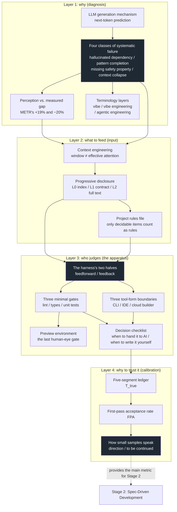

**English** | [中文](./README.zh.md)

# Vibe Coding: Putting the "Vibe" into a Harness

> **What this volume is**: the complete textbook text of **Stage 1 (4 weeks)** from the *Vibe Coding Learning Plan*, covering Chapters 01–04.
> The plan gives "what to learn, which books to read, what assignments to hand in"; this gives **how to learn it** — intuition, deduction, runnable code, gates, and reviewable exercise answers.
>
> **Volume structure**: this directory is `phase1/`, one stage per volume, self-contained (`README.md` + `chapters/` + `assets/` + `code/`), level with `phase2/`, `phase3/`, `phase4/`, `phase5/`. Chapter numbers in this volume start at ch01 and do not run continuously with other stages.
>
> **Design principles**: intuition first · First Principles decomposition · tight text–figure coupling · every conclusion carries its scope boundary · exercises must be hands-on

---

## 1. What problem this stage actually solves

In the plan, stage 1 is named "Putting the 'Vibe' into a Harness" — it sounds like a metaphor. Translate it into plain speech:

> **While you still cannot judge whether the AI wrote it correctly, first build a device that can judge for you.**

Why must this come first, instead of first learning "how to write better prompts"? Because Chapter 01 will prove one thing: **your subjective sense of speed is an accounting system that is systematically over-optimistic**, and between "this feels right" and "this really is right" lie four classes of mechanistic failure. Solve this first, or every method learned in the next four stages will be built on sand.

The mark of finishing the stage is not "finished reading"; it is four physical artifacts in your hands:

| # | Artifact | How to judge it |
|---|---|---|
| 1 | A harness repository | Someone else can pick it up and get it running: `AGENTS.md` + three gates + preview environment + decision checklist |
| 2 | A set of your own numbers | A/B records of 3 same-kind tasks × 2 groups, with the conclusion written as "direction + interval + limitations" |
| 3 | Two input snapshots | One-sentence prompt vs three-layer input for the same requirement, with a first-pass acceptance rate comparison |
| 4 | A decision checklist | 6 decidable criteria, plus one record of "changed a decision on this basis" |

---

## 2. Panoramic knowledge map: how the seven pieces of knowledge interlock

Stage 1 in the plan has 7 knowledge points. They are not a flat list but a three-layer structure with dependencies:



**How to read it**: the three black blocks are three "turning points" — ① the four failure classes (why external judgment is needed); ② the harness (where the judgment is installed); ③ how to speak from small samples (how to interpret the judgment results). All the other nodes serve them.

---

## 3. Chapter map

| Ch | Title | Knowledge points from the plan | Deliverable | Suggested week |
|---|---|---|---|---|
| 01 | **The Speed Illusion** | ① LLM mechanism and the four failure classes · ⑥ perception–measurement gap · ⑦ terminology tiers | Dependency-hallucination scanner + a write-up of "the three mechanisms in my project" | Week 1 |
| 02 | **What You Feed Matters More Than How You Phrase It** | ② context engineering · ③ progressive disclosure · ④ the feedforward half | `AGENTS.md` + three-layer input generator | Week 2 |
| 03 | **The Two Halves of the Harness** | ④ the harness's feedforward/feedback · ⑤ the three tool forms | A harness repository (three gates + preview + decision checklist) | Week 3 |
| 04 | **Calibrate with Your Own Numbers** | ⑥ gap → your own numbers | A/B records + the stage acceptance checklist | Week 4 |

The four chapters map exactly onto four weeks, but **do not march rigidly at "one chapter per week"**: Chapter 1's code runs in 30 minutes; the remaining time should go to "mapping the three mechanisms to concrete spots in your own repository". Chapter 3's repository is worth a full week out of the two.

### Each chapter's structure

A fixed six-part structure; the order is not typographic habit but cognitive order:

1. **Cognitive Anchor**: first a real scenario + an analogy (with the analogy's boundaries stated)
2. **First Principles**: unpack the mechanism; every term explained at first appearance; with figures
3. **Hands-on**: runnable code + **real run output** (not "expected output")
4. **Common pitfalls**: a right-vs-wrong comparison table, each row giving "why it is wrong"
5. **Chapter summary + local map**: five key points + its coordinates in the whole book
6. **Tiered exercises**: Tier 1 intuition / Tier 2 hands-on / Tier 3 boundaries, with answers folded inside details blocks

---

## 4. Repository structure

```text
phase1/                              # this volume = Stage 1, self-contained
├── README.md                        # this file: stage intro and knowledge map
├── chapters/
│   ├── ch01-speed-illusion.md       # the speed illusion
│   ├── ch02-context-over-prompt.md  # what you feed matters more than how you phrase it
│   ├── ch03-two-halves-of-harness.md# the two halves of the harness
│   └── ch04-calibrate-with-your-own-numbers.md
├── assets/                          # all figures (240 dpi, regenerable)
│   ├── ch01/  fig-01 perception gap · fig-02 context collapse · fig-03 accounting conventions
│   ├── ch02/  fig-01 three-layer progressive disclosure
│   ├── ch03/  fig-01 the harness's two halves · fig-02 cost of shifting gates left
│   └── ch04/  fig-01 five-segment ledger template
└── code/
    ├── make_figures.py              # redraw all figures in one command
    ├── ch01/check_deps.py           # dependency hallucination scanner (three-level verdict)
    ├── ch01/sample_ai_output.py     # a piece of AI output that "looks like it runs"
    ├── ch02/build_context.py        # three-layer input generator + token budget stats
    ├── ch02/demo_repo/              # demo repo (11 py files, runnable tests)
    ├── ch03/harness-template/       # ★ this stage's core deliverable: the harness template
    │   ├── AGENTS.md
    │   ├── pyproject.toml           # ruff / mypy / pytest config
    │   ├── .pre-commit-config.yaml
    │   ├── .github/workflows/ci.yml
    │   ├── src/csvkit/export.py
    │   ├── tests/test_export.py
    │   └── scripts/
    │       ├── preview.sh           # preview: bring up a viewable page in 3 seconds
    │       └── demo_gate_catch.sh   # demo: the gate catches a real regression
    └── ch04/
        ├── ab_log.py                # five-segment ledger summary + bootstrap interval
        └── sample_log.csv           # sample data (made up, only to demo the format)
```

---

## 5. How to cut the four weeks (at 30 hours/week)

The plan gives the time budget: 12 hours reading, 15 hours hands-on, 3 hours writing records per week. Applied to this stage:

| Week | Read (12h) | Hands-on (15h) | Write (3h) |
|---|---|---|---|
| **1** | Chapter 01 + *Vibe Coding* Part I (the head-chef/line-chef model) | Run `check_deps.py` over your own project; score 3 real tasks (the checklist's six criteria) | 300 words: where each of my project's three "slowing mechanisms" lives |
| **2** | Chapter 02 + *AI Engineering* Chapter 5 (prompt engineering) | Write `AGENTS.md`; use `build_context.py` to generate three-layer input and run one comparison | Two input snapshots + first-pass acceptance rate comparison |
| **3** | Chapter 03 + the first half of *A Philosophy of Software Design* (judgment) | Build the harness repository: three gates + preview environment; inject a regression to prove the gate rings | The raw log of one red light + an explanation |
| **4** | Chapter 04 + re-reading Chapters 01–03 | A/B of 3 same-kind tasks × 2 groups; retro-record your most recent task | A retrospective ≤ 1500 words, which must contain a set of your own numbers |

**The easiest thing to cut is week 4's "writing".** The plan already warns: a retrospective with no records equals never having learned it three months later. These three hours are not a summary; they are **turning the data into verifiable artifacts**.

---

## 6. How to read (adjust to your starting point)

| Your background | Suggested reading |
|---|---|
| **Middle / high school** | Read all four chapters, skip none. Slow down on the token mechanism in Chapter 1 §2.1; read the comments in Chapter 3's `pyproject.toml` line by line. Get the examples running first, then change your own. Go through the Appendix A self-check list first |
| **Associate / bachelor** | Read all four chapters. Chapter 1 §2.1 can be skimmed (you most likely know it); focus on 2.3 (the two accounting conventions) and 2.4 (why mature repos lose out more) |
| **Master's** | Chapter 1 knowledge points 1, 6, 7 can be read fast in calibration mode (focus on the data and conventions, not the mechanism explanations); go straight to Chapters 2 and 3 |
| **PhD** | Use Chapters 1 and 2 for "calibration": jump to each chapter's "Data and sources" at the end and check whether the conventions hold; focus on the deliverables of Chapters 3 and 4, at the highest standard (reproducible, others can follow along) |

---

## 7. Three reading conventions

1. **Every figure is labeled with its convention.** The caption will say "measured data" or "qualitative schematic". This is not a disclaimer; it is this textbook's bottom line — **a schematic must not be drawn as data**.
2. **Every code block has really been run.** Terminal snippets marked "real output" are verbatim execution results; if what you get differs, it is most likely an environment difference (Python version, package versions) — do not skip it, go find the cause of the difference.
3. **Exercise answers are folded inside details blocks.** Write your own first, then expand. The answers give not only the conclusion but also "why the wrong option is wrong" — the latter is the point.

---

## 8. Correspondence with the plan document

| Plan item | Where it lands |
|---|---|
| Knowledge point 1 (LLM mechanism and the four failure classes) | Chapter 01 §2.1–2.2 |
| Knowledge point 2 (context engineering) | Chapter 02 §2.2–2.3 |
| Knowledge point 3 (progressive disclosure) | Chapter 02 §2.4, §3.2–3.3 |
| Knowledge point 4 (the two halves of the harness) | Chapter 03 §2.1–2.3 |
| Knowledge point 5 (boundaries of the three tool forms) | Chapter 03 §2.6 |
| Knowledge point 6 (perception–measurement gap) | Chapter 01 §1.3, §2.3; all of Chapter 04 |
| Knowledge point 7 (terminology tiers and responsibility boundaries) | Chapter 01 §2.5 |
| Task 1 (personal harness) | Chapter 03 §3.1–3.5 + `code/ch03/harness-template/` |
| Task 2 (A/B comparison) | Chapter 04 §3.1–3.3 + `code/ch04/` |
| Task 3 (progressive-disclosure three-layer input) | Chapter 02 §3.2–3.4 |
| The five inspection criteria | Chapter 04 §5.3 acceptance checklist |
| Reading list | Not included in this repository (the plan has the full list and how to read it) |

---

## 9. Reproduce everything

```bash
# 重画全部配图（需要 matplotlib + 中文字体）
python3 code/make_figures.py

# 第 1 章：扫一段 AI 产出的依赖
python3 code/ch01/check_deps.py code/ch01/sample_ai_output.py --online

# 第 2 章：生成三层输入
python3 code/ch02/build_context.py code/ch02/demo_repo \
    --task "给日程导出加一个按 tag 过滤的选项" --focus src/sched/export.py

# 第 3 章：三条门禁
cd code/ch03/harness-template
ruff check . && mypy src tests && pytest -q
bash scripts/demo_gate_catch.sh    # 应该看到红灯（这是设计意图）

# 第 4 章：汇总 A/B 记录
python3 code/ch04/ab_log.py code/ch04/sample_log.csv
```
