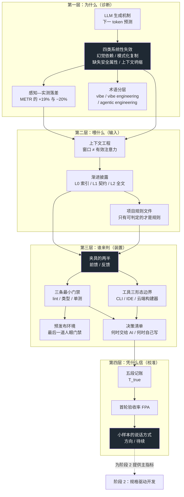

[English](./README.md) | **中文**

# 《Vibe Coding：把「氛围」装进夹具》

> **本册是什么**：《Vibe Coding 学习规划》中**阶段 1（4 周）**的完整教材正文，含第 01—04 章。
> 规划给的是"学什么、读哪本书、交什么作业"；这里给的是**怎么学会**——直觉、推演、可运行代码、门禁、可复查的练习答案。
>
> **分册结构**：本目录是 `phase1/`，一个阶段一册、自包含（`README.zh.md` + `chapters/` + `assets/` + `code/`），与 `phase2/`、`phase3/`、`phase4/`、`phase5/` 平级。本册的章号从 ch01 起，不与其它阶段连号。
>
> **设计原则**：直觉先行 · 第一性原理拆解 · 图文紧耦合 · 每个结论都带口径边界 · 练习必须能动手

---

## 1. 这个阶段到底在解决什么问题

规划里阶段 1 的名字叫"把「氛围」装进夹具"，听起来像个比喻。把它翻译成一句人话：

> **在你还无法判断 AI 写得对不对的时候，先建立一套能替你判断的装置。**

为什么必须先做这件事，而不是先学"怎么写出更好的提示词"？因为第 01 章会证明一件事：**你对速度的主观感受是一套会系统性偏乐观的会计系统**，而"感觉这次对了"和"这次真的对了"之间隔着四类机制性的失效。不先解决这件事，后面四个阶段学的所有方法都会建在沙子上。

阶段结束的标志不是"读完了"，而是你手上有四件实物：

| # | 实物 | 判断标准 |
|---|---|---|
| 1 | 一个夹具仓库 | 别人拿到能跑通：`AGENTS.md` + 三条门禁 + 预览环境 + 决策清单 |
| 2 | 一组自己的数字 | 3 个同类任务 × 2 组的 A/B 记录，结论写成"方向 + 区间 + 局限" |
| 3 | 两份输入快照 | 同一需求的一句话提示 vs 三层输入，附首轮验收率对比 |
| 4 | 一份决策清单 | 6 条可判定判据，且有一次"据此改变了决定"的记录 |

---

## 2. 全景知识图谱：七块知识怎么咬合

规划里阶段 1 有 7 个知识点。它们不是并列的清单，而是有依赖的三层结构：



**读法**：黑色三块是三个"转折点"——①四类失效（说明为什么需要外部判定）；②夹具（说明判定装在哪）；③小样本说话方式（说明判定结果该怎么解读）。其余节点都是为它们服务的。

---

## 3. 章节地图

| 章 | 标题 | 对应规划的知识点 | 交付物 | 建议周次 |
|---|---|---|---|---|
| 01 | **速度的错觉** | ① LLM 机制与四类失效 · ⑥ 感知—实测落差 · ⑦ 术语分层 | 依赖幻觉扫描器 + 一份"我项目里的三条机制" | 第 1 周 |
| 02 | **喂什么，比怎么说更上位** | ② 上下文工程 · ③ 渐进披露 · ④ 前馈的一半 | `AGENTS.md` + 三层输入生成器 | 第 2 周 |
| 03 | **夹具的两半** | ④ 夹具的前馈/反馈 · ⑤ 工具三形态 | 夹具仓库（三条门禁 + 预览 + 决策清单） | 第 3 周 |
| 04 | **用你自己的数字校准** | ⑥ 落差 → 自己的数字 | A/B 记录 + 阶段验收清单 | 第 4 周 |

四个章节正好对应四周，但**不要按"一周一章"死板推进**：第 1 章的代码 30 分钟能跑完，剩下的时间应该花在"把三条机制对应到自己仓库的具体位置"上；第 3 章的仓库值得花掉两周里的一整周。

### 每章的结构

六段固定结构，顺序不是排版习惯，是认知顺序：

1. **认知锚点**：先给一个真实场景 + 一个类比（并说明类比的边界）
2. **第一性原理**：拆机制，每个术语首次出现就解释，配图
3. **手把手**：可运行的代码 + **真实运行输出**（不是"预期输出"）
4. **常见误区**：正反例对照表，每条都给"为什么会错"
5. **本章小结 + 局部图谱**：五个要点 + 它在全书里的坐标
6. **分级练习**：Tier 1 直觉 / Tier 2 动手 / Tier 3 边界，答案折叠在 details 块里

---

## 4. 仓库结构

```text
phase1/                              # 本册 = 阶段 1，自包含
├── README.zh.md                        # 本文件：阶段导读与知识图谱
├── chapters/
│   ├── ch01-speed-illusion.zh.md       # 速度的错觉
│   ├── ch02-context-over-prompt.zh.md  # 喂什么，比怎么说更上位
│   ├── ch03-two-halves-of-harness.zh.md# 夹具的两半
│   └── ch04-calibrate-with-your-own-numbers.zh.md
├── assets/                          # 全部配图（240 dpi，可重新生成）
│   ├── ch01/  fig-01 感知落差 · fig-02 上下文坍缩 · fig-03 记账口径
│   ├── ch02/  fig-01 三层渐进披露
│   ├── ch03/  fig-01 夹具两半 · fig-02 门禁左移成本
│   └── ch04/  fig-01 五段记账模板
└── code/
    ├── make_figures.py              # 一键重画全部配图
    ├── ch01/check_deps.py           # 依赖幻觉扫描器（三层判定）
    ├── ch01/sample_ai_output.py     # 一份"看起来能跑"的 AI 产出
    ├── ch02/build_context.py        # 三层输入生成器 + token 预算统计
    ├── ch02/demo_repo/              # 演示仓库（11 个 py 文件，可跑测试）
    ├── ch03/harness-template/       # ★ 本阶段核心交付物：夹具模板
    │   ├── AGENTS.md
    │   ├── pyproject.toml           # ruff / mypy / pytest 配置
    │   ├── .pre-commit-config.yaml
    │   ├── .github/workflows/ci.yml
    │   ├── src/csvkit/export.py
    │   ├── tests/test_export.py
    │   └── scripts/
    │       ├── preview.sh           # 预发布：3 秒起一个可看页面
    │       └── demo_gate_catch.sh   # 演示门禁抓住真实回归
    └── ch04/
        ├── ab_log.py                # 五段记账汇总 + bootstrap 区间
        └── sample_log.csv           # 示例数据（编的，仅为演示格式）
```

---

## 5. 四周怎么切（按 30 小时/周）

规划给了时间口径：每周 12 小时读、15 小时动手、3 小时写记录。落到这个阶段：

| 周 | 读（12h） | 动手（15h） | 写（3h） |
|---|---|---|---|
| **1** | 第 01 章 + 《Vibe Coding》Part I（主厨/线厨模型） | 跑 `check_deps.py` 扫自己项目；给 3 个真实任务打分（决策清单六条） | 300 字：我项目里的三条"变慢机制"分别在哪 |
| **2** | 第 02 章 + 《AI Engineering》第 5 章（提示工程） | 写 `AGENTS.md`；用 `build_context.py` 生成三层输入并做一次对照 | 两份输入快照 + 首轮验收率对比 |
| **3** | 第 03 章 + 《A Philosophy of Software Design》前半（判断力） | 搭夹具仓库：三条门禁 + 预览环境；注入一次回归证明门禁会响 | 一次红灯的原始日志 + 说明 |
| **4** | 第 04 章 + 第 01—03 章回读 | 3 个同类任务 × 2 组的 A/B；补记最近一次任务 | 复盘 ≤ 1500 字，必须含一组自己的数字 |

**最容易砍掉的是第 4 周的"写"**。规划里已经警告过：没有记录的复盘，三个月后等于没学过。这一章的三小时不是总结，是**把数据落成可复查的实物**。

---

## 6. 怎么读（按你的起点调）

| 你的情况 | 建议读法 |
|---|---|
| **中学 / 高中背景** | 四章全读，一个不跳。第 1 章 2.1 节的 token 机制可以放慢；第 3 章的 `pyproject.toml` 逐行看注释。先跑通示例，再改自己的。附录 A 自测清单先过 |
| **专科 / 本科** | 四章全读。第 1 章 2.1 可快读（你大概率知道），重点放在 2.3（两种记账口径）与 2.4（为什么成熟库更吃亏） |
| **硕士** | 第 1 章知识点 1、6、7 可校准式快读（重点看数据与口径，不看机制解释）；直接进第 2、3 章 |
| **博士** | 第 1、2 章当"校准"用：跳到每章末尾的"数据与来源"，检查口径是否成立；重点做第 3、4 章的交付物，且按最高标准（可复现、别人能照着做） |

---

## 7. 三条阅读约定

1. **每张图都标了口径。** 图注里会写"实测数据"或"定性示意"。这不是免责声明，是这份教材的底线——**示意不能画成数据**。
2. **每个代码块都是真跑过的。** 标注"真实输出"的终端片段是执行结果原文；如果你跑出来不一样，多半是环境差异（Python 版本、包版本），不要跳过，去查差异原因。
3. **练习答案折叠在 details 块里。** 先自己写，再展开。答案里给的不只是结论，还有"为什么错的那个选项是错的"——后者才是重点。

---

## 8. 与规划文档的对应关系

| 规划条目 | 落在哪 |
|---|---|
| 知识点 1（LLM 机制与四类失效） | 第 01 章 2.1—2.2 |
| 知识点 2（上下文工程） | 第 02 章 2.2—2.3 |
| 知识点 3（渐进披露） | 第 02 章 2.4、3.2—3.3 |
| 知识点 4（夹具的两半） | 第 03 章 2.1—2.3 |
| 知识点 5（工具三形态边界） | 第 03 章 2.6 |
| 知识点 6（感知—实测落差） | 第 01 章 1.3、2.3；第 04 章全章 |
| 知识点 7（术语分层与责任边界） | 第 01 章 2.5 |
| 任务 1（个人夹具） | 第 03 章 3.1—3.5 + `code/ch03/harness-template/` |
| 任务 2（A/B 对照） | 第 04 章 3.1—3.3 + `code/ch04/` |
| 任务 3（渐进披露三层输入） | 第 02 章 3.2—3.4 |
| 五条检验标准 | 第 04 章 5.3 验收清单 |
| 书单 | 未包含在本仓库（规划里有完整书单与读法） |

---

## 9. 一键复现

```bash
# 重画全部配图（需要 matplotlib + 中文字体）
python3 code/make_figures.py

# 第 1 章：扫一段 AI 产出的依赖
python3 code/ch01/check_deps.py code/ch01/sample_ai_output.py --online

# 第 2 章：生成三层输入
python3 code/ch02/build_context.py code/ch02/demo_repo \
    --task "给日程导出加一个按 tag 过滤的选项" --focus src/sched/export.py

# 第 3 章：三条门禁
cd code/ch03/harness-template
ruff check . && mypy src tests && pytest -q
bash scripts/demo_gate_catch.sh    # 应该看到红灯（这是设计意图）

# 第 4 章：汇总 A/B 记录
python3 code/ch04/ab_log.py code/ch04/sample_log.csv
```
