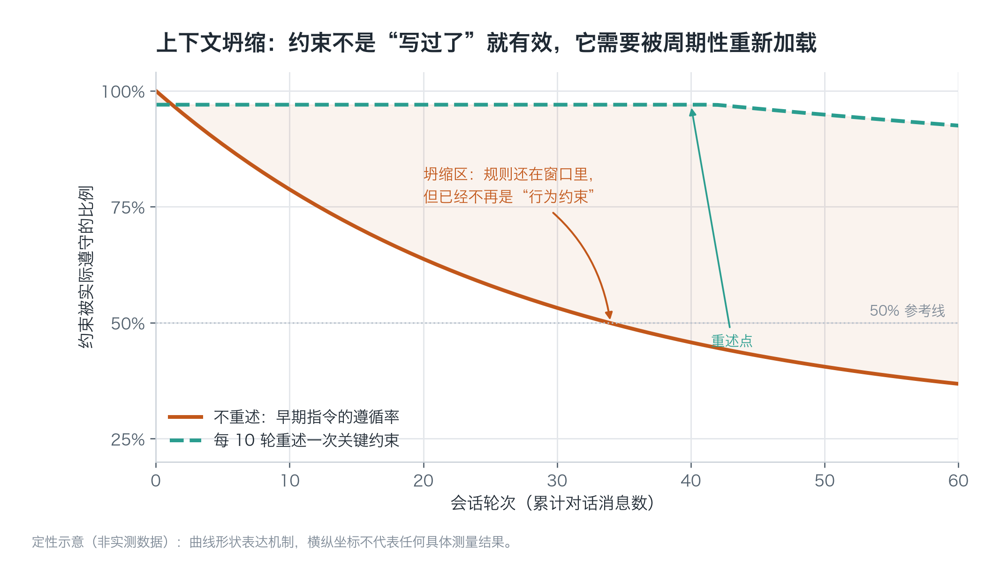
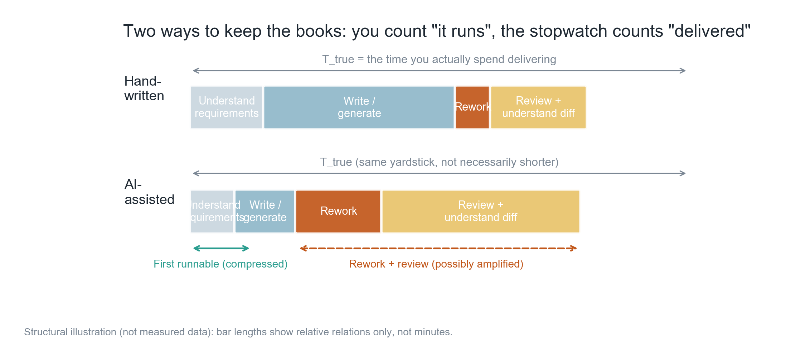
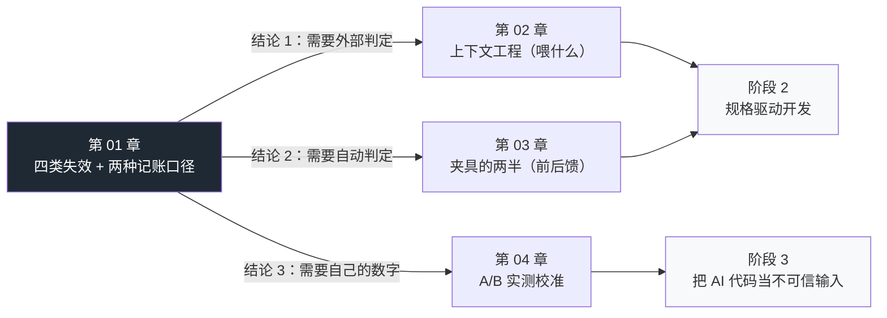

**English** | [中文](./ch01-speed-illusion.zh.md)

# Chapter 01: The Speed Illusion

> **Chapter overview**: This is the foundation of the entire stage. Fine if you don't believe "AI makes people slower" — but you must first accept one thing: **your subjective sense of speed is an unreliable accounting system**. This chapter takes that system apart, exposes its accounting loopholes, and gives four classes of failure that can be caught automatically. Its place in the whole book is "why you need a harness".
>
> **Prerequisites**: Readable with zero background. You only need to be able to write functions in one language and to have run a test command. Every term gets a plain-language explanation at first appearance.
>
> **Core learning objectives**:
> - Understand the mechanism by which LLMs generate code, and use it to explain "why the syntax can all be correct while the semantics are wrong"
> - Master the causes of the four classes of systematic failure and the first deterministic line of defense against each
> - Be able to account for your own tasks using T_true (true delivery time) instead of "it runs"
> - Be able to judge which tier a task belongs to — vibe coding / vibe engineering / agentic engineering — and what responsibility that tier demands of you

---

## 1. Cognitive Anchor: why "feels fast" and "actually slow" can both be true

### 1.1 A real scenario

It is 4pm on Friday, and you need to add an "export CSV" feature to an internal tool.

You throw the requirement to the agent: *"Add an export button that exports the current table as CSV — watch out for garbled Chinese."*

Ninety seconds later it hands back 180 lines of code: a Flask route, a serialization function, a frontend download button, plus a `try/except` and a comment line `# 处理编码问题` thrown in for good measure. You click the button, the file downloads, Excel opens it, and the Chinese looks fine.

**Your ledger books one entry right here: this feature cost 15 minutes.**

On Monday morning, an operations colleague messages you: in the exported table, notes containing commas have knocked the columns out of alignment. You go back through the code and find three new problems:

1. The note field is not escaped, so `周会, 含研发` gets taken as two columns — this knocks every downstream reconciliation script out of alignment;
2. It reads the entire table into memory in one go before writing the file; the 400,000-row production table goes straight to OOM;
3. It introduced a new package without writing it into the dependency manifest — your colleague pulls the code and the `import` fails immediately.

Fixing those three problems took you 3 hours 20 minutes. 40 minutes of that went into "confirming whether problem #2 was its fault or the database's".

**At half past eleven on Monday morning, the feature was actually delivered.** Total on the books: 3 hours 35 minutes.

This is not a "the AI is unreliable" story. What the agent did in those 15 minutes was real and effective: it compressed the typing time for 180 lines of boilerplate to nearly zero. The problem lies elsewhere — **you treated "first run works" as "delivered", and between those two things lies an entire stretch of road that nobody times.**

### 1.2 Intuitive Analogy: the "foreman illusion" in renovation

Anyone who has been through a home renovation knows this scene: the foreman finishes the walls in three days; you go take a look — the walls are straight, the brick joints are even, progress is flying. What about the plumbing and wiring? Buried inside the walls, invisible, and if something goes wrong you have to smash the walls open.

So your subjective progress bar tracks "the visible part". By the third month after moving in — the bathroom smells, the outlets trip — you finally realize the real schedule was never about laying walls.

The correspondence between code and renovation is this:

| Renovation | Writing code | Subjectively timed? |
|---|---|---|
| Wall-laying (visible) | First run works | Yes — and remembered especially clearly |
| Plumbing and wiring (invisible) | Edge cases, error handling, dependency declarations | No — unless it blows up |
| Acceptance (must be done, but nobody wants to) | Reading the diff, understanding the change | No — people skip it |

**The boundary of this analogy** (important — don't push the analogy too far): renovation is a one-time deliverable; once handed over, it is done. Code is not. Code will keep being read and changed by others (or by you three months later). So for code, "I understand it" is not optional — it is part of the deliverable, a layer that renovation does not have.

### 1.3 Look at a set of numbers first, then at your intuition

In July 2025 the research organization METR ran a randomized controlled trial: 16 senior open-source developers, 246 real tasks, all in repositories they had maintained themselves for an average of 5 years. Same people, same tasks — one group allowed to use AI, one group not.

The results are in the figure below. Note the signs of the three bars:


*Figure 1-1: To read this chart you only need one thing — the first two bars are negative (faster), the third is positive (slower). Developers predicted they would be 24% faster, rated themselves 20% faster afterwards, while the stopwatch showed 19% slower. These three numbers come from the same experiment; the only difference is "who is timing".*

> **The scope boundary of this data** (must accompany any citation): the limiting conditions are "million-line-scale mature codebases + senior developers with an average of 5 years of repository experience + early-2025 frontier tools". It cannot be extrapolated to greenfield projects, cannot be extrapolated to newcomers unfamiliar with the codebase, and does not represent the 2026 tooling level. METR itself admitted in February 2026 that the original experimental design had failed (the control group could not recruit people willing to work without AI); the new estimate is "about 18% faster", but the interval runs from −38% to +9%, and is not significant. **In other words: as for "whether AI makes people faster or slower", there is currently no credible universal answer in the research community.**

So what is this chapter about? About one thing that does not depend on that answer:

> **Whether AI makes you faster or slower, your subjective feeling is not sufficient grounds for judgment. So you need a harness — one that lets tools answer "is it correct", instead of letting feelings answer it.**

---

## 2. First Principles: which layer the errors grow from

### 2.1 What an LLM is actually doing when it writes code

First build the minimal necessary model. A code LLM does exactly one thing:

> Given all the preceding tokens (token: the smallest unit in which a model processes text), predict what the next token is most likely to be.

It is trained to "make humans find this passage plausible", not to "make this code correct". These two coincide heavily in natural language; in code they **coincide only at the syntax layer**.

This mechanism directly yields three consequences, which you will use again and again in every chapter to come:

1. **Near-perfect scores at the syntax layer.** Whether brackets close and whether indentation lines up are the highest-frequency patterns; the model gets them right with its eyes closed. In Veracode's July 2026 tests, the syntax pass rate of generated code was close to 100%.
2. **The semantics layer relies on inference.** The invariants of `Event` in your project, the fact that `COLUMNS` is an external contract, that this table has 400,000 rows — none of that is in the training corpus; it lives only in your head. The model can only fill in "the most common way it is written".
3. **It does not have your memory.** In each session it owns only the slice of the world you paste into the context window. Everything outside the window does not exist for it.

And so, in the gap between "looks right" and "runs right", the following four classes of failure grow.

### 2.2 Four classes of systematic failure: mechanism, symptom, first line of defense

These four are what this chapter most deserves to have memorized. **What they share is: none of them is an occasional bug; all are inevitable products of the mechanism** — so they will not disappear just because you "switch to a stronger model".

| Failure type | Mechanism (why it happens) | Typical symptom | First deterministic means that catches it |
|---|---|---|---|
| **① Hallucinated dependency**<br>hallucinated dependency | A package name is a decomposable token combination (`pydantic` + `_json` + `_repair`); every fragment has appeared in the corpus, so the model stitches them into a new name that "sounds exactly right" | `import`-ing a package that does not exist in the registry; calling an API that does not exist; referencing a config key that does not exist | Dependency lock + registry verification (this chapter ships a runnable tool) |
| **② Pattern completion**<br>pattern completion | In the training corpus, "tutorial-grade code" vastly outnumbers "production-grade code". Tutorials, in order to be clear, will stitch SQL into strings, swallow exceptions, and read whole tables into memory | Copy-paste-style new code; the same logic written once each in three files; share of refactors declining | Mutation testing + complexity gates + human review asking "does this look copied?" |
| **③ Absence of requirement**<br>absence of requirement | **What is "not written" will not throw an error.** No transaction boundary, no rate limiting, no row-level permissions — and the code stays all green | Everything fine in the demo; after launch: privilege escalation, abuse, data crossing | Security checklist / property-based testing / red teaming (the main body of stages 3–4) |
| **④ Context collapse**<br>context collapse | In long sessions the weight of early instructions gets diluted by later content; the window is still there, but the "constraint" has already become "background noise" | A spec stated in round 3 is not obeyed by round 30; the same error keeps coming back | Rules files + short sessions + externalizing constraints into executable checks |

The first three are "the model wrote it wrong"; the fourth is "the model forgot what you said". The countermeasures they need are completely different — which is exactly why "writing better prompts" cannot solve the core problem of this field.

Class ④ deserves a separate look, because it is the most counterintuitive: **having written a constraint down does not make it effective.**



*Figure 1-2: This is a qualitative schematic, not a measured curve — its shape expresses one mechanism: a constraint's "existence" and a constraint's "taking effect" are two different things. The solid line is the typical decay shape; the dashed line shows the effect of restating the key constraint every 10 rounds. Note the vertical axis is not "model capability"; it is "the proportion with which this constraint is actually obeyed".*

So the real approach is not "state it clearly at the beginning", but **turning constraints into things the model does not need to remember** — write them into rules files (reloaded every round), turn them into lint rules (violation means red), turn them into tests (fail means no merge). That is the entire meaning of the word "harness"; Chapter 3 expands on it.

### 2.3 Two accounting conventions: T_first and T_true

Now back to the scenario in 1.1. The same event has two durations, and you recorded only one of them.

Define three quantities (all in minutes, or in whatever unit you prefer):

- **T_first**: time from the start until "first run works". This is the number your brain records automatically.
- **T_rework**: rework time. Includes fixing bugs, filling in edge cases, and changing it until it can be merged.
- **T_review**: review and understanding time. Reading the diff, figuring out why it was written this way, turning it into "code I dare to maintain".

Then:

> **T_true = T_first + T_rework + T_review**



*Figure 1-3: Bar lengths only express relative relationships, not any measured number of minutes. What to look at is the structure: AI compresses the second segment (generation) very short while inflating the third (rework) and the fourth (review). And your memory retains only the one signal "the second segment got shorter".*

This formula explains three things, which you will use repeatedly later:

1. **Why "feels faster" and "actually slower" can both be true.** The feeling reads T_first; the stopwatch reads T_true. METR's +19% is T_true; the developers' −20% is a recollection of T_first.
2. **Why the testimony "AI made me much faster" cannot serve as evidence.** People cannot reliably recall T_rework and T_review, because those two segments are fragmented, interrupted, and emotionally unpleasant. The brain compresses them.
3. **Why "waiting" must be recorded separately.** The AI group gets an extra segment out of thin air — "waiting for it to think". You go pour a glass of water, come back and it has finished; this segment simply does not exist in your memory. The recording template in Chapter 4 keeps a dedicated slot for it.

### 2.4 Why mature codebases lose out more

There is one easily overlooked detail in METR's experiment: the subjects were **senior developers working on repositories they had maintained for 5 years**. This setup is no accident — it is exactly the scenario where AI fares worst. Three mechanisms:

**First, convention density.** In a repository that has been running for five years, "the correct way to write it" is often counterintuitive: no ORM here because of historical migration issues; manual locking required there because a deadlock was hit once. These conventions live in no document, and in no training corpus. The "standard way" the model offers is wrong here — and it is wrong very persuasively.

**Second, implicit dependencies.** Changing one function signature can affect 7 call sites, 2 scheduled jobs, and 1 frontend contract. The model sees only the few files you pasted to it. Its change looks clean, but the parts it missed will not throw an error — they will surface in some scheduled job at three in the morning.

**Third, verification cost rises with scale.** In a 20-line script you can read every line before shipping; in a 200,000-line repository you cannot. So you can only "spot-check". Spot-check coverage determines the miss rate — and AI tends to increase the volume of change, pushing spot-check coverage even lower.

> This also explains a counterintuitive phenomenon: a 2026 Harvard Business School study (78 workers, cross-disciplinary tasks) found that AI can flatten expertise gaps in the **planning stage**, but by the **execution stage**, the output of "the person furthest from the field" is 13% lower than the specialist's. Translated into this field's language: AI made "thinking through what to do" cheap, but it did not make "judging whether it was done right" cheap.

### 2.5 Terminology tiers: whichever tier you are in, that is the responsibility you carry

Karpathy coined the term "vibe coding" in February 2025; his original words were "fully give it over to vibes, embrace exponential growth, forget the code itself even exists". A year later he proposed another term to rein it in: **agentic engineering**, and described the relationship between the two in one sentence — "vibe coding raises the floor; agentic engineering extrapolates the ceiling".

There is a layer in between, **vibe engineering**, proposed by Simon Willison in October 2025: senior engineers use LLMs to accelerate while taking responsibility for the output. The core judgment is one sentence — "AI tools amplify existing expertise".

These three tiers are not "levels of skill"; they have **different responsibility boundaries**. Pick the wrong tier and you get accidents like "running a production system with a vibe coding mindset".

| Tier | What you do | Who is responsible for correctness | Fits | Explicitly does not fit |
|---|---|---|---|---|
| **vibe coding** | Describe intent, accept the output, don't read line by line | Nobody (throwaway) | One-off scripts, data exploration, prototype validation, toy projects while learning | Anything others will depend on |
| **vibe engineering** | Use AI to accelerate, but review line by line and take responsibility for the result | You | Production code, internal tools, projects that will live past three months | Fields you are not familiar with (it amplifies YOUR expertise, not someone else's) |
| **agentic engineering** | Orchestrate agents, act as supervisor; 99% of the time you do not write code directly | You + the harness you designed | Mid-to-large projects with a full set of gates and specs | Projects without a harness (= handing the steering wheel to someone without a license) |

**The column of this table most worth remembering is the third.** "I write code with AI" carries no information, because it does not say "if it is wrong, who pays". This textbook's position is explicit: in stages 1–2 you may run experiments with a vibe coding mindset, but as soon as code is going to production, responsibility must land on a human — and the concrete form of "landing on a human" is exactly that harness in Chapter 3.

---

## 3. Hands-on: turning failure class one into a single command

### 3.1 Case setup

The code below is a typical AI output for the "export CSV" feature (full file at `code/ch01/sample_ai_output.py`):

```python
class ExportRequest(BaseModel):
    table: str
    limit: int = 1000


def export_table(req: ExportRequest) -> ExportResult:
    conn = os.environ["DB_URL"]
    df = pd.read_sql(f"SELECT * FROM {req.table} LIMIT {req.limit}", conn)

    broken = repair(json.dumps(df.to_dict()))
    rows = json.loads(broken)

    out = f"/tmp/{req.table}.csv"
    with open(out, "w", newline="") as fh:
        writer = csv.writer(fh)
        writer.writerows([r.values() for r in rows])

    return ExportResult(path=out, rows=len(rows))
```

Read it once, mark the lines you find suspicious, then read on. It hides all four classes of failure at once:

| Line | Problem | Which class |
|---|---|---|
| `from pydantic_json_repair import repair` | This package does not exist | ① Hallucinated dependency |
| `f"SELECT * FROM {req.table} ..."` | Table name spliced straight into SQL — injection surface | ② Pattern completion (tutorial style) |
| `os.environ["DB_URL"]` | Not validated at startup — it only blows up at runtime; also reads config covertly from environment variables | ③ Absence of requirement |
| `r.values()` | dict order is not guaranteed; columns get misaligned | ② Pattern completion |
| `repair(...)` / `CsvResponse(...)` | Calls APIs that do not exist at all | ① Hallucinated dependency |

Now we handle only class ①, because it is the only one that can be "decided with a single command".

### 3.2 The dependency-hallucination scanner

The tool is small (full code at `code/ch01/check_deps.py`); its core logic is a three-layer determination:

```python
def local_status(module: str) -> str:
    if module in STDLIB:                          # 1. 标准库？
        return "stdlib"
    if importlib.util.find_spec(module) is not None:   # 2. 装了吗？
        return "installed"
    return "missing"


def index_status(module: str) -> str:
    """3. 注册表里有吗？absent 才是幻觉包名的强证据。"""
    url = f"https://pypi.org/pypi/{module.replace('_', '-')}/json"
    try:
        with urllib.request.urlopen(url, timeout=6.0) as resp:
            return "exists" if resp.status == 200 else "unknown"
    except urllib.error.HTTPError as exc:
        return "absent" if exc.code == 404 else "unknown"
    except Exception:
        return "unknown"
```

Why three layers instead of just querying the registry? Because **three results correspond to three completely different dispositions**:

- `absent` (404) → this code is a hallucination artifact; delete or replace it; do NOT try to `pip install`;
- `exists` but not present locally → the dependency is not installed; an environment problem, not a hallucination;
- `unknown` (network failure) → **nothing can be asserted**. This is the scope error tools of this kind make most easily: turning "I could not find out" into "it does not exist".

Run it:

```bash
$ python code/ch01/check_deps.py code/ch01/sample_ai_output.py --online

扫描目标：code/ch01/sample_ai_output.py
顶层模块：9 个

模块                    判定             首次出现               备注
------------------------------------------------------------------
__future__            标准库            sample_ai_output.py:10
csv                   标准库            sample_ai_output.py:12
dataclasses           标准库            sample_ai_output.py:15
flask_csv_plus        ★ 注册表不存在       sample_ai_output.py:19
json                  标准库            sample_ai_output.py:13
os                    标准库            sample_ai_output.py:14
pandas                已安装            sample_ai_output.py:20
pydantic              存在但未安装         sample_ai_output.py:17 （先 pip install 再判断）
pydantic_json_repair  ★ 注册表不存在       sample_ai_output.py:18

结论：2 个模块无法解析 → 这段代码在干净环境里必然 import 失败。
  · flask_csv_plus（sample_ai_output.py:19）
  · pydantic_json_repair（sample_ai_output.py:18）
```

(The above is real run output. Note the `pydantic` row: it is "exists but not installed", which is a different thing from "does not exist" — conflate the two and your scanner will start lying to you.)

**The boundaries of this tool are things you must know**:

- It only checks the **top-level module name** in `import` statements; it cannot detect "the package exists but this function/class does not" (for example `repair` might come from a nonexistent submodule of a real package);
- It does not check version compatibility;
- It does not check modules internal to your project (relative imports are skipped).

So it is the **first** gate, not the only one. And the "package exists but the API does not" class is precisely the next gate's job: type checking and tests (Chapter 3). This is why gates must be layered — **no single point can cover everything**.

### 3.3 The other three classes: minimal actions you can take right now

| Failure | Minimal action (do it today) | Full solution |
|---|---|---|
| ② Pattern completion | After AI finishes changing code, run `git diff --stat` once and look at "lines added vs lines modified". Additions with no deletions often mean it wrote another copy alongside | Chapter 3: mutation testing + complexity gates |
| ③ Absence of requirement | For any "it runs" output, ask three questions: **Who can access it without logging in? What happens when it fails? What is its input limit?** If you cannot answer all three, it is not finished | Chapters 3–4: security checklist and threat modeling |
| ④ Context collapse | Move the project's hard constraints out of the conversation into `AGENTS.md` (Chapter 2), and start a new session after each subtask completes | Chapter 2: three-layer input + rules files |

---

## 4. Common pitfalls and right-vs-wrong examples

| Easy pitfall | Why it is wrong | Correct mental model |
|---|---|---|
| **"It runs, so it is correct"** | "Running" only proves the happy path holds on **the inputs you tried**. Of the four failure classes, three are completely invisible on the happy path | Downgrade "it runs" to "necessary condition"; the delivery criterion becomes "all gates green + I know where it could be wrong" |
| **"I know my project better than METR's sample, so that conclusion does not apply to me"** | The first half may well be true (you do know your project better), but the second half is a logical leap: you have no data about yourself | Admit the sample cannot be extrapolated, while also admitting **you have no data of your own either**. Chapter 4 solves this |
| **"Just switch to a stronger model"** | Of the four classes, the first three are products of the mechanism and the fourth is related to window management; none of them disappears linearly with model capability. Veracode's 2026 data shows code-specialized models (51%) are not safer than general models (52%) | Treat "switch models" as an optimization item; treat "add gates" as a required item |
| **"I cannot read the AI-written code, but it runs — ship it first"** | This is the definition of cognitive debt: code speed outpaces understanding speed. Its interest gets paid three months later in the form of "nobody dares touch this module" | If you cannot read it, do not merge it — or slice it small enough to read. This is the first criterion of Chapter 3's "when to write it yourself" |
| **"Writing the prompt in more detail will solve it"** | Prompt optimization works on "the wording of the instruction", while what you usually lack is "what it can see" (context) and "who can determine it is wrong" (gates) | Wording is third priority. First priority is context (Chapter 2), second is the harness (Chapter 3) |

---

## 5. Chapter summary and local knowledge map

### 5.1 Five key points

- **The accounting convention determines the conclusion.** T_first is feeling; T_true is fact. Under AI assistance the two diverge systematically, and your memory retains only the former.
- **The four failure classes are products of the mechanism, not occasional bugs**: hallucinated dependency, pattern completion, absence of requirement, context collapse. The first three are "written wrong"; the fourth is "forgotten".
- **"Perfect syntax" is the least informative signal.** Syntax pass rate close to 100%, security pass rate 56% (the failure rate under raw-model, no-review conditions — not the same as the production failure rate).
- **Mature codebases are AI's weak scenario**, for three reasons — convention density, implicit dependencies, verification cost — not because "the model is dumb".
- **Terminology tiers ARE responsibility tiers.** Saying "I write code with AI" carries no information; you must say "if it is wrong, who is responsible, and by what criteria".

### 5.2 This chapter's place in the book



---

## 6. Tiered exercises

### Tier 1 · Intuition and concept check

1. A colleague says: "Writing this feature with AI took me only 20 minutes — twice as fast as writing it by hand." List the **three questions** you need to ask in order to judge whether that statement holds.
2. Which failure class does each of the following four situations belong to? ① The code calls `stripe.Webhook.verify_signature()`, while in the current SDK version that method is called `construct_event()`; ② An "export" endpoint does no pagination and returns all the data at once; ③ In round 12 of the conversation, the model starts using `var` instead of the project-mandated `const`; ④ Three files each contain an almost identical date-formatting function.
3. Why does "syntax pass rate close to 100%" actually make review harder rather than easier?

### Tier 2 · Deduction and hands-on

4. Use `code/ch01/check_deps.py` to scan the most recent AI-generated code in your own project (`--online`). Organize the results into the three classes `absent / exists-未安装 / installed`, and answer: which class requires changing the code, and which only requires changing the environment?
5. Retroactively record T_true for a task you recently finished: split the time into the three segments `T_first / T_rework / T_review`. If you cannot recall the last two segments, what does that tell you?

### Tier 3 · Boundaries and transfer

6. Suppose your repository has 400,000 lines and 200 modules, with a team of 6. Write a set of no more than 5 decision rules for choosing between "hand this task to the agent" and "faster to write it myself", and state under what conditions each rule fails.
7. METR's conclusion is "+19% (slower)"; the 2026 update is "about 18% faster but not significant". Write out respectively: under what conditions you would cite the former, under what conditions you would cite the latter, and under what conditions you would cite **neither**.

<details>
<summary><strong>Click to expand: reference answers and in-depth analysis for this chapter's exercises</strong></summary>

#### 1. The three questions to ask

- **Convention**: is "20 minutes" T_first or T_true? Does it include the time spent fixing bugs, filling edge cases, reading the diff? If not, have them recompute per `T_first + T_rework + T_review`.
- **Comparability**: which "by hand" run does "twice as fast" compare against? A by-hand baseline from the same requirement, the same codebase, the same person — or estimated from impression? Impression-based baselines usually skew high (people tend to overestimate the tedium of their own hand-writing).
- **Extrapolation range**: can this one conclusion carry over to the next task? Different task types (new feature / refactor / bug fix) can flip the direction of the benefit — bug fixes are often dominated by "reading code", where AI cannot help and may mislead.

Addendum: if the person says "even afterwards I felt I was 20% faster", that is exactly the bias reproduced in the METR experiment — it is not independent evidence.

#### 2. Class attribution

1. **① Hallucinated dependency** (a subclass of API hallucination): the package exists, the method does not. This class **the dependency scanner cannot catch**; it needs type checking or tests — `mypy` will report `has no attribute` from `stripe`'s type stubs.
2. **③ Absence of requirement**: no pagination is "not written", not "written wrong". No test will fail because "pagination was not written" — unless you write a test saying "must paginate at 100,000 rows".
3. **④ Context collapse**: the rule is in the window, but the constraint has failed. Note the distinction: if it **never used** `const` at all, that is "never read the rule"; if it used it for the first 11 rounds and stopped at round 12, that is collapse.
4. **② Pattern completion**: three identical implementations. `git diff --stat` will not reveal it; you need duplication analysis or human eyes.

#### 3. Why perfect syntax makes review harder

Because **the reviewer's first filter fails.** The default strategy when a human reads code is "scan for syntax and obvious errors first, then enter semantics" — a syntax error gives you a strong signal: "stop and look here". When syntax is 100% correct, all the code "looks right"; your attention can no longer be automatically guided to the suspicious spots, and you must rely on active semantic reasoning, which costs far more.

Worse still: AI-generated code is **stylistically consistent.** In human-written code, sudden style shifts (say, a suddenly messy-indented block) often betray "this was copied/modified". AI output is uniformly styled, so that signal disappears too.

Conclusion: the higher the syntax pass rate, the more **gates should move toward the semantics layer** (types, tests, invariants), because the syntax layer no longer provides information.

#### 4. Dispositions for the three result classes

- `absent` → **the code must change.** This is not an environment problem; the code contains a dependency that does not exist. Note: do not "casually `pip install` a same-named package" — that is exactly the attack surface of slopsquatting (squatting on hallucinated package names).
- `exists` but not installed → **only the environment needs changing** (declare it in the dependency manifest and install it). But if it is also "not declared in requirements", that is still a code problem: the dependency declaration is missing and others will fail when they pull it down.
- `installed` → no action needed, but **it does not mean safe.** Installed only says it can be imported, not that the usage is correct (back to case ① of question 2).

#### 5. Retroactive T_true and "cannot recall"

The very fact that you cannot break it down is itself the conclusion: `T_rework` and `T_review` are **fragmented and interrupted** in your workflow, and therefore cannot be recalled after the fact. This is not a memory problem; it is a recording-method problem.

The right way is to **record on the spot**: press the stopwatch when the task starts, cut a segment when rework begins. Chapter 4's `ab_log.py` is designed for exactly this. If you cannot reconstruct it now, start recording from the next task — do not try to "fill it in from memory"; that only produces fabricated numbers.

#### 6. Example decision rules (adapt and use directly)

| Rule | Criterion | Failure condition |
|---|---|---|
| Delegate only when deterministic verification exists | The change can be decided by at least one of lint / types / tests | When interaction, visuals, or external system behavior is involved, the "verification means" itself is unreliable |
| Split if it spans more than 3 files | The change touches ≤ 3 files, and you can read the diff within 10 minutes | Mechanical renames / batch replacements (50 files but a single rule) are actually AI's strong suit |
| Hand-write the skeleton first in unfamiliar territory | Whether you can write a minimal runnable version in 20 minutes | Under extreme time pressure (then downgrade to "ship first, fill in later", and record the technical debt explicitly) |
| Irreversible operations require human-in-the-loop | Involves data deletion, migration, payments, permission changes | None (this rule should have no exceptions) |
| If you cannot judge, look at churn | How many times this module changed in the past 30 days | New modules have no history |

The value of this rule set is not "correctness" but **decidability**: each one can be answered yes/no within 30 seconds. Undecidable rules (like "if it feels complex, don't use it") are equivalent to having no rules.

#### 7. When to cite which number

- **Cite +19% (slower)**: when discussing the specific scenario "mature codebases, senior developers, early tools"; to refute the absolute claim "AI definitely makes people faster"; as motivation for "you must run your own measurements".
- **Cite "about 18% faster, but not significant"**: when discussing "the 2026 tooling level"; when emphasizing the methodological point "the evidence is very weak". Note you must carry the interval (−38% to +9%, on the "speedup" convention) and "the author himself does not recommend treating it as a current-productivity conclusion".
- **Cite neither**: when making decisions for your own project. Because neither satisfies the three conditions "comparable to your codebase, your task type, your tool versions". The only legitimate action then is: run that experiment from Chapter 4 with your own numbers.

This is also a basic principle of this textbook: **external research is there to calibrate your skepticism, not to replace your measurements.**

</details>

---

### Data and sources for this chapter

| Number | Content | Source and date | Convention |
|---|---|---|---|
| −24% / −20% / +19% | Predicted / self-rated / measured completion-time change | METR randomized controlled trial, 2025-07-10 (16 senior developers, 246 tasks) | Mature codebases + early-2025 tools |
| About 18% faster (interval −38%—+9%, speedup convention) | 2026 updated estimate | METR, 2026-02-24 | Author self-assessed "very weak evidence"; not recommended as a current conclusion |
| Syntax ≈100% / security 56% | Pass rates of generated code | Veracode 2026 GenAI code security report, 2026-07-28 | Raw model, no security prompts, no agent, no human review → **not the same as the production failure rate** |
| 51% vs 52% | Security pass rate: code-specialized vs general models | Same as above | Same as above |
| 19.7% | Proportion of LLM-recommended package names that do not exist in the registry | USENIX Security 2025 paper (cited here via secondary summary) | Open-source models 21.7%, commercial models 5.2% |
| 13% | Output gap of "the person furthest from the domain" in the execution stage | Harvard Business School study, cited via O'Reilly Radar, 2026 | 78 workers, cross-disciplinary tasks |
| Etymology and word of the year | Coinage and dictionary inclusion of "vibe coding" | Karpathy 2025-02; Collins word of the year 2025-11-06 | — |
| Three-tier terms | vibe coding / vibe engineering / agentic engineering | Karpathy 2025-02 and 2026; Simon Willison 2025-10-07 | The Chinese wording of agentic engineering is secondhand |

---

## 7. Authoritative References and Further Reading

1. **METR**: [METR](https://metr.org/) - the definitions and norms of this chapter are anchored here (verification date: `2026-10-23`).
2. **DORA**: [DORA](https://dora.dev/) - the definitions and norms of this chapter are anchored here (verification date: `2026-10-23`).
3. **Anthropic Prompt Engineering**: [Anthropic Prompt Engineering](https://docs.anthropic.com/en/docs/build-with-claude/prompt-engineering/overview) - the definitions and norms of this chapter are anchored here (verification date: `2026-10-23`).

> Scope note: the sources above anchor **definitions and norms**, not extrapolated risk probabilities. Before citing any number, first verify the source's year and its denominator.
