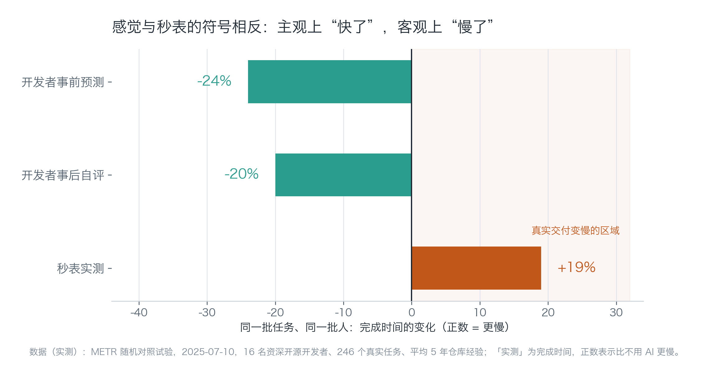
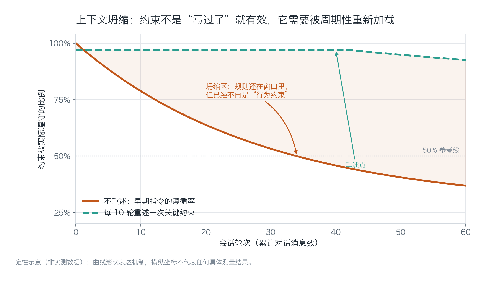
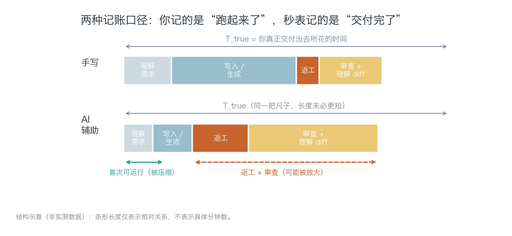
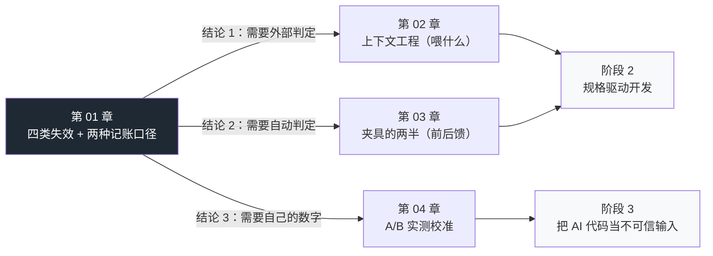

# 第 01 章：速度的错觉

> **本章导读**：这是整个阶段的地基。你不相信"AI 让人变慢"这句话没关系——但你必须先接受一件事：**你对速度的主观感受，是一套不可靠的会计系统**。本章拆开这套系统的记账漏洞，并给出四类可被自动抓住的失效模式。它在全书的位置是「为什么需要夹具」。
>
> **前置知识**：零基础可读。只需要你会用一门语言写函数、跑过测试命令。所有术语在首次出现时给白话解释。
>
> **核心学习目标**：
> - 理解 LLM 生成代码的机制，并能用它解释"为什么语法全对、语义会错"
> - 掌握四类系统性失效的成因与各自的第一道确定性防线
> - 能够用 T_true（真实交付时间）而不是"跑起来了"来给自己的任务记账
> - 能够判断一个任务属于 vibe coding / vibe engineering / agentic engineering 中的哪一档，以及这一档要求你承担什么责任

---

## 1. 认知锚点：为什么"感觉很快"和"其实很慢"能同时成立

### 1.1 一个真实的场景

周五下午四点，你要给内部工具加一个"导出 CSV"的功能。

你把需求丢给智能体：*"加一个导出按钮，把当前表格导成 CSV，注意中文不要乱码。"*

九十秒后它给出了 180 行代码：一个 Flask 路由、一个序列化函数、一个前端下载按钮，还顺手加了 `try/except` 和一行注释 `# 处理编码问题`。你点了一下按钮，文件下载下来了，Excel 打开，中文正常。

**你的记账本在这里记下了一笔：这个功能花了 15 分钟。**

周一早上，运营同事发来消息：导出的表里，带逗号的备注把列冲错了位。你回去看代码，发现三个新问题：

1. 备注字段没有转义，`周会, 含研发` 被当成两列 —— 这会让下游的对账脚本全部错位；
2. 它把整张表一次性读进内存再写文件，线上那张 40 万行的表直接 OOM；
3. 它新引入了一个包，但没写进依赖清单——你的同事拉下代码后 `import` 就失败。

修完这三个问题，你花了 3 小时 20 分。其中 40 分钟用在"确认第 2 个问题到底是它的问题还是数据库的问题"。

**周一上午十一点半，这个功能才真正交付。** 总账：3 小时 35 分。

这不是一个"AI 不靠谱"的故事。智能体在这 15 分钟里做的事情是真实的、有效的：它把 180 行样板代码的键入时间压到了接近零。问题出在另一件事上——**你把"首次可运行"当成了"交付"，而这两件事之间隔着一整段没人计时的路。**

### 1.2 直觉类比：装修里的"包工头错觉"

装修过的人都熟悉这个场景：包工头三天就把墙砌完了，你去看，墙是直的，砖缝是齐的，进度飞快。水电呢？埋在墙里，看不见，出了问题要砸墙。

于是你的主观进度条跟着"看得见的部分"走。等到入住第三个月，卫生间返味、插座跳闸，你才发现真正的工期从来不是砌墙。

代码和装修的对应关系是这样的：

| 装修 | 写代码 | 是否被主观计时 |
|---|---|---|
| 砌墙（看得见） | 首次能跑起来 | 会，而且记得特别清楚 |
| 水电（看不见） | 边界条件、错误处理、依赖声明 | 不会，除非它炸了 |
| 验收（要做但不想做） | 读 diff、理解改动 | 不会，人会跳过 |

**这个类比的边界**（很重要，别把类比用过头）：装修是一次性交付物，交付完就结束了；代码不是。代码要被别人（或三个月后的你）继续读、继续改。所以对代码来说，"我理解了它"不是可选项，而是交付物的一部分——这是装修没有的一层。

### 1.3 先看一组数字，再看你的直觉

2025 年 7 月，研究机构 METR 做了一个随机对照试验：16 名资深开源开发者，246 个真实任务，都是他们自己维护了平均 5 年的仓库。同一批人、同一批任务，一组允许用 AI，一组不允许。

结果在下面这张图里。请注意三根柱子的符号：



*图 1-1：读图只需看一件事——前两根柱子是负的（变快），第三根是正的（变慢）。开发者事前预测自己能快 24%，事后自评快 20%，而秒表显示慢了 19%。这三个数字来自同一个实验，差别只在"谁在计时"。*

> **这份数据的口径边界**（引用前必须带上）：限定条件是"百万行级成熟代码库 + 平均 5 年仓库经验的资深开发者 + 2025 年初的前沿工具"。它不能推广到绿地项目、不能推广到不熟悉代码库的新人、也不代表 2026 年的工具水平。METR 自己在 2026 年 2 月承认原实验设计已经失效（对照组招不到愿意不用 AI 的人），新估值为"快约 18%"，但区间是 −38% 到 +9%，不显著。**换句话说：关于"AI 到底让人快还是慢"，学界目前没有可信的普适答案。**

那这一章要讲什么？讲一件不依赖那个答案的事：

> **不管 AI 让你快还是慢，你的主观感受都不足以作为判断依据。所以你需要一套夹具，让"对不对"由工具回答，而不是由感觉回答。**

---

## 2. 第一性原理：错是从哪一层长出来的

### 2.1 LLM 在写代码时到底在做什么

先把最小必要模型建立起来。一个代码大模型做的事情只有一件：

> 给定前面的所有 token（词元，模型处理文本的最小单位），预测下一个 token 最可能是什么。

它被训练成"让人类觉得这段话合理"，而不是"让这段代码正确"。这两件事在自然语言里高度重合，在代码里**只在语法层重合**。

这个机制直接推出三个后果，你会在后面每一章反复用到：

1. **语法层近乎满分**。括号闭不闭合、缩进对不对，是最高频的模式，模型闭着眼也能做对。2026 年 7 月 Veracode 的测试里，生成代码的语法通过率接近 100%。
2. **语义层靠推断**。你项目里 `Event` 的不变量、`COLUMNS` 是对外契约、这张表有 40 万行——这些信息不在训练语料里，只在你脑子里。模型只能按"最常见的写法"填。
3. **它没有你的记忆**。每次会话它只拥有你贴进上下文窗口的那部分世界。窗口之外的一切，对它不存在。

于是"看起来对"和"跑得对"之间的缝隙，就长出了下面四类失效。

### 2.2 四类系统性失效：机制、症状、第一道防线

这四类是本章最该背下来的东西。**它们的共同点是：都不是偶发 bug，而是机制必然产物**——所以它们不会因为"换个更强的模型"就消失。

| 失效类型 | 机制（为什么会发生） | 典型症状 | 第一道能抓住它的确定性手段 |
|---|---|---|---|
| **① 幻觉依赖**<br>hallucinated dependency | 包名是可拆解的 token 组合（`pydantic` + `_json` + `_repair`），语料里每个碎片都出现过，模型就把它们拼成一个"听起来非常对"的新名字 | `import` 一个注册表里不存在的包；调用一个不存在的 API；引用一个不存在的配置项 | 依赖锁 + 注册表核验（本章有可运行的工具） |
| **② 模式化复制**<br>pattern completion | 训练语料里"教程级代码"远多于"生产级代码"。教程为了讲清楚，会把 SQL 拼成字符串、把异常吞掉、把整表读进内存 | 复制粘贴式的新代码；同一段逻辑在三个文件里各写一遍；重构占比下降 | 变异测试 + 复杂度门禁 + 人工评审"这段像不像抄来的" |
| **③ 缺失安全属性**<br>absence of requirement | **"没写"的东西不会报错**。没有事务边界、没有限流、没有行级权限，代码照样全绿 | 演示时一切正常，上线后越权、被刷、数据串号 | 安全清单 / 属性测试 / 红队（阶段 3—4 的主体） |
| **④ 上下文坍缩**<br>context collapse | 长会话里早期指令的权重被后续内容稀释；窗口还在，但"约束"已经变成"背景噪音" | 第 3 轮说过的规范第 30 轮就不遵守了；同一个错误反复修不好 | 规则文件 + 短会话 + 把约束外置成可执行检查 |

前三类是"模型写错了"，第四类是"模型忘了你说过什么"。它们需要的对策完全不同——这就是为什么"写好提示词"解决不了这个领域的核心问题。

第 ④ 类值得单独看一眼，因为它最反直觉：**约束写过了，不等于有效**。



*图 1-2：这是定性示意图，不是实测曲线——它的形状表达一个机制：约束的"存在"和约束的"生效"是两件事。实线是典型的衰减形态，虚线是把关键约束每 10 轮重述一次的效果。注意纵轴不是"模型能力"，是"这条约束被实际遵守的比例"。*

所以真正的做法不是"在开头把话说清楚"，而是**把约束变成不需要模型记住的东西**——写进规则文件（每轮都重新加载）、变成 lint 规则（违反就红）、变成测试（不通过就合不进去）。这就是"夹具"这个词的全部含义，第 3 章展开。

### 2.3 两种记账口径：T_first 与 T_true

现在回到 1.1 那个场景。同一件事有两个时间，而你只记了其中一个。

定义三个量（都用分钟，或用你喜欢的单位）：

- **T_first**：从开始到"首次可运行"的时间。这是你大脑自动记录的那个数。
- **T_rework**：返工时间。包括修 bug、补边界、改到能合并。
- **T_review**：审查与理解时间。读 diff、搞明白它为什么这么写、把它变成"我敢维护的代码"。

于是：

> **T_true = T_first + T_rework + T_review**



*图 1-3：条形长度只表示相对关系，不是任何实测分钟数。要看的是结构：AI 把第二段（生成）压得很短，同时把第三段（返工）和第四段（审查）撑大。而你的记忆只保留了"第二段变短了"这一个信号。*

这个公式解释了三件事，你后面会反复用到：

1. **为什么"感觉快了"和"实际慢了"能同时为真**。感觉读的是 T_first，秒表读的是 T_true。METR 的 +19% 是 T_true，开发者的 −20% 是 T_first 的回忆。
2. **为什么"AI 让我快了很多"的证词不能作为证据**。人无法可靠地回忆 T_rework 与 T_review，因为这两段是碎片化的、被打断的、情绪上不愉快的。大脑会把它们压缩。
3. **为什么"等待"必须单独记**。AI 组会凭空多出一个"等它想"的段——你去倒了杯水，回来它写完了，这段在你的记忆里根本不存在。第 4 章的记录模板专门给它留了一格。

### 2.4 为什么成熟代码库更吃亏

METR 的实验有一个容易被忽略的细节：实验对象是**资深开发者在自己维护了 5 年的仓库上**。这个设定不是偶然，它恰好是 AI 最吃亏的场景。三条机制：

**第一，约定密度。** 一个跑了五年的仓库里，"正确写法"往往是反直觉的：这里不用 ORM 是因为历史迁移问题，那里必须手动加锁是因为踩过一次死锁。这些约定不在任何文档里，也不在训练语料里。模型给出的"标准写法"在这里是错的——而它错得很有说服力。

**第二，隐式依赖。** 改一个函数签名，可能影响 7 个调用点、2 个定时任务、1 个前端契约。模型只看得见你贴给它的那几个文件。它改得很干净，但漏掉的部分不会报错，只会在某个凌晨的定时任务里报错。

**第三，验证成本随规模上升。** 在一个 20 行的脚本里，你可以逐行读完再上线；在 20 万行的仓库里，读不完。于是你只能"抽查"。抽查的覆盖率决定了漏检率——而 AI 恰恰会提高改动量，把抽查覆盖率进一步压低。

> 这也解释了一个反直觉的现象：Harvard Business School 2026 年的一项研究（78 名工作者、跨专业任务）发现，AI 在**规划阶段**能抹平专业差距，但到了**执行阶段**，"离该领域最远的人"的产出比专业者低 13%。翻译成这个领域的语言：AI 让"想清楚要做什么"变便宜了，但并没有让"判断做得对不对"变便宜。

### 2.5 术语分层：你在哪一档，就要承担什么

Karpathy 2025 年 2 月造了 "vibe coding" 这个词，原话是"完全交给感觉，拥抱指数增长，忘掉代码本身的存在"。一年后他自己又提了一个词来收敛它：**agentic engineering**，并把两者的关系说成一句话——"vibe coding 抬高下限，agentic engineering 外推上限"。

中间还有一层，是 Simon Willison 2025 年 10 月提的 **vibe engineering**：资深工程师用 LLM 加速，同时为产出负责。核心判断只有一句——"AI 工具放大的是你已有的专业能力"（AI tools amplify existing expertise）。

这三档不是"水平高低"，而是**责任边界不同**。选错档位，就会出现"用 vibe coding 的心态做生产系统"这种事故。

| 档位 | 你做什么 | 谁负责正确性 | 适用场景 | 明确不适用 |
|---|---|---|---|---|
| **vibe coding** | 描述意图，接受产出，不逐行读 | 没人（用完即弃） | 一次性脚本、数据探索、原型验证、学习时的玩具项目 | 任何会被别人依赖的东西 |
| **vibe engineering** | 用 AI 加速，但逐行审、为结果负责 | 你 | 生产代码、内部工具、会活过三个月的项目 | 你不熟悉的领域（放大的是你的专业，不是别人的） |
| **agentic engineering** | 编排智能体、当监督者，99% 时间不直接写代码 | 你 + 你设计的夹具 | 有成套门禁与规格的中大型项目 | 没有夹具的项目（等于把方向盘交给没驾照的人） |

**这张表最该记住的是第三列。** "我用 AI 写代码"这句话没有信息量，因为它没说"如果它错了，谁赔"。本教材的立场很明确：阶段 1—2 你可以用 vibe coding 的心态做实验，但只要代码要上线，责任必须落到人头上——而"落到人头上"的具体形态，就是第 3 章那套夹具。

---

## 3. 手把手：把第一类失效变成一条命令

### 3.1 案例设定

下面这份代码是"导出 CSV"功能的典型 AI 产出（完整文件见 `code/ch01/sample_ai_output.py`）：

```python
class ExportRequest(BaseModel):
    table: str
    limit: int = 1000


def export_table(req: ExportRequest) -> ExportResult:
    conn = os.environ["DB_URL"]
    df = pd.read_sql(f"SELECT * FROM {req.table} LIMIT {req.limit}", conn)

    broken = repair(json.dumps(df.to_dict()))
    rows = json.loads(broken)

    out = f"/tmp/{req.table}.csv"
    with open(out, "w", newline="") as fh:
        writer = csv.writer(fh)
        writer.writerows([r.values() for r in rows])

    return ExportResult(path=out, rows=len(rows))
```

读一遍，标出你觉得可疑的行，然后往下看。它里面同时藏着四类失效：

| 行 | 问题 | 属于哪一类 |
|---|---|---|
| `from pydantic_json_repair import repair` | 这个包不存在 | ① 幻觉依赖 |
| `f"SELECT * FROM {req.table} ..."` | 表名直接拼进 SQL，注入面 | ② 模式化复制（教程写法） |
| `os.environ["DB_URL"]` | 启动期不校验，运行时才炸；且配置从环境变量偷偷读 | ③ 缺失安全属性 |
| `r.values()` | dict 顺序不保证，列会错位 | ② 模式化复制 |
| `repair(...)` / `CsvResponse(...)` | 调用完全不存在的 API | ① 幻觉依赖 |

现在只处理第 ① 类，因为它是唯一能"一条命令判定"的。

### 3.2 依赖幻觉扫描器

工具很小（完整代码 `code/ch01/check_deps.py`），核心逻辑三层判定：

```python
def local_status(module: str) -> str:
    if module in STDLIB:                          # 1. 标准库？
        return "stdlib"
    if importlib.util.find_spec(module) is not None:   # 2. 装了吗？
        return "installed"
    return "missing"


def index_status(module: str) -> str:
    """3. 注册表里有吗？absent 才是幻觉包名的强证据。"""
    url = f"https://pypi.org/pypi/{module.replace('_', '-')}/json"
    try:
        with urllib.request.urlopen(url, timeout=6.0) as resp:
            return "exists" if resp.status == 200 else "unknown"
    except urllib.error.HTTPError as exc:
        return "absent" if exc.code == 404 else "unknown"
    except Exception:
        return "unknown"
```

为什么要分三层，而不是直接查注册表？因为**三种结果对应三种完全不同的处置**：

- `absent`（404）→ 这段代码是幻觉产物，删掉/换掉，不要试图 `pip install`；
- `exists` 但本地没有 → 依赖没装，是环境问题，不是幻觉；
- `unknown`（网络失败）→ **什么都不能断言**。这是这类工具最容易犯的口径错误：把"我查不到"说成"它不存在"。

跑一下：

```bash
$ python code/ch01/check_deps.py code/ch01/sample_ai_output.py --online

扫描目标：code/ch01/sample_ai_output.py
顶层模块：9 个

模块                    判定             首次出现               备注
------------------------------------------------------------------
__future__            标准库            sample_ai_output.py:10
csv                   标准库            sample_ai_output.py:12
dataclasses           标准库            sample_ai_output.py:15
flask_csv_plus        ★ 注册表不存在       sample_ai_output.py:19
json                  标准库            sample_ai_output.py:13
os                    标准库            sample_ai_output.py:14
pandas                已安装            sample_ai_output.py:20
pydantic              存在但未安装         sample_ai_output.py:17 （先 pip install 再判断）
pydantic_json_repair  ★ 注册表不存在       sample_ai_output.py:18

结论：2 个模块无法解析 → 这段代码在干净环境里必然 import 失败。
  · flask_csv_plus（sample_ai_output.py:19）
  · pydantic_json_repair（sample_ai_output.py:18）
```

（以上为真实运行输出。注意 `pydantic` 那一行：它"存在但未安装"，和"不存在"是两件事——把这两种情况混为一谈，你的扫描器就会开始骗你。）

**这个工具的边界，你必须知道**：

- 它只查 `import` 语句的**顶层模块名**，查不出"包存在但这个函数/类不存在"（比如 `repair` 可能来自真实包的某个不存在的子模块）；
- 它不查版本兼容性；
- 它不查你项目内部模块（相对导入被跳过）。

所以它是**第一道**门禁，不是唯一一道。而"包存在但 API 不存在"这一类，恰好由下一道门禁负责：类型检查与测试（第 3 章）。这就是门禁要分层的原因——**没有单点能覆盖全部**。

### 3.3 剩下三类，现在就做的最小动作

| 失效 | 最小动作（今天就能做） | 完整方案 |
|---|---|---|
| ② 模式化复制 | 让 AI 改完代码后，跑一次 `git diff --stat`，看"新增行数 vs 修改行数"。纯新增而没有删除，往往意味着它在旁边又写了一份 | 第 3 章：变异测试 + 复杂度门禁 |
| ③ 缺失安全属性 | 拿到任何"能跑"的产出，问三个问题：**谁能在不登录的情况下访问它？它失败了会怎样？它的输入上限是多少？** 三个都答不出，就是没写完 | 第 3—4 章：安全清单与威胁建模 |
| ④ 上下文坍缩 | 把项目的硬约束从对话里搬进 `AGENTS.md`（第 2 章），并且每完成一个子任务就开新会话 | 第 2 章：三层输入 + 规则文件 |

---

## 4. 常见误区与正反例

| 容易踩的坑 | 为什么会错 | 正确的心智模型 |
|---|---|---|
| **"它跑通了，所以它对了"** | "跑通"只证明主路径在**你试的那组输入**上成立。四类失效里，有三类在 happy path 上完全不显形 | 把"能跑"降级为"必要条件"，交付判据换成"门禁全绿 + 我知道它哪里可能错" |
| **"我比 METR 的样本更懂我的项目，所以那条结论对我不适用"** | 前半句可能为真（你的确更懂你的项目），但后半句是逻辑跳跃：你没有任何关于自己的数据 | 承认样本不可外推，同时承认**你也没有自己的数据**。第 4 章解决这件事 |
| **"换个更强的模型就好了"** | 四类失效里，前三类是机制产物，第四类与窗口管理有关，都不随模型能力线性消失。Veracode 2026 的数据显示编程专用模型（51%）并不比通用模型（52%）更安全 | 把"换模型"当成优化项，把"加门禁"当成必选项 |
| **"AI 写的代码我读不懂，但它能跑，先上线吧"** | 这是认知债的定义：代码速度超过理解速度。它的利息在三个月后以"没人敢改这个模块"的形式支付 | 读不懂就不合并——或者把它拆小到能读懂为止。这是第 3 章"什么时候自己写"的第一条判据 |
| **"提示词写得更详细就能解决问题"** | 提示词优化的是"指令的措辞"，而你缺的往往是"它能看见什么"（上下文）与"谁能判定它错了"（门禁） | 措辞是第三顺位。第一顺位是上下文（第 2 章），第二顺位是夹具（第 3 章） |

---

## 5. 本章小结与局部知识图谱

### 5.1 五个要点

- **记账口径决定结论**。T_first 是感觉，T_true 是事实。二者在 AI 辅助下会系统性分离，而你的记忆只保留前者。
- **四类失效是机制产物，不是偶发 bug**：幻觉依赖、模式化复制、缺失安全属性、上下文坍缩。前三类是"写错了"，第四类是"忘了"。
- **"语法全对"是最没有信息量的信号**。语法通过率接近 100%，安全通过率 56%（原始模型、无复核条件下的失败率，不等于上线失败率）。
- **成熟代码库是 AI 的劣势场景**，原因是约定密度、隐式依赖、验证成本三条，而不是"模型笨"。
- **术语分层就是责任分层**。说"我用 AI 写代码"没有信息量，要说"如果它错了，谁负责、凭什么判据"。

### 5.2 本章在全书中的位置



---

## 6. 分级通关练习

### Tier 1 · 直觉与概念核验

1. 一个同事说："我用 AI 写这个功能只花了 20 分钟，比手写快一倍。"请列出你需要追问的**三个问题**，用来判断这句话是否成立。
2. 下面四种情况分别属于哪一类失效？① 代码调用了 `stripe.Webhook.verify_signature()`，而该方法在当前 SDK 版本里叫 `construct_event()`；② 一个"导出"接口没有做分页，一次性返回全部数据；③ 第 12 轮对话里，模型开始用 `var` 而不是项目规定的 `const`；④ 三个文件里各有一份几乎一样的日期格式化函数。
3. 为什么"语法通过率接近 100%"这件事，反而让评审变得更难而不是更容易？

### Tier 2 · 推演与实操

4. 用 `code/ch01/check_deps.py` 扫描你自己项目里最近一次 AI 生成的代码（`--online`）。把结果按 `absent / exists-未安装 / installed` 三类整理，并回答：其中哪一类必须改代码，哪一类只需改环境？
5. 给一个你最近做完的任务补记 T_true：把耗时拆成 `T_first / T_rework / T_review` 三段。如果你回忆不出后两段，说明什么？

### Tier 3 · 边界与迁移

6. 假设你的仓库有 40 万行、200 个模块，团队 6 人。请写出一份不超过 5 条的判断规则，用来决定"这个任务交给智能体"还是"自己写更快"，并说明每条规则在什么条件下会失效。
7. METR 的结论是"+19%（更慢）"，2026 年更新是"快约 18% 但不显著"。请分别写出：在什么条件下你会引用前者、什么条件下你会引用后者、什么条件下你会**两个都不引用**。

<details>
<summary><strong>点击展开：本章练习参考答案与深度解析</strong></summary>

#### 1. 需要追问的三个问题

- **口径**："20 分钟"是 T_first 还是 T_true？有没有算上修 bug、补边界、读 diff 的时间？如果没有，让他按 `T_first + T_rework + T_review` 重算。
- **可比性**："比手写快一倍"里的"手写"是哪一次？同一个需求、同一个代码库、同一个人的手写基线，还是凭印象估的？凭印象估的基线通常会偏高（人倾向于高估自己手写的繁琐程度）。
- **外推范围**：这一次的结论能不能推广到下一个任务？任务类型（新增功能 / 重构 / 修 bug）不同，收益方向可能相反——修 bug 常常是"读代码"占大头，AI 帮不上，还可能误导。

补充：如果对方说"我事后也觉得自己快了 20%"，那恰好是 METR 实验里复现过的偏差，不构成独立证据。

#### 2. 四类归属

1. **① 幻觉依赖**（API 幻觉的子类）：包存在，方法不存在。这类**依赖扫描器抓不到**，需要类型检查或测试——`mypy` 会在 `stripe` 的类型存根里报 `has no attribute`。
2. **③ 缺失安全属性**：没有分页是"没写"，不是"写错"。任何测试都不会因为"没写分页"而失败，除非你写了一条"10 万行时必须分页"的测试。
3. **④ 上下文坍缩**：规则在窗口里，但约束失效了。注意区分：如果它**从来没用过** `const`，那是"没读到规则"；如果他前 11 轮用了、第 12 轮开始不用，那是坍缩。
4. **② 模式化复制**：三份一样的实现。用 `git diff --stat` 看不出来，要用重复度分析或人工看。

#### 3. 为什么语法全对反而更难评审

因为**评审者的第一道过滤器失效了**。人读代码时的默认策略是"先扫语法与明显错误，再进语义"——语法错误会给你一个强信号："这里需要停下来看"。当语法 100% 正确时，所有代码看起来都"像对的"，你的注意力无法被自动引导到可疑处，只能靠主动的语义推理，而语义推理的成本高得多。

更麻烦的是：AI 生成的代码**风格一致**。人写的代码里，风格突变（比如突然出现一段缩进混乱的代码）常常暴露"这是抄来的/改过的"。AI 产出风格统一，这个信号也消失了。

结论：语法通过率越高，**门禁就越应该往语义层走**（类型、测试、不变量），因为语法层已经不再提供信息。

#### 4. 三类结果的处置

- `absent` → **必须改代码**。这不是环境问题，是代码里有一个不存在的依赖。注意不要"顺手 `pip install` 一个同名包"——那正是 slopsquatting（抢注幻觉包名）的攻击面。
- `exists` 但未安装 → **只需要改环境**（写进依赖清单并安装）。但如果它同时"未在 requirements 中声明"，那还是代码问题：依赖声明缺失，别人拉下来会失败。
- `installed` → 无需动作，但**不代表安全**。已安装只说明能 import，不说明用法正确（回到第 2 题的第 ① 种情况）。

#### 5. 补记 T_true 与"回忆不出来"

拆不出来这个事实本身就是结论：说明 `T_rework` 与 `T_review` 在你的工作流里是**碎片化的、被中断的**，因此无法被事后回忆。这不是记忆力问题，是记录方式问题。

正确做法是**当场记**：任务开始时按下秒表，遇到返工时切一个分段。第 4 章的 `ab_log.py` 就是为这个设计的。如果你现在补不出来，就从下一个任务开始记——不要试图"回忆补齐"，那只会得到编造的数字。

#### 6. 判断规则示例（可直接改用）

| 规则 | 判据 | 失效条件 |
|---|---|---|
| 有确定性验证手段才委托 | 这个改动能被 lint / 类型 / 测试中至少一项判定 | 涉及交互、视觉、外部系统行为时，"验证手段"本身不可靠 |
| 跨度超过 3 个文件就拆 | 改动影响的文件数 ≤ 3，且你能在 10 分钟内读完 diff | 机械式重命名/批量替换（跨 50 个文件但规则单一）反而是 AI 的强项 |
| 不熟的领域先手写骨架 | 你能否在 20 分钟内写出一个能跑的最小版本 | 时间压力极大时（此时应降级为"先上线再补"，并明确记下技术债） |
| 不可逆操作必须人在环 | 涉及数据删除、迁移、支付、权限变更 | 无（这条不该有例外） |
| 判断不了就看 churn | 这个模块过去 30 天被改了几次 | 新模块没有历史数据 |

这套规则的价值不在"正确"，而在**可判定**：每一条都能在 30 秒内回答是/否。不可判定的规则（比如"感觉复杂就别用"）等于没有规则。

#### 7. 什么时候引用哪个数字

- **引用 +19%（更慢）**：讨论"在成熟代码库上、资深开发者、早期工具"这个特定情境时；用来反驳"AI 一定让人变快"的绝对论断；作为"必须做自己的实测"的动机。
- **引用"快约 18%，但不显著"**：讨论"2026 年工具水平"时；强调"证据很弱"这个方法论要点时。注意必须带区间（−38% 到 +9%，按"提速"口径）与"作者本人不建议当作当前生产力结论"。
- **两个都不引用**：给你的项目做决策时。因为两者都不满足"与你的代码库、你的任务类型、你的工具版本可比"这三个条件。此时唯一合法的动作是：做第 4 章那个实验，用你自己的数字。

这也是本教材的一个基本原则：**外部研究用来校准你的怀疑，不用来替代你的测量。**

</details>

---

### 本章数据与来源

| 数字 | 内容 | 来源与时间 | 口径 |
|---|---|---|---|
| −24% / −20% / +19% | 预测 / 自评 / 实测的完成时间变化 | METR 随机对照试验，2025-07-10（16 名资深开发者、246 个任务） | 成熟代码库 + 早期 2025 工具 |
| 快约 18%（区间 −38%—+9%，提速口径） | 2026 年更新估值 | METR，2026-02-24 | 作者自评"很弱的证据"，不建议当作当前结论 |
| 语法 ≈100% / 安全 56% | 生成代码的通过率 | Veracode 2026 GenAI 代码安全报告，2026-07-28 | 原始模型、无安全提示、无 agent、无人工复核 → **不等于上线失败率** |
| 51% vs 52% | 编程专用模型 vs 通用模型的安全通过率 | 同上 | 同上 |
| 19.7% | LLM 推荐的包名在注册表中不存在的比例 | USENIX Security 2025 论文（本书经二手汇总转引） | 开源模型 21.7%，商用模型 5.2% |
| 13% | 执行阶段"离专业最远者"的产出差距 | Harvard Business School 研究，经 O'Reilly Radar 转引，2026 | 78 名工作者、跨专业任务 |
| 词源与年度词 | "vibe coding" 的提出与词典收录 | Karpathy 2025-02；Collins 年度词 2025-11-06 | — |
| 三档术语 | vibe coding / vibe engineering / agentic engineering | Karpathy 2025-02 与 2026；Simon Willison 2025-10-07 | agentic engineering 的中文表述经二手整理 |

---

## 7. 本章权威参考信源与延伸阅读 (Authoritative References)

1. **METR**：[METR](https://metr.org/) - 本章的定义与规范以此为锚（核验日期：`2026-10-23`）。
2. **DORA**：[DORA](https://dora.dev/) - 本章的定义与规范以此为锚（核验日期：`2026-10-23`）。
3. **Anthropic Prompt Engineering**：[Anthropic Prompt Engineering](https://docs.anthropic.com/en/docs/build-with-claude/prompt-engineering/overview) - 本章的定义与规范以此为锚（核验日期：`2026-10-23`）。

> 口径提示：以上信源用于锚定**定义与规范**，不用于外推风险概率。引用任何数字前，先核对来源年份与分母。
