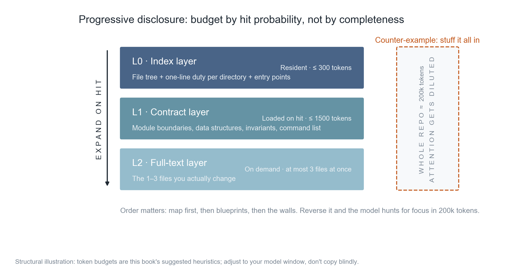
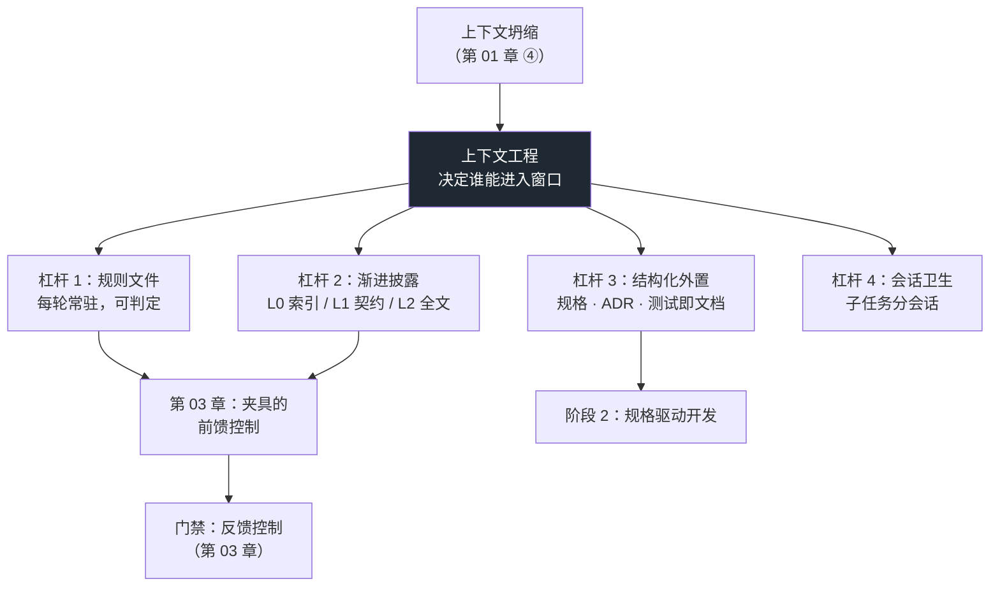

**English** | [中文](./ch02-context-over-prompt.zh.md)

# Chapter 02: What You Feed Matters More Than How You Phrase It

> **Chapter overview**: The previous chapter said "constraints cannot rely on the model remembering", but did not answer "what should they rely on instead". This chapter gives the answer: the **organization structure of the context**. It explains why prompt engineering and context engineering are not on the same level, gives a reusable three-layer progressive disclosure structure, and turns the "project rules file" into a constitution you can drop straight into the repository. After this chapter, you should be able to state, for a real requirement: "which layer of input am I changing this time."
>
> **Prerequisites**: Chapter 01 (the four failure classes, especially class ④ context collapse). You can use the command line and know what a file tree is.
>
> **Core learning objectives**:
> - Be able to explain the difference between "context window" and "effective attention", and why it makes "stuffing it all in" fail
> - Master the L0 / L1 / L2 three-layer structure of progressive disclosure, and be able to generate three-layer input for a real requirement
> - Be able to write a decidable project rules file (not a wishlist)
> - Be able to design a controlled comparison of "one-sentence prompt vs three-layer input", and draw a conclusion using first-pass acceptance rate

---

## 1. Cognitive Anchor: both people used the same model

### 1.1 Same model, two kinds of input, 3x apart

Two people use the same model for the same thing: adding a "filter export by tag" option to a small scheduling tool.

**Person A** opens the dialog and writes an 800-character prompt: starting from "you are a senior Python engineer", explaining that the project is roughly a scheduling tool, that it uses dataclass, that the code should be "elegant, robust, in line with best practices", and ending with the demand "do not break existing features".

**Person B** writes only three lines:

> Task: add an optional parameter `tag` to `to_csv`; when non-empty, export only events containing that tag.
> Constraints: `COLUMNS` is an external contract and must not change; new behavior must have tests.
> Relevant files: `src/sched/export.py` (to be changed this time), `src/sched/models.py` (the definition of `Event.tags`), `tests/test_export.py` (the existing contract).

Person A's output: it runs, but it changed the signature of `to_csv` to `to_csv(events, path, tag=None, **kwargs)`, "optimized" the column order along the way, and 3 tests fail.
Person B's output: 11 lines changed, all tests green, passed on the first round.

**The difference is not in the wording.** In Person A's 800 characters, the amount of information about "what this repo looks like" is close to zero — the model does not know `COLUMNS` exists, does not know a test file is watching the column order, and does not know whether `Event.tags` is a tuple or a list. And what it does not know, it will certainly make up.

> The core proposition of this chapter: **the model's capability ceiling is determined by "what it can see", not by "how you phrase it".** Wording only takes effect once "what it can see is already enough".

### 1.2 Intuitive Analogy: handing work over to a new colleague

You are taking two weeks of leave and handing your work over to a new colleague. You have two handover styles:

**Style A (corresponding to Person A's prompt)**: pull him into a meeting room and talk for forty minutes — "our team really cares about code quality, you should be careful, this project has a long history, there are quite a few unspoken conventions……"

**Style B (corresponding to Person B's three lines)**: give him a file tree (one line per directory saying what it is for), an interface contract (which functions are for others, which constants must not move), then open the one file he needs to change this time.

Style B is clearly more effective. The reason is not "less information" but that **the organization of the information matches the order in which the work proceeds**: first the map (where things are), then the blueprints (where the boundaries are), and only then do you enter the room (the actual code).

But this analogy has a **boundary** that must be stated: a new colleague will ask questions proactively. He will say "why can't this `COLUMNS` be changed?" — the model will not. The model only makes a choice silently, then continues confidently. **This is exactly why the context must be fed by you in a structured way, and you cannot count on it to ask.**

---

## 2. First Principles: context is a budget, not a bucket

### 2.1 Window ≠ attention

First separate two concepts that are often conflated:

- **Context window**: how many tokens the model can receive at once. It is a **capacity** number, say 200,000.
- **Effective attention**: in this one inference, how much "weight" the model can actually assign to each token. It is an **allocation** problem, not a capacity problem.

These two numbers differ, and the second does not grow linearly with the first. The best-known phenomenon is called **lost in the middle**: put key information in the exact middle of a long context and the model's recall rate is markedly lower than at the beginning or the end. In other words, a 200,000-token window does not equal 200,000 tokens of effective memory — it is more like a zone that is **sharp at both ends and blurry in the middle**.

From this follows an engineering conclusion:

> Cramming more content into the window yields **diminishing** marginal returns, which can even turn negative — because irrelevant content dilutes the weight of relevant content.

So "stuffing it all in" is not "safer" — it is "noisier".

### 2.2 Prompt engineering and context engineering are not on the same level

These two terms are often placed side by side; in fact they sit on **different levels**:

| | Prompt Engineering | Context Engineering |
|---|---|---|
| What is optimized | How to phrase a sentence or passage | Which tokens are entitled to enter the window |
| Typical question | "How do I make the model output JSON" | "Which files, constraints, counter-examples does the model need to know" |
| Scope of effect | A single call | The whole project lifecycle |
| Failure point | Fails immediately across files and sessions | Get the organization wrong and it stays wrong; get it right and it can be reused |
| Analogy | The tone of voice when talking to a colleague | Which materials to give him, and in what order |

The Thoughtworks Technology Radar Vol.34 (2026-04) promoted context engineering from "optimization trick" to the **Adopt** ring, explicitly positioning it as an **architecture-level concern** — for exactly the reason in the last row of the table above: wording is effective at a single point; organization is effective across the whole project lifecycle.

A more blunt criterion:

> If a change affects only "this one conversation", you are doing prompt engineering;
> if a change affects "every conversation from now on", you are doing context engineering.

Only the latter is worth writing into the repository.

### 2.3 Four levers

Ordered by "return on effort", context engineering has four levers:

**Lever 1: project rules file (the highest lever).** An `AGENTS.md` (or `CLAUDE.md`, `.cursor/rules`) placed at the repository root, automatically loaded in every session. The problem it solves is the class ④ failure from Chapter 01: the constraint is no longer "do you remember saying it" but "present every time".

**Lever 2: progressive disclosure.** Do not stuff the whole repository in; allocate the budget by "hit probability": always give the map, give the blueprints only when relevant, give the full text only when actually changing.

**Lever 3: structured externalization.** Write implicit knowledge into retrievable forms: spec documents, ADRs (architecture decision records), tests (tests as documentation), type annotations. **Only what can be read can possibly be obeyed.**

**Lever 4: session hygiene.** One session per subtask; periodically restate key constraints; for long sessions, regularly "restart + hand over with a summary".

This chapter focuses on levers 1 and 2, because they determine whether the other two mean anything.

### 2.4 Three-layer progressive disclosure: allocate the budget by hit probability



*Figure 2-1: The three layers are not "information from less to more" but "load timing from early to late". L0 is present every round; L1 loads only on a hit; L2 unfolds only the few files that actually change. The dashed box on the right is the counter-example: stuff the whole repository in, the token count goes up, and effective attention gets diluted.*

Concrete definition:

| Layer | Content | When to load | Suggested budget (this book) | Question it answers |
|---|---|---|---|---|
| **L0 index** | File tree + one-line responsibility per directory + entry points | Resident every round | ≤ 300 tokens | "Where are things?" |
| **L1 contracts** | Module boundaries, public signatures, data structures, invariants, command list | When a relevant module is hit | ≤ 1500 tokens | "Where are the boundaries?" |
| **L2 full text** | The 1–3 files that actually change | Before starting to edit | No hard cap, but **no more than 3 files at a time** | "How is this line of code written?" |

Three usage rules:

1. **The order must not reverse.** Map first, then blueprints, then walls. The reverse (paste the full text of three files first, then add "this is a scheduling tool") amounts to making the model guess the structure from details.
2. **Restraint with L2.** Paste 8 files at once and the model will start "casually optimizing" inside unrelated files — this is a high-incidence scenario for Chapter 01's "pattern completion".
3. **The budget is not a hard metric.** 300 / 1500 are empirical values; adjust them with the model's window. What must really be guarded is the property "**L2's size does not grow with repository volume**".

### 2.5 Rules files: write a constitution, not a wishlist

The most common failure mode of a rules file is a passage that is **correct but undecidable**:

> ❌ "Keep the code style consistent, value readability, follow best practices, do not introduce unnecessary complexity."

Not one item of this can be executed. The model's behavior does not change after reading it, because it cannot judge "did I violate it this time".

There is only one criterion:

> **A rule is a rule if an uninformed third party can determine "violated / not violated" within 30 seconds; otherwise it is just atmosphere.**

Rewrite it:

| ❌ Undecidable (atmosphere) | ✅ Decidable (rule) |
|---|---|
| Keep the code style consistent | `ruff check .` must be run before commit, zero warnings |
| Value readability | A single function no longer than 40 lines; nesting no deeper than 3 levels |
| Follow best practices | Public functions must have type annotations; `Any` requires a comment stating its origin |
| Do not introduce unnecessary complexity | New dependencies forbidden unless the PR explains "why the standard library is not enough" |
| Mind security | Secrets may only be read from environment variables, and startup must exit if any is missing |

A minimally usable rules file looks like this (full version at `code/ch03/harness-template/AGENTS.md`):

| Section | What it must contain | Counter-example |
|---|---|---|
| **What the project is** | One sentence saying what it does and what it does not do | "A powerful tooling platform" (says nothing) |
| **Stack and prohibitions** | Versions, dependency policy, explicitly forbidden technologies | Only writes "use Python", never "no ORM" |
| **Directory responsibilities** | What each level can do and **must not** do | Only lists directory names, no forbidden zones |
| **Commands** | The 3 commands you must run yourself after changing things | Written in the README — the model won't go look |
| **Definition of done** | What counts as finished (decidable) | "Ensure the feature works" |
| **Forbidden zones** | Explicitly forbidden actions + what happens on violation | None |
| **Delivery format** | What the reply must contain | None |

The last section (delivery format) is often ignored, but it is extremely effective. For example, requiring "paste the **raw output** of the three commands, do not paraphrase" — this one item directly blocks empty talk like "I ran it, no problem".

---

## 3. Hands-on: turning one requirement into three-layer input

### 3.1 Case

We reuse the book's demo repository `code/ch02/demo_repo/` (a small tool that only does "export schedules to CSV", 9 source files + 2 test files).

Requirement (**frozen — no mid-flight changes allowed**):

> Add an optional parameter `tag` to `to_csv`; when non-empty, export only events containing that tag; `COLUMNS` must not change.

### 3.2 Generating the three layers

This chapter's companion tool `code/ch02/build_context.py` does three things: scan the file tree (L0), extract signatures and invariants (L1), expand full text per `--focus` (L2).

```bash
python code/ch02/build_context.py code/ch02/demo_repo \
    --task "给日程导出加一个按 tag 过滤的选项" \
    --focus src/sched/export.py
```

Real output (excerpt):

```text
# 任务
给日程导出加一个按 tag 过滤的选项

# L0 索引层（常驻）
仓库根：demo_repo

文件树（只为回答「东西在哪」）：
  README.md
  src/sched/__init__.py
  src/sched/adapters/__init__.py
  src/sched/adapters/ics.py
  src/sched/cli.py
  src/sched/export.py
  src/sched/models.py
  src/sched/recur.py
  src/sched/reminders.py
  src/sched/store.py
  tests/test_export.py
  tests/test_models.py

各文件一句话职责：
  README.md — schedule-kit（演示用最小仓库）
  src/sched/export.py — 导出成 CSV。
  src/sched/models.py — 领域对象：日程事件。
  src/sched/store.py — 内存存储。写入只能走 add() —— 这样"重复日程"的判定只存在一处。
  tests/test_export.py — 导出契约的回归测试。修改 COLUMNS 必须同步改这里——这是"测试即文档"。
  ...

# L1 契约层（相关模块）
### src/sched/export.py
- 职责：导出成 CSV。
- const COLUMNS = ('start', 'end', 'minutes', 'title', 'tags')
- def to_csv(events: list[Event], path: Path) -> int — 写入 CSV，返回写入行数。用 newline="" 避免 Windows 上多出空行。
- def main(argv: list[str] | None = None) -> int

# L2 全文层（本次要改的文件）
### src/sched/export.py
（完整源码，含"列顺序是对外契约"的模块 docstring）
```

The final summary table is the point:

```text
层                             tokens（估算）       占全塞比例
--------------------------------------------------------------
L0 索引层                               403        14%
L1 契约层                               774        26%
L2 全文层                               318        11%
合计（三层）                              1546        52%
对照：全塞整个仓库                           2965       100%
```

### 3.3 How to read this table (don't misread it)

**First, this ratio is not impressive, and that is honest.** The demo repository is only 3,000 tokens; stuffing it all in is not expensive either. Saving half on a 3k-token repository is nothing to brag about.

**Second, what really matters is not this one ratio but the slopes of the three curves**:

| Quantity | How it grows as the repository grows | On a 200,000-token repository |
|---|---|---|
| Stuff-it-all-in | Linear: code doubles, tokens double | ≈ 200,000 |
| L0 index | Linear but with a tiny coefficient: about 10–20 tokens per file | ≈ 3,000–5,000 |
| L1 contracts | Proportional to module count, about 50–100 tokens per module | ≈ 5,000–8,000 |
| L2 full text | **Constant**: always just those 1–3 files | ≈ 300–2,000 |

So the property of "three-layer input" is not "less", but **"the size of L2 decouples from repository volume"**. This is its essential difference from "stuff-it-all-in": the former ties your input budget to task complexity; the latter ties it to repository size.

**Third, the token estimates are rough.** The script estimates by "1 Chinese character ≈ 1 token, every 4 other characters ≈ 1 token"; different tokenizers will differ by 20%–40%. It is good enough for comparing magnitudes, not good enough for keeping accounts. If you need precision, use the corresponding model's tokenizer.

### 3.4 Task 3: turn it into a controlled comparison

Task 3 in the plan is "same requirement, two kinds of input, compare first-pass acceptance rate". The procedure must be strict, or you will end up with a conclusion that fools yourself.

**Four control conditions:**

1. **Freeze the requirement.** Write the requirement out as one paragraph and save it to a file; not a single character may change between the two runs. Changing the requirement = changing the subject of the experiment.
2. **Randomize the order, with a gap ≥ 1 day.** Do A first then B, and B enjoys the advantage of "I have already thought it through once". The simplest method: flip a coin for the order, with a day in between.
3. **Acceptance criteria first.** Before doing it, write down "what counts as passing", e.g.: `pytest` all green + `COLUMNS` unchanged + a new test covering tag filtering added. **"Looks reasonable" is not allowed to appear in the criteria.**
4. **Record rounds, not time.** The denominator of first-pass acceptance rate is "number of independent tasks"; the numerator is "number of tasks whose first output passed". Do not use "how many changes" as the numerator — that conflates "passed after one change" with "passed after ten changes".

**The recording table looks like this:**

| Task | Input method | Passed on round | Touched forbidden files | Note |
|---|---|---|---|---|
| T1 export + tag | One-sentence prompt | 3 | Yes (changed COLUMNS) | It added tag to the columns |
| T1 export + tag | Three-layer input | 1 | No | Only 11 lines changed |

Two tasks are not enough to draw a conclusion, but enough to let you see the direction. Chapter 4 will teach you how to grow n, and how to speak when n is small.

> **An easily overlooked observation**: in the one-sentence prompt group, failure is often not "wrote it wrong" but "**changed things it should not have changed**". This points to the first value of rules files — they don't just raise the correctness rate; their main effect is **reducing boundary violations**.

---

## 4. Common pitfalls and right-vs-wrong examples

| Easy pitfall | Why it is wrong | Correct practice |
|---|---|---|
| **"The window is big enough — stuffing it all in is safest"** | Effective attention does not grow linearly with the window; middle-forgetting + dilution by irrelevant content | Layer by hit probability; L2 no more than 3 files at a time |
| **"The longer the rules file, the more professional"** | Undecidable entries get ignored wholesale by the model; as the rules file grows, the real hard constraints get diluted | Every item must be decidable within 30 seconds; keep it within one screen; overflow gets split into "rules + referenced docs" |
| **"Write the rule and it will obey"** | A rules file is context too, and decays across a session just the same (Chapter 01, class ④) | Rules files provide "always present"; real enforcement comes from gates (Chapter 3) |
| **"Write the prompt like legal code and get it right in one shot"** | Wording cannot solve the problem of "it cannot see `COLUMNS`" | Fill in the context first, then talk about wording |
| **"I gave it the README to read — that counts as project background"** | READMEs are usually written for humans (vision, install steps); they do not contain "what you must not change" | Rules files are written for machines: commands, boundaries, forbidden zones, definition of done |
| **"Context engineering is one-time configuration"** | The repository keeps changing and rules rot; three months later rules that don't match reality are worse than having no rules | Update rules whenever the architecture changes; put "update AGENTS.md" into the PR template |

---

## 5. Chapter summary and local knowledge map

### 5.1 Four key points

- **The window is capacity; attention is budget.** Stuffing it all in is not safer — it is noisier.
- **Prompt engineering optimizes wording; context engineering decides who gets into the window.** The latter is the architecture-level concern (Thoughtworks Vol.34 has already put it in the Adopt ring).
- **The property of progressive disclosure is "L2 decouples from repository volume"**, not "fewer words". This property is what makes it still hold on a 200,000-token repository.
- **The one criterion for rules files is decidability**: only what can be judged "violated / not violated" within 30 seconds is a rule; the rest is atmosphere.

### 5.2 Concept topology



---

## 6. Tiered exercises

### Tier 1 · Intuition and concept check

1. Distinguish "context window" from "effective attention" in one sentence, and give a concrete scenario that shows the difference.
2. Which of the following four are "rules", and which are "atmosphere"?
   ① All API responses must carry `request_id`; ② Code must be easy to maintain; ③ Calling `datetime.now()` inside `src/` is forbidden — always pass it in via parameters; ④ Reuse existing utility functions wherever possible.
3. Why is the order "paste the full file text first, then give the project background" worse than the reverse?

### Tier 2 · Deduction and hands-on

4. Use `build_context.py` to generate three-layer input for one real repository of your own (pick any requirement). Record three numbers: stuff-it-all-in tokens, three-layer total tokens, L2 tokens. Then compute: if your repository were 10 times bigger, how would these three numbers change?
5. Write an `AGENTS.md` for your own project, with requirements: no more than 40 lines, every item decidable, including the two sections "definition of done" and "forbidden zones". When done, do a self-check: read each item aloud to someone who does not know your project — can they judge "violated or not"?

### Tier 3 · Boundaries and transfer

6. Suppose you need AI to modify a module you are **completely unfamiliar with** (say, code left behind by a departed colleague). How should the three-layer input be adjusted? Which layer should be weighted up, which trimmed?
7. Rules files and gates both constrain behavior; where is the boundary between them? Give at least two examples of "should only be written into rules, not made into gates", and two of "should only be made into gates — writing rules is useless".

<details>
<summary><strong>Click to expand: reference answers and in-depth analysis for this chapter's exercises</strong></summary>

#### 1. Window vs attention

**In one sentence**: the window is "how much it can hold at most"; attention is "how much of what is held actually gets used".

**Scenario**: you stuff a 150,000-token codebase into a 200,000 window, with one line "`COLUMNS` must not change" in the middle. The model's window did hold it (no overflow error), but its weight in that inference was extremely low — so it changed the column order. **Fitting in ≠ getting used** — that is the difference.

#### 2. Rules vs atmosphere

- ① Rule (decidable: does the response contain this field)
- ② Atmosphere ("easy to maintain" cannot be judged within 30 seconds)
- ③ Rule (decidable: `grep datetime.now src/`)
- ④ Atmosphere ("wherever possible" and "reuse" are both undecidable softeners)

Note that ④'s problem is not the intent "reuse" but "wherever possible" — it hands the right of judgment back to the model. Rewrite it as "before adding a utility function you must search `utils/`; if a similar implementation already exists, reuse it and delete the newly written one", and it becomes a rule.

#### 3. Why the reversed order is worse

Because the model will **build structural hypotheses first, then verify them with details**. When you give it the full text of three files, it must first guess "where these three files sit in the system", then make changes based on that guess. If it guesses wrong, it will treat local style as global convention (for example, seeing `**kwargs` used in one file and concluding the whole project works that way).

When you give the index first, it receives the global structure, and reading local details afterwards is "locating on a known map" — the error rates of the two cognitive modes differ enormously.

In one sentence: **structure before details is dimensionality reduction; details before structure is guessing.**

#### 4. The three numbers and scaling 10x

Typical result (replace with your own numbers): stuff-it-all-in 3,000 / three layers 1,500 / L2 320.

After scaling 10x:

- Stuff-it-all-in ≈ 30,000 (linear)
- Three layers ≈ 1,500 + 9 × (L0 increment + L1 increment). If the file count grows 10x, L0 is about 4,000 and L1 about 7,000 (the number of modules grows too), so the total still lands around ten thousand
- L2 ≈ 320 (**almost unchanged**, because the requirement didn't change — it is still that one file to modify)

Key conclusion: the size of three-layer input is tied to "how many files this task touches"; the size of stuffing it all in is tied to "how big the repository is". The former is under your control; the latter is not.

#### 5. `AGENTS.md` self-check

What a passing one looks like (example, not a template):

```
## 命令
ruff check . / mypy src / pytest -q    # 三条全绿才算完成

## 禁区
- 不改 COLUMNS 的顺序
- 不新增依赖（除非 PR 说明标准库为什么不够）
- 不在 src/ 里 print 或读环境变量

## 完成定义
三条命令全绿 + 新增行为有对应测试 + 回复里贴原始输出
```

A typical failure: 200 lines written, containing "architecture philosophy", "team culture", "code taste", yet not one item verifiable by `grep` or a command. The actual function of such a file is **making yourself feel good**.

#### 6. How to adjust for an unfamiliar module

- **Weight up L1**: write out explicitly the contracts you don't know (data structures, invariants, caller assumptions). This is the information you lack most.
- **Trim L2**: don't paste 5 files at once. Being unfamiliar, you are more easily led astray by files that "look relevant"; paste just 1 first, finish it, then move to the next.
- **Add a layer, "L1.5: history"**: how many times this module changed in the past 30 days, whether there are known pitfalls (generatable with `git log --oneline -20 -- <file>`). History is the most valuable — and most easily ignored — context when you don't know the code.
- **Reverse approach**: first have the AI explain the module to you ("read these three files, draw the call relationships, point out what you find suspicious"); you review its understanding, then let it act. This step costs little; the payoff is turning "you are not familiar" into "neither of you is familiar, but you have already corrected its map".

#### 7. The boundary between rules files and gates

Criterion: **can a program decide it at commit time.**

Should only go into rules (cannot become a gate):

- "Before changing a public API, write the impact scope in the PR description" — this is a process requirement; a machine cannot judge "whether it was written thoroughly enough".
- "If a test fails, first determine whether the test or the implementation is wrong, and state the basis in your reply" — what is being judged is reasoning quality, not text patterns.

Should only become gates (writing rules is useless):

- "Do not commit secrets" — the model will say "sure", then write it in anyway; `detect-private-key` will block it outright.
- "Types must be correct" — "please mind the types" is a prayer; `mypy --strict` is the law.

An even sharper criterion: **for the same thing, if you find yourself stressing it for the third time in the rules file, it is time to turn it into a gate.**

</details>

---

### Data and sources for this chapter

| Content | Source | Note |
|---|---|---|
| Context engineering listed in the Technology Radar Adopt ring | Thoughtworks Technology Radar Vol.34, 2026-04 | This book's citation of that issue is secondhand; the methodological judgment matches the official one |
| Progressive disclosure (light index + expand on demand) | Same as above; Craig et al. on industry practice in context management | Token budgets are this book's suggested values, not a standard |
| The "lost in the middle" phenomenon | A common conclusion in long-context retrieval research ("Lost in the Middle", 2023) | The specific curve varies by model; this book uses only the qualitative conclusion |
| `AGENTS.md` / `CLAUDE.md` / `.cursor/rules` | Official documentation of each tool | Different filenames, same function: repo-level always-present instructions |

---

## 7. Authoritative References and Further Reading

1. **Anthropic Prompt Engineering**: [Anthropic Prompt Engineering](https://docs.anthropic.com/en/docs/build-with-claude/prompt-engineering/overview) - the definitions and norms of this chapter are anchored here (verification date: `2026-10-23`).
2. **Long-context research (arXiv:2404.19737)**: [Long-context research (arXiv:2404.19737)](https://arxiv.org/abs/2404.19737) - the definitions and norms of this chapter are anchored here (verification date: `2026-10-23`).
3. **martinfowler.com**: [martinfowler.com](https://martinfowler.com/) - the definitions and norms of this chapter are anchored here (verification date: `2026-10-23`).

> Scope note: the sources above anchor **definitions and norms**, not extrapolated risk probabilities. Before citing any number, first verify the source's year and its denominator.
