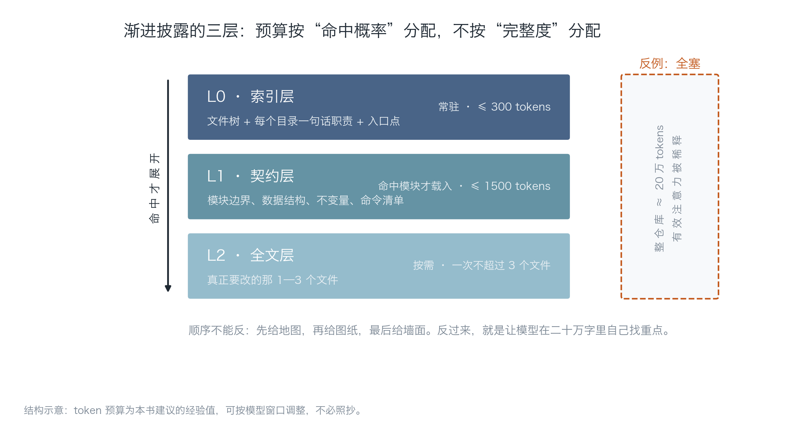
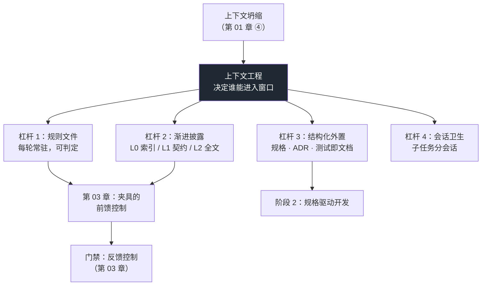

# 第 02 章：喂什么，比怎么说更上位

> **本章导读**：上一章说"约束不能靠模型记住"，但没有回答"那要靠什么"。本章给答案：靠**上下文的组织结构**。它讲清提示工程与上下文工程为什么不在一个层级上，给出可复用的三层渐进披露结构，并把「项目规则文件」做成一份能直接放进仓库的宪法。学完本章，你要能对一个真实需求说清："这次我改的是哪一层输入。"
>
> **前置知识**：第 01 章（四类失效，尤其第 ④ 类上下文坍缩）。会用命令行、知道什么是文件树。
>
> **核心学习目标**：
> - 能解释"上下文窗口"与"有效注意力"的区别，以及它为什么让"全塞进去"失效
> - 掌握渐进披露的 L0 / L1 / L2 三层结构，并能为一个真实需求生成三层输入
> - 能写出可判定的项目规则文件（而不是愿望清单）
> - 能设计一次"一句话提示 vs 三层输入"的对照，并用首轮验收率给出结论

---

## 1. 认知锚点：两个人都用了同一个模型

### 1.1 同一个模型，两种输入，差三倍

两个人用同一个模型做同一件事：给日程小工具加一个"按标签过滤导出"的选项。

**甲**打开对话框，写了一段 800 字的提示词：从"你是一个资深 Python 工程师"开始，交代了项目大概是个日程工具，用了 dataclass，希望代码"优雅、健壮、符合最佳实践"，最后要求"不要破坏现有功能"。

**乙**只写了三行：

> 任务：`to_csv` 增加可选参数 `tag`，非空时只导出包含该 tag 的事件。
> 约束：`COLUMNS` 是对外契约，不许改；新增行为要有测试。
> 相关文件：`src/sched/export.py`（本次要改）、`src/sched/models.py`（`Event.tags` 的定义）、`tests/test_export.py`（现有契约）。

甲的产出：能跑，但把 `to_csv` 的签名改成了 `to_csv(events, path, tag=None, **kwargs)`，顺手"优化"了列顺序，测试挂了 3 个。
乙的产出：改了 11 行，测试全绿，首轮通过。

**差别不在措辞。** 甲的 800 字里，关于"这个仓库长什么样"的信息量接近于零——模型不知道 `COLUMNS` 存在，不知道有个测试文件在盯着列顺序，也不知道 `Event.tags` 是 tuple 还是 list。而它不知道的东西，它一定会自己编。

> 这一章的核心命题：**模型的能力上限由"它能看见什么"决定，不由"你怎么措辞"决定。** 措辞只在"它能看见的东西已经足够"时才起作用。

### 1.2 直觉类比：交接工作给新同事

你要休假两周，把工作交给一个新同事。你有两种交接方式：

**方式 A（对应甲的提示词）**：拉他到会议室讲四十分钟——"我们团队很注重代码质量，你要小心一点，这个项目历史比较久，有很多约定俗成的东西……"

**方式 B（对应乙的三行）**：给他一张文件树（每行一句话说明这个目录干什么）、一份接口契约（哪些函数是给别人用的、哪些常量不能动）、然后打开他这次要改的那一个文件。

方式 B 明显更有效。原因不是"信息更少"，而是**信息的组织方式匹配了工作的推进顺序**：先有地图（东西在哪），再有图纸（边界在哪），最后才进房间（具体代码）。

但这个类比有一个必须说清的**边界**：新同事会主动提问。他会说"这个 `COLUMNS` 为什么不能改？"——而模型不会。模型只会沉默地做出一个选择，然后自信地继续。**这正是为什么上下文必须由你结构化地喂，而不能指望它来问。**

---

## 2. 第一性原理：上下文是一种预算，不是一只桶

### 2.1 窗口 ≠ 注意力

先把两个常被混用的概念分开：

- **上下文窗口（context window）**：模型一次能接收多少 token。它是一个**容量**数字，比如 20 万。
- **有效注意力（effective attention）**：在这一次推理里，模型实际能给每个 token 分配多少"权重"。它是一个**分配**问题，不是一个容量问题。

这两个数字不同，而且第二个不随第一个线性增长。最著名的现象叫 **lost in the middle**（中间遗忘）：把关键信息放在长上下文的正中间，模型的召回率明显低于放在开头或结尾。也就是说，20 万 token 的窗口，不等于 20 万 token 的有效记忆——它更像一条**两端清晰、中间发虚**的地带。

由此推出一条工程结论：

> 往窗口里塞更多内容，边际收益是**递减**的，甚至会变成负的——因为无关内容会稀释相关内容的权重。

所以"全塞进去"不是"更保险"，而是"更吵"。

### 2.2 提示工程与上下文工程不在一个层级

这两个词经常被并列，其实它们是**不同层级**的：

| | 提示工程（Prompt Engineering） | 上下文工程（Context Engineering） |
|---|---|---|
| 优化对象 | 一句话/一段话怎么措辞 | 哪些 token 有资格进入窗口 |
| 典型问题 | "怎么让模型按 JSON 输出" | "模型需要知道哪些文件、哪些约束、哪些反例" |
| 生效范围 | 单次调用 | 整个项目生命周期 |
| 失效点 | 跨文件、跨会话立刻失效 | 组织错了会一直错，但组织对了可以复用 |
| 类比 | 跟同事说话的语气 | 给他哪些资料、按什么顺序给 |

Thoughtworks 第 34 期技术雷达（2026-04）把上下文工程从"优化技巧"提到了 **Adopt** 环，明确把它定位成**架构级关注点**——理由正是上表最后一行：措辞在单点有效，组织在整个项目生命周期有效。

一个更直白的判据：

> 如果一个改动只影响"这一次对话"，你在做提示工程；
> 如果一个改动会影响"以后每一次对话"，你在做上下文工程。

后者才值得写进仓库。

### 2.3 四个杠杆

按"投入产出比"排序，上下文工程有四个杠杆：

**杠杆 1：项目规则文件（最高杠杆）。** 一份放在仓库根目录的 `AGENTS.md`（或 `CLAUDE.md`、`.cursor/rules`），每次会话自动加载。它解决的问题是第 01 章的第 ④ 类失效：约束不再是"你记得说过"，而是"每次都在"。

**杠杆 2：渐进披露。** 不把整个仓库塞进去，而是按"命中概率"分配预算：永远给地图，相关时才给图纸，真要改才给全文。

**杠杆 3：结构化外置。** 把隐式知识写成可检索的形式：规格文档、ADR（架构决策记录）、测试（测试即文档）、类型标注。**能被读到的东西，才可能被遵守。**

**杠杆 4：会话卫生。** 一个子任务一个会话；关键约束周期性重述；长会话定期"重开 + 摘要交接"。

本章重点讲杠杆 1 和 2，因为它们决定了另外两个有没有意义。

### 2.4 三层渐进披露：按命中概率分配预算



*图 2-1：三层不是"信息从少到多"，而是"加载时机从早到晚"。L0 每轮都在，L1 命中才载入，L2 只有真要改的那几个文件才展开。右边那个虚线框是反例：把整个仓库塞进去，token 数量上去了，有效注意力反而被稀释。*

具体定义：

| 层 | 内容 | 何时加载 | 本书建议预算 | 负责回答的问题 |
|---|---|---|---|---|
| **L0 索引** | 文件树 + 每个目录一句话职责 + 入口点 | 每轮常驻 | ≤ 300 tokens | "东西在哪？" |
| **L1 契约** | 模块边界、公开签名、数据结构、不变量、命令清单 | 相关模块被命中时 | ≤ 1500 tokens | "边界在哪？" |
| **L2 全文** | 真正要改的 1—3 个文件 | 开始改之前 | 无硬上限，但**一次不超过 3 个文件** | "这行代码怎么写？" |

三条使用规则：

1. **顺序不能反。** 先给地图，再给图纸，最后给墙面。反过来（先贴三个文件全文，再补一句"这是个日程工具"）等于让模型在细节里自己猜结构。
2. **L2 要克制。** 一次贴 8 个文件，模型会开始在无关文件里"顺手优化"——这是第 01 章"模式化复制"的高发场景。
3. **预算不是硬指标。** 300 / 1500 是经验值，随模型窗口调整。真正要守的是"**L2 的规模不随仓库体积增长**"这条性质。

### 2.5 规则文件：写宪法，不写愿望清单

规则文件最常见的失败形态，是写成了一段**正确但不可判定**的话：

> ❌ "请保持代码风格一致，注重可读性，遵循最佳实践，不要引入不必要的复杂度。"

这段话一条都执行不了。模型读完不会改变任何行为，因为它无法判断"我这次是否违反了"。

判据只有一条：

> **一条规则，如果能被一个不知情的第三方在 30 秒内判定"违反/未违反"，它就是规则；否则它只是气氛。**

改写一下：

| ❌ 不可判定（气氛） | ✅ 可判定（规则） |
|---|---|
| 保持代码风格一致 | 提交前必须跑 `ruff check .`，零告警 |
| 注重可读性 | 单个函数不超过 40 行；嵌套不超过 3 层 |
| 遵循最佳实践 | 公开函数必须有类型标注；`Any` 需注释来源 |
| 不要引入不必要的复杂度 | 禁止新增依赖，除非 PR 说明"标准库为什么不够" |
| 注意安全 | 密钥只能从环境变量读，且启动时校验缺失即退出 |

一份最小可用的规则文件长这样（完整版见 `code/ch03/harness-template/AGENTS.md`）：

| 段落 | 必须写什么 | 反例 |
|---|---|---|
| **项目是什么** | 一句话说清做什么、不做什么 | "一个强大的工具平台"（等于没说） |
| **技术栈与禁令** | 版本、依赖策略、明确禁止的技术 | 只写"用 Python"，不说"不引入 ORM" |
| **目录职责** | 每层能做什么、**不能**做什么 | 只列目录名，不写禁区 |
| **命令** | 改完必须自己跑的 3 条命令 | 写在 README 里，模型不会去翻 |
| **完成定义** | 什么算做完（可判定） | "确保功能正常" |
| **禁区** | 明确不许做的事 + 违反了会怎样 | 无 |
| **交付格式** | 回复里必须包含什么 | 无 |

最后一段（交付格式）经常被忽略，但它极其有效。比如要求"贴出三条命令的**原始输出**，不要转述"——这一条直接把"我跑过了，没问题"这种空话堵死。

---

## 3. 手把手：把一个需求做成三层输入

### 3.1 案例

沿用书里的演示仓库 `code/ch02/demo_repo/`（一个只做"日程导出成 CSV"的小工具，9 个源文件 + 2 个测试文件）。

需求（**冻结，不许中途改**）：

> `to_csv` 增加可选参数 `tag`；非空时只导出包含该 tag 的事件；`COLUMNS` 不得改动。

### 3.2 生成三层

本章配套工具 `code/ch02/build_context.py` 做三件事：扫文件树（L0）、抽签名与不变量（L1）、按 `--focus` 展开全文（L2）。

```bash
python code/ch02/build_context.py code/ch02/demo_repo \
    --task "给日程导出加一个按 tag 过滤的选项" \
    --focus src/sched/export.py
```

真实输出（节选）：

```text
# 任务
给日程导出加一个按 tag 过滤的选项

# L0 索引层（常驻）
仓库根：demo_repo

文件树（只为回答「东西在哪」）：
  README.md
  src/sched/__init__.py
  src/sched/adapters/__init__.py
  src/sched/adapters/ics.py
  src/sched/cli.py
  src/sched/export.py
  src/sched/models.py
  src/sched/recur.py
  src/sched/reminders.py
  src/sched/store.py
  tests/test_export.py
  tests/test_models.py

各文件一句话职责：
  README.md — schedule-kit（演示用最小仓库）
  src/sched/export.py — 导出成 CSV。
  src/sched/models.py — 领域对象：日程事件。
  src/sched/store.py — 内存存储。写入只能走 add() —— 这样"重复日程"的判定只存在一处。
  tests/test_export.py — 导出契约的回归测试。修改 COLUMNS 必须同步改这里——这是"测试即文档"。
  ...

# L1 契约层（相关模块）
### src/sched/export.py
- 职责：导出成 CSV。
- const COLUMNS = ('start', 'end', 'minutes', 'title', 'tags')
- def to_csv(events: list[Event], path: Path) -> int — 写入 CSV，返回写入行数。用 newline="" 避免 Windows 上多出空行。
- def main(argv: list[str] | None = None) -> int

# L2 全文层（本次要改的文件）
### src/sched/export.py
（完整源码，含"列顺序是对外契约"的模块 docstring）
```

最后一段统计表是重点：

```text
层                             tokens（估算）       占全塞比例
--------------------------------------------------------------
L0 索引层                               403        14%
L1 契约层                               774        26%
L2 全文层                               318        11%
合计（三层）                              1546        52%
对照：全塞整个仓库                           2965       100%
```

### 3.3 怎么读这张表（别读错）

**第一，这个比例不好看，而且这是诚实的。** 演示仓库只有 3000 token，全塞也不贵。在一个 3 千 token 的仓库上省一半，没什么可炫耀的。

**第二，真正要看的不是这一次的比例，而是三条曲线的斜率**：

| 量 | 随仓库变大的增长方式 | 在 20 万 token 的仓库上 |
|---|---|---|
| 全塞 | 线性：代码翻倍，token 翻倍 | ≈ 200,000 |
| L0 索引 | 线性但系数极小：每个文件约 10—20 token | ≈ 3,000—5,000 |
| L1 契约 | 与模块数成正比，约每模块 50—100 token | ≈ 5,000—8,000 |
| L2 全文 | **常数**：永远只是那 1—3 个文件 | ≈ 300—2,000 |

所以"三层输入"的性质不是"少"，而是**"L2 的规模与仓库体积脱钩"**。这是它与"全塞"的本质差别：前者让你的输入预算与任务复杂度挂钩，后者与仓库体积挂钩。

**第三，token 估算是粗的。** 脚本按"中文 1 字 ≈ 1 token、其余 4 字符 ≈ 1 token"估算，不同分词器会差 20%—40%。它够用来比较量级，不够用来算账。真要精确，用对应模型的 tokenizer。

### 3.4 任务 3：把它做成一次对照

规划里的任务 3 是"同一需求，两种输入，比首轮验收率"。做法要严格，否则你会得到一个自己骗自己的结论。

**四个控制条件：**

1. **需求冻结。** 把需求写成一段话存进文件，两次都不许改一个字。改需求 = 换了实验对象。
2. **顺序随机，间隔 ≥ 1 天。** 先做 A 再做 B，B 会占"我已经想过一遍"的便宜。最省事的办法：掷硬币决定顺序，中间隔一天。
3. **验收判据先行。** 在做之前写下"什么算通过"，例如：`pytest` 全绿 + `COLUMNS` 未变 + 新增了一个覆盖 tag 过滤的测试。**判据里不许出现"看起来合理"。**
4. **记录轮数而不是时间。** 首轮验收率的分母是"独立任务数"，分子是"第一次产出即通过的任务数"。不要用"改了几次"当分子——那会把"改一次就过"和"改十次才过"混为一谈。

**记录表长这样：**

| 任务 | 输入方式 | 第几轮通过 | 触碰禁区文件 | 备注 |
|---|---|---|---|---|
| T1 导出加 tag | 一句话提示 | 3 | 是（改了 COLUMNS） | 它把 tag 加进了列 |
| T1 导出加 tag | 三层输入 | 1 | 否 | 只改了 11 行 |

两个任务不足以得出结论，但足以让你看见方向。第 4 章会教你怎么把 n 做大、以及 n 小的时候该怎么说话。

> **一个容易忽略的观察点**：一句话提示那一组，失败往往不是"写错了"，而是"**改了不该改的东西**"。这提示了规则文件的第一价值——它不只提高正确率，它主要**减少越界**。

---

## 4. 常见误区与正反例

| 容易踩的坑 | 为什么会错 | 正确做法 |
|---|---|---|
| **"窗口够大，全塞进去最保险"** | 有效注意力不随窗口线性增长；中间遗忘 + 无关内容稀释 | 按命中概率分层，L2 一次不超过 3 个文件 |
| **"规则文件越长越专业"** | 不可判定的条目会被模型整体忽略；规则文件变长后，真正的硬约束被稀释 | 每条必须 30 秒内可判定；长度控制在 1 屏内，超了就拆成"规则 + 引用文档" |
| **"写了规则它就会遵守"** | 规则文件也是上下文，同样会随会话衰减（第 01 章 ④ 类） | 规则文件负责"常驻"，真正的强制靠门禁（第 3 章） |
| **"提示词写得像法律条文就能一次到位"** | 措辞解决不了"它看不见 `COLUMNS`"这个问题 | 先补上下文，再谈措辞 |
| **"我把 README 给它读了，等于给了项目背景"** | README 通常写给人类（愿景、安装步骤），不含"禁止改什么" | 规则文件是给机器读的：命令、边界、禁区、完成定义 |
| **"上下文工程是一次性配置"** | 仓库在变，规则会腐化；三个月后规则与现实不符，比没有规则更糟 | 每次改架构时同步改规则；把"更新 AGENTS.md"写进 PR 模板 |

---

## 5. 本章小结与局部知识图谱

### 5.1 四个要点

- **窗口是容量，注意力是预算**。全塞不是更保险，是更吵。
- **提示工程优化措辞，上下文工程决定谁能进入窗口**。后者才是架构级关注点（Thoughtworks Vol.34 已把它放进 Adopt 环）。
- **渐进披露的性质是"L2 与仓库体积脱钩"**，不是"字数少"。这条性质决定它在 20 万 token 的仓库上依然成立。
- **规则文件的唯一判据是可判定**：30 秒内能判"违反/未违反"的才是规则，其余是气氛。

### 5.2 概念拓扑



---

## 6. 分级通关练习

### Tier 1 · 直觉与概念核验

1. 用一句话区分"上下文窗口"和"有效注意力"，并给出一个能体现差别的具体场景。
2. 下面四条，哪些是"规则"，哪些是"气氛"？
   ① 所有 API 响应必须带 `request_id`；② 代码要易于维护；③ 禁止在 `src/` 里调用 `datetime.now()`，一律从参数传入；④ 尽量复用已有工具函数。
3. 为什么"先贴文件全文、再说项目背景"的顺序，比反过来更差？

### Tier 2 · 推演与实操

4. 用 `build_context.py` 对你自己的一个真实仓库生成三层输入（任选一个需求）。记录三个数字：全塞 token、三层合计 token、L2 token。然后算一下：如果你的仓库大 10 倍，这三个数字会怎么变？
5. 为你自己的项目写一份 `AGENTS.md`，要求：不超过 40 行、每一条都可判定、包含"完成定义"与"禁区"两段。写完做一次自检：把每一条念给一个不了解你项目的人听，他能判断"违反了没有"吗？

### Tier 3 · 边界与迁移

6. 假设你要让 AI 修改一个你**完全不熟悉的**模块（比如同事离职留下的代码）。三层输入该怎么调整？哪一层应该加重、哪一层应该减？
7. 规则文件与门禁都在约束行为，它们的边界在哪？请给出至少两个"只该写进规则、不该做门禁"的例子，以及两个"只该做门禁、写规则没用"的例子。

<details>
<summary><strong>点击展开：本章练习参考答案与深度解析</strong></summary>

#### 1. 窗口 vs 注意力

**一句话**：窗口是"最多能装多少"，注意力是"装进去之后实际用得上多少"。

**场景**：你把 15 万 token 的代码库塞进 20 万窗口，中间放着一句"`COLUMNS` 不许改"。模型的窗口确实装下了它（没有报超出），但它在那次推理里对这句话的权重极低，于是改了列顺序。**装得下 ≠ 用得上**，这就是差别。

#### 2. 规则 vs 气氛

- ① 规则（可判定：响应里有没有这个字段）
- ② 气氛（"易于维护"无法在 30 秒内判定）
- ③ 规则（可判定：`grep datetime.now src/`）
- ④ 气氛（"尽量""复用"都是不可判定的软化词）

注意 ④ 的问题不在"复用"这个意图，而在"尽量"——它把判定权交回给了模型。改写成"新增工具函数前必须搜索 `utils/`，若已存在同类实现则复用并删除新写的那份"，就变成规则了。

#### 3. 为什么顺序反过来更差

因为模型会**先建立结构假设，再用细节去验证**。你给它三个文件全文时，它必须先猜"这三个文件在系统里的位置"，然后基于猜测去改。猜错的话，它会把局部写法当成全局规范（比如看到某个文件里用了 `**kwargs`，就以为整个项目都这么干）。

先给索引时，它拿到的是全局结构，再看局部细节就是"在已知地图上定位"，两种认知模式的错误率差别很大。

一句话：**先结构后细节是降维，先细节后结构是猜。**

#### 4. 三个数字与放大 10 倍

典型结果（用你自己的数字替换）：全塞 3,000 / 三层 1,500 / L2 320。

放大 10 倍后：

- 全塞 ≈ 30,000（线性）
- 三层 ≈ 1,500 + 9 ×（L0 增量 + L1 增量）。若文件数翻 10 倍，L0 约 4,000、L1 约 7,000（模块也变多了），合计仍在一万上下
- L2 ≈ 320（**几乎不变**，因为需求没变，要改的还是那一个文件）

关键结论：三层输入的规模跟"这次任务碰几个文件"挂钩；全塞的规模跟"仓库多大"挂钩。前者是你能控制的，后者不是。

#### 5. `AGENTS.md` 自检

合格的样子（示例，非模板）：

```
## 命令
ruff check . / mypy src / pytest -q    # 三条全绿才算完成

## 禁区
- 不改 COLUMNS 的顺序
- 不新增依赖（除非 PR 说明标准库为什么不够）
- 不在 src/ 里 print 或读环境变量

## 完成定义
三条命令全绿 + 新增行为有对应测试 + 回复里贴原始输出
```

不合格的典型：写了 200 行，包含"架构理念""团队文化""代码品味"，但没有一条能被 `grep` 或命令验证。这种文件的实际作用是**让你自己感觉良好**。

#### 6. 不熟悉模块时怎么调

- **L1 加重**：把你不知道的契约显式写出来（数据结构、不变量、调用方假设）。这是你最缺的信息。
- **L2 减轻**：不要一次贴 5 个文件。你不熟，就更容易被"看起来相关"的文件带偏；先只贴 1 个，改完再进下一个。
- **加一层"L1.5：历史"**：这个模块过去 30 天被改了几次、有没有已知的坑（可以用 `git log --oneline -20 -- <file>` 生成）。历史是不熟悉代码时最有价值、也最容易被忽略的上下文。
- **反向做法**：先让 AI 给你讲一遍这个模块（"读这三个文件，画出调用关系，指出你认为可疑的地方"），你审核它的理解，再让它动手。这一步的成本很低，收益是把"你不熟"变成"你们都不熟，但你已经校正过它的地图"。

#### 7. 规则文件与门禁的边界

判据：**能不能被程序在提交时判定**。

只该写进规则（做不成门禁）：

- "改公开 API 前先在 PR 描述里写影响面" —— 这是流程要求，机器判不了"写得够不够"。
- "如果测试挂了，先判断是测试错还是实现错，并在回复里说明判据" —— 判的是推理质量，不是文本模式。

只该做门禁（写规则没用）：

- "不许提交密钥" —— 模型会说"好的"，然后照样写进去；`detect-private-key` 会直接拦住。
- "类型必须正确" —— "请注意类型"是祈祷，`mypy --strict` 是法律。

一个更狠的判据：**同一件事，如果你发现自己在规则文件里反复强调第三遍，说明它该变成门禁了。**

</details>

---

### 本章数据与来源

| 内容 | 来源 | 说明 |
|---|---|---|
| 上下文工程被列入技术雷达 Adopt 环 | Thoughtworks Technology Radar Vol.34，2026-04 | 本书对该期的引用经二手梳理，方法论判断与官方一致 |
| 渐进披露（轻索引 + 按需展开） | 同上；Craig 等关于上下文管理的行业实践 | token 预算为本书建议值，非标准 |
| lost in the middle 现象 | 长上下文检索研究中的通行结论（"Lost in the Middle", 2023） | 具体曲线随模型而异，本书只使用定性结论 |
| `AGENTS.md` / `CLAUDE.md` / `.cursor/rules` | 各工具官方文档 | 文件名不同，作用相同：仓库级常驻指令 |

---

## 7. 本章权威参考信源与延伸阅读 (Authoritative References)

1. **Anthropic Prompt Engineering**：[Anthropic Prompt Engineering](https://docs.anthropic.com/en/docs/build-with-claude/prompt-engineering/overview) - 本章的定义与规范以此为锚（核验日期：`2026-10-23`）。
2. **长上下文研究（arXiv:2404.19737）**：[长上下文研究（arXiv:2404.19737）](https://arxiv.org/abs/2404.19737) - 本章的定义与规范以此为锚（核验日期：`2026-10-23`）。
3. **martinfowler.com**：[martinfowler.com](https://martinfowler.com/) - 本章的定义与规范以此为锚（核验日期：`2026-10-23`）。

> 口径提示：以上信源用于锚定**定义与规范**，不用于外推风险概率。引用任何数字前，先核对来源年份与分母。
