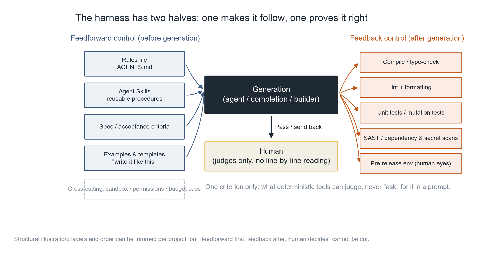
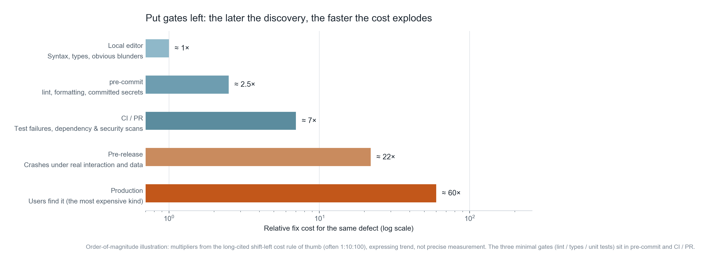
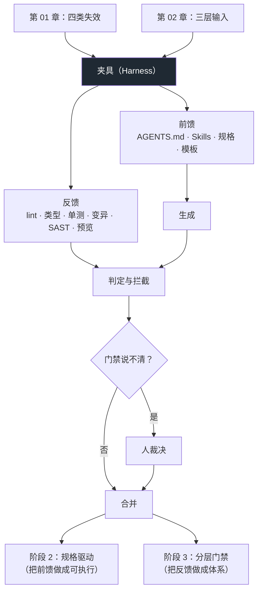

**English** | [中文](./ch03-two-halves-of-harness.zh.md)

# Chapter 03: The Two Halves of the Harness

> **Chapter overview**: The first two chapters answered "why does it go wrong" and "what should be fed". This chapter answers the hardest question: **without reading every line, on what grounds do you dare use it?** The answer is the harness — a set of devices that turn "what counts as correct" into machine-decidable conditions. This chapter gives you a minimal repository you can `git clone` and use directly, and demonstrates on the spot a gate catching a real regression.
>
> **Prerequisites**: Chapter 01 (the four failure classes), Chapter 02 (rules files and three-layer input). You need to be able to run command-line tools and know what a git commit is.
>
> **Core learning objectives**:
> - Be able to distinguish feedforward control from feedback control, and state clearly which layer each belongs in
> - Be able to build the three minimal gates (lint / types / unit tests) and explain what each catches and what it misses
> - Be able to judge whether a task should go to the agent or be written by you, with decidable, restatable criteria
> - Be able to explain why the "pre-release environment" is part of the harness, not part of the deployment process

---

## 1. Cognitive Anchor: you don't cancel code review just because the intern is smart

### 1.1 A familiar Monday

On Friday you finished a feature with the agent, tests all green, and you merged.

On Monday you open CI and find the main branch red — not the module you changed, but another colleague's feature. Trace it down and you find: your change flipped a shared utility's default parameter from `None` to `{}`, and your local tests happened not to cover that branch.

So you spend a whole morning doing a job nobody wants: **manual CI**.

The key to this scenario is not "the AI wrote it wrong". The key is: **the error appears in the form of "it runs"**. It gets past your manual clicking, past the three tests you wrote, and past your own eyes — because it looks exactly like correct code.

### 1.2 Intuitive analogy: a new colleague's onboarding + code review

Suppose you hired a very smart intern who knows nothing about your project. You would do two things:

**First, give him a document on day one**: how to run the project, where code goes, which files must not be touched, which commands to run before committing. This is called **feedforward** — telling him "what counts as correct" before he acts.

**Second, do a review after he commits**: read the diff, run the tests, have him change things. This is called **feedback** — judging against an external standard after he acts.

You would do both. And you would not cancel either one just because "he is very smart".

**A harness is exactly this, except the object is an agent.** Its two halves map exactly onto those two things:

- **Feedforward control (feedforward)**: guidance before generation. Rules files, Agent Skills, specs, templates, examples.
- **Feedback control (feedback)**: self-correction after generation. The compiler, type checking, linters, tests, mutation testing, security scanning, preview environments.

The formal source of this framework is Birgitta Böckeler's *Harness Engineering* (2026) on Martin Fowler's site; Thoughtworks Technology Radar Vol.34 listed it, together with "cognitive debt", as the annual theme.

**The boundary of the analogy**: an intern grows and remembers after the third mistake; an agent does not. Every session is its first day on the job. So the harness cannot rely on "it has learned"; it can only rely on "it is stopped every time".

---

## 2. First Principles: what tools can decide, don't demand with words

### 2.1 One criterion beats ten pages of methodology

The whole harness discipline can be compressed into one sentence:

> **Whatever can be decided by a deterministic tool, do not "demand" it via prompts.**

Compare:

| Your intent | Prompt approach (prayer) | Harness approach (law) |
|---|---|---|
| Types must be correct | "Please mind the type annotations" | `mypy --strict` — no merge without passing |
| Don't commit secrets | "Do not write secrets in" | `detect-private-key` hook + CI scanning |
| Column order must not change | "COLUMNS is an external contract" | One assertion `COLUMNS == (...)` |
| Don't swallow exceptions | "Exceptions must propagate correctly" | ruff rule `BLE001` (blind-except) |
| Don't make the change too big | "Keep changes minimal" | A human reads `git diff --stat` in the PR (this one really can only be judged by a human) |

The right column has one thing in common: **the verdict does not depend on the judge's mood.** The left column relies every time on the model "remembering this time".

This also explains why "prompt engineering" has a low ceiling in this field: it optimizes "whether it is willing to comply", while the harness solves "if it can't do it, it doesn't get through".

### 2.2 The two halves of the harness — where each one goes



*Figure 3-1: The four items on the left are feedforward, the five on the right are feedback, generation sits in the middle, and the human's position is below. Note the human is not in the "read line by line" position but in the "adjudicate" position — that displacement is the precondition for the whole method to hold. The dashed line at the bottom is cross-cutting concerns: sandbox, permissions, budget — they belong to neither half but constrain both sides at once.*

Division of responsibilities among the four positions:

| Position | Responsible for | Not responsible for | How it fails |
|---|---|---|---|
| **Feedforward** | Making the correct way "the least-effort way" | Guaranteeing correctness | Output drifts, crosses boundaries, style slides |
| **Generation** | Producing candidates | Judging itself | Confidently producing wrong answers |
| **Feedback** | Deciding, blocking, giving a readable failure reason | Fixing | Red light nobody reads; or green light that tested nothing |
| **Human** | Adjudicating the gray areas, bearing final responsibility | Reading code line by line | Rubber-stamping; or becoming manual CI |

**The last cell is the easiest to get wrong.** Once the human's position slips to "read line by line", the whole method degrades into "AI types, human proofreads" — which really is worse than writing it yourself. The human's value is in adjudication: only what gates cannot settle (is the design sound, is this complexity worth it, does this logic match the business) needs a human.

### 2.3 The three minimal gates: why these three

The three required by the plan are lint / type checking / unit tests. Not a random pick — each covers a different failure surface:

| Gate | What it catches | What it misses | Typical time |
|---|---|---|---|
| **lint** (ruff / eslint) | Style, unused imports, suspicious constructs (bare `except`, mutable default arguments), spelling-level errors | Any logic error | < 1 second |
| **Type checking** (mypy --strict / tsc) | Signature mismatches, unhandled `None`, "this attribute does not exist" (the main killer of API hallucination), missed call sites in cross-file changes | Semantically wrong but type-correct code | Seconds |
| **Unit tests** (pytest / vitest) | Behavioral regressions, edge cases, contracts (column order, status codes, idempotency) | Cases you didn't write; the tests themselves being wrong | Seconds to minutes |

Note that phrase in the second row, "the main killer of API hallucination" — the Chapter 01 kind where `stripe.Webhook.verify_signature()` has "package exists but method doesn't": a dependency scanner cannot catch it, **type checking can**, because the type stubs do not have that method. This is the concrete meaning of "gates must be layered": **no single point covers everything, but the three layers stacked cover most of it.**

So what about what unit tests cannot catch? Two supplements; this chapter will not expand them — stage 3 covers them systematically:

- **Mutation testing**: deliberately break the code and see whether the tests go red. What it checks is "whether the tests themselves have holes"; it is the cure for "forever-green tests".
- **SAST / dependency and secret scanning**: the cure for "absence of requirement" — the things that were "not written".

### 2.4 Gates must sit to the left



*Figure 3-2: The horizontal axis is a logarithmic scale; the five cells on the vertical axis are the five positions from "local editor" to "production". How to read it: for the same defect, fixing it at the pre-commit stage costs 1 unit; fixing it in production costs dozens. The three minimal gates are installed in the pre-commit and CI/PR cells — not because they are the strongest, but because they offer the best trade-off between "cheap" and "coverage".*

One **scope note** must be stated here: those multipliers (1× / 2.5× / 7× / 22× / 60×) come from the long-cited "defect left-shift cost" rule of thumb (often stated as 1:10:100); they are **not precise measurements**. Different teams and systems differ enormously (fixing a bug in production for a small tool may take 10 minutes; for a payment system it may mean downtime). Using it to express a "trend" is reasonable; using it to compute ROI is not rigorous.

The real conclusion is only one, and does not depend on those numbers: **the further left your gates sit, the less time you spend on "discovery", the less time you spend on "fixing", and the sum of the two falls.**

### 2.5 The pre-release environment: why it counts as harness, not deployment

Task 1 in the plan requires delivering "a previewable pre-release environment". Many people read this as ops work, schedule it last, or skip it outright. That is a misjudgment.

**The essence of the preview environment is "the last human-eye gate"; it blocks what automation cannot test**:

- The layout collapses under real data (your test data has only 3 rows);
- Empty states, error states, loading states were never built at all;
- The interaction is clickable, but the order defies humans;
- Chinese line-breaking, long English overflow.

What these four classes share: **visible at a glance, but unwritable as assertions.** So a human must look, and "a human looks" needs something lookable — a URL.

One engineering judgment:

> If a feature has "no preview URL", it has not passed the last human-eye gate; and the human-eye gate is the only one that covers "does it look right". **Skip it, and you have moved this check to your users.**

The minimal implementation (zero cost, runs in three seconds) is at `code/ch03/harness-template/scripts/preview.sh`: render the artifacts into a static table page and start a local HTTP server. For team collaboration, switch to Vercel / Netlify PR previews, or containers + a tunnel. **The form does not matter; what matters is "every change gets a clickable URL".**

### 2.6 Boundaries of the three tool forms

For the same "AI writes code", the three forms have completely different risk surfaces. Choosing a form is choosing harness strength:

| Form | What it can see | Best at | Most easily misses | Required harness strength |
|---|---|---|---|---|
| **CLI agent** (the kind running in a terminal) | Your entire filesystem; can execute commands and run tests | Cross-file refactors, driving a complete pipeline, verifying itself | **Excessive permissions**: can delete files, change config, `git push` | Highest: sandbox + short-lived credentials + human-in-the-loop |
| **In-IDE agent** (completion/chat inside the editor) | The current file + a little context; human-in-the-loop by default | Inline completion, local rewrites, explaining code | Sees only the local picture; easily writes code inconsistent with the whole | Medium: type checking + review |
| **Cloud generative builder** (click a few times on a web page, get a full-stack app) | Only your description | Fastest clickable prototype; usable by non-technical people | **Permissions and data layer**: exposed keys, missing row-level security policies, interfaces open by default | Highest (but users are usually the least aware): privilege and secret checks before launch |

The third row is the disaster zone. Chapter 4 gives a real incident genealogy; here you only need one sentence: **the form with the fastest generation speed is usually the one with the most missing security attributes**, because "not written" things do not throw errors, and the builder will not remind you that "you haven't set permissions yet".

### 2.7 Decision checklist: when to hand it to the agent, when to write it yourself

This is the most practical table in this stage. The criteria must be **decidable** — each answerable yes/no within 30 seconds:

| # | Criterion | Yes → | No → |
|---|---|---|---|
| 1 | Does this change have deterministic verification (at least one of lint / types / tests)? | Delegate | Fill in verification first, or switch to "human writes + AI assists" |
| 2 | How many files will the change touch? (> 3 means split) | Split into small batches | Delegate directly |
| 3 | Does it involve irreversible operations (deleting data, migration, payments, permission changes)? | **Human-in-the-loop**; AI only proposes | May execute automatically |
| 4 | Can you understand the diff it produced within 10 minutes? | Merge | Split smaller, or write it yourself |
| 5 | Is this a domain/module you are **not familiar with**? | Hand-write a minimal skeleton first, then let AI extend | Delegate directly |
| 6 | Is this a "copy once and done" mechanical task (renaming, batch replacement, boilerplate)? | **AI's strong suit** — don't write it yourself | Judge by the criteria above |

Criterion 5 is the most counterintuitive and the most important. Simon Willison's judgment is "AI tools amplify your existing expertise" — in unfamiliar territory it amplifies **your mistaken judgments**, and amplifies them smoothly. So in an unfamiliar module, the right order is: you write a 20-line minimal runnable version first (proving you understand the contract), then let AI extend on that skeleton. The skeleton is your anchor.

Criterion 6 is likewise empirical: **AI's cost-performance is highest on mechanical tasks**, because "correctness" there is fully decidable (rename done, tests still green = correct). Do not keep for yourself the work that most belongs to it.

---

## 3. Hands-on: building a usable harness repository

### 3.1 Goal and file tree

The goal is not "assemble the fullest toolchain" but: **a new member following this repository can get it running within 15 minutes and knows what counts as done.**

```text
harness-template/
├── AGENTS.md                  # 前馈：给智能体的宪法
├── pyproject.toml             # 三条门禁的配置都在这里
├── .pre-commit-config.yaml    # 门禁左移到提交前
├── .github/workflows/ci.yml   # 门禁的最终判决
├── src/csvkit/
│   ├── __init__.py
│   └── export.py              # 只有 30 行的业务实现
├── tests/test_export.py       # 5 条测试，其中 3 条是契约
└── scripts/
    ├── preview.sh             # 预发布：3 秒起一个可看的页面
    └── demo_gate_catch.sh     # 演示：门禁抓住一次真实回归
```

The complete files are in `code/ch03/harness-template/`. Below we only cover **why it is written this way**.

### 3.2 `AGENTS.md`: turning "what counts as correct" into decidable conditions

The key sections (full version in the file):

| Section | Actual wording (excerpt) | Why it is written this way |
|---|---|---|
| Commands | `ruff check .` / `mypy src` / `pytest -q`; done only when all three are green | Turns "done" from an adjective into three executable commands |
| Definition of done | All three green + new behavior has corresponding tests | Gives "is it finished?" a single answer |
| Hard conventions | Public functions must have type annotations; `Any` requires a comment stating its origin | Decidable by `grep` |
| Forbidden zones | Don't change the `COLUMNS` order; no new dependencies; don't read environment variables in `src/` | Each one machine-decidable or human-decidable in 30 seconds |
| Delivery format | The reply must contain: which files changed, the **raw output** of the three commands, what remains uncertain | Directly blocks "I ran it, no problem" |

The last item deserves a word of its own: requiring "paste the raw output, do not paraphrase" turns "self-certification" into a verifiable action. What it blocks is not just lying, but more often the case where **the model genuinely believes it ran the commands** — it did not actually run them, but the text it generated looks like it did.

### 3.3 The three gates: configuration as documentation

The three gates' configuration in `pyproject.toml` (excerpt):

```toml
[tool.ruff]
line-length = 100
target-version = "py311"

[tool.ruff.lint]
select = ["E", "F", "I", "UP", "B", "SIM", "RUF"]
# RUF001/002/003 会把中文全角标点报成 "ambiguous unicode"。
# 这是规则与项目语言不匹配，不是代码问题——按项目调规则，不要整条关掉 RUF。
ignore = ["RUF001", "RUF002", "RUF003"]

[tool.mypy]
python_version = "3.11"
strict = true
files = ["src", "tests"]
warn_unreachable = true

[tool.pytest.ini_options]
testpaths = ["tests"]
addopts = "-q --strict-markers"
```

About that `ignore` block, there is a real lesson that must be told:

> The first time this configuration ran `ruff check .` it was **red**: all 4 errors were `RUF002/RUF001` — Chinese full-width colons and full-width commas judged as "ambiguous unicode". The code was not wrong; the rules simply did not understand a Chinese-language project.

There are three reactions to this situation, and only one is right:

| Reaction | Consequence | Verdict |
|---|---|---|
| Turn off the whole `RUF` rule group | Takes dozens of genuinely useful checks down with it | ❌ Throw the baby out with the bathwater |
| Add `# noqa` to every line | In a Chinese project nearly every docstring needs it; noise drowns the real problems | ❌ Treats the symptom |
| **`ignore` only these three rules, with a comment explaining why** | Keeps the rest of `RUF`'s ability, and tells the next person why | ✅ |

This is the right way to handle "the first gate run is usually red": **first determine whether the rules are wrong or the code is wrong, then decide which side to change.** Write the reasoning into a comment, because three months later you will have forgotten.

The three gates running in CI:

```yaml
steps:
  - run: pip install -e ".[dev]"
  - name: lint
    run: ruff check .
  - name: typecheck
    run: mypy src tests
  - name: test
    run: pytest -q
  - name: secret scan
    run: |
      if grep -rInE "(sk-[A-Za-z0-9]{20,}|AKIA[0-9A-Z]{16})" --exclude-dir=.git .; then
        echo "::error::疑似密钥被提交"; exit 1
      fi
```

### 3.4 Real run: all three green

Actually executed under `code/ch03/harness-template/` (real output):

```text
$ ruff check .
All checks passed!

$ mypy src tests
Success: no issues found in 3 source files

$ pytest -q
.....                                                                    [100%]
```

Note the mypy line "3 source files": `src` and `tests` together contain 3 py files. **This piece of information is itself part of the gate** — if you added 5 files and it still says 3, the configuration is not scanning them, and the green light is fake.

### 3.5 Proving the gate really rings: inject a regression

All-green only proves "it is currently correct"; it does not prove "the gate is effective". So one more step is needed: **deliberately break it and see whether it rings.**

What `scripts/demo_gate_catch.sh` does: copy the code to a temporary directory, swap the standard library `csv.writer` for hand-spliced strings (a typical AI optimization suggestion — "simpler, fewer dependencies"), then run the tests.

Real output:

```text
$ bash scripts/demo_gate_catch.sh
已注入回归：改为手工拼接，不再转义逗号
--- pytest ---

    def test_commas_are_escaped(tmp_path: Path) -> None:
        out = tmp_path / "a.csv"
        to_csv([(1, "周会, 含研发", 0, "")], out)
>       assert '"周会, 含研发"' in out.read_text(encoding="utf-8")
E       assert '"周会, 含研发"' in 'id,name,amount,note\n1,周会, 含研发,0,\n'
E        +  where 'id,name,amount,note\n1,周会, 含研发,0,\n' = read_text(...)

tests/test_export.py:24: AssertionError
=========================== short test summary info ============================
FAILED tests/test_export.py::test_commas_are_escaped - assert '"周会, 含研发"...
--- 退出码：1 （非 0 表示门禁生效）---
```

Three layers of information, none dispensable:

1. **Who caught it**: unit tests, not lint, not type checking — because they **cannot see** "the comma was not escaped" (the types are perfectly correct).
2. **How it is presented**: the error message gives the expected and actual values directly (`'id,name,...1,周会, 含研发,0,\n'`). This makes the fix possible without re-debugging.
3. **How it exits**: exit code 1. CI relies on this code to decide "block or not"; it does not rely on a human reading logs.

This is the verification method for that requirement in the plan — "the gate must have blocked a real problem at least once". **All-green is not evidence; having been red once and correctly blocked is.**

### 3.6 Four things you can do right now

| Order | Action | Time | Payoff |
|---|---|---|---|
| 1 | Write `AGENTS.md` (within 40 lines, every section decidable) | 1 hour | Immediately fewer boundary-violating changes |
| 2 | Configure ruff + mypy + pytest in `pyproject.toml` | 1 hour | The three gates in place |
| 3 | Add a pre-commit hook | 20 minutes | Defects shift left to before commit |
| 4 | Write a `preview.sh` or hook up Vercel previews | 1–2 hours | Adds the human-eye gate |

All four together take less than half a day, and they cover 60% of this stage's payoff.

---

## 4. Common pitfalls and right-vs-wrong examples

| Easy pitfall | Why it is wrong | Correct practice |
|---|---|---|
| **"Set up the gates and everything is fine"** | Gates only prove "what I tested is not broken". About untested branches and unwritten assertions they know nothing | Regularly do "regression injection" (like 3.5) to prove the gate rings; in stage 3 add mutation testing to probe the tests' own holes |
| **"Finish the features first, add gates all at once at the end"** | The value of gates is "every change gets decided". Adding them last treats all history as a black box | Commit gates together with the first feature; rather have only lint at first |
| **"It looks fine to me, merging"** | The human eye has almost no discernment for "consistent style, correct syntax" AI output (Chapter 01, exercise 3) | Humans only adjudicate what gates cannot settle; "no problem" must point to some gate or some restatable criterion |
| **"The longer the rules file, the safer"** | Undecidable entries get ignored wholesale and dilute the real hard constraints (Chapter 02) | Every item decidable in 30 seconds; split long content into referenced documents |
| **"The pre-release environment is ops' business — later"** | It blocks the four classes of problems automation cannot test (layout, empty states, interaction, overflow); skipping it means letting users test for you | The minimal implementation runs in 3 seconds (`preview.sh`) — have it first, judge it later |
| **"Gates that are too strict slow you down"** | The real slowdown comes from "doing manual CI on Monday". Gates move cost from "after-the-fact investigation" to "30 seconds up front" | Start with the three minimal gates; use data to decide whether to add more, not gut feeling |
| **"The AI runs the tests itself"** | It may really have run them, or it may just have generated text that "looks like it ran" | Require raw output to be pasted; more reliable still is letting CI run them, not trusting self-reports in the conversation |

---

## 5. Chapter summary and local knowledge map

### 5.1 Five key points

- **Harness = feedforward + feedback.** The former makes the correct way the effortless way; the latter proves it was done right. Remove either half and it does not hold.
- **One criterion**: what can be decided deterministically must not be "demanded" via prompts. Prompts optimize "is it willing"; the harness decides "can it get through".
- **The three minimal gates each have blind spots**: lint cannot see logic, types cannot see semantics, unit tests cannot see unwritten cases. Hence layering.
- **Gates must sit as far left as possible**, and "all-green" is not evidence — **having been red once and correctly blocked** is.
- **The human's place is adjudication, not line-by-line reading.** Let the position slip and the whole method degrades into "AI types, human proofreads".

### 5.2 Concept topology



---

## 6. Tiered exercises

### Tier 1 · Intuition and concept check

1. Distinguish feedforward control from feedback control in one sentence, and give one existing example of each in your project.
2. Which of the following five belong to feedforward, feedback, or cross-cutting concerns? ① `AGENTS.md`; ② `mypy --strict`; ③ A sandbox where the agent can read but not write; ④ An example file saying "write it like this"; ⑤ CI that runs automatically on every push.
3. Why can "type checking" catch "calling a method that does not exist", while "dependency scanning" cannot?

### Tier 2 · Deduction and hands-on

4. Use `code/ch03/harness-template/` to start your own repository: replace the business code, keep the three gates and `AGENTS.md`. Then run a variant of `demo_gate_catch.sh` — **inject a regression yourself** and confirm the gate rings.
5. Using the six criteria in 2.7, score your five most recent tasks (yes/no each). Count up: how many tasks should actually have been "written by you" but were handed to AI?

### Tier 3 · Boundaries and transfer

6. Suppose your team has no CI (local commit = deploy). How should the three gates be adjusted? Give a scheme that "still works without CI", and state its biggest hole.
7. Can gates produce a "false sense of security"? Design a mechanism for discovering "the gates look strict but are not actually blocking anything".

<details>
<summary><strong>Click to expand: reference answers and in-depth analysis for this chapter's exercises</strong></summary>

#### 1. Feedforward vs feedback

**In one sentence**: feedforward is "putting the standard in front of its eyes before it acts"; feedback is "using tools to judge whether it met the bar after it acts".

Example: writing "public functions must have type annotations" in `AGENTS.md` is feedforward; `mypy --strict` erroring at commit time is feedback. The two manage the two ends of the same thing — feedforward only, and the model may not read or obey it; feedback only, and you will collect a pile of "avoidable" red lights.

#### 2. Classification

- ① `AGENTS.md` → **feedforward**
- ② `mypy --strict` → **feedback**
- ③ Sandbox (read but not write) → **cross-cutting** (it constrains behavior in both the feedforward and feedback phases; it belongs to neither half)
- ④ Example file → **feedforward**
- ⑤ CI → **feedback** (and the final verdict)

#### 3. Why type checking can catch API hallucination

Because type checking looks at **the shape of the interface**, not "whether the package exists". The `stripe` package is indeed installed, and installed correctly; but its type stubs have no `verify_signature` method, so `mypy` reports right at the attribute access: `"Webhook" has no attribute "verify_signature"`.

A dependency scanner only answers "can this module be imported"; it does not even care whether `stripe` has a `Webhook` class. **The two observe at different granularity: one looks at packages, one looks at members.**

This also explains why hallucinations of the "package exists but the API does not" kind are precisely type checking's main trophy — it does not need to know the truth; it only needs to know "it is not in the declaration".

#### 4. Injecting a regression yourself

A passing approach must satisfy three conditions:

- The regression must **look correct** (say, swapping `csv.writer` for hand-splicing — the code gets shorter and "cleaner");
- It must make **at least one test turn red**;
- You must be able to say "which test caught it, and on which assertion".

If your injected regression turned no test red, your test suite has a hole — this is exactly the problem stage 3's mutation testing solves. You can add one assertion by hand first.

#### 5. Self-scoring against the six criteria

There is no standard answer, but there is a common distribution: most people hand 2–3 "should have written it themselves" tasks to AI. Typically these two kinds:

- **Changes in a module you don't know** (criterion 5 = yes) → handed to AI, and you end up spending more time reviewing a diff you don't understand;
- **A refactor across 5 files** (criterion 2 = yes) → not split; AI missed two call sites, and type checking did not catch it (because `Any` was used).

The typical misjudgment in the other direction: hand-writing a script for a mechanical task like "rename 200 files in batch" — that should be a few minutes of AI work.

#### 6. What to do without CI

Scheme: **put the CI into a pre-push hook + a "evidence must be left behind" convention.**

- `pre-push` runs ruff / mypy / pytest, and rejects the push on any failure;
- The commit message template requires pasting the raw output of the three commands (or the CI equivalent);
- The deploy script runs the three gates once more at the start (in case someone used `--no-verify`).

Biggest hole: **local hooks can be bypassed with `--no-verify`, and everyone's environment differs** (your machine is green; a colleague's machine missing dependencies is also green — because it skipped). So the essence of this scheme is "replacing enforcement with convention"; it only holds in small, high-trust teams.

Another more practical route: use GitHub Actions' free tier, even for private repositories. **Having no CI is not a technical limit; usually it is a habit problem.**

#### 7. The gate's "false sense of security"

Three concrete mechanisms:

- **Regression-injection drill (once a month)**: randomly pick an assertion, deliberately break the implementation, and see whether CI goes red. If it doesn't, that's a hole. This is the cheapest detection method.
- **Coverage is not evidence; the mutation score is**: a test suite with 90% line coverage may contain no assertions at all ("executed" is not the same as "asserted"). Mutation testing can tell these two apart.
- **Look at the red-light history**: if CI has not been red once in the past 30 days, there are two possibilities — extremely high code quality (rare), or the gates are not blocking anything (common). Check `git log` for commits that "fixed a bug but added no test".

One-sentence criterion: **a gate that has never blocked anything is equal to no gate.** Its only function is to make people feel at ease.

</details>

---

### Data and sources for this chapter

| Content | Source | Convention |
|---|---|---|
| The feedforward / feedback harness framework | Martin Fowler's site, Birgitta Böckeler, "Harness Engineering", 2026 | This book's wording is a pedagogical rewrite; the structure is unchanged |
| Cognitive debt + harness + Agent Skills listed as the annual theme | Thoughtworks Technology Radar Vol.34, 2026-04 | Secondhand digest; conclusions match the official ones |
| Defect left-shift cost multipliers | A long-cited industry rule of thumb (often stated as 1:10:100) | **Magnitude illustration, not precise measurement**; varies enormously across teams |
| Choice of the three gates (ruff / mypy / pytest) | Official tool documentation | Equivalent substitutes: eslint / tsc / vitest; tools can be swapped, layering cannot be skipped |

---

## 7. Authoritative References and Further Reading

1. **GitHub Copilot Docs**: [GitHub Copilot Docs](https://docs.github.com/en/copilot) - the definitions and norms of this chapter are anchored here (verification date: `2026-10-23`).
2. **GitHub Spec Kit**: [GitHub Spec Kit](https://github.com/github/spec-kit) - the definitions and norms of this chapter are anchored here (verification date: `2026-10-23`).
3. **OWASP ASVS**: [OWASP ASVS](https://www.owasp.org/www-project-application-security-verification-standard/) - the definitions and norms of this chapter are anchored here (verification date: `2026-10-23`).

> Scope note: the sources above anchor **definitions and norms**, not extrapolated risk probabilities. Before citing any number, first verify the source's year and its denominator.
