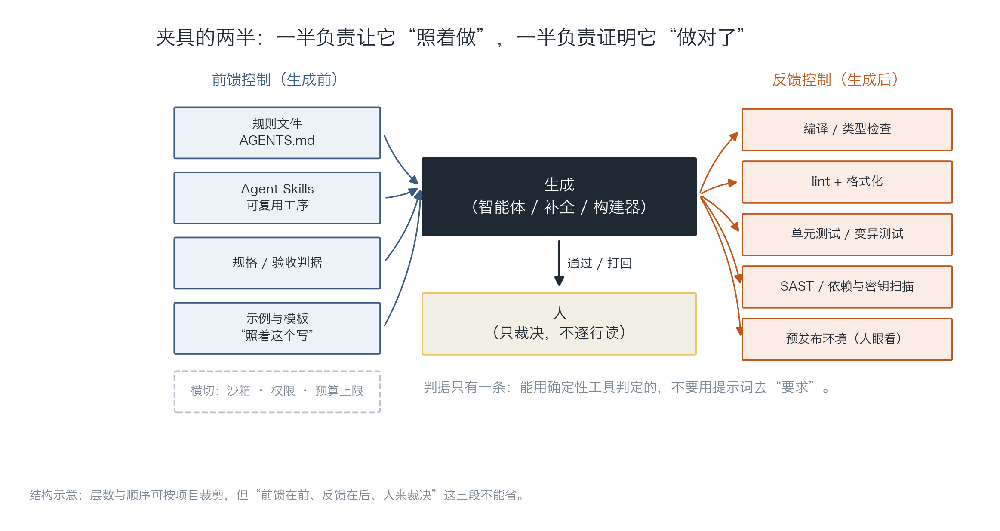
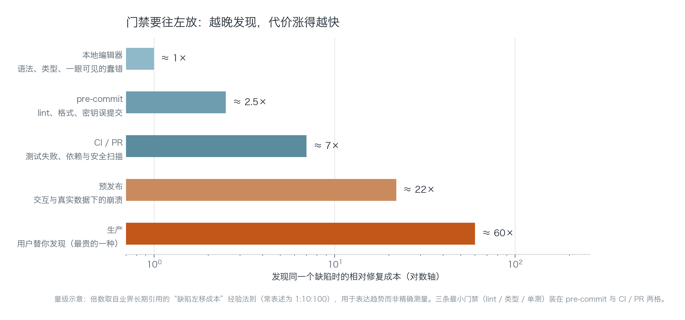
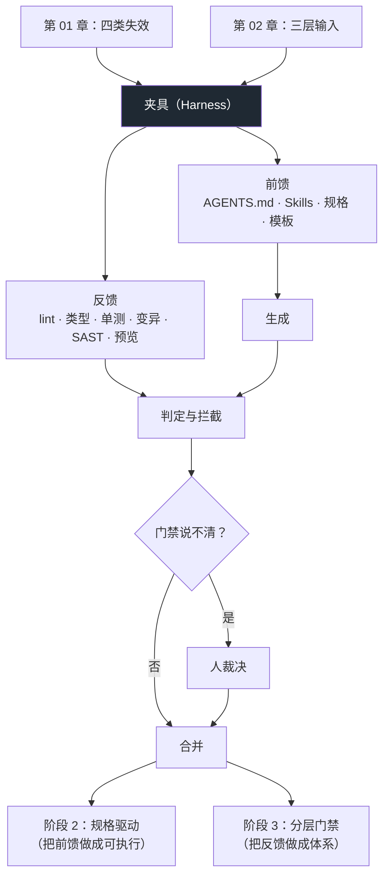

# 第 03 章：夹具的两半

> **本章导读**：前两章分别回答了"为什么会错"与"该喂什么"。本章回答最难的一问：**在不逐行读完的前提下，凭什么敢用？** 答案是夹具（harness）——一组把"什么算对"变成机器可判定条件的装置。本章会给你一个能直接 `git clone` 下来用的最小仓库，并当场演示门禁抓住一次真实回归。
>
> **前置知识**：第 01 章（四类失效）、第 02 章（规则文件与三层输入）。你需要会跑命令行、知道 git 提交是什么。
>
> **核心学习目标**：
> - 能区分前馈控制与反馈控制，并说清各自该放在哪一层
> - 能搭出三条最小门禁（lint / 类型 / 单测）并解释每条各自抓什么、抓不到什么
> - 能判断一个任务该交给智能体还是自己写，判据可判定、可复述
> - 能说清"预发布环境"为什么是夹具的一部分，而不是部署流程的一部分

---

## 1. 认知锚点：你不会因为实习生聪明就取消 code review

### 1.1 一个熟悉的周一

周五你用智能体写完了一个功能，测试全绿，你合并了。

周一你打开 CI，发现主干红了——不是你改的那个模块，是另一个同事的功能。追下去发现：你的改动把一个共享工具的默认参数从 `None` 改成了 `{}`，你本地的测试恰好没有覆盖那个分支。

于是你花了一个上午做一件谁都不想做的工作：**人肉 CI**。

这个场景的关键不是"AI 写错了"。关键是：**错误是以"能跑"的形态出现的**。它跑得过你的手动点击，跑得过你写的三条测试，也跑得过你自己的眼睛——因为它长得和正确代码一模一样。

### 1.2 直觉类比：新同事的 onboarding + code review

假设你招了一个非常聪明、但对你项目一无所知的实习生。你会做两件事：

**第一件，入职时给他一份文档**：项目怎么跑、代码放哪、哪些文件不能碰、提交前要跑什么命令。这叫**前馈**——在他动手之前，把"什么算对"告诉他。

**第二件，他提交后你做 review**：看 diff、跑测试、让他改。这叫**反馈**——在他动手之后，用外部标准判定。

这两件事你都会做。而你不会因为"他很聪明"就取消其中任何一件。

**夹具就是这个东西，只不过对象是智能体。** 它的两半正好对应上面两件事：

- **前馈控制（feedforward）**：生成之前的引导。规则文件、Agent Skills、规格、模板、示例。
- **反馈控制（feedback）**：生成之后的自纠。编译器、类型检查、linter、测试、变异测试、安全扫描、预览环境。

这个框架的正式来源是 Martin Fowler 站点上 Birgitta Böckeler 的 *Harness Engineering*（2026），Thoughtworks 技术雷达第 34 期把它与"认知债"一起列为年度主题。

**类比的边界**：实习生会成长，会在第三次犯错后记住；智能体不会。它每次会话都是第一天上班。所以夹具不能依赖"它学会了"，只能依赖"每次都被拦住"。

---

## 2. 第一性原理：能用工具判定的，不要用话去要求

### 2.1 一条判据，胜过十页方法论

整个夹具工程可以压缩成一句话：

> **凡是能被确定性工具判定的，就不要用提示词去"要求"。**

对比一下：

| 你的意图 | 提示词做法（祈祷） | 夹具做法（法律） |
|---|---|---|
| 类型要正确 | "请注意类型标注" | `mypy --strict`，不通过不给合 |
| 不要提交密钥 | "不要写入密钥" | `detect-private-key` 钩子 + CI 扫描 |
| 列顺序不能改 | "COLUMNS 是对外契约" | 一条断言 `COLUMNS == (...)` |
| 不要吞异常 | "异常要正确传播" | ruff 规则 `BLE001`（blind-except） |
| 改动别太大 | "保持改动最小" | PR 里人工看 `git diff --stat`（这条确实只能人看） |

右边那一列有个共同点：**判定结果不依赖判定者的心情**。左边那一列每次都要靠模型"这次记得住"。

这也解释了为什么"提示词工程"在这个领域的天花板很低：它优化的是"它愿不愿意照做"，而夹具解决的是"它做不到就过不去"。

### 2.2 夹具的两半，各放在哪一层



*图 3-1：左边四项是前馈，右边五项是反馈，中间是生成，下面是人的位置。注意人不在"逐行读"的位置上，而在"裁决"的位置上——这个位移是整套方法能成立的前提。底部虚线是横切关注点：沙箱、权限、预算，它们不属于任何一半，而是同时约束两边。*

四个位置的职责划分：

| 位置 | 负责 | 不负责 | 失败时的表现 |
|---|---|---|---|
| **前馈** | 让正确的做法成为"最省力的做法" | 保证正确 | 产出跑偏、越界、风格漂移 |
| **生成** | 产出候选 | 判定自己 | 自信地给出错误答案 |
| **反馈** | 判定、拦截、给出可读的失败原因 | 修复 | 红灯但没人看；或绿灯但没测到 |
| **人** | 裁决模糊地带、承担最终责任 | 逐行读代码 | 橡皮图章；或变成人肉 CI |

**最容易做错的是最后一格**。人的位置一旦滑到"逐行读"，整套方法就退化成"AI 打字、人看稿"——那确实不如自己写。人的价值在裁决：门禁说不清的（设计是否合理、这个复杂度是否值得、这段逻辑符不符合业务），才需要人。

### 2.3 三条最小门禁：为什么是这三条

规划里要求的三条是 lint / 类型检查 / 单测。这不是随便选的，它们各自覆盖不同的失效面：

| 门禁 | 能抓什么 | 抓不到什么 | 典型耗时 |
|---|---|---|---|
| **lint**（ruff / eslint） | 风格、无用导入、可疑写法（裸 `except`、可变默认参数）、拼写级错误 | 任何逻辑错误 | < 1 秒 |
| **类型检查**（mypy --strict / tsc） | 签名不匹配、`None` 未处理、"这个属性不存在"（API 幻觉的主要杀手）、跨文件改动的遗漏调用点 | 类型正确但语义错误 | 数秒 |
| **单测**（pytest / vitest） | 行为回归、边界条件、契约（列顺序、状态码、幂等性） | 你没写的用例；测试本身写错的情况 | 秒级到分钟级 |

注意第二行那句"API 幻觉的主要杀手"——第 01 章里 `stripe.Webhook.verify_signature()` 那种"包存在但方法不存在"，依赖扫描器抓不到，**类型检查能抓到**，因为类型存根里没有这个方法。这就是"门禁要分层"的具体含义：**没有单点覆盖全部，但三层叠起来能覆盖大部分**。

那单测抓不到的部分怎么办？两条补充，本章不展开，阶段 3 会系统讲：

- **变异测试**（mutation testing）：故意把代码改坏，看测试会不会红。它检验的是"测试本身有没有漏洞"，专治"永远绿的测试"。
- **SAST / 依赖与密钥扫描**：专治"缺失安全属性"——那些"没写"的东西。

### 2.4 门禁要往左放



*图 3-2：横轴是对数刻度，纵轴五格是从"本地编辑器"到"生产"的五个位置。读法：同一个缺陷，在 pre-commit 阶段修是 1 份成本，在生产环境修是几十份。三条最小门禁装在 pre-commit 与 CI/PR 这两格——不是因为它们最强，而是因为它们在"便宜"与"覆盖"之间最划算。*

这里必须说清一个**口径**：那些倍数（1× / 2.5× / 7× / 22× / 60×）来自业界长期引用的"缺陷左移成本"经验法则（常被表述为 1:10:100），**不是精确测量**。不同团队、不同系统差别很大（一个小工具在生产修 bug 可能只要 10 分钟，一个支付系统可能要停服）。用它来表达"趋势"是合理的，用它来算 ROI 是不严谨的。

真正的结论只有一条，且不依赖那些数字：**你的门禁越靠左，你花在"发现"上的时间越少，花在"修"上的时间越少，而两者的总和下降。**

### 2.5 预发布环境：为什么它算夹具，不算部署

规划的任务 1 要求交付"一个可预览的预发布环境"。很多人会把它理解成运维工作，于是排在最后做，或者干脆跳过。这是个误判。

**预览环境的本质是"最后一道人眼门禁"，它拦的是自动化测不出来的东西**：

- 布局在真实数据下崩了（你的测试数据只有 3 行）；
- 空态、错误态、加载态根本没做；
- 交互能点通，但顺序反人类；
- 中文换行、长英文溢出。

这四类问题的共同点：**能被一眼看出，但写不成断言**。所以它必须由人看，而"人看"需要一个能看的东西——一个 URL。

一条工程判断：

> 一个功能如果"没有预览地址"，它就没有经过最后一道人眼门禁；而人眼门禁是唯一能覆盖"看起来对不对"的一道。**省掉它，等于把这道检查挪到用户那里。**

最小实现（零成本、三秒可跑）在 `code/ch03/harness-template/scripts/preview.sh`：把产物渲染成静态表格页，起一个本地 HTTP 服务。要团队协作再换成 Vercel / Netlify 的 PR 预览，或者容器 + 隧道。**形态不重要，"每次改动都有一个可点的地址"这件事才重要。**

### 2.6 工具三形态的边界

同样是"AI 写代码"，三种形态的风险面完全不同。选形态就是选夹具强度：

| 形态 | 它看得见什么 | 最擅长 | 最容易漏 | 需要的夹具强度 |
|---|---|---|---|---|
| **CLI 智能体**（终端里跑的那种） | 你的整个文件系统、能执行命令、能跑测试 | 跨文件重构、跑通一条完整流水、自己验证 | **权限过大**：能删文件、能改配置、能 `git push` | 最高：沙箱 + 短寿命凭据 + 人在环 |
| **IDE 内智能体**（编辑器里的补全/对话） | 当前文件 + 少量上下文，人在环默认 | 行内补全、局部改写、解释代码 | 只看得见局部，容易写出与全局不一致的代码 | 中：类型检查 + 评审 |
| **云端生成式构建器**（网页上点几下生成全栈应用） | 只有你的描述 | 最快出可点原型、非技术人员可用 | **权限与数据层**：公开的 key、缺失的行级安全策略、默认全开的接口 | 最高（但用户往往最没有意识）：上线前的越权与密钥检查 |

第三行是重灾区。第 4 章会给真实事故谱系；这里只需要记住一句话：**生成速度最快的形态，通常是安全属性缺失最严重的形态**，因为"没写"的东西不会报错，而构建器不会提醒你"你还没设权限"。

### 2.7 决策清单：什么时候交给智能体，什么时候自己写

这是本阶段最实用的一张表。判据必须**可判定**——每条都能在 30 秒内回答是/否：

| # | 判据 | 是 → | 否 → |
|---|---|---|---|
| 1 | 这个改动有确定性验证手段吗（lint / 类型 / 测试至少命中一项）？ | 可以委托 | 先补验证，或改为"人写 + AI 辅助" |
| 2 | 改动会碰到几个文件？（> 3 就要拆） | 拆成小批 | 直接委托 |
| 3 | 涉及不可逆操作吗（删数据、迁移、支付、改权限）？ | **人在环**，AI 只出方案 | 可自动执行 |
| 4 | 你能在 10 分钟内读懂它给出的 diff 吗？ | 可以合并 | 拆小，或自己写 |
| 5 | 这是你**不熟**的领域/模块吗？ | 先手写最小骨架，再让 AI 扩展 | 直接委托 |
| 6 | 这是一个"抄一遍就完"的机械任务吗（重命名、批量替换、加样板）？ | **AI 的强项**，别自己写 | 按上面几条判断 |

第 5 条最反直觉，但最重要。Simon Willison 的判断是"AI 工具放大的是你已有的专业能力"——在不熟的领域，它放大的是**你的错误判断**，而且放大得很顺滑。所以在陌生模块里，正确顺序是：你先写一个 20 行的最小可运行版本（证明你理解了契约），再让 AI 在这个骨架上扩展。骨架是你的锚。

第 6 条同样是经验：**机械任务上 AI 的性价比最高**，因为这类任务的"正确"完全可判定（改完名字，测试还绿就是对的）。不要把最该交给它的活留给自己。

---

## 3. 手把手：搭一个能用的夹具仓库

### 3.1 目标与文件树

目标不是"配一套最全的工具链"，而是：**一个新成员照这个仓库做，能在 15 分钟内跑通，并且知道什么算做完。**

```text
harness-template/
├── AGENTS.md                  # 前馈：给智能体的宪法
├── pyproject.toml             # 三条门禁的配置都在这里
├── .pre-commit-config.yaml    # 门禁左移到提交前
├── .github/workflows/ci.yml   # 门禁的最终判决
├── src/csvkit/
│   ├── __init__.py
│   └── export.py              # 只有 30 行的业务实现
├── tests/test_export.py       # 5 条测试，其中 3 条是契约
└── scripts/
    ├── preview.sh             # 预发布：3 秒起一个可看的页面
    └── demo_gate_catch.sh     # 演示：门禁抓住一次真实回归
```

完整文件在 `code/ch03/harness-template/`。下面只讲**为什么这么写**。

### 3.2 `AGENTS.md`：把"什么算对"写成可判定条件

关键段落（完整版见文件）：

| 段落 | 实际写法（摘） | 为什么这么写 |
|---|---|---|
| 命令 | `ruff check .` / `mypy src` / `pytest -q`，三条全绿才算完成 | 把"完成"从一个形容词变成三条可执行命令 |
| 完成定义 | 三条全绿 + 新增行为有对应测试 | 让"做完了吗"有唯一答案 |
| 硬性约定 | 公开函数必须有类型标注；`Any` 需注释来源 | 可 `grep` 判定 |
| 禁区 | 不改 `COLUMNS` 顺序；不新增依赖；不在 `src/` 里读环境变量 | 每条都能被机器或 30 秒人工判定 |
| 交付格式 | 回复必须含：改了哪些文件、三条命令的**原始输出**、仍不确定的地方 | 直接堵死"我跑过了，没问题" |

最后一条值得单独说：要求"贴原始输出，不要转述"，是把"自证"变成可核验的动作。它拦住的不只是撒谎，更多是**模型真心以为跑过了**的情况——它没有真的运行，但它生成的文本看起来像是运行过。

### 3.3 三条门禁：配置即文档

`pyproject.toml` 里三条门禁的配置（节选）：

```toml
[tool.ruff]
line-length = 100
target-version = "py311"

[tool.ruff.lint]
select = ["E", "F", "I", "UP", "B", "SIM", "RUF"]
# RUF001/002/003 会把中文全角标点报成 "ambiguous unicode"。
# 这是规则与项目语言不匹配，不是代码问题——按项目调规则，不要整条关掉 RUF。
ignore = ["RUF001", "RUF002", "RUF003"]

[tool.mypy]
python_version = "3.11"
strict = true
files = ["src", "tests"]
warn_unreachable = true

[tool.pytest.ini_options]
testpaths = ["tests"]
addopts = "-q --strict-markers"
```

关于那段 `ignore`，有一个真实的教训必须讲：

> 这份配置第一次跑 `ruff check .` 时是**红的**，4 个错误全是 `RUF002/RUF001`：中文全角冒号、全角逗号被判定为"ambiguous unicode"。代码没有错，是规则不认识中文项目。

遇到这种情况有三种反应，只有一种是对的：

| 反应 | 后果 | 评价 |
|---|---|---|
| 把 `RUF` 整组规则关掉 | 顺带关掉了几十条真正有用的检查 | ❌ 因噎废食 |
| 给每一行加 `# noqa` | 中文项目里几乎每个 docstring 都要加，噪音淹没真问题 | ❌ 治标 |
| **只 `ignore` 这三条规则，并写注释说明原因** | 保留 `RUF` 其余能力，同时让下一个人知道为什么 | ✅ |

这就是"门禁第一次跑通常是红的"这件事的正确处理方式：**先判断是规则错了还是代码错了，再决定改哪边**。判据写进注释，因为三个月后你会忘记。

CI 里三条门禁跑起来：

```yaml
steps:
  - run: pip install -e ".[dev]"
  - name: lint
    run: ruff check .
  - name: typecheck
    run: mypy src tests
  - name: test
    run: pytest -q
  - name: secret scan
    run: |
      if grep -rInE "(sk-[A-Za-z0-9]{20,}|AKIA[0-9A-Z]{16})" --exclude-dir=.git .; then
        echo "::error::疑似密钥被提交"; exit 1
      fi
```

### 3.4 真实运行：三条全绿

在 `code/ch03/harness-template/` 下实际执行（真实输出）：

```text
$ ruff check .
All checks passed!

$ mypy src tests
Success: no issues found in 3 source files

$ pytest -q
.....                                                                    [100%]
```

注意 mypy 那行 "3 source files"：`src` 与 `tests` 里一共 3 个 py 文件。**这条信息本身就是门禁的一部分**——如果你加了 5 个文件而它还说 3 个，说明配置没扫到，绿灯是假的。

### 3.5 证明门禁真的会响：注入一次回归

全绿只能证明"当前是对的"，不能证明"门禁有效"。所以还需要一步：**故意弄坏它，看它响不响**。

`scripts/demo_gate_catch.sh` 做的事：把代码复制到临时目录，用标准库 `csv.writer` 换成人手拼接字符串（"更简单、更少依赖"这种典型的 AI 优化建议），然后跑测试。

真实输出：

```text
$ bash scripts/demo_gate_catch.sh
已注入回归：改为手工拼接，不再转义逗号
--- pytest ---

    def test_commas_are_escaped(tmp_path: Path) -> None:
        out = tmp_path / "a.csv"
        to_csv([(1, "周会, 含研发", 0, "")], out)
>       assert '"周会, 含研发"' in out.read_text(encoding="utf-8")
E       assert '"周会, 含研发"' in 'id,name,amount,note\n1,周会, 含研发,0,\n'
E        +  where 'id,name,amount,note\n1,周会, 含研发,0,\n' = read_text(...)

tests/test_export.py:24: AssertionError
=========================== short test summary info ============================
FAILED tests/test_export.py::test_commas_are_escaped - assert '"周会, 含研发"...
--- 退出码：1 （非 0 表示门禁生效）---
```

三重信息，缺一不可：

1. **谁抓到的**：是单测，不是 lint、不是类型检查——因为它们**看不到**"逗号没转义"（类型完全正确）。
2. **怎么呈现的**：错误信息里直接给出了期望值与实际值（`'id,name,...1,周会, 含研发,0,\n'`）。这让修复不需要重新调试。
3. **怎么退出**：退出码 1。CI 靠这个码决定"拦不拦"，不靠人读日志。

这就是规划里那条要求——"门禁至少拦住过一次真实问题"——的验证方式。**全绿不算证据，红过一次并且被正确拦住才算。**

### 3.6 现在就可以做的四件事

| 顺序 | 动作 | 耗时 | 收益 |
|---|---|---|---|
| 1 | 写 `AGENTS.md`（40 行以内，每段可判定） | 1 小时 | 立刻减少越界改动 |
| 2 | 在 `pyproject.toml` 里配 ruff + mypy + pytest | 1 小时 | 三条门禁就位 |
| 3 | 加 pre-commit 钩子 | 20 分钟 | 缺陷左移到提交前 |
| 4 | 写一个 `preview.sh` 或接 Vercel 预览 | 1—2 小时 | 补上人眼门禁 |

四件事加起来不超过半天，而它们覆盖了本阶段 60% 的收益。

---

## 4. 常见误区与正反例

| 容易踩的坑 | 为什么会错 | 正确做法 |
|---|---|---|
| **"门禁配好就万事大吉"** | 门禁只证明"我测的东西没坏"。没测到的分支、没写的断言，它一无所知 | 定期做"注入回归"（3.5 那种），证明门禁会响；阶段 3 加变异测试查测试本身的漏洞 |
| **"先把功能做完，最后统一加门禁"** | 门禁的价值在"每次改动都被判定"。最后加，等于把全部历史改动当黑盒 | 门禁和第一个功能一起提交；宁可先只有 lint |
| **"我看着没问题就合并"** | 人眼对"风格统一、语法正确"的 AI 产出几乎没有分辨力（第 01 章练习 3） | 人只裁决门禁说不清的事；"没问题"必须能指向某条门禁或某条可复述的判据 |
| **"规则文件写得越长越安全"** | 不可判定的条目会被整体忽略，且稀释真正的硬约束（第 02 章） | 每条 30 秒可判定；把长内容拆成引用文档 |
| **"预发布环境是运维的事，以后再说"** | 它拦的是自动化测不出来的四类问题（布局、空态、交互、溢出），跳过等于让用户替你测 | 最小实现 3 秒可跑（`preview.sh`），先有再说好不好 |
| **"门禁太严会拖慢进度"** | 真正的拖慢来自"周一做人肉 CI"。门禁把成本从"事后排查"挪到"事前 30 秒" | 从三条最小门禁开始，用数据决定要不要加，而不是凭感觉砍 |
| **"AI 自己会跑测试"** | 它可能真的跑了，也可能只是生成了"看起来像跑过"的文本 | 要求贴原始输出；更可靠的是让 CI 跑，而不是信对话里的自述 |

---

## 5. 本章小结与局部知识图谱

### 5.1 五个要点

- **夹具 = 前馈 + 反馈**。前者让正确做法变省力，后者证明做对了。缺任一半都不成立。
- **一条判据**：能确定性判定的，不要用提示词要求。提示词优化"愿不愿意"，夹具决定"过不过得去"。
- **三条最小门禁各有盲区**：lint 看不见逻辑，类型看不见语义，单测看不见没写的用例。所以要分层。
- **门禁要往左放**，且"全绿"不算证据——**红过一次并被正确拦住**才算。
- **人的位置在裁决，不在逐行读**。位置一滑，整套方法退化成"AI 打字、人看稿"。

### 5.2 概念拓扑



---

## 6. 分级通关练习

### Tier 1 · 直觉与概念核验

1. 用一句话区分前馈控制与反馈控制，并各举一个你项目里已有的例子。
2. 下面五项分别属于前馈、反馈，还是横切关注点？① `AGENTS.md`；② `mypy --strict`；③ 智能体只能读、不能写的沙箱；④ 一份"照着这个写"的示例文件；⑤ 每次 push 自动跑的 CI。
3. 为什么"类型检查"能抓住"调用了不存在的方法"，而"依赖扫描"抓不到？

### Tier 2 · 推演与实操

4. 用 `code/ch03/harness-template/` 起一个你自己的仓库：替换业务代码，保留三条门禁与 `AGENTS.md`。然后跑一次 `demo_gate_catch.sh` 的变体——**你自己注入一个回归**，确认门禁会响。
5. 按 2.7 的六条判据，给你最近五个任务打分（每条是/否）。统计一下：有几个任务其实应该"自己写"而你交给了 AI？

### Tier 3 · 边界与迁移

6. 假设你的团队没有 CI（本地提交即部署），三条门禁该怎么调整？请给出一个"在没有 CI 的前提下仍然有效"的方案，并说明它最大的漏洞。
7. 门禁会不会产生"虚假的安全感"？请设计一条机制，用来发现"门禁看起来很严，实际上没在拦东西"。

<details>
<summary><strong>点击展开：本章练习参考答案与深度解析</strong></summary>

#### 1. 前馈 vs 反馈

**一句话**：前馈是"动手之前把标准放进它眼前"，反馈是"动手之后用工具判定它是否达标"。

例子：`AGENTS.md` 里写"公开函数必须标注类型"是前馈；提交时 `mypy --strict` 报错是反馈。两者管的是同一件事的两端——只做前馈，模型可能没读到或不遵守；只做反馈，你会收到一堆"本来可以避免"的红灯。

#### 2. 归类

- ① `AGENTS.md` → **前馈**
- ② `mypy --strict` → **反馈**
- ③ 沙箱（能读不能写） → **横切**（它同时限制前馈与反馈两个阶段的行为，不属于任何一半）
- ④ 示例文件 → **前馈**
- ⑤ CI → **反馈**（且是最终判决）

#### 3. 类型检查为什么能抓 API 幻觉

因为类型检查看的是**接口的形状**，不是"包是否存在"。`stripe` 这个包确实装着，装得很正确；但它的类型存根里没有 `verify_signature` 这个方法，`mypy` 会在属性访问处直接报 `"Webhook" has no attribute "verify_signature"`。

依赖扫描器只回答"这个模块能不能 import"，它连 `stripe` 有没有 `Webhook` 这个类都不关心。**两者观察的粒度不同：一个看包，一个看成员。**

这也解释了为什么"包存在但 API 不存在"这类幻觉，恰恰是类型检查的主要战绩——它不需要知道真相，只需要知道"声明里没有"。

#### 4. 自己注入一次回归

合格的做法要满足三条：

- 回归必须**看起来是对的**（比如把 `csv.writer` 换成手写拼接，代码更短、更"简洁"）；
- 必须**至少有一条测试变红**；
- 你要能说出"是哪条测试、因为什么断言抓住的"。

如果你注入的回归没有让任何测试变红，那说明你的测试套件有洞——这正是阶段 3 变异测试要解决的问题。可以先手动补一条断言。

#### 5. 六条判据自评

没有标准答案，但有一个常见的分布：多数人会把 2—3 个"其实该自己写"的任务交给 AI。典型是这两类：

- **你不熟的模块里的改动**（判据 5 = 是）→ 交给了 AI，结果花了更多时间审核一个你不理解的 diff；
- **跨 5 个文件的重构**（判据 2 = 是）→ 没拆，AI 改漏了两处调用点，类型检查没覆盖到（因为用了 `Any`）。

反过来的典型误判是：把"批量重命名 200 个文件"这种机械任务自己手写脚本——那本该是 AI 几分钟的事。

#### 6. 没有 CI 怎么办

方案：**把 CI 装进 pre-push 钩子 + 一个"必须留下证据"的约定**。

- `pre-push` 跑 ruff / mypy / pytest，任一失败就拒绝 push；
- 提交信息模板要求贴三条命令的原始输出（或 CI 的等价物）；
- 部署脚本开头再跑一次三条门禁（防止有人 `--no-verify`）。

最大漏洞：**本地钩子可以被 `--no-verify` 绕过，而且每个人的环境不同**（你的机器绿，同事的机器缺依赖也会绿——因为跳过了）。所以这个方案的本质是"用约定替代强制"，它只在小团队、高信任度下成立。

另一条更实际的路：用 GitHub Actions 的免费额度，哪怕是私有仓库。**没有 CI 不是技术限制，通常是习惯问题。**

#### 7. 门禁的"虚假安全感"

三个具体机制：

- **注入回归演练（每月一次）**：随机挑一条断言，故意破坏实现，看 CI 会不会红。不会红就是洞。这是最便宜的检测手段。
- **覆盖率不是证据，变异分数才是**：行覆盖率 90% 的测试套件可能一条断言都没有（"执行过"不等于"断言过"）。变异测试能区分这两件事。
- **看红灯的历史**：如果 CI 过去 30 天从没红过，两种可能——代码质量极高（少见），或门禁没在拦东西（常见）。去查 `git log` 里有没有"修了 bug 但测试没加"的提交。

一句话判据：**一个从来没拦住过任何东西的门禁，等于没有门禁。** 它唯一的作用是让人心安。

</details>

---

### 本章数据与来源

| 内容 | 来源 | 口径 |
|---|---|---|
| 前馈 / 反馈控制的夹具框架 | Martin Fowler 站点，Birgitta Böckeler《Harness Engineering》，2026 | 本书的表述做了教学化重写，结构未改 |
| 认知债 + 夹具 + Agent Skills 列为年度主题 | Thoughtworks Technology Radar Vol.34，2026-04 | 二手梳理，结论与官方一致 |
| 缺陷左移成本倍数 | 业界长期引用的经验法则（常表述为 1:10:100） | **量级示意，非精确测量**，不同团队差异极大 |
| 三条门禁的选型（ruff / mypy / pytest） | 工具官方文档 | 等价替代：eslint / tsc / vitest；工具可换，分层不可省 |

---

## 7. 本章权威参考信源与延伸阅读 (Authoritative References)

1. **GitHub Copilot Docs**：[GitHub Copilot Docs](https://docs.github.com/en/copilot) - 本章的定义与规范以此为锚（核验日期：`2026-10-23`）。
2. **GitHub Spec Kit**：[GitHub Spec Kit](https://github.com/github/spec-kit) - 本章的定义与规范以此为锚（核验日期：`2026-10-23`）。
3. **OWASP ASVS**：[OWASP ASVS](https://www.owasp.org/www-project-application-security-verification-standard/) - 本章的定义与规范以此为锚（核验日期：`2026-10-23`）。

> 口径提示：以上信源用于锚定**定义与规范**，不用于外推风险概率。引用任何数字前，先核对来源年份与分母。
