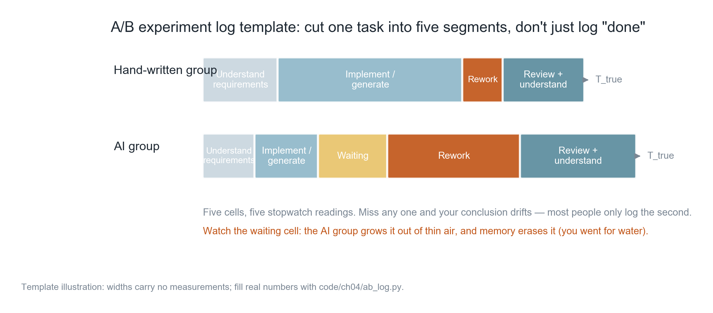
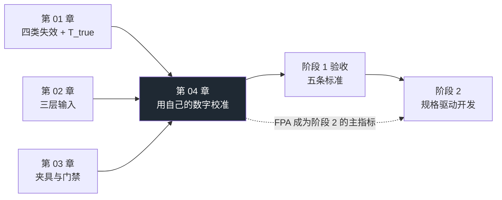

**English** | [中文](./ch04-calibrate-with-your-own-numbers.zh.md)

# Chapter 04: Calibrate with Your Own Numbers

> **Chapter overview**: The first three chapters gave you judgment (why it gets slower), input (what to feed), and verdict (who judges correctness). This chapter fills in the last piece: **what grounds you have to trust your own judgment**. It teaches no further theory; it does one thing — give you a number that belongs to your own project, and teach you how to speak when the sample is small.
>
> **Prerequisites**: Chapter 01 (T_first / T_true), Chapter 03 (gates and acceptance criteria). You need to be able to use the command line and read CSV.
>
> **Core learning objectives**:
> - Be able to design an A/B comparison that does not fool yourself (same-kind tasks, randomized order, criteria first)
> - Be able to record one task's true time cost in five segments and compute T_true
> - Be able to correctly interpret small-sample results: when you may speak of direction, when you may only say "don't know"
> - Complete the five acceptance criteria of Stage 1, leaving verifiable evidence behind

---

## 1. Cognitive Anchor: it's not that you distrust data — you just don't have your own yet

### 1.1 Most people's first reaction after reading Chapter 1

"Those 16 METR developers were senior engineers maintaining million-line repositories. My project is only twenty thousand lines, written by me alone — the situation is different."

This statement **may be completely correct**. Its problem is not the conclusion but the evidence: you have no data about yourself, so the word "different" is a belief, not a judgment.

And this has an awkward consequence: **you cannot make a better decision next week.** Because your basis for deciding is still feeling — and Chapter 1 has already shown that feeling is systematically over-optimistic on this question.

### 1.2 A result that really happens

Suppose you really do measure (Section 3 provides the tools for this procedure):

Three same-kind tasks, one hand-written group, one AI group. You measure:

- Hand-written group T_true median 98 minutes, AI group 118 minutes;
- Hand-written group first-pass acceptance rate 67%, AI group 33%;
- The AI group's "waiting" took 17% of the time — a segment you never even realized existed.

You may be disappointed, or you may disagree. But note: **this result is itself no more valuable than "I feel faster"** — because there are only 3 records. Its correct reading is "the direction may be wrong, but the evidence is insufficient", not "AI made me 20% slower".

What this chapter teaches is exactly this distinction. Because the vast majority of "AI productivity" debates are lost on precisely this distinction.

### 1.3 Intuitive Analogy: a health-check report vs how you feel

Saying "I've been feeling quite healthy lately" and receiving a health report saying "blood lipids are high" are two kinds of information.

- The former is **how you feel**: real and worth referencing, but not re-checkable, not comparable, easily dominated by a single experience.
- The latter is **measurement**: possibly inaccurate (instrument error, single-session fluctuation), but it has units, reference ranges, and can be measured again in three months for comparison.

The key point: the value of the health report is not "the absolute value this time", but that **it gives you a point you can measure repeatedly**. Only after the second and third time does a trend appear.

A/B experiments are the same. **The value of 3 records is not a conclusion; it is "you finally have a baseline".**

---

## 2. First Principles: how to measure without fooling yourself

### 2.1 Three principles

**Principle one: only same-kind tasks are comparable.** "Fixing a bug" and "adding a page" are not the same kind of task. Chapter 1 said task type determines the direction of the conclusion — for bug fixes the bulk of the time is "understanding the existing code", where AI cannot help; for new boilerplate code the bulk is "typing", where AI helps enormously. Measure them mixed together and you get an average — and the average hides the only useful information.

**Practice**: pick **three similar small features in the same product** (say, "add a filter to each of three list pages"), not three tasks of different difficulty.

**Principle two: the stopwatch, not recollection.** Chapter 1 explained that `T_rework` and `T_review` are fragmented and cannot be reliably recalled afterwards. You must record on the spot.

**Practice**: start timing when the task starts; cut a segment when rework begins. Even just noting in a phone memo "14:20 rework started" counts.

**Principle three: complete accounting.** Recording only `T_first` means recording only the segment favorable to you.

**Practice**: cut one task into five segments (next section).

### 2.2 The five-segment model



*Figure 4-1: The widths represent no measured result; this is only a template. What to look at is "the AI group gets an extra 'wait' cell out of thin air" — you went to pour a glass of water, came back and it had finished; this segment simply does not exist in your memory.*

| Segment | Meaning | Why it must be recorded separately |
|---|---|---|
| **Understand** | Figuring out what to do | This segment often shrinks for the AI group (you can have it restate the requirement first), but if the requirement itself is vague, this segment becomes "repeated clarification" |
| **Build / generate** | Actually writing it out | The one segment AI definitely compresses, and the only one you will remember |
| **Wait** | Waiting for the model to output/think | Extremely easily erased from memory; in long tasks it is a real cost |
| **Rework** | Fixing bugs, filling edge cases, changing until mergeable | The easiest to underestimate, because it is fragmented and emotionally unpleasant |
| **Review + understand** | Reading the diff, understanding why it was written that way | The essence of this segment is **the current-period payment on cognitive debt** |

The sum of the five segments is `T_true`. **Any "productivity report" that counts only the first two segments is not worth believing** — including your own.

### 2.3 Four metrics: keep only the decidable ones

| Metric | Definition | Why use it | Common misuse |
|---|---|---|---|
| **T_true** | Sum of the five segments | The only time that corresponds to "delivery" | Recording only generation time, then calling it "AI time used" |
| **First-pass acceptance rate (FPA)** | Tasks whose first output passed acceptance ÷ total tasks | Far more honest than "how many lines were generated": it folds "rework" into the numerator | Using "how many changes" as the denominator; editing acceptance criteria after the fact |
| **Defect density** | Defects found within 7 days after each task's delivery ÷ number of tasks | Catches "fast but booby-trapped" | Counting only production defects, ignoring those blocked by gates (those should count as "blocked", not "defects") |
| **Rework rate** | Rework time ÷ T_true | Says in one line "how unreliable this change was" | Confused with FPA; the two look at time vs count |

Among the four metrics, **FPA is the one most worth tracking long-term.** Because it does not depend on recalling time — it only needs one "pass/fail" judgment; and it is extremely sensitive to spec quality — which is exactly the theme of stage 2.

### 2.4 Experiment design: five rules that must be held

1. **Freeze the requirement**: write it out as one paragraph and save it to a file; neither group may change it. Changing the requirement = changing the subject of the experiment.
2. **Randomize the order**: flip a coin for which group goes first. The first group enjoys the advantage of "I have already thought it through once".
3. **Washout interval**: at least 1 day between the two groups. When you do the same task a second time you already know the answer; the gap weakens but does not eliminate this effect — so the more robust approach is **six different tasks, randomly split into two groups** (3 hand-written, 3 AI), rather than doing the same task twice.
4. **Criteria first**: write down "what counts as passing" before starting (e.g.: `pytest` all green + new tests added + no forbidden files touched). **"Looks reasonable" may not appear in the criteria.**
5. **Record at the time, not from retrospective memory**: fill in the form the moment the task ends. Fill it in two days later and you are filling in a story, not data.

Rule 3 is the easiest to ignore and the most capable of ruining a conclusion. Do the same task twice and the second "AI group" is actually enjoying the fruits of the first round of thinking — this is called the learning effect, and it systematically makes the second group look faster.

### 2.5 What small samples can and cannot say

This is the most important section in the chapter, because the vast majority of "AI productivity" discussions crash right here.

**What you can say at n = 3:**
- "On these three tasks of mine, the AI group's median T_true was 20 minutes higher than the hand-written group's." (description)
- "The direction is opposite to what I expected; worth measuring more." (observation)
- "The AI group's waiting time was 17% — I never realized that before." (finding)

**What you cannot say at n = 3:**
- "AI made me 20% slower." (this treats a point estimate as a population parameter)
- "AI is useless on my project." (extrapolation)
- "This proves METR's conclusion." (that is someone else's conclusion, not yours)

**Why not**: with 3 observations the sampling fluctuation is enormous. Do the same batch of tasks on a different day and the median difference may swing from +20 to −15. Statistically what you must give is an **interval**, not a point — and an interval from 3 points is so wide it contains almost every possibility; the conclusion is "don't know".

This is not telling you not to measure. Quite the opposite: **after measuring you will know "I don't know" — a huge improvement over "I feel faster"**, because the former pushes you to keep measuring while the latter stops your thinking.

A sentence you can memorize verbatim:

> **When n is small, the correct form of a conclusion is "direction" and "to be continued", not "magnitude" and "verdict".**

---

## 3. Hands-on: run it once and get your first set of numbers

### 3.1 Recording format

One CSV, one row per task:

```csv
task,group,understand,build,wait,rework,review,defects,first_pass
导出CSV,hand,12,58,0,8,20,1,1
导出CSV,ai,9,21,17,46,25,2,0
```

Column meanings: `group ∈ {hand, ai}`; the middle five columns are minutes; `defects` is the number of defects found within 7 days after delivery; `first_pass` is 1/0 (whether the first output passed acceptance).

Three decisions in the field design are all worth stating:

- **Why `wait` gets its own column**: because it is extremely easily erased from memory, and it is a cost unique to the AI group.
- **Why `first_pass` is 1/0 rather than "how many changes"**: because "changed once" and "changed ten times" make no semantic difference (both failed), but if you record counts you will be tempted to compute the average count, which is a meaningless number.
- **Why `defects` says "within 7 days"**: because defects have a time window. Without a window, the "defect count" metric cannot be compared.

### 3.2 The aggregation tool

`code/ch04/ab_log.py` does only three things: compute T_true, aggregate by group, and give a bootstrap interval for the median difference.

**Sample data** (`sample_log.csv`, **the numbers are made up, only to demonstrate the format**):

```text
$ python code/ch04/ab_log.py code/ch04/sample_log.csv

记录文件：code/ch04/sample_log.csv（共 6 条）

组别      n    T_true 中位数       均值      首轮验收率     缺陷/任务      等待占比
-----------------------------------------------------------------------------------
手写      3          98 分     93       67%      0.67        0%
AI      3         118 分    107       33%      2.00       17%

时间构成（均值，分钟）：
  手写  understand 12  build 55  wait 0  rework 9  review 17
  AI    understand 9   build 18  wait 18  rework 42  review 21

中位数差（AI − 手写）= +20 分钟
95% bootstrap 区间 = [-42, +65]  （重采样 10000 次）

结论：区间跨 0 → 这组数据**不足以支持任何一个方向**的结论。
      正确动作是继续攒数据（或加任务数），不是把这条写进复盘当结论。
提醒：AI 组只有 3 条记录。n < 10 时，这是个案基线，不是统计结论。
```

### 3.3 How to read this output

**First, look at the segment breakdown, not the median first.** The most informative part of this table is not "+20 minutes"; it is these two lines:

- Hand-written: `build 55`, `rework 9`
- AI: `build 18`, `rework 42`, `wait 18`

How to read it: AI compressed "generation" from 55 minutes to 18 (**this is real**), but rework rose from 9 to 42, and waiting added 18. Sum the three segments: hand-written 55+9=64, AI 18+42+18=78. **The saved time was eaten back by rework and waiting, with a deficit to spare.** This structural information is far more useful than a total — it tells you where to fix (more rework → a spec or context problem, not a model problem).

**Second, the interval matters more than the point estimate.** `[-42, +65]` crosses 0, meaning "this data cannot distinguish fast from slow". Writing "AI was 20 minutes slower" at this point is treating uncertainty as certainty.

**Third, the `n < 10` warning is hard talk.** It is not a disclaimer; it tells you: **the only use of this number right now is to establish a baseline** — it cannot be used for decisions (like "never use AI again").

### 3.4 Task 3: how to record the progressive-disclosure comparison

Task 3 in the plan is "same requirement, one-sentence prompt vs three-layer input, compare first-pass acceptance rate". Its recording differs slightly from the above, because the variable is not time but **the round on which it passed**.

| Task | Input method | Passed on round | Touched forbidden files | First output out of bounds? | Note |
|---|---|---|---|---|---|
| T1 add tag filter | One-sentence prompt | 3 | Yes | Yes | Stuffed tag into COLUMNS |
| T1 add tag filter | Three-layer input | 1 | No | No | Changed 11 lines |

Three notes:

- **"Which round" must be clearly defined**: one round = one complete "generate → you accept" cycle. You give feedback, it changes — that counts as a new round.
- **"Touched forbidden zones" must be recorded separately**: this is progressive disclosure's most valuable effect. The failure of a one-sentence prompt is often not "wrote it wrong" but "changed what should not have changed" — which you cannot see from "which round passed".
- **Two tasks are not enough for a conclusion**, but enough to let you see the direction, and enough to make you use the right language in your retrospective ("out of bounds both times out of two" is a description, not a conclusion).

---

## 4. Common pitfalls and right-vs-wrong examples

| Easy pitfall | Why it is wrong | Correct practice |
|---|---|---|
| **Treating the n=3 point estimate as a conclusion** | Sampling fluctuation is enormous; a different day may flip the direction | Report the interval + state "direction / to be continued"; n < 10 is baseline only |
| **Using "lines of generated code" as productivity** | Line count is output volume, not delivery volume; deleting code is usually good | Use T_true + FPA; line count is at most for judging "is the change too large" |
| **Recording only T_first** | This is the one segment that is systematically over-optimistic | Record all five, especially `wait` and `rework` |
| **Giving the AI group easier tasks** | People subconsciously hand "convenient small jobs" to AI and keep the hard ones | Same-kind tasks + random assignment; write down the task type in the record |
| **Adjusting acceptance criteria after the fact** | Once the result is known, criteria drift toward the result (unconsciously) | Write criteria before the task starts, save to a file, read-only afterwards |
| **Writing "it felt fast this time" into the retrospective** | Feeling is not data; once written it turns into "experience" | Write only verifiable numbers + one line "data insufficient this time" |
| **Concluding after one measurement and never measuring again** | One measurement is a snapshot, not a trend; tools and fluency both change | Re-measure at the end of every stage; look at the trend, not a single point |

---

## 5. Chapter summary and stage closeout

### 5.1 Four key points

- **Three measurement principles**: same-kind tasks, the stopwatch, complete accounting. Miss one and the conclusion is untrustworthy.
- **The value of the five-segment model is the structure**: not "how many minutes in total" but "where was it saved, where lost". Rework rising means a spec or context problem, not a model problem.
- **When n is small, the correct form of a conclusion is "direction" and "to be continued".** Report intervals, not verdicts.
- **FPA is the metric most worth long-term tracking**: it does not depend on recall, and it is extremely sensitive to spec quality.

### 5.2 This chapter's place in the stage



### 5.3 Stage 1 acceptance checklist

The plan gives five inspection criteria. Turn them into a checkable table, and **each one demands evidence left behind** — a "can" with no evidence equals "could not" three months later:

| # | Criterion | Form of evidence (must be a physical artifact) | Self-check |
|---|---|---|---|
| 1 | Can explain "why AI may slow people down on mature codebases", and name three mechanisms directly relevant to your project | A text of no more than 300 words, in which the three mechanisms each map to a concrete spot in your repo (file/module) | ☐ |
| 2 | Can produce a harness repository someone else can pick up and use | A real Git repository: `AGENTS.md` + three gates + preview environment + decision checklist; have someone who wasn't involved get it running by following it | ☐ |
| 3 | Can independently reproduce an A/B comparison and give your own numbers | The CSV for `ab_log.py` + one aggregation output + a conclusion in correct form (direction + interval + limitations) | ☐ |
| 4 | Can carry out "progressive disclosure" and state which layer this change touched | Snapshots of both inputs (one-sentence prompt vs three layers) + first-pass acceptance rate comparison + one line saying "which layer L0/L1/L2 I changed" | ☐ |
| 5 | Can decide whether a task should be fully handed to the agent or written by you | Score 5 real tasks with the six criteria of 2.7, plus one record of "changed a decision on this basis" | ☐ |

Plus one item not in the plan but strongly recommended:

| # | Criterion | Evidence |
|---|---|---|
| 6 | The gate has blocked a real problem at least once | The raw log of one red light (not a paraphrase), stating which gate and on which assertion |

**On handling "did not pass"**: do not jump to stage 2. Following the plan's suggestion, break the failed inspection item into finer parts (for example, failing item 2 usually means "no definition of done was written" or "the preview environment was never built"); extending by one week may replace redoing the whole stage. Downgrading is allowed, but the reason must be written down — pretending no downgrade happened is not.

---

## 6. Tiered exercises

### Tier 1 · Intuition and concept check

1. Why must `wait` be recorded separately? Give an example of your own showing why this segment gets erased from memory.
2. "The AI group's median T_true is 20 minutes higher than the hand-written group's, with a 95% interval [−42, +65]". Write three conclusions that **cannot** be derived from this sentence, and one conclusion that **can** be said.
3. First-pass acceptance rate and rework rate both describe "how reliable this change was". What is the difference between them? Why is FPA better suited to long-term tracking?

### Tier 2 · Deduction and hands-on

4. Use `ab_log.py` to run your own experiment (3 same-kind tasks × 2 groups). Requirements: criteria first, randomized order, gap ≥ 1 day. Save your CSV and aggregation output into the repository.
5. Retroactively record your most recent "felt especially fast" task in five segments (as much as you can reconstruct). Then answer: if you had recorded `wait` and `rework` at the time, would the conclusion change?

### Tier 3 · Boundaries and transfer

6. Suppose you must convince your boss that "we should keep coding with AI", and your n is only 6. Design a **non-lying** way to report: one that states the strength of the evidence clearly and still moves the decision forward.
7. If the measurements show "AI really is slower on your project", would you stop using it? Give your grounds for judgment (hint: consider task types, the learning curve, and which segment the "slowness" happens in).

<details>
<summary><strong>Click to expand: reference answers and in-depth analysis for this chapter's exercises</strong></summary>

#### 1. Why `wait` gets erased

Because during the wait **you were not doing this task**. You went to pour water, scroll messages, look at other issues — the brain does not record "the time I wasn't working" into "how long this task took".

Example: you ask the agent to refactor a module; it runs for 4 minutes. During those 4 minutes you replied to three messages. Afterwards your memory says this task was "I gave a requirement, it finished changing, about 10 minutes". In the real T_true those 4 minutes are a hard cost — they could not be used for anything else (because you must wait for the result before continuing).

**This is also why "multitasking in parallel" makes people misjudge AI productivity gains**: waiting time gets filled by other tasks, so subjectively it has "no cost". But parallelism itself has switching costs, and it masks the real delivery latency.

#### 2. Three conclusions you cannot draw + one you can say

**Cannot derive:**

- "AI made my project 20 minutes slower." (point estimate treated as population parameter)
- "AI is useless to me." (extrapolation — and even the direction may be wrong)
- "This shows METR's +19% holds on my project too." (using someone else's numbers to back yourself)

**Can say:**

- "On these three same-kind tasks of mine, the AI group's median T_true was 20 minutes higher than the hand-written group's, but the 95% interval [−42, +65] crosses 0, so this data is insufficient to judge the direction; the next step is to grow the number of tasks past 10."

This sentence has three features worth treating as a template: **it gives the number, gives the interval, gives the next step.** It neither pretends to be certain nor abandons judgment.

#### 3. FPA vs rework rate

- **FPA is a count metric**: pass/fail, binary. It answers "how likely is a first-try success".
- **Rework rate is a time metric**: the proportion of total time spent on rework. It answers "how laborious this change was".

The difference: **FPA is insensitive to "small fixes"** (changing one line still counts as a fail), while rework rate is insensitive to "count" (ten changes of one minute each give a very low rework rate).

Why FPA suits long-term tracking better: ① no precise timing needed — just one judgment, so recording cost is extremely low; ② it is extremely sensitive to **spec quality** — write the spec well and the first-pass rate rises, which is exactly what stage 2 optimizes; ③ it is not easily polluted by tricks like "I change things fast".

#### 4. Self-check for the experiment record

The passing standard is not "nice-looking results" but these three:

- The criteria were written down before you started (with file timestamps);
- The two groups' tasks really are same-kind (three list pages of the same product, not "one page + one bug + one refactor");
- You can say how the order was decided (coin flip / random number), not "did hand-written first because it was convenient".

#### 5. Retro-recording the five segments

Most people doing the retro-recording discover: `build` is remembered clearly, `review` can roughly be estimated, `wait` and `rework` cannot be recalled at all.

This discovery is itself a gain — it proves that the phrase "feels fast" carries almost no information. More importantly it gives you one concrete improvement action: **from the next task on, note three timestamps in a phone memo (start / first runnable / delivered)** — this already separates four segments (`wait` needs the two points "I started waiting" and "it produced a result").

#### 6. How to report without lying (n=6)

Structural suggestion:

1. **Give the strength of the conclusion first, then the conclusion**: "This is a 6-task case measurement; it can give direction, not magnitude."
2. **Give the structure, not the total**: "The generation segment fell from 55 minutes to 18 (certain), but rework rose from 9 to 42 (certain). No significant difference in the total."
3. **Give a mechanism explanation**: "Rework concentrated in two classes — 'edge cases' and 'conflicts with existing contracts' — and these two happen to be exactly where the spec was unclear. This points to the next action, not to 'AI is no good'."
4. **Give the next step and criteria**: "For the next 4 weeks we write the acceptance criteria into the spec, then see whether FPA rises from 33% to over 60%. If it doesn't, we discuss narrowing the scope of use."

The power of this script: it swaps the binary argument "should we keep using AI" for the executable question "which segment should we fix". **What the boss usually wants is not a conclusion but controllability.**

#### 7. If it really is slower, should you stop

Look at three things first, not at the conclusion:

- **Which segment is slow?** If `rework` is slow, that is a spec/context problem, fixable; if `review` is slow, that is your project's complexity problem, splittable; if `wait` is slow, that is a tool/network problem, swappable. **Only "slower in the build segment" would mean AI itself did not help** — and that segment almost cannot get slower.
- **What task type is it?** Bug fixes, refactors, unfamiliar modules → AI naturally loses; these tasks call for less use in the first place. New boilerplate, mechanical replacement, writing tests → AI naturally wins.
- **What stage of learning are you in?** In the first two weeks your fluency is low and `rework` will be unusually high. The numbers measured then reflect "you are not familiar yet", not "AI is no good".

Conclusion: **"slower" is rarely a global conclusion; usually it is "slower on certain task types".** The right action is tiered use by task type (which is what that decision checklist in 2.7 is for), not blanket discontinuation.

</details>

---

### Data and sources for this chapter

| Content | Source | Convention |
|---|---|---|
| All numbers in the sample log | Sample data constructed while writing this book | **Not measured conclusions**; only to demonstrate the recording format and aggregation logic |
| The five-segment model | A recording framework proposed by this book | Not an industry standard; the purpose is to make "waiting" and "rework" explicit |
| Bootstrap interval | Standard resampling method | At n=3 the interval is extremely wide — which is exactly the message |
| The within-7-days defect window | This book's suggested value | Adjustable to the project's release cadence, but it must be fixed, otherwise incomparable |

---

## 7. Authoritative References and Further Reading

1. **METR**: [METR](https://metr.org/) - the definitions and norms of this chapter are anchored here (verification date: `2026-10-23`).
2. **DORA**: [DORA](https://dora.dev/) - the definitions and norms of this chapter are anchored here (verification date: `2026-10-23`).
3. **RFC 2119 (Requirement Levels)**: [RFC 2119 (Requirement Levels)](https://www.ietf.org/rfc/rfc2119.txt) - the definitions and norms of this chapter are anchored here (verification date: `2026-10-23`).

> Scope note: the sources above anchor **definitions and norms**, not extrapolated risk probabilities. Before citing any number, first verify the source's year and its denominator.
