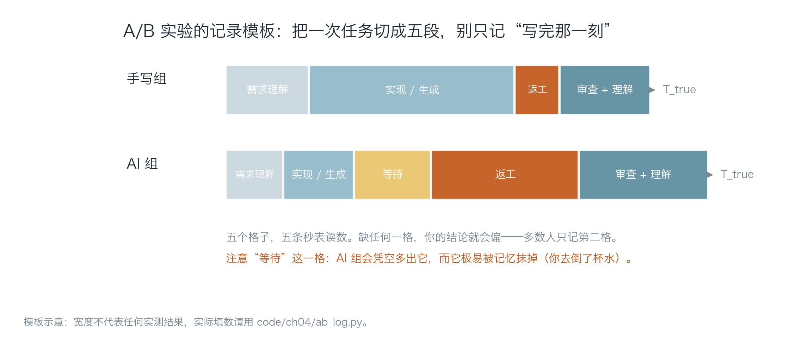
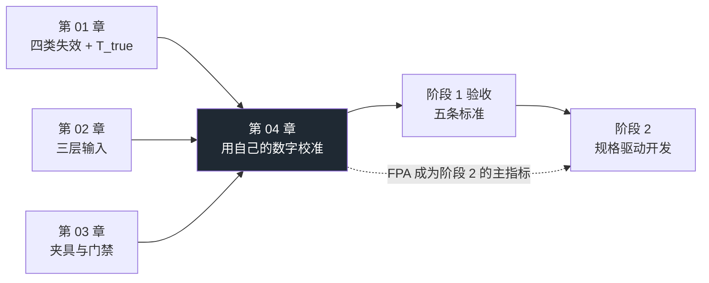

[English](./ch04-calibrate-with-your-own-numbers.md) | **中文**

# 第 04 章：用你自己的数字校准

> **本章导读**：前三章给了你判断（为什么会慢）、输入（喂什么）、判定（谁来判对）。本章补最后一块：**你凭什么相信自己的判断**。它不讲更多道理，只做一件事——让你拥有一个属于自己项目的数字，并且知道在样本很小的时候该怎么说话。
>
> **前置知识**：第 01 章（T_first / T_true）、第 03 章（门禁与验收判据）。需要会用命令行、能读 CSV。
>
> **核心学习目标**：
> - 能设计一次不被自己骗到的 A/B 对照（任务同类、顺序随机、判据先行）
> - 能用五个分段记录一次任务的真实耗时，并算出 T_true
> - 能正确解读小样本结果：什么时候可以说方向，什么时候只能说"不知道"
> - 完成阶段 1 的五条验收标准，并留下可复查的证据

---

## 1. 认知锚点：你不是不信数据，你只是还没有自己的

### 1.1 读完第 1 章之后，多数人的第一反应

"METR 那 16 个开发者是资深工程师，维护的是百万行仓库。我这个项目才两万行，我一个人写，情况不一样。"

这句话**可能完全正确**。它的问题不在结论，在证据：你没有任何关于自己的数据，所以"不一样"这三个字是信念，不是判断。

而这件事有个尴尬的后果：**你没法在下一周做出更好的决定**。因为你的决策依据仍然是感觉——而第 1 章已经证明了，感觉在这个问题上会系统性偏乐观。

### 1.2 一个真实会发生的结果

假设你真的去测了（下面这套流程第 3 节会给工具）：

三个同类任务，手写一组、AI 一组。你测出：

- 手写组 T_true 中位数 98 分钟，AI 组 118 分钟；
- 手写组首轮验收率 67%，AI 组 33%；
- AI 组的"等待"占了 17% 的时间——这一段你原本根本没意识到它存在。

你可能会失望，也可能不服。但请注意：**这个结果本身不比"我觉得快了"更有价值**——因为只有 3 条记录。它的正确读法是"方向可能不对，但证据不足"，而不是"AI 让我慢了 20%"。

这一章要教的，正是这个区别。因为绝大多数"AI 生产力"的争论，输就输在这个区别上。

### 1.3 直觉类比：体检报告 vs 自我感觉

你说"我最近身体挺好"，和你拿到一份体检报告说"血脂偏高"，是两种性质的信息。

- 前者是**自我感觉**：真实、有参考价值，但不可复核、不可比较、容易被单次体验主导。
- 后者是**测量**：可能不准（仪器误差、单次波动），但它有单位、有参考区间、可以三个月后再测一次对比。

关键在于：体检报告的价值不在于"这一次的绝对值"，而在于**它给了你一个可以重复测量的点**。第二次、第三次之后，趋势才出现。

A/B 实验同理。**3 条记录的价值不是结论，是"你终于有了一个基线"。**

---

## 2. 第一性原理：怎样测才不算自欺

### 2.1 三个原则

**原则一：同类任务才可比。** "修一个 bug"和"新增一个页面"不是同一类任务。第 1 章说过，任务类型决定结论方向——修 bug 的时间大头是"读懂现有代码"，AI 帮不上；新增样板代码的时间大头是"键入"，AI 帮助巨大。混在一起测，得到的是平均值，而平均值掩盖了唯一有用的信息。

**做法**：选**同一产品里三个相似的小功能**（比如"给三个列表页各加一个筛选器"），而不是三个不同难度的任务。

**原则二：秒表，不是回忆。** 第 1 章讲过，`T_rework` 与 `T_review` 是碎片化的，事后无法可靠回忆。你必须当场记。

**做法**：任务开始时按下计时，遇到返工就切一段。哪怕只是用手机备忘录记"14:20 开始返工"。

**原则三：完整记账。** 只记 `T_first` 等于只记了对自己有利的那一段。

**做法**：把一次任务切成五段（下一节）。

### 2.2 五段模型



*图 4-1：宽度不代表任何实测结果，它只是模板。要看的是"AI 组会凭空多出'等待'这一格"——你去倒了杯水，回来它写完了，这段在你的记忆里根本不存在。*

| 段 | 含义 | 为什么必须单独记 |
|---|---|---|
| **理解** | 搞清楚要做什么 | AI 组这一段常常变短（可以让它先复述需求），但如果需求本身模糊，这一段会变成"反复澄清" |
| **实现 / 生成** | 真正写出来 | 这是 AI 唯一确定压缩的一段，也是你唯一会记住的一段 |
| **等待** | 等模型输出/思考 | 极易被记忆抹掉；长任务里它是真实的成本 |
| **返工** | 修 bug、补边界、改到可合并 | 最容易被低估，因为它是碎片化的、情绪上不愉快的 |
| **审查 + 理解** | 读 diff、搞懂它为什么这么写 | 这一段的本质是**认知债的当期支付** |

五段之和就是 `T_true`。**任何只统计前两段的"提效报告"，都不值得采信**——包括你自己写的。

### 2.3 四个指标：只留能判定的

| 指标 | 定义 | 为什么用它 | 常见误用 |
|---|---|---|---|
| **T_true** | 五段之和 | 唯一对应"交付"的时间 | 只记生成时间，然后称之为"AI 用时" |
| **首轮验收率（FPA）** | 第一次产出即通过验收的任务数 ÷ 任务总数 | 比"生成了多少行"诚实得多：它把"返工"折进了分子 | 用"改了几次"当分母；验收判据事后修改 |
| **缺陷密度** | 每个任务交付后 7 天内发现的缺陷数 ÷ 任务数 | 抓"跑得快但埋雷" | 只统计已上线缺陷，忽略被门禁拦下的（那部分其实该算"拦住"，不算"缺陷"） |
| **返工率** | 返工时间 ÷ T_true | 一句话说明"这次改动有多不靠谱" | 与 FPA 混用；两者一个看时间一个看次数 |

四个指标里，**FPA 最值得长期跟踪**。原因：它不依赖你回忆时间，只需要一个"通过/不通过"的判断；而且它对规格质量极其敏感——这正是阶段 2 的主题。

### 2.4 实验设计：五条必须守住的规则

1. **需求冻结**：把需求写成一段话存进文件，两组都不许改。改需求 = 换了实验对象。
2. **顺序随机**：掷硬币决定先做哪一组。先做的那组会占"我已经想过一遍"的便宜。
3. **洗脱间隔**：两组之间至少隔 1 天。同一个任务做第二遍时你已经知道答案了，间隔能削弱但不能消除这个效应——所以更稳的做法是**用六个不同的任务，随机分到两组**（3 个手写、3 个 AI），而不是同一个任务做两次。
4. **判据先行**：开始前写下"什么算通过"（例如：`pytest` 全绿 + 新增测试 + 未触碰禁区文件）。**判据里不许出现"看起来合理"。**
5. **记录当时，不复盘回忆**：任务结束立刻填表。隔两天再补，你补的是故事，不是数据。

第 3 条是最容易被忽略、也最能毁掉结论的一条。同一个任务做两次，第二次的"AI 组"其实享受着第一次的思考成果——这叫学习效应，它系统性地让第二组看起来更快。

### 2.5 小样本能说什么，不能说什么

这是本章最重要的一节，因为绝大多数"AI 生产力"的讨论都在这里翻车。

**n = 3 时你能说的：**
- "在我这三个任务上，AI 组的 T_true 中位数比手写组高 20 分钟。"（描述）
- "方向和我预期相反，值得继续测。"（观察）
- "AI 组的等待时间占了 17%，这个我之前没意识到。"（发现）

**n = 3 时你不能说的：**
- "AI 让我慢了 20%。"（这是把点估计当总体参数）
- "在我的项目上 AI 没用。"（外推）
- "这证明了 METR 的结论。"（这是别人的结论，不是你的）

**为什么不能**：3 个观测值的抽样波动极大。同一批任务换一天做，中位数差可能从 +20 变成 −15。统计上，你要给的是**区间**而不是点——而 3 个点的区间会宽到几乎包含所有可能，结论就是"不知道"。

这不是让你别测。恰恰相反：**测了之后你会知道"我不知道"，这比"我觉得我快了"是巨大的进步**，因为前者会推动你继续测，后者会让你停止思考。

一句可以直接背下来的话：

> **n 小的时候，结论的正确形态是"方向"和"待续"，不是"幅度"和"定论"。**

---

## 3. 手把手：跑一次，拿到你的第一组数字

### 3.1 记录格式

一个 CSV，一行一次任务：

```csv
task,group,understand,build,wait,rework,review,defects,first_pass
导出CSV,hand,12,58,0,8,20,1,1
导出CSV,ai,9,21,17,46,25,2,0
```

各列含义：`group ∈ {hand, ai}`；中间五列是分钟数；`defects` 是交付后 7 天内发现的缺陷数；`first_pass` 是 1/0（第一次产出是否通过验收）。

字段设计上的三个决定，都值得说清：

- **为什么 `wait` 单独一列**：因为它极易被记忆抹掉，而它又是 AI 组独有的成本。
- **为什么 `first_pass` 是 1/0 而不是"改了几次"**：因为"改了 1 次"和"改了 10 次"在语义上没差别（都是没通过），但如果你记次数，就会忍不住去算平均次数，那是个没有意义的数。
- **为什么 `defects` 要写"7 天内"**：因为缺陷有时间窗口。不写窗口，"缺陷数"这个指标就无法比较。

### 3.2 汇总工具

`code/ch04/ab_log.py` 只做三件事：算 T_true、按组汇总、给中位数差的 bootstrap 区间。

**示例数据**（`sample_log.csv`，**数字是编的，只为演示格式**）：

```text
$ python code/ch04/ab_log.py code/ch04/sample_log.csv

记录文件：code/ch04/sample_log.csv（共 6 条）

组别      n    T_true 中位数       均值      首轮验收率     缺陷/任务      等待占比
-----------------------------------------------------------------------------------
手写      3          98 分     93       67%      0.67        0%
AI      3         118 分    107       33%      2.00       17%

时间构成（均值，分钟）：
  手写  understand 12  build 55  wait 0  rework 9  review 17
  AI    understand 9   build 18  wait 18  rework 42  review 21

中位数差（AI − 手写）= +20 分钟
95% bootstrap 区间 = [-42, +65]  （重采样 10000 次）

结论：区间跨 0 → 这组数据**不足以支持任何一个方向**的结论。
      正确动作是继续攒数据（或加任务数），不是把这条写进复盘当结论。
提醒：AI 组只有 3 条记录。n < 10 时，这是个案基线，不是统计结论。
```

### 3.3 怎么读这份输出

**第一，先看段位构成，不要先看中位数。** 这张表最有信息量的不是"+20 分钟"，是这两行：

- 手写：`build 55`，`rework 9`
- AI：`build 18`，`rework 42`，`wait 18`

读法：AI 把"生成"从 55 分钟压到 18 分钟（**这是真的**），但返工从 9 涨到 42，等待多出 18。三段相加：手写 55+9=64，AI 18+42+18=78。**省下的时间被返工和等待吃回去了，还倒欠。** 这个结构信息比一个总数有用得多——它告诉你去改哪里（返工多 → 规格或上下文有问题，不是模型不行）。

**第二，区间比点估计重要。** `[-42, +65]` 跨过 0，意思是"这批数据无法区分快慢"。这时候写"AI 慢了 20 分钟"就是把不确定当确定。

**第三，`n < 10` 的提醒是硬话。** 它不是免责声明，是告诉你：**当前这个数字的唯一用途是建立基线**，不能用来做决策（比如"以后都不用 AI 了"）。

### 3.4 任务 3：渐进披露的对照怎么记

规划里的任务 3 是"同一需求，一句话提示 vs 三层输入，比较首轮验收率"。它的记录方式和上面略有不同，因为变量不是时间，而是**通过轮数**。

| 任务 | 输入方式 | 第几轮通过 | 触碰禁区文件 | 首次产出是否越界 | 备注 |
|---|---|---|---|---|---|
| T1 加 tag 过滤 | 一句话提示 | 3 | 是 | 是 | 把 tag 塞进了 COLUMNS |
| T1 加 tag 过滤 | 三层输入 | 1 | 否 | 否 | 改了 11 行 |

三条注意事项：

- **"第几轮"要有明确定义**：一轮 = 一次完整的"生成 → 你验收"循环。你提意见它改，算新一轮。
- **"触碰禁区"要单独记**：这是渐进披露最有价值的效应。一句话提示的失败常常不是"写错"，而是"改了不该改的"——这无法从"第几轮通过"里看出来。
- **两个任务不够得出结论**，但它足够让你看见方向，也足够让你写进复盘时用对语言（"两次里两次都越界"是描述，不是结论）。

---

## 4. 常见误区与正反例

| 容易踩的坑 | 为什么会错 | 正确做法 |
|---|---|---|
| **把 n=3 的点估计当结论** | 抽样波动极大，换一天可能反向 | 报区间 + 明确"方向/待续"；n < 10 只当基线 |
| **用"生成代码行数"当生产力** | 行数是产出量，不是交付量；删代码通常是好事 | 用 T_true + FPA；行数最多用来判断"改动是否过大" |
| **只记 T_first** | 这是唯一被系统性乐观的段 | 五段全记，尤其 `wait` 与 `rework` |
| **AI 组拿到更简单的任务** | 人会下意识把"顺手的小活"分给 AI，把难的留给自己 | 任务同类 + 随机分配；记录时写清任务类型 |
| **验收判据事后调整** | 一旦知道结果，判据就会向结果靠拢（这是无意识的） | 判据写在任务开始前，存进文件，事后只读不改 |
| **把"我感觉这次很快"写进复盘** | 感觉不是数据；写进复盘后会变成"经验" | 复盘里只写可复查的数字 + 一句"这次数据不足" |
| **只测一次就下结论，之后不再测** | 一次测量是快照，不是趋势；工具与熟练度都在变 | 每阶段末重测一次，看趋势而不是看单点 |

---

## 5. 本章小结与阶段收尾

### 5.1 四个要点

- **测量三原则**：同类任务、秒表、完整记账。缺一条，结论就不可信。
- **五段模型的价值在结构**：不是"总共多少分钟"，而是"省在哪、亏在哪"。返工涨了说明规格或上下文有问题，不是模型不行。
- **n 小的时候，正确结论的形态是"方向"和"待续"**。报区间，不报定论。
- **FPA 是最值得长期跟踪的指标**：它不依赖回忆，且对规格质量极其敏感。

### 5.2 本章在阶段中的位置



### 5.3 阶段 1 验收清单

规划里给了五条检验标准。把它们做成可勾选的表，并且**每一条都要求留下证据**——没有证据的"能"，三个月后等于"没能"：

| # | 标准 | 证据形态（必须有实物） | 自查 |
|---|---|---|---|
| 1 | 能解释"为什么在成熟代码库上 AI 可能让人变慢"，并说出三条与你项目直接相关的机制 | 一段 300 字以内的文字，其中三条机制各自对应你仓库里的一个具体位置（文件/模块） | ☐ |
| 2 | 能做出一个别人拿到就能用的夹具仓库 | 一个真实 Git 仓库：`AGENTS.md` + 三条门禁 + 预览环境 + 决策清单；让一个没参与的人照着跑通 | ☐ |
| 3 | 能独立复现一次 A/B 对照并给出自己的数字 | `ab_log.py` 的 CSV + 一份汇总输出 + 一句正确形态的结论（方向 + 区间 + 局限） | ☐ |
| 4 | 能走通"渐进披露"，并说出这次改动了哪一层 | 两次输入的快照（一句话提示 vs 三层）+ 首轮验收率对比 + 一句"我改的是 L0/L1/L2 的哪一层" | ☐ |
| 5 | 能判定一个任务该全交给智能体还是自己写 | 用 2.7 的六条判据给 5 个真实任务打分，并有一次"据此改变了决定"的记录 | ☐ |

外加一条不在规划里、但强烈建议的：

| # | 标准 | 证据 |
|---|---|---|
| 6 | 门禁至少拦住过一次真实问题 | 一次红灯的原始日志（不是转述），并说明是哪条门禁、因为什么断言 |

**关于"没过"的处理**：不要跳到阶段 2。按规划的建议，把失效的检验项拆细（例如第 2 条没过，通常是"没写完成定义"或"预览环境没做"），允许用延长一周代替重做整阶段。降级可以，但要写明降级原因——假装没降级不行。

---

## 6. 分级通关练习

### Tier 1 · 直觉与概念核验

1. 为什么 `wait` 必须单独记？举一个你自己的例子，说明这段为什么会被记忆抹掉。
2. "AI 组 T_true 中位数比手写组高 20 分钟，95% 区间 [−42, +65]"。请写出三种**不能**从这句话推出的结论，以及一句**可以**说的结论。
3. 首轮验收率与返工率都在描述"这次改动靠不靠谱"，它们的差别是什么？为什么说 FPA 更适合长期跟踪？

### Tier 2 · 推演与实操

4. 用 `ab_log.py` 跑一次你自己的实验（3 个同类任务 × 2 组）。要求：判据先行、顺序随机、间隔 ≥ 1 天。把你的 CSV 与汇总输出存进仓库。
5. 把你最近一次"感觉特别快"的任务按五段补记（能补多少补多少）。然后回答：如果你当时记了 `wait` 和 `rework`，结论会变吗？

### Tier 3 · 边界与迁移

6. 假设你要向老板证明"我们该继续用 AI 编码"，而你的 n 只有 6。请设计一个**不撒谎**的汇报方式：既说清证据强度，又能推动决策。
7. 如果测量结果显示"AI 在你的项目上确实更慢"，你会不会停用？请给出你的判断依据（提示：考虑任务类型、学习曲线、以及"慢"发生在哪一段）。

<details>
<summary><strong>点击展开：本章练习参考答案与深度解析</strong></summary>

#### 1. 为什么 `wait` 会被抹掉

因为等待期间**你没有在做这个任务**。人去倒水、刷消息、看别的 issue——大脑不会把"我没在干活的那段时间"记进"这个任务花了多久"。

例子：你让智能体重构一个模块，它跑了 4 分钟。这 4 分钟里你回了三条消息。事后你的记忆里，这个任务是"我提了个需求，它改完了，大概 10 分钟"。真实 T_true 里那 4 分钟是实打实的成本——它不能用来做别的事（因为你要等结果才能继续）。

**这也是为什么"多任务并行"会让人误判 AI 提效**：等待时间被别的任务填满，于是主观上"没有成本"。但并行本身有切换成本，且它掩盖了真实的交付延迟。

#### 2. 三种不能推的结论 + 一句可以说

**不能推：**

- "AI 让我的项目慢了 20 分钟。"（点估计当总体参数）
- "AI 对我没用。"（外推，且方向都可能错）
- "这说明 METR 的 +19% 在我的项目上也成立。"（拿别人的数字给自己背书）

**可以说：**

- "在我这三个同类任务上，AI 组的中位 T_true 比手写组高 20 分钟，但 95% 区间 [−42, +65] 跨过 0，所以这批数据不足以判断方向；下一步是把任务数加到 10 个以上。"

这句话有三个特征，值得当作模板：**给了数字、给了区间、给了下一步**。它不假装确定，也不放弃判断。

#### 3. FPA vs 返工率

- **FPA 是次数指标**：通过/不通过，二值。它回答"一次做对的概率有多大"。
- **返工率是时间指标**：返工时间占总时间的比例。它回答"这次改动有多费劲"。

差别在于：**FPA 对"小修小补"不敏感**（改一行也算没通过），返工率对"次数"不敏感（改十次但每次 1 分钟，返工率很低）。

为什么 FPA 更适合长期跟踪：① 不需要精确计时，只需要一次判断，记录成本极低；② 它对**规格质量**极敏感——规格写得好，首轮通过率就会上去，这正好是阶段 2 要优化的东西；③ 它不容易被"我改得快"这种技巧污染。

#### 4. 实验记录自检

合格的标准不是"结果好看"，而是这三条：

- 判据在你开始前就写下来了（有文件时间戳）；
- 两组的任务确实同类（同一个产品的三个列表页，而不是"一个页面 + 一个 bug + 一次重构"）；
- 你能说出顺序是怎么决定的（掷硬币/随机数），而不是"先做了手写因为顺手"。

#### 5. 补记五段

多数人补记时会发现：`build` 记得很清楚，`review` 大概能估，`wait` 和 `rework` 完全想不起来。

这个发现本身就是收获——它证明"感觉快"这句话的信息量极低。更重要的是它给了你一个具体的改进行动：**从下一个任务开始，用手机备忘录记三个时间点（开始 / 首次可运行 / 交付）**，这已经能拆出四段（`wait` 要靠"我开始等"和"它出结果"两个时间点）。

#### 6. 怎么不撒谎地汇报（n=6）

结构建议：

1. **先给结论的强度，再给结论**："这是一次 6 个任务的个案测量，能给方向，不能给幅度。"
2. **给结构而不是给总数**："生成段从 55 分钟降到 18 分钟（确定），但返工从 9 涨到 42（确定）。总数上没有显著差异。"
3. **给出机制解释**："返工集中在'边界条件'和'与现有契约冲突'两类，这两类恰好是规格没写清的地方——这指向下一步动作，而不是'AI 不行'。"
4. **给出下一步与判据**："接下来 4 周，我们把验收判据写进规格，再看 FPA 是否从 33% 升到 60% 以上。如果升不上去，再讨论缩减使用范围。"

这套说法的力量在于：它把"要不要继续用 AI"这个二元争论，换成了"该改哪一段"这个可执行问题。**老板要的通常不是结论，是可控性。**

#### 7. 如果确实更慢，要不要停

先看三件事，而不是看结论：

- **慢在哪一段？** 如果慢在 `rework`，那是规格/上下文问题，可修；如果慢在 `review`，那是你的项目复杂度问题，可拆；如果慢在 `wait`，那是工具/网络问题，可换。**只有"慢在 build 段"才说明 AI 本身没帮上忙**——而这一段几乎不可能变慢。
- **是什么任务类型？** 修 bug、重构、不熟悉的模块 → AI 天然吃亏，这类任务本来就该少用。新增样板、机械替换、写测试 → AI 天然占优。
- **在学习的哪个阶段？** 前两周你的熟练度低，`rework` 会异常高。这时测出来的数字反映的是"你还不熟"，不是"AI 不行"。

结论：**"慢"很少是全局结论，通常是"某些任务类型上慢"。** 正确的动作是按任务类型分层使用（这就是 2.7 那张决策清单的用途），而不是一刀切停用。

</details>

---

### 本章数据与来源

| 内容 | 来源 | 口径 |
|---|---|---|
| 示例日志中的全部数字 | 本书编写时构造的示例数据 | **不是实测结论**，仅用于演示记录格式与汇总逻辑 |
| 五段模型 | 本书提出的记录框架 | 不是行业标准；目的是让"等待"与"返工"显式化 |
| bootstrap 区间 | 标准重采样方法 | n=3 时区间极宽，这正是要传达的信息 |
| 七天内缺陷窗口 | 本书建议值 | 可按项目发布节奏调整，但必须固定，否则不可比 |

---

## 7. 本章权威参考信源与延伸阅读 (Authoritative References)

1. **METR**：[METR](https://metr.org/) - 本章的定义与规范以此为锚（核验日期：`2026-10-23`）。
2. **DORA**：[DORA](https://dora.dev/) - 本章的定义与规范以此为锚（核验日期：`2026-10-23`）。
3. **RFC 2119（Requirement Levels）**：[RFC 2119（Requirement Levels）](https://www.ietf.org/rfc/rfc2119.txt) - 本章的定义与规范以此为锚（核验日期：`2026-10-23`）。

> 口径提示：以上信源用于锚定**定义与规范**，不用于外推风险概率。引用任何数字前，先核对来源年份与分母。
