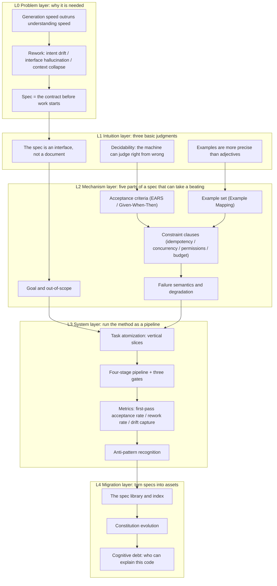

**English** | [中文](./README.zh.md)

# Write the Spec First, Then Let the AI Build: From Zero to Spec-Driven Development

> **Positioning**: a systematic open textbook for learners with zero spec experience, matching **Stage 2** of the Vibe Coding Learning Plan (4 weeks / 30 hours per week)
> **Where it sits in the roadmap**: `phase2/`. Stage 1 solves "why trust it"; this stage solves "make it do it right"; Stage 3 is where the heavy gates and security arrive.
> **Design principles**: incidents first · executable criteria · tightly coupled text and figures · every concept gets its failure boundary
> **What this is not**: not a prompt-template collection, not a tool manual, and it does not promise "right in one generation"

---

## 0. Definitions and Conventions (stated before we start)

| Item | Value |
|---|---|
| Starting assumptions | Can read code in one language, can use Git, has built at least one working web service; **has never systematically written specs** |
| Not assumed | No requirements-engineering training assumed, no UML assumed, no assumption that Specification by Example has been read |
| Endpoint | The four acceptance checks of learning-plan Stage 2 (see Section 10) |
| Language | Chinese body text; terms give their English original on first appearance |
| Citation discipline | Every external conclusion is tagged with source and date; if any Python figure is a model illustration, its caption must state the parameter assumptions, **never disguised as empirical data** |
| Tool convention | Based on the GitHub Spec Kit v1.0 (2026-08) command family; a "minimal manual version without installing tools" is also given, so the book is not tied to any one tool |

**The dividing line between this book and "prompt tricks"**

Prompt tricks answer "how do I phrase this so the model obeys"; specs answer "what shape counts as right". The former works within a single conversation; the latter works across files, across sessions, and across handovers. This book covers only the latter; any paragraph written like the former is off-topic.

---

## 1. Domain Overview and Learning Goals

### 1.1 Why This Craft Is Needed

Three sentences, each mapping to a real failure:

1. **The AI will not stop just because you were unclear.** It fills the blanks with "reasonable defaults" and hands you something that looks right but has actually made thirty decisions you never approved.
2. **The cost of rework is not in writing code; it is in thinking it through again.** Have the AI rewrite the same sentence three times and you get three differently shaped systems - because what is missing is not code, it is the definition of "what counts as right".
3. **The spec is the only artifact that constrains people, models, and the future at once.** Code rots, conversations get lost; only written-down criteria can answer "why was it designed this way" three months later.

### 1.2 What You Will Master

- **Core cognition layer**: you can explain the division of labor and the boundary-crossing signals among "spec / plan / task", and judge whether a sentence is "decidable" or not.
- **Systematic method layer**: you can independently produce a spec that lets the AI pass acceptance on the first round, containing goals, out-of-scope, acceptance criteria, non-functional constraints, and failure semantics; and you can slice the spec into independently acceptable tasks.
- **Practical capability layer**: you can run one complete pipeline (spec -> plan -> tasks -> implementation -> converge), prove with three metrics that "this spec is better than last time", and point at which sentence made it better.

---

## 2. Domain Knowledge Map



**How to read the map**: vertically are the four layers "from problem to asset"; horizontally are the dependencies within one layer. **If any one of L2's five parts is missing, L3's pipeline will collapse on some concrete task** - this is not a theoretical arrangement; the three rework rounds in Chapter 11's real run point at exactly three such gaps.

---

## 3. Knowledge Module Matrix

| Module | Core problem solved | Chapter | Prerequisites | Visual assets | Difficulty |
|---|---|---|---|---|---|
| M1 Spec ontology | What spec, plan, and task each own, and what boundary-crossing looks like | ch02 | none | Three-layer separation diagram (Mermaid) | ★☆☆☆☆ |
| M2 Decidability | Rewrite "the user can log in" into sentences both machines and people can judge | ch03 | M1 | Decision tree (Mermaid) + criterion rewrite table | ★★☆☆☆ |
| M3 Exemplification | Pin the boundaries of abstract rules with concrete inputs and outputs | ch04 | M2 | Example Mapping board diagram | ★★☆☆☆ |
| M4 Ambiguity resolution | Find the spots in a spec that "everybody thinks they understand" | ch05 | M2 | Ambiguity classification tree + question template table | ★★★☆☆ |
| M5 Constraint clauses | Why unwritten non-functional constraints authorize the model to freelance | ch06 | M2 | Idempotency state-machine comparison (Mermaid) | ★★★☆☆ |
| M6 Task slicing | How small must it be to count as "one review unit" | ch07 | M5 | Horizontal/vertical slice comparison + batch curve | ★★★☆☆ |
| M7 Pipeline and gates | Turn judgments into process, and process into revertible steps | ch08 | M6 | Pipeline diagram + convergence loop state machine | ★★★★☆ |
| M8 Metrics | Prove with three numbers that the spec got better, and say where | ch09 | M7 | Metric computation path diagram + trend sketch | ★★★☆☆ |
| M9 Anti-patterns | The five ways SDD degrades into waterfall itself | ch10 | M8 | Anti-pattern matrix + spec weight-risk diagram | ★★★★☆ |
| M10 Asset-ization | Is this spec still worth anything three months later | ch12 | M9 | Spec library structure diagram + cognitive debt curve | ★★★★★ |

---

## 4. Detailed Chapter Outline

> Length estimated at "4,000-6,000 characters of body text + 3-5 figures + 4 tiered exercises" per chapter. Each chapter reads independently, but the case is continuous.

### Part 1 · Intuition: Why "Being Clear" Is So Hard (ch01-ch03)

**Chapter 01: The Topography of Rework** (`chapters/ch01-rework-topography.md`)
- **Intuition Anchor**: You say "add a sign-up feature". The AI delivers 400 lines: it runs, it clicks, the UI looks nice. Three days later you find: no waitlist, double-clicks created two records, and canceled slots are never released. **Three bugs, one root cause.**
- **Core knowledge**: the three forms of rework (intent drift / interface hallucination / context collapse); how "reasonable defaults" get filled in; the order of magnitude of rework cost as discovery moves later (**model illustration, not empirical**); where a spec acts on this curve
- **Planned visuals**: sequence comparison of three conversation round-trips (Mermaid sequenceDiagram); Figure 1-1 rework cost vs. discovery stage (Python, assumptions annotated)
- **Hands-on / walkthrough**: have the AI generate three times from the same requirement sentence, and record a diff list of the three outputs - **this is the reader's own first data set; ch09 will take it as the baseline**

**Chapter 02: The Spec Is an Interface, Not a Document** (`chapters/ch02-spec-as-interface.md`)
- **Intuition Anchor**: Ordering "something savory" versus "Kung Pao chicken, no peanuts, mildly spicy, no cilantro" - the difference is not politeness; it is executability
- **Core knowledge**: separating What / Why / How into three layers; the responsibility boundaries and boundary-crossing signals of the `spec.md` / `plan.md` / `tasks.md` trio; what "single source of truth" actually means (and what it does not); the minimal seven-section spec structure
- **Planned visuals**: Figure 2-1 three-layer separation and boundary-crossing signals (Mermaid); Table 2-1 legal vs. illegal writings of the same requirement across the three files
- **Hands-on / walkthrough**: write one real requirement into the three files, checking for boundary crossings one by one (with 6 "crossed the line but looks right" samples)

**Chapter 03: Decidability - Writing "Can Log In" as a Sentence You Can Judge** (`chapters/ch03-testability.md`)
- **Intuition Anchor**: In court "his attitude was bad" does not hold; "he said this in the group at 14:02 on March 5" does
- **Core knowledge**: the four conditions of decidability (observable / quantifiable / has a trigger condition / has a failure path); the five EARS patterns (ubiquitous / event-driven / state-driven / unwanted / optional, proposed by Mavin et al. at Rolls-Royce, RE'09); the division of labor between EARS and Given-When-Then; why the difference between `shall` and `should` is a hard rule
- **Planned visuals**: Figure 3-1 criterion decidability decision tree (Mermaid); Table 3-1 rewriting twelve "undecidable sentences" one by one
- **Hands-on / walkthrough**: rewrite the requirement sentence from ch01 into 8 EARS criteria, then attack your own criteria one by one with the counter-example method

### Part 2 · Mechanism: The Five Parts of a Punch-Resistant Spec (ch04-ch07)

**Chapter 04: Pinning Down Abstractions with Examples** (`chapters/ch04-examples.md`)
- **Intuition Anchor**: Two people both say "friendlier"; only after three concrete scenarios do you find one meant the copy and the other meant button size
- **Core knowledge**: the four Example Mapping cards (story / rule / example / question); Adzic's seven process patterns from Specification by Example; the four requirements for examples (precise, complete, realistic, easy to understand); the rule-example-criterion mapping; why "boundary examples" expose ambiguity better than "typical examples"
- **Planned visuals**: Figure 4-1 Example Mapping board structure and flow (Mermaid); Table 4-1 the rule -> example -> criterion three-column mapping
- **Hands-on / walkthrough**: run one complete Example Mapping on the "waitlist queue", producing 6 rules + 12 examples, at least 3 of them boundary examples

**Chapter 05: The Anatomy of Ambiguity** (`chapters/ch05-ambiguity.md`)
- **Intuition Anchor**: "Reply ASAP" - in three heads it is three different times: five minutes, before leaving work, this week
- **Core knowledge**: the six ambiguity types (reference / scope / boundary / exception / timing & concurrency / permissions & visibility); identification signals for each; the three questioning weapons (counter-example / extreme-value / role); why clarify's five-question limit is a cap rather than a quota; answers must be written back into the spec, not left in the conversation
- **Planned visuals**: Figure 5-1 six-type ambiguity classification tree (Mermaid); Table 5-1 identification signal x question template x write-back location
- **Hands-on / walkthrough**: ask five questions on the spec ch04 produced, simulate "how first-pass acceptance rate changes after asking", and record which question paid off most

**Chapter 06: Constraint Clauses - Not Writing Them Authorizes the Defaults** (`chapters/ch06-constraints.md`)
- **Intuition Anchor**: Hotel checkout inspects the room; the unmanned hotel does not - not inspecting does not mean there are no rules; the rules were written into the door locks and the deposit
- **Core knowledge**: why constraints are easiest to miss (**a miss throws no error**); six must-write constraint types (idempotency / concurrency / retry & timeout / permissions & visibility / performance budget / dependencies & fallback); how to write idempotency keys + retry windows (why clauses like "idempotency key required + 24-hour retry window" must enter the spec); writing constraints as criteria, not wishes
- **Planned visuals**: Figure 6-1 state-machine comparison of the same request without / with idempotency (Mermaid stateDiagram); Table 6-1 clause templates and verification methods for the six constraint types
- **Hands-on / walkthrough**: write 6 constraint clauses for the waitlist system, each with a "verifiable" criterion, and deliberately leave one out to see how the AI fills it

**Chapter 07: Task Atomization - Vertical Slices and Review Units** (`chapters/ch07-task-slicing.md`)
- **Intuition Anchor**: In renovation, do the plumbing first or buy the sofa first? Horizontal slicing leaves you three months without a single livable room
- **Core knowledge**: vertical slice vs. horizontal slice; one task = one review unit = one revertible commit; dependency ordering and the "can run in parallel" criteria; the batch-size vs. context-budget trade-off; how to write `tasks.md` (why every task needs an "acceptance method")
- **Planned visuals**: delivery-pace comparison of the two slicings (Mermaid); Figure 7-1 batch size vs. context usage and rework (Python, model illustration)
- **Hands-on / walkthrough**: slice the specs from ch04-ch06 into 9 tasks and order them, marking which two can run in parallel and on what basis

### Part 3 · System: Pipeline, Metrics, and Anti-Patterns (ch08-ch10)

**Chapter 08: The Four-Stage Pipeline and Three Gates** (`chapters/ch08-pipeline.md`)
- **Intuition Anchor**: Airport security is not about distrusting you; it turns "should this be let through" from personal judgment into a reviewable process
- **Core knowledge**: the Spec Kit v1.0 command family one by one - `constitution` / `specify` / `clarify` / `plan` / `checklist` / `tasks` / `analyze` / `implement` / `converge` - with their artifacts and fallback directions; the `specs/<feature>/` directory convention; the three gates (disambiguate before planning / review requirement quality before splitting tasks / check consistency before implementing); the loop termination condition of `converge`; OpenSpec's "propose -> apply -> archive" light process as contrast; **the minimal manual version without tools** (three files + one checklist, buildable in 20 minutes)
- **Planned visuals**: Figure 8-1 pipeline with the three gates and fallback arrows (Mermaid flowchart); Figure 8-2 convergence loop state machine (Mermaid stateDiagram)
- **Hands-on / walkthrough**: run one round with the minimal manual version first, then run the same requirement with Spec Kit, comparing artifact differences and friction points

**Chapter 09: Metrics - First-Pass Acceptance Rate and Its Two Companions** (`chapters/ch09-metrics.md`)
- **Intuition Anchor**: The bathroom scale vs. "I think I have lost weight lately"
- **Core knowledge**: the definition of first-pass acceptance rate and the denominator trap (what counts as "one generation"); the rework ratio formula (follow-up commits within 7 days); the spec drift capture rate (how many "violates the spec" comments appear in review); the two-week baseline method; CSV field design; why "lines of generated code" is a misleading metric
- **Planned visuals**: Figure 9-1 computation paths and data sources of the three metrics (Mermaid); Figure 9-2 trend after spec improvements (Python, **sample data**, with a CSV template)
- **Hands-on / walkthrough**: build your own `metrics.csv`, fill the first row with ch01's baseline data, and write a one-page dashboard note

**Chapter 10: Anti-Patterns - Five Ways SDD Degrades into Waterfall** (`chapters/ch10-antipatterns.md`)
- **Intuition Anchor**: Too much medicine is poison; over-write the spec and you have invited the 1970s waterfall process back in verbatim
- **Core knowledge**: the five death modes (heavy upfront spec + big-bang release / PRD cosplay / spec overload / change code without changing the spec / self-approving checklists); early signals and cures for each; spec weight should match task risk (the rule-of-thumb "one screen of markdown per day of work"); why "change code without changing the spec" brings the same hole back in a new shape
- **Planned visuals**: Table 10-1 five anti-patterns x signals x cures x recurrence detection; Figure 10-1 spec weight and task risk matching matrix (Mermaid)
- **Hands-on / walkthrough**: run an anti-pattern health check on your last three projects, writing one "if we had written one more sentence back then, it would not have happened" per project

### Part 4 · Practice and Transfer (ch11-ch12)

**Chapter 11: End-to-End in Practice - From a Vague Requirement to Launch** (`chapters/ch11-end-to-end.md`)
- **Intuition Anchor**: The first ten chapters are drills; this one is a complete set of moves
- **Core knowledge**: the waitlist sign-up system through the complete flow (one-sentence requirement -> rules -> examples -> five questions -> constraints -> nine tasks -> implementation -> converge -> launch); **the tracing table of three real rework rounds**, each traced to "which spec sentence was missing", verifying "after adding it, does regenerating 3 times on similar tasks recur?"
- **Planned visuals**: Figure 11-1 full-flow timeline (Mermaid); Table 11-1 three rework rounds x symptoms x spec gaps x fixes x recurrence verification
- **Hands-on / walkthrough**: the reader walks through a real requirement they intend to ship, delivering `spec/plan/tasks` + tracing records (this is learning-plan tasks 1 and 3)

**Chapter 12: The Spec Library and Cognitive Debt** (`chapters/ch12-spec-library.md`)
- **Intuition Anchor**: The person who takes over three months later (maybe you) asks "why is it written this way?", and the code cannot answer
- **Core knowledge**: the spec library's index and naming; how `constitution` grows out of repeated review comments; drift detection between spec and code (periodic converge, adding "does this violate the spec?" to the PR template); measuring cognitive debt ("how many people on the team can explain this code"); which specs to archive and which to delete
- **Planned visuals**: spec library structure and reuse paths (Mermaid); Figure 12-1 cognitive debt accumulating with delivery speed (Python, model illustration)
- **Hands-on / walkthrough**: build a `specs/README.md` index for the project + a constitution evolution record (v0.1 -> v1.0, each change noting which repeated comment triggered it)

---

## 5. The Running Case: The Waitlist Sign-Up System

It was not chosen for simplicity; it was chosen because **its constraint density is the highest**.

**One-sentence requirement**: an event sign-up page; when the slots are full, people join a waitlist; when someone cancels, the slot automatically goes to the first person on the waitlist.

It naturally forces out the four kinds of things AI most easily "fills in with defaults":

| Category | Concrete form in the case | What happens if not written |
|---|---|---|
| Idempotency | A user double-taps submit | Two sign-up records created, occupying two slots |
| Concurrency | Two people grab the last seat at once | Both sign up successfully; oversold |
| Timing | The first waitlisted person never confirms after notification; the 15-minute window expires | The slot is stuck forever; the queue stops advancing |
| Permissions and visibility | Viewing the list while logged out, A canceling B's sign-up | Data leak or unauthorized action |

**The case's nine evolution steps** (one per chapter): one-sentence requirement (ch01) -> three rules (ch02) -> eight criteria (ch03) -> six rules and twelve examples (ch04) -> five disambiguating questions (ch05) -> six constraints (ch06) -> nine tasks (ch07) -> one pipeline run (ch08-ch09) -> launch and archive (ch11-ch12).

---

## 6. Repository Structure

```text
phase2/                     # this volume (Stage 2)
├── README.md                     # this file: panoramic knowledge map, outline, reading path
├── chapters/
│   ├── ch01-rework-topography.md
│   ├── ch02-spec-as-interface.md
│   ├── ch03-testability.md
│   ├── ch04-examples.md
│   ├── ch05-ambiguity.md
│   ├── ch06-constraints.md
│   ├── ch07-task-slicing.md
│   ├── ch08-pipeline.md
│   ├── ch09-metrics.md
│   ├── ch10-antipatterns.md
│   ├── ch11-end-to-end.md
│   └── ch12-spec-library.md
├── assets/
│   ├── ch01/  ch07/  ch09/  ch12/  # chapters with figures: fig-NN-<slug>.png (en) / fig-NN-<slug>.zh.png (zh), ≥200 DPI
├── code/
│   ├── figures/                   # generation script for all figures (make_figures.py)
│   ├── ch09/                     # metrics.csv template and stats script
│   └── ch11/                     # waitlist reference implementation (3 spec gaps left on purpose)
└── templates/
    ├── spec.md                   # minimal seven-section spec template
    ├── plan.md                   # plan template (How only)
    ├── tasks.md                  # task template (each item carries its acceptance method)
    └── requirements-checklist.md # requirements quality checklist ("unit tests written in natural language")
```

---

## 7. Reading Path and Weekly Plan Mapping

**A four-week cut at 30 hours/week** (matching learning-plan Stage 2's 4-week cycle)

| Week | Chapters | What to do after reading | Approx. time |
|---|---|---|---|
| Week 1 | ch01-ch03 | Generate three times from one real requirement, note the differences; rewrite it into 8 criteria | 12 h reading + 8 h doing |
| Week 2 | ch04-ch06 | One Example Mapping round + five-question write-back + six constraint clauses | 12 h reading + 10 h doing |
| Week 3 | ch07-ch08 | Slice nine tasks; run one round with the minimal manual version, then switch to Spec Kit | 10 h reading + 12 h doing |
| Week 4 | ch09-ch11 | Build the metrics table; walk end to end; write tracing records | 8 h reading + 14 h doing |
| Extra reading | ch10, ch12 | Anti-pattern health check + spec library archiving | 2 h each |

**Adjust by education level**

| Level | How to read |
|---|---|
| Middle / high school | Read ch01-ch03 twice; read each chapter's "Intuition Anchor" first, then the body; do only the Tier 1 and Tier 2 exercises; skip ch10's matrix derivation and read only the conclusions and the health check |
| Undergraduate | Read the whole book in order, do all three exercise tiers; ch08 must include installing Spec Kit once by hand |
| Master's | Skim ch01-ch03 (focus on the three rework forms and your own data); focus on ch06-ch09 and ch12 |
| PhD | Read the `specs/` layered design and ch08's command semantics directly; automate ch09's metric collection; read ch10 alongside the requirement quality characteristics of ISO/IEC/IEEE 29148 |

---

## 8. Visual Asset Inventory and Drawing Principles

**Division of labor**: logical structures in Mermaid (native GitHub rendering, diffable, editable); quantitative and illustrative figures in Python (≥200 DPI, CJK font gate).

| Chapter | Mermaid | Python figure | Question the figure answers |
|---|---|---|---|
| 01 | Three round-trip sequence | Rework cost curve (assumptions annotated) | Why the third rewrite costs more than the first |
| 02 | Three-layer separation + boundary signals | - | Which file does this sentence belong in |
| 03 | Criterion decision tree | - | Can this sentence be judged |
| 04 | Example Mapping board | - | How do rules and examples fill each other in |
| 05 | Six-type ambiguity tree | - | Which type of ambiguity does this sentence have |
| 06 | Idempotency state machine comparison | - | Why "retry" turns into "duplicate" |
| 07 | Slicing pace comparison | Batch size vs. rework | How fine should the slicing go |
| 08 | Pipeline + convergence state machine | - | Which step to fall back to on error |
| 09 | Metric computation path | Trend example (sample data) | How the numbers are computed |
| 10 | Spec weight-risk matrix | - | How heavy should this task's spec be |
| 11 | Full-flow timeline | - | Where the three rework rounds happened |
| 12 | Spec library structure | Cognitive debt accumulation (model illustration) | Why nobody understands it after three months |

**Visual discipline** (concrete anti-AI-slop constraints)

- One base color + one accent + one warning color; white background, thin lines, no shadows, no gradients, no rounded corners everywhere
- Captions state "conclusions", not "schematic" - e.g. "note that after the 15-minute window expires the queue stops advancing; this is the direct cause of rework round 3"
- **Decorative illustrations are forbidden.** Every figure must be explicitly cited in the body and carry one concrete judgment
- If any Python figure is a model illustration, its caption must state the parameter assumptions and a "not empirical" label

---

## 9. Three Quality Gates Before Delivery

| Gate | What it checks | How it is judged |
|---|---|---|
| Figure gate | Zero CJK tofu blocks, no label overlap, no cropping, clear contrast, hierarchy visible at a glance | Visually check every PNG one by one; redraw immediately if unqualified |
| Grammar and link gate | Mermaid labels containing parentheses/colons must be wrapped in double quotes; folded answer blocks close in pairs; all local image paths exist | `python3 scripts/verify_textbook_quality.py chapters/` |
| Teaching completeness gate | No "curse of knowledge" skips: every new term gets an intuition bridge first, then a numeric or code example; no placeholders; all three exercise tiers complete with answers in folded blocks | Check each chapter against the template's six-module list |

---

## 10. Mapping to the Learning Plan

**Seven core knowledge points -> chapters**

| Plan knowledge point | Chapters |
|---|---|
| SDD's core claim: the spec is the single source of truth | ch01, ch02 |
| The four-stage pipeline and scaffolding (Spec Kit / OpenSpec) | ch08 |
| Decidable acceptance criteria; constraints must go into the spec | ch03, ch06 |
| Failure-mode attribution: problems are usually products of spec gaps | ch01, ch10, ch11 |
| Task atomization and batch size | ch07 |
| First-pass acceptance rate as a spec-quality measure | ch09 |
| Anti-pattern: heavy upfront spec + big-bang release | ch10 |

**Three practice tasks -> landing spots**

| Plan task | Landing spot in the book |
|---|---|
| Task 1: walk a real requirement through the full SDD flow | ch11's hands-on (including the four `templates/` and the `code/ch11/` reference implementation) |
| Task 2: three counter-examples of "bad specs" | ch05's exercises + ch10's anti-pattern health check |
| Task 3: trace a bug back to the spec layer and verify no recurrence | ch11's tracing table + the "regenerate 3 times to check recurrence" verification script |

**Four acceptance checks -> how they are verified**

| Check | How the book makes it verifiable |
|---|---|
| Do the same requirement twice; the second time first-pass acceptance rate is significantly higher, and you can say which sentence made the difference | ch09's `metrics.csv` + ch11's tracing table; a side-by-side diff of the two specs |
| You can explain why "fix code without patching the spec" recurs | ch10's recurrence-detection column + ch11's third rework round |
| You can produce a checklist that runs without a human in the loop | ch08's `requirements-checklist.md` and the `checklist` gate; the checklist carries its own judgment rules |
| You can judge how many things a requirement should be split into, and which constraints must enter the spec | ch06's constraint list + ch07's slicing criteria (both are tickable tables, not principle slogans) |

**Where the reading list plugs in**

- Adzic, Specification by Example: ch04 uses the seven process patterns as its skeleton directly; exercises require citing the original pattern names
- Software Engineering at Google: ch12's "asset-ization" connects to its knowledge-sharing and deprecation chapters
- Prompt Engineering for LLMs: ch08's closing section "how specs become model input" (structured input and guardrails)
- Zhang Xindong, Vibe Coding: Cognitive Reconstruction in the Age of AI Programming: Chinese-context contrast for ch01 and ch10

---

## 11. Confirmation Records and Delivery Status

| Item | Decision | Date |
|---|---|---|
| Running case | Keep the "waitlist sign-up system", handled as a **fictionalized case of a real requirement**: the requirement shape comes from real operational incidents; organizations and names are fictional | 2026-10-19 |
| Chapter count | 12 chapters, no compression | 2026-10-19 |
| Delivery scope | Full: 12 chapters of body text + 4 templates + metrics script + reference implementation + all figures | 2026-10-19 |

**The case's authenticity boundary (written into the body so readers do not mistake it for empirical)**: the three incident types - sign-up overselling, duplicate submissions, and slots not released after cancellation - come from real problem patterns that recur in community event operations; specific settings like the "woodworking class" and "Xiao Chen" are fictional. Every number in the book is labeled with its source type: teaching model, sample data, or external fact.

**Next step**: self-study along Section 7's four-week cut; the three-tier exercises at the end of each chapter are hard requirements - skipping Tier 2 and Tier 3 equals not having read it.

---

## 12. Delivery Inventory

**Body text (12 chapters, about 41,000 Chinese characters, all passing the grammar and teaching completeness gates)**

| Chapter | File | Core output | Figures |
|---|---|---|---|
| 01 | `chapters/ch01-rework-topography.md` | The three forms of rework; cost curve; five "sentences that should have been written" | Sequence diagram + cost curve |
| 02 | `chapters/ch02-spec-as-interface.md` | Three-layer separation; six boundary-crossing writings; seven-section format | Three-layer separation diagram |
| 03 | `chapters/ch03-testability.md` | The four decidability conditions; five EARS patterns; 12 rewrites | Decision tree |
| 04 | `chapters/ch04-examples.md` | Example Mapping; Adzic's seven patterns; 6 rules and 12 examples | Board flow diagram |
| 05 | `chapters/ch05-ambiguity.md` | Six ambiguity types; three questioning weapons; five-question cap | Ambiguity classification tree |
| 06 | `chapters/ch06-constraints.md` | Six constraint types; three idempotency elements; TOCTOU experiment | Idempotency state comparison |
| 07 | `chapters/ch07-task-slicing.md` | Four atomic criteria; nine tasks in four batches; parallelism boundaries | Slicing comparison + batch curve |
| 08 | `chapters/ch08-pipeline.md` | The Spec Kit v1.0 command family; three gates; minimal manual version | Pipeline + convergence state machine |
| 09 | `chapters/ch09-metrics.md` | The three metric definitions; CSV and script; one real reading | Metric path + trend example |
| 10 | `chapters/ch10-antipatterns.md` | The five death modes; weight-risk matching; recurrence detection | Degradation path diagram |
| 11 | `chapters/ch11-end-to-end.md` | The ten-day full flow; three rework traces; launch checklist | Full-flow timeline |
| 12 | `chapters/ch12-spec-library.md` | The spec library's three elements; constitution evolution; three cognitive-debt questions | State machine + debt curve |

**Supporting assets**

| Directory | Contents | Verification status |
|---|---|---|
| `templates/` | `spec.md` / `plan.md` / `tasks.md` / `requirements-checklist.md` | Consistent with the body text of Chapters 2, 7, 8 |
| `code/ch09/` | `metrics.csv` (12 sample rows) + `summarize.py` | Actually run; output matches the numbers cited in Chapter 9 |
| `code/ch11/` | `store.py` (core logic) + `verify.py` (forensics on four constraints) | Actually run: **5/5 passed** (idempotency at 20 concurrent, 50 racing for 1 with no overselling, notification fallback, dedup, expiry pass-on) |
| `code/figures/` | `make_figures.py` | The four figures can be redrawn with one command, carrying "not empirical" labels |
| `assets/` | 4 figures at 240 DPI | Visually checked one by one: no CJK tofu blocks, no label overlap |

**Three known teaching simplifications** (written in the code comments, not hidden)

1. `store.py` uses an in-process lock + SQLite `BEGIN IMMEDIATE`; switching to PostgreSQL should become "unique constraint + conflict retry" - do not carry this lock over.
2. `code/ch11` has no HTTP layer - deliberately, so that constraint forensics is not buried under framework details.
3. Chapter 9's 12 rows of data are constructed examples (9 first-batch tasks + 3 appended), for demonstrating how to read the table; they do not represent any team's measurements.
