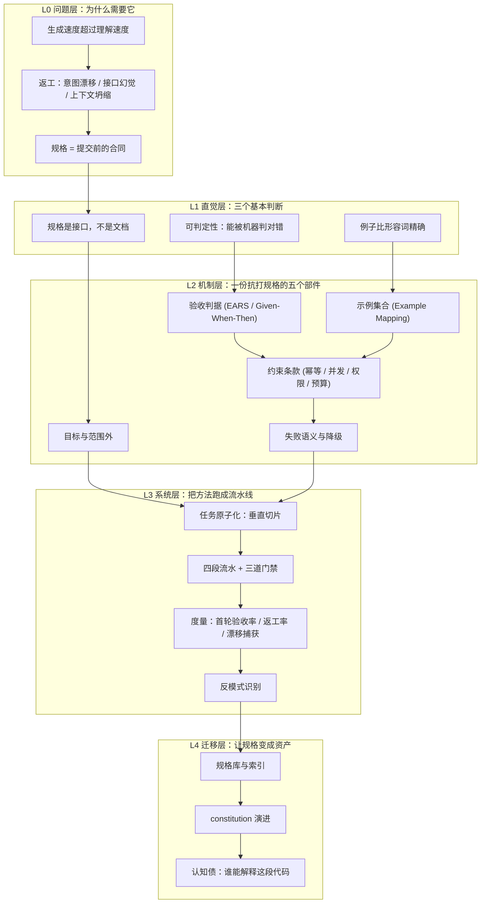

[English](./README.md) | **中文**

# 《先写规格，再让 AI 动手：从零基础到规格驱动开发》

> **定位**：面向零规格经验学习者的系统化开源教材，对应《Vibe Coding 学习规划》**阶段 2**（4 周 / 30 小时每周）
> **在整条路线里的坐标**：`phase2/`。阶段 1 解决"凭什么信"，这一阶段解决"让它照着做对"；阶段 3 才上重型门禁与安全。
> **设计原则**：事故先行 · 判据可执行 · 图文紧耦合 · 每个概念都给出失效边界
> **不做什么**：不是提示词模板集，不是工具说明书，不承诺"一次生成就对"

---

## 0. 口径声明（开工前先说清）

| 项 | 值 |
|---|---|
| 起点假设 | 能读懂一门语言的代码、会用 Git、写过至少一个能跑的 Web 服务；**没系统写过规格** |
| 不预设 | 不预设需求工程训练，不预设 UML，不预设读过《实例化需求》 |
| 终点 | 对应学习规划阶段 2 的四条检验标准（见第 10 节） |
| 语言 | 中文正文；术语首次出现给英文原文 |
| 引用纪律 | 所有外部结论标来源与时点；所有 Python 图若为模型示意，图注必须写明参数假设，**不伪装成实证数据** |
| 工具口径 | 以 GitHub Spec Kit v1.0（2026-08）命令族为准；同时给"不装工具的最小手工版"，防止教材绑死某一个工具 |

**这本书与"提示词技巧"的分界线**

提示词技巧回答"这句话怎么说模型才听话"；规格回答"做成什么样才算对"。前者在单轮对话里有效，后者跨文件、跨会话、跨人交接都有效。本书只讲后者，凡是讲成前者的段落都算跑题。

---

## 1. 领域全景与学习目标

### 1.1 为什么需要这门手艺

三句话，每句都对应一个真实失败：

1. **AI 不会因为你说得不清楚而停下来**。它会用"合理默认值"把空白填满，然后交给你一份看起来正确、实际上做了三十个你没批准过的决定的东西。
2. **返工的成本不在写代码，在重新想清楚**。同一句话让 AI 重写三次，你会得到三个形状不同的系统——因为缺的不是代码，是那份"什么叫对"的定义。
3. **规格是唯一能同时约束人、模型和未来的产物**。代码会腐烂，对话会丢失，只有写下来的判据能在三个月后回答"当初为什么这么设计"。

### 1.2 学完你将掌握什么

- **核心认知层**：能说清"规格 / 计划 / 任务"三者的分工与越界信号；能判断一句话是"能判"还是"不能判"。
- **系统方法层**：能独立产出一份让 AI 首轮通过验收的规格，包含目标、范围外、验收判据、非功能约束、失败语义；能把规格切成可独立验收的任务。
- **实战能力层**：能跑通一条完整流水（规格 → 计划 → 任务 → 实现 → 收敛），并用三个指标证明"这次的规格比上次好"，且能指出好在哪一句。

---

## 2. 领域全景知识图谱



**读图要点**：纵向是"从问题到资产"的四层，横向是同一层内的依赖。**L2 的五个部件缺任何一个，L3 的流水线都会在某个具体任务上塌掉**——这不是理论排列，是第 11 章实战里三次返工分别指向的三个缺口。

---

## 3. 知识模块矩阵

| 模块 | 核心解决的问题 | 对应章节 | 前置 | 视觉资产 | 难度 |
|---|---|---|---|---|---|
| M1 规格本体论 | 规格、计划、任务到底各管什么，越界长什么样 | ch02 | 无 | 三层分离图 (Mermaid) | ★☆☆☆☆ |
| M2 可判定性 | 把"能登录"改写成机器和人都能判的句子 | ch03 | M1 | 判定树 (Mermaid) + 判据改写对照表 | ★★☆☆☆ |
| M3 示例化 | 用具体输入输出钉住抽象规则的边界 | ch04 | M2 | Example Mapping 板面图 | ★★☆☆☆ |
| M4 歧义消解 | 找出规格里那些"每个人都以为自己懂"的地方 | ch05 | M2 | 歧义分类树 + 提问模板表 | ★★★☆☆ |
| M5 约束条款 | 为什么非功能约束不写就等于授权模型自由发挥 | ch06 | M2 | 幂等状态机对比 (Mermaid) | ★★★☆☆ |
| M6 任务切分 | 拆到多大才叫"一个评审单元" | ch07 | M5 | 水平/垂直切片对比 + 批次曲线 | ★★★☆☆ |
| M7 流水线与门禁 | 把判断变成流程，把流程变成可回退的步骤 | ch08 | M6 | 流水线图 + 收敛循环状态机 | ★★★★☆ |
| M8 度量 | 用三个数字证明规格变好了，并说清好在哪 | ch09 | M7 | 指标计算路径图 + 趋势示意 | ★★★☆☆ |
| M9 反模式 | SDD 自己退化成瀑布的五种死法 | ch10 | M8 | 反模式矩阵 + 规格重量-风险图 | ★★★★☆ |
| M10 资产化 | 三个月后这份规格还值钱吗 | ch12 | M9 | 规格库结构图 + 认知债累积曲线 | ★★★★★ |

---

## 4. 分章详细大纲

> 篇幅按"正文 4000–6000 字 + 3–5 张图 + 4 道分级练习"估算。每章独立可读，但案例连续。

### 第一部分 · 直觉：为什么"说清楚"这么难（ch01–ch03）

**第 01 章：返工的地形图**（`chapters/ch01-rework-topography.zh.md`）
- **直觉锚点**：你说"加个报名功能"。AI 交了 400 行，能跑、能点、界面漂亮。三天后你发现：没有候补、重复点击建了两条记录、有人取消后名额没释放。**三个 bug，同一个根因。**
- **核心知识**：返工的三种形态（意图漂移 / 接口幻觉 / 上下文坍缩）；"合理默认值"是怎么被填进去的；返工成本随发现阶段推移的量级（**模型示意，不是实证**）；规格在这条曲线上的作用点
- **规划图表**：三次对话往返的时序对比 (Mermaid sequenceDiagram)；图 1-1 返工成本随发现阶段的变化（Python，标注假设）
- **实操/推演**：用同一句需求让 AI 生成三次，记录三次产出的差异清单——**这是读者自己的第一组数据，后面 ch09 要拿它做基线**

**第 02 章：规格是接口，不是文档**（`chapters/ch02-spec-as-interface.zh.md`）
- **直觉锚点**：点菜说"来个下饭的"，和说"宫保鸡丁、不要花生、微辣、不要香菜"——差别不在礼貌，在可执行性
- **核心知识**：What / Why / How 三层分离；`spec.zh.md` / `plan.zh.md` / `tasks.zh.md` 三件套的职责边界与越界信号；"唯一真源"到底指什么（以及它不指什么）；规格的最小结构七段式
- **规划图表**：图 2-1 三层分离与越界信号 (Mermaid)；表 2-1 同一条需求在三个文件里的合法/非法写法对照
- **实操/推演**：把一条真实需求分别写进三个文件，逐条检查是否越界（含 6 个"越界了但很像对的"样例）

**第 03 章：可判定性——把"能登录"写成能判的句子**（`chapters/ch03-testability.zh.md`）
- **直觉锚点**：法庭上"他态度不好"不成立，"他 3 月 5 日 14:02 在群里说了这句话"成立
- **核心知识**：可判定的四个条件（可观测 / 可量化 / 有触发条件 / 有失败路径）；EARS 五句式（ubiquitous / event-driven / state-driven / unwanted / optional，Mavin 等人在 Rolls-Royce 提出，RE'09）；EARS 与 Given-When-Then 的分工；`shall` 与 `should` 的差别为什么是硬规则
- **规划图表**：图 3-1 判据可判定性判定树 (Mermaid)；表 3-1 十二条"不可判定句"的逐条改写
- **实操/推演**：把 ch01 里那句需求改写成 8 条 EARS 判据，再用"反例法"逐条攻击自己的判据

### 第二部分 · 机制：一份抗打规格的五个部件（ch04–ch07）

**第 04 章：用例子钉住抽象**（`chapters/ch04-examples.zh.md`）
- **直觉锚点**：两个人都说"友好一点"，直到给出三个具体场景，才发现一个想的是文案、一个想的是按钮大小
- **核心知识**：Example Mapping 四色卡（故事 / 规则 / 例子 / 疑问）；Adzic《实例化需求》七条过程模式；例子的四条要求（精确、完整、真实、易懂）；规则—例子—判据的映射关系；为什么"边界例子"比"典型例子"更能暴露歧义
- **规划图表**：图 4-1 Example Mapping 板面结构与流转 (Mermaid)；表 4-1 规则→例子→判据三列映射
- **实操/推演**：对"候补队列"做一次完整 Example Mapping，产出 6 条规则 + 12 个例子，其中至少 3 个是边界例子

**第 05 章：歧义的解剖学**（`chapters/ch05-ambiguity.zh.md`）
- **直觉锚点**："尽快回复我"——在三个人心里是三个时间：五分钟、下班前、这周
- **核心知识**：六类歧义（指代 / 范围 / 边界 / 例外 / 时序与并发 / 权限与可见性）；每类的识别信号；三种提问武器（反例法 / 极端值法 / 角色法）；clarify 的五问上限为什么是上限而不是配额；答案必须回写规格而不是留在对话里
- **规划图表**：图 5-1 六类歧义分类树 (Mermaid)；表 5-1 识别信号 × 提问模板 × 回写位置
- **实操/推演**：对 ch04 产出的规格提五个问题，模拟"提问后首轮验收率变化"，并记录哪一问带来了最大收益

**第 06 章：约束条款——不写，就等于授权默认值**（`chapters/ch06-constraints.zh.md`）
- **直觉锚点**：酒店退房要查房，无人酒店不查——不查不等于没规则，规则被写进了门锁和押金
- **核心知识**：为什么约束最容易被漏（**漏掉不会报错**）；六类必写约束（幂等 / 并发 / 重试与超时 / 权限与可见性 / 性能预算 / 依赖与降级）；幂等键 + 重试窗口的写法（"幂等键必填 + 24 小时重试窗口"这一类条款为什么必须进规格）；把约束写成判据而不是写成愿望
- **规划图表**：图 6-1 同一请求在无幂等 / 有幂等下的状态机对比 (Mermaid stateDiagram)；表 6-1 六类约束的条款模板与验证方式
- **实操/推演**：给候补系统写 6 条约束条款，每条配一个"能验出来的"判据，并故意留一条不写，观察 AI 会怎么填

**第 07 章：任务原子化——垂直切片与评审单元**（`chapters/ch07-task-slicing.zh.md`）
- **直觉锚点**：装修先装水电还是先买沙发？水平切片让你三个月看不见一间能住的房
- **核心知识**：垂直切片 vs 水平切片；一个任务 = 一个评审单元 = 一次可回滚的提交；依赖排序与"可并行"的判据；批次大小与上下文预算的权衡；`tasks.zh.md` 的写法（为什么每条任务都要写"验收方式"）
- **规划图表**：两种切片的交付节奏对比 (Mermaid)；图 7-1 批次大小 vs 上下文占用与返工（Python，模型示意）
- **实操/推演**：把 ch04–ch06 的规格切成 9 个任务并排序，标出哪两个可以并行、依据是什么

### 第三部分 · 系统：流水线、度量与反模式（ch08–ch10）

**第 08 章：四段流水与三道门禁**（`chapters/ch08-pipeline.zh.md`）
- **直觉锚点**：机场安检不是不信任你，是把"该不该放行"从个人判断变成可复核的流程
- **核心知识**：Spec Kit v1.0 命令族逐个讲——`constitution` / `specify` / `clarify` / `plan` / `checklist` / `tasks` / `analyze` / `implement` / `converge`，各自产物与回退方向；`specs/<feature>/` 目录约定；三道门禁（规划前消歧 / 拆任务前审需求质量 / 实现前查一致性）；`converge` 的循环终止条件；OpenSpec 的"提议 → 应用 → 存档"轻流程对照；**不装工具的最小手工版**（三个文件 + 一张清单，20 分钟可搭）
- **规划图表**：图 8-1 流水线与三道门禁及回退箭头 (Mermaid flowchart)；图 8-2 收敛循环状态机 (Mermaid stateDiagram)
- **实操/推演**：先用最小手工版跑一轮，再换 Spec Kit 跑同一需求，对比两者的产物差异与摩擦点

**第 09 章：度量——首轮验收率与它的两个同伴**（`chapters/ch09-metrics.zh.md`）
- **直觉锚点**：体重秤 vs "我最近好像瘦了"
- **核心知识**：首轮验收率的定义与分母陷阱（什么算"一次生成"）；返工率的算法（7 天内跟进提交）；规格漂移捕获率（评审里出现"违反规格"意见的次数）；两周基线法；一张 CSV 的字段设计；为什么"生成代码行数"是误导性指标
- **规划图表**：图 9-1 三个指标的计算路径与数据来源 (Mermaid)；图 9-2 规格改进后的趋势（Python，**示例数据**，附 CSV 模板）
- **实操/推演**：建自己的 `metrics.csv`，用 ch01 的基线数据填第一行，写一页看板说明

**第 10 章：反模式——SDD 退化成瀑布的五种死法**（`chapters/ch10-antipatterns.zh.md`）
- **直觉锚点**：药吃多了也是毒；规格写过头，你就把 1970 年代的瀑布流程原样请回来了
- **核心知识**：五种死法（重前期规格 + 大爆炸发布 / PRD cosplay / 规格过载 / 只改代码不改规格 / 清单自我批准）；每种死法的早期信号与解药；规格重量应匹配任务风险（"一屏 markdown 换一天工作量"的经验线）；为什么"改代码不改规格"会让同一个洞换个形状回来
- **规划图表**：表 10-1 五反模式 × 信号 × 解药 × 复发检测；图 10-1 规格重量与任务风险的匹配矩阵 (Mermaid)
- **实操/推演**：给自己过去三个项目做反模式体检，每个项目写一条"当时如果多写一句什么就不会出事"

### 第四部分 · 实战与迁移（ch11–ch12）

**第 11 章：端到端实战——从模糊需求到上线**（`chapters/ch11-end-to-end.zh.md`）
- **直觉锚点**：前面十章都是分解动作，这一章是完整的一套拳
- **核心知识**：候补报名系统走完整流程（一句话需求 → 规则 → 例子 → 五问 → 约束 → 九任务 → 实现 → 收敛 → 上线）；**三次真实返工的追因表**，每次追到"规格的哪一句缺了"，并验证"补了这句之后同类任务重生成 3 次是否复发"
- **规划图表**：图 11-1 全流程时间线 (Mermaid)；表 11-1 三次返工 × 症状 × 规格缺口 × 补法 × 复发验证
- **实操/推演**：读者用自己真实要上线的需求走一遍，交付 `spec/plan/tasks` + 追因记录（这是学习规划的任务 1 与任务 3）

**第 12 章：规格库与认知债**（`chapters/ch12-spec-library.zh.md`）
- **直觉锚点**：三个月后接手的人（可能是你自己）问"这里为什么这么写"，代码答不上来
- **核心知识**：规格库的索引与命名；`constitution` 如何从重复的评审意见里长出来；规格与代码的漂移检测（定期 converge、PR 模板里加"是否违反规格"）；认知债的度量（"团队里有几个人能解释这段代码"）；哪些规格该归档、哪些该删
- **规划图表**：规格库结构与复用路径 (Mermaid)；图 12-1 认知债随交付速度的累积（Python，模型示意）
- **实操/推演**：给项目建 `specs/README.md` 索引 + 一份 constitution 演进记录（v0.1 → v1.0，每次改动写明由哪条重复意见触发）

---

## 5. 贯穿案例：候补报名系统

选它不是为了简单，是因为**它的约束密度最高**。

**一句话需求**：一个活动报名页，名额满了进候补，有人取消就自动放位给候补第一位。

它天然逼出 AI 最容易"用默认值填掉"的四类东西：

| 类别 | 案例里的具体形态 | 不写会发生什么 |
|---|---|---|
| 幂等 | 用户连点两次提交 | 建出两条报名记录，占两个名额 |
| 并发 | 两个人同时抢最后一个位子 | 两个人都报名成功，超卖 |
| 时序 | 候补第一位收到通知后没确认，15 分钟窗口过期 | 名额永久卡住，队列不前进 |
| 权限与可见性 | 未登录访问名单、A 取消 B 的报名 | 数据泄露或越权操作 |

**案例的九个演进步骤**（与章节一一对应）：一句话需求（ch01）→ 三条规则（ch02）→ 八条判据（ch03）→ 六规则十二例（ch04）→ 五问消歧（ch05）→ 六条约束（ch06）→ 九个任务（ch07）→ 流水线跑一轮（ch08–ch09）→ 上线并归档（ch11–ch12）。

---

## 6. 仓库目录结构

```text
phase2/                     # 本册（阶段 2）
├── README.zh.md                     # 本文件：全景知识图谱、大纲、阅读路径
├── chapters/
│   ├── ch01-rework-topography.zh.md
│   ├── ch02-spec-as-interface.zh.md
│   ├── ch03-testability.zh.md
│   ├── ch04-examples.zh.md
│   ├── ch05-ambiguity.zh.md
│   ├── ch06-constraints.zh.md
│   ├── ch07-task-slicing.zh.md
│   ├── ch08-pipeline.zh.md
│   ├── ch09-metrics.zh.md
│   ├── ch10-antipatterns.zh.md
│   ├── ch11-end-to-end.zh.md
│   └── ch12-spec-library.zh.md
├── assets/
│   ├── ch01/  ch07/  ch09/  ch12/  # 有图各章 fig-NN-<slug>.png（en）/ fig-NN-<slug>.zh.png（zh），≥200 DPI
├── code/
│   ├── figures/                   # 全部配图的生成脚本（make_figures.py）
│   ├── ch09/                     # metrics.csv 模板与统计脚本
│   └── ch11/                     # 候补系统参考实现（含 3 个故意留的规格缺口）
└── templates/
    ├── spec.zh.md                   # 最小规格七段式模板
    ├── plan.zh.md                   # 计划模板（只允许写 How）
    ├── tasks.zh.md                  # 任务模板（每条带验收方式）
    └── requirements-checklist.zh.md # 需求质量清单（"用自然语言写的单元测试"）
```

---

## 7. 阅读路径与周计划映射

**30 小时/周的四周切法**（对应学习规划阶段 2 的 4 周周期）

| 周 | 章节 | 读完做什么 | 约需时间 |
|---|---|---|---|
| 第 1 周 | ch01–ch03 | 用一句真实需求做三次生成，记下差异；把它改写成 8 条判据 | 12 h 读 + 8 h 做 |
| 第 2 周 | ch04–ch06 | Example Mapping 一轮 + 五问回写 + 六条约束条款 | 12 h 读 + 10 h 做 |
| 第 3 周 | ch07–ch08 | 切九个任务；先用最小手工版跑一轮，再上 Spec Kit | 10 h 读 + 12 h 做 |
| 第 4 周 | ch09–ch11 | 建度量表；走完端到端；写追因记录 | 8 h 读 + 14 h 做 |
| 加读 | ch10、ch12 | 反模式体检 + 规格库归档 | 各 2 h |

**按学历档调档**

| 档位 | 怎么读 |
|---|---|
| 中学 / 高中 | ch01–ch03 读两遍；每章的"直觉锚点"先读，再看正文；练习只做 Tier 1 与 Tier 2；跳过 ch10 的矩阵推导，只读结论与体检表 |
| 本科 | 全书顺序读，练习三级全做；ch08 必须亲手装一次 Spec Kit |
| 硕士 | ch01–ch03 快速过（重点看返工的三种形态与你自己的数据）；重点 ch06–ch09 与 ch12 |
| 博士 | 直接读 `specs/` 层级设计与 ch08 的命令语义；把 ch09 的指标做成可自动化采集；ch10 与 ISO/IEC/IEEE 29148 的需求质量特性对照读 |

---

## 8. 视觉资产清单与绘制原则

**分工**：逻辑结构用 Mermaid（GitHub 原生渲染、可 diff、可改），定量与示意用 Python（≥200 DPI、CJK 字体门禁）。

| 章 | Mermaid | Python 图 | 图要回答的问题 |
|---|---|---|---|
| 01 | 三次往返时序 | 返工成本曲线（标注假设） | 为什么第三次重写比第一次贵 |
| 02 | 三层分离 + 越界信号 | — | 这句话该写在哪个文件 |
| 03 | 判据判定树 | — | 这条句子能不能判 |
| 04 | Example Mapping 板面 | — | 规则和例子怎么互相补 |
| 05 | 六类歧义分类树 | — | 这句话歧义属于哪一类 |
| 06 | 幂等状态机对比 | — | 为什么"重试"会变成"重复" |
| 07 | 切片节奏对比 | 批次大小 vs 返工 | 拆多细才合适 |
| 08 | 流水线 + 收敛状态机 | — | 出错时该退回哪一步 |
| 09 | 指标计算路径 | 趋势示例（示例数据） | 数字怎么算出来的 |
| 10 | 规格重量-风险矩阵 | — | 这个任务该写多重 |
| 11 | 全流程时间线 | — | 三次返工发生在哪 |
| 12 | 规格库结构 | 认知债累积（模型示意） | 为什么三个月后没人懂 |

**视觉纪律**（反 AI slop 的具体约束）

- 单色主调 + 一个强调色 + 一个警示色；白底、细线、无阴影、无渐变、无圆角泛滥
- 图注写"结论"，不写"示意图"——例如"注意 15 分钟窗口过期后队列不前进，这是第 3 次返工的直接原因"
- **禁止装饰性插图**。每一张图必须在正文里被显式引用，并承担一个具体判断
- 所有 Python 图若为模型示意，图注必须写清参数假设与"非实证"标注

---

## 9. 交付前的三道质量门禁

| 门禁 | 检查什么 | 判定方式 |
|---|---|---|
| 配图门禁 | CJK 零豆腐块、无标签重叠、无裁切、对比清晰、层级一眼可辨 | 每张 PNG 逐张目视检查，不合格立即重绘 |
| 语法与链接门禁 | Mermaid 标签含括号/冒号必须双引号包裹；折叠答案块成对闭合；本地图片路径全部存在 | `python3 scripts/verify_textbook_quality.py chapters/` |
| 教学完整性门禁 | 无"知识诅咒"跳步：每个新术语先给直觉桥，再给数值或代码例；无占位符；练习三级齐全且答案在折叠块内 | 逐章对照模板六个模块清单 |

---

## 10. 与学习规划的对应关系

**七个核心知识点 → 章节**

| 规划知识点 | 章节 |
|---|---|
| SDD 的核心主张：规格是唯一真源 | ch01、ch02 |
| 四段流水与脚手架（Spec Kit / OpenSpec） | ch08 |
| 可判定的验收标准；约束必须写进规格 | ch03、ch06 |
| 失败形态归因：问题通常是规格缺口的产物 | ch01、ch10、ch11 |
| 任务原子化与批次大小 | ch07 |
| 首轮验收率作为规格质量的度量 | ch09 |
| 反模式：重前期规格 + 大爆炸发布 | ch10 |

**三个实践任务 → 落点**

| 规划任务 | 教材中的落点 |
|---|---|
| 任务 1：真实需求走完 SDD 全流程 | ch11 的实操（含 `templates/` 四份模板与 `code/ch11/` 参考实现） |
| 任务 2：三个"坏规格"反面案例 | ch05 的练习 + ch10 的反模式体检表 |
| 任务 3：把 bug 追回规格层并验证不复发 | ch11 的追因表 + "重生成 3 次看是否复发"的验证脚本 |

**四条检验标准 → 验收方式**

| 检验标准 | 教材怎么保证可验 |
|---|---|
| 同一需求做两次，第二次首轮验收率显著更高，且能说出差异来自哪一句 | ch09 的 `metrics.csv` + ch11 的追因表；两次规格并排 diff |
| 能解释"只修代码不补规格"为何复发 | ch10 的复发检测列 + ch11 的第三次返工 |
| 能做出一份不进人也能跑的检查清单 | ch08 的 `requirements-checklist.zh.md` 与 `checklist` 门禁；清单自带判定规则 |
| 能判定一个需求该拆几件事、哪些约束必须进规格 | ch06 的约束清单 + ch07 的切片判据（两者都是可勾选的表，不是原则口号） |

**书单的接入点**

- Adzic《实例化需求》：ch04 直接以七条过程模式为骨架，练习要求引用原文模式名
- 《Software Engineering at Google》：ch12 的"资产化"与其知识共享、弃用章节对接
- 《Prompt Engineering for LLMs》：ch08 末尾"规格如何变成模型输入"一节（结构化输入与护栏）
- 张昕东《Vibe Coding：AI 编程时代的认知重构》：ch01 与 ch10 的中文语境对照

---

## 11. 确认记录与交付状态

| 项 | 裁决 | 时间 |
|---|---|---|
| 贯穿案例 | 保留「候补报名系统」，按**真实需求的虚构化案例**处理：需求形态取自真实运营事故，组织与人名虚构 | 2026-10-19 |
| 章节数 | 12 章，不压缩 | 2026-10-19 |
| 交付范围 | 全量：12 章正文 + 4 份模板 + 度量脚本 + 参考实现 + 全部配图 | 2026-10-19 |

**案例的真实性边界（写进正文，避免读者误当实证）**：报名超卖、重复提交、取消后名额未释放这三类事故，来自社区活动运营中反复出现的真实问题形态；「木工课」「小陈」等具体设定为虚构。书中所有数字标注了来源类型——教学模型、示例数据、或外部事实。

**下一步**：按第 7 节的四周切法自学；每章末尾的三级练习是硬要求，Tier 2 与 Tier 3 不做等于没读。

---

## 12. 交付清单

**正文（12 章，约 4.1 万汉字，全部通过语法与教学完整性门禁）**

| 章 | 文件 | 核心产出 | 配图 |
|---|---|---|---|
| 01 | `chapters/ch01-rework-topography.zh.md` | 返工的三种形态；成本曲线；五个"本该写的那一句" | 时序图 + 成本曲线 |
| 02 | `chapters/ch02-spec-as-interface.zh.md` | 三层分离；六种越界写法；七段式 | 三层分离图 |
| 03 | `chapters/ch03-testability.zh.md` | 可判定四条件；EARS 五句式；12 条改写 | 判定树 |
| 04 | `chapters/ch04-examples.zh.md` | Example Mapping；Adzic 七模式；6 规则 12 例 | 板面流转图 |
| 05 | `chapters/ch05-ambiguity.zh.md` | 六类歧义；三种提问武器；五问上限 | 歧义分类树 |
| 06 | `chapters/ch06-constraints.zh.md` | 六类约束；幂等三要素；TOCTOU 实验 | 幂等状态对比 |
| 07 | `chapters/ch07-task-slicing.zh.md` | 四条原子判据；九任务四批；并行边界 | 切片对比 + 批次曲线 |
| 08 | `chapters/ch08-pipeline.zh.md` | Spec Kit v1.0 命令族；三道门禁；最小手工版 | 流水线 + 收敛状态机 |
| 09 | `chapters/ch09-metrics.zh.md` | 三指标口径；CSV 与脚本；一次真实解读 | 指标路径 + 趋势示例 |
| 10 | `chapters/ch10-antipatterns.zh.md` | 五种死法；重量-风险匹配；复发检测 | 退化路径图 |
| 11 | `chapters/ch11-end-to-end.zh.md` | 十天全流程；三次返工追因；上线清单 | 全流程时间线 |
| 12 | `chapters/ch12-spec-library.zh.md` | 规格库三要素；constitution 演进；认知债三问 | 状态机 + 债务曲线 |

**配套**

| 目录 | 内容 | 验证状态 |
|---|---|---|
| `templates/` | `spec.zh.md` / `plan.zh.md` / `tasks.zh.md` / `requirements-checklist.zh.md` | 与第 2、7、8 章正文一致 |
| `code/ch09/` | `metrics.csv`（12 行样例）+ `summarize.py` | 已实跑，输出与第 9 章引用的数字一致 |
| `code/ch11/` | `store.py`（核心逻辑）+ `verify.py`（四条约束取证） | 已实跑：**5/5 通过**（幂等 20 并发、50 抢 1 无超卖、通知降级、去重、过期顺延） |
| `code/figures/` | `make_figures.py` | 四张图可一键重绘，含"非实证"标注 |
| `assets/` | 4 张 240 DPI 图 | 已逐张目视检查：CJK 无豆腐块、无标签重叠 |

**三处已知的教学简化**（写在代码注释里，不藏）

1. `store.py` 用进程内锁 + SQLite `BEGIN IMMEDIATE`；换 PostgreSQL 应改为"唯一约束 + 冲突重试"，不能照搬这把锁。
2. `code/ch11` 没有 HTTP 层——刻意如此，让约束取证不被框架细节掩盖。
3. 第 9 章的 12 行数据是构造的示例（首发 9 个任务 + 追加 3 个），用于演示读表方式，不代表任何团队实测。


