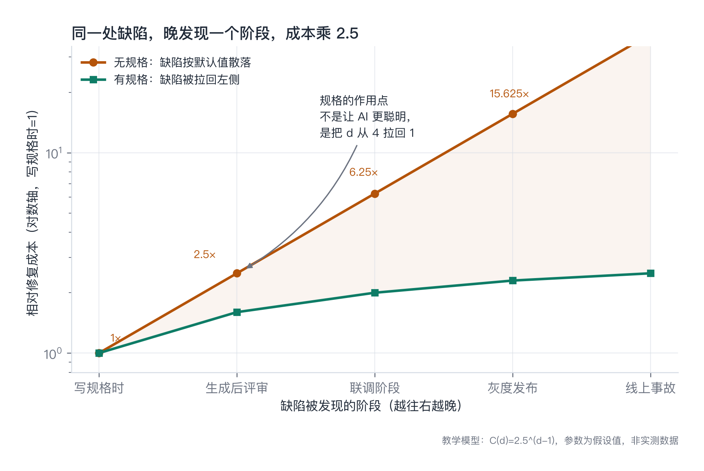
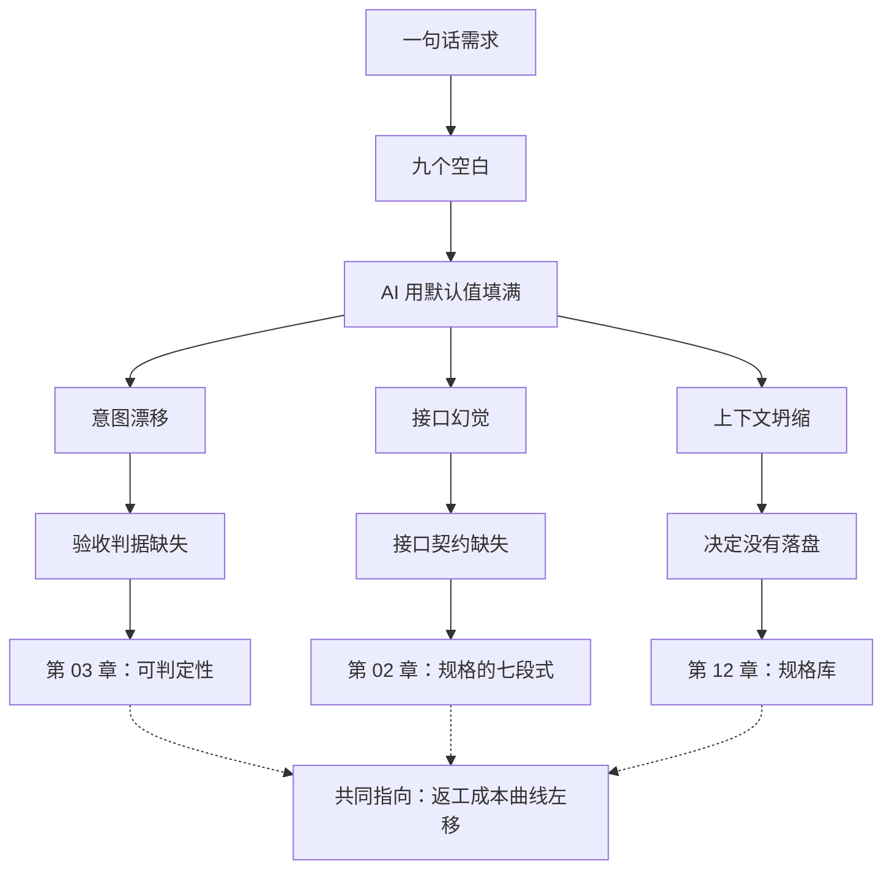

# 第 01 章：返工的地形图

> **本章导读**：这是全书的起点。你要先看清一件事——AI 交付物出问题，多数时候不是因为它不会写，而是因为它替你做了你没授权的决定。本章用一次真实形态的返工，把"返工"从一个模糊的挫败感，变成一张能定位、能归因、能预防的地形图。
> **前置知识**：零基础可读。会用任意一个 AI 编码工具即可，不需要写过规格。
> **核心学习目标**：
> - 说清返工的三种形态，并能给一个具体缺陷准确归因
> - 理解"晚发现一个阶段、成本乘几倍"的机制，而不是死记一个数字
> - 能指出一次返工本该被规格里的哪一句拦住

---

## 1. 认知锚点：一句话需求，三次返工

### 1.1 一个真实的痛点场景

> **案例说明**：本章（以及全书）的案例是**真实需求的虚构化处理**。超卖、重复报名、取消后名额没释放这三类事故，来自社区活动运营中反复出现的真实问题形态；"周末亲子木工课""运营小陈"等具体设定为虚构，不对应任何真实个人或机构。

某个社区活动中心办"周末亲子木工课"，每场 24 个名额，免费但需实名，一个家长带一个孩子。运营只有一个两人小组，报名靠一张手机表格加微信群接龙。两个月里出了三次事故：

| 时间 | 事故 | 现场后果 |
|---|---|---|
| 第 1 个月 | 一位家长在弱网下连点两次提交，表格收了两条记录 | 系统认为 24 人已满，实际只到场 23 人，一个孩子在门口被劝回 |
| 第 2 个月 | 有人临时取消，运营没看到，名额空着 | 候补名单上 6 个人在等，教室空着一把椅子 |
| 第 3 个月 | 两位家长几乎同时提交，都显示"报名成功" | 第 25 个人站在门口，运营当场加凳子 |

于是有了那句需求。它只有一句话：

> **「帮我做个报名页，名额满了进候补，有人取消就放位给候补的人。」**

### 1.2 这句话里，藏了九个没答案的问题

把这句话拆开，你会发现它没有规定任何一件真正决定成败的事：

1. 名额是 24 人还是 24 条报名记录？（一个人重复报名算几个？）
2. "满了"的判定发生在哪一刻？提交时、支付时、还是运营点确认时？
3. 候补按什么顺序？先来后到、随机、还是运营手动挑？
4. 有人取消后，名额是立刻释放，还是要等运营确认？
5. 候补的人收到通知后，多久内必须确认？超时怎么办？
6. 谁能取消？本人、家长、还是运营？
7. 通知发不出去（手机号错、服务挂了），报名算不算成功？
8. 同一个人重复提交，算一条还是两条？
9. 名单谁能看？未登录的人能不能看到"某某妈妈"的名字？

**九个问题，零个答案。而 AI 不会停下来问你，它会替你答。**

它会用"统计上最常见"的默认值把九个空填满：名额写成硬编码的 100、候补用创建时间排序、"取消"直接删记录、通知放在请求里同步发、名单接口不做鉴权。每一条都"合理"，每一条都不是你要的。

### 1.3 直觉类比：装修报价单

你跟工长说"我想要一个温馨的家"，他给你报了个价。三个月后你发现：墙面是冷灰色、插座少了六个、厨房台面矮了五公分。你没有说错话，他也没有偷工——**你们对"温馨"的理解不一样，而这句话没有留下任何可对照的凭据。**

装修行业早就解决了这个问题：**报价单**。它不描述"温馨"，它写"墙面乳胶漆两遍、立邦净味 120、色号 NN0037-4、单价 38 元/平米、面积 62 平米"。有了这张单子，"做得对不对"不再靠感觉，靠逐项对照。

对应关系是这样的：

| 装修 | 软件开发 |
|---|---|
| 业主的意图 | 产品意图（"满了进候补"） |
| 工长 | AI 编码助手 |
| 报价单 | 规格（spec） |
| 施工图 | 实现计划（plan） |
| 工序表 | 任务清单（tasks） |
| 验收 | 逐条判据对照，不是"看起来挺好" |

**类比的局限**，必须说清楚：装修是一次性交付，软件会一直改。所以规格不能像报价单那样签完就锁进抽屉——它必须和代码一起演进。这一点会在第 12 章展开。

---

## 2. 第一性原理：返工不是能力问题，是信息问题

### 2.1 三种失败形态

把所有 AI 交付物的缺陷归因，绝大多数会落进三个筐。分清它们的意义在于：**三种病的药不一样。**

| 形态 | 英文 | 机制 | 典型症状 | 你当时的感受 |
|---|---|---|---|---|
| **意图漂移** | intent drift | 模型在规格的空白处填了"统计上最常见"的默认值，而你要的是另一套 | 功能都在，行为不对；改一处牵动三处 | "它明明按我说的做了" |
| **接口幻觉** | interface hallucination | 模型发明了不存在的方法、字段、配置项，并且同时发明了它们的定义，所以能编译 | 运行时才炸；报错指向一个"文档里查不到"的东西 | "这方法哪来的？" |
| **上下文坍缩** | context collapse | 跨文件、跨会话时，前面做过的决定被遗忘或被改写 | 越做越矛盾；同一规则在两个文件里两种实现 | "上次不是这么说的吗" |

**意图漂移**最隐蔽，因为它交付的东西**看起来是对的**。第 3 个月那次超卖就是典型：AI 写了 `if count < 24: insert()`——这行代码在单线程、无并发、无重复提交的世界里完全正确。它漂移的不是语法，是"什么情况下算满"这个判断。

**接口幻觉**在 2024—2026 年这一代工具上明显减少（模型更倾向于查文档、跑测试），但在"少见组合"里仍然高发：三个库的交叉用法、刚发布的 SDK 版本、内部私有包。

**上下文坍缩**是长任务的默认结局。要建立一个正确直觉：**上下文窗口不是记忆，是草稿纸。** 草稿纸会被擦掉，被压缩，被新内容覆盖。任何"必须一直记住"的决定，都得写到纸面之外——也就是规格里。

### 2.2 返工成本的地形

返工贵，不是因为改代码费手，而是因为**一个晚期缺陷要重做的是一组互相依赖的决定**。

设想"取消后要延迟 15 分钟再放位"这条规则。在写规格时发现它，成本是改一行字。在联调时发现它，成本是改接口签名、改状态机、改前端文案、改测试用例、再回归一遍。在线上发现它，成本还要加上：已经发出去的通知、已经被占用的名额、以及运营对系统的信任。

用一张图把它摊开（图 1-2）。横轴是缺陷被发现的阶段，纵轴是相对修复成本（写规格时记为 1），纵轴取对数，因为差距是量级而不是倍数。

*图 1-2：橙色是无规格时的典型路径——缺陷按默认值散落在各阶段，越往后越贵；绿色是有规格时，缺陷被"拉回"左侧两阶段。注意两条线的斜率差，而不是某个具体倍数。*

**怎么读这张图，比记住数字重要**：

- 纵轴是对数轴。橙线看起来是直线，恰恰说明它在**指数增长**——每往右一格，就乘一个固定倍数。
- 图中倍数（2.5 倍/阶段）是**教学假设，不是实测数据**。不同团队、不同系统差别很大：一个有完整回归测试的项目，联调阶段的成本会低得多；一个没有测试、靠手工点一遍的项目，灰度阶段的成本会高得多。
- 你真正要带走的是**方向**：把缺陷往左推一格，收益远大于把代码写快一点。

### 2.3 规格的作用点

规格不提高模型的智力。它做的是另一件事：**把"决定"从代码里提前搬到纸面上，让缺陷在 d=1（写规格时）或 d=2（生成后评审）暴露。**

一个决定，写在代码里只能被"读代码"发现；写在规格里，可以被"读一句话"发现。前者需要理解 400 行，后者需要 10 秒。

这就是为什么本书反复讲同一件事：**规格的价值不在"写下来"，在"写下来之后能被对照"。** 一份没人能对照的规格，和没有规格没有区别——第 10 章会把这种退化形态单列出来。

---

## 3. 手把手推演：三次生成，三种病

### 3.1 实验设定

同一个模型、同一个项目骨架（一个空的前后端模板）、同一句需求，分三次、隔天进行。每次只在上一次的基础上补一句话。记录三次产出与三天的使用结果。

| 版本 | 你补的那句话 | AI 交了什么 | 三天后暴露 |
|---|---|---|---|
| v1 | "做个报名页" | 表单 + 报名列表 + 写库；`capacity` 硬编码 100 | 没有候补概念 |
| v2 | "加候补，满了进候补" | `if count >= capacity: insert(waitlist)`；取消时 `delete(registration)` | 取消后名额空着，候补队列不前进 |
| v3 | "取消后自动通知候补第一位" | 在 `cancel()` 里同步调用通知 SDK，成功后 `delete` | 通知服务超时 → 整个取消接口 500；已删的报名回滚失败 |

### 3.2 逐条归因

| 缺陷 | 归因形态 | 判据 |
|---|---|---|
| `capacity` 硬编码 100 | 意图漂移 | 需求没给数字，模型选了"一个看起来像默认值"的数 |
| 取消即删除，不推进队列 | 意图漂移 | "放位给候补"被理解成"腾出位置"，而不是"把位置交给具体的人" |
| 通知同步调用，失败拖垮主流程 | 意图漂移 + 上下文坍缩 | 模型不知道"通知可以失败、报名不能失败"这条业务优先级 |
| 接口返回了一个不存在的 `waitlist.position` 字段 | 接口幻觉 | 前端读不到值，运行时才发现 |
| 第二次生成时，把 v1 的"报名需实名"丢了 | 上下文坍缩 | 跨会话没有留痕，模型重建了一个更简单的模型 |

### 3.3 如果当时写了哪一句

把每个缺陷翻译成"本该写进规格的那一句"，你会看到规格长什么样——它不神秘，就是一句句可对照的话：

| 缺陷 | 本该写进规格的那一句 |
|---|---|
| 容量硬编码 | 「每场活动的名额是 24，由运营在后台按场次设置，不是全局常量。」 |
| 取消不推进 | 「当报名被取消时，系统应在 1 分钟内把该名额分配给候补队列的第一位，并向其发送确认通知。」 |
| 通知拖垮主流程 | 「通知失败不得导致报名或取消失败；通知应异步重试，最多 5 次，间隔指数退避。」 |
| 幻觉字段 | 「名单接口返回字段：`registration_id`、`name`、`phone_masked`、`status`、`created_at`；不返回 `position`。」 |
| 丢掉实名 | 「所有报名必须携带真实姓名与手机号；缺任一项应拒绝并返回 422。」 |

注意这五句话的共同点：**都在描述"什么算对"，没有一句在说"用什么框架、哪张表"。** 这就是第 2 章要展开的分界线。

---

## 4. 常见误区与正反例对比

| 容易踩的坑 | 为什么会出错 | 正确的心智模型 |
|---|---|---|
| **把"提示词写长"当成规格** | 长提示词仍然是一次性对话，没有版本、没有对照、不能复用于下一次 | 规格是**文件**，进版本库，能被 diff、被评审、被下次任务引用 |
| **把"AI 说它明白了"当成验收** | 模型说"明白了"是对语言的自信，不是对结果的责任 | 验收只认**跑出来的结果**对照**写下来的判据** |
| **把"能跑"当成"对了"** | 能跑只证明语法和基本路径通，不证明并发、边界、失败路径对 | 判据必须覆盖**失败路径与边界值**，否则等于只测了顺利情况 |
| **一次让 AI 做完整功能** | 一次生成的范围越大，上下文越容易坍缩，缺陷越难定位 | 一次一个**可独立验收**的切片（第 7 章） |
| **返工后只改代码，不回写规格** | 规格与代码分叉，下一次任务会以过期规格为起点，同一个洞换个形状回来 | 改代码的同一次提交里**改规格**（第 10 章的死法之一） |

---

## 5. 本章小结与局部知识图谱

### 5.1 三句话带走

- **返工的根因是信息缺口，不是模型能力。** 空白被默认值填满，而默认值不是你的意图。
- **三种病三种药**：意图漂移要判据，接口幻觉要契约，上下文坍缩要落盘。
- **规格的作用是把缺陷往左推。** 它不让你写得更快，它让你**更早知道自己错了**。

### 5.2 本章概念拓扑

---

## 6. 分级通关练习

### Tier 1：直觉核验

1. 用一句话区分"意图漂移"和"接口幻觉"，并各举一个你亲自遇到过的例子。
2. 判断：如果一份规格写得很详细，但从来没有人拿它对照过交付物，它算不算规格？说明理由。

### Tier 2：动手应用

3. 找一句你最近对 AI 说过的需求（越短越好），数出它里面**未定义的决定**有几个。把每个决定写成"如果不定，AI 最可能选什么默认值"。

### Tier 3：边界与迁移

4. 有人说："返工成本曲线是软件工程的常识，跟 AI 没关系。"请用本章的三种形态说明：为什么在 AI 参与交付后，这条曲线的**形状**变了（提示：变化的是 d 的分布，还是 k 的大小？）。

<strong>点击展开：本章练习参考答案与深度解析</strong>

#### 1. 区分意图漂移与接口幻觉

- **结论**：意图漂移是"行为符合代码、不符合意图"；接口幻觉是"引用了不存在的东西"。
- **判定口诀**：前者能跑但不对，后者跑不起来或运行时炸。
- **例子**：让 AI 做"删除后回到列表页"，它做成了"删除后留在详情页并提示已删除"——意图漂移；让 AI 用 `db.batchDelete()`，而这个 ORM 只有 `deleteMany()`——接口幻觉。

#### 2. 没人对照的详细规格算不算规格

- **结论**：不算。它是**文档**。
- **推演**：规格的功能是"提供对照基准"。没有对照动作，它既不约束生成，也不约束验收，只剩心理安慰。第 10 章把这种状态叫"规格变成曾经对过的文档"，并指出它比没有规格更糟——因为它让人误以为有防线。

#### 3. 数空白

- **参考做法**：一句 20 字的需求，通常能数出 5–9 个未定义决定。关键是第二步：不要停在"有空白"，要写出"AI 最可能怎么填"。
- **示例**：需求"加个搜索框" → 未定义：搜哪些字段、是否模糊匹配、是否分页、空结果怎么显示、是否记录搜索词、权限是否过滤。默认值猜测：搜标题、精确匹配、前 20 条、显示"暂无数据"、不记录、不过滤权限（**最后一条最危险**）。

#### 4. 曲线形状为什么变了

- **结论**：变的主要是 **d 的分布**，不是 k。
- **推演**：传统开发里，缺陷大多在编码阶段产生、在测试阶段发现，d 集中在 2–3。AI 交付把"编码"压缩到几分钟，但把"决定"的数量放大了——因为模型会自行补全大量细节。于是缺陷产生得更早、更多，而发现仍然靠人看，d 被推到了 3–4。k 没怎么变，**落点整体右移了**，总成本因此上升。
- **迁移**：这也解释了为什么"更快的生成"没有带来等比例的交付提速——速度被右移的成本吃掉了。

---

## 7. 本章权威参考信源与延伸阅读 (Authoritative References)

1. **METR**：[METR](https://metr.org/) - 本章的定义与规范以此为锚（核验日期：`2026-10-23`）。
2. **GitHub Spec Kit**：[GitHub Spec Kit](https://github.com/github/spec-kit) - 本章的定义与规范以此为锚（核验日期：`2026-10-23`）。
3. **Specification by Example（Adzic, 2011）**：[Specification by Example（Adzic, 2011）](https://www.manning.com/books/specification-by-example) - 本章的定义与规范以此为锚（核验日期：`2026-10-23`）。

> 口径提示：以上信源用于锚定**定义与规范**，不用于外推风险概率。引用任何数字前，先核对来源年份与分母。
