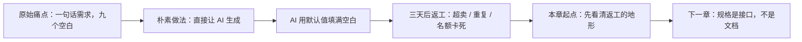
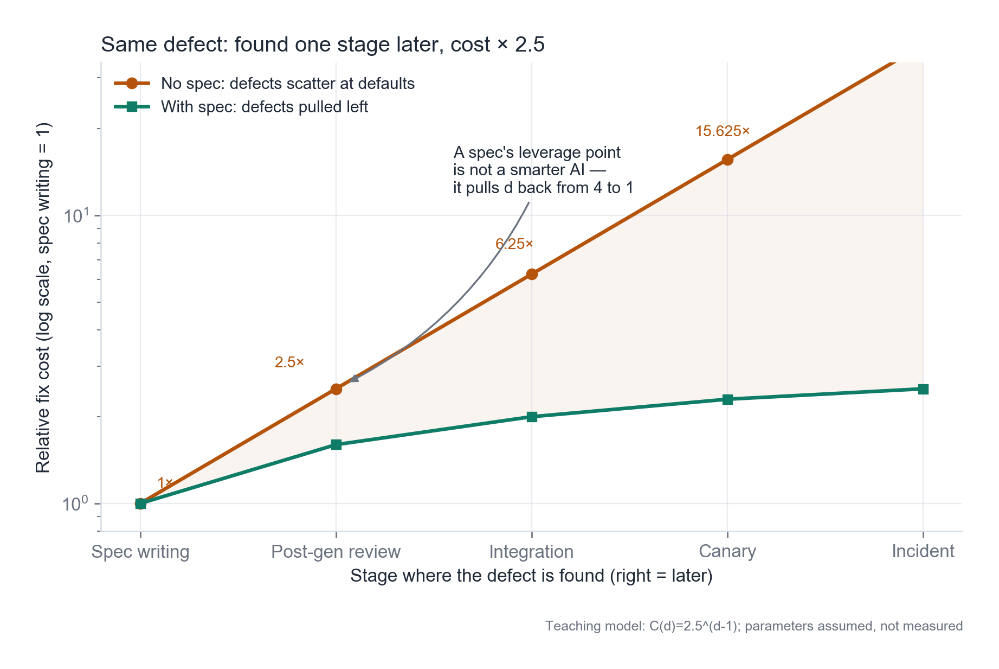
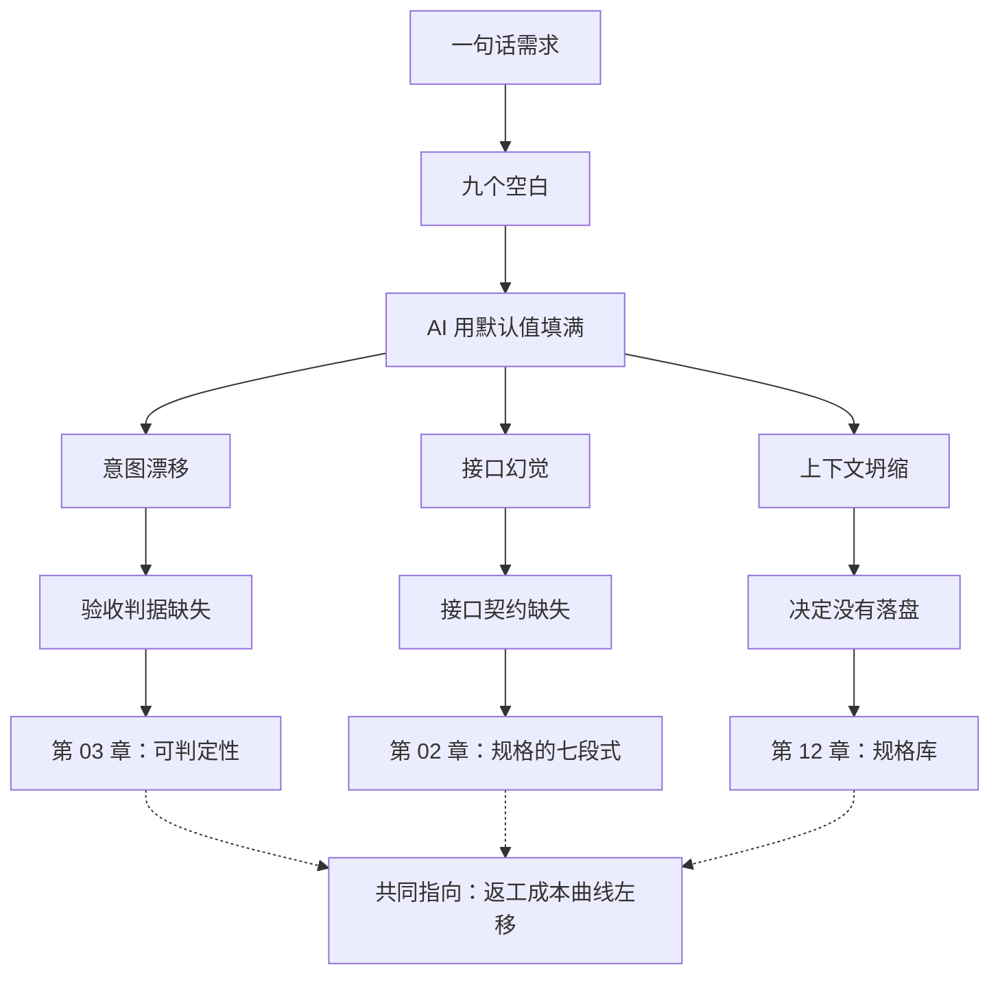

**English** | [中文](./ch01-rework-topography.zh.md)

# Chapter 01: The Topography of Rework

> **Chapter overview**: This is the starting point of the whole book. First you need to see one thing clearly: when an AI deliverable goes wrong, it is usually not because it cannot write code, but because it made decisions you never authorized. Using one realistic shape of rework, this chapter turns "rework" from a vague sense of frustration into a map you can locate, attribute, and prevent.
> **Prerequisites**: Readable with zero background. Being able to use any AI coding tool is enough; you do not need to have written specs before.
> **Core learning objectives**:
> - Name the three forms of rework, and attribute a specific defect to the right one
> - Understand the mechanism of "one stage later, several times the cost", rather than memorizing a number
> - Point out which single sentence in a spec should have stopped a given round of rework

---

## 1. Cognitive Anchor: A One-Sentence Requirement, Three Rounds of Rework

### 1.1 A Real Pain Point

> **About the case**: The case in this chapter (and in the whole book) is a fictionalized treatment of a real requirement. The three incident types - overselling, duplicate sign-ups, and slots not released after cancellation - come from real problem patterns that recur in community event operations; specific settings such as "weekend parent-child woodworking class" and "operator Xiao Chen" are fictional and do not correspond to any real person or organization.

A community center runs a "weekend parent-child woodworking class", 24 slots per session, free but real-name registration required, one parent per child. Operations staff is a two-person team; sign-ups run on a mobile spreadsheet plus a WeChat group relay. Three incidents happened within two months:

| Time | Incident | On-site consequence |
|---|---|---|
| Month 1 | A parent double-tapped submit on a weak connection, and the spreadsheet collected two records | The system believed all 24 slots were full; only 23 people actually showed up, and one child was turned away at the door |
| Month 2 | Someone canceled at the last minute; operations did not see it, and the slot stayed empty | Six people were waiting on the waitlist while one chair in the classroom stayed empty |
| Month 3 | Two parents submitted almost simultaneously, and both saw "sign-up successful" | Person number 25 stood at the door, and operations added an extra stool on the spot |

That was where the requirement came from. It was only one sentence:

> **"Build me a sign-up page: when the slots are full, people go on a waitlist; when someone cancels, hand the slot to the people on the waitlist."**

### 1.2 Inside That Sentence Hid Nine Unanswered Questions

Take the sentence apart and you will find it specifies nothing that actually decides success or failure:

1. Are the slots 24 people, or 24 sign-up records? (If one person signs up twice, how many does that count as?)
2. At which exact moment is "full" decided? At submit time, at payment time, or when the operator clicks confirm?
3. What order does the waitlist follow? First come first served, random, or hand-picked by operations?
4. After someone cancels, is the slot released immediately, or only after the operator confirms?
5. After a waitlisted person is notified, how long do they have to confirm? What happens on timeout?
6. Who can cancel? The person themselves, the parent, or operations?
7. If the notification cannot be sent (wrong phone number, service down), does the sign-up still count as successful?
8. If the same person submits twice, is that one record or two?
9. Who can see the list? Can a logged-out visitor see a name like "someone's mom"?

**Nine questions, zero answers. And the AI will not stop to ask you; it will answer them for you.**

It will fill the nine blanks with "statistically most common" defaults: the slot count becomes a hardcoded 100, the waitlist is sorted by creation time, "cancel" simply deletes the record, notifications are sent synchronously inside the request, and the list endpoint has no authentication. Every single one is "reasonable"; every single one is not what you wanted.

### 1.3 Intuition Analogy: The Home Renovation Quote

You tell your contractor "I want a cozy home", and he gives you a price. Three months later you find: the walls are cold gray, six power outlets are missing, and the kitchen counter is five centimeters too low. You did not say the wrong thing, and he did not cut corners: **your understandings of "cozy" differ, and that sentence left nothing to check against.**

The renovation trade solved this long ago: the **itemized quote**. It does not describe "cozy"; it writes "two coats of wall latex paint, Nippon Paint Odorless 120, color code NN0037-4, unit price 38 yuan/m2, area 62 m2". With that sheet in hand, "was it done right" no longer depends on feeling; it depends on checking item by item.

The mapping is this:

| Home renovation | Software development |
|---|---|
| The homeowner's intent | Product intent ("when full, go on the waitlist") |
| The contractor | The AI coding assistant |
| The itemized quote | The spec |
| The construction drawings | The implementation plan |
| The work schedule | The task list |
| Acceptance | Checking criteria one by one, not "looks pretty good to me" |

**The limits of the analogy** must be stated clearly: renovation is a one-time delivery, while software keeps changing. So a spec cannot be signed and locked in a drawer like a quote - it must evolve together with the code. Chapter 12 expands on this point.

---

## 2. First Principles: Rework Is Not a Capability Problem, It Is an Information Problem

### 2.1 Three Failure Patterns

Attribute the defects in AI deliverables, and the vast majority fall into three baskets. Telling them apart matters because: **three illnesses need three different medicines.**

| Pattern | English | Mechanism | Typical symptom | How it felt to you |
|---|---|---|---|---|
| **Intent drift** | intent drift | The model fills the blank in the spec with the "statistically most common" default, while you wanted something else | Everything is there, but the behavior is wrong; changing one place drags three others | "But it did exactly what I said" |
| **Interface hallucination** | interface hallucination | The model invents methods, fields, and config options that do not exist - and invents their definitions too, so it compiles | It only blows up at runtime; the error points at something "you cannot find in any docs" | "Where did this method come from?" |
| **Context collapse** | context collapse | Across files and sessions, earlier decisions are forgotten or overwritten | Things get more contradictory as work goes on; the same rule is implemented two ways in two files | "That's not what we agreed last time" |

**Intent drift** is the stealthiest, because what it delivers **looks right**. The oversell in month 3 is typical: the AI wrote `if count < 24: insert()` - a line that is perfectly correct in a world with single threading, no concurrency, and no duplicate submissions. What drifted was not the syntax; it was the judgment of "what counts as full".

**Interface hallucination** has clearly decreased in the 2024-2026 generation of tools (models tend to check docs and run tests), but it is still frequent in "rare combinations": cross-usage of three libraries, a just-released SDK version, internal private packages.

**Context collapse** is the default outcome of long tasks. Build one correct intuition: **the context window is not memory; it is scratch paper.** Scratch paper gets erased, compressed, and overwritten by new content. Any decision that "must stay remembered" has to be written outside the paper - that is, into the spec.

### 2.2 The Terrain of Rework Cost

Rework is expensive not because typing code is laborious, but because **a late defect forces a whole set of interdependent decisions to be redone.**

Take the rule "after a cancellation, wait 15 minutes before releasing the slot". Found while writing the spec, it costs one changed line. Found during integration, it costs changing the interface signature, the state machine, the front-end copy, the test cases, and running regression again. Found in production, the cost additionally includes: notifications already sent, slots already occupied, and operations' trust in the system.

Spread it out in one figure (Figure 1-1). The horizontal axis is the stage at which the defect is found; the vertical axis is the relative fix cost (set to 1 when writing the spec), on a logarithmic scale, because the gap is in orders of magnitude, not multiples.

*Figure 1-1：The orange line is the typical path without a spec - defects are scattered across stages by default values, and each later stage costs more; the green line is with a spec, where defects are "pulled back" to the two leftmost stages. Watch the difference in slope between the two lines, not any specific multiplier.*

**How to read this figure matters more than remembering the numbers**:

- The vertical axis is logarithmic. The orange line looks straight precisely because it is **exponential growth** - every step to the right multiplies by a fixed factor.
- The multiplier in the figure (2.5x per stage) is a **teaching assumption, not measured data**. Teams and systems differ a lot: a project with full regression tests pays much less at the integration stage; a project with no tests that relies on clicking through by hand pays much more at the canary stage.
- What you should really take away is the **direction**: pushing a defect one step left pays off far more than writing code a bit faster.

### 2.3 Where a Spec Acts

A spec does not raise the model's intelligence. It does something else: **it moves "decisions" out of the code and onto paper ahead of time, so defects surface at d=1 (writing the spec) or d=2 (reviewing after generation).**

A decision written in code can only be found by "reading the code"; written in the spec, it can be found by "reading one sentence". The former requires understanding 400 lines; the latter takes 10 seconds.

This is why the book keeps saying the same thing: **the value of a spec is not in "writing it down"; it is in "being able to check against it once it is written down."** A spec nobody can check against is no different from having no spec - Chapter 10 lists this degraded form separately.

---

## 3. Hands-on Walkthrough: Three Generations, Three Illnesses

### 3.1 Experiment Setup

Same model, same project skeleton (an empty front-end/back-end template), same one-sentence requirement, run three times on three different days. Each time you add exactly one sentence on top of the previous round. Record the three outputs and the three days of use.

| Version | The one sentence you added | What the AI delivered | What surfaced after three days |
|---|---|---|---|
| v1 | "Build a sign-up page" | Form + sign-up list + database writes; `capacity` hardcoded to 100 | No waitlist concept at all |
| v2 | "Add a waitlist; when full, go on the waitlist" | `if count >= capacity: insert(waitlist)`; on cancel, `delete(registration)` | After a cancellation the slot stays empty and the waitlist never advances |
| v3 | "After a cancellation, automatically notify the first person on the waitlist" | Calls the notification SDK synchronously inside `cancel()`, then `delete` on success | Notification service timeout -> the whole cancel endpoint returns 500; the already-deleted sign-up fails to roll back |

### 3.2 Attribution, Item by Item

| Defect | Attribution pattern | Criterion |
|---|---|---|
| `capacity` hardcoded to 100 | Intent drift | The requirement gave no number, so the model picked "a number that looks like a default" |
| Cancel deletes and does not advance the queue | Intent drift | "Hand the slot to the waitlist" was understood as "free up space", not "hand the space to a specific person" |
| Notification called synchronously; failure drags down the main flow | Intent drift + context collapse | The model did not know the business priority "notifications may fail; sign-ups must not" |
| The API returned a `waitlist.position` field that does not exist | Interface hallucination | The front end gets no value; it is only discovered at runtime |
| On the second generation, v1's "sign-ups require real names" was lost | Context collapse | Nothing was written down across sessions, so the model rebuilt a simpler model |

### 3.3 Which Sentence Should Have Been Written

Translate each defect into "the sentence that should have gone into the spec", and you will see what a spec looks like - nothing mysterious, just sentence after sentence you can check against:

| Defect | The sentence that should have gone into the spec |
|---|---|
| Hardcoded capacity | "Each event has 24 slots, configured by operations per session in the admin panel; it is not a global constant." |
| Cancel does not advance | "When a sign-up is canceled, the system shall assign that slot to the first person on the waitlist within 1 minute and send them a confirmation notification." |
| Notification drags down the main flow | "Notification failure must not cause sign-up or cancellation to fail; notifications shall be retried asynchronously, at most 5 times, with exponential backoff." |
| Hallucinated field | "The list endpoint returns these fields: `registration_id`, `name`, `phone_masked`, `status`, `created_at`; it does not return `position`." |
| Real names lost | "Every sign-up must carry a real name and a phone number; if either is missing, reject and return 422." |

Note what these five sentences share: **every one describes "what counts as right"; not one says "which framework, which table".** That is the dividing line Chapter 2 will draw.

---

## 4. Common Pitfalls: Wrong vs. Right

| Common pitfall | Why it goes wrong | The right mental model |
|---|---|---|
| **Treating "a long prompt" as a spec** | A long prompt is still a one-shot conversation: no versioning, no checking against it, no reuse in the next task | A spec is a **file**: it enters version control and can be diffed, reviewed, and referenced by the next task |
| **Treating "the AI said it understood" as acceptance** | The model saying "got it" is confidence about language, not responsibility for the result | Acceptance only counts **the result that ran** checked against **the criteria that were written down** |
| **Treating "it runs" as "it is right"** | Running only proves syntax and the happy path; it proves nothing about concurrency, boundaries, or failure paths | Criteria must cover **failure paths and boundary values**, or you have only tested the smooth case |
| **Asking the AI for the whole feature at once** | The larger the scope of one generation, the more easily context collapses and the harder defects are to locate | One **independently acceptable** slice at a time (Chapter 7) |
| **After rework, changing only the code and not the spec** | Spec and code diverge; the next task starts from an outdated spec, and the same hole comes back in a different shape | In the same commit that changes the code, **change the spec** (one of the death modes in Chapter 10) |

---

## 5. Chapter Summary and Local Knowledge Map

### 5.1 Three Takeaways

- **The root cause of rework is an information gap, not model capability.** Blanks get filled with defaults, and the defaults are not your intent.
- **Three illnesses, three medicines**: intent drift needs criteria, interface hallucination needs contracts, context collapse needs writing things down.
- **What a spec does is push defects to the left.** It does not let you write faster; it lets you **know you were wrong sooner**.

### 5.2 This Chapter's Concept Topology

---

## 6. Tiered Exercises

### Tier 1: Intuition Check

1. In one sentence each, tell "intent drift" from "interface hallucination", and give one example of each that you have personally run into.
2. True or false: if a spec is written in great detail but nobody has ever checked a deliverable against it, does it count as a spec? Explain your reasoning.

### Tier 2: Hands-on Application

3. Take a requirement you recently gave to an AI (the shorter the better), and count the **undefined decisions** inside it. Write each decision as "if left unspecified, which default is the AI most likely to pick?"

### Tier 3: Boundaries & Transfer

4. Someone says: "The rework cost curve is software engineering common sense; it has nothing to do with AI." Use this chapter's three patterns to explain why, once AI participates in delivery, the **shape** of this curve changes (hint: what changed is the distribution of d, or the size of k?).

<strong>Click to expand: reference answers and in-depth analysis for this chapter's exercises</strong>

#### 1. Telling intent drift from interface hallucination

- **Conclusion**: intent drift is "behavior matches the code but not the intent"; interface hallucination is "referencing something that does not exist".
- **Mnemonic**: the former runs but is wrong; the latter does not run, or explodes at runtime.
- **Example**: you ask the AI to "return to the list page after deletion" and it makes it "stay on the detail page after deletion and show a deleted notice" - intent drift; you ask the AI to use `db.batchDelete()` while the ORM only has `deleteMany()` - interface hallucination.

#### 2. Does a detailed spec nobody checks against count as a spec

- **Conclusion**: No. It is a **document**.
- **Reasoning**: the function of a spec is "to provide a baseline to check against". Without the checking action, it neither constrains generation nor constrains acceptance; all that is left is psychological comfort. Chapter 10 calls this state "the spec becomes a document that was once checked against", and points out it is worse than having no spec - because it makes people believe there is a line of defense.

#### 3. Counting the blanks

- **Suggested approach**: in a 20-character requirement you can usually count 5-9 undefined decisions. The key is the second step: do not stop at "there are blanks"; write out "how the AI is most likely to fill them".
- **Example**: the requirement "add a search box" -> undefined: which fields are searched, whether matching is fuzzy, whether results are paginated, how empty results are shown, whether search terms are logged, whether permissions are filtered. Default guesses: search the title, exact match, first 20 rows, show "no data", do not log, do not filter by permission (**the last one is the most dangerous**).

#### 4. Why the shape of the curve changed

- **Conclusion**: what changed is mainly the **distribution of d**, not k.
- **Reasoning**: in traditional development, defects are mostly produced in the coding stage and found in the testing stage, so d clusters around 2-3. AI delivery compresses "coding" to minutes, but multiplies the number of "decisions" - because the model fills in masses of detail by itself. So defects are produced earlier and in greater numbers, while discovery still relies on human review, and d is pushed to 3-4. k barely changed; **the landing point moved right as a whole**, so total cost rises.
- **Transfer**: this also explains why "faster generation" did not bring a proportional speed-up in delivery - the speed was eaten by the rightward shift in cost.

---

## 7. Authoritative References and Further Reading for This Chapter (Authoritative References)

1. **METR**: [METR](https://metr.org/) - The definitions and conventions of this chapter are anchored here (verified on: `2026-10-23`).
2. **GitHub Spec Kit**: [GitHub Spec Kit](https://github.com/github/spec-kit) - The definitions and conventions of this chapter are anchored here (verified on: `2026-10-23`).
3. **Specification by Example (Adzic, 2011)**: [Specification by Example (Adzic, 2011)](https://www.manning.com/books/specification-by-example) - The definitions and conventions of this chapter are anchored here (verified on: `2026-10-23`).

> A note on scope: the sources above anchor **definitions and conventions**, not extrapolated risk probabilities. Before citing any number, check its source year and denominator first.
