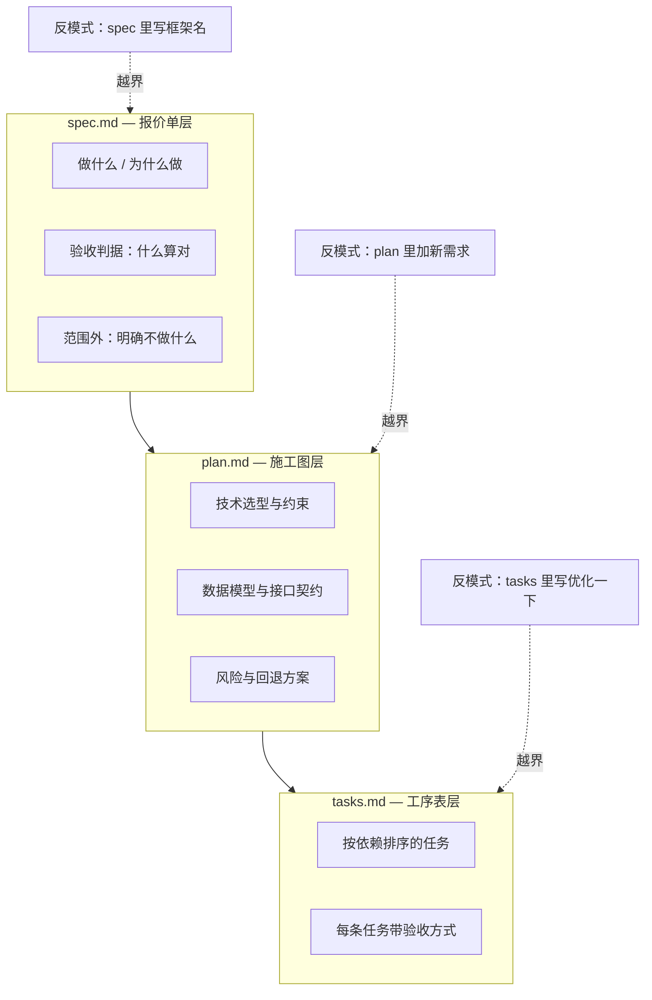
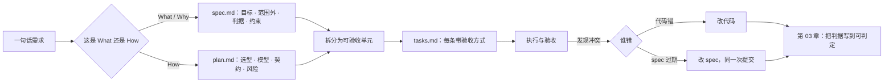

**English** | [中文](./ch02-spec-as-interface.zh.md)

# Chapter 02: The Spec Is an Interface, Not a Document

> **Chapter overview**: The previous chapter said "a spec can push defects to the left", but did not say what a spec should and should not contain. This chapter draws the dividing line: a spec is the **interface** between people and models - it stipulates "what counts as fulfilling the contract" rather than describing "what the world looks like". Written in the wrong layer, a spec turns from guardrail into shackles.
> **Prerequisites**: Chapter 01 (the three failure patterns, the rework cost curve).
> **Core learning objectives**:
> - Name the readers and the forbidden content of the `spec` / `plan` / `tasks` trio
> - Recognize the six "boundary-violating but plausible" writings
> - Write the skeleton of a minimal usable spec in the seven-section format

---

## 1. Cognitive Anchor: Forty Pages Written, and the AI Still Got It Wrong

### 1.1 A More Insidious Failure

Xiao Chen had learned her lesson this time. She spent an afternoon writing a forty-page requirements document: background, user personas, competitor analysis, feature list, UI sketches, and even six reference screenshots. She threw the document at the AI and said, "Build it according to this."

What the AI produced went off track in the very first version: **it used Prisma as the ORM.**

The problem: this project already had a database access layer the team was using, built on a different approach. The document never mentioned this - it only wrote "Database: PostgreSQL" in the "Technical Architecture" section. Seeing the word "architecture", the model went ahead and filled in a whole stack it was familiar with.

This is not the model being disobedient; it is **the document's layers getting mixed**. Of the forty pages, the first thirty talk about "why to build it, for whom, and what to build"; the last ten suddenly start talking about "which technology to use". The model treated the whole document as information from one layer, and so took "technology choice" as a requirement that must be satisfied.

### 1.2 Intuition Analogy: Quote, Construction Drawings, Work Schedule

Home renovation again. A reliable construction team carries three things, and **the three have different readers**:

| Document | Question it answers | Reader | Consequence of writing it wrong |
|---|---|---|---|
| Itemized quote | What counts as delivery? How much? | The homeowner | Written too technically, the homeowner cannot understand it, and acceptance ends in an argument |
| Construction drawings | How exactly to implement it? How do the pipes and wires run? | The foreman and the workers | Written too vaguely, the workers improvise and every dimension is wrong |
| Work schedule | Which step first? Which day is acceptance? | The site dispatcher | Wrong order: the tiles are laid before anyone remembers to move the water pipes |

Software's trio has exactly the same relationship. **Chaos almost always starts with "writing the construction drawings' content into the quote".**



---

## 2. First Principles: Separating Three Layers and the Single Source of Truth

### 2.1 The Responsibility Boundary of the Trio

**`spec.md` - what to build, why to build it, and what counts as right.**

It has three readers: product/operations (to confirm this is what they want), the AI (to know what to deliver), and you three months from now (to know why it was decided this way). So it must contain **no implementation details**: no frameworks, no table names, no function signatures, no directory structures.

The test is hard: **hand this spec to a team using a completely different tech stack, and they should be able to build a system with identical behavior.** If they cannot, plan content has leaked into the spec.

**`plan.md` - how to do it.**

The reader is the implementer. Here you can and should write: technology choices with rationale, data models, interface contracts, concurrency strategy, dependencies and fallbacks, risk points, rollback plans. It is the only place where "Prisma / SQLite / Redis" is allowed to appear.

**`tasks.md` - in which order to do it.**

The reader is the executor (human or AI). Every task must be **independently acceptable**: once it is done, you can point at a specific behavior and say "this one passed". It is a slicing of the plan, not a restatement of it.

### 2.2 Six "Boundary-Violating but Plausible" Writings

These appear constantly in real projects; every one "sounds professional", but every one sits in the wrong layer.

| # | Writing | Problem | Where it belongs |
|---|---|---|---|
| 1 | Writing "Use Next.js 14 App Router" in the spec | An implementation approach written as a requirement, locking down the technology choice | plan |
| 2 | Writing "add a unique index to the `registrations` table" in the spec | This is an implementation means, not a behavioral requirement | plan |
| 3 | Writing "users should also be able to export the list" in the plan | A new requirement sneaks into the plan, reviewed by nobody | spec (via change process) |
| 4 | Writing "code must be clean and commented" in the plan | This is a team convention, not the implementation plan for this feature | constitution (Chapter 8) |
| 5 | Writing "optimize the sign-up flow" in tasks | Not acceptable; no way to tell whether it is done | Split into observable specific behaviors |
| 6 | Writing "as fast as possible" in the spec | Not quantified; equals writing nothing | Write it as a p95 latency budget |

Item 6 deserves an extra word. "As fast as possible" can still be filled in from experience by a human team; in a model it gets translated as "do not do obviously stupid performance things". It will not add indexes, will not cache, will not limit N+1 queries - because all of these require someone to ask explicitly.

### 2.3 What "Single Source of Truth" Actually Means

No term is misused more badly. It does **not** mean "the whole project may have only one file". It means: **when two descriptions conflict, there is a clear order of adjudication, rather than trusting whichever is in front of you.**

Real conflicts come in three kinds, with different adjudication rules:

| Conflict | Common trigger | Adjudication rule |
|---|---|---|
| Code conflicts with the spec | Someone changed the code directly to save trouble | First judge who is wrong: if the code is right, **change the spec first, then commit**; if the spec is right, change the code. Quietly settling it with "the code is authoritative" is **forbidden** |
| Plan conflicts with the spec | Implementation finds the spec infeasible | The spec wins, or the spec is changed via the change process; the plan is not allowed to downgrade requirements on its own |
| Tasks conflict with the plan | One item was missed when splitting tasks | The plan wins, and the task is added; "we skip this one for now" is not allowed |

The third is the easiest to let slide. A quietly dropped task turns into "this feature seems missing" at acceptance, and nobody remembers it ever existed.

### 2.4 The Seven-Section Format of a Minimal Spec

You do not need forty pages. Seven sections are enough for a usable spec:

| Section | What to write | Counter-example (common mistake) |
|---|---|---|
| **1 Goals and success metrics** | Which metric should this feature move, in which direction? | "Improve the user experience" |
| **2 Out of scope (Non-goals)** | What is **explicitly not done** this time | Left blank, or "not considered for now" |
| **3 User stories** | Who, in what scenario, trying to achieve what | Written as a feature list |
| **4 Acceptance criteria** | Condition by condition, decidable (Chapter 3) | "The feature works normally" |
| **5 Constraints** | Idempotency, concurrency, permissions, performance budget, dependencies, fallbacks (Chapter 6) | Only writing "mind the security" |
| **6 Data and interface contracts** | Fields, types, nullability, error codes | Only writing "returns a list" |
| **7 Failure semantics** | What the user sees on error, and what the system leaves behind | Missing entirely |

**The "out of scope" section is the most underestimated of all.** It does more than prevent scope creep; it is also a **negative instruction** to the model: without boundaries the model will "helpfully do the related stuff too", and that helpful part usually passes through no review at all.

---

## 3. Hands-on Walkthrough: One Requirement, Three Files

### 3.1 Input

Requirement: **"After a sign-up is canceled, hand the slot to the first person on the waitlist."**

### 3.2 The Right Way to Write It in Each of the Three Files

**Into spec.md (What):**

```text
### 需求 3：取消后释放名额
当一位已报名用户取消报名时，系统应在 1 分钟内将名额分配给候补队列的第一位，
并向其发送确认通知。该用户需在 15 分钟内确认，超时则名额顺延至下一位。

验收判据：
- AC-3.1 取消成功后 60 秒内，候补第一位收到通知（可观测：通知记录存在且状态为 sent）
- AC-3.2 候补第一位在 15 分钟内确认，其状态变为 confirmed，名额占用数不减少
- AC-3.3 超过 15 分钟未确认，其状态变为 expired，名额分配给下一位，且不重复通知已过期者
- AC-3.4 候补队列为空时，取消仅减少占用数，不产生通知
```

**Into plan.md (How):**

```text
- 状态机：pending → offered → confirmed / expired
- 名额占用以 SELECT ... FOR UPDATE 锁定活动行，避免并发释放冲突
- offer 超时由定时任务扫描（每 30 秒），不使用延迟队列（当前无 Redis）
- 通知走 outbox 表 + 后台 worker，避免在事务内调用外部服务
- 风险：定时任务精度 30 秒，AC-3.2 的 15 分钟窗口需预留 1 分钟余量
```

**Into tasks.md (Order):**

```text
T4 实现取消接口并释放名额
   验收：调用取消接口后，占用数 -1；候补队列为空时无异常
T5 实现 offer 状态机与 15 分钟过期
   验收：构造一条 16 分钟前的 offer，定时任务应将其置为 expired 并顺延
T6 实现 outbox 通知 worker
   验收：断开通知服务，取消接口仍返回 200；恢复后 5 分钟内补发成功
```

### 3.3 How to Check That You Did Not Cross the Line

Three self-check questions, one per layer:

1. **If you hand the spec to a team on another tech stack, can they build a system with the same behavior?** No -> plan has been mixed into the spec.
2. **Does every "should" appearing in the plan trace back to a criterion in the spec?** If not -> new requirements have been mixed into the plan.
3. **Can every item in tasks be described in one sentence as "what counts as done"?** No -> not sliced finely enough yet.

---

## 4. Common Pitfalls: Wrong vs. Right

| Common pitfall | Why it goes wrong | The right approach |
|---|---|---|
| **Writing the spec as a technical design document** | Technical details look "more professional" and flow more easily from the pen | The spec describes observable behavior only; technical approaches all go into the plan |
| **Writing the plan as a restatement of requirements** | Restating is easier than thinking, and a full page looks productive | The plan must answer "which approach, why not the other one, where are the risks" |
| **Leaving Non-goals blank** | Feeling that "what we do not do" need not be written | Write at least three, specific down to "this round: no export, no refunds, no multi-language" |
| **Taking "single source of truth" to mean a single file** | Literal intuition | Source of truth = the adjudication order on conflict, not the file count |
| **Locking the spec once written** | Fear that changing it makes it "not count" | The spec evolves with the code, but every change leaves a trace: what changed, and why |
| **Using adjectives as criteria** | Adjectives are easy and hard to refute | Every adjective must translate into an observable quantity (Chapter 3) |

---

## 5. Chapter Summary and Local Knowledge Map

### 5.1 Three Takeaways

- **The spec is an interface**: it stipulates "what counts as fulfilling the contract", not "what the world looks like".
- **Each of the three layers has its own reader**: the quote for the homeowner, the drawings for the foreman, the schedule for the site dispatcher. Mixed layers are the most common starting point of failure.
- **Single source of truth = adjudication order**, not file count. In a conflict someone must win, and the winner must be written down.

### 5.2 This Chapter's Concept Topology



---

## 6. Tiered Exercises

### Tier 1: Intuition Check

1. Decide which layer each of these three belongs to: (1) "The list endpoint must mask phone numbers in its response"; (2) "Use bcrypt with cost=12"; (3) "T7 implements masking; acceptance: phone numbers in the response look like 138****1234".
2. Why does the "out of scope" section reduce the model's habit of "helpfully doing more"?

### Tier 2: Hands-on Application

3. Take a real document you have on hand (requirements, design, or a README all work), and annotate paragraph by paragraph which layer it belongs to: spec / plan / tasks / conventions. Count the boundary-violation ratio.

### Tier 3: Boundaries & Transfer

4. Consider this situation: the spec requires "release the slot within 1 minute after cancellation", but the existing architecture can only do 3 minutes at best. Here "the spec wins" would create an impossible task. Give your adjudication process, and explain why the spec should not simply be changed.

<details>
<summary><strong>Click to expand: reference answers and in-depth analysis for this chapter's exercises</strong></summary>

#### 1. Layer attribution

- (1) spec - it describes observable behavior (what shape the phone number has in the response), and does not specify implementation.
- (2) plan - concrete algorithms and parameters belong to the implementation approach.
- (3) tasks - with an ID and an acceptance method, it is an execution unit.
- **Note**: if you write (1) as "replace using the regex `(\d{3})\d{4}(\d{4})`", it has crossed into plan.

#### 2. Why "out of scope" reduces "helpfully doing more"

- **Conclusion**: because the model's default behavior is "complete the context". When it sees "sign-up system", it automatically associates a whole set of "what a sign-up system should have": export, refunds, notification template management, admin permissions, and so on.
- **Mechanism**: these associations are not errors; they are priors from the training data. The job of Non-goals is to prune the priors and tell it "this project does not need these priors".
- **Practice tip**: non-goals should be written as **decidable absences**, e.g. "this round provides no export; the list page shows no export button", rather than "export is not supported for now".

#### 3. Counting the boundary-violation ratio

- **Suggested approach**: label layers paragraph by paragraph, and count "mixed-layer paragraphs / total paragraphs". In real projects this ratio often lands between 40% and 70%.
- **Key finding**: most violations are **downward** (implementation written into the spec), because writing implementation feels safer. A few are **upward** (requirements added to the plan), which do more harm because they bypass review.

#### 4. When the spec conflicts with architectural capability

- **Conclusion**: neither side may be changed unilaterally. Go through the change process: mark "1 minute" as **currently unsatisfiable**, record the constraint, then choose one of two options.
- **Process**: (1) mark that criterion as `blocked` in the spec, stating the blocking reason and the measured lower bound (3 minutes); (2) write "lower to 3 minutes" or "introduce a delayed queue to bring the capability to 1 minute" as two options into the plan's risk section; (3) someone with the authority to make the trade-off adjudicates, and the result is written back into the spec with date and rationale.
- **Why not just change the spec**: changing it directly disguises "insufficient capability" as "the requirement was always like this", and next time nobody will know there was once a 1-minute promise here. Leaving a trace is worth more than saving trouble.

</details>

---

## 7. Authoritative References and Further Reading for This Chapter (Authoritative References)

1. **GitHub Spec Kit**: [GitHub Spec Kit](https://github.com/github/spec-kit) - The definitions and conventions of this chapter are anchored here (verified on: `2026-10-23`).
2. **Specification by Example (Adzic, 2011)**: [Specification by Example (Adzic, 2011)](https://www.manning.com/books/specification-by-example) - The definitions and conventions of this chapter are anchored here (verified on: `2026-10-23`).
3. **RFC 2119 (Requirement Levels)**: [RFC 2119 (Requirement Levels)](https://www.ietf.org/rfc/rfc2119.txt) - The definitions and conventions of this chapter are anchored here (verified on: `2026-10-23`).

> A note on scope: the sources above anchor **definitions and conventions**, not extrapolated risk probabilities. Before citing any number, check its source year and denominator first.
