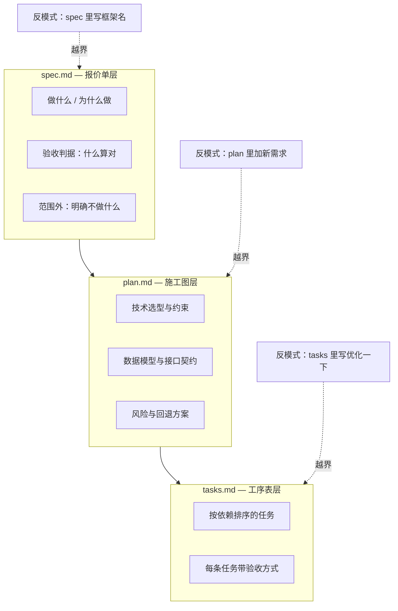
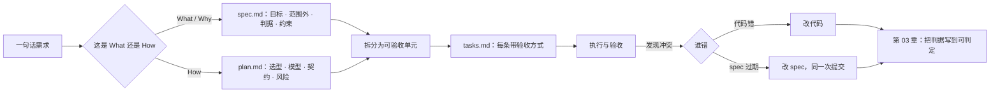

# 第 02 章：规格是接口，不是文档

> **本章导读**：上一章说"规格能把缺陷往左推"，但没说规格到底该写什么、不该写什么。本章给出分界线：规格是人与模型之间的**接口**——它约定"什么叫履约"，而不是描述"世界长什么样"。写错层，规格会从护栏变成枷锁。
> **前置知识**：第 01 章（三种失败形态、返工成本曲线）。
> **核心学习目标**：
> - 说清 `spec` / `plan` / `tasks` 三件套各自的读者与禁止内容
> - 能识别六种"越界但很像对的"写法
> - 能用七段式写出一份最小可用规格的骨架

---

## 1. 认知锚点：写了四十页，AI 还是做错

### 1.1 一个更隐蔽的失败

小陈这次学乖了。她花了一个下午，写了四十页需求文档：背景、用户画像、竞品分析、功能列表、界面草图、甚至还贴了六张参考截图。她把文档丢给 AI，说："按这个做。"

结果 AI 做出来的东西，第一版就跑偏了：**它用了 Prisma 做 ORM。**

问题是，这个项目里已经有一个团队在用的数据库访问层，用的是另一套方案。文档里从没提过这件事——文档只在"技术架构"那一节写了"数据库：PostgreSQL"。模型看到"架构"两个字，就顺着补了一整套它熟悉的方案。

这不是模型不听话，是**文档的层级混了**。四十页里，前三十页在讲"为什么做、给谁做、做什么"，后十页突然开始讲"用什么技术"。模型把整份文档当成同一层的信息，于是把"技术选型"也当成了必须满足的需求。

### 1.2 直觉类比：报价单、施工图、工序表

还是装修。一个靠谱的工程队，手里有三样东西，**三样东西的读者不同**：

| 文件 | 回答的问题 | 读者 | 写错的后果 |
|---|---|---|---|
| 报价单 | 做成什么样算交付？多少钱？ | 业主 | 写得太技术，业主看不懂，验收时吵架 |
| 施工图 | 具体怎么实现？水电怎么走？ | 工长与工人 | 写得太笼统，工人自由发挥，尺寸全错 |
| 工序表 | 先做哪一步？哪天验收？ | 现场调度 | 顺序错，瓷砖贴完才想起改水管 |

软件的三件套，关系一模一样。**混乱几乎总是从"把施工图的内容写进报价单"开始的。**



---

## 2. 第一性原理：三层分离与唯一真源

### 2.1 三件套的职责边界

**`spec.md`——做什么、为什么做、什么算对。**

它有三个读者：产品/运营（确认这是不是他要的）、AI（知道要交付什么）、三个月后的你（知道当初为什么这么定）。因此它必须**不含实现细节**：不写框架、不写表名、不写函数签名、不写目录结构。

判断标准很硬：**把这份 spec 交给一个用完全不同技术栈的团队，他们应该能做出行为一致的系统。** 如果做不到，说明 spec 里混进了 plan 的内容。

**`plan.md`——怎么做。**

读者是实现者。这里可以也应该写：技术选型及理由、数据模型、接口契约、并发策略、依赖与降级、风险点、回退方案。它是唯一允许出现"Prisma / SQLite / Redis"的地方。

**`tasks.md`——按什么顺序做。**

读者是执行者（人或 AI）。每条任务必须**可独立验收**：做完这一条，能指着某个具体行为说"这条过了"。它是 plan 的切分，不是 plan 的复述。

### 2.2 六种"越界但很像对"的写法

这些都是真实项目里高频出现的，每一条都"读起来很专业"，但都放错了层。

| # | 写法 | 问题 | 该放哪 |
|---|---|---|---|
| 1 | spec 里写「使用 Next.js 14 App Router」 | 把实现方案写成了需求，锁死了技术选择 | plan |
| 2 | spec 里写「`registrations` 表加唯一索引」 | 这是实现手段，不是行为要求 | plan |
| 3 | plan 里写「用户还应能导出名单」 | 新需求偷偷混进计划，没人评审过 | spec（走变更） |
| 4 | plan 里写「代码要整洁、要有注释」 | 这是团队规范，不是本功能的实现计划 | constitution（第 8 章） |
| 5 | tasks 里写「优化一下报名流程」 | 不可验收，无法判断做完没有 | 拆成可观测的具体行为 |
| 6 | spec 里写「尽量快」 | 无量化，等于没写 | 写成 p95 延迟预算 |

第 6 条值得多说一句。"尽量快"在人类团队里还能靠经验补齐，在模型那里会被翻译成"不要做明显的性能傻事"。它不会加索引、不会做缓存、不会限制 N+1 查询——因为这些都需要有人明确要求。

### 2.3 "唯一真源"到底指什么

这个词被误用得最厉害。它**不是**"整个项目只允许有一个文件"。它指的是：**当两处描述冲突时，有明确的裁决顺序，而不是谁在眼前就信谁。**

真实的冲突有三种，裁决规则不同：

| 冲突 | 常见诱因 | 裁决规则 |
|---|---|---|
| 代码与 spec 冲突 | 有人直接改代码图省事 | 先判断是谁错：若代码是对的，**先改 spec 再提交**；若 spec 是对的，改代码。**禁止"以代码为准"默默了事** |
| plan 与 spec 冲突 | 实现时发现 spec 不可行 | spec 赢，或者走变更把 spec 改掉；不允许 plan 私自降级需求 |
| tasks 与 plan 冲突 | 拆任务时漏了一条 | plan 赢，补任务；不允许"这条先不做" |

第三条最容易被放过。一条被悄悄删掉的任务，在验收时会变成"这个功能好像没做"，而没人记得它曾经存在。

### 2.4 最小规格的七段式

不需要四十页。一份能用的规格，七段就够：

| 段 | 写什么 | 反例（常见错误） |
|---|---|---|
| **1 目标与成功度量** | 这个功能要让什么指标变化？ | "提升用户体验" |
| **2 范围外（Non-goals）** | 这次**明确不做**什么 | 空着，或写"暂不考虑" |
| **3 用户故事** | 谁、在什么场景、要达成什么 | 写成功能列表 |
| **4 验收判据** | 逐条可判定的条件（第 3 章） | "功能正常可用" |
| **5 约束** | 幂等、并发、权限、性能预算、依赖、降级（第 6 章） | 只写"要注意安全" |
| **6 数据与接口契约** | 字段、类型、可空性、错误码 | 只写"返回列表" |
| **7 失败语义** | 出错时用户看到什么、系统留下什么 | 完全缺失 |

**"范围外"这一段是被低估最严重的。** 它不只是防止范围蔓延，它还是给模型的**负向指令**：模型在没有边界时会"顺手把相关的也做了"，而顺手做的那部分通常没经过任何评审。

---

## 3. 手把手推演：同一条需求，三个文件

### 3.1 输入

需求：**「取消报名后，把名额让给候补第一位。」**

### 3.2 三个文件里的正确写法

**写进 spec.md（What）：**

```text
### 需求 3：取消后释放名额
当一位已报名用户取消报名时，系统应在 1 分钟内将名额分配给候补队列的第一位，
并向其发送确认通知。该用户需在 15 分钟内确认，超时则名额顺延至下一位。

验收判据：
- AC-3.1 取消成功后 60 秒内，候补第一位收到通知（可观测：通知记录存在且状态为 sent）
- AC-3.2 候补第一位在 15 分钟内确认，其状态变为 confirmed，名额占用数不减少
- AC-3.3 超过 15 分钟未确认，其状态变为 expired，名额分配给下一位，且不重复通知已过期者
- AC-3.4 候补队列为空时，取消仅减少占用数，不产生通知
```

**写进 plan.md（How）：**

```text
- 状态机：pending → offered → confirmed / expired
- 名额占用以 SELECT ... FOR UPDATE 锁定活动行，避免并发释放冲突
- offer 超时由定时任务扫描（每 30 秒），不使用延迟队列（当前无 Redis）
- 通知走 outbox 表 + 后台 worker，避免在事务内调用外部服务
- 风险：定时任务精度 30 秒，AC-3.2 的 15 分钟窗口需预留 1 分钟余量
```

**写进 tasks.md（Order）：**

```text
T4 实现取消接口并释放名额
   验收：调用取消接口后，占用数 -1；候补队列为空时无异常
T5 实现 offer 状态机与 15 分钟过期
   验收：构造一条 16 分钟前的 offer，定时任务应将其置为 expired 并顺延
T6 实现 outbox 通知 worker
   验收：断开通知服务，取消接口仍返回 200；恢复后 5 分钟内补发成功
```

### 3.3 怎么检查自己没越界

三个自检问题，每个对应一层：

1. **如果把 spec 交给另一个技术栈的团队，他们能做出行为一样的系统吗？** 不能 → spec 里混了 plan。
2. **plan 里出现的每一条"应该"，都能在 spec 的判据里找到出处吗？** 找不到 → plan 里混了新需求。
3. **tasks 里的每一条，都能用一句话描述"怎么算做完"吗？** 不能 → 还没拆到位。

---

## 4. 常见误区与正反例对比

| 容易踩的坑 | 为什么会出错 | 正确做法 |
|---|---|---|
| **把 spec 写成技术设计文档** | 技术细节看起来"更专业"，写起来也更顺手 | spec 只描述可观测行为；技术方案一律进 plan |
| **把 plan 写成需求复述** | 复述比思考容易，写满一页显得有产出 | plan 必须回答"用哪个方案、为什么不用另一个、风险在哪" |
| **Non-goals 留空** | 觉得"不做什么"不用写 | 至少写三条，且要具体到"这次不做导出、不做退款、不做多语言" |
| **把"唯一真源"理解成单文件** | 词面直觉 | 真源 = 冲突时的裁决顺序，不是文件数量 |
| **规格写完就锁死** | 怕改了之后"不算数" | 规格随代码演进，但每次改动要留痕：改了什么、为什么 |
| **用形容词当判据** | 形容词省事，且不容易被反驳 | 每个形容词都要能翻译成一个可观测的量（第 3 章） |

---

## 5. 本章小结与局部知识图谱

### 5.1 三句话带走

- **规格是接口**：它约定"什么叫履约"，不描述"世界长什么样"。
- **三层各有各的读者**：报价单给业主，施工图给工长，工序表给调度。混层是最常见的失败起点。
- **唯一真源 = 裁决顺序**，不是文件数量。冲突时必须有人赢，而且赢家要写下来。

### 5.2 本章概念拓扑



---

## 6. 分级通关练习

### Tier 1：直觉核验

1. 判断以下三条各属于哪一层：①「名单接口返回手机号需脱敏」②「使用 bcrypt cost=12」③「T7 实现脱敏，验收：响应中手机号为 138****1234 格式」。
2. 为什么"范围外"这一段能减少模型"顺手多做"的行为？

### Tier 2：动手应用

3. 拿你手上一份真实的文档（需求、设计、或 README 都行），逐段标注它属于 spec / plan / tasks / 规范 哪一层。统计越界比例。

### Tier 3：边界与迁移

4. 有一种情况：spec 要求"取消后 1 分钟内释放名额"，但现有架构最快只能做到 3 分钟。此时"spec 赢"会导致不可能完成的任务。请给出你的裁决流程，并说明为什么不直接改 spec。

<details>
<summary><strong>点击展开：本章练习参考答案与深度解析</strong></summary>

#### 1. 三层归属

- ① spec —— 它描述的是可观测行为（响应里手机号是什么形态），不指定实现。
- ② plan —— 具体算法与参数，属于实现方案。
- ③ tasks —— 带编号、带验收方式，是执行单元。
- **注意**：如果把 ① 写成「使用正则 `(\d{3})\d{4}(\d{4})` 替换」，它就越界到了 plan。

#### 2. 范围外为什么能减少"顺手多做"

- **结论**：因为模型的默认行为是"补全上下文"。当它看到"报名系统"，它会自动联想出导出、退款、通知模板管理、后台权限等一整套"一个报名系统该有的东西"。
- **机制**：这些联想不是错误，是训练数据里的先验。Non-goals 的作用是把先验剪掉，告诉它"这个项目不需要这些先验"。
- **实践提示**：非目标要写成**可判定的缺失**，例如"本期不提供导出；名单页不出现导出按钮"，而不是"暂不支持导出功能"。

#### 3. 越界比例统计

- **参考做法**：按段落标层，统计"混层段落 / 总段落"。真实项目里这个比例常在 40%–70%。
- **关键发现**：多数越界是**向下越界**（spec 里写实现），因为写实现更有安全感。少数是**向上越界**（plan 里加需求），危害更大，因为它绕过了评审。

#### 4. 规格与架构能力冲突

- **结论**：不许单方面改任何一边。走变更：把"1 分钟"标为**当前不可满足**，记录约束，然后二选一。
- **流程**：① 在 spec 里把该判据标为 `blocked`，写明阻塞原因与实测下限（3 分钟）；② 把"降到 3 分钟"或"引入延迟队列把能力提到 1 分钟"作为两个方案写进 plan 的风险节；③ 由能做取舍的人裁决，裁决结果回写 spec 并注明日期与理由。
- **为什么不直接改 spec**：直接改会让"能力不足"伪装成"需求本来就这样"，下一次没人知道这里曾经有个 1 分钟的承诺。留痕的价值大于省事。

</details>

---

## 7. 本章权威参考信源与延伸阅读 (Authoritative References)

1. **GitHub Spec Kit**：[GitHub Spec Kit](https://github.com/github/spec-kit) - 本章的定义与规范以此为锚（核验日期：`2026-10-23`）。
2. **Specification by Example（Adzic, 2011）**：[Specification by Example（Adzic, 2011）](https://www.manning.com/books/specification-by-example) - 本章的定义与规范以此为锚（核验日期：`2026-10-23`）。
3. **RFC 2119（Requirement Levels）**：[RFC 2119（Requirement Levels）](https://www.ietf.org/rfc/rfc2119.txt) - 本章的定义与规范以此为锚（核验日期：`2026-10-23`）。

> 口径提示：以上信源用于锚定**定义与规范**，不用于外推风险概率。引用任何数字前，先核对来源年份与分母。
