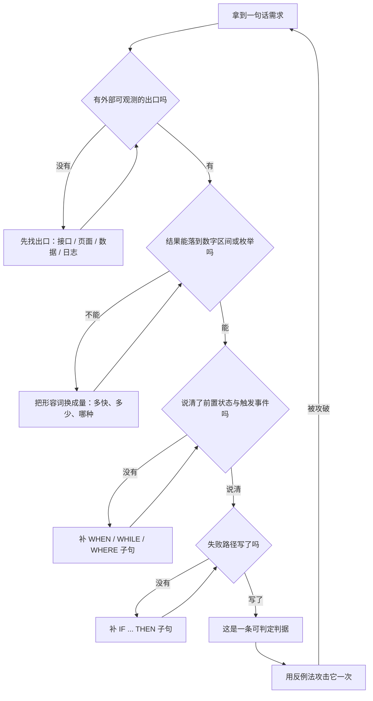
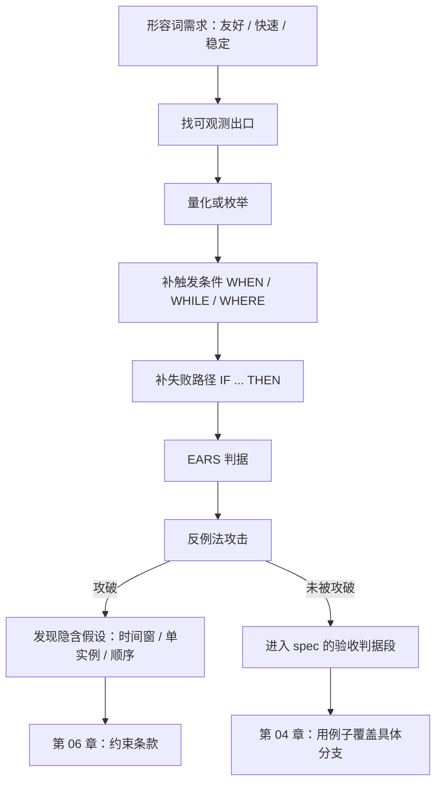

# 第 03 章：可判定性——把"能登录"写成能判的句子

> **本章导读**：这是全书技术上最硬的一章。前两章说"要有判据"，但没回答"什么样的句子才算判据"。本章给出四条硬标准和一套句式：写完之后，一段需求该不该被判为"做完了"，不再需要开会争论。
> **前置知识**：第 01–02 章（返工形态、三层分离、七段式）。
> **核心学习目标**：
> - 用四个条件检验任意一句话是否可判定
> - 掌握 EARS 五句式及其组合顺序，能写出不带歧义的判据
> - 说清 EARS 与 Given-When-Then 的分工，知道什么时候用哪个

---

## 1. 认知锚点：验收会上的那句"这不是我要的感觉"

### 1.1 一个所有人都输的场面

交付演示。运营看完说："这不是我要的感觉。"开发把需求文档翻出来："你看，这里写的是『用户可以取消报名』，我实现了，能取消，还有确认弹窗。"

运营说："我说的是取消之后要通知候补的人。"

开发说："那没写啊。"

于是这场对话没有赢家。运营觉得开发不用心，开发觉得需求不清楚，项目多花两周。**而那份需求文档里的那句话——"用户可以取消报名"——在语法上完全正确。**

### 1.2 直觉类比：法庭证词与天气预报

法庭上，"他态度很不好"不会被采纳，"他 3 月 5 日 14:02 在群里发了这句话"会被采纳。区别不在语气，在**能不能被第三方独立核实**。

天气预报也一样。老话说"明天下午有雨"，你没法说它对错；现代预报说"14:00–16:00 降水概率 70%，累计 5–8 毫米"，你可以第二天拿量杯去验。

**可判定的句子，是那种"换一个人来，也会得出同一个结论"的句子。**

---

## 2. 第一性原理：可判定的四个条件

### 2.1 四个条件

| 条件 | 含义 | 缺了会怎样 |
|---|---|---|
| **可观测** | 有一个外部能看到的出口：接口响应、页面元素、数据库状态、日志、通知记录 | 只能靠"读代码"或"问作者"来判断 |
| **可量化或可枚举** | 结果落在一个数字区间，或一个有限的枚举集合里 | "友好""快速""稳定"永远无法判错 |
| **有触发条件** | 说清在什么前置状态、什么事件下生效 | 判据变成永远成立的空话 |
| **有失败路径** | 说清不满足时系统做什么、用户看到什么 | 只测了顺利情况，一遇异常就没人知道"应该"是什么 |

四条缺一条，判据就会在某个具体场景上失效。最常见的缺法是**缺第四条**：大家写判据时下意识只写顺利路径，因为失败路径要想得更久。

### 2.2 EARS 五句式

EARS（Easy Approach to Requirements Syntax）由 Alistair Mavin 及同事在 Rolls-Royce 分析航空发动机控制系统的适航规章时提出，2009 年在 IEEE 需求工程国际会议（RE'09）发表。它的做法很克制：不引入形式化语言，只给自然语言加一层句式约束。

五种句式，覆盖绝大多数需求：

| 句式 | 结构 | 什么时候用 | 例子 |
|---|---|---|---|
| **普适** (Ubiquitous) | `The <system> shall <response>` | 无条件、始终成立 | 系统应对所有报名请求校验实名信息完整性 |
| **事件驱动** (Event-driven) | `WHEN <trigger>, the <system> shall <response>` | 由一个离散事件触发 | 当已确认报名数达到 24 时，系统应把新报名写入候补队列 |
| **状态驱动** (State-driven) | `WHILE <state>, the <system> shall <response>` | 在某状态持续期间成立 | 当报名处于 waiting 状态时，用户应能查询自己的队列序号 |
| **非期望行为** (Unwanted) | `IF <condition>, THEN the <system> shall <response>` | 错误、异常、需要防止的情况 | 如果同一手机号在 10 秒内重复提交，则系统应只保留一条记录 |
| **可选特性** (Optional) | `WHERE <feature>, the <system> shall <response>` | 只在某配置/变体下成立 | 当活动启用运营审核时，新报名应进入待审状态 |

**组合的顺序是固定的：`WHERE → WHILE → WHEN → SHALL`。** 顺序固定不是形式主义——它对应"配置条件 → 持续状态 → 触发事件 → 响应"的时间逻辑。写反了，读的人要在脑子里重新排一次序，歧义就从这里长出来。



### 2.3 EARS 与 Given-When-Then 的分工

这两个经常被混为一谈。它们不是替代关系，是**两个粒度**：

| | EARS | Given-When-Then |
|---|---|---|
| 视角 | 需求视角 | 测试视角 |
| 覆盖 | 一类条件（可能对应无穷多个具体输入） | 一个具体例子（一组确定的输入与输出） |
| 用途 | 写进 spec，约束"什么算对" | 写进测试，证明"这一组确实对" |
| 数量关系 | 一条判据 → 多个 GWT 场景 | 一个场景 → 对应某条判据的一个分支 |

**实践建议**：spec 里写 EARS（因为它能覆盖未列出的情况），测试里写 GWT（因为它能被执行）。第 4 章会用例子把两者接起来。

### 2.4 `shall` / `should` / `may` 是硬规则，不是语气

| 词 | 语义 | 在规格里的后果 |
|---|---|---|
| `shall` / 应 | 强制 | 可以据此判失败 |
| `should` / 宜 | 建议 | 模型会当"最好有"，验收时无法判失败 |
| `may` / 可 | 允许 | 模型可能实现，也可能不实现，且都算合规 |

一份规格里出现 `should`，等于在那一条上放弃了验收权。**要么改成 `shall`，要么删掉。**

---

## 3. 手把手推演：十二条改写，八条判据

### 3.1 十二条"不可判定句"的改写

| # | 改写前（不可判定） | 改写后（可判定） | 补了哪个条件 |
|---|---|---|---|
| 1 | 系统应该安全 | 所有密码以 bcrypt cost ≥ 12 存储；连续登录失败 5 次锁定 15 分钟 | 量化 + 触发 |
| 2 | 响应要快 | 名单页在 1000 条记录、4 核 8G 环境下 p95 < 800ms | 量化 + 环境 |
| 3 | 支持大量用户 | 单场活动 24 人；全站并发报名 200 QPS 时错误率 < 0.1% | 量化 |
| 4 | 提示要友好 | 手机号格式错误时，输入框下方显示"请输入 11 位手机号"，已填内容不丢失 | 可观测 + 失败路径 |
| 5 | 防止重复提交 | 同一手机号 10 秒内重复提交同一场次，只创建一条记录，第二次返回首次结果 | 触发 + 结果 |
| 6 | 要通知候补 | 取消后 60 秒内，候补第一位收到短信；发送失败重试 5 次，间隔指数退避 | 量化 + 失败路径 |
| 7 | 名单要保密 | 未登录访问名单接口返回 401；非本人访问他人报名返回 403 | 可观测 + 枚举 |
| 8 | 活动前可取消 | 活动开始前 120 分钟（含）可取消；之后返回 409 并提示联系运营 | 边界 + 失败路径 |
| 9 | 满了进候补 | 当已确认数 = 24 时，新报名写入 waiting 队列并返回队列序号 | 触发 + 可观测 |
| 10 | 候补按顺序 | 按 created_at 升序；同一毫秒按 id 升序 | 枚举 + 边界 |
| 11 | 系统要稳定 | 单实例连续运行 7 天，报名接口可用性 ≥ 99.9% | 量化 + 时间窗 |
| 12 | 数据不能丢 | 报名成功后 5 秒内落盘；进程崩溃重启后，已确认报名不丢失 | 量化 + 失败路径 |

看第 6 条和第 8 条：它们都补了"失败路径"。**这是改写练习里最值钱的一步**，因为失败路径决定了系统最坏情况下的样子，而 AI 默认不写。

### 3.2 候补系统的八条判据

用 EARS 把上一章的七段式落到具体句子。注意每条只描述**一个**行为，且都能被一个外部观察者验证。

```text
AC-1 [普适]        系统应对所有报名请求校验：真实姓名非空、手机号为 11 位大陆号码。
AC-2 [事件驱动]    当已确认报名数达到 24 时，系统应将新报名写入候补队列，
                 状态为 waiting，并返回其在队列中的序号。
AC-3 [状态驱动]    当报名处于 waiting 状态时，用户应能查询自己的队列序号，
                 且序号在队列变化后 60 秒内更新。
AC-4 [非期望行为]  如果同一手机号在 10 秒内对同一场次重复提交，
                 则系统应只保留一条报名记录，并返回首次提交的结果。
AC-5 [事件驱动]    当一条已确认报名被取消时，系统应在 60 秒内向候补队列第一位
                 发送确认邀请，其状态变为 offered。
AC-6 [状态驱动]    当邀请处于 offered 状态超过 15 分钟未确认时，
                 系统应将其置为 expired，并把名额分配给下一位。
AC-7 [非期望行为]  如果通知服务不可用，则报名与取消操作仍应成功返回，
                 通知进入待补发队列，恢复后 5 分钟内补发。
AC-8 [可选特性]    当活动启用「运营审核」时，新报名应进入 pending_review，
                 审核通过后才计入名额。
```

### 3.3 用反例法攻击自己的判据

写完不算完。每条判据都要问一句：**"给我一个它会被误判的场景。"**

以 AC-4 为例，攻击过程：

- 攻击 1：用户在 9.9 秒时重试，被拦；在 10.1 秒时网络自动重试，未被拦 → 产生两条记录。**判据被攻破。**
- 攻击 2：两个设备同时提交，都在 10 秒内，但落在两个服务实例上 → 分布式下时间窗不可靠。**判据被攻破。**
- 结论：时间窗是一个**近似幂等**，不是幂等。正确的写法是要求客户端携带幂等键，服务端以键去重：

```text
AC-4' [非期望行为] 如果请求携带的 idempotency_key 已存在，
                  则系统应返回首次请求的结果，不创建新记录；
                  未携带 idempotency_key 的报名请求应被拒绝（400）。
```

这就是第 6 章要展开的约束条款。**可判定性只保证"能判"，不保证"判得对"**——判据本身可能是错的，反例法是发现"错得可判"的唯一手段。

---

## 4. 常见误区与正反例对比

| 容易踩的坑 | 为什么会出错 | 正确做法 |
|---|---|---|
| **把 EARS 当填空题** | 生搬句式，语义没变，反而更长 | 先想清"谁在什么条件下要看到什么"，再套句式 |
| **一条判据塞三个行为** | 想省行数；验收时三个行为只能一起判 | 一条一个行为；失败时能定位到唯一原因 |
| **只写顺利路径** | 顺利路径好想，失败路径要想 | 每条核心判据配一条 `IF ... THEN` |
| **用 `should` 软化了承诺** | 语气上更礼貌 | 全篇只用 `shall`；不确定的就删掉，别留着 |
| **判据写成实现细节** | 觉得"具体"就是"可判定" | 判据描述**可观测行为**，不描述代码结构 |
| **判据之间互相矛盾** | 分开写时各自都对 | 写完做一次交叉检查（第 8 章的 analyze 门禁） |

---

## 5. 本章小结与局部知识图谱

### 5.1 三句话带走

- **可判定 = 换个人也能得出同一结论**：可观测、可量化、有触发、有失败路径。
- **EARS 只做一件事**：给自然语言加一层句式约束，把"谁在什么条件下做什么"逼出来。
- **判据能被写出来，不等于判据是对的**。反例法是唯一能攻击判据本身的手段。

### 5.2 本章概念拓扑



---

## 6. 分级通关练习

### Tier 1：直觉核验

1. 判断："系统应在用户取消后尽快释放名额"——缺了四个条件中的哪几个？
2. 为什么 `should` 在规格里是一个陷阱？如果你的团队习惯用"应该"，怎么处理？

### Tier 2：动手应用

3. 把下面三条改写成 EARS 判据：①"候补要公平" ②"名单不能被人随便看" ③"系统要能承受活动开始瞬间的流量"。

### Tier 3：边界与迁移

4. AC-6 用"15 分钟未确认则过期"实现。请构造两个反例，说明这个判据在什么情况下会**误伤用户**（提示：考虑通知延迟、用户在医院、时区）。并给出改法。

<details>
<summary><strong>点击展开：本章练习参考答案与深度解析</strong></summary>

#### 1. 缺哪些条件

- **结论**：缺"可量化"（尽快是多久）、"有触发条件"（取消的判定时点）、“有失败路径”（释放失败怎么办）。
- **可观测**勉强算有（名额数变化），但没写从哪个出口观察（列表页？接口字段？）。
- **补法**：「当一条已确认报名被取消时，系统应在 60 秒内释放名额；若释放失败，应记录告警并在 5 分钟内重试，最多 3 次。」

#### 2. `should` 为什么是陷阱

- **结论**：它把强制承诺降级为建议，而验收只能针对强制项。
- **处理**：团队习惯用"应该"时，不要做语言警察，做**替换规则**：凡是"应该"，问一句"如果没做到，算不算 bug？"算 → 改 `shall`；不算 → 删掉或移到"未来考虑"。
- **附加价值**：这个提问本身就能筛掉一批"写了但没人真在意"的需求。

#### 3. 三条改写参考

```text
① 当候补队列中存在多条 waiting 记录时，系统应按 created_at 升序分配名额；
   同一毫秒提交的，按 id 升序。
② 未携带有效会话访问名单接口时，系统应返回 401；
   已登录但非本人且非运营角色访问他人报名详情时，应返回 403。
③ 当活动开始前 5 分钟内并发报名请求达到 200 QPS 时，
   系统应保持错误率 < 0.5%，且 p95 响应时间 < 1.5s。
```
注意 ③ 里"承受流量"被翻译成了三个可测量：并发数、错误率、延迟分位。

#### 4. AC-6 的两个反例与改法

- **反例 A（通知延迟）**：短信网关排队 20 分钟，用户 15 分钟内根本没收到 → 被判过期，名额顺延。用户认为自己被坑。
- **反例 B（状态不可知）**：用户在飞机上，15 分钟内无法操作 → 系统无法区分"不想确认"和"不能确认"。
- **改法**：把"15 分钟"从**绝对时间窗**改为**可感知时间窗**——`offered_at` 以"通知成功送达"为起点计时，并给用户一个显式的"我还在，请保留 30 分钟"操作（有次数上限）。同时把超时结果从"静默过期"改为"发送一条已过期通知"，让状态可追溯。
- **迁移结论**：任何以"时间"为条件的判据，都要问一句"这个时间的起点，用户能感知到吗？"

</details>

---

## 7. 本章权威参考信源与延伸阅读 (Authoritative References)

1. **RFC 2119（Requirement Levels）**：[RFC 2119（Requirement Levels）](https://www.ietf.org/rfc/rfc2119.txt) - 本章的定义与规范以此为锚（核验日期：`2026-10-23`）。
2. **GitHub Spec Kit**：[GitHub Spec Kit](https://github.com/github/spec-kit) - 本章的定义与规范以此为锚（核验日期：`2026-10-23`）。
3. **Gherkin Reference**：[Gherkin Reference](https://cucumber.io/docs/gherkin/reference/) - 本章的定义与规范以此为锚（核验日期：`2026-10-23`）。

> 口径提示：以上信源用于锚定**定义与规范**，不用于外推风险概率。引用任何数字前，先核对来源年份与分母。
