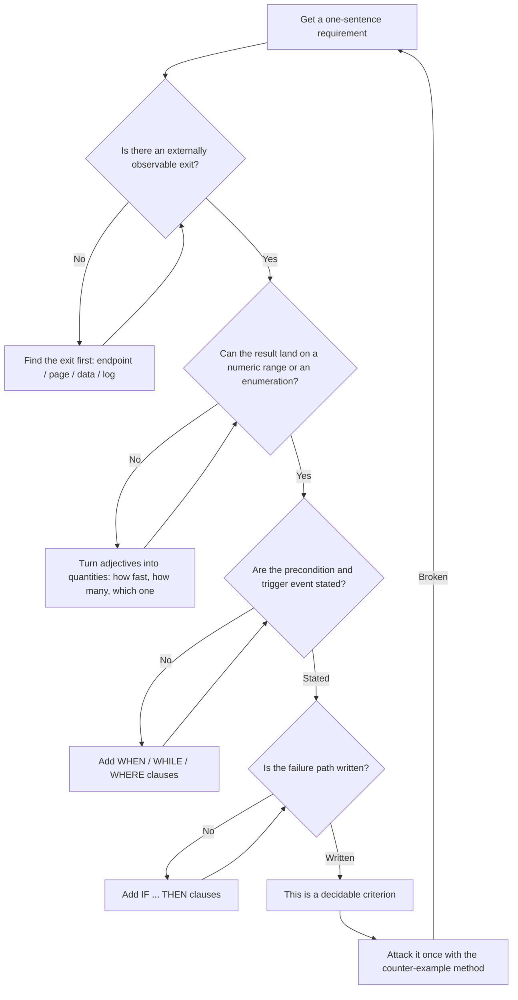
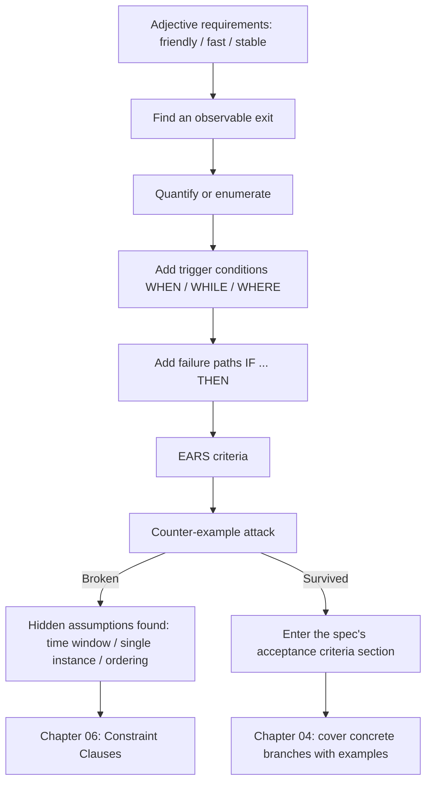

**English** | [中文](./ch03-testability.zh.md)

# Chapter 03: Decidability - Writing "Can Log In" as a Sentence You Can Judge

> **Chapter overview**: This is technically the hardest chapter in the book. The first two chapters said "there must be criteria", but did not answer "what kind of sentence counts as a criterion". This chapter gives four hard standards and a set of sentence patterns: once written, whether a piece of requirement should be judged "done" no longer needs a meeting to argue about.
> **Prerequisites**: Chapters 01-02 (rework patterns, three-layer separation, seven-section format).
> **Core learning objectives**:
> - Test whether any sentence is decidable using the four conditions
> - Master the five EARS sentence patterns and their combination order, and write unambiguous criteria
> - Explain the division of labor between EARS and Given-When-Then, and know which to use when

---

## 1. Cognitive Anchor: "This Is Not the Feeling I Wanted" at the Acceptance Meeting

### 1.1 A Scene Where Everyone Loses

The delivery demo. Operations watches and says: "This is not the feeling I wanted." The developer pulls up the requirements document: "Look, it says here 'users can cancel sign-ups'. I implemented that - you can cancel, and there is even a confirmation dialog."

Operations says: "What I meant was that after a cancellation, the people on the waitlist should be notified."

The developer says: "Well, that was not written down."

So this conversation has no winner. Operations thinks the developer did not care; the developer thinks the requirements were unclear; the project burns two extra weeks. **And that sentence in the requirements document - "users can cancel sign-ups" - is grammatically perfectly correct.**

### 1.2 Intuitive Analogy: Court Testimony and Weather Forecasts

In court, "his attitude was very bad" will not be admitted; "he posted this message in the group at 14:02 on March 5" will be. The difference is not tone; it is **whether a third party can independently verify it**.

Weather forecasts are the same. The old kind says "rain tomorrow afternoon", and you cannot say whether it is right or wrong; a modern forecast says "14:00-16:00, 70% chance of precipitation, 5-8 millimeters accumulated", and the next day you can go verify it with a measuring cup.

**A decidable sentence is one where "a different person would reach the same conclusion".**

---

## 2. First Principles: The Four Conditions of Decidability

### 2.1 The Four Conditions

| Condition | Meaning | What happens without it |
|---|---|---|
| **Observable** | There is an externally visible outlet: API response, page element, database state, logs, notification records | The only way to judge is "reading the code" or "asking the author" |
| **Quantifiable or enumerable** | The result lands in a numeric range, or in a finite enumeration set | "Friendly", "fast", "stable" can never be judged wrong |
| **Has a trigger condition** | Stated clearly: under what prior state, under what event it takes effect | The criterion becomes an empty phrase that is always true |
| **Has a failure path** | Stated clearly: what the system does and what the user sees when it is not satisfied | Only the happy path is tested, and once an exception hits, nobody knows what "should" happen |

Miss any one of the four and the criterion fails in some specific scenario. The most common miss is **the fourth**: when writing criteria people instinctively only write the happy path, because failure paths take longer to think through.

### 2.2 The Five EARS Sentence Patterns

EARS (Easy Approach to Requirements Syntax) was proposed by Alistair Mavin and colleagues at Rolls-Royce while analyzing airworthiness regulations for aero-engine control systems, and published in 2009 at the IEEE International Requirements Engineering Conference (RE'09). Its approach is restrained: it introduces no formal language, only a layer of sentence-pattern constraints on natural language.

Five patterns cover the vast majority of requirements:

| Pattern | Structure | When to use | Example |
|---|---|---|---|
| **Ubiquitous** | `The <system> shall <response>` | Unconditional, always true | The system shall validate the completeness of real-name information for all sign-up requests |
| **Event-driven** | `WHEN <trigger>, the <system> shall <response>` | Triggered by a discrete event | When confirmed sign-ups reach 24, the system shall write new sign-ups into the waitlist queue |
| **State-driven** | `WHILE <state>, the <system> shall <response>` | Holds while some state persists | While a sign-up is in the waiting state, the user shall be able to query their queue position |
| **Unwanted** | `IF <condition>, THEN the <system> shall <response>` | Errors, exceptions, situations to prevent | If the same phone number submits repeatedly within 10 seconds, then the system shall keep only one record |
| **Optional** | `WHERE <feature>, the <system> shall <response>` | Holds only under some configuration or variant | Where an event enables operations review, new sign-ups shall enter the pending-review state |

**The combination order is fixed: `WHERE → WHILE → WHEN → SHALL`.** A fixed order is not formalism - it corresponds to the temporal logic "configuration condition -> persistent state -> triggering event -> response". Write it in the wrong order and the reader has to mentally re-sort it, and ambiguity grows from there.



### 2.3 Division of Labor Between EARS and Given-When-Then

These two are often conflated. They are not substitutes; they are **two granularities**:

| | EARS | Given-When-Then |
|---|---|---|
| Perspective | Requirements perspective | Testing perspective |
| Coverage | A class of conditions (possibly corresponding to infinitely many concrete inputs) | One concrete example (one definite set of inputs and outputs) |
| Use | Written into the spec, constraining "what counts as right" | Written into the tests, proving "this set is indeed right" |
| Quantity relation | One criterion -> multiple GWT scenarios | One scenario -> one branch of some criterion |

**Practical advice**: write EARS in the spec (because it covers cases not enumerated), and write GWT in the tests (because it can be executed). Chapter 4 connects the two with examples.

### 2.4 `shall` / `should` / `may` Are Hard Rules, Not Tone

| Word | Semantics | Consequence in a spec |
|---|---|---|
| `shall` | Mandatory | Failure can be judged from it |
| `should` | Advisory | The model treats it as "nice to have", and failure cannot be judged at acceptance |
| `may` | Permitted | The model may or may not implement it, and both count as compliant |

A single `should` in a spec means surrendering the right of acceptance on that item. **Either change it to `shall`, or delete it.**

---

## 3. Hands-on Walkthrough: Twelve Rewrites, Eight Criteria

### 3.1 Rewriting Twelve "Undecidable Sentences"

| # | Before (undecidable) | After (decidable) | Which condition was added |
|---|---|---|---|
| 1 | The system should be secure | All passwords stored with bcrypt cost ≥ 12; five consecutive failed logins lock the account for 15 minutes | Quantification + trigger |
| 2 | Responses must be fast | The list page with 1000 records, on a 4-core 8G machine, p95 < 800ms | Quantification + environment |
| 3 | Support a large number of users | 24 people per event; with 200 QPS of concurrent sign-ups site-wide, error rate < 0.1% | Quantification |
| 4 | Prompts must be friendly | On a malformed phone number, show "enter an 11-digit phone number" below the input box, and do not lose what was already entered | Observable + failure path |
| 5 | Prevent duplicate submissions | The same phone number submitting the same session repeatedly within 10 seconds creates only one record; the second call returns the first result | Trigger + result |
| 6 | Notify the waitlist | Within 60 seconds after a cancellation, the first person on the waitlist receives an SMS; on send failure, retry 5 times with exponential backoff | Quantification + failure path |
| 7 | The list must stay private | Accessing the list endpoint without login returns 401; accessing someone else's sign-up as a non-owner returns 403 | Observable + enumeration |
| 8 | Cancellation before the event | Cancellable up to 120 minutes before the event starts (inclusive); after that return 409 and prompt to contact operations | Boundary + failure path |
| 9 | Go on the waitlist when full | When confirmed count = 24, new sign-ups are written into the waiting queue and a queue position is returned | Trigger + observable |
| 10 | Waitlist in order | By created_at ascending; within the same millisecond, by id ascending | Enumeration + boundary |
| 11 | The system must be stable | A single instance running continuously for 7 days, sign-up endpoint availability ≥ 99.9% | Quantification + time window |
| 12 | Data must not be lost | Persisted within 5 seconds after a successful sign-up; after a process crash and restart, confirmed sign-ups are not lost | Quantification + failure path |

Look at items 6 and 8: both added a "failure path". **This is the most valuable step in the rewrite exercise**, because failure paths decide what the system looks like in the worst case, and the AI does not write them by default.

### 3.2 Eight Criteria for the Waitlist System

Use EARS to turn the previous chapter's seven-section format into concrete sentences. Note that each one describes exactly **one** behavior, and each can be verified by an external observer.

```text
AC-1 [Ubiquitous]   The system shall validate every registration request: real name non-empty, phone number an 11-digit mainland number.
AC-2 [Event-driven] When confirmed registrations reach 24, the system shall write new registrations to the waitlist,
                    with status waiting, and return their queue position.
AC-3 [State-driven] While a registration is in waiting status, the user shall be able to query their queue position,
                    and the position shall update within 60 seconds of any queue change.
AC-4 [Unwanted]     If the same phone number submits twice for the same session within 10 seconds,
                    the system shall keep only one registration record and return the result of the first submission.
AC-5 [Event-driven] When a confirmed registration is cancelled, the system shall send a confirmation invite
                    to the first person on the waitlist within 60 seconds, and their status becomes offered.
AC-6 [State-driven] When an invite sits in offered status for more than 15 minutes without confirmation,
                    the system shall set it to expired and assign the seat to the next person.
AC-7 [Unwanted]     If the notification service is unavailable, registration and cancellation shall still return success,
                    notifications enter the catch-up queue and are delivered within 5 minutes after recovery.
AC-8 [Optional]     When the event enables "ops review", new registrations shall enter pending_review,
                    and only count toward seats after approval.
```

### 3.3 Attacking Your Own Criteria with the Counter-Example Method

Writing them is not the end. Every criterion must be asked: **"Give me a scenario where it would be misjudged."**

Take AC-4 as an example; the attack goes:

- Attack 1: the user retries at 9.9 seconds and is blocked; at 10.1 seconds the network auto-retries and is not blocked -> two records are created. **The criterion is broken.**
- Attack 2: two devices submit at the same time, both within 10 seconds, but landing on two service instances -> time windows are unreliable in a distributed setting. **The criterion is broken.**
- Conclusion: a time window is **approximate idempotency**, not idempotency. The correct writing requires the client to carry an idempotency key and the server to deduplicate by key:

```text
AC-4' [Unwanted]    If the idempotency_key carried by the request already exists,
                  the system shall return the result of the first request and create no new record;
                  registration requests without an idempotency_key shall be rejected (400).
```

These are the constraint clauses Chapter 6 will develop. **Decidability only guarantees "it can be judged", not "it is judged right"** - the criterion itself may be wrong, and the counter-example method is the only means to discover "wrong but decidable".

---

## 4. Common Pitfalls: Wrong vs. Right

| Common pitfall | Why it goes wrong | The right approach |
|---|---|---|
| **Treating EARS as fill-in-the-blank** | Applying the pattern mechanically: semantics unchanged, only longer | First think through "who needs to see what under which conditions", then apply the pattern |
| **Cramming three behaviors into one criterion** | Trying to save lines; at acceptance the three can only be judged together | One behavior per criterion; on failure you can pinpoint a single cause |
| **Writing only the happy path** | The happy path is easy to think of; failure paths take thought | Pair every core criterion with an `IF ... THEN` |
| **Softening the commitment with `should`** | It sounds more polite | Use only `shall` throughout; if unsure, delete it instead of keeping it |
| **Writing criteria as implementation details** | Believing "concrete" means "decidable" | Criteria describe **observable behavior**, not code structure |
| **Criteria contradicting each other** | Each looks right when written separately | Do a cross-check after writing (the analyze gate in Chapter 8) |

---

## 5. Chapter Summary and Local Knowledge Map

### 5.1 Three Takeaways

- **Decidable = a different person reaches the same conclusion**: observable, quantifiable, triggered, with a failure path.
- **EARS does one thing only**: add a layer of sentence-pattern constraints to natural language, forcing out "who does what under which conditions".
- **Being able to write a criterion down does not mean it is right**. The counter-example method is the only means to attack the criterion itself.

### 5.2 This Chapter's Concept Topology



---

## 6. Tiered Exercises

### Tier 1: Intuition Check

1. Judge: "The system should release the slot as soon as possible after the user cancels" - which of the four conditions are missing?
2. Why is `should` a trap in a spec? If your team habitually says "should", how do you handle it?

### Tier 2: Hands-on Application

3. Rewrite the following three as EARS criteria: (1) "The waitlist must be fair"; (2) "The list must not be casually visible to others"; (3) "The system must withstand the traffic spike at the moment the event starts".

### Tier 3: Boundaries & Transfer

4. AC-6 is implemented as "expire if not confirmed within 15 minutes". Construct two counter-examples showing under what circumstances this criterion would **wrongly hurt users** (hint: consider notification delays, a user in a hospital, time zones). Then give a fix.

<details>
<summary><strong>Click to expand: reference answers and in-depth analysis for this chapter's exercises</strong></summary>

#### 1. Which conditions are missing

- **Conclusion**: missing "quantifiable" (how soon is "as soon as possible"), "trigger condition" (the decision point of cancellation), and "failure path" (what happens if the release fails).
- **Observable** barely passes (the slot count changes), but it does not say through which outlet to observe (the list page? an API field?).
- **Fix**: "When a confirmed sign-up is canceled, the system shall release the slot within 60 seconds; if the release fails, it shall record an alert and retry within 5 minutes, at most 3 times."

#### 2. Why `should` is a trap

- **Conclusion**: it downgrades a mandatory commitment to advice, while acceptance can only target mandatory items.
- **Handling**: when the team habitually says "should", do not be the language police; make a **substitution rule**: for every "should", ask "if it is not done, does that count as a bug?" Yes -> change to `shall`; no -> delete it or move it to "future considerations".
- **Bonus value**: this question alone filters out a batch of requirements that "were written but nobody truly cared about".

#### 3. Three rewrite references

```text
① When multiple waiting records exist in the waitlist, the system shall assign seats in ascending created_at order;
   ties within the same millisecond break by ascending id.
② Accessing the roster endpoint without a valid session shall return 401;
   a logged-in user who is neither the owner nor an ops role accessing someone else's registration detail shall get 403.
③ When concurrent registration requests reach 200 QPS within 5 minutes before the event starts,
   the system shall keep the error rate < 0.5% and p95 response time < 1.5s.
```
Note that in ③ "withstand the traffic" is translated into three measurables: concurrency, error rate, latency percentile.

#### 4. Two counter-examples for AC-6 and the fix

- **Counter-example A (notification delay)**: the SMS gateway queues for 20 minutes; the user never receives it within 15 minutes -> judged expired and the slot passes on. The user feels cheated.
- **Counter-example B (state unknowable)**: the user is on a plane and cannot act within 15 minutes -> the system cannot distinguish "does not want to confirm" from "cannot confirm".
- **Fix**: change "15 minutes" from an **absolute time window** to a **perceivable time window** - `offered_at` starts counting from "notification successfully delivered", and give the user an explicit "I am still here, hold the slot for 30 minutes" action (with a usage cap). At the same time change the timeout result from "silent expiry" to "send an expired notice", making the state traceable.
- **Transfer conclusion**: for any criterion conditioned on "time", ask "can the user perceive the starting point of this time?"

</details>

---

## 7. Authoritative References and Further Reading for This Chapter (Authoritative References)

1. **RFC 2119 (Requirement Levels)**: [RFC 2119 (Requirement Levels)](https://www.ietf.org/rfc/rfc2119.txt) - The definitions and conventions of this chapter are anchored here (verified on: `2026-10-23`).
2. **GitHub Spec Kit**: [GitHub Spec Kit](https://github.com/github/spec-kit) - The definitions and conventions of this chapter are anchored here (verified on: `2026-10-23`).
3. **Gherkin Reference**: [Gherkin Reference](https://cucumber.io/docs/gherkin/reference/) - The definitions and conventions of this chapter are anchored here (verified on: `2026-10-23`).

> A note on scope: the sources above anchor **definitions and conventions**, not extrapolated risk probabilities. Before citing any number, check its source year and denominator first.
