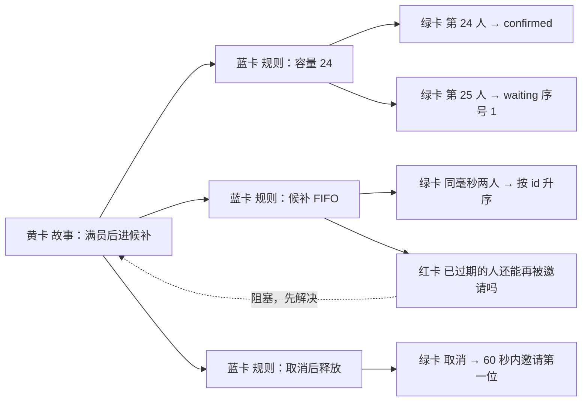
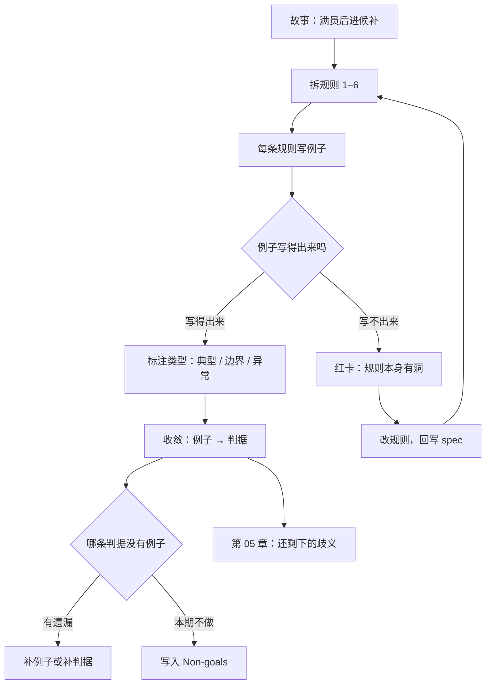

**English** | [中文](./ch04-examples.zh.md)

# Chapter 04: Pinning Down Abstractions with Examples

> **Chapter overview**: Chapter 3 solved "whether a sentence can be judged", but not "where criteria come from". This chapter gives a method for forcing abstract rules into concrete examples: Example Mapping. Examples are not there to "illustrate" rules; they are there to **attack** rules.
> **Prerequisites**: Chapter 03 (the five EARS patterns, the counter-example method).
> **Core learning objectives**:
> - Run one complete Example Mapping with the four-color cards
> - Explain the division of labor between "rules" and "examples", and know why neither can be omitted
> - Converge a pile of examples into a set of criteria, and identify the questions the examples expose

---

## 1. Cognitive Anchor: Three Nods, Three Different Systems

### 1.1 One Sentence: "It Must Be Fair"

At the requirements review, the ordering of the waitlist queue is being discussed. Someone writes down a rule:

> **"The waitlist must be fair."**

Operations nods: fairness means first come first served; whoever signed up first gets the slot first.
A parent says in the group: fairness should favor families with two children; they have a harder time coordinating schedules.
The tech lead nods: fairness means FIFO, sorted by creation time, by ID within the same time.

All three nodded, and not one word of their three understandings matches. **And the word "fair" looks perfectly reasonable in any spec.**

### 1.2 Intuition Analogy: Dictionary and Example Sentences

When learning a foreign language, you look up "nevertheless" in the dictionary, see "however", and still cannot use it. Look at three example sentences and you can use it immediately - you even know it only goes at the start of a sentence and must be followed by a comma.

**Rules give the boundary; examples give the shape.** With rules alone you do not know where the boundary is; with examples alone you do not know what happens outside it.

Software is the same: rules cover cases not listed; examples expose places where rules are unclear. **The two are complementary, not substitutes.**

---

## 2. First Principles: Example Mapping and the Four Requirements for Examples

### 2.1 The Four-Color Cards

Example Mapping is a collaborative method popularized by the Cucumber community (Matt Wynne and others): using four colors of cards to break a user story apart on one table.

| Card | Content | Role |
|---|---|---|
| **Yellow card: story** | One user story | The anchor; discuss one at a time |
| **Blue card: rule** | A rule this story must satisfy | Breaks the story into small discussable chunks |
| **Green card: example** | One concrete scenario: given what, do what, expect what | Verifies whether the rule is clear |
| **Red card: question** | A question that comes up in discussion and cannot be answered yet | **The most valuable output** |

The process has one hard rule: **when the discussion gets stuck (a red card appears), stop adding examples.** Because a red card means the rule is not yet clear, and continuing to add examples only adds bricks to a wrong understanding.



### 2.2 Adzic's Seven Process Patterns

In Specification by Example (Manning, 2011), Gojko Adzic distilled seven process patterns from over 50 projects. They are not process steps; they are "what successful teams do over and over":

| # | Pattern | In one sentence | Where it lands in this book |
|---|---|---|---|
| 1 | Derive scope from goals | Scope comes from business goals, not from detailed requirements handed over by the customer | Section 1 of Chapter 2's seven-section format |
| 2 | Collaborative specification | The spec is written by multiple parties together, not written by one person for others to read | The four-color cards in this chapter |
| 3 | Illustrate with examples | Use concrete examples to eliminate ambiguity in natural language | This chapter |
| 4 | Refine the specification | Examples should be concise, focused on "what to do" rather than "how to do it" | Chapter 2's three-layer separation |
| 5 | Automate verification without changing the spec | The automated implementation must not turn around and change how the spec is phrased | The checklist gate in Chapter 8 |
| 6 | Verify frequently | Criteria must run continuously, not once before launch | Chapter 9's metrics |
| 7 | Evolve a living document system | The spec is alive and updates with business change | Chapter 12's spec library |

Pattern 5 deserves special attention: **quietly rewording the spec to make tests easier to write is where spec rot begins.** Once the spec starts accommodating the tool, it is no longer a criterion.

### 2.3 The Four Requirements for Examples

| Requirement | Meaning | Counter-example |
|---|---|---|
| **Precise** | Has concrete values: counts, times, states, results | "A user submits a sign-up" |
| **Complete** | Contains the three parts: pre-state, action, expected result | Only writing "should succeed" |
| **Realistic** | It can really happen in the business | "The user submits at 00:00:00.000" |
| **Easy to understand** | Understandable without reading code | "Calling POST /api/reg returns 201" |

**"Realistic" is the easiest to overlook.** Fabricated examples (timestamps exactly on the hour, phone numbers exactly 11 digits, a network that never jitters) create the illusion of "already covered", while real-world input is dirty.

### 2.4 Boundary Examples First

One rule usually needs only 2-4 examples to be clear, but which ones you pick decides how much information you get:

- **Typical example** (person 24 signs up successfully): confirms the feature exists.
- **Boundary example** (person 25, waitlist position 1, exactly 15:00): confirms whether the threshold is right.
- **Exception example** (two people in the same millisecond, notification failure, empty waitlist): confirms the failure path.

**Write boundaries and exceptions first.** Typical examples almost never expose problems - they are the part you and the AI already agree on. **Disagreement always hides on the boundary.**

---

## 3. Hands-on Walkthrough: Six Rules, Twelve Examples

### 3.1 Six Rules

For the story "waitlist sign-up", first split out the rules (blue cards):

| ID | Rule |
|---|---|
| Rule 1 | Each event has a cap of 24 confirmed sign-ups; beyond that goes to the waitlist |
| Rule 2 | The waitlist is ordered by submission time ascending; within the same millisecond, by record ID ascending |
| Rule 3 | When a confirmed sign-up is canceled, the slot enters "reserved", and the first person on the waitlist is invited |
| Rule 4 | The invitee has a 15-minute confirmation window; on timeout the slot passes on |
| Rule 5 | Duplicate submissions of the same phone number for the same session keep only one record |
| Rule 6 | The list is visible only to the person themselves and to operations; invisible when logged out |

### 3.2 Twelve Examples

| ID | Rule | Pre-state | Action | Expected result | Type |
|---|---|---|---|---|---|
| E01 | Rule 1 | 23 confirmed | Person 24 submits | Status confirmed, occupancy 24 | Typical |
| E02 | Rule 1 | 24 confirmed | Person 25 submits | Status waiting, queue position 1 | Boundary |
| E03 | Rule 1 | 24 confirmed, 3 on waitlist | Person 28 submits | Status waiting, queue position 4 | Boundary |
| E04 | Rule 2 | Waitlist A(10:00:00.100, id=7), B(10:00:00.100, id=9) | Release 1 slot | A gets the invite (smaller id first) | Boundary |
| E05 | Rule 2 | Waitlist A expired, B waiting | Release 1 more slot | B gets the invite; A receives no more invites | Exception |
| E06 | Rule 3 | 24 confirmed, 2 on waitlist | One person cancels | A receives the invite within 60 seconds; the slot is marked reserved and not taken by new sign-ups | Typical |
| E07 | Rule 3 | 23 confirmed, 0 on waitlist | One person cancels | Occupancy 23, no notification; new sign-ups can go straight to confirmed | Boundary |
| E08 | Rule 4 | A has held the invite for 14 min 59 s | A clicks confirm | Status confirmed | Boundary |
| E09 | Rule 4 | A has held the invite for 15 min 01 s | A clicks confirm | Returns 409 saying the slot has passed on; A's status is expired | Boundary |
| E10 | Rule 5 | Phone number 138**** has signed up | Resubmits within 9 seconds with the same number but a different name | Returns the first result; no new record | Exception |
| E11 | Rule 5 | Phone number 138**** has signed up | Resubmits with the same number after 11 seconds | — **(cannot be written)** | Question |
| E12 | Rule 6 | Logged out | Requests the list endpoint | Returns 401, no names returned | Exception |

### 3.3 The E11 That Cannot Be Written

E11 is the most valuable output of this round. It is not "not thought through yet"; it **exposes a problem in Rule 5 itself**:

- If deduplication uses "within 10 seconds", an 11-second retry creates a second record. And real network retries can be spaced 1 second, 5 seconds, 30 seconds, or 2 minutes apart.
- If you relax it to "within 24 hours", what about a parent who really wants to sign up a second child?
- If deduplication uses "phone number + name", the same number with a different name is two people - but E10 requires counting it as one.

The three questions contradict each other. This is not badly written examples; it is the rule's error of substituting a "time window" for "idempotency".

**The red-card answer** (written back into the spec):

```text
规则 5' 所有报名请求必须携带客户端生成的 idempotency_key。
    同一 key 的重复请求返回首次结果，不创建新记录。
    未携带 key 的请求返回 400。
    同一手机号在同一场次的自然重复报名（不同 key）需运营人工合并，系统不自动判重。
```

This one change solves three problems at once: retries at any interval do not create duplicates, real multi-child families are not wrongly hurt, and manual merging leaves an exception channel.

### 3.4 Converging from Twelve Examples to Eight Criteria

Many examples, few criteria - that is normal. Convergence rules:

| Criterion (Chapter 3's AC-1 to AC-8) | Supported by which examples |
|---|---|
| AC-1 real-name validation | E01, E10 (phone number format implied) |
| AC-2 waitlist when full | E01, E02, E03 |
| AC-3 queue position queryable | E02, E03 |
| AC-4 idempotency | E10, E11 (after the fix -> Rule 5') |
| AC-5 release on cancel + invite | E06, E07 |
| AC-6 15-minute window | E08, E09 |
| AC-7 notification failure does not affect the main flow | No examples yet -> **must be added** |
| AC-8 review toggle | No examples yet -> not done this round, goes into Non-goals |

**Of the two "no examples yet" rows, one exposes an omission (AC-7), the other confirms a boundary (AC-8).** That is the value of the convergence step: it does not just compress; it does a health check.

---

## 4. Common Pitfalls: Wrong vs. Right

| Common pitfall | Why it goes wrong | The right approach |
|---|---|---|
| **Examples but no rules** | Examples are intuitive; rules take thought | Rules handle "cases not listed", examples handle "cases listed"; neither can be missing |
| **Rules but no examples** | Feeling the rules are already clear | Every rule gets at least one boundary example, or the boundary stays in someone else's head |
| **Examples written as UI operation steps** | Clicking through the page is the least effort | Examples write "states and results", not "which button to click" |
| **Examples too clean** | Instinctively picking tidy values when making up data | Deliberately use dirty data: same millisecond, empty strings, over-long names, +86 prefixes |
| **Red cards skipped** | Wanting to finish the meeting first | Stop when a red card appears; skipping it leaves a known hole to the implementation stage |
| **Examples contradicting rules without anyone noticing** | Each written separately, nobody cross-checks | Every example must point back to a rule; if it cannot, either add a rule or delete the example |

---

## 5. Chapter Summary and Local Knowledge Map

### 5.1 Three Takeaways

- **Rules handle coverage; examples handle boundaries.** Typical examples almost never expose problems; boundary examples do.
- **Red cards are output, not obstacles.** Where examples cannot be written is where the rule has a hole.
- **The endpoint of examples is criteria, not test cases.** First converge into criteria (covering cases not listed), then expand into GWT (covering the listed branches).

### 5.2 This Chapter's Concept Topology



---

## 6. Tiered Exercises

### Tier 1: Intuition Check

1. Why is "examples cannot be written" more alarming than "examples were written wrong"?
2. A rule is paired with 8 typical examples and 0 boundary examples. Is its coverage high or low?

### Tier 2: Hands-on Application

3. For the rule "the waitlist is in order", write 4 examples, at least 2 of them boundary or exception ones. Requirement: each contains pre-state, action, and expected result.

### Tier 3: Boundaries & Transfer

4. E04 specifies "within the same millisecond, by ID ascending". Construct a scenario showing this rule fails on a distributed database, and give an alternative.

<details>
<summary><strong>Click to expand: reference answers and in-depth analysis for this chapter's exercises</strong></summary>

#### 1. Why "cannot be written" is more dangerous

- **Conclusion**: errors get exposed by inconsistency between examples; being unable to write one means **the rule contradicts itself**, and a contradiction will not be exposed by any single example.
- **Mechanism**: writing an example is a "substitution run". Getting stuck during substitution means the rule has no solution or two solutions in some state. E11 is exactly that: three dedup definitions conflict, and any one of them breaks on another example.
- **Practice**: treat "cannot be written" as a red light; do not paper over it with "let us leave it like this for now".

#### 2. Do 8 typical examples count as high coverage

- **Conclusion**: Low. Typical examples are highly homogeneous; 8 of them often carry less information than 1 boundary example.
- **Judging standard**: see whether the examples are distributed on the **boundaries of the state space** (0, 1, cap, cap+1, same value, timeout, failure).
- **Rule of thumb**: 3-5 examples per rule is enough, at least half of them boundary or exception ones.

#### 3. Four reference examples

| Pre-state | Action | Expected | Type |
|---|---|---|---|
| Waitlist A(10:00), B(10:05) | Release 1 slot | A gets the invite | Typical |
| Waitlist A(10:00:00.100), B(10:00:00.100) | Release 1 slot | The smaller ID gets the invite | Boundary (same millisecond) |
| Waitlist A expired, B waiting | Release 1 more slot | B gets the invite, A is not invited again | Exception |
| Waitlist empty | Release 1 slot | No slot assigned, no notification | Boundary (empty set) |

#### 4. Same-millisecond ordering fails in a distributed setting

- **Conclusion**: the `created_at` generated on different nodes comes from their own clocks; even with NTP sync there is millisecond-level drift; if `id` is auto-increment, it is not comparable across shards either.
- **Counter-example**: node 1's clock is 3ms slow; A actually submits later but has an earlier timestamp -> A cuts in line. The "fairness" the user sees is broken by clock error.
- **Alternatives**: (1) use a **monotonic sequence** (such as a database sequence, Snowflake ID) as the sole sort key, with timestamps kept for display only; (2) or introduce explicit queue positions (atomically incremented on enqueue), turning "order" into a persisted attribute rather than one derived from time.
- **Transfer conclusion**: for any "sort by time" rule, ask "whose clock is this time from?"

</details>

---

## 7. Authoritative References and Further Reading for This Chapter (Authoritative References)

1. **Specification by Example (Adzic, 2011)**: [Specification by Example (Adzic, 2011)](https://www.manning.com/books/specification-by-example) - The definitions and conventions of this chapter are anchored here (verified on: `2026-10-23`).
2. **Example Mapping**: [Example Mapping](https://cucumber.io/blog/bdd/example-mapping-introduction/) - The definitions and conventions of this chapter are anchored here (verified on: `2026-10-23`).
3. **Gherkin Reference**: [Gherkin Reference](https://cucumber.io/docs/gherkin/reference/) - The definitions and conventions of this chapter are anchored here (verified on: `2026-10-23`).

> A note on scope: the sources above anchor **definitions and conventions**, not extrapolated risk probabilities. Before citing any number, check its source year and denominator first.
