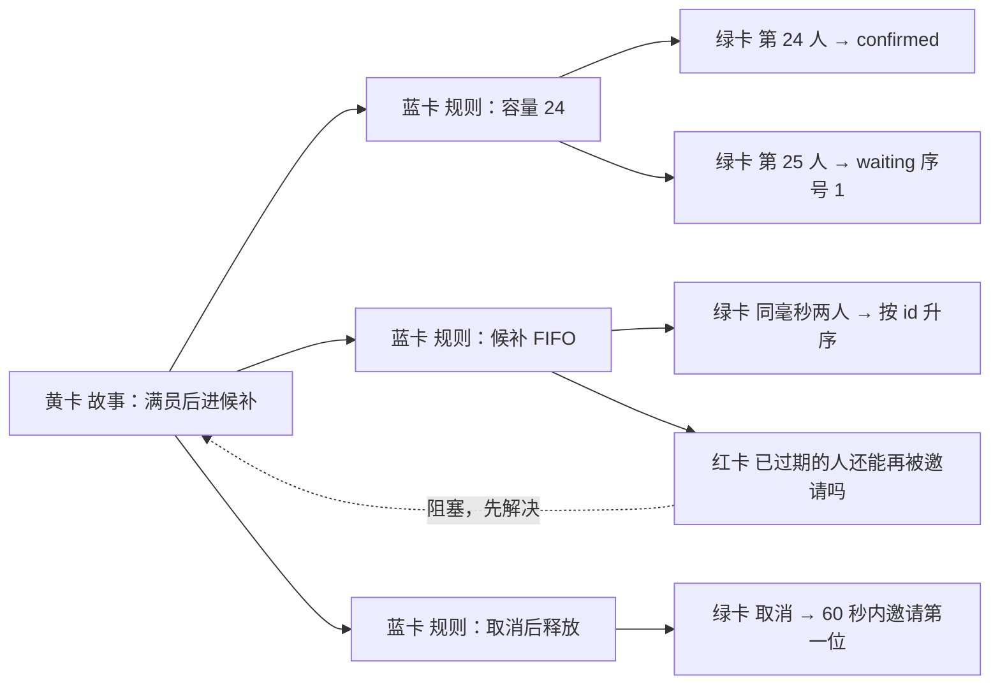
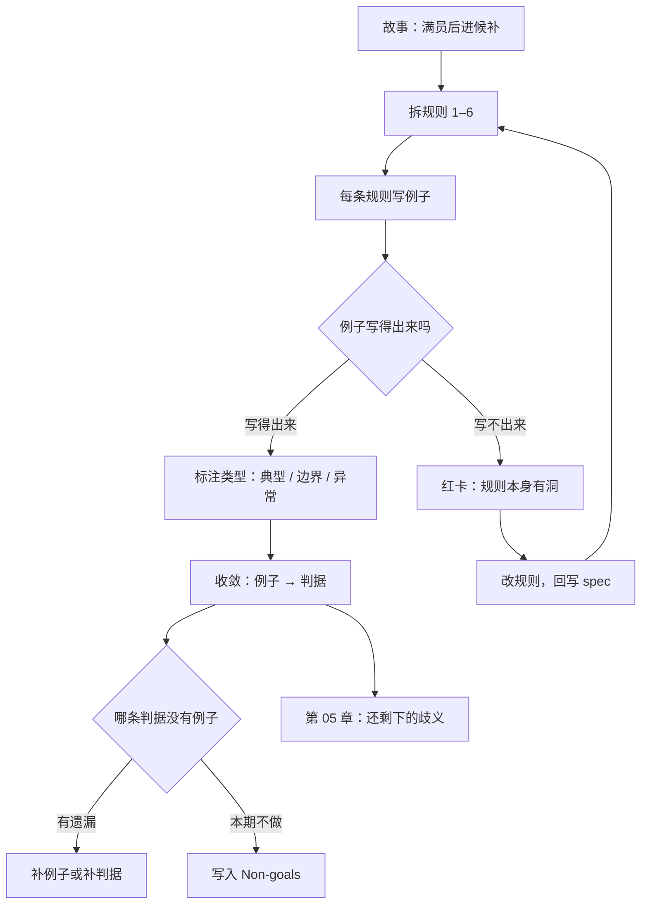

[English](./ch04-examples.md) | **中文**

# 第 04 章：用例子钉住抽象

> **本章导读**：第 3 章解决了"句子能不能判"，但没解决"判据从哪来"。本章给出一套把抽象规则逼成具体例子的方法：Example Mapping。例子不是用来"说明"规则的，是用来**攻击**规则的。
> **前置知识**：第 03 章（EARS 五句式、反例法）。
> **核心学习目标**：
> - 用四色卡做一次完整的 Example Mapping
> - 说清"规则"与"例子"的分工，知道为什么两者都不能少
> - 能从一堆例子收敛出一组判据，并识别例子暴露出的疑问

---

## 1. 认知锚点：三个人都点头，三个不同系统

### 1.1 一句"要公平"

需求评审会上，讨论候补队列的排序。有人写下一条规则：

> **「候补要公平。」**

运营点头：公平就是先来后到，谁先报名谁先补上。
一位家长在群里说：公平应该照顾带两个孩子的家庭，他们更难协调时间。
技术负责人点头：公平就是 FIFO，按创建时间排序，同一时间按 ID。

三个人都点了头，三份理解没有一个字相同。**而"公平"这个词，在任何一份规格里都显得非常合理。**

### 1.2 直觉类比：字典与例句

学外语时，"nevertheless" 你查字典看到"然而、不过"，还是不会用。看三个例句，你立刻会用，还知道它只能放句首、后面要跟逗号。

**规则给边界，例子给形状。** 只给规则，你不知道边界在哪；只给例子，你不知道边界外怎么办。

软件里同理：规则能覆盖未列出的情况，例子能暴露规则没说清的地方。**两者是互补的，不是替代的。**

---

## 2. 第一性原理：Example Mapping 与例子的四条要求

### 2.1 四色卡

Example Mapping 是 Cucumber 社区（Matt Wynne 等人）推广的一种协作方法：用四种颜色的卡片，在一张桌上把一条用户故事拆开。

| 卡 | 内容 | 作用 |
|---|---|---|
| **黄卡：故事** | 一条用户故事 | 锚点，一次只讨论一条 |
| **蓝卡：规则** | 这条故事必须满足的规则 | 把故事拆成可讨论的小块 |
| **绿卡：例子** | 一个具体场景：给定什么、做什么、期望什么 | 验证规则是否清楚 |
| **红卡：疑问** | 讨论中出现的、暂时答不上来的问题 | **最有价值的产出** |

流程有一条硬规矩：**当讨论卡住（出现红卡）时，停止往下加例子。** 因为红卡说明规则还没想清，继续加例子只是在给一个错误的理解添砖。



### 2.2 Adzic 的七条过程模式

Gojko Adzic 在《实例化需求》（Specification by Example, Manning, 2011）里从 50 多个项目里提炼出七条过程模式。它们不是流程步骤，是"成功团队反复在做的事"：

| # | 模式 | 一句话 | 在本书的落点 |
|---|---|---|---|
| 1 | 从目标导出范围 | 范围来自业务目标，不是来自客户给的详细需求 | 第 2 章七段式的第 1 段 |
| 2 | 协作式规格 | 规格由多方一起写，不是一个人写完给别人看 | 本章的四色卡 |
| 3 | 用例子说明 | 用具体例子消除自然语言的歧义 | 本章 |
| 4 | 精炼规格 | 例子要简洁、聚焦"做什么"而不是"怎么做" | 第 2 章的三层分离 |
| 5 | 不改规格地自动化验证 | 自动化实现不能反过来改变规格的表述 | 第 8 章的 checklist 门禁 |
| 6 | 频繁验证 | 判据要持续运行，不是上线前跑一次 | 第 9 章的度量 |
| 7 | 演进文档系统 | 规格是活的，随业务变化而更新 | 第 12 章的规格库 |

第 5 条尤其值得注意：**为了让测试好写而偷偷改掉规格的表述，是规格腐烂的起点。** 一旦规格开始迁就工具，它就不再是判据了。

### 2.3 例子的四条要求

| 要求 | 含义 | 反例 |
|---|---|---|
| **精确** | 有具体值：人数、时间、状态、结果 | "一位用户提交报名" |
| **完整** | 含前置状态、操作、期望结果三部分 | 只写"应成功" |
| **真实** | 业务上真的会发生 | "用户在 00:00:00.000 提交" |
| **易懂** | 不用读代码就能懂 | "调用 POST /api/reg 返回 201" |

**"真实"这一条最容易被忽略。** 编造出来的例子（时间戳正好整点、手机号正好 11 位、网络永远不抖）会让人产生"已经覆盖了"的错觉，而真实世界的输入是脏的。

### 2.4 边界例子优先

一条规则通常只需要 2–4 个例子就能说清，但选哪几个决定了信息量：

- **典型例子**（第 24 人报名成功）：确认功能存在。
- **边界例子**（第 25 人、候补第 1 位、15:00 整）：确认阈值对不对。
- **异常例子**（同毫秒两人、通知失败、候补为空）：确认失败路径。

**优先写边界和异常。** 典型例子几乎不会暴露问题——它是你和 AI 都同意的部分。**分歧永远藏在边界上。**

---

## 3. 手把手推演：六条规则，十二个例子

### 3.1 六条规则

对"候补报名"这条故事，先拆规则（蓝卡）：

| 编号 | 规则 |
|---|---|
| 规则 1 | 每场活动已确认报名上限 24 人，超出进入候补 |
| 规则 2 | 候补按提交时间升序；同一毫秒按记录 ID 升序 |
| 规则 3 | 已确认报名被取消时，名额进入"预留"，并邀请候补第一位 |
| 规则 4 | 被邀请者有 15 分钟确认窗口，超时则顺延 |
| 规则 5 | 同一手机号对同一场次的重复提交只保留一条记录 |
| 规则 6 | 名单仅本人与运营可见；未登录不可见 |

### 3.2 十二个例子

| 编号 | 规则 | 前置状态 | 操作 | 期望结果 | 类型 |
|---|---|---|---|---|---|
| E01 | 规则 1 | 已确认 23 人 | 第 24 人提交 | 状态 confirmed，占用 24 | 典型 |
| E02 | 规则 1 | 已确认 24 人 | 第 25 人提交 | 状态 waiting，队列序号 1 | 边界 |
| E03 | 规则 1 | 已确认 24 人，候补 3 人 | 第 28 人提交 | 状态 waiting，队列序号 4 | 边界 |
| E04 | 规则 2 | 候补 A(10:00:00.100, id=7)、B(10:00:00.100, id=9) | 释放 1 个名额 | A 获得邀请（id 小者优先） | 边界 |
| E05 | 规则 2 | 候补 A 已过期，候补 B 在等 | 再释放 1 个名额 | B 获得邀请；A 不再收到邀请 | 异常 |
| E06 | 规则 3 | 已确认 24 人，候补 2 人 | 一人取消 | 60 秒内 A 收到邀请；该名额标记为 reserved，不被新报名占用 | 典型 |
| E07 | 规则 3 | 已确认 23 人，候补 0 人 | 一人取消 | 占用 23，无通知；新报名可直接 confirmed | 边界 |
| E08 | 规则 4 | A 已收到邀请 14 分 59 秒 | A 点击确认 | 状态 confirmed | 边界 |
| E09 | 规则 4 | A 已收到邀请 15 分 01 秒 | A 点击确认 | 返回 409，提示名额已顺延；A 状态 expired | 边界 |
| E10 | 规则 5 | 手机号 138**** 已报名 | 9 秒内以同号不同姓名再次提交 | 返回首次结果，不新建记录 | 异常 |
| E11 | 规则 5 | 手机号 138**** 已报名 | 11 秒后以同号再次提交 | ——**（写不出来）** | 疑问 |
| E12 | 规则 6 | 未登录 | 请求名单接口 | 返回 401，不返回任何姓名 | 异常 |

### 3.3 那个写不出来的 E11

E11 是本轮最有价值的产出。它不是"暂时没想好"，而是**暴露了规则 5 本身有问题**：

- 如果按"10 秒内"判重，11 秒的重试就会建出第二条记录。而真实的网络重试，间隔可能是 1 秒、5 秒、30 秒、2 分钟。
- 如果放宽到"24 小时内"，那这位家长真的想给第二个孩子报名怎么办？
- 如果按"手机号 + 姓名"判重，同号不同姓名就是两个人——但 E10 又要求它算一个人。

三个问法互相矛盾。这不是例子没写好，是规则用"时间窗"代替了"幂等"这个错误。

**红卡答案**（回写规格）：

```text
规则 5' 所有报名请求必须携带客户端生成的 idempotency_key。
    同一 key 的重复请求返回首次结果，不创建新记录。
    未携带 key 的请求返回 400。
    同一手机号在同一场次的自然重复报名（不同 key）需运营人工合并，系统不自动判重。
```

这条改动一次解决了三个问题：重试任意间隔都不重复建、真实的多孩家庭不被误伤、人工合并留出了例外通道。

### 3.4 从十二个例子收敛到八条判据

例子多、判据少，这是正常的。收敛规则：

| 判据（第 3 章的 AC-1–AC-8） | 由哪些例子支撑 |
|---|---|
| AC-1 实名校验 | E01、E10（隐含手机号格式） |
| AC-2 满员进候补 | E01、E02、E03 |
| AC-3 队列序号可查 | E02、E03 |
| AC-4 幂等 | E10、E11（改造后 → 规则 5'） |
| AC-5 取消释放 + 邀请 | E06、E07 |
| AC-6 15 分钟窗口 | E08、E09 |
| AC-7 通知失败不影响主流程 | 暂无例子 → **必须补** |
| AC-8 审核开关 | 暂无例子 → 本期不做，进 Non-goals |

**"暂无例子"的两条，一条暴露遗漏（AC-7），一条确认边界（AC-8）。** 这就是收敛动作的价值：它不只压缩，还做体检。

---

## 4. 常见误区与正反例对比

| 容易踩的坑 | 为什么会出错 | 正确做法 |
|---|---|---|
| **只有例子，没有规则** | 例子直观，规则费脑 | 规则管"未列出的情况"，例子管"列出的情况"；缺一不可 |
| **只有规则，没有例子** | 觉得规则已经写清了 | 每条规则至少配一个边界例子，否则边界永远在别人脑子里 |
| **例子写成了 UI 操作步骤** | 照着页面点一遍最省事 | 例子写"状态与结果"，不写"点哪个按钮" |
| **例子过于干净** | 编数据时下意识选整齐的值 | 故意用脏数据：同毫秒、空字符串、超长姓名、+86 前缀 |
| **红卡被跳过** | 想先把会开完 | 出现红卡就停；跳过红卡等于把已知的洞留给实现阶段 |
| **例子与规则矛盾却不核查** | 各写各的，没人交叉看 | 每个例子必须能指回一条规则；指不回去的，要么补规则，要么删例子 |

---

## 5. 本章小结与局部知识图谱

### 5.1 三句话带走

- **规则管覆盖，例子管边界。** 典型例子几乎不会暴露问题，边界例子才会。
- **红卡是产出，不是障碍。** 写不出例子的地方，就是规则有洞的地方。
- **例子的终点是判据，不是测试用例。** 先收敛成判据（覆盖未列出的情况），再展开成 GWT（覆盖已列出的分支）。

### 5.2 本章概念拓扑



---

## 6. 分级通关练习

### Tier 1：直觉核验

1. 为什么"例子写不出来"比"例子写错了"更值得警惕？
2. 一条规则配了 8 个典型例子、0 个边界例子，这条规则的覆盖率算高还是低？

### Tier 2：动手应用

3. 对"候补按顺序"这条规则，写 4 个例子，其中至少 2 个是边界或异常。要求：每条都含前置状态、操作、期望结果。

### Tier 3：边界与迁移

4. E04 规定"同一毫秒按 ID 升序"。请构造一个场景，说明这条规则在分布式数据库下会失效，并给出替代方案。

<details>
<summary><strong>点击展开：本章练习参考答案与深度解析</strong></summary>

#### 1. 为什么"写不出来"更危险

- **结论**：写错了会被例子之间的不一致暴露；写不出来说明**规则内部有矛盾**，而矛盾不会被任何单个例子暴露。
- **机制**：写例子是一次"代入执行"。代入时卡住，说明规则在某个状态下无解或有两个解。E11 就是典型：三种判重口径互相冲突，任何一种写法都会在另一个例子上崩。
- **实践**：把"写不出来"当成红灯，不要用"先这样，后面再说"糊过去。

#### 2. 8 个典型例子算不算高覆盖

- **结论**：低。典型例子高度同质，8 个典型例子的信息量往往不如 1 个边界例子。
- **判断标准**：看例子是否分布在**状态空间的边界**上（0、1、上限、上限+1、同值、超时、失败）。
- **经验值**：一条规则 3–5 个例子足够，其中至少一半是边界或异常。

#### 3. 四个例子参考

| 前置 | 操作 | 期望 | 类型 |
|---|---|---|---|
| 候补 A(10:00)、B(10:05) | 释放 1 个名额 | A 获邀请 | 典型 |
| 候补 A(10:00:00.100)、B(10:00:00.100) | 释放 1 个名额 | ID 小者获邀请 | 边界（同毫秒） |
| 候补 A 已过期、B 在等 | 再释放 1 个名额 | B 获邀请，A 不再受邀 | 异常 |
| 候补为空 | 释放 1 个名额 | 无名额分配，无通知 | 边界（空集） |

#### 4. 同毫秒排序在分布式下失效

- **结论**：不同节点生成的 `created_at` 来自各自时钟，即使 NTP 同步也有毫秒级漂移；`id` 若是自增，跨分片也不可比。
- **反例**：节点 1 的时钟慢 3ms，A 实际后提交但时间戳更早 → A 插队。用户看到的"公平"被时钟误差破坏。
- **替代方案**：① 用**单调序列**（如数据库序列、Snowflake ID）作为唯一排序键，时间戳只作展示；② 或引入显式队列序号（入队时原子自增），把"顺序"变成一个被持久化的属性，而不是从时间推导。
- **迁移结论**：凡是"按时间排序"的规则，都要问一句"这个时间是谁的时钟"。

</details>

---

## 7. 本章权威参考信源与延伸阅读 (Authoritative References)

1. **Specification by Example（Adzic, 2011）**：[Specification by Example（Adzic, 2011）](https://www.manning.com/books/specification-by-example) - 本章的定义与规范以此为锚（核验日期：`2026-10-23`）。
2. **Example Mapping**：[Example Mapping](https://cucumber.io/blog/bdd/example-mapping-introduction/) - 本章的定义与规范以此为锚（核验日期：`2026-10-23`）。
3. **Gherkin Reference**：[Gherkin Reference](https://cucumber.io/docs/gherkin/reference/) - 本章的定义与规范以此为锚（核验日期：`2026-10-23`）。

> 口径提示：以上信源用于锚定**定义与规范**，不用于外推风险概率。引用任何数字前，先核对来源年份与分母。
