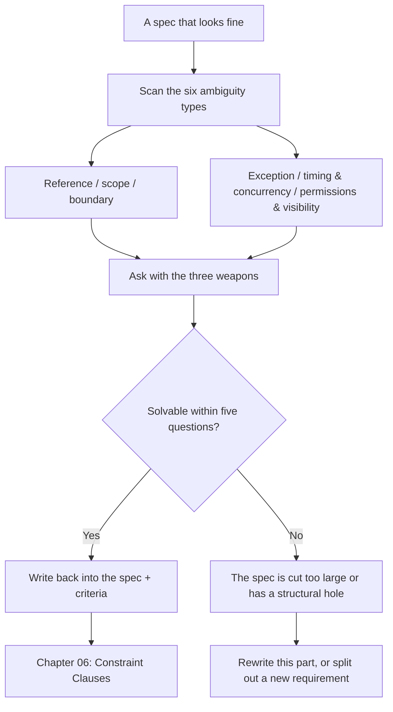

**English** | [中文](./ch05-ambiguity.zh.md)

# Chapter 05: The Anatomy of Ambiguity

> **Chapter overview**: Chapters 3 and 4 taught you to write decidable criteria and force out concrete examples, but there is a kind of blank these two moves will not catch: the sentences **everybody thinks they understand**. This chapter divides ambiguity into six types, gives identification signals and question templates for each, and explains how many questions to ask before the pace is dragged to a halt.
> **Prerequisites**: Chapters 03-04.
> **Core learning objectives**:
> - Given a piece of spec, locate the six types of ambiguity within ten minutes
> - Turn open-ended ambiguity into closed options with the three questioning weapons
> - Build the discipline that "answers must be written back into the spec", not left in the chat log

---

## 1. Cognitive Anchor: "As Soon As Possible" Is Three Different Times in Three Heads

### 1.1 A Realistic Delay Incident

In the group chat the waitlist plan is being discussed; operations types:

> **"When the slots are full, write them down for now; when someone cancels, notify the waitlist people as soon as possible."**

The developer's understanding: ASAP = send immediately after a successful cancel. So the code synchronously calls the SMS service inside the cancel endpoint. In the first week after launch the SMS gateway jittered, one cancel request stalled for 12 seconds, the front end timed out, operations thought it had failed and clicked again - **two cancels, one slot, zero notifications**.

Operations' understanding: ASAP = sometime today. She never expected "second-level" speed at all.

Neither understanding is wrong. **The phrase "as soon as possible" is competent in natural language and derelict in a spec** - it hands the judgment to the reader, and the reader is an AI.

### 1.2 Intuitive Analogy: "A Reasonable Period" in Contracts

Legal texts have phrases like "a reasonable period" too. They work because there are **precedents** behind them: courts ruling again and again on "does three months count as reasonable", forming referable case law.

Software has no precedents. After an incident in production, nobody will rule on "does 12 seconds count as ASAP"; there will just be a crowd each insisting on their own version. **So a software spec must grow its own "case law" - that is, anchor every fuzzy spot to a decidable value.**

---

## 2. First Principles: Six Types of Ambiguity and Three Questioning Weapons

### 2.1 The Six Types of Ambiguity

| # | Type | Identification signal | Typical sentence | Question template |
|---|---|---|---|---|
| 1 | **Reference** | Words like "it / this / that / the relevant" appear | "After canceling, notify it" | "Which specific record does "it" refer to?" |
| 2 | **Scope** | Words like "all / every / users / admins" appear | "All users can cancel" | "Does that include operations? Does it include expired people?" |
| 3 | **Boundary** | Words like "full / exceeds / within / before" appear | "When slots are full, join the waitlist" | "Is it full at 24 people, or only at 25?" |
| 4 | **Exception** | Words like "generally / usually / unless" appear | "Usually cancellable before the event starts" | "What counts as an exception? What happens then?" |
| 5 | **Timing and concurrency** | Words like "after / immediately / simultaneously" appear | "Notify immediately after canceling" | "How fast is immediate? When two people act at once, who wins?" |
| 6 | **Permissions and visibility** | Words like "can view / manage" appear | "Operations can manage the list" | "Can they see full phone numbers? Export? Cancel on someone's behalf?" |

These six deserve their own list because **each corresponds to a classic production incident**:

- Reference ambiguity -> the wrong object is changed (someone else's sign-up is canceled)
- Scope ambiguity -> permission bypass (an admin treated as a normal user, or the reverse)
- Boundary ambiguity -> off-by-one (person 25 standing at the door)
- Exception ambiguity -> the rule silently fails in special scenarios (nobody on duty during holidays)
- Timing ambiguity -> races and timeouts (overselling, duplicate notifications)
- Permission ambiguity -> data leaks (the list page forgot authentication)

### 2.2 The Three Questioning Weapons

The quality of a question depends on **whether it can turn an open question into closed options**.

| Weapon | How to use | Why it works |
|---|---|---|
| **Counter-example method** | "Give me a case you would judge as a failure." | People often cannot articulate "what counts as right", but are very sensitive to "what counts as wrong" |
| **Extreme-value method** | "0 people, 1 person, 24 people, 25 people, 1000 people - what happens in each case?" | The most undefined behavior hides at the boundaries |
| **Role method** | "Switch to a new colleague / an auditor / a malicious user - how would they read this sentence?" | Switching perspective exposes "insider default knowledge" |

**The counter-example method is the strongest.** It sidesteps the hard problem of "describing correct behavior" and directly exploits people's intuition about errors. Chapter 3 uses it to attack criteria; this chapter uses it to mine requirements.

### 2.3 Why "Five Questions", Not "Twenty"

Commands like `/speckit-clarify` default to at most 5 questions per round. This is not a quota; it is a **cap by design**. Three reasons:

1. **Every question requires a human decision.** Twenty questions push people into "just pick one" mode, and answer quality falls off a cliff.
2. **The more questions, the more likely the spec structure is at fault.** If you need twenty questions to make one feature clear, the spec needs rewriting, not patching.
3. **After asking, you must write back.** Writing back five questions costs about ten minutes; the cost of writing back twenty makes people give up, the answers stay in the conversation, and the next task loses them all over again.

**The judging standard**: if critical blanks remain after five questions -> stop and rewrite that section instead of asking more.

### 2.4 Write-Back Discipline: The Conversation Is Not the Spec

This is the rule most often violated. A real failure looks like this:

> You ask in the conversation: "Can people still cancel after the event starts?" They answer: "No, it closes 2 hours before." You say "okay" and keep generating.
> Three weeks later, another person (or another session) takes over, sees "users can cancel sign-ups" written in the spec, and implements "cancellable at any time".

**An answer that is not written back is the same as not asking.** Write-back must satisfy three conditions:

1. Written into the corresponding section of `spec.md`, not into an "addendum" at the end of the file;
2. Carries an adjudication trace: `<!-- 2026-10-19 ops confirmed: cutoff 120 minutes before start -->`;
3. In the same commit, the affected criteria are changed along with it.

---

## 3. Hands-on Walkthrough: Five Questions on a First-Draft Spec

### 3.1 The First-Draft Spec (excerpt)

```text
### Requirement 3: cancel and release
Users can cancel a registration. On cancellation, the seat is released to the waitlisted people.

### Requirement 5: roster
Operations can view the roster.
```

### 3.2 Five Questions and Their Write-Backs

| # | Ambiguity type | Question | Adjudication | Write-back location |
|---|---|---|---|---|
| Q1 | Scope | Does "users" in "users can cancel" include operations canceling on someone's behalf? | Operations may cancel on behalf, but must fill in a reason | Requirement 3 criteria + permissions section |
| Q2 | Boundary | Is "the slot is released" immediate, or does it wait for operations to confirm? | Immediately enters reserved; invite within 60 seconds | Requirement 3 criteria |
| Q3 | Timing | If two people cancel the same session at the same time, could the same person be invited twice? | No: invitations are per slot, and one slot sends exactly one invite | Requirement 3 concurrency constraints |
| Q4 | Permissions | When operations views the list, can they see full phone numbers? | List page masked (138****1234), detail page full, plus an audit log | Requirement 5 criteria |
| Q5 | Exception | If the notification cannot be sent, is the waitlist still valid? | Yes: the invite state advances as usual; the notification goes to the retry queue | Requirement 3 failure semantics |

### 3.3 The Spec After Write-Back (revised)

```text
### Requirement 3: cancel and release
- AC-3.1 When a confirmed registration is cancelled (by the user or by ops on their behalf), the system shall set
  the seat to reserved within 60 seconds and send a confirmation invite to the first person on the waitlist.
- AC-3.2 Ops canceling on someone's behalf must fill in a reason (enum: something came up / duplicate registration / other + note);
  the reason is written to the audit log.
- AC-3.3 One seat produces exactly one invite record per round of transfers; under concurrent cancellation,
  each seat is allocated independently, and no one may receive two invites.
- AC-3.4 Invite delivery failure does not affect the cancellation result; the invite enters the catch-up queue and is delivered within 5 minutes after recovery.
<!-- 2026-10-19 ops confirmed: cancellation closes 120 minutes before start; proxy cancellation requires a reason -->

### Requirement 5: roster
- AC-5.1 The list endpoint returns masked phone numbers (first 3, last 4, middle 4 as asterisks).
- AC-5.2 The detail endpoint returns the full phone number, ops role only, and every access writes an audit log.
- AC-5.3 Any endpoint accessed without login returns 401.
```

Compare the four changes:

1. Criteria went from 1 to 7 (**every one asked out loud was originally left to guessing**);
2. An "enumeration" appeared (the reason types) - the standard cure for scope ambiguity;
3. An "audit log" appeared - the common patch for permission ambiguity;
4. A dated comment appeared - **the adjudication leaves a trace, traceable three months later**.

### 3.4 When Five Questions Are Not Enough

Suppose you also want to ask: can a waitlisted person give up voluntarily? Can slots be transferred across sessions? Can the list be exported? - **all three questions fall outside the scope of "cancellation and the list".**

The right move is not to keep asking, but to record them in `Non-goals` (not done this round) or create a new requirement. **Questions going out of scope mean the spec is sliced too large, not that you asked too little.**

---

## 4. Common Pitfalls: Wrong vs. Right

| Common pitfall | Why it goes wrong | The right approach |
|---|---|---|
| **Asking open-ended questions** | "What do you want to do?" sounds respectful but pushes the design responsibility back onto non-technical people | Give 2-3 closed options with their consequences, and let people pick |
| **Answering for the other side yourself** | Feeling "does that even need asking?" | Your default is the model's default; not confirming equals letting it decide for you |
| **Taking "the customer did not say" as "not needed"** | Silence treated as agreement | Silence is the highest-risk signal; "not done this round" must be confirmed explicitly |
| **Leaving answers in the conversation** | Writing back is a hassle, and it feels remembered at the moment | Not writing back = not asking; the next session is a fresh start |
| **Asking twenty at once** | Wanting to settle it all at once | Five-question cap; more than that means rewrite |
| **Asking only about features, never failures** | Failure paths take thought | In every round of five, at least two questions about failures and boundaries |

---

## 5. Chapter Summary and Local Knowledge Map

### 5.1 Three Takeaways

- **Ambiguity is not an expression problem, it is a structure problem**: the six types have their own locations and can be swept systematically.
- **The counter-example method works best**: people's intuition about "what counts as wrong" is far stronger than their articulation of "what counts as right".
- **Five questions is the cap**: more means the spec structure is at fault; answers not written back equal not asking.

### 5.2 This Chapter's Concept Topology



---

## 6. Tiered Exercises

### Tier 1: Intuition Check

1. Of the six types, which two most easily cause **data leaks**? Why?
2. Why does the "counter-example method" get useful answers more easily than "please describe the behavior you expect"?

### Tier 2: Hands-on Application

3. Take Chapter 3's eight criteria (AC-1 to AC-8), sweep each for the six types of ambiguity, mark at least three places where ambiguity remains, and write one question for each.

### Tier 3: Boundaries & Transfer

4. Suppose the other side answers every question with "you decide". Design a way to move forward that does not depend on their decisions, and explain where the **risk boundary** of that approach lies.

<details>
<summary><strong>Click to expand: reference answers and in-depth analysis for this chapter's exercises</strong></summary>

#### 1. Which two most easily cause data leaks

- **Conclusion**: scope ambiguity and permission/visibility ambiguity.
- **Mechanism**: scope ambiguity lets "people who should not be included" into the set (e.g. "all users" counting admins in, or "operations" implemented as "any logged-in user"); permission ambiguity turns "can view" into "can view all fields".
- **The common combination**: `list endpoint + unauthenticated + returns full phone numbers` - the most classic trio in real incidents.

#### 2. Why the counter-example method works better

- **Conclusion**: because "correct" is an infinite set while "wrong" is finite and concrete.
- **Reasoning**: ask someone to describe correct behavior and they must build a complete model in their head; ask them for one failure scenario and they only need to recall one unpleasant experience - the latter costs less and carries more information.
- **Limitation**: the counter-example method only covers "errors you thought of", not "errors you did not think of". So it must be paired with the extreme-value method.

#### 3. Residual ambiguity in the eight criteria (example)

| Criterion | Residual ambiguity | Type | Question |
|---|---|---|---|
| AC-1 real-name validation | Whether "real name" allows English, spaces, the dots in ethnic minority names | Boundary | What character set and length range are allowed for names? |
| AC-2 waitlist when full | Whether a slot manually released by operations counts toward "confirmed count" | Scope | Does a manual release occupy one of the 24 slots? |
| AC-3 queue position queryable | Who guarantees the position updates within 60 seconds after the queue changes | Timing | Computed live on query, or refreshed on a schedule? The two mean different things by "60 seconds" |
| AC-5 release on cancel | What happens if an expired person cancels again | Exception | Can an expired user cancel? Who gets the slot after that cancel? |
| AC-7 notification failure | What signal does "resend within 5 minutes after recovery" depend on | Timing | How is "recovered" decided? Health check, or first successful send? |

#### 4. When the other side always says "you decide"

- **Approach**: turn decisions into **reversible default values + explicit records of responsibility transfer**. Three steps:
  1. Give every decision a default value, tagged "default, overridable";
  2. Build a "pending-decision table" at the top of the spec, with columns: decision point, current default, blast radius, deadline;
  3. If unconfirmed by the deadline, execute the default, and explicitly list "the three items executed by default" in the delivery notes.
- **Risk boundary**: this approach only suits **reversible** decisions (copy, sorting details, prompt styles). Irreversible ones (data deletion policy, permission model, billing definitions) must not be pushed through with defaults; they must be escalated to someone who can decide.
- **Transfer conclusion**: default values are not dodging decisions; they make the state of "silence" explicit. Silence itself must also leave a trace.

</details>

---

## 7. Authoritative References and Further Reading for This Chapter (Authoritative References)

1. **GitHub Spec Kit**: [GitHub Spec Kit](https://github.com/github/spec-kit) - The definitions and conventions of this chapter are anchored here (verified on: `2026-10-23`).
2. **Specification by Example (Adzic, 2011)**: [Specification by Example (Adzic, 2011)](https://www.manning.com/books/specification-by-example) - The definitions and conventions of this chapter are anchored here (verified on: `2026-10-23`).
3. **RFC 2119 (Requirement Levels)**: [RFC 2119 (Requirement Levels)](https://www.ietf.org/rfc/rfc2119.txt) - The definitions and conventions of this chapter are anchored here (verified on: `2026-10-23`).

> A note on scope: the sources above anchor **definitions and conventions**, not extrapolated risk probabilities. Before citing any number, check its source year and denominator first.
