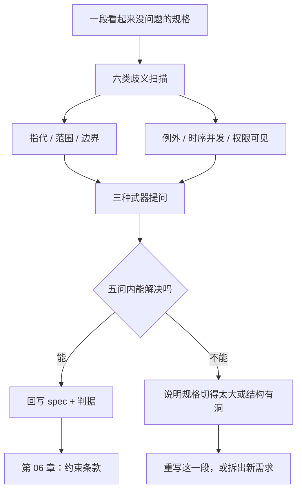

# 第 05 章：歧义的解剖学

> **本章导读**：第 3、4 章教你写出可判定的判据、逼出具体的例子，但还有一类空白不会被这两招抓到——**每个人都以为自己懂了**的那种句子。本章把歧义分成六类，每类给出识别信号和提问模板，并说明"问多少问"才不至于把节奏拖死。
> **前置知识**：第 03–04 章。
> **核心学习目标**：
> - 拿到一段规格，能在十分钟内标出六类歧义的位置
> - 用三种提问武器把开放性歧义变成封闭选项
> - 建立"答案必须回写规格"的纪律，而不是留在聊天记录里

---

## 1. 认知锚点："尽快"在三个人心里是三个时间

### 1.1 一次真实形态的延迟事故

群里讨论候补方案，运营打字：

> **「名额满了就先记下来，有人取消就尽快通知候补的。」**

开发的理解：尽快 = 取消成功后立刻发。于是代码写成在取消接口里同步调用短信服务。上线第一周，短信网关抖动，一次取消请求卡了 12 秒，前端超时，运营以为没成功又点了一次——**两条取消、一个名额、零个通知**。

运营的理解：尽快 = 今天之内。她完全没指望"秒级"。

两种理解都不算错。**"尽快"这个词，在自然语言里是称职的，在规格里是失职的**——它把判断权交给了读者，而读者是 AI。

### 1.2 直觉类比：合同里的"合理期限"

法律文本里也有"合理期限"这种词。它能用，是因为背后有**判例**：法院一次次裁定"三个月算不算合理"，形成了可参照的先例。

软件里没有判例。线上出事之后，没人会来裁定"12 秒算不算尽快"，只会有一堆人各自坚持自己的版本。**所以软件规格必须自己长出"判例"——也就是把每个模糊处都锚到一个可判定的值上。**

---

## 2. 第一性原理：六类歧义与三种提问武器

### 2.1 六类歧义

| # | 类型 | 识别信号 | 典型句子 | 提问模板 |
|---|---|---|---|---|
| 1 | **指代** | 出现"它/该/此/这个/相关" | "取消后要通知它" | "「它」具体指哪一条记录？" |
| 2 | **范围** | 出现"所有/全部/用户/管理员" | "所有用户都能取消" | "含不含运营？含不含已过期的人？" |
| 3 | **边界** | 出现"满/超过/以内/之前" | "名额满了进候补" | "24 人算满还是 25 人才算满？" |
| 4 | **例外** | 出现"一般/通常/除非" | "一般活动开始前可取消" | "什么情况属于例外？例外时做什么？" |
| 5 | **时序与并发** | 出现"之后/立即/同时" | "取消后立即通知" | "多快算立即？两人同时操作谁赢？" |
| 6 | **权限与可见性** | 出现"可以查看/管理" | "运营可以管理名单" | "能看手机号全量吗？能导出吗？能代取消吗？" |

这六类之所以值得单列，是因为它们**各自对应一种经典的线上事故**：

- 指代歧义 → 改错了对象（取消了别人的报名）
- 范围歧义 → 权限绕过（管理员被当成普通用户，或反之）
- 边界歧义 → 差一错误（第 25 个人站在门口）
- 例外歧义 → 规则在特殊场景下静默失效（节假日无人值守）
- 时序歧义 → 竞态与超时（超卖、重复通知）
- 权限歧义 → 数据泄露（列表页漏了鉴权）

### 2.2 三种提问武器

提问的质量，取决于**能不能把开放问题变成封闭选项**。

| 武器 | 怎么用 | 为什么有效 |
|---|---|---|
| **反例法** | "给我一个你会判定为失败的情况。" | 人对"什么算对"常常说不清，但对"什么算错"非常敏感 |
| **极端值法** | "0 个人、1 个人、24 个人、25 个人、1000 个人，分别怎样？" | 边界处藏着最多的未定义行为 |
| **角色法** | "换成新来的同事 / 审计员 / 恶意用户，他会怎么理解这句话？" | 换视角能暴露"内部人默认知识" |

**反例法是最强的**。它绕过了"描述正确行为"这个难题，直接利用人对错误的直觉。第 3 章用它攻击判据，本章用它挖掘需求。

### 2.3 为什么是"五问"，而不是"二十问"

`/speckit-clarify` 这类命令默认一次最多提 5 个问题，这不是配额，是**上限设计**。理由有三：

1. **每个问题都要人做决定**。二十个问题会让人进入"随便选一个"的状态，答案质量断崖下跌。
2. **问题越多，越可能是规格结构有问题**。如果你需要问二十个问题才能说清一个功能，说明这份规格该重写，而不是该补丁。
3. **问完必须回写**。五问的回写成本约十分钟；二十问的回写成本会让人放弃回写，答案就留在对话里，下次任务重新丢。

**判断标准**：五问之后还有关键空白 → 停下来重写这一段，而不是继续问。

### 2.4 回写纪律：对话不是规格

这是本章最容易被违反的一条。真实的失败长这样：

> 你在对话里问："活动开始后还能取消吗？" 对方答："不能，开始前 2 小时截止。" 你说"好的"，继续生成。
> 三周后，另一个人（或另一个会话）接手，看到规格里写着"用户可以取消报名"，于是实现了"随时可取消"。

**答案没有回写，等于没问。** 回写要满足三个条件：

1. 写进 `spec.md` 的对应段落，不是写在文件末尾的"补充说明"里；
2. 带裁决痕迹：`<!-- 2026-10-19 运营确认：开始前 120 分钟截止 -->`；
3. 同一次提交里，把受影响的判据一起改掉。

---

## 3. 手把手推演：对一份初版规格提五问

### 3.1 初版规格（节选）

```text
### 需求 3：取消与释放
用户可以取消报名。取消后，名额释放给候补的人。

### 需求 5：名单
运营可以查看名单。
```

### 3.2 五个问题与回写

| # | 歧义类型 | 问题 | 裁决 | 回写位置 |
|---|---|---|---|---|
| Q1 | 范围 | "用户可以取消"里的"用户"，含不含运营代取消？ | 运营可代取消，但必须填原因 | 需求 3 判据 + 权限段 |
| Q2 | 边界 | "名额释放"是立即，还是等运营确认？ | 立即进入 reserved，60 秒内邀请 | 需求 3 判据 |
| Q3 | 时序 | 两人同时取消同一场次，会不会邀请同一个人两次？ | 不会：邀请以名额为单位，一个名额只发一次邀请 | 需求 3 并发约束 |
| Q4 | 权限 | 运营看名单，能看到手机号全量吗？ | 列表页脱敏（138****1234），详情页全量，且记审计日志 | 需求 5 判据 |
| Q5 | 例外 | 通知发不出去，候补还有效吗？ | 有效：邀请状态照常推进，通知进补发队列 | 需求 3 失败语义 |

### 3.3 回写后的规格（改后）

```text
### 需求 3：取消与释放
- AC-3.1 当一条已确认报名被取消时（本人或运营代取消），系统应在 60 秒内
  将名额置为 reserved，并向候补队列第一位发送确认邀请。
- AC-3.2 运营代取消时必须填写原因（枚举：临时有事 / 重复报名 / 其他 + 备注），
  原因写入审计日志。
- AC-3.3 一个名额在一次流转中只产生一条邀请记录；并发取消时，
  每个名额独立分配，不得向同一人发出两条邀请。
- AC-3.4 邀请发送失败不影响取消结果；邀请进入补发队列，恢复后 5 分钟内补发。
<!-- 2026-10-19 运营确认：开始前 120 分钟截止取消；代取消需填原因 -->

### 需求 5：名单
- AC-5.1 列表接口返回手机号脱敏格式（前 3 后 4，中间 4 位为星号）。
- AC-5.2 详情接口返回全量手机号，仅限运营角色，且每次访问写审计日志。
- AC-5.3 未登录访问任一接口返回 401。
```

对比一下四个变化：

1. 判据从 1 条变成 7 条（**问出来的每一条都是原来要靠猜的**）；
2. 出现了"枚举"（原因类型）——这是范围歧义的标准解法；
3. 出现了"审计日志"——权限歧义的常见补丁；
4. 出现了带日期的注释——**裁决有痕迹，三个月后能追**。

### 3.4 如果五问不够

假设你还想问：候补的人能不能主动放弃？名额能不能跨场次转移？名单能不能导出？——**这三个问题都超出了"取消与名单"这个范围。**

正确的动作不是继续问，而是：把它们记进 `Non-goals`（本期不做）或新建一条需求。**问题超范围，说明规格切得太大，不是问得不够。**

---

## 4. 常见误区与正反例对比

| 容易踩的坑 | 为什么会出错 | 正确做法 |
|---|---|---|
| **问开放式问题** | "你想怎么做？"听起来尊重，实际把设计责任推回给了不懂技术的人 | 给 2–3 个封闭选项 + 各自后果，让人选 |
| **自己替对方回答** | 觉得"这还用问吗" | 你的默认值就是模型的默认值；不确认就等于让它替你决定 |
| **把"客户没说"当"不需要"** | 沉默被当成同意 | 沉默是最高风险的信号，必须显式确认"本期不做" |
| **答案留在对话里** | 回写麻烦，且当下感觉记住了 | 不回写 = 没问；下一次会话就是一次重来 |
| **一次问二十个** | 想一次问清 | 五问上限；超了说明该重写 |
| **只问功能，不问失败** | 失败路径要想 | 每轮五问里，至少两问关于失败与边界 |

---

## 5. 本章小结与局部知识图谱

### 5.1 三句话带走

- **歧义不是表达水平问题，是结构问题**：六类各有各的位置，可以系统性排查。
- **反例法最好用**：人对"什么算错"的直觉，远强于对"什么算对"的表述。
- **五问是上限**：超了说明规格结构有问题；答案不回写等于没问。

### 5.2 本章概念拓扑



---

## 6. 分级通关练习

### Tier 1：直觉核验

1. 六类歧义里，哪两类最容易造成**数据泄露**？为什么？
2. 为什么"反例法"比"请描述你期望的行为"更容易得到有用答案？

### Tier 2：动手应用

3. 拿第 3 章的八条判据（AC-1–AC-8），逐条扫描六类歧义，标出至少三处仍然存在歧义的地方，并各写一个提问。

### Tier 3：边界与迁移

4. 假设对方对每个问题的回答都是"你看着办"。请设计一套不依赖对方决策的推进方式，并说明这套方式的**风险边界**在哪里。

<details>
<summary><strong>点击展开：本章练习参考答案与深度解析</strong></summary>

#### 1. 哪两类最容易造成数据泄露

- **结论**：范围歧义与权限可见性歧义。
- **机制**：范围歧义让"不该被包含的人"进入集合（例如"所有用户"把管理员算进去，或"运营"被实现成"任何登录用户"）；权限歧义让"能看"被实现成"能看全部字段"。
- **常见组合**：`列表接口 + 未鉴权 + 返回全量手机号`，这是真实事故里最经典的一组。

#### 2. 反例法为什么更有效

- **结论**：因为"正确"是无限集合，"错误"是有限且具体的。
- **推演**：让人描述正确行为，他要在脑子里构建一个完整模型；让人举一个失败场景，他只需要回忆一次不愉快的经历——后者成本低、信息密度高。
- **限制**：反例法只能覆盖"想到的错"，覆盖不了"没想到的错"。所以它要和极端值法配合使用。

#### 3. 八条判据的残留歧义（示例）

| 判据 | 残留歧义 | 类型 | 提问 |
|---|---|---|---|
| AC-1 实名校验 | "真实姓名"是否允许英文、空格、少数民族姓名中的点 | 边界 | 姓名允许的字符集与长度范围是什么？ |
| AC-2 满员进候补 | 运营手动释放的名额算不算"已确认数" | 范围 | 手动释放是否占用 24 个名额？ |
| AC-3 序号可查 | 序号在队列变化后 60 秒内更新，谁来保证 | 时序 | 是查询时实时计算，还是定时刷新？两者对"60 秒"的含义不同 |
| AC-5 取消释放 | 已过期的人再次取消会怎样 | 例外 | 过期用户能否取消？取消后名额归谁 |
| AC-7 通知失败 | "恢复后 5 分钟内补发"依赖什么信号 | 时序 | 如何判定"已恢复"？健康检查还是首次发送成功 |

#### 4. 对方永远说"你看着办"

- **做法**：把决策变成**可回滚的默认值 + 明确的责任转移记录**。三步：
  1. 每个决策给一个默认值，并标注"默认值，可覆盖"；
  2. 在 spec 顶部建一张《待确认决策表》，列：决策点、当前默认、影响面、截止日期；
  3. 到截止日未确认，按默认执行，并在交付说明里显式列出"按默认执行的三项"。
- **风险边界**：这套方式只适用于**可回滚**的决策（文案、排序细节、提示样式）。不可回滚的（数据删除策略、权限模型、计费口径）不能用默认值推进，必须升级到能拍板的人。
- **迁移结论**：默认值不是逃避决策，是把"沉默"这个状态显式化。沉默本身也必须留下痕迹。

</details>

---

## 7. 本章权威参考信源与延伸阅读 (Authoritative References)

1. **GitHub Spec Kit**：[GitHub Spec Kit](https://github.com/github/spec-kit) - 本章的定义与规范以此为锚（核验日期：`2026-10-23`）。
2. **Specification by Example（Adzic, 2011）**：[Specification by Example（Adzic, 2011）](https://www.manning.com/books/specification-by-example) - 本章的定义与规范以此为锚（核验日期：`2026-10-23`）。
3. **RFC 2119（Requirement Levels）**：[RFC 2119（Requirement Levels）](https://www.ietf.org/rfc/rfc2119.txt) - 本章的定义与规范以此为锚（核验日期：`2026-10-23`）。

> 口径提示：以上信源用于锚定**定义与规范**，不用于外推风险概率。引用任何数字前，先核对来源年份与分母。
