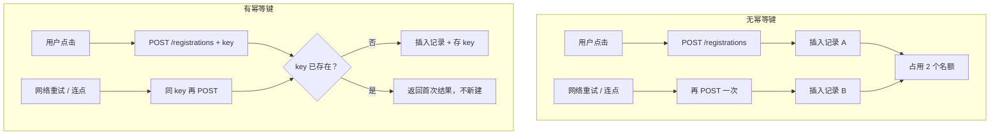
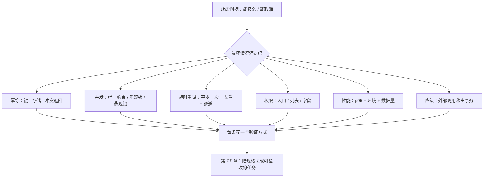

# 第 06 章：约束条款——不写，就等于授权默认值

> **本章导读**：功能和判据决定"做对了吗"，约束决定"在最坏情况下还对吗"。这一章讲六类必须写进规格的约束，以及一个反直觉的事实：**约束漏掉不会报错，所以它最容易被漏掉，也最贵。**
> **前置知识**：第 03 章（EARS）、第 05 章（时序与权限歧义）。
> **核心学习目标**：
> - 说清六类约束各自的"默认值陷阱"
> - 写出幂等、并发、重试三类约束的可验证条款
> - 能用一次"故意不写"的实验，证明约束缺失会带来什么

---

## 1. 认知锚点：不查房的酒店

### 1.1 上线第一周的三件事

候补系统上线。功能全对：能报名、能候补、能取消、能通知。演示时一切正常。第一周，三件事同时发生：

| 现象 | 现场 | 根因 |
|---|---|---|
| 一场 24 人的活动，报名表里 26 条记录 | 两位家长连点了两三次 | 没有幂等约束 |
| 最后 1 个名额被两个家长同时抢到 | 都收到了"报名成功" | 没有并发约束，代码是"先查再写" |
| 有人取消，名额空着，候补没收到通知 | 短信网关当天抖动 | 通知同步调用失败，整个取消回滚，名额没释放 |

三件事有一个共同点：**都不违反任何一条功能判据。** "能报名"是对的，"能取消"也是对的。它们违反的是没写下来的东西。

### 1.2 直觉类比：无人酒店

传统酒店退房要查房，规则长在"人"身上。无人酒店不查房，但规则没有消失——它被写进了门锁（房卡失效时间）、押金（预授权额度）、退房时间（12:00 自动计费）。

**"没人查"不等于"没规则"，只等于"规则被搬到了别的地方"。**

软件里同理。你不写约束，规则不会消失，它会以"框架的默认行为"、"模型选的实现方式"、"数据库的默认隔离级别"的形式存在。**而这些默认值，没有一个是为你这个业务选的。**

---

## 2. 第一性原理：六类约束与它们的默认值

### 2.1 为什么约束最容易被漏

因为**漏掉约束不会立刻报错**。

- 少写一条功能判据 → 演示时被问到，当场发现。
- 少写一条约束 → 演示时一切正常，因为演示是单人、顺序、网络良好、数据干净的。

约束的失败需要**特定条件**才显形：并发、重试、超时、越权、数据量、依赖故障。这些条件在开发和演示环境里几乎不出现，在生产环境里每天都出现。

### 2.2 六类约束及其默认值陷阱

| # | 约束 | 不写时，系统会默认成什么 | 典型事故 |
|---|---|---|---|
| 1 | **幂等** | 不幂等：每次请求都产生新副作用 | 连点、重试、消息重投 → 重复记录 |
| 2 | **并发** | 假设串行：先查后写，中间无保护 | 超卖、重复占位、队列错乱 |
| 3 | **重试与超时** | 要么无限等，要么一次就放弃 | 接口挂起、通知丢失 |
| 4 | **权限与可见性** | 只保护"详情"，忘记"列表"和"字段" | 名单泄露、越权操作 |
| 5 | **性能预算** | 不管：能跑就行 | 数据量上来后页面 8 秒 |
| 6 | **依赖与降级** | 同步强依赖：依赖挂了我也挂 | 短信网关抖动 → 整个报名不可用 |

这六类的排列不是随意的，它对应一条**失败链**：请求进来（幂等）→ 同时来了很多（并发）→ 依赖慢或挂（超时与重试）→ 有人不该看（权限）→ 数据变多（性能）→ 外部服务死了（降级）。

### 2.3 幂等：键、存储、冲突返回

幂等不是"小心一点"，它有三个必须写清的要素：

| 要素 | 必须回答的问题 | 写错的后果 |
|---|---|---|
| **键从哪来** | 客户端生成 UUID，还是服务端按业务字段算？ | 客户端忘了传 → 退化成不幂等 |
| **存多久** | 24 小时？7 天？ | 存太短 → 长重试穿透；存太久 → 存储膨胀、key 冲突 |
| **冲突返回什么** | 返回首次结果（200），还是报错（409）？ | 返回 409 → 客户端以为失败，用户重复操作 |



### 2.4 并发：三种手段与选择判据

| 手段 | 机制 | 适合 | 代价 |
|---|---|---|---|
| **唯一约束** | 数据库层拒绝重复（如 `(event_id, seat_no)` 唯一） | 占位类、去重类 | 需要在数据模型里预留"位号"这类字段 |
| **乐观锁** | 版本号 CAS：`UPDATE ... WHERE version = n` | 读多写少、冲突可重试 | 冲突时要有重试逻辑 |
| **悲观锁** | `SELECT ... FOR UPDATE` | 短事务、强一致 | 锁等待、死锁风险 |

**选择判据**：能用唯一约束解决的，绝不用应用层判断。因为唯一约束是**数据库替你保证**的，而应用层判断在并发下必然出现"检查与执行之间"的窗口。

这个窗口有个名字：**TOCTOU**（Time-of-Check to Time-of-Use）。第 3 节的实验会亲手造一个。

### 2.5 重试：至少一次投递 + 去重 + 退避

外部依赖（短信、邮件、支付回调）几乎都只能保证"至少一次"，不保证"恰好一次"。所以约束要写成三件事：

1. **投递语义**：至少一次（写清楚，别指望恰好一次）。
2. **去重**：消费端按 `dedupe_key` 去重，重复到达时不重复执行副作用。
3. **退避与上限**：1s、2s、4s、8s、16s，最多 5 次，超过进死信队列并告警。

**注意第三条的前置条件**：重试必须建立在幂等之上。不幂等的接口重试五次，就是制造五份垃圾。

### 2.6 权限：默认拒绝，且要管住三个面

权限约束容易只做一面。三面都要写：

| 面 | 常见漏法 | 写法 |
|---|---|---|
| **入口** | 只在前端隐藏按钮 | 后端每个写接口独立鉴权，默认拒绝 |
| **列表** | 详情做了鉴权，列表忘了 | 列表接口同样校验角色与数据范围 |
| **字段** | 返回整条记录 | 字段级脱敏：列表脱敏、详情全量且记审计 |

### 2.7 性能：写 p95，不写"平均"

平均值会被长尾掩盖。一场活动 24 人，一个人等了 8 秒，平均值可能只有 300ms——而那一个人就是投诉的那位。

约束要写清三件事：**分位数 + 环境 + 数据量**。例如：

```text
在 4 核 8G 单实例、名单 1000 条记录的条件下，
名单接口 p95 < 800ms，p99 < 1500ms。
```

### 2.8 降级：把"外部调用"移出事务

最常见的一类事故：在数据库事务里调用外部服务。

```text
BEGIN;
  UPDATE registrations SET status='cancelled';
  send_sms(...)          ← 这里超时 12 秒
COMMIT;
```

外部服务慢，事务就长；事务长，锁就久；锁久，其他请求排队；一旦超时回滚，前面的更新白做。

**约束写法**：外部调用不得出现在事务内；用 outbox 表记录待发消息，由后台 worker 投递。

---

## 3. 手把手推演：六条约束条款

### 3.1 条款与判据

| # | 约束条款（写进 spec 的"约束"段） | 对应判据（写进"验收判据"段） | 怎么验 |
|---|---|---|---|
| C1 | 所有写接口必须携带 `idempotency_key`（UUID v4），服务端保留 24 小时 | 同一 key 重复请求 50 次，只产生 1 条记录，响应体一致 | 脚本并发重放 |
| C2 | 名额占用由数据库唯一约束 `(event_id, seq_no)` 保证，应用层不得以"先查后写"替代 | 100 并发抢 1 个名额，成功 1、失败 99，无超卖 | 压测脚本 |
| C3 | 通知采用 outbox + 至少一次投递；指数退避 1/2/4/8/16 秒，上限 5 次 | 断开通知服务 2 分钟后恢复，5 分钟内补发完成，且不重复发送 | 故障注入 |
| C4 | 权限默认拒绝；列表脱敏；详情全量且写审计 | 未登录 401、非本人 403、运营访问留痕 | 三角色各测 |
| C5 | 名单接口 p95 < 800ms（4C8G，1000 条） | 压测报告达标 | 压测 |
| C6 | 外部调用不得在数据库事务内；通知失败不得导致报名/取消失败 | 关闭通知服务，报名与取消仍返回 2xx | 依赖开关 |

**这六条有一个共同结构**：一句"必须怎样"，加一句"怎么证明"。约束条款如果没有验证方式，它就只是一句愿望。

### 3.2 实验：故意留一条不写

现在做一件有用的事。把 C2（并发）从规格里删掉，只保留功能判据"名额满了进候补"，让 AI 实现。它大概率会写成：

```python
count = db.query("SELECT COUNT(*) FROM registrations WHERE event_id=? AND status='confirmed'")
if count < 24:
    db.execute("INSERT INTO registrations (...) VALUES (...)")
```

这段代码在单请求下完全正确。在两请求并发下：

```text
T1: SELECT COUNT(*) → 23
T2: SELECT COUNT(*) → 23        ← 两个都读到 23
T1: INSERT → 24 条
T2: INSERT → 25 条              ← 超卖
```

**这就是 TOCTOU。** 它不会被单元测试抓到（单线程），不会被演示抓到（一个人点），只会在活动开始的那一分钟被抓到。

补上 C2 之后，实现会变成：

```sql
-- 位号在报名时由序列分配，唯一约束兜底
INSERT INTO registrations (event_id, seq_no, user_id, ...)
VALUES (?, nextval('seat_seq'), ?, ...);
-- 捕获唯一约束冲突 → 返回 409 "名额已满"
```

**一句话的差别，决定了系统在最坏情况下是"超卖"还是"拒绝"。**

### 3.3 六条约束的书写模板

```text
约束 C<n>：<强制要求>
理由：<不写会怎样，一句话>
验证：<可执行的验证方式>
失效边界：<什么情况下这条约束不适用>
```

"失效边界"这一项常被省略，但它能防止约束被机械套用。例如 C3 的失效边界是"通知渠道本身不保证送达（如用户关机）——此时只要求系统侧状态可追溯"。

---

## 4. 常见误区与正反例对比

| 容易踩的坑 | 为什么会出错 | 正确做法 |
|---|---|---|
| **把约束写成形容词** | "要高可用""要注意并发"读起来没压力 | 每条约束配一个可执行的验证方式 |
| **在 spec 里提一句就以为模型会加锁** | 以为"提到"等于"实现" | 约束必须写成"必须/不得"的强制句，并进判据 |
| **用应用层判重代替数据库约束** | 应用层写起来更直觉 | 能用唯一约束就用唯一约束；应用层判断只做友好提示 |
| **重试没有上限或退避** | 只想"多试几次总能成" | 指数退避 + 上限 + 死信队列 |
| **权限只做前端隐藏** | 前端隐藏见效快 | 后端每个入口独立鉴权，默认拒绝 |
| **性能只写平均值** | 平均值好看 | 写 p95/p99 + 环境 + 数据量 |
| **外部调用写在事务里** | 代码顺序自然 | outbox + 异步投递 |
| **约束写进 plan 而不是 spec** | 觉得"这是技术细节" | 行为级约束（"通知失败不得影响取消"）进 spec；实现手段（outbox）进 plan |

最后一条是本章与第 2 章的接缝：**"必须幂等"是需求，"用唯一约束实现幂等"是方案。** 前者进 spec，后者进 plan。

---

## 5. 本章小结与局部知识图谱

### 5.1 三句话带走

- **约束漏了不报错**，所以它必须靠清单检查，而不是靠灵感。
- **六类约束对应一条失败链**：幂等 → 并发 → 超时重试 → 权限 → 性能 → 降级。
- **每条约束都要配一个验证方式**，否则它只是愿望。

### 5.2 本章概念拓扑



---

## 6. 分级通关练习

### Tier 1：直觉核验

1. 为什么"漏写功能判据"会在演示时暴露，而"漏写约束"不会？
2. 幂等的三个要素里，哪一个最容易被漏？漏了会怎样？

### Tier 2：动手应用

3. 给"运营代取消报名"这个动作写三条约束（提示：权限、审计、通知），每条配一个验证方式。

### Tier 3：边界与迁移

4. 有人主张："幂等键由客户端生成不可靠，客户端可能重复生成不同的 key。所以应该在服务端按业务字段算 key。"请分析这个主张在什么情况下成立、在什么情况下会出错。

<details>
<summary><strong>点击展开：本章练习参考答案与深度解析</strong></summary>

#### 1. 为什么约束的缺失不会在演示时暴露

- **结论**：因为演示环境的条件恰好是"约束不起作用"的条件：单人、顺序、网络良好、数据量小、依赖健康。
- **机制**：约束的失败需要触发条件（并发、重试、超时、越权、规模、故障）。这些条件在演示里被系统性地排除了。
- **推论**：**演示通过不是质量证据**，它只是"顺利路径存在"的证据。约束必须靠专门的验证手段（压测、故障注入、越权测试）来证伪。

#### 2. 幂等三要素里最易漏的

- **结论**：**冲突返回什么**。
- **原因**：键和存储是"实现"，冲突返回是"语义"，而语义要靠人决定。
- **漏了会怎样**：重复请求返回 409 或 500，客户端把它当失败，用户看到"提交失败"再点一次，或者客服让用户重试——重复副作用反而被"错误处理"放大。

#### 3. 代取消的三条约束

| 约束 | 条款 | 验证 |
|---|---|---|
| 权限 | 仅运营角色可代取消；必须指定目标报名 ID，不得按姓名模糊匹配 | 普通用户调用返回 403；模糊参数返回 400 |
| 审计 | 每次代取消写入审计日志：操作者、目标、时间、原因枚举、备注 | 查询审计表可见完整记录，且不可删除 |
| 通知 | 代取消后向被取消者发送通知（含原因），发送失败不影响取消结果 | 关闭通知服务后取消仍成功，恢复后补发 |

#### 4. 客户端 key vs 服务端算 key

- **主张成立的情况**：业务字段能唯一确定"意图"，且用户确实不会重复提交两次相同业务。例如"给订单 X 付一次款"，`order_id` 就是天然幂等键。
- **会出错的情况**：
  - 允许同一用户对同一场次多次报名（多孩家庭），业务字段相同但意图不同 → 服务端算 key 会把第二次合法提交误判为重复。
  - 业务字段会变（用户先报 A 姓名，后改成 B 姓名）→ key 变了，去重失效。
- **正确做法**：**两层**。客户端生成 `idempotency_key` 解决"同一次提交的重试"；业务层另设唯一约束解决"同一实体的重复"。前者管传输，后者管语义。
- **迁移结论**：任何"用业务字段做幂等"的方案，都要先回答"同一个业务字段，是否可能对应两次合法意图"。

</details>

---

## 7. 本章权威参考信源与延伸阅读 (Authoritative References)

1. **Stripe Idempotent Requests**：[Stripe Idempotent Requests](https://stripe.com/docs/api/idempotent_requests) - 本章的定义与规范以此为锚（核验日期：`2026-10-23`）。
2. **RFC 9110（HTTP Semantics）**：[RFC 9110（HTTP Semantics）](https://www.rfc-editor.org/rfc/rfc9110.html) - 本章的定义与规范以此为锚（核验日期：`2026-10-23`）。
3. **Python sqlite3**：[Python sqlite3](https://docs.python.org/3/library/sqlite3.html) - 本章的定义与规范以此为锚（核验日期：`2026-10-23`）。

> 口径提示：以上信源用于锚定**定义与规范**，不用于外推风险概率。引用任何数字前，先核对来源年份与分母。
