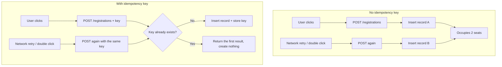
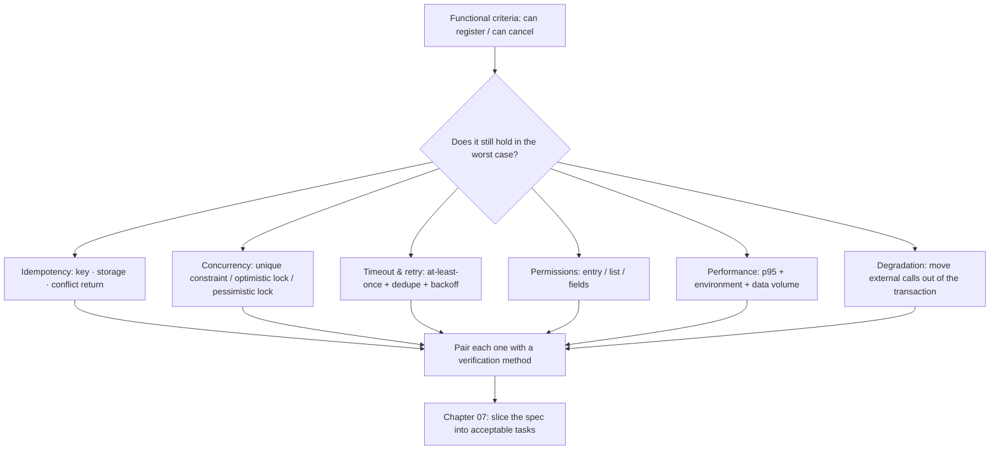

**English** | [中文](./ch06-constraints.zh.md)

# Chapter 06: Constraint Clauses - Not Writing Them Authorizes the Defaults

> **Chapter overview**: Features and criteria decide "did we build it right"; constraints decide "is it still right in the worst case". This chapter covers the six kinds of constraints that must go into a spec, plus one counter-intuitive fact: **a missing constraint produces no error, which is exactly why it is the easiest thing to miss and the most expensive.**
> **Prerequisites**: Chapter 03 (EARS), Chapter 05 (timing and permission ambiguity).
> **Core learning objectives**:
> - Name the "default-value trap" of each of the six constraint types
> - Write verifiable clauses for idempotency, concurrency, and retry constraints
> - Use a "deliberately leave one out" experiment to prove what a missing constraint costs

---

## 1. Cognitive Anchor: The Hotel That Does Not Inspect the Room

### 1.1 Three Things in the First Week After Launch

The waitlist system goes live. Every feature is right: you can sign up, join the waitlist, cancel, and get notified. The demo went fine. In the first week, three things happen at once:

| Symptom | On site | Root cause |
|---|---|---|
| An event with 24 slots has 26 records in the sign-up table | Two parents tapped two or three times | No idempotency constraint |
| The last slot was grabbed by two parents at the same time | Both received "sign-up successful" | No concurrency constraint; the code was "check then write" |
| Someone canceled, the slot sat empty, and the waitlist was never notified | The SMS gateway jittered that day | The synchronous notification call failed, the whole cancel rolled back, and the slot was never released |

The three share one thing: **none of them violates any functional criterion.** "Can sign up" is right, and "can cancel" is right. What they violate is the stuff that was never written down.

### 1.2 Intuitive Analogy: The Unmanned Hotel

At a traditional hotel, checkout includes a room inspection; the rule lives on "people". An unmanned hotel does not inspect the room, but the rules did not vanish - they were written into the door lock (key-card expiry), the deposit (pre-authorization amount), and the checkout time (auto-billing at 12:00).

**"Nobody checks" does not mean "no rules"; it only means "the rules were moved elsewhere".**

Software is the same. If you do not write constraints, the rules do not disappear; they exist as "the framework's default behavior", "the implementation the model picked", "the database's default isolation level". **And not one of those defaults was chosen for your business.**

---

## 2. First Principles: Six Constraint Types and Their Defaults

### 2.1 Why Constraints Are the Easiest to Miss

Because **a missing constraint does not immediately throw an error**.

- Miss one functional criterion -> it gets asked about during the demo, and you find out on the spot.
- Miss one constraint -> the demo is perfectly fine, because the demo is single-user, sequential, well-networked, and clean-data.

Constraint failures need **specific conditions** to show up: concurrency, retries, timeouts, privilege escalation, data volume, dependency failures. These conditions almost never appear in development and demo environments, and appear every day in production.

### 2.2 Six Constraint Types and Their Default-Value Traps

| # | Constraint | What the system defaults to without it | Typical incident |
|---|---|---|---|
| 1 | **Idempotency** | Not idempotent: every request produces new side effects | Double-clicks, retries, message redelivery -> duplicate records |
| 2 | **Concurrency** | Assumes serial: check then write, nothing in between | Overselling, duplicate holds, queue chaos |
| 3 | **Retry and timeout** | Either wait forever, or give up after one try | Hung endpoints, lost notifications |
| 4 | **Permissions and visibility** | Only protects "detail", forgets "list" and "fields" | List leak, unauthorized actions |
| 5 | **Performance budget** | Ignore it: as long as it runs | The page takes 8 seconds once data grows |
| 6 | **Dependencies and fallback** | Synchronous hard dependency: when it dies, I die | SMS gateway jitter -> the whole sign-up is unavailable |

The order of these six is not arbitrary; it follows a **failure chain**: requests arrive (idempotency) -> many at once (concurrency) -> dependencies slow or down (timeouts and retries) -> someone should not see it (permissions) -> data grows (performance) -> the external service dies (fallback).

### 2.3 Idempotency: Key, Storage, Conflict Response

Idempotency is not "be careful"; it has three elements that must be spelled out:

| Element | The question that must be answered | Consequence of getting it wrong |
|---|---|---|
| **Where the key comes from** | A UUID generated by the client, or computed server-side from business fields? | The client forgets to send it -> degrades to non-idempotent |
| **How long to store it** | 24 hours? 7 days? | Too short -> long retries punch through; too long -> storage bloat, key collisions |
| **What to return on conflict** | Return the first result (200), or an error (409)? | Return 409 -> the client thinks it failed, the user does it again |



### 2.4 Concurrency: Three Mechanisms and How to Choose

| Mechanism | How it works | Fits | Cost |
|---|---|---|---|
| **Unique constraint** | The database rejects duplicates (e.g. unique `(event_id, seat_no)`) | Holding slots, deduplication | You must reserve fields like "seat number" in the data model |
| **Optimistic locking** | Version CAS: `UPDATE ... WHERE version = n` | Read-heavy, write-light, conflicts retryable | You need retry logic on conflict |
| **Pessimistic locking** | `SELECT ... FOR UPDATE` | Short transactions, strong consistency | Lock waits, deadlock risk |

**The choosing rule**: if a unique constraint can solve it, never use application-layer checks. Because a unique constraint is **guaranteed by the database for you**, while an application-layer check under concurrency inevitably leaves a "between check and execute" window.

That window has a name: **TOCTOU** (Time-of-Check to Time-of-Use). The experiment in Section 3 will build one with your own hands.

### 2.5 Retry: At-Least-Once Delivery + Deduplication + Backoff

External dependencies (SMS, email, payment callbacks) can almost only guarantee "at least once", never "exactly once". So the constraint must say three things:

1. **Delivery semantics**: at least once (write it clearly; do not count on exactly once).
2. **Deduplication**: the consumer dedupes by `dedupe_key`; duplicate arrivals do not re-run side effects.
3. **Backoff and cap**: 1s, 2s, 4s, 8s, 16s, at most 5 times; beyond that go to the dead-letter queue and raise an alert.

**Note the precondition of the third item**: retries must be built on idempotency. Retrying a non-idempotent endpoint five times just manufactures five piles of garbage.

### 2.6 Permissions: Deny by Default, and Cover All Three Surfaces

Permission constraints easily end up covering only one surface. All three must be written:

| Surface | Common miss | How to write it |
|---|---|---|
| **Entry points** | Only hiding buttons in the front end | Every write endpoint authenticates independently, deny by default |
| **Lists** | Detail pages authenticated, lists forgotten | List endpoints check roles and data scope too |
| **Fields** | Returning the whole record | Field-level masking: lists masked, details full plus audit log |

### 2.7 Performance: Write p95, Not "Average"

Averages hide behind the long tail. At an event with 24 people, one person waits 8 seconds, and the average may be only 300ms - and that one person is the one who complains.

The constraint must state three things: **percentile + environment + data volume**. For example:

```text
On a 4-core 8 GB single instance with 1000 roster records,
the roster endpoint keeps p95 < 800ms and p99 < 1500ms.
```

### 2.8 Fallback: Move "External Calls" Out of Transactions

The most common class of incident: calling an external service inside a database transaction.

```text
BEGIN;
  UPDATE registrations SET status='cancelled';
  send_sms(...)          ← times out 12 seconds here
COMMIT;
```

The slower the external service, the longer the transaction; the longer the transaction, the longer the locks; the longer the locks, the more other requests queue up; once it times out and rolls back, the earlier updates were for nothing.

**How to write the constraint**: external calls must not appear inside transactions; use an outbox table to record pending messages, delivered by a background worker.

---

## 3. Hands-on Walkthrough: Six Constraint Clauses

### 3.1 Clauses and Criteria

| # | Constraint clause (into the spec's "Constraints" section) | Corresponding criterion (into the "Acceptance criteria" section) | How to verify |
|---|---|---|---|
| C1 | All write endpoints must carry an `idempotency_key` (UUID v4), retained server-side for 24 hours | 50 duplicate requests with the same key produce 1 record and identical response bodies | Concurrent replay script |
| C2 | Slot occupancy is guaranteed by the database unique constraint `(event_id, seq_no)`; the application layer must not substitute "check then write" | 100 concurrent grabs for 1 slot: 1 success, 99 failures, no overselling | Load-test script |
| C3 | Notifications use outbox + at-least-once delivery; exponential backoff 1/2/4/8/16 seconds, cap 5 attempts | Disconnect the notification service for 2 minutes, then restore; resends complete within 5 minutes, with no duplicates | Fault injection |
| C4 | Permissions deny by default; lists masked; details full and audited | Logged out gets 401, non-owner gets 403, operations access leaves a trace | Test all three roles |
| C5 | List endpoint p95 < 800ms (4C8G, 1000 rows) | Load-test report passes | Load test |
| C6 | External calls must not be inside database transactions; notification failure must not fail sign-up/cancel | With the notification service off, sign-up and cancel still return 2xx | Dependency switch |

**These six share one structure**: one sentence of "what must happen", plus one sentence of "how to prove it". A constraint clause without a verification method is just a wish.

### 3.2 Experiment: Deliberately Leave One Out

Now do something useful. Delete C2 (concurrency) from the spec, keep only the functional criterion "when slots are full, join the waitlist", and let the AI implement it. It will most likely write:

```python
count = db.query("SELECT COUNT(*) FROM registrations WHERE event_id=? AND status='confirmed'")
if count < 24:
    db.execute("INSERT INTO registrations (...) VALUES (...)")
```

This code is perfectly correct for a single request. Under two concurrent requests:

```text
T1: SELECT COUNT(*) → 23
T2: SELECT COUNT(*) → 23        ← both read 23
T1: INSERT → 24 rows
T2: INSERT → 25 rows            ← oversold
```

**This is TOCTOU.** Unit tests will not catch it (single-threaded), the demo will not catch it (one person clicking); it will only be caught in the minute the event starts.

With C2 added back, the implementation becomes:

```sql
-- 位号在报名时由序列分配，唯一约束兜底
INSERT INTO registrations (event_id, seq_no, user_id, ...)
VALUES (?, nextval('seat_seq'), ?, ...);
-- 捕获唯一约束冲突 → 返回 409 "名额已满"
```

**The difference of one sentence decides whether the system "oversells" or "rejects" in the worst case.**

### 3.3 A Writing Template for the Six Constraints

```text
Constraint C<n>: <mandatory requirement>
Reason: <what happens if this is not written, one sentence>
Verification: <an executable way to verify it>
Failure boundary: <when this constraint does not apply>
```

The "failure boundary" item is often skipped, but it prevents constraints from being applied mechanically. For example, C3's failure boundary is "the notification channel itself does not guarantee delivery (e.g. the user's phone is off) - in that case only the system-side state needs to be traceable".

---

## 4. Common Pitfalls: Wrong vs. Right

| Common pitfall | Why it goes wrong | The right approach |
|---|---|---|
| **Writing constraints as adjectives** | "Must be highly available", "mind the concurrency" read without pressure | Pair every constraint with an executable verification method |
| **Mentioning it in the spec and assuming the model will add locking** | Believing "mentioning" equals "implementing" | Constraints must be written as mandatory "must / must not" sentences and enter the criteria |
| **Application-layer dedup instead of database constraints** | Application code feels more intuitive | Use a unique constraint wherever possible; application checks only provide friendly hints |
| **Retries with no cap or backoff** | Just wanting to "try a few more times until it works" | Exponential backoff + cap + dead-letter queue |
| **Permissions only as front-end hiding** | Front-end hiding shows results fast | Every back-end entry authenticates independently, deny by default |
| **Performance written as averages only** | Averages look good | Write p95/p99 + environment + data volume |
| **External calls inside transactions** | The code order feels natural | Outbox + async delivery |
| **Constraints written into the plan instead of the spec** | Feeling "this is a technical detail" | Behavioral constraints ("notification failure must not affect canceling") go into the spec; implementation means (outbox) go into the plan |

The last one is the seam between this chapter and Chapter 2: **"must be idempotent" is a requirement; "implement idempotency with a unique constraint" is an approach.** The former goes into the spec, the latter into the plan.

---

## 5. Chapter Summary and Local Knowledge Map

### 5.1 Three Takeaways

- **A missed constraint throws no error**, so it must be checked by a checklist, not by inspiration.
- **The six constraint types follow a failure chain**: idempotency -> concurrency -> timeout/retry -> permissions -> performance -> fallback.
- **Every constraint gets a verification method**, or it is just a wish.

### 5.2 This Chapter's Concept Topology



---

## 6. Tiered Exercises

### Tier 1: Intuition Check

1. Why does a "missing functional criterion" show up at the demo while a "missing constraint" does not?
2. Of the three elements of idempotency, which is easiest to miss? What happens when it is missed?

### Tier 2: Hands-on Application

3. Write three constraints for the action "operations cancels a sign-up on someone's behalf" (hint: permissions, audit, notification), each paired with a verification method.

### Tier 3: Boundaries & Transfer

4. Someone argues: "Client-generated idempotency keys are unreliable; clients may generate different keys repeatedly. So the key should be computed server-side from business fields." Analyze when this claim holds and when it breaks.

<details>
<summary><strong>Click to expand: reference answers and in-depth analysis for this chapter's exercises</strong></summary>

#### 1. Why missing constraints do not surface at the demo

- **Conclusion**: because demo conditions are exactly the conditions where "constraints do not matter": single user, sequential, good network, small data, healthy dependencies.
- **Mechanism**: constraint failures need triggers (concurrency, retries, timeouts, privilege escalation, scale, faults). These conditions are systematically excluded from demos.
- **Corollary**: **passing the demo is not evidence of quality**; it is only evidence that "the happy path exists". Constraints must be falsified with dedicated verification (load tests, fault injection, privilege-escalation tests).

#### 2. The easiest-to-miss of the three idempotency elements

- **Conclusion**: **what to return on conflict**.
- **Reason**: key and storage are "implementation"; the conflict response is "semantics", and semantics must be decided by a human.
- **What happens when missed**: duplicate requests return 409 or 500, the client treats it as failure, the user sees "submission failed" and clicks again, or support tells the user to retry - the duplicate side effects get amplified by the "error handling".

#### 3. Three constraints for cancel-on-behalf

| Constraint | Clause | Verification |
|---|---|---|
| Permissions | Only the operations role may cancel on behalf; a target sign-up ID must be specified, no fuzzy matching by name | Normal users calling it get 403; fuzzy parameters get 400 |
| Audit | Every cancel-on-behalf writes an audit log: operator, target, time, reason enum, note | The audit table shows complete records, and they cannot be deleted |
| Notification | After canceling on behalf, notify the canceled person (including the reason); send failure does not affect the cancel result | With notifications off, cancel still succeeds; resends after recovery |

#### 4. Client keys vs. server-computed keys

- **When the claim holds**: business fields uniquely determine the "intent", and users truly never submit the same business twice. E.g. "pay once for order X"; `order_id` is a natural idempotency key.
- **When it breaks**:
  - When the same user may sign up for the same session multiple times (multi-child families): the business fields are the same but the intents differ -> server-computed keys would wrongly mark the second legitimate submission as a duplicate.
  - When business fields change (the user first signs up under name A, then changes to name B) -> the key changes and dedup fails.
- **The right approach**: **two layers**. The client generates `idempotency_key` to handle "retries of the same submission"; the business layer sets a separate unique constraint to handle "duplicates of the same entity". The former governs transport, the latter governs semantics.
- **Transfer conclusion**: any "use business fields for idempotency" design must first answer "can the same business field correspond to two legitimate intents?"

</details>

---

## 7. Authoritative References and Further Reading for This Chapter (Authoritative References)

1. **Stripe Idempotent Requests**: [Stripe Idempotent Requests](https://stripe.com/docs/api/idempotent_requests) - The definitions and conventions of this chapter are anchored here (verified on: `2026-10-23`).
2. **RFC 9110 (HTTP Semantics)**: [RFC 9110 (HTTP Semantics)](https://www.rfc-editor.org/rfc/rfc9110.html) - The definitions and conventions of this chapter are anchored here (verified on: `2026-10-23`).
3. **Python sqlite3**: [Python sqlite3](https://docs.python.org/3/library/sqlite3.html) - The definitions and conventions of this chapter are anchored here (verified on: `2026-10-23`).

> A note on scope: the sources above anchor **definitions and conventions**, not extrapolated risk probabilities. Before citing any number, check its source year and denominator first.
