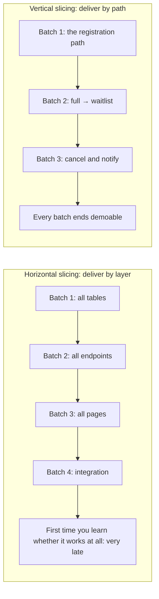
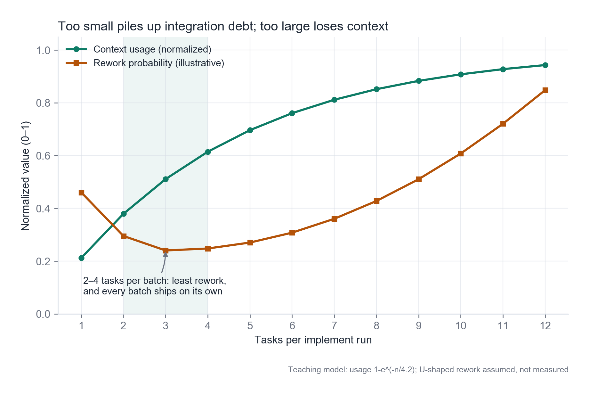
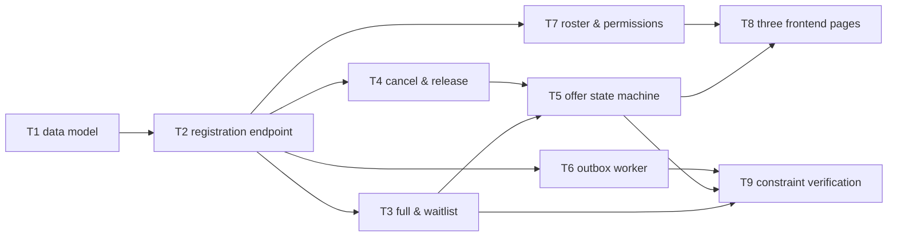
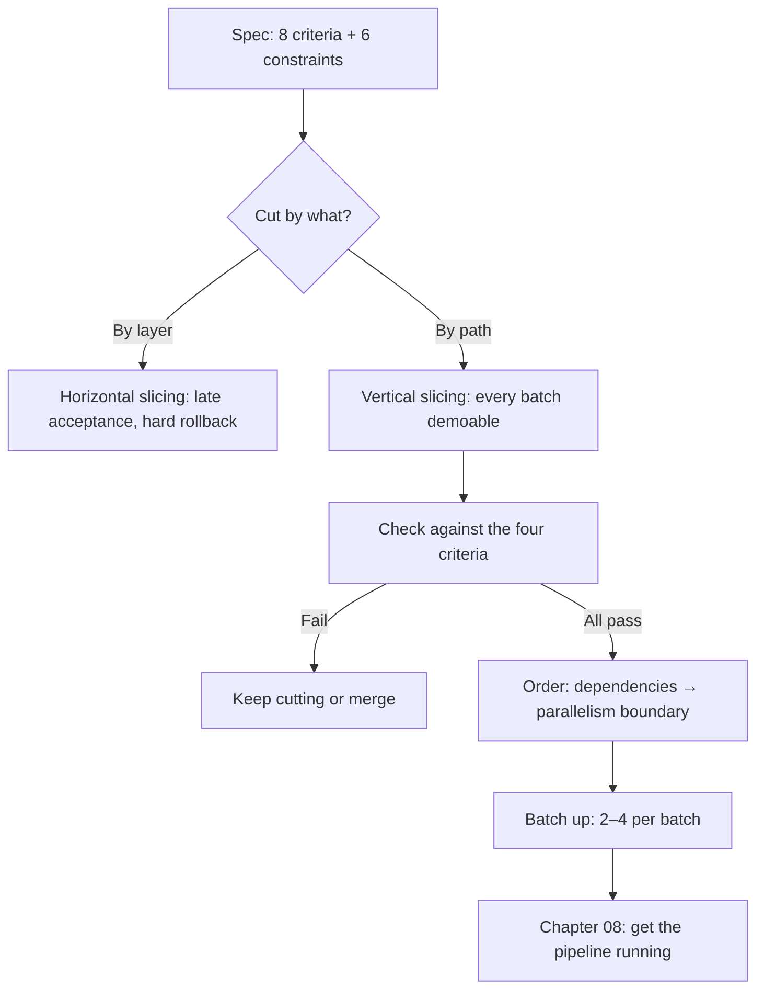

**English** | [中文](./ch07-task-slicing.zh.md)

# Chapter 07: Task Atomization - Vertical Slices and Review Units

> **Chapter overview**: The spec is written; next comes "how much should the AI do at once". This chapter gives one hard standard: a task must be an **independently acceptable, independently reviewable-and-revertible review unit**. Slice it wrong and you get two illnesses: tasks so big they are never finished, and tasks so fragmented they cannot be reviewed.
> **Prerequisites**: Chapter 02 (the tasks layer), Chapter 06 (constraints).
> **Core learning objectives**:
> - Tell vertical slicing from horizontal slicing, and judge which one your current split is
> - Test whether a task is "atomic" with the four criteria
> - Order a set of specs by dependency and say which tasks can run in parallel

---

## 1. Cognitive Anchor: Three Months Without a Single Livable Room

### 1.1 A Typical Split

The specs are ready. The AI starts working. In week one it creates all the database tables (7 tables), defines 12 empty functions for the API, and scaffolds the front-end routes and pages. It looks very efficient: **every layer is 60% complete.**

At the end of week two you open the system and find: clicking "sign up" does nothing (because the API is empty), clicking "list" shows a blank page (because the front end gets no data), and not one path works end to end. You want to accept it, but there is nothing to accept; you want to demo it, but there is nothing to demo; you want to roll back, and you do not even know which part to roll back.

This is **horizontal slicing**: cutting by technical layer, doing a segment of each layer. Its problem is not slowness; it is that **you learn "does it work at all" for the first time very late**.

### 1.2 Intuitive Analogy: Pizza and Mille-Crepes Cake

A vertical slice is like cutting a pizza: every piece has crust, sauce, cheese - **one piece alone is edible**.
A horizontal slice is like cutting a mille-crepes cake into layers: a pile of crepe skins, a pile of cream, a pile of fruit - **no single pile is edible**.

In software, an "edible slice of pizza" is: page click -> API -> database -> response -> page display, **one complete but very narrow path**.

---

## 2. First Principles: What "Atomic" Means

### 2.1 The Four Criteria

Whether a task is atomic is tested with four criteria, and it counts only if it passes all four:

| Criterion | How to ask | What failing looks like |
|---|---|---|
| **Independently acceptable** | Once this is done, can you say in one sentence "what counts as passing"? | "Implemented the sign-up feature" - untestable |
| **Independently revertible** | If this one goes wrong, can it be removed without affecting what is done? | Changed 7 tables; cannot be removed |
| **Depends on nothing unfinished** | Is everything it depends on already done? | "Test it when the front end is ready" |
| **Blast radius describable** | Can you roughly list which files/modules it will touch? | "It will change quite a few places" |

The fourth is not fastidiousness. **If the blast radius cannot be stated, you have not yet thought through what this task does** - and that is exactly where the AI is most likely to freelance.

### 2.2 The Size of a Review Unit

One task = one commit = one review. This equation decides the size:

- **Too small**: renaming a field also takes a full review round -> review cost exceeds the value of the change, and people start skipping reviews.
- **Too large**: a 1200-line diff at once -> the review becomes "looks fine to me", which equals no review.

Rule-of-thumb range: **100-400 lines of effective change per commit, covering the main logic of 1-3 files**. Beyond that, slice first; below 50 lines with no independent behavior, merge into a neighboring task.

### 2.3 Batch Size and the Context Budget

A task is a "review unit"; a batch is a "unit of one implement run". The two are not the same thing: one batch can hold 2-4 tasks.

Why batch at all? Two opposing forces pull:

- **Batches too small**: context must be reloaded every time, and integration debt accumulates (a merge after every batch).
- **Batches too large**: the context blows up, and the model starts forgetting earlier decisions (the context collapse of Chapter 1).

*Figure 7-1：Green is context usage (rising with task count and saturating); orange is rework probability (U-shaped: too small accumulates integration debt, too large loses context). The shaded band 2-4 is the practical range. Note this is a teaching model, not a measured curve - your own optimal range must be found with Chapter 9's metrics.*

---

## 3. Hands-on Walkthrough: Nine Tasks

### 3.1 From Specs to Tasks

Cut the specs from Chapters 3-6 (8 criteria + 6 constraints) into nine tasks. Each task carries: goal, acceptance method, dependencies, blast radius.

| ID | Task | Acceptance method | Dependencies | Blast radius |
|---|---|---|---|---|
| T1 | Data model and migrations: events, sign-ups, waitlist, idempotency keys, outbox | Migrations run forward and roll back; 5 table structures match the contract | none | `migrations/`, `models/` |
| T2 | Sign-up endpoint: real-name validation + idempotency + writes | No key returns 400; replaying the same key 50 times yields only 1 record | T1 | `api/registrations`, `services/idempotency` |
| T3 | Full-check and waitlist enqueue (with queue positions) | Person 24 confirmed, person 25 waiting with position 1 | T1, T2 | `services/capacity`, `services/waitlist` |
| T4 | Cancel endpoint: slot to reserved + emit invite event | After cancel, occupancy -1, exactly 1 invite record | T1, T2 | `api/registrations`, `services/release` |
| T5 | offer state machine and 15-minute expiry scan | Construct an offer from 16 minutes ago; after scanning it becomes expired and passes on | T3, T4 | `services/offer`, `jobs/expire` |
| T6 | outbox worker: delivery + exponential backoff + dedup | Disconnect notifications for 2 minutes; after recovery resends within 5 minutes with no duplicates | T1, T2 | `jobs/outbox`, `adapters/sms` |
| T7 | List endpoint: permissions + masking + audit | Logged out 401, others 403, list masked, details audited | T1, T2 | `api/list`, `middleware/auth` |
| T8 | Three front-end pages: sign-up / waitlist status / list | Three main paths clickable end to end; the waitlist page shows live positions | T2, T3, T7 | `web/pages`, `web/api` |
| T9 | Constraint verification: load tests + fault injection | Forensics on all six constraints C1-C6, one by one | T3-T7 | `tests/load`, `tests/chaos` |

### 3.2 Dependency Order and Parallelism

**The two groups that can run in parallel**:

- **T3 / T4 / T6 / T7 can run in parallel** (each depends only on T1 and T2, and none of them touch the same batch of files). This is the boundary at which four separate people (or four agents) can start at once.
- **T5 and T8 cannot run in parallel**: T8's waitlist page shows the offer countdown, which depends on T5's state machine.

**T9 must come last**, but it is not optional. It is the forensics on Chapter 6's six constraints - without it, the constraints are only words on paper.

### 3.3 Split into Four Batches

| Batch | Contains | Why split this way |
|---|---|---|
| Batch 1 | T1, T2 | Infrastructure + one narrowest end-to-end path (you can sign up). At the end of batch 1 you should be able to demo "sign-up succeeded" |
| Batch 2 | T3, T4, T6 | Three mutually independent business paths; combined blast radius still manageable |
| Batch 3 | T5, T7 | State machine and permissions, each needing its own design; not suited to mixing with others |
| Batch 4 | T8, T9 | Front-end integration + constraint forensics |

**At the end of every batch there must be "something you can demo".** This is the core benefit of vertical slicing: you do not have to wait until the end to find out whether it is right.

---

## 4. Common Pitfalls: Wrong vs. Right

| Common pitfall | Why it goes wrong | The right approach |
|---|---|---|
| **Slicing by technical layer** | It looks tidy and matches intuition | Slice by end-to-end path; one segment per layer means nobody can use anything |
| **Tasks written as "implement feature X"** | The granularity reads like a requirement, not a task | A task must map to "one observable behavior" |
| **Slicing too fine** | Chasing "small steps", forgetting review cost | 100-400 lines per commit; below 50 lines with no independent behavior, merge |
| **Tasks without acceptance methods** | Feeling acceptance is testing's job | Every task carries "what counts as passing", or completion cannot be judged |
| **Ordering by "what feels easy"** | Wanting easy wins first for confidence | Order by dependency; do the minimal set that "gets one path through" first |
| **Cramming 8 tasks into one implement run** | Wanting to finish faster | 2-4 per batch; more and the context is lost (Figure 7-1) |
| **Treating "integration testing" as a task** | Integration is an outcome, not a task | Integration failing means the earlier slicing was wrong; go back and re-slice |

---

## 5. Chapter Summary and Local Knowledge Map

### 5.1 Three Takeaways

- **Vertical slice = every piece is edible**: one narrow but complete path beats seven layers at 60% each.
- **The four criteria**: independently acceptable, independently revertible, depends on nothing unfinished, blast radius describable.
- **Tasks and batches are two things**: a task is the review unit (1); a batch is the execution unit (2-4).

### 5.2 This Chapter's Concept Topology

---

## 6. Tiered Exercises

### Tier 1: Intuition Check

1. Why does "slicing by technical layer" always lose out at the demo stage? Say it in one sentence.
2. A task changed 900 lines across 12 files, but "did only one thing". Is it an atomic task? Which criterion decides?

### Tier 2: Hands-on Application

3. Slice T2 (the sign-up endpoint) further into two tasks, each independently acceptable, and explain the basis for the split.

### Tier 3: Boundaries & Transfer

4. Someone says: "Higher parallelism means higher efficiency." Use the parallel group T3/T4/T6/T7 to explain the **hidden costs** of parallelism, and when you should give up parallelism for serial execution.

<strong>Click to expand: reference answers and in-depth analysis for this chapter's exercises</strong>

#### 1. Why slicing by layer loses at the demo

- **Conclusion**: because a demo needs "one complete path", and slicing by layer leaves no complete path at any intermediate moment.
- **Mechanism**: 60% completion in each layer cannot be summed into "usable". Usability is a property of a chain, not the average of per-layer properties.

#### 2. Is 900 lines / 12 files atomic

- **Conclusion**: No. It violates two criteria: "blast radius describable" and "review unit size".
- **Reasoning**: "did only one thing" is atomic in narrative, not atomic in review. Facing a 900-line diff, the reviewer can only spot-check, which equals no review.
- **Fix**: slice further by "independently acceptable behaviors", even when they serve the same feature.

#### 3. Slicing T2 twice more

| Subtask | Content | Acceptance |
|---|---|---|
| T2a | Real-name validation + basic writes (no idempotency) | Missing name or phone returns 422; a normal submit gets 201 and the record is persisted |
| T2b | Idempotency layer: key validation, storage, replay response | No key returns 400; replaying the same key 50 times yields 1 record with identical responses |

- **Basis for the split**: T2a is "behaviorally correct"; T2b is "still correct in the worst case". They can be accepted separately, and T2a remains valid when T2b fails - satisfying "independently revertible".

#### 4. The hidden costs of parallelism

- **Cost one: merge conflicts**. If all four tasks touch `api/registrations`, merging will conflict; conflict resolution quality is far below writing code.
- **Cost two: contract drift**. T3 and T7 may understand "sign-up status enum" differently (one uses `waiting`, the other `pending`), and it is only discovered at T8.
- **Cost three: review bandwidth**. Four PRs arriving at once means the reviewer can only skim, which is giving up the review.
- **Cost four: failure attribution**. When a bug appears in a parallel batch, time is spent deciding which task introduced it.
- **When to switch to serial**: (1) tasks share the same batch of files; (2) tasks have implicit contracts (enums, state machines, error codes); (3) review bandwidth is insufficient; (4) the team is still unfamiliar with this code (the first two batches are better run serially; parallelize once it runs smoothly).

---

## 7. Authoritative References and Further Reading for This Chapter (Authoritative References)

1. **martinfowler.com**: [martinfowler.com](https://martinfowler.com/) - The definitions and conventions of this chapter are anchored here (verified on: `2026-10-23`).
2. **GitHub Spec Kit**: [GitHub Spec Kit](https://github.com/github/spec-kit) - The definitions and conventions of this chapter are anchored here (verified on: `2026-10-23`).
3. **DORA**: [DORA](https://dora.dev/) - The definitions and conventions of this chapter are anchored here (verified on: `2026-10-23`).

> A note on scope: the sources above anchor **definitions and conventions**, not extrapolated risk probabilities. Before citing any number, check its source year and denominator first.
