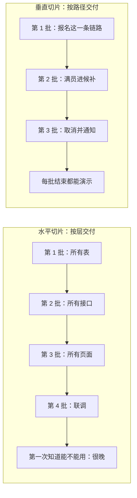
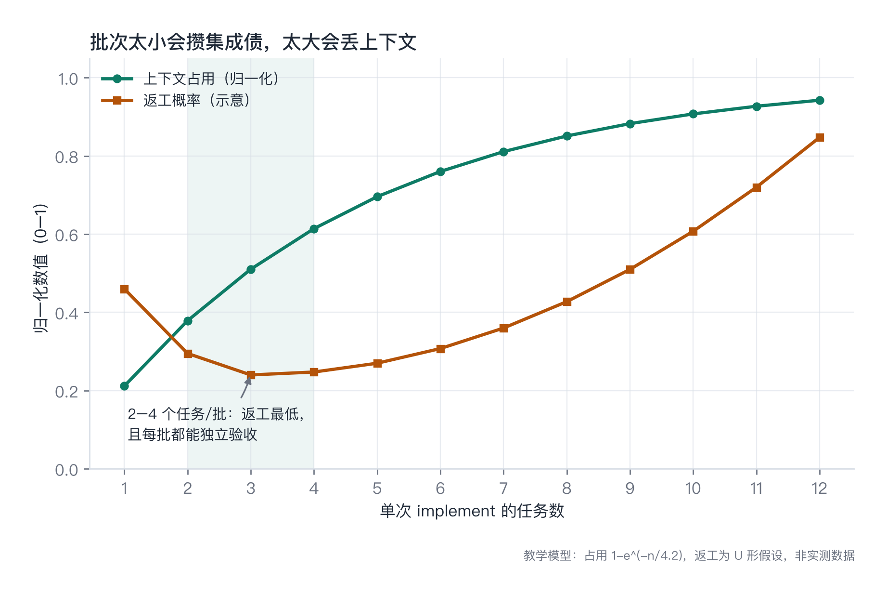
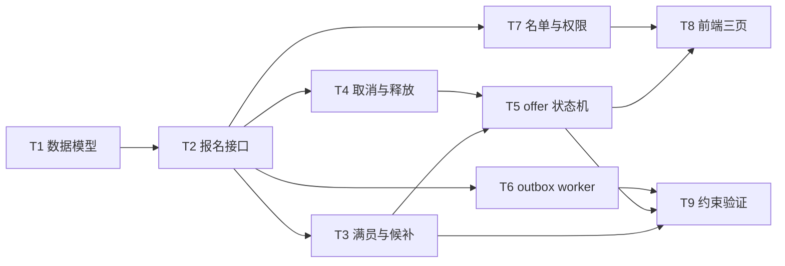
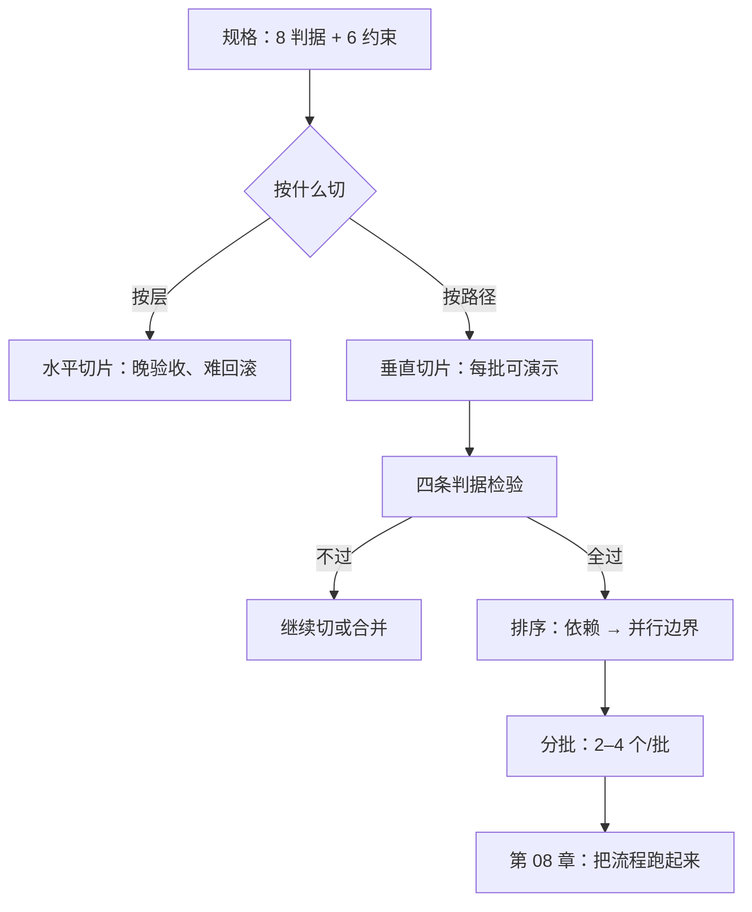

# 第 07 章：任务原子化——垂直切片与评审单元

> **本章导读**：规格写好了，接下来是"一次让 AI 做多少"。本章给出一条硬标准：一个任务必须是一个**可独立验收、可独立回滚的评审单元**。切错了，你会得到两种病：一种是永远做不完的大任务，一种是碎到无法评审的小任务。
> **前置知识**：第 02 章（tasks 层）、第 06 章（约束）。
> **核心学习目标**：
> - 说清垂直切片与水平切片的差别，并能判断手上的拆法是哪一种
> - 用四条判据检验一个任务是否"原子"
> - 能为一组规格排出依赖顺序，并说明哪些任务可并行

---

## 1. 认知锚点：三个月看不见一间能住的房

### 1.1 一个典型的拆法

规格齐了。AI 开始干活。第一周，它把数据库表全建好了（7 张表），接口定义了 12 个空函数，前端路由和页面骨架也搭好了。看起来很高效：**每一层都完成了 60%。**

第二周结束，你打开系统，发现：点"报名"没反应（因为接口是空的），点"名单"白屏（因为前端拿不到数据），没有任何一条路径能走通。你想验收，验收不了；你想演示，演示不了；你想回滚，也不知道该回滚哪一部分。

这就是**水平切片**：按技术层切，每层各做一段。它的问题不是慢，是**在很晚的时候才第一次知道"能不能用"**。

### 1.2 直觉类比：披萨与千层蛋糕

垂直切片像切披萨：每一块都有饼底、酱、芝士——**单拿一块就能吃**。
水平切片像切千层蛋糕的层：饼皮一堆、奶油一堆、水果一堆——**单独哪一堆都不能吃**。

软件里，一块"能吃的披萨"是：从页面点击 → 接口 → 数据库 → 返回 → 页面显示，**一条完整但很窄的路径**。

---

## 2. 第一性原理：什么是"原子"

### 2.1 四条判据

一个任务是否原子，用四条判据检验，四条全过才算：

| 判据 | 问法 | 不过的表现 |
|---|---|---|
| **能独立验收** | 做完这一条，能不能用一句话说"怎么算过了"？ | "实现了报名功能"——验不了 |
| **能独立回滚** | 这一条出问题，能不能撤掉而不影响已完成的？ | 改了 7 张表，撤不掉 |
| **不依赖未完成的任务** | 它依赖的东西是不是都已完成？ | "等前端好了再测" |
| **改动面可描述** | 能不能列出它大概会碰哪些文件/模块？ | "会改挺多地方的" |

第四条不是洁癖。**改动面说不清，说明你还没想清这个任务要做什么**——而这正是 AI 最容易自由发挥的地方。

### 2.2 评审单元的尺寸

一个任务 = 一次提交 = 一次评审。这个等式决定了尺寸：

- **太小**：改一个字段名也要走一轮评审 → 评审成本超过改动价值，人会开始跳过评审。
- **太大**：一次 1200 行 diff → 评审变成"看起来没问题"，等于没评审。

经验区间：**一次提交 100–400 行有效改动，对应 1–3 个文件的主逻辑**。超过这个范围，先切；低于 50 行且无独立行为，合并到相邻任务。

### 2.3 批次大小与上下文预算

任务是"评审单位"，批次是"一次 implement 的单位"。两者不是一回事：一个批次可以包含 2–4 个任务。

为什么要分批？两个相反的力在拉扯：

- **批次太小**：每次都要重新载入上下文，集成债累积（每批结束都要合一次）。
- **批次太大**：上下文被撑爆，模型开始遗忘前面的决定（第 1 章的上下文坍缩）。

*图 7-2：绿色是上下文占用（随任务数上升并趋于饱和），橙色是返工概率（U 形：太小攒集成债，太大丢上下文）。阴影区 2–4 是实践区间。注意这是教学模型，不是实测曲线——你自己的最优区间要靠第 9 章的度量找。*

---

## 3. 手把手推演：九个任务

### 3.1 从规格到任务

把第 3–6 章的规格（8 条判据 + 6 条约束）切成九个任务。每个任务都带：目标、验收方式、依赖、涉及范围。

| ID | 任务 | 验收方式 | 依赖 | 涉及范围 |
|---|---|---|---|---|
| T1 | 数据模型与迁移：活动、报名、候补、幂等键、outbox | 迁移可正向执行与回滚；5 张表结构符合契约 | 无 | `migrations/`、`models/` |
| T2 | 报名接口：实名校验 + 幂等 + 写库 | 无 key 返回 400；同 key 重放 50 次只得 1 条记录 | T1 | `api/registrations`、`services/idempotency` |
| T3 | 满员判定与候补入队（含序号） | 第 24 人 confirmed、第 25 人 waiting 序号 1 | T1、T2 | `services/capacity`、`services/waitlist` |
| T4 | 取消接口：名额置 reserved + 产生邀请事件 | 取消后占用数 -1，邀请记录 1 条 | T1、T2 | `api/registrations`、`services/release` |
| T5 | offer 状态机与 15 分钟过期扫描 | 构造 16 分钟前的 offer，扫描后置 expired 并顺延 | T3、T4 | `services/offer`、`jobs/expire` |
| T6 | outbox worker：投递 + 指数退避 + 去重 | 断开通知服务 2 分钟，恢复后 5 分钟内补发且不重复 | T1、T2 | `jobs/outbox`、`adapters/sms` |
| T7 | 名单接口：权限 + 脱敏 + 审计 | 未登录 401、他人 403、列表脱敏、详情留痕 | T1、T2 | `api/list`、`middleware/auth` |
| T8 | 前端三页：报名 / 候补状态 / 名单 | 三条主路径可点通；候补页显示实时序号 | T2、T3、T7 | `web/pages`、`web/api` |
| T9 | 约束验证：压测 + 故障注入 | C1–C6 六条约束逐条取证 | T3–T7 | `tests/load`、`tests/chaos` |

### 3.2 依赖顺序与并行

**可并行的两组**：

- **T3 / T4 / T6 / T7 可并行**（都只依赖 T1、T2，互相不碰同一批文件）。这是四个独立的人（或四个 agent）能同时开工的边界。
- **T5 与 T8 不能并行**：T8 的候补页要显示 offer 倒计时，依赖 T5 的状态机。

**T9 必须最后**，但它不是"可选项"。它是对第 6 章六条约束的取证——没有它，约束只是写在纸上。

### 3.3 分成四个批次

| 批次 | 包含 | 为什么这样分 |
|---|---|---|
| 批 1 | T1、T2 | 基础设施 + 一条最窄的端到端路径（能报名）。批 1 结束时应当能演示"报名成功" |
| 批 2 | T3、T4、T6 | 三条互相独立的业务路径，合计改动面仍在可控范围 |
| 批 3 | T5、T7 | 状态机与权限，都需要单独设计，不适合和别的混在一起 |
| 批 4 | T8、T9 | 前端整合 + 约束取证 |

**每批结束时都要有一个"能演示的东西"。** 这是垂直切片的核心收益：你不需要等到最后才知道对不对。

---

## 4. 常见误区与正反例对比

| 容易踩的坑 | 为什么会出错 | 正确做法 |
|---|---|---|
| **按技术层切** | 看起来整齐，符合直觉 | 按端到端路径切；一层只做一段等于谁都不能用 |
| **任务写成"实现 X 功能"** | 粒度像需求，不像任务 | 任务要能对应"一条可观测的行为" |
| **切得太碎** | 追求"小步"，忘掉评审成本 | 一次提交 100–400 行；低于 50 行且无独立行为就合并 |
| **任务没有验收方式** | 觉得验收是测试的事 | 每条任务自带"怎么算过"，否则无法判断完成 |
| **顺序按"我觉得简单"排** | 想先做容易的建立信心 | 按依赖排；先做"能打通一条链路"的最小集合 |
| **一次 implement 塞 8 个任务** | 想快点做完 | 2–4 个/批；超出就丢上下文（图 7-2） |
| **把"联调"当成一个任务** | 联调是结果，不是任务 | 联调失败说明前面切错了，回去重切 |

---

## 5. 本章小结与局部知识图谱

### 5.1 三句话带走

- **垂直切片 = 每块都能吃**：一条窄但完整的路径，胜过七层各 60%。
- **四条判据**：能独立验收、能独立回滚、不依赖未完成、改动面可描述。
- **任务与批次是两件事**：任务是评审单位（1 个），批次是执行单位（2–4 个）。

### 5.2 本章概念拓扑

---

## 6. 分级通关练习

### Tier 1：直觉核验

1. 为什么"按技术层切"在演示环节一定吃亏？用一句话说清。
2. 一个任务改动了 900 行、涉及 12 个文件，但"只做了一件事"。它算不算原子任务？依据是哪条判据？

### Tier 2：动手应用

3. 把 T2（报名接口）再切成两个任务，要求每个都能独立验收，并说明切分依据。

### Tier 3：边界与迁移

4. 有人说："并行度高就是效率高。"请用 T3/T4/T6/T7 这组并行任务，说明并行带来的**隐性成本**，以及什么情况下应该放弃并行、改串行。

<strong>点击展开：本章练习参考答案与深度解析</strong>

#### 1. 为什么按层切在演示时吃亏

- **结论**：因为演示需要"一条完整路径"，而按层切在任何中间时刻都不存在完整路径。
- **机制**：每层 60% 的完成度无法相加成"可用"。可用性是一条链路的属性，不是各层属性的平均。

#### 2. 900 行 / 12 文件算不算原子

- **结论**：不算。违反了"改动面可描述"和"评审单元尺寸"两条。
- **理由**："只做了一件事"是叙事上的原子，不是评审上的原子。评审者面对 900 行 diff，只能抽查，等于没评审。
- **改法**：按"可独立验收的行为"再切，即使它们服务于同一个功能。

#### 3. T2 再切两刀

| 子任务 | 内容 | 验收 |
|---|---|---|
| T2a | 实名校验 + 基础写库（无幂等） | 缺姓名或缺手机号返回 422；正常提交得 201 且记录落库 |
| T2b | 幂等层：key 校验、存储、重放返回 | 无 key 返回 400；同 key 重放 50 次只得 1 条且响应一致 |

- **切分依据**：T2a 是"行为正确"，T2b 是"最坏情况下仍正确"。两者可以分别验收，且 T2b 失败时 T2a 仍然有效——满足"能独立回滚"。

#### 4. 并行的隐性成本

- **成本一：合并冲突**。四个任务如果都碰 `api/registrations`，合并时必然冲突；冲突解决的质量远低于写代码。
- **成本二：契约漂移**。T3 与 T7 对"报名状态枚举"的理解可能不同（一个用 `waiting`，一个用 `pending`），到 T8 才发现。
- **成本三：评审带宽**。四个 PR 同时到，评审者只能快速扫，等于放弃了评审。
- **成本四：失败归因**。并行批里出现 bug，要花时间判断是哪个任务引入的。
- **什么时候改串行**：① 任务间共享同一批文件；② 任务间有隐含契约（枚举、状态机、错误码）；③ 评审带宽不足；④ 团队对这块代码还不熟（前两个批次建议串行，跑顺了再并行）。

---

## 7. 本章权威参考信源与延伸阅读 (Authoritative References)

1. **martinfowler.com**：[martinfowler.com](https://martinfowler.com/) - 本章的定义与规范以此为锚（核验日期：`2026-10-23`）。
2. **GitHub Spec Kit**：[GitHub Spec Kit](https://github.com/github/spec-kit) - 本章的定义与规范以此为锚（核验日期：`2026-10-23`）。
3. **DORA**：[DORA](https://dora.dev/) - 本章的定义与规范以此为锚（核验日期：`2026-10-23`）。

> 口径提示：以上信源用于锚定**定义与规范**，不用于外推风险概率。引用任何数字前，先核对来源年份与分母。
