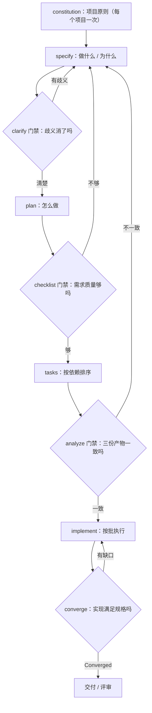
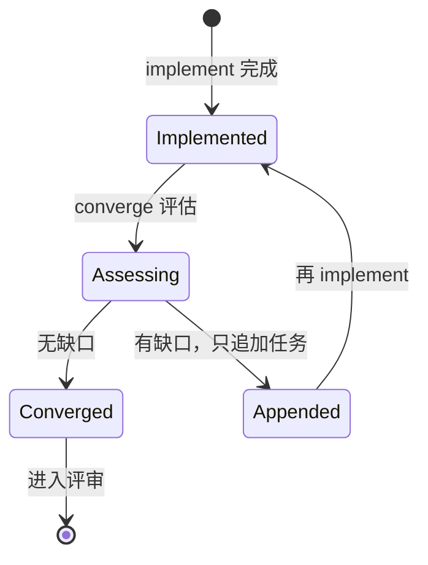
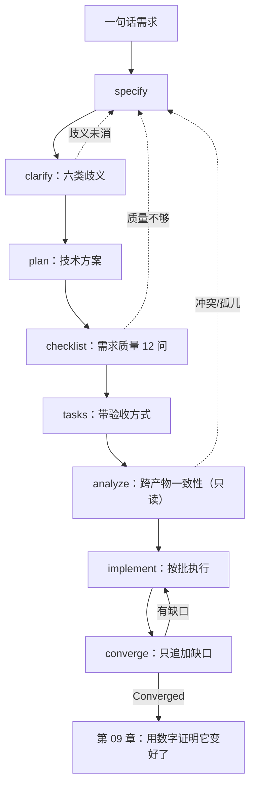

# 第 08 章：四段流水与三道门禁

> **本章导读**：前七章是零件，本章把它们装成一台机器。你会看到一条完整流水：规格 → 计划 → 任务 → 实现 → 收敛，中间有三道可选门禁，以及"发现问题该退回哪一步"的规则。同时给出一个不装任何工具、20 分钟能搭起来的最小手工版。
> **前置知识**：第 02 章（三层）、第 07 章（任务切片）。
> **核心学习目标**：
> - 说清四段流水每一步的输入输出，以及越界后的回退方向
> - 掌握三道门禁各自检查什么、什么时候可以跳过
> - 能搭一套最小手工版，并知道它与工具版的差别在哪

---

## 1. 认知锚点：安检不是不信任你

### 1.1 一个反复出现的争论

每次提"加个流程"，都会有人说："这是不信任工程师。"

有意思的是，同一批人对机场安检没有意见——没人觉得安检是"不信任乘客"。因为安检的逻辑不是"怀疑你是坏人"，而是**把"该不该放行"从个人判断变成可复核的流程**：谁都能过，但必须过同一道门。

软件里的门禁也一样。它不是"不信任 AI"，是**把"这个规格够不够清楚"从"我觉得可以了"变成"清单上每一条都勾上了"**。

### 1.2 类比的局限

安检也会形式化：人站在机器前，包放上去，眼睛看手机——门过了，东西没查。流程的门禁有同样的病：**跑完命令 ≠ 通过检查**。

这个病在第 10 章会作为一种反模式单列（"清单自我批准"）。这里先记住一句：**门禁的价值在"检查动作"，不在"命令执行"。**

---

## 2. 第一性原理：四段流水

### 2.1 流水线的形状



**四段是主路径**：specify（What）→ plan（How）→ tasks（Order）→ implement（Do）。
**converge 是回路**，不是第五段——它检查"实现是否满足前三份产物"，并只往 `tasks.md` 追加缺口任务，不改代码、不改规格。

### 2.2 Spec Kit v1.0 的命令族

以下基于 GitHub Spec Kit 官方 README（v1.0，2026 年 8 月发布）。**注意命令前缀**：v1.0 起在 agent 里以技能形式调用，写作 `/speckit-specify`（连字符）；旧版本文档里常见的 `/speckit.specify`（点号）是历史写法。以你本地 `specify init` 生成的提示文件为准。

| 命令 | 作用 | 产物 | 是否必跑 |
|---|---|---|---|
| `/speckit-constitution` | 建立项目原则（质量、测试、可维护性等） | `.specify/memory/constitution.md` | 每个项目一次 |
| `/speckit-specify` | 从自然语言描述生成功能规格 | `specs/<feature>/spec.md` | 必跑 |
| `/speckit-clarify` | 针对规格中的不明确处提问（默认最多 5 个），把答案回写规格 | 更新 `spec.md` | 有歧义时 |
| `/speckit-plan` | 基于规格生成技术实现计划与设计产物 | `plan.md`、`research.md`、`data-model.md`、`contracts/` | 必跑 |
| `/speckit-checklist` | 生成"需求质量清单"（需求的单元测试） | `checklists/` 下的清单 | 高风险功能建议跑 |
| `/speckit-tasks` | 把计划拆成按依赖排序的任务 | `tasks.md` | 必跑 |
| `/speckit-analyze` | **只读**的跨产物一致性分析（spec/plan/tasks 的冲突、缺口、歧义） | 报告（不改文件） | 实现前建议跑 |
| `/speckit-implement` | 按 `tasks.md` 顺序执行 | 代码 | 必跑 |
| `/speckit-converge` | 对照 spec/plan/tasks 评估代码，缺口**只追加**到 `tasks.md` | 更新 `tasks.md` | 每轮实现后 |

**初始化**（终端执行，不是在 agent 里）：

```bash
uv tool install specify-cli
specify init my-project --integration copilot
```

`--integration` 换成你用的编码代理对应的 key。初始化会生成命令模板与脚本目录，之后所有 `/speckit-*` 都在 agent 的聊天里逐个调用。

### 2.3 三道门禁检查什么

| 门禁 | 时机 | 检查对象 | 通过的判据 | 不通过怎么办 |
|---|---|---|---|---|
| **clarify** | plan 之前 | 规格的歧义 | 六类歧义（第 5 章）都有明确裁决 | 回到 specify 改规格，不要"先规划再说" |
| **checklist** | tasks 之前 | 需求本身的质量 | 完整、清晰、无矛盾、可验证（相当于"用自然语言写的单元测试"） | 回到 specify / clarify 收紧 |
| **analyze** | implement 之前 | 三份产物的一致性 | 无冲突、无缺口、无孤儿需求 | 按问题归属回退（见下表） |

**回退规则**——这是流水线里最容易做错的地方：

| 问题归属 | 回退到 | 不要做什么 |
|---|---|---|
| 需求本身错/缺 | `/speckit-specify` 或 `clarify` | 不要在 plan 里"顺手补需求" |
| 技术方案不可行 | `/speckit-plan` | 不要偷偷降低判据 |
| 任务漏项/顺序错 | `/speckit-tasks` | 不要在执行时"顺便加一条" |
| 实现与规格不符 | `/speckit-implement` | 不要改规格去迁就实现 |

最后一行是底线。**改规格迁就实现，是规格腐烂的第一种方式**（第 10 章详述）。

### 2.4 converge：唯一允许"循环"的地方



三条规则，缺一条就会跑偏：

1. **只追加，不改**：`converge` 不动代码、不改 spec/plan，只往 `tasks.md` 末尾追加"缺口任务"。这样每一轮都有审计痕迹。
2. **有终止条件**：报告 `Converged` 才停。不是"跑两轮差不多了"。
3. **缺口应递减**：如果第二轮缺口比第一轮多，说明规格本身有问题，停下来回 specify，而不是继续循环。

### 2.5 OpenSpec：轻量对照

Spec Kit 是"重流程"：九条命令、五个产物目录。对一次性的小改动，这套装备太重。OpenSpec 一类的轻量方案走的是另一条路：**以变更包为单位**——提议（propose）→ 应用（apply）→ 归档（archive）。

| 维度 | Spec Kit | 轻量变更包（如 OpenSpec） |
|---|---|---|
| 单位 | 功能（feature） | 变更（change） |
| 产物 | spec / plan / tasks / checklists | 一份提案 + 一份任务清单 |
| 适合 | 新功能、跨多文件、要长期维护 | 已有系统上的小改动、单点修复 |
| 代价 | 启动成本高 | 容易退化成"写个说明就开干" |

**选择判据不是"哪个更先进"，而是"这次改动的寿命"**：改动要活过三个月，用重流程；活不过一周，用轻流程或干脆不写（第 10 章会讲"什么时候不该写规格"）。

### 2.6 最小手工版：三个文件加一张清单

不装任何工具也能跑。目录结构：

```text
specs/
└── waitlist/
    ├── spec.md          # 七段式（第 2 章）
    ├── plan.md          # 技术方案 + 风险
    ├── tasks.md         # 带验收方式的任务表
    └── checklist.md     # 需求质量清单（自己写 12 条）
```

`checklist.md` 的内容就是 12 个问句，每条只能答"是/否"：

```markdown
- [ ] 每条判据都有可观测的出口（接口字段 / 页面元素 / 数据状态）吗？
- [ ] 每条判据都有量化值或枚举吗？
- [ ] 每条核心判据都配了失败路径吗？
- [ ] 六类歧义（指代/范围/边界/例外/时序/权限）都扫过了吗？
- [ ] 六类约束（幂等/并发/超时重试/权限/性能/降级）都有条款吗？
- [ ] Non-goals 至少写了三条，且都是可判定的缺失吗？
- [ ] 每条任务都有"怎么算过"吗？
- [ ] 任务之间的依赖有环吗？
- [ ] spec 里出现了框架名、表名、函数名吗？（有就是越界）
- [ ] plan 里出现了新需求吗？（有就是越界）
- [ ] 判据之间有不一致吗？（例如两处对"满员"的定义不同）
- [ ] 有没有"待定"的地方被悄悄按默认值执行了？
```

**这 12 条就是三道门禁的手工实现。** 它比命令慢，但它有一个工具给不了的好处：**每一条都要你亲眼看一遍。**

---

## 3. 手把手推演：同一需求，跑两遍

### 3.1 实验设计

用第 7 章的九个任务，分别用"最小手工版"和"Spec Kit"各跑一轮。同一模型、同一需求、记录四个指标。

| 指标 | 手工版 | Spec Kit 版 | 差异原因 |
|---|---|---|---|
| 前置准备时间 | 25 分钟 | 60 分钟（安装 + 初始化 + 熟悉命令） | 工具的学习成本是真实的 |
| 产物文件数 | 4 | 9（含 research / data-model / contracts / checklists） | 工具会生成它认为必要的中间产物 |
| **发现的问题数** | 6 | 11 | 多出来的 5 个来自 `analyze` 与 `checklist`——它们会主动找矛盾 |
| 首轮实现后返工 | 3 个任务 | 1 个任务 | 前置检查把缺陷推到了左侧 |

### 3.2 那 5 个"多出来的问题"长什么样

这是本节的重点：工具版多发现的问题，都不是"功能没写"，而是**跨产物的一致性缺口**：

| # | analyze / checklist 发现 | 手工版为什么漏了 |
|---|---|---|
| 1 | `spec` 写"60 秒内邀请"，`plan` 写"定时任务每 30 秒扫一次"，两者在边界上冲突 | 两份文件分开看都对，放一起才冲突 |
| 2 | `tasks` 缺失"过期扫描"任务，但 plan 里有这个机制 | 拆任务时漏抄 |
| 3 | 有一条判据没有对应任务（孤儿需求） | 没人做"判据 → 任务"的覆盖检查 |
| 4 | `spec` 的 Non-goals 写了"不做导出"，`plan` 的接口设计里却有 `GET /export` | 两份产物由不同轮次生成 |
| 5 | 权限判据只覆盖了列表，没覆盖详情 | 清单里"权限"只勾了一次 |

**共同的教训**：单份文件的质量，不能保证多份文件之间的一致性。**一致性只能靠一个专门的、只读的检查动作来保证**——这就是 `analyze` 存在的理由。

### 3.3 该选哪个

| 你的情况 | 建议 |
|---|---|
| 第一次做规格驱动，还没有肌肉记忆 | 手工版。12 条清单比九条命令更能建立直觉 |
| 功能跨 3 个以上模块、要维护半年 | Spec Kit。跨产物一致性检查的收益在这里最大 |
| 只改一个小接口 | 都不要。写三行判据，直接做 |
| 团队多人协作、要交接 | Spec Kit。产物的目录约定本身就是交接协议 |

---

## 4. 常见误区与正反例对比

| 容易踩的坑 | 为什么会出错 | 正确做法 |
|---|---|---|
| **把跑完命令当成通过门禁** | 命令有输出，感觉就完成了 | 门禁的判据是"清单每条都能答是"，不是"命令返回 0" |
| **跳过 constitution** | 觉得项目原则是空话 | 第三个功能时你会发现同样的评审意见在重复——那就是 constitution 该写的内容 |
| **analyze 发现问题却不修就 implement** | 想先把功能做出来 | 带着已知矛盾实现，等于把矛盾写进代码 |
| **清单自己勾** | 实现者最清楚细节 | 需求质量清单归评审者所有；实现者不得自我批准 |
| **converge 当成"再实现一遍"** | 名字像"合并" | 它是只读评估 + 只追加任务；有缺口才回到 implement |
| **没有工具就不会写规格** | 把方法绑在工具上 | 手工版 12 条清单就是方法本身 |
| **所有改动都上重流程** | 一把锤子看什么都是钉子 | 按"改动的寿命"选流程（2.5 节） |

---

## 5. 本章小结与局部知识图谱

### 5.1 三句话带走

- **四段是主路径，converge 是回路**：spec → plan → tasks → implement，实现后回到"是否满足规格"。
- **三道门禁各有归属**：clarify 管歧义，checklist 管需求质量，analyze 管跨产物一致性。**一致性只能靠专门检查**。
- **门禁的价值在检查动作**，不在命令执行；手工版 12 条清单同样成立。

### 5.2 本章概念拓扑



---

## 6. 分级通关练习

### Tier 1：直觉核验

1. 为什么 `analyze` 被设计成**只读**？如果它可以直接改文件，会有什么风险？
2. `converge` 与 `implement` 都能改变系统状态，为什么只允许前者"循环"？

### Tier 2：动手应用

3. 用最小手工版，为你手上的一个小功能搭出四个文件（spec / plan / tasks / checklist），并逐条勾选 12 问。记录你勾不上的是哪几条。

### Tier 3：边界与迁移

4. 假设你的团队坚持"不装任何 AI 工具，只用聊天窗口"。请设计一套不依赖任何命令前缀的流程，并说明它相比 Spec Kit 少了哪一项保障、你打算怎么补。

<details>
<summary><strong>点击展开：本章练习参考答案与深度解析</strong></summary>

#### 1. 为什么 analyze 是只读的

- **结论**：因为它检查的是"三份产物之间的一致性"，一旦它能改文件，它就从"裁判"变成了"运动员"。
- **风险**：① 它可能为了让报告变干净而修改判据（降低标准）；② 修改后没有对照基线，无法判断改得对不对；③ 报告与改动混在一起，评审者分不清"哪里是问题、哪里是修复"。
- **设计原则**：**检查与修复分离**。这是所有质量门禁的共同结构（代码评审、静态分析、财务审计都一样）。

#### 2. 为什么只允许 converge 循环

- **结论**：因为 `converge` 的写操作是**受限且可审计**的（只往 `tasks.md` 追加），而 `implement` 的写操作是全量的（代码）。
- **推演**：无限循环的 `implement` 会产生大量无记录的改动，且每轮都可能推翻上一轮的实现；而 `converge` 的每次追加都留下一条"缺什么"的记录，天然形成收敛证据。
- **终止条件的意义**："Converged" 是一个**可判定的状态**，不是"我觉得差不多了"。没有可判定终止条件的循环，一定会停在某个随机时刻。

#### 3. 手工版实操要点

- **勾不上的通常是这三条**：失败路径（第 3 条）、六类约束（第 5 条）、"待定被默认执行"（第 12 条）。
- **发现即收益**：勾不上的地方就是这次最可能返工的地方。把它们写在 `checklist.md` 末尾，实现后逐条回填。

#### 4. 无工具流程

- **可用的替代**：把四个文件放在仓库里，用一个 `Makefile` 或 shell 脚本串起来：`make clarify`（打印六类歧义清单让你逐条填）、`make check`（跑 12 问的交互式勾选）、`make analyze`（人工对照三份文件的"判据 → 任务"映射表）。
- **少掉的保障**：少了"跨产物自动比对"——Spec Kit 的 `analyze` 会真正去比对文本，而人工对照会漏。
- **补法**：建一张**覆盖矩阵**（判据 × 任务），每次改动后手动过一遍。矩阵很小（8 条判据 × 9 个任务），五分钟能过完；它替代不了自动比对，但能挡住"孤儿需求"这类最致命的缺口。

</details>

---

## 7. 本章权威参考信源与延伸阅读 (Authoritative References)

1. **GitHub Spec Kit**：[GitHub Spec Kit](https://github.com/github/spec-kit) - 本章的定义与规范以此为锚（核验日期：`2026-10-23`）。
2. **GitHub Copilot Docs**：[GitHub Copilot Docs](https://docs.github.com/en/copilot) - 本章的定义与规范以此为锚（核验日期：`2026-10-23`）。
3. **Specification by Example（Adzic, 2011）**：[Specification by Example（Adzic, 2011）](https://www.manning.com/books/specification-by-example) - 本章的定义与规范以此为锚（核验日期：`2026-10-23`）。

> 口径提示：以上信源用于锚定**定义与规范**，不用于外推风险概率。引用任何数字前，先核对来源年份与分母。
