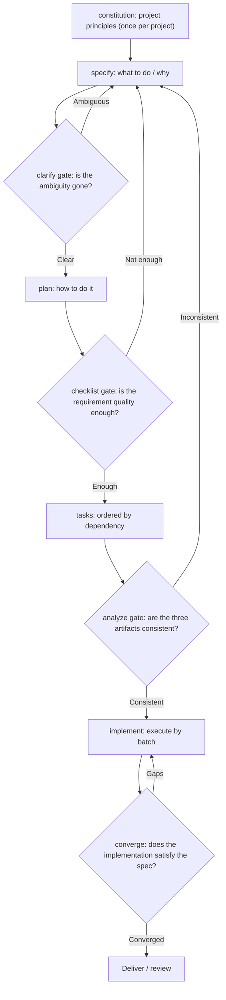
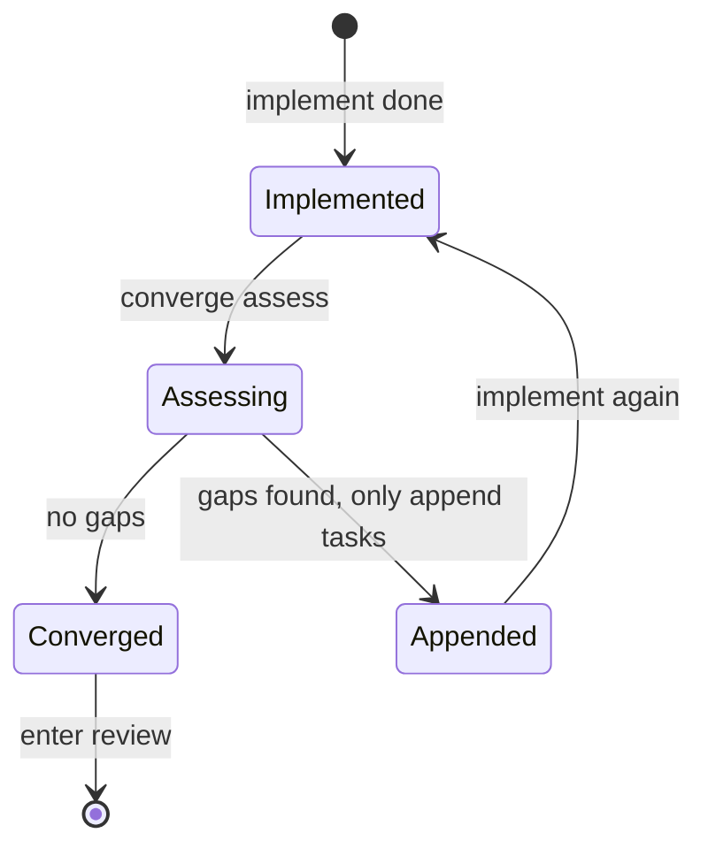
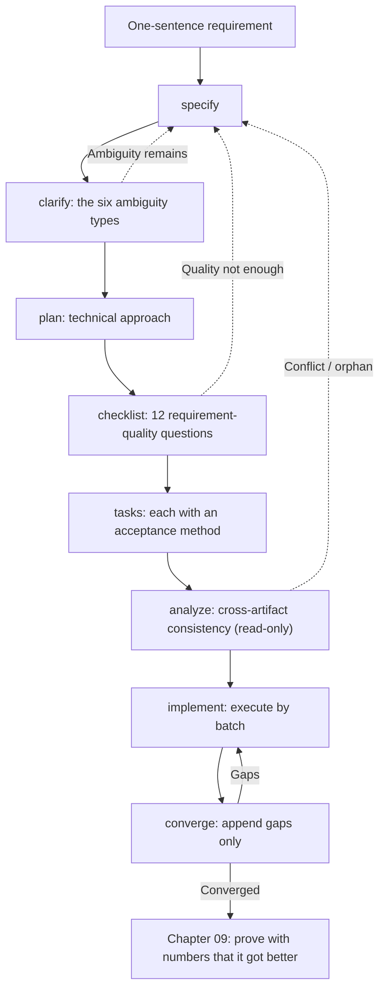

**English** | [中文](./ch08-pipeline.zh.md)

# Chapter 08: The Four-Stage Pipeline and Three Gates

> **Chapter overview**: The first seven chapters are parts; this chapter assembles them into a machine. You will see one complete pipeline: spec -> plan -> tasks -> implement -> converge, with three optional gates in between, plus rules for "when you find a problem, which step do you fall back to". It also gives a minimal manual version you can build in 20 minutes without installing anything.
> **Prerequisites**: Chapter 02 (the three layers), Chapter 07 (task slicing).
> **Core learning objectives**:
> - Name the input and output of each of the four stages, and the fallback direction when a boundary is crossed
> - Know what each of the three gates checks, and when it may be skipped
> - Build a minimal manual version, and know where it differs from the tool version

---

## 1. Cognitive Anchor: Security Screening Is Not About Distrusting You

### 1.1 An Argument That Keeps Recurring

Every time "add a process" is proposed, someone says: "That is distrust of engineers."

Interestingly, the same people have no problem with airport security - nobody thinks screening is "distrust of passengers". Because the logic of screening is not "we suspect you are a bad person"; it is **turning "should this be let through" from a personal judgment into a reviewable process**: anyone may pass, but everyone must pass the same gate.

Gates in software are the same. It is not "distrust of the AI"; it is **turning "is this spec clear enough" from "I think it is fine" into "every item on the checklist is ticked"**.

### 1.2 The Limits of the Analogy

Security screening can become ritual too: a person stands in front of the machine, puts the bag on, eyes on the phone - the gate is passed, nothing is checked. Process gates have the same disease: **running the command is not passing the check**.

Chapter 10 lists this disease as an anti-pattern of its own ("self-approving checklists"). For now remember one line: **the value of a gate is in the checking action, not in the command execution.**

---

## 2. First Principles: The Four-Stage Pipeline

### 2.1 The Shape of the Pipeline



**The four stages are the main path**: specify (What) -> plan (How) -> tasks (Order) -> implement (Do).
**converge is a loop**, not a fifth stage - it checks "does the implementation satisfy the first three artifacts", and only appends gap tasks to `tasks.md`, never touching code or specs.

### 2.2 The Spec Kit v1.0 Command Family

The following is based on the official GitHub Spec Kit README (v1.0, released August 2026). **Note the command prefix**: since v1.0 they are invoked as skills inside the agent, written `/speckit-specify` (hyphen); the `/speckit.specify` (dot) form common in older docs is a historical spelling. Follow the prompt files your local `specify init` generates.

| Command | What it does | Artifact | Required? |
|---|---|---|---|
| `/speckit-constitution` | Establish project principles (quality, testing, maintainability, etc.) | `.specify/memory/constitution.md` | Once per project |
| `/speckit-specify` | Generate a feature spec from a natural-language description | `specs/<feature>/spec.md` | Required |
| `/speckit-clarify` | Ask about the unclear spots in the spec (default max 5), writing answers back into the spec | Updates `spec.md` | When ambiguous |
| `/speckit-plan` | Generate the technical implementation plan and design artifacts from the spec | `plan.md`, `research.md`, `data-model.md`, `contracts/` | Required |
| `/speckit-checklist` | Generate a "requirements quality checklist" (unit tests for requirements) | Checklists under `checklists/` | Recommended for high-risk features |
| `/speckit-tasks` | Split the plan into dependency-ordered tasks | `tasks.md` | Required |
| `/speckit-analyze` | **Read-only** cross-artifact consistency analysis (conflicts, gaps, ambiguity across spec/plan/tasks) | A report (changes no files) | Recommended before implement |
| `/speckit-implement` | Execute in `tasks.md` order | Code | Required |
| `/speckit-converge` | Evaluate code against spec/plan/tasks; gaps are **only appended** to `tasks.md` | Updates `tasks.md` | After each implement round |

**Initialization** (run in the terminal, not in the agent):

```bash
uv tool install specify-cli
specify init my-project --integration copilot
```

Replace `--integration` with the key for the coding agent you use. Initialization generates command templates and a script directory; after that every `/speckit-*` is invoked one by one in the agent's chat.

### 2.3 What the Three Gates Check

| Gate | When | Checks | Pass criterion | If it fails |
|---|---|---|---|---|
| **clarify** | Before plan | Ambiguity in the spec | All six types of ambiguity (Chapter 5) have explicit adjudications | Fall back to specify and fix the spec; do not "plan first, talk later" |
| **checklist** | Before tasks | Quality of the requirements themselves | Complete, clear, contradiction-free, verifiable (i.e. "unit tests written in natural language") | Fall back to specify / clarify to tighten |
| **analyze** | Before implement | Consistency across the three artifacts | No conflicts, no gaps, no orphan requirements | Fall back per problem ownership (see the table below) |

**Fallback rules** - the easiest place in the pipeline to get wrong:

| Problem ownership | Fall back to | What not to do |
|---|---|---|
| The requirement itself is wrong/missing | `/speckit-specify` or `clarify` | Do not "helpfully patch requirements" in the plan |
| The technical approach is infeasible | `/speckit-plan` | Do not quietly lower the criteria |
| Task missing / wrong order | `/speckit-tasks` | Do not "add one while executing" |
| Implementation does not match the spec | `/speckit-implement` | Do not change the spec to accommodate the implementation |

The last row is the bottom line. **Changing the spec to accommodate the implementation is the first way specs rot** (Chapter 10 details it).

### 2.4 converge: The Only Place Loops Are Allowed



Three rules; miss one and it drifts:

1. **Append only, never edit**: `converge` does not touch code and does not change spec/plan; it only appends "gap tasks" to the end of `tasks.md`. That way every round leaves an audit trace.
2. **There is a termination condition**: stop only on the report saying `Converged`. Not "two rounds is probably enough".
3. **Gaps should shrink**: if round two has more gaps than round one, the spec itself is at fault; stop and go back to specify instead of looping on.

### 2.5 OpenSpec: The Lightweight Contrast

Spec Kit is a "heavy process": nine commands, five artifact directories. For one-off small changes that gear is too heavy. Lightweight schemes like OpenSpec take another road: **change packages as the unit** - propose -> apply -> archive.

| Dimension | Spec Kit | Lightweight change packages (e.g. OpenSpec) |
|---|---|---|
| Unit | Feature | Change |
| Artifacts | spec / plan / tasks / checklists | One proposal + one task list |
| Fits | New features, multi-file, long-term maintenance | Small changes on an existing system, single-point fixes |
| Cost | High startup cost | Easily degrades into "write a note and start hacking" |

**The choosing criterion is not "which is more advanced" but "the lifespan of this change"**: if the change must live past three months, use the heavy process; if it will not survive a week, use the light one or do not write at all (Chapter 10 covers "when not to write a spec").

### 2.6 The Minimal Manual Version: Three Files Plus One Checklist

It runs without installing anything. Directory structure:

```text
specs/
└── waitlist/
    ├── spec.md          # the seven sections (Chapter 2)
    ├── plan.md          # technical approach + risks
    ├── tasks.md         # task table with acceptance methods
    └── checklist.md     # requirements quality checklist (write your own 12 items)
```

`checklist.md` is just 12 questions, each answerable only "yes/no":

```markdown
- [ ] Does every criterion have an observable exit (endpoint field / page element / data state)?
- [ ] Does every criterion have a quantified value or an enumeration?
- [ ] Does every core criterion have a failure path?
- [ ] Have the six ambiguity types (reference / scope / boundary / exception / timing / permissions) all been scanned?
- [ ] Do the six constraint types (idempotency / concurrency / timeout & retry / permissions / performance / degradation) all have clauses?
- [ ] Are there at least three Non-goals, all decidable omissions?
- [ ] Does every task say "how it counts as done"?
- [ ] Do the task dependencies contain a cycle?
- [ ] Do framework names, table names, or function names appear in the spec? (if so, out of bounds)
- [ ] Do new requirements appear in the plan? (if so, out of bounds)
- [ ] Are any criteria inconsistent? (e.g. two different definitions of "full")
- [ ] Has any "TBD" quietly been executed as a default value?
```

**These 12 items are the manual implementation of the three gates.** It is slower than commands, but it has one benefit tools cannot give: **every item must pass before your own eyes.**

---

## 3. Hands-on Walkthrough: One Requirement, Two Runs

### 3.1 Experiment Design

Take Chapter 7's nine tasks and run one round with the "minimal manual version" and one with "Spec Kit". Same model, same requirement, four metrics recorded.

| Metric | Manual version | Spec Kit version | Why the difference |
|---|---|---|---|
| Setup time | 25 minutes | 60 minutes (install + init + learn commands) | The learning cost of tools is real |
| Artifact file count | 4 | 9 (incl. research / data-model / contracts / checklists) | Tools generate the intermediate artifacts they think necessary |
| **Problems found** | 6 | 11 | The extra 5 come from `analyze` and `checklist` - they actively hunt contradictions |
| Rework after first implement round | 3 tasks | 1 task | Upfront checks pushed defects to the left |

### 3.2 What Those 5 "Extra Problems" Look Like

This is the point of the section: the extra problems the tool version finds are not "features not written" but **cross-artifact consistency gaps**:

| # | What analyze / checklist found | Why the manual version missed it |
|---|---|---|
| 1 | `spec` says "invite within 60 seconds", `plan` says "the cron job scans every 30 seconds"; the two conflict at the boundary | Each file looks right read alone; the conflict appears only side by side |
| 2 | `tasks` is missing the "expiry scan" task although the plan has the mechanism | Missed when copying while splitting tasks |
| 3 | One criterion has no corresponding task (orphan requirement) | Nobody does the "criterion -> task" coverage check |
| 4 | The spec's Non-goals say "no export", yet the plan's API design has `GET /export` | The two artifacts were generated in different rounds |
| 5 | The permission criterion covers only the list, not the detail | "Permissions" was ticked only once in the checklist |

**The shared lesson**: the quality of a single file cannot guarantee consistency across files. **Consistency can only be guaranteed by a dedicated, read-only checking action** - which is the reason `analyze` exists.

### 3.3 Which One to Choose

| Your situation | Advice |
|---|---|
| First time doing spec-driven work, no muscle memory yet | Manual version. The 12-item checklist builds intuition better than nine commands |
| Feature spans 3+ modules, maintained for half a year | Spec Kit. Cross-artifact consistency checks pay off most here |
| Just changing one small API | Neither. Write three lines of criteria and go |
| Multi-person team, needs handover | Spec Kit. The artifact directory convention is itself a handover protocol |

---

## 4. Common Pitfalls: Wrong vs. Right

| Common pitfall | Why it goes wrong | The right approach |
|---|---|---|
| **Treating "command ran" as "gate passed"** | The command produced output, so it feels done | The gate's criterion is "every checklist item answers yes", not "the command returned 0" |
| **Skipping constitution** | Feeling project principles are empty words | By the third feature you will see the same review comments repeating - that is exactly what the constitution should hold |
| **analyze finds problems but you implement without fixing** | Wanting to build the feature first | Implementing with known contradictions is writing the contradictions into the code |
| **Ticking the checklist yourself** | The implementer knows the details best | The requirements quality checklist belongs to the reviewer; implementers may not self-approve |
| **Treating converge as "implement again"** | The name sounds like "merge" | It is read-only assessment + append-only tasks; only fall back to implement when there are gaps |
| **Cannot write specs without tools** | Tying the method to a tool | The manual 12-item checklist is the method itself |
| **Putting every change through the heavy process** | When you have a hammer, everything looks like a nail | Choose the process by "the lifespan of the change" (Section 2.5) |

---

## 5. Chapter Summary and Local Knowledge Map

### 5.1 Three Takeaways

- **The four stages are the main path; converge is the loop**: spec -> plan -> tasks -> implement, then back to "does it satisfy the spec".
- **Each gate has its own domain**: clarify handles ambiguity, checklist handles requirement quality, analyze handles cross-artifact consistency. **Consistency needs its own dedicated check**.
- **The value of a gate is in the checking action**, not the command execution; the manual 12-item checklist works just as well.

### 5.2 This Chapter's Concept Topology



---

## 6. Tiered Exercises

### Tier 1: Intuition Check

1. Why is `analyze` designed to be **read-only**? If it could edit files directly, what would the risks be?
2. Both `converge` and `implement` can change system state; why is only the former allowed to loop?

### Tier 2: Hands-on Application

3. Using the minimal manual version, build the four files (spec / plan / tasks / checklist) for a small feature on your hands, and tick through the 12 questions one by one. Record which ones you could not tick.

### Tier 3: Boundaries & Transfer

4. Suppose your team insists on "no AI tools at all, chat window only". Design a process that depends on no command prefixes, and explain which guarantee it lacks compared to Spec Kit and how you plan to compensate.

<details>
<summary><strong>Click to expand: reference answers and in-depth analysis for this chapter's exercises</strong></summary>

#### 1. Why analyze is read-only

- **Conclusion**: because what it checks is "consistency among the three artifacts"; once it can edit files, it turns from "referee" into "player".
- **Risks**: (1) it might modify criteria to make the report look clean (lowering the bar); (2) after modification there is no baseline to compare against, so correctness cannot be judged; (3) report and edits get mixed, and reviewers cannot tell "where is the problem, where is the fix".
- **Design principle**: **separate checking from fixing**. This is the shared structure of all quality gates (code review, static analysis, financial audit alike).

#### 2. Why only converge may loop

- **Conclusion**: because `converge`'s writes are **constrained and auditable** (only appending to `tasks.md`), while `implement`'s writes are total (the code).
- **Reasoning**: an infinitely looping `implement` produces masses of unrecorded changes, and each round may overturn the last; whereas every append by `converge` leaves a record of "what is missing", naturally forming convergence evidence.
- **The point of the termination condition**: `Converged` is a **decidable state**, not "I think it is about done". A loop without a decidable termination condition will definitely stop at some random moment.

#### 3. Practical notes for the manual version

- **The three usually untickable ones**: failure paths (item 3), the six constraint types (item 5), and "pending items silently executed by default" (item 12).
- **Finding them is already a payoff**: the untickable spots are where rework is most likely this time. Write them at the end of `checklist.md` and fill them in one by one after implementation.

#### 4. A tool-free process

- **A workable substitute**: keep the four files in the repo and wire them with a `Makefile` or shell script: `make clarify` (prints the six-type ambiguity list for you to fill), `make check` (interactive ticking of the 12 questions), `make analyze` (manually check the "criterion -> task" mapping table across the three files).
- **The guarantee lost**: "automated cross-artifact comparison" - Spec Kit's `analyze` really compares the text, while manual comparison misses things.
- **How to compensate**: build a **coverage matrix** (criteria x tasks) and go through it manually after every change. The matrix is small (8 criteria x 9 tasks) and takes five minutes; it cannot replace automated comparison, but it blocks the most fatal gaps like "orphan requirements".

</details>

---

## 7. Authoritative References and Further Reading for This Chapter (Authoritative References)

1. **GitHub Spec Kit**: [GitHub Spec Kit](https://github.com/github/spec-kit) - The definitions and conventions of this chapter are anchored here (verified on: `2026-10-23`).
2. **GitHub Copilot Docs**: [GitHub Copilot Docs](https://docs.github.com/en/copilot) - The definitions and conventions of this chapter are anchored here (verified on: `2026-10-23`).
3. **Specification by Example (Adzic, 2011)**: [Specification by Example (Adzic, 2011)](https://www.manning.com/books/specification-by-example) - The definitions and conventions of this chapter are anchored here (verified on: `2026-10-23`).

> A note on scope: the sources above anchor **definitions and conventions**, not extrapolated risk probabilities. Before citing any number, check its source year and denominator first.
