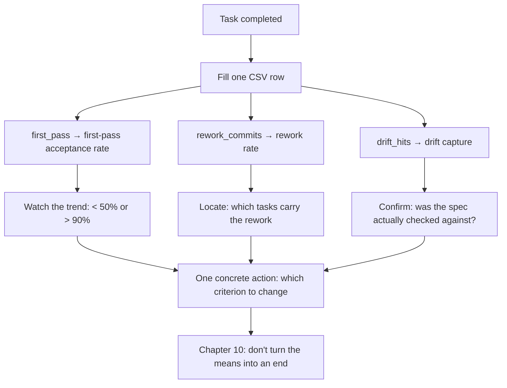

**English** | [中文](./ch09-metrics.zh.md)

# Chapter 09: Metrics - First-Pass Acceptance Rate and Its Two Companions

> **Chapter overview**: If "this spec is better than last time" is only a feeling, it can be neither refuted nor reproduced. This chapter gives three metrics, one set of definitions, and one CSV, turning "the spec got better" into a statement others can verify.
> **Prerequisites**: Chapter 08 (the pipeline and converge).
> **Core learning objectives**:
> - Compute first-pass acceptance rate, and explain why the denominator must be "tasks"
> - Use rework ratio and drift catches to cover the two things first-pass rate cannot see
> - Establish a two-week baseline, and read off "what to change next month"

---

## 1. Cognitive Anchor: The Bathroom Scale and "I Think I've Lost Weight Lately"

### 1.1 A Statement That Cannot Be Refuted

The team finishes its first spec-driven feature, and everyone feels "much smoother". In the second month someone asks: "Did it really get better?" The answer: "Feels like it; less rework."

This sentence has two problems: **first, it cannot be refuted** (anyone can say "I feel it did not drop"); **second, it cannot be reproduced** (next time the same situation comes up, you do not know which action to repeat).

The value of a bathroom scale is not that it is accurate; it is that **it gives you a number on the same scale every day**, so you can say "up 0.8 kilograms this week" and then go find out which three meals did it.

### 1.2 Analogy: The Health Report vs. How You Feel

A person who feels fine may have three arrows on their health report. The job of metrics is not to make you anxious; it is to **replace "feeling" with "something you can take to a discussion with others"**.

The "three arrows" in software are this chapter's three metrics. None of them is perfect, but every one is more reliable than how you feel right now.

---

## 2. First Principles: Three Metrics and One Set of Definitions

### 2.1 Why the Counting Basis Must Be Fixed

Where metrics die most easily is not miscalculation but **switching definitions**. Last month counted by "task", this month by "PR", the trend chart looks wonderful, and in reality nothing changed.

So set three rules first:

1. **The definition goes into the doc**, committed together with the metric;
2. **Switching definitions requires rebuilding the baseline**; do not plot it on the same chart as old data;
3. **No conclusions from small samples** (under 15 tasks, read direction only, not values).

### 2.2 First-Pass Acceptance Rate

**Definition**: number of tasks that pass all their acceptance methods in one generation / total number of tasks.

The differences between the three counting bases must be seen first:

| Counting basis | Denominator | Pros | Cons |
|---|---|---|---|
| **By task (recommended)** | Task count | Right granularity; can locate the specific spec section | Tasks must first be sliced clearly |
| By PR | Merged PR count | Easy to collect | One PR may hold 3 tasks, hiding differences |
| By user story | Story count | Suits reporting upward | Too coarse: 5 wrong tasks inside one story count as 1 failure |

**Why count by task**: because rework happens at task granularity. The criterion sentence you added affects one task's first pass, not the whole requirement.

**Empirical ranges** (note: these are practice advice, not empirical conclusions; the source is industry experience sharing, and teams differ widely):

| Range | Reading | What to do |
|---|---|---|
| < 50% | The spec has systematic gaps | Do not chase generation speed; go back and fix criteria and constraints |
| 50%-90% | Normal working zone | Watch the trend, not the absolute value |
| > 90% | Possibly over-specified | Check whether criteria are written at a fineness the risk does not need (Chapter 10) |

**Why > 90% is also a problem**: if every task passes at once, the criteria may be looser than what you actually care about - you are accepting "it runs", not "it is right".

### 2.3 Rework Ratio

**Definition**: number of follow-up commits made within 7 days after merge to fix that task / number of tasks.

What first-pass rate cannot see is "it passed, but barely". A task passes first time, then four fix commits land within three days - it is a success in the metric and a failure in reality.

**Definitional details** (must be written down, or people will argue):

- Count only commits **made to fix this task**; formatting, renames, dependency upgrades do not count.
- 7 days is an empirical window: shorter misses slowly surfacing defects; longer pulls in later feature changes.
- One person making 5 small commits a day versus 1 big commit makes this number differ 5x - so it suits **watching trends**, not cross-team comparison.

### 2.4 Drift Catches

**Definition**: number of review comments of the kind "violates the spec / out of scope".

This metric is the most counter-intuitive: **its number going up is a good thing.**

- Value 0: either the spec is never read, or it is written vaguely enough to be unviolatable - both mean the spec carries no load.
- Steady non-zero values: reviews really are checking code against the spec; the spec is "load-bearing".
- A sudden spike: implementation is starting to systematically deviate; check whether spec and code have diverged.

Its relation to the other two: **first-pass rate measures "generation quality", rework ratio measures "whether the quality is real", drift catches measure "whether the spec is being used".**

### 2.5 The Two-Week Baseline Method

Do not chase "improvement" from day one. Measure two weeks first and get your own baseline.

| Step | What to do |
|---|---|
| 1 | Pick 10-15 tasks, work in your current habit, change no process |
| 2 | Fill one CSV row per task (see 2.6) |
| 3 | After two weeks compute once, and record these three numbers as the baseline |
| 4 | Change one variable (e.g. add failure-path criteria), then measure two more weeks |
| 5 | Compare only "same definition, same task type" before vs. after |

**Step 5 is where it is won or lost.** A two weeks dense with migration tasks will crush any metric, and it has nothing to do with the spec.

### 2.6 Field Design and the Runnable Script

Fields of `code/ch09/metrics.csv`:

| Field | Meaning | Values |
|---|---|---|
| `date` | Task completion date | YYYY-MM-DD |
| `task_id` | Task ID (maps to tasks.md) | T1... |
| `spec_version` | The spec version at the time | v1.0... |
| `gen_rounds` | How many generation rounds before stopping | Integer |
| `first_pass` | Whether all acceptance methods passed on the first round | 1 / 0 |
| `rework_commits` | Follow-up commits within 7 days | Integer |
| `review_minutes` | Review time | Integer |
| `drift_hits` | Number of "violates the spec" comments in that task's review | Integer |

`summarize.py` reads this table and outputs the three metrics. Below is a **real run result** (the sample data under `code/ch09/`: 9 first-batch tasks + 3 appended after launch, 12 in total):

```text
=== 规格质量指标 ===
任务数              : 12
首轮通过任务数      : 9
首轮验收率          : 75.0%   （落在 0.5–0.9：可继续，观察趋势而不是绝对值）
跟进提交总数        : 19
返工率（提交/任务） : 1.58
规格漂移捕获        : 6 次
平均评审时长        : 25 分钟/任务
平均生成轮次        : 1.33 轮/任务
```

### 2.7 Three Misleading Metrics

| Metric | Why it misleads |
|---|---|
| **Lines of generated code** | Many lines can mean verbosity, duplication, defensive piling; few lines can mean corner-cutting |
| **Conversation rounds** | Few rounds can mean "wrong in one shot"; many rounds can mean "asked carefully". It measures interaction style, not quality |
| **Generation speed (sec per KLOC)** | Speed is a property of the tool, not of your method; it is almost unrelated to delivery quality |

The fourth number you really should watch (not among this chapter's three, but worth recording): **how many times the spec changed**. If a spec was never changed from start to finish, either it was perfect from the start (rare) or it was never checked against at all (common).

---

## 3. Hands-on Walkthrough: Reading a Real Report

### 3.1 The Data

Using the real output above, interpret item by item. Note this is a small sample of 12 tasks; **direction only**.

| Metric | Value | Reading | Next action |
|---|---|---|---|
| First-pass rate | 75.0% | In the normal zone, but not far from the 50% warning line | First see which 3 tasks failed and whether they share the same gap |
| Rework ratio | 1.58 commits/task | High: on average 1.5 follow-up commits per task | See where those 19 commits cluster - if they cluster in T2 and T8, those two tasks' criteria are too coarse |
| Drift catches | 6 | The spec is load-bearing; reviews are using it | Keep; record which section each of the 6 violated, as constitution candidates |
| Average generation rounds | 1.33 | Most tasks pass in one round, a few drag to 2-3 | Retrospect the tasks above 2 rounds individually |

### 3.2 Split by Month (Same Run)

```text
=== 按月 ===
月份          任务     首轮率     返工率    漂移
2026-09      7     71%    1.57     3
2026-10      5     80%    1.60     3
```

The first-pass rate went from 71% to 80% across two months, seemingly improving. But stay restrained:

- September was the project's first 7 tasks (including T1 data model, T2 sign-up endpoint); infrastructure tasks naturally either pass at once or fail repeatedly, with high variance.
- Of October's 5 tasks, 2 are pure front-end (excluding T8); the difficulty mix differs.
- **The sample is too small to conclude "the method works".** All you can say is "it did not get worse".

### 3.3 What to Change Next Month: One Concrete Judgment

Do not vaguely say "keep optimizing". The data supports one concrete action:

T2 (sign-up endpoint) and T8 (three front-end pages) together account for 9 of the 19 follow-up commits. Looking back at those two tasks' criteria, the common trait is **few failure paths**: T2 only wrote "no key returns 400", never "what does a duplicate key return"; T8 only wrote "three main paths clickable", never "what shows when the position fails to load".

**Action**: in the next batch, every task's criteria must include at least one `IF ... THEN` (Chapter 3). Then watch whether T2-type tasks' rework ratio drops after two weeks.

**This is what metrics are for**: they do not tell you "try harder"; they tell you "change which sentence".

---

## 4. Common Pitfalls: Wrong vs. Right

| Common pitfall | Why it goes wrong | The right approach |
|---|---|---|
| **Switching definitions midway** | Switching can make numbers look good | Write definitions into the doc; switch means rebuilding the baseline |
| **Concluding from 5 tasks** | Small samples swing wildly | Under 15 tasks, read direction only |
| **Treating first-pass rate as the only metric** | It only measures "generation quality" | Read all three: quality, whether quality is real, whether the spec is load-bearing |
| **Chasing 100% first-pass** | The number looks nice | > 90% means check for over-specification; real projects should have failures |
| **Comparing rework ratios across teams** | Commit granularity differs | Compare only with yourself, same definition, same task type |
| **Recording without interpreting** | Filling the sheet feels productive | After each recording write one sentence: "this means change what next month" |
| **Pushing metrics down as personal KPIs** | Once metrics become appraisals they get gamed | Metrics are for improving the method, not for judging people |

The last one deserves expansion: once "first-pass acceptance rate" becomes a personal appraisal, the most rational move is **splitting tasks into tiny pieces** so every one passes at once. The metric looks great; delivery did not change. **All metrics have this side effect; the cure is to watch counter-metrics at the same time** (rework ratio and drift catches are the counter-metrics).

---

## 5. Chapter Summary and Local Knowledge Map

### 5.1 Three Takeaways

- **Definitions before metrics**: numbers without fixed definitions are just emotions visualized.
- **The three metrics cover each other**: first-pass rate for generation quality, rework ratio for whether quality is real, drift catches for whether the spec is load-bearing.
- **The output of a measurement is one concrete action**, not a pretty chart.

### 5.2 This Chapter's Concept Topology



---

## 6. Tiered Exercises

### Tier 1: Intuition Check

1. Why is "first-pass rate > 90%" worth worrying about rather than celebrating?
2. A drift-catch count of 0 can come from which two completely opposite causes?

### Tier 2: Hands-on Application

3. Using the format of `code/ch09/metrics.csv`, fill a table for your last 5 tasks and run the script once. Write your interpretation (no more than 200 words).

### Tier 3: Boundaries & Transfer

4. Your team decides to put "first-pass acceptance rate" into quarterly appraisals. Predict three foreseeable behavior changes, and design one counter-measure.

<details>
<summary><strong>Click to expand: reference answers and in-depth analysis for this chapter's exercises</strong></summary>

#### 1. Why > 90% deserves worry

- **Conclusion**: because the acceptance standard may have been loosened, and the system is "passing a low bar".
- **Mechanism**: the denominator of first-pass rate is tasks; the numerator is "passed all acceptance methods". If the acceptance methods only cover the happy path, the pass rate is naturally high.
- **How to check**: randomly pick 3 passing tasks and ask "if this task broke under concurrency/failure/privilege escalation, would my criteria catch it?" If not, the pass rate is hollow.

#### 2. The two causes of zero drift catches

- **Cause A (good)**: spec and implementation are highly consistent; reviews genuinely find nothing "against the spec". This happens in projects with very concrete criteria and very small tasks.
- **Cause B (bad)**: reviews do not check against the spec and only look at code style; or the spec is vague enough that any implementation can be read as "compliant".
- **How to tell**: look at the type distribution of review comments. If they are all "naming", "formatting", "extract a function here", that is B.

#### 3. Notes for filling the table

- **`first_pass` is the easiest to get wrong**: the basis must be "all acceptance methods passed", not "it feels about done".
- **Interpretation template**: `this run X%, failures concentrated in T__ (cause: criteria missing __); rework rate __, meaning __; next month change one line of __.`

#### 4. Three behavior changes after adding it to appraisals

| Change | Mechanism | Consequence |
|---|---|---|
| Tasks get shredded | The smaller each task, the easier it passes at once | Integration debt rises, rework ratio spikes and nobody watches |
| Criteria get loosened | The looser the criteria, the easier the pass | Quality problems move downstream to production |
| Failures get hidden | Recording "did not pass" as "requirement change" | Data distorts; the method loses its basis for improvement |

- **Counter-measures**: (1) metrics go to teams, never individuals; (2) publish rework ratio and drift catches (counter-metrics) alongside; (3) each quarter audit 3 tasks for "criteria strength" (the method from question 1).
- **Transfer conclusion**: any single metric, once it becomes an appraisal target, gets optimized until it is meaningless. **Metric design must include "what happens when it is abused".**

</details>

---

## 7. Authoritative References and Further Reading for This Chapter (Authoritative References)

1. **DORA**: [DORA](https://dora.dev/) - The definitions and conventions of this chapter are anchored here (verified on: `2026-10-23`).
2. **METR**: [METR](https://metr.org/) - The definitions and conventions of this chapter are anchored here (verified on: `2026-10-23`).
3. **martinfowler.com**: [martinfowler.com](https://martinfowler.com/) - The definitions and conventions of this chapter are anchored here (verified on: `2026-10-23`).

> A note on scope: the sources above anchor **definitions and conventions**, not extrapolated risk probabilities. Before citing any number, check its source year and denominator first.
