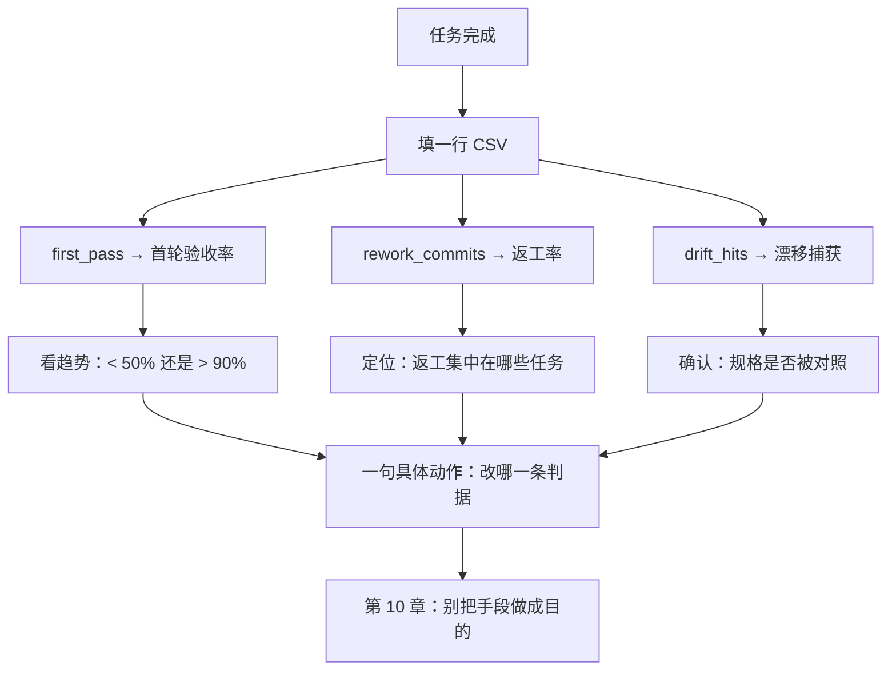

# 第 09 章：度量——首轮验收率与它的两个同伴

> **本章导读**："这次规格比上次好"如果只是一句感觉，它就无法被反驳，也无法被复制。本章给三个指标、一套口径、一张 CSV，让"规格变好了"变成可以被别人复核的陈述。
> **前置知识**：第 08 章（流水线与 converge）。
> **核心学习目标**：
> - 算清首轮验收率，并说清分母为什么必须是"任务"
> - 用返工率与漂移捕获率补上首轮验收率看不见的两件事
> - 建立两周基线，能读出"下个月该改什么"

---

## 1. 认知锚点：体重秤与"我最近好像瘦了"

### 1.1 一个无法反驳的陈述

团队做完第一个规格驱动的功能，所有人都觉得"顺畅多了"。第二个月，有人问："真的变好了吗？"回答是："感觉是的，返工少了。"

这句话有两个问题：**第一，它无法被反驳**（谁都可以说"我感觉没少"）；**第二，它无法被复制**（下次遇到同样情况，你不知道该重复哪个动作）。

体重秤的价值不在于它准，而在于**它每天都在同一个刻度上给你一个数**，让你能说"这周涨了 0.8 公斤"，然后去查是哪三顿饭。

### 1.2 类比：体检报告与自我感觉

自我感觉良好的人，体检报告上可能有三个箭头。指标的作用不是让你焦虑，是**把"感觉"换成"可以拿去和别人讨论的东西"**。

软件里的"三个箭头"就是本章的三个指标。它们都不完美，但都比你此刻的感觉可靠。

---

## 2. 第一性原理：三个指标与一套口径

### 2.1 为什么必须固定口径

指标最容易死的地方不是算错，是**换口径**。上个月按"任务"算，这个月按"PR"算，趋势图看起来一片大好，实际上什么都没变。

所以先定三条规矩：

1. **口径写进文档**，和指标一起提交；
2. **换口径必须重新建基线**，不能和旧数据画在同一张图上；
3. **小样本不下结论**（少于 15 个任务，只看方向，不看数值）。

### 2.2 首轮验收率（first-pass acceptance rate）

**定义**：一次生成即通过该任务全部验收方式的任务数 ÷ 任务总数。

三个口径的差别，必须先看清：

| 口径 | 分母 | 优点 | 缺点 |
|---|---|---|---|
| **按任务**（推荐） | 任务数 | 粒度合适，能定位到具体规格段落 | 需要先把任务拆清 |
| 按 PR | 合并的 PR 数 | 好采集 | 一个 PR 可能含 3 个任务，掩盖差异 |
| 按需求 | 用户故事数 | 适合向上汇报 | 粒度太粗，一个故事内 5 个任务全错也只算 1 次失败 |

**为什么推荐按任务**：因为返工发生在任务粒度上。你补的那一句判据，影响的是某一个任务的首轮通过，而不是整个需求。

**经验区间**（注意：这是实践建议，不是实证结论，来源是行业内的经验分享，不同团队差异很大）：

| 区间 | 解读 | 该做什么 |
|---|---|---|
| < 50% | 规格有系统性缺口 | 先别提高生成速度，回去补判据与约束 |
| 50%–90% | 正常工作区 | 看趋势，不看绝对值 |
| > 90% | 可能过规格 | 检查判据是否写到了风险不需要的细度（第 10 章） |

**> 90% 为什么也是问题**：如果每个任务都一次通过，可能说明判据写得比你真正在意的更宽松——你只是在验收"能跑"，不是在验收"对"。

### 2.3 返工率（rework ratio）

**定义**：合并后 7 天内为修该任务产生的跟进提交数 ÷ 任务数。

首轮验收率看不见的是"通过了但通过得很勉强"。一个任务首轮通过，但三天内又提了 4 个修复提交——它在指标上是成功的，在现实里是失败的。

**口径细节**（必须写清，否则会吵架）：

- 只统计**为修这个任务**产生的提交；格式化、重命名、依赖升级不算。
- 7 天是经验窗口：太短会漏掉慢暴露的缺陷，太长会把后续功能的改动算进来。
- 一个人一天提 5 个小提交，和一个人提 1 个大提交，会让这个数字差 5 倍——所以它适合**看趋势**，不适合跨团队比较。

### 2.4 漂移捕获率（drift catches）

**定义**：评审意见中"违反规格 / 超出范围外"的条数。

这个指标最反直觉：**它的数值上升是好事。**

- 数值为 0：要么规格没被读，要么规格写得足够模糊以至于无法违反——两种情况都说明规格没有承重。
- 数值稳定出现：说明评审真的在拿规格对照代码，规格是"承重的"。
- 数值暴涨：说明实现开始系统性偏离，要查是不是规格与代码分叉了。

它和另外两个指标的关系是：**首轮验收率测"生成质量"，返工率测"质量的真假"，漂移捕获测"规格有没有被使用"。**

### 2.5 两周基线法

不要一上来就追求"提升"。先测两周，拿到自己的基线。

| 步骤 | 做法 |
|---|---|
| 1 | 选 10–15 个任务，按现有习惯做，不改流程 |
| 2 | 每个任务填一行 CSV（见 2.6） |
| 3 | 两周后算一次，把这三个数记为基线 |
| 4 | 改一个变量（例如补失败路径判据），再测两周 |
| 5 | 只比较"同口径、同类型任务"的前后差异 |

**第 5 步是成败关键。** 一个迁移任务密集的两周，会把任何指标搞崩，跟规格没关系。

### 2.6 字段设计与可运行脚本

`code/ch09/metrics.csv` 的字段：

| 字段 | 含义 | 取值 |
|---|---|---|
| `date` | 任务完成日期 | YYYY-MM-DD |
| `task_id` | 任务编号（对应 tasks.md） | T1… |
| `spec_version` | 当时的规格版本 | v1.0… |
| `gen_rounds` | 生成了几轮才停 | 整数 |
| `first_pass` | 首轮是否通过全部验收方式 | 1 / 0 |
| `rework_commits` | 7 天内跟进提交数 | 整数 |
| `review_minutes` | 评审耗时 | 整数 |
| `drift_hits` | 该任务评审中"违反规格"的条数 | 整数 |

`summarize.py` 读这张表，输出三个指标。下面是**真实运行结果**（`code/ch09/` 下的示例数据：首发 9 个任务 + 上线后追加的 3 个任务，共 12 个）：

```text
=== 规格质量指标 ===
任务数              : 12
首轮通过任务数      : 9
首轮验收率          : 75.0%   （落在 0.5–0.9：可继续，观察趋势而不是绝对值）
跟进提交总数        : 19
返工率（提交/任务） : 1.58
规格漂移捕获        : 6 次
平均评审时长        : 25 分钟/任务
平均生成轮次        : 1.33 轮/任务
```

### 2.7 三个误导性指标

| 指标 | 为什么误导 |
|---|---|
| **生成代码行数** | 行数多可能是啰嗦、重复、防御性代码堆砌；行数少可能是偷工 |
| **对话轮数** | 轮数少可能是"一次生成就错"，轮数多可能是"问得细"。它测的是交互风格，不是质量 |
| **生成速度（秒/千行）** | 速度是工具属性，不是你的方法属性；它和交付质量几乎无关 |

真正该看的第四个数字（不在本章三指标内，但建议记）：**规格的改动次数**。如果一份规格从头到尾没改过，要么它一开始就完美（罕见），要么它根本没被对照过（常见）。

---

## 3. 手把手推演：读一份真实报表

### 3.1 数据

用上面那段真实输出，逐项解读。注意这是 12 个任务的小样本，**只能看方向**。

| 指标 | 数值 | 解读 | 下一步动作 |
|---|---|---|---|
| 首轮验收率 | 75.0% | 落在正常工作区，但离 50% 的警戒线不算远 | 先看是哪 3 个任务失败，它们是否共享同一个缺口 |
| 返工率 | 1.58 提交/任务 | 偏高：平均每个任务要 1.5 个跟进提交 | 查这 19 个提交集中在哪——如果集中在 T2、T8，说明这两个任务的判据太粗 |
| 漂移捕获 | 6 次 | 规格在承重，评审在用 | 保持；记录这 6 条分别违反了哪一段，作为 constitution 的候选 |
| 平均生成轮次 | 1.33 | 大多数任务一轮过，少数拖到 2–3 轮 | 2 轮以上的任务单独复盘 |

### 3.2 按月拆分（同一次运行）

```text
=== 按月 ===
月份          任务     首轮率     返工率    漂移
2026-09      7     71%    1.57     3
2026-10      5     80%    1.60     3
```

两个月的首轮率从 71% 到 80%，看起来在变好。但要克制：

- 9 月是项目前 7 个任务（含 T1 数据模型、T2 报名接口），基础设施类任务本来就容易一次过或反复失败，波动大。
- 10 月的 5 个任务里有 2 个是纯前端（T8 除外），难度结构不同。
- **样本太小，不能得出"方法起效"的结论。** 只能说"没有恶化"。

### 3.3 下个月该改什么：一个具体判断

不要笼统地说"继续优化"。从数据能推出一个具体动作：

T2（报名接口）与 T8（前端三页）合计贡献了 19 个跟进提交中的 9 个。回看这两条任务的判据，共同点是**失败路径写得少**：T2 只写了"无 key 返回 400"，没写"key 重复时返回什么"；T8 只写了"三条主路径可点通"，没写"序号加载失败时显示什么"。

**动作**：下一个批次的每个任务，判据里强制包含至少一条 `IF ... THEN`（第 3 章）。然后观察两周后 T2 类任务的返工率是否下降。

**这就是度量的用处**：它不告诉你"要努力"，它告诉你"改哪一句"。

---

## 4. 常见误区与正反例对比

| 容易踩的坑 | 为什么会出错 | 正确做法 |
|---|---|---|
| **中途换口径** | 换口径能让数字变好看 | 口径写进文档；换口径重新建基线 |
| **用 5 个任务下结论** | 小样本波动大 | 少于 15 个任务只看方向 |
| **把首轮验收率当唯一指标** | 它只测"生成质量" | 三个一起看：质量、真假、规格是否承重 |
| **追求 100% 首轮通过** | 数字好看 | > 90% 要查过规格；真实项目应当有失败 |
| **跨团队比较返工率** | 提交粒度不同 | 只和自己比，同口径、同类型任务 |
| **只记录不解读** | 填表有产出感 | 每次记录后写一句"这说明下个月改什么" |
| **把指标当 KPI 压给个人** | 指标一旦成为考核就会被优化 | 指标用于改方法，不用于评价人 |

最后一条值得展开：一旦"首轮验收率"变成个人考核，最理性的做法是**把任务拆到极小**，每个都一次通过。指标漂亮了，交付没变。**所有度量都有这个副作用，解法是同时看反指标**（返工率与漂移捕获就是反指标）。

---

## 5. 本章小结与局部知识图谱

### 5.1 三句话带走

- **口径先于指标**：不固定口径的数字，只是情绪的可视化。
- **三个指标互相补位**：首轮验收率测生成质量，返工率测质量真假，漂移捕获测规格是否承重。
- **度量的产出是一句具体动作**，不是一张漂亮的图。

### 5.2 本章概念拓扑



---

## 6. 分级通关练习

### Tier 1：直觉核验

1. 为什么"首轮验收率 > 90%"值得警惕，而不是值得庆祝？
2. 漂移捕获率为 0，可能是哪两种完全相反的原因？

### Tier 2：动手应用

3. 用 `code/ch09/metrics.csv` 的格式，为你最近 5 个任务填一张表，跑一次脚本。写出你的解读（不超过 200 字）。

### Tier 3：边界与迁移

4. 你的团队决定把"首轮验收率"纳入季度考核。请预测三个可预期的行为变化，并设计一条反制措施。

<details>
<summary><strong>点击展开：本章练习参考答案与深度解析</strong></summary>

#### 1. 为什么 > 90% 值得警惕

- **结论**：因为验收标准可能被写松了，系统在"通过一个低标准"。
- **机制**：首轮验收率的分母是任务，分子是"通过全部验收方式"。如果验收方式只覆盖顺利路径，通过率自然高。
- **检查方法**：随机抽 3 个通过的任务，问一句"如果这个任务在并发/失败/越权下出问题，我的判据能抓到吗"。抓不到，说明通过率是虚的。

#### 2. 漂移捕获为 0 的两种原因

- **原因 A（好）**：规格与实现高度一致，评审确实找不到"违反规格"的地方。这种情况多见于判据写得非常具体、任务切得很小的项目。
- **原因 B（坏）**：评审没有拿规格对照，只看代码风格；或者规格写得足够模糊，任何实现都能解释成"符合"。
- **区分方法**：看评审意见的类型分布。如果全是"命名""格式""这里可以抽个函数"，那是 B。

#### 3. 填表要点

- **最容易填错的是 `first_pass`**：判断依据必须是"验收方式全部通过"，不是"我觉得差不多了"。
- **解读模板**：`本次 X% ，主要失败集中在 T__（原因：判据缺少 __）；返工率 __，说明 __；下个月改 __ 一句。`

#### 4. 纳入考核后的三个行为变化

| 变化 | 机制 | 后果 |
|---|---|---|
| 任务被拆碎 | 每个任务越小，越容易一次通过 | 集成债上升，返工率飙升但没人看 |
| 判据被写松 | 判据越松，通过越容易 | 质量问题后移到线上 |
| 失败被隐藏 | 把"没通过"记成"需求变更" | 数据失真，方法失去改进依据 |

- **反制措施**：① 指标只到团队不到个人；② 同时公布返工率与漂移捕获（反指标）；③ 每季度抽 3 个任务做"判据强度审计"（第 1 题的方法）。
- **迁移结论**：任何单一指标一旦成为考核目标，都会被优化到失去意义。**度量的设计要包含"被滥用时会发生什么"。**

</details>

---

## 7. 本章权威参考信源与延伸阅读 (Authoritative References)

1. **DORA**：[DORA](https://dora.dev/) - 本章的定义与规范以此为锚（核验日期：`2026-10-23`）。
2. **METR**：[METR](https://metr.org/) - 本章的定义与规范以此为锚（核验日期：`2026-10-23`）。
3. **martinfowler.com**：[martinfowler.com](https://martinfowler.com/) - 本章的定义与规范以此为锚（核验日期：`2026-10-23`）。

> 口径提示：以上信源用于锚定**定义与规范**，不用于外推风险概率。引用任何数字前，先核对来源年份与分母。
