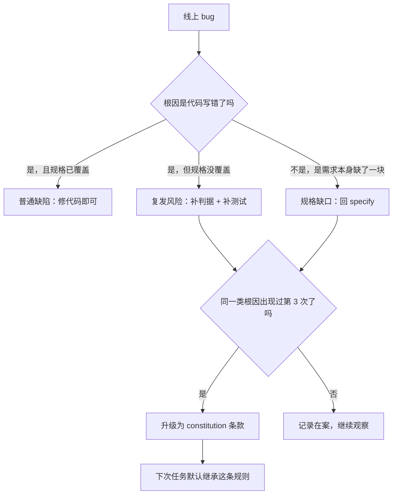
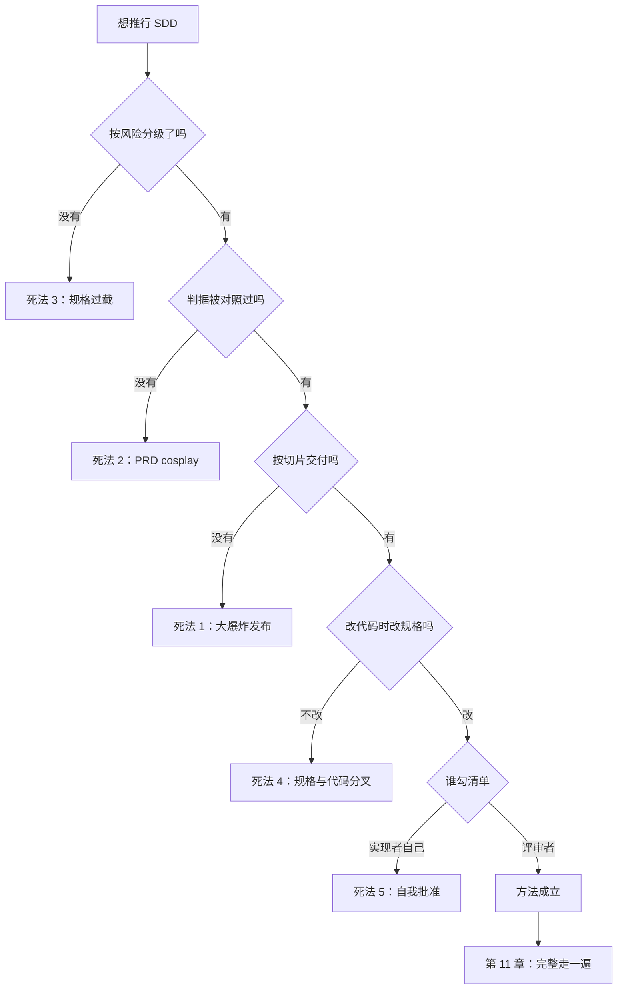

**English** | [中文](./ch10-antipatterns.zh.md)

# Chapter 10: Anti-Patterns - Five Ways SDD Degrades into Waterfall

> **Chapter overview**: This book teaches you to write judgments down, but the writing-down itself can run out of control. Overwrite the spec and you have invited the 1970s waterfall process back in verbatim, at twice the cost. This chapter lists five death modes, their early signals and cures, and answers a question people avoid: **when you should not write a spec.**
> **Prerequisites**: Chapter 08 (the pipeline), Chapter 09 (metrics).
> **Core learning objectives**:
> - Recognize the early signals of the five degradation patterns, instead of waiting for project failure
> - Judge how heavy a spec should be by "spec weight x task risk"
> - Run an anti-pattern health check, and give concrete subtraction actions

---

## 1. Cognitive Anchor: Turning the Means into an End

### 1.1 A Real Degradation

A team read the SDD material and decided to roll it out across the board. The rule was hard: **every change must have a spec first, the spec must pass a three-person review, and only then is it scheduled.**

Month one: a change of "rename the button copy from 'Submit' to 'Sign up'" went through 3 days of process.
Month two: people started bypassing the process, changing code directly and writing the spec afterwards.
Month three: 14 specs sat in the "pending review" backlog while 9 features had already shipped.

Quarterly retrospective conclusion: **"SDD is too heavy for us."**

That conclusion is wrong. The wrongness is not in SDD; it is in treating "every change" as the same risk level - **this is death mode number 3: spec overload.**

### 1.2 Intuitive Analogy: The Seatbelt

Seatbelts have saved many lives. But if someone rules "when getting in a car you must first buckle up, then adjust the seat, then check tire pressure, then start the engine", and enforces it strictly in food-delivery scenarios, riders will start skipping the seatbelt.

**The seatbelt is not wrong; the scenario is mismatched.** The value of a method is always conditional - talk about "whether to use it" outside its conditions and the answer is guaranteed wrong.

---

## 2. First Principles: Five Death Modes and One Matching Principle

### 2.1 The Five Death Modes

| # | Death mode | Mechanism | Early signal | Cure |
|---|---|---|---|---|
| 1 | **Heavy upfront spec + big-bang release** | Treating SDD as "finish the spec before starting", delivering everything at once | Spec written for three weeks with no implementation started; first demo at the end of the project | Deliver by vertical slices (Chapter 7); write the spec only "enough to start", filling in detail during implementation and writing it back |
| 2 | **PRD cosplay** | The spec becomes performance: forty-page documents, signing meetings, covers and TOCs; nobody actually checks against it | The criteria in the spec are never cited; reviews say "feels good overall" | Cut to the seven-section format (Chapter 2); every criterion must be checkable item by item at review |
| 3 | **Spec overload** | Every change goes through the same heavy process; risk and weight mismatch | Copy changes need review meetings; specs pile up; people start bypassing the process | Tier by "change lifespan x blast radius" (see 2.2) |
| 4 | **Change code without changing the spec** | Patching fast during fixes, changing code directly; the spec stays at the old version | Spec and code inconsistent; the same bug recurs in a different shape | Change the spec in the same commit as the code; add a CI reminder "changing this directory requires touching the spec" |
| 5 | **Self-approving checklists** | The implementer ticks "requirements quality passed" themselves | Checklist all green but production problems; the checklist has never been sent back | The checklist belongs to the reviewer; implementers may only submit "pending review", not tick |

### 2.2 Matching Spec Weight to Task Risk

Not every change deserves a spec. Judge on two dimensions:

| | **Low blast radius** (single file, revertible, no data change) | **High blast radius** (cross-module, touches data, involves permissions/money) |
|---|---|---|
| **Short lifespan** (deleted same day, experiments, one-off scripts) | **Do not write.** Just do it. | **Write three lines**: what to do, what counts as right, how to undo. |
| **Long lifespan** (maintained, handed over, used by many) | **Write criteria** (half a page): goal + 3-5 acceptance criteria. | **Write the full seven sections** + constraint clauses + gates. |

Four rule-of-thumb lines, all concretizations of "good enough is enough":

1. **One screen of markdown per day of work** - that is the ceiling; exceed it and ask "am I writing a PRD?"
2. **Criterion count follows risk**: 1 for a copy change; 15 for changing billing definitions is not too many.
3. **Constraint clauses only when there is concurrency/permissions/external dependencies.** A pure display page needs no idempotency.
4. **For changes without a spec, leave one line in the commit message saying "why no spec"**. That line is itself a light gate.

### 2.3 When You Should Not Write a Spec

This section contradicts the book's thesis, but it must be written, or this book will manufacture death mode number 3.

**Three situations where you may skip it:**

1. **One-off scripts**: deleted after running, or a data migration run only once (but the migration needs a rollback script - that matters more than a spec).
2. **Pure exploration**: you are trying three UI options just to see which looks right. Writing a spec here is waste - you have not even settled what you want.
3. **Things that will be overturned the same day**: prototypes, demos, fake pages shown to the boss.

**But one precondition must hold**: this code **will not enter the main branch**, or if it does it will be rewritten within two weeks. Once it has real users, real data, people depending on it, it is no longer "one-off" - **and the moment it becomes "long-term" usually happens silently.**

This is why "change code without changing the spec" (death mode 4) is so common: nobody decided not to write; nobody noticed the thing had grown up.

### 2.4 Recurrence Detection: The Same Hole in a New Shape

To judge whether a bug is "new" or "a recurrence", look at one thing only: **whether the root cause traces to a missing criterion or constraint.**

**The "third time" threshold is not mysticism**: the first time is an accident, the second a coincidence, the third a pattern. Fail to promote it into a rule by the third time and you will be fixing it a fourth and a fifth time.

---

## 3. Hands-on Walkthrough: One Anti-Pattern Health Check

### 3.1 The Check Table (10 items, 0-2 points each)

Score your most recent project. 0 = not at all, 1 = sometimes but inconsistently, 2 = done steadily.

| # | Check item | Score |
|---|---|---|
| 1 | The spec's criteria were checked item by item at review | |
| 2 | Every delivery has a "demoable" slice | |
| 3 | Changes of different risk got different spec weights | |
| 4 | The spec was changed in the same commit as the code | |
| 5 | The requirements quality checklist is ticked by a non-implementer | |
| 6 | Non-goals exist and are concrete | |
| 7 | Constraint clauses (idempotency/concurrency/permissions/fallback) live in the spec | |
| 8 | Tasks all carry "what counts as passing" | |
| 9 | There is measurement data, and you know which sentence to change next month | |
| 10 | Problems with the same root cause have not been fixed a third time | |

**How to read the score**:

- 16-20: the method works; focus on maintenance and transfer (Chapter 12).
- 10-15: skeleton exists but items are missing; fix items 3, 4, 5 first (they map to the three most common death modes).
- 0-9: do not add process; do one thing first - take one real requirement through the minimal manual version (Chapter 8).

### 3.2 Records of Three "Recurrences in a New Shape"

This is the real shape of one project over three months (details fictional, pattern real):

| # | Symptom | Fix at the time | The form it took three months later |
|---|---|---|---|
| 1 | Double-clicking created two sign-ups | Added `disabled` to the front-end button | Mobile retries on weak networks bypassed the front end; still two records |
| 2 | Mobile retries created two | Added "same phone number within 10 seconds is a duplicate" at the back end | Users manually resubmitted after 30 seconds; still two records |
| 3 | Manual duplicate submissions | Added idempotency keys at the back end | - finally no more recurrence |

The first two fixes treated **symptoms** (front end, time window); the third fixed the **root cause** (the missing idempotency constraint). And the root cause had already been exposed by Chapter 3's counter-example method - **it was not promoted into a constraint clause, so tuition was paid twice more.**

### 3.3 A Subtraction List

If you are living through death modes 1, 2, or 3, do three subtractions, in order:

1. **Delete every spec section that "has no criteria"**. Keep the background, but move it to a separate file outside the spec.
2. **Tier the process**: restrict "must be reviewed" to the high-blast-radius + long-lifespan cell; the rest walks itself.
3. **Change the checklist from "the implementer's self-check" to "the reviewer's gate"**. Once this is done, death mode 5 disappears immediately.

---

## 4. Common Pitfalls: Wrong vs. Right

| Common pitfall | Why it goes wrong | The right approach |
|---|---|---|
| **Treating "write a spec" as "write a document"** | Documents have word counts to show off | The value of a spec is in criterion count and check-against count, not page count |
| **One process for every change** | Uniformity is easy to manage | Tier by risk; the heavy process is only for high blast radius |
| **Using the spec as a "disclaimer"** | When things go wrong you can say "I wrote it down" | A spec must be checkable; an uncheckable spec is psychological comfort |
| **Fixing bugs without patching the spec** | Fixing bugs is tiring enough | Add one criterion line in the same commit, or death mode 4 kicks in |
| **Ticking your own checklist** | Nobody knows the details better than you | The checklist belongs to the reviewer; implementers only submit for review |
| **Treating "no spec" as liberalism** | The thrill of rebelling against process | Skipping needs a reason, and the reason stays in the commit message |
| **Attributing SDD failure to "the team does not fit"** | Blaming people does not hurt | First check whether one of the five death modes was triggered |

---

## 5. Chapter Summary and Local Knowledge Map

### 5.1 Three Takeaways

- **The five death modes share one trait**: turning "write a spec" from a means into an end.
- **Weight must match risk**: one screen of markdown per day of work is the ceiling; a copy change should not need a review meeting.
- **Recurrence is judged by root cause**: when the same hole appears a third time in a new shape, promote it into a constitution clause.

### 5.2 This Chapter's Concept Topology

---

## 6. Tiered Exercises

### Tier 1: Intuition Check

1. Why does "heavy upfront specs" become more likely once AI participates? (Hint: the cost of writing specs changed.)
2. "Spec overload" and "no specs at all" look like two extremes; what do they share?

### Tier 2: Hands-on Application

3. Score your most recent project with the 3.1 check table, write out the three lowest-scoring items, and give each one subtraction action.

### Tier 3: Boundaries & Transfer

4. Someone says: "Our team is small, just two people; we do not need this formality." Give a plan that respects that judgment without letting specs vanish entirely, and explain its failure boundary.

<strong>Click to expand: reference answers and in-depth analysis for this chapter's exercises</strong>

#### 1. Why AI makes "heavy upfront specs" more likely

- **Conclusion**: because AI slashes the cost of writing specs, and the temptation of "write it all, then build" rises as cost falls.
- **Mechanism**: writing 30 pages of spec used to take a week, so people instinctively compressed; now AI generates 30 pages in ten minutes and people feel "it is cheap anyway" - so specs bloat and implementation is postponed.
- **The deeper mechanism**: AI-generated specs look complete, but may contain masses of unverified assumptions. **A cheap spec is not the same as cheap rework.**

#### 2. What the two extremes share

- **Conclusion**: both give up "allocating attention by risk".
- **Reasoning**: spec overload spreads attention evenly over all changes (no focus); no specs withdraw attention entirely (no defense). Both leave "high-risk changes" without extra protection.
- **The correct middle**: attention should be proportional to blast radius.

#### 3. Running the check table

- **The usual low scorers**: item 4 (change code without the spec), item 5 (ticking your own checklist), item 3 (no tiering).
- **Sample subtraction actions**: item 4 -> add a line to the commit template "did this change the spec? if not, say why"; item 5 -> move the checklist into the PR description, ticked by the reviewer; item 3 -> define three tiering lines (see the 2.2 table).

#### 4. What a two-person team should do

- **Plan**: **downgrade the spec to "three sentences + one criteria table"**.
  - Three sentences: what to do, what counts as right, what not to do.
  - Criteria table: 3-7 rows, written in the issue description, no separate directory.
  - Gate: keep one action only - **before submitting, the other person reads the criteria table and replies "my understanding matches"**.
- **Why it works**: it keeps the spec's core function (checkable) and cuts all ceremony (directories, versions, review meetings).
- **Failure boundary**: (1) when data migration, permissions, or billing are involved, it must be upgraded to the full version (the cost of error in these three is asymmetric); (2) above 4 people, "the other person reads it" breaks down and explicit checklists and roles are needed; (3) when the project lives past half a year, the criteria table needs archiving and indexing (Chapter 12), or it scatters across issues and cannot be found again.

---

## 7. Authoritative References and Further Reading for This Chapter (Authoritative References)

1. **Specification by Example (Adzic, 2011)**: [Specification by Example (Adzic, 2011)](https://www.manning.com/books/specification-by-example) - The definitions and conventions of this chapter are anchored here (verified on: `2026-10-23`).
2. **GitHub Spec Kit**: [GitHub Spec Kit](https://github.com/github/spec-kit) - The definitions and conventions of this chapter are anchored here (verified on: `2026-10-23`).
3. **martinfowler.com**: [martinfowler.com](https://martinfowler.com/) - The definitions and conventions of this chapter are anchored here (verified on: `2026-10-23`).

> A note on scope: the sources above anchor **definitions and conventions**, not extrapolated risk probabilities. Before citing any number, check its source year and denominator first.
