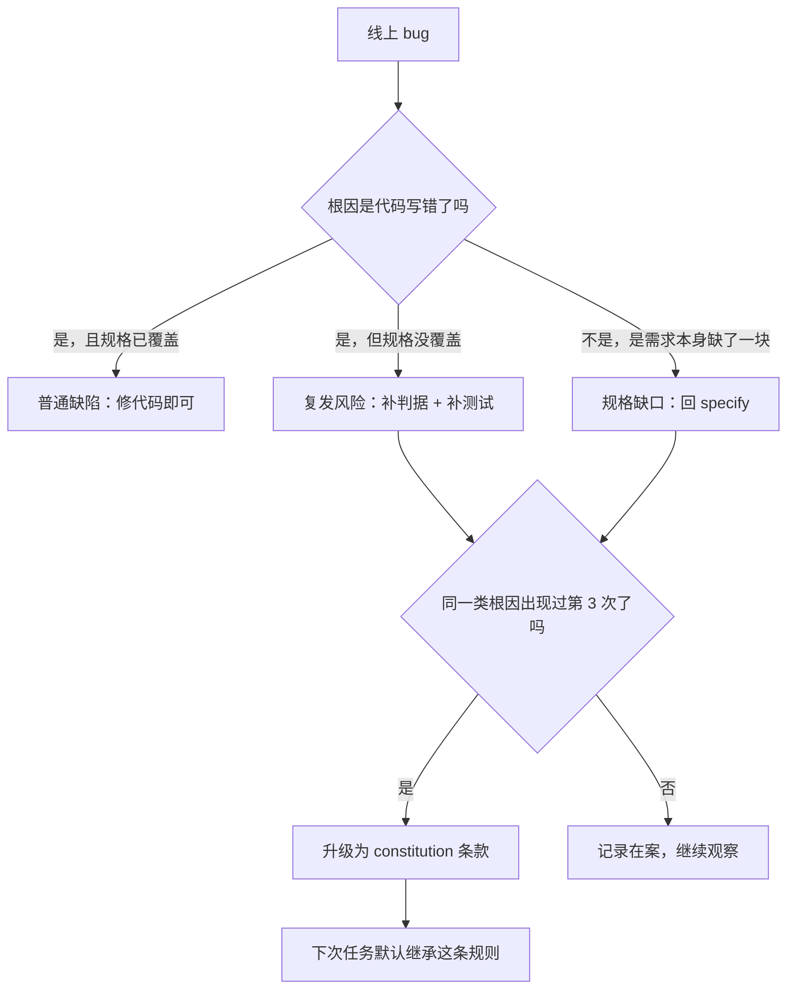
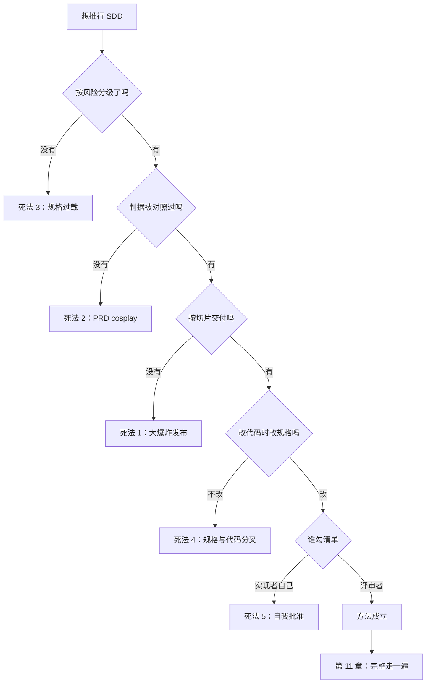

[English](./ch10-antipatterns.md) | **中文**

# 第 10 章：反模式——SDD 退化成瀑布的五种死法

> **本章导读**：这本书教你把判断写下来，但写下来这件事本身会失控。规格写重了，你就把 1970 年代的瀑布流程原样请了回来，还多花了一倍时间。本章列五种死法、各自的早期信号与解药，并回答一个被回避的问题：**什么时候不该写规格。**
> **前置知识**：第 08 章（流水线）、第 09 章（度量）。
> **核心学习目标**：
> - 识别五种退化形态的早期信号，而不是等到项目失败才发现
> - 用"规格重量 × 任务风险"判断该写多重
> - 能做一次反模式体检，并给出具体的减法动作

---

## 1. 认知锚点：把手段做成目的

### 1.1 一个真实的退化

某团队读了 SDD 的材料，决定全面推行。规则定得很硬：**任何改动，必须先写规格，规格须经三人评审，评审通过后排期。**

第一个月：一个"把按钮文案从『提交』改成『报名』"的改动，走了 3 天流程。
第二个月：有人开始绕过流程，直接改代码，事后补一份规格。
第三个月：规格文档积压了 14 份"待评审"，代码已经上线了 9 个功能。

季度复盘结论：**"SDD 太重，不适合我们。"**

这个结论是错的。错不在 SDD，在于把"所有改动"当成了同一个风险等级——**这是第 3 号死法：规格过载。**

### 1.2 直觉类比：安全带

安全带救了很多命。但如果有人规定"上车必须先系安全带、再调座椅、再检查胎压、再点火"，并且在送外卖的场景下严格执行，骑手会开始不系安全带。

**不是安全带错了，是场景错配了。** 方法的价值总是条件性的——脱离条件谈"要不要用"，得到的答案一定是错的。

---

## 2. 第一性原理：五种死法与一条匹配原则

### 2.1 五种死法

| # | 死法 | 机制 | 早期信号 | 解药 |
|---|---|---|---|---|
| 1 | **重前期规格 + 大爆炸发布** | 把 SDD 当成"先写完规格再开工"，一次交付全部功能 | 规格写了三周还没开始实现；第一次演示在项目末期 | 按垂直切片交付（第 7 章）；规格只写到"够开工"，细节在实现中补齐并回写 |
| 2 | **PRD cosplay** | 规格变成表演：四十页文档、签字会、封面目录，没人真的用它对照 | 规格里的判据从没被引用过；评审会说"整体感觉不错" | 砍到七段式（第 2 章）；每条判据必须能在评审时被逐条对照 |
| 3 | **规格过载** | 所有改动用同一套重流程，风险与重量不匹配 | 改文案也要评审会；规格积压；有人开始绕过流程 | 按"改动寿命 × 影响面"分级（见 2.2） |
| 4 | **只改代码不改规格** | 修复时图快，直接改代码；规格停在旧版本 | 规格与代码不一致；同一个 bug 换形状复发 | 改代码的同一次提交里改规格；CI 里加"改了这个目录必须动 spec"的提醒 |
| 5 | **清单自我批准** | 实现者自己勾"需求质量达标" | 清单全绿但上线出问题；清单从没被打回过 | 清单归评审者所有；实现者只能提交"待审"，不能勾选 |

### 2.2 规格重量与任务风险的匹配

不是所有改动都值得写规格。判断用两个维度：

| | **低影响面**（单文件、可回滚、无数据变更） | **高影响面**（跨模块、动数据、涉权限/金钱） |
|---|---|---|
| **短寿命**（当天删、试验、一次性脚本） | **不写**。直接做。 | **写三行**：做什么、什么算对、怎么撤。 |
| **长寿命**（要维护、要交接、多人用） | **写判据**（半页）：目标 + 3–5 条验收判据。 | **写完整七段式** + 约束条款 + 门禁。 |

四条经验线，都是"够用就好"的具体化：

1. **一屏 markdown 换一天工作量**——这是上限，超过就该问"我是不是在写 PRD"。
2. **判据数量跟风险走**：改文案 1 条，改计费口径 15 条不算多。
3. **约束条款只在有并发/权限/外部依赖时写**。一个纯展示页面不需要幂等。
4. **不写规格的改动，要在提交信息里留一句"为什么不写"**。这句话本身就是一道轻门禁。

### 2.3 什么时候不该写规格

这一节违背本书主旨，但必须写，否则这本书会制造第 3 号死法。

**三种情况可以不写：**

1. **一次性脚本**：跑完就删，或者只跑一次的数据迁移（但迁移要有回滚脚本，这比规格重要）。
2. **纯探索**：你在试三种 UI 方案，目的就是看哪个顺眼。这时候写规格是浪费——你连自己要什么都没确定。
3. **当天会被推翻的东西**：原型、demo、给老板看一眼的假页面。

**但要满足一个前提**：这些代码**不会进主干**，或者进了主干也会在两周内被重写。一旦它开始有真实用户、有数据、有人依赖，它就不再是"一次性的"——**而它变成"长期"的那一刻，通常会悄无声息地发生。**

这就是为什么"只改代码不改规格"（第 4 号死法）如此普遍：不是有人决定不写，是没人注意到这件东西已经长大了。

### 2.4 复发检测：同一个洞换个形状

判断一次 bug 是"新问题"还是"复发"，只看一件事：**根因能不能追到某条缺失的判据或约束。**

**"第 3 次"这个阈值不是玄学**：第一次是意外，第二次是巧合，第三次是模式。到了第三次还不升格成规则，你就会第四次、第五次地修它。

---

## 3. 手把手推演：一次反模式体检

### 3.1 体检表（10 项，各 0–2 分）

给自己最近一个项目打分。0 = 完全没有，1 = 有但不稳定，2 = 稳定做到。

| # | 检查项 | 分 |
|---|---|---|
| 1 | 规格里的判据在评审时被逐条对照过 | |
| 2 | 每次交付都有一个"能演示"的切片 | |
| 3 | 不同风险的改动用了不同重量的规格 | |
| 4 | 改代码的同一次提交里改了规格 | |
| 5 | 需求质量清单由非实现者勾选 | |
| 6 | 有明确的 Non-goals，且具体 | |
| 7 | 约束条款（幂等/并发/权限/降级）写在规格里 | |
| 8 | 任务都有"怎么算过" | |
| 9 | 有度量数据，且知道下个月改哪一句 | |
| 10 | 同一个根因的问题没有被第三次修复 | |

**读分方式**：

- 16–20：方法已经跑通，重点是保持与迁移（第 12 章）。
- 10–15：有骨架但漏项，优先补第 3、4、5 项（这三项对应最常见的三种死法）。
- 0–9：不要加流程，先做一件事——挑一个真实需求，用最小手工版走完一遍（第 8 章）。

### 3.2 三次"换形状复发"的记录

这是某项目三个月的真实形态（细节虚构，模式真实）：

| 次数 | 症状 | 当时的修法 | 三个月后又出现的形式 |
|---|---|---|---|
| 1 | 用户连点创建了两条报名 | 前端按钮加 `disabled` | 移动端弱网重试，绕过前端，仍然两条 |
| 2 | 移动端重试产生两条 | 后端加"10 秒内同手机号判重" | 用户隔了 30 秒手动再提交，仍然两条 |
| 3 | 手动重复提交 | 后端加幂等键 | ——终于不再复发 |

前两次修的都是**症状**（前端、时间窗），第三次才修**根因**（缺少幂等这个约束）。而根因在第 3 章的反例法里就已经被暴露过——**当时没有升级成约束条款，于是又付了两次学费。**

### 3.3 减法清单

如果你正在经历第 1、2、3 号死法，做三件减法，按顺序：

1. **删掉所有"没有判据"的规格段落**。保留背景介绍，但把它移到单独的文件，不进 spec。
2. **给流程分级**：把"必须评审"限定在高影响面 + 长寿命的格子里，其余的自己走。
3. **把清单从"实现者的自检"改成"评审者的门禁"**。这一条改完，第 5 号死法立刻消失。

---

## 4. 常见误区与正反例对比

| 容易踩的坑 | 为什么会出错 | 正确做法 |
|---|---|---|
| **把"写规格"当成"写文档"** | 文档有字数可以炫耀 | 规格的价值在判据数量与对照次数，不在页数 |
| **所有改动同一套流程** | 统一好管理 | 按风险分级；重流程只给高影响面 |
| **用规格当"免责声明"** | 出事时可以说"我写过了" | 规格要能被对照；不能对照的规格是心理安慰 |
| **修 bug 不补规格** | 修 bug 已经够累了 | 同一次提交里补一句判据，否则第 4 号死法启动 |
| **自己勾自己的清单** | 最了解细节的人是自己 | 清单归评审者；实现者只提交待审 |
| **把"不写规格"当自由主义** | 反抗流程的快感 | 不写要有理由，理由要留在提交信息里 |
| **把 SDD 失败归因于"团队不适合"** | 归因于人不痛 | 先查是不是踩了五种死法之一 |

---

## 5. 本章小结与局部知识图谱

### 5.1 三句话带走

- **五种死法有一个共同点**：把"写规格"从手段变成了目的。
- **重量要匹配风险**：一屏 markdown 换一天工作量是上限；改文案不该走评审会。
- **复发的判据是根因**：同一个洞换形状出现第三次，就该升格成 constitution 条款。

### 5.2 本章概念拓扑

---

## 6. 分级通关练习

### Tier 1：直觉核验

1. 为什么"重前期规格"在 AI 参与后会更容易发生？（提示：写规格的成本变了。）
2. "规格过载"和"不写规格"看起来是两个极端，它们的共同点是什么？

### Tier 2：动手应用

3. 用 3.1 的体检表给自己最近一个项目打分，写出得分最低的三项，并各给一个减法动作。

### Tier 3：边界与迁移

4. 有人说："我们团队小，只有两个人，不需要这么正式。"请给出一个既尊重这个判断、又不至于让规格完全消失的方案，并说明它的失效边界。

<strong>点击展开：本章练习参考答案与深度解析</strong>

#### 1. 为什么 AI 让"重前期规格"更容易发生

- **结论**：因为写规格的成本被 AI 大幅降低，而"写完再做"的诱惑随成本下降而上升。
- **机制**：以前写 30 页规格要一周，人会本能地压缩；现在 AI 十分钟能生成 30 页，人会觉得"反正便宜"——于是规格膨胀、实现被推迟。
- **更深的机制**：AI 生成的规格看起来完整，但它可能包含大量未被验证的假设。**便宜的规格不等于便宜的返工。**

#### 2. 两个极端的共同点

- **结论**：都放弃了"按风险分配注意力"。
- **推演**：规格过载把注意力平均撒在所有改动上（等于没有重点）；不写规格把注意力全部撤走（等于没有防线）。两者都让"高风险改动"得不到额外保护。
- **正确的中间态**：注意力应当与影响面成正比。

#### 3. 体检表实操

- **最常见的低分项**：第 4 项（改代码不改规格）、第 5 项（自己勾清单）、第 3 项（不分级）。
- **减法动作示例**：第 4 项 → 在提交模板里加一行"本次是否修改了规格？没有请说明原因"；第 5 项 → 把清单移到 PR 描述里，由评审者勾；第 3 项 → 定三条分级线（见 2.2 表）。

#### 4. 两个人的团队怎么办

- **方案**：**规格降级为"三句话 + 一张判据表"**。
  - 三句话：做什么、什么算对、什么不做。
  - 判据表：3–7 行，写在 issue 描述里，不建单独目录。
  - 门禁：只保留一个动作——**提交前，另一人读一遍判据表并回一句"我理解的一致"**。
- **为什么有效**：它保留了规格最核心的功能（可对照），砍掉了所有仪式（目录、版本、评审会）。
- **失效边界**：① 涉及数据迁移、权限、计费时，必须升级为完整版（这三类错误的代价不对称）；② 团队超过 4 人时，"另一人读一遍"会失效，需要显式的清单与角色；③ 项目寿命超过半年时，判据表需要归档与索引（第 12 章），否则会散落在 issue 里找不回来。

---

## 7. 本章权威参考信源与延伸阅读 (Authoritative References)

1. **Specification by Example（Adzic, 2011）**：[Specification by Example（Adzic, 2011）](https://www.manning.com/books/specification-by-example) - 本章的定义与规范以此为锚（核验日期：`2026-10-23`）。
2. **GitHub Spec Kit**：[GitHub Spec Kit](https://github.com/github/spec-kit) - 本章的定义与规范以此为锚（核验日期：`2026-10-23`）。
3. **martinfowler.com**：[martinfowler.com](https://martinfowler.com/) - 本章的定义与规范以此为锚（核验日期：`2026-10-23`）。

> 口径提示：以上信源用于锚定**定义与规范**，不用于外推风险概率。引用任何数字前，先核对来源年份与分母。
