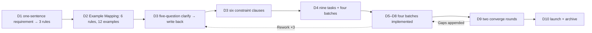
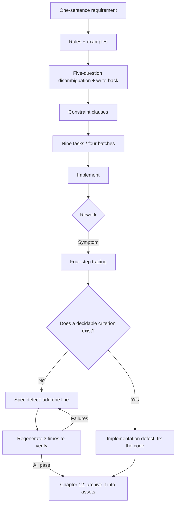

**English** | [中文](./ch11-end-to-end.zh.md)

# Chapter 11: End-to-End in Practice - From a Vague Requirement to Launch

> **Chapter overview**: The first ten chapters are drills. This one connects them into one complete run: a one-sentence requirement, ten days, four delivery batches, three rounds of rework, and finally launch. The point is not "smooth sailing"; it is that **every round of rework can be traced to the exact sentence in the spec** - that decides whether you step into the same hole again.
> **Prerequisites**: Chapters 01-10. Having done at least one Example Mapping and one task slicing with your own hands is recommended.
> **Core learning objectives**:
> - Walk the complete chain "requirement -> rules -> examples -> ambiguity -> constraints -> tasks -> implementation -> converge"
> - Master the rework root-cause method: from symptom to the missing criterion sentence
> - Use "regenerate 3 times" to verify that the added sentence really plugs the hole

---

## 1. Cognitive Anchor: Drills Are Not the Same as Swimming

### 1.1 A Common Gap

You have watched the drills: how to pull, how to breathe, how to kick. Once in the water, you still choked.

Not because the moves were wrong, but because **in a real scene these moves happen at the same time**: you breathe while pulling, watch your direction while breathing, correct when the direction drifts, and forget to kick while correcting.

Spec-driven work is the same. You can write criteria, make examples, write constraints; but in a real project: requirements change, examples cannot be finished, a constraint is missed, and after slicing tasks you find a dependency cycle. **This chapter puts them all together so you choke once.**

### 1.2 The Structure of This Chapter

It is not "teaching you a perfect process"; it is **giving you a wounded process record**. Three rounds of rework, two corrections, one launch delayed by half a day. Every round of rework traces to a specific sentence - this is the real test of the book's method.

---

## 2. First Principles: The Skeleton of One Complete Run

### 2.1 The Ten-Day Timeline



**Note that dashed line**: two of the three rework rounds went back to D3 (the spec layer), not to the code layer. That is no coincidence - **most rework root causes live in the spec, not in the implementation.**

### 2.2 Three Rework Rounds and Their Traces

| # | Symptom | Which spec sentence it traced to | What was added | Result of regenerating 3 times |
|---|---|---|---|---|
| 1 | Someone canceled, the waitlist was never notified, the slot sat empty overnight | "Release the slot after cancellation" - missing three sub-clauses: "how fast", "to whom", "how to notify" | AC-3.1: within 60 seconds after cancel, set reserved and invite the first waitlisted person; AC-3.4: notification failure does not affect the cancel | All 3 regenerations passed; the 2nd still missed the "reserved" state and was caught by the analyze gate |
| 2 | The same parent received two invite SMS messages | "Send a confirmation invite" - missing delivery semantics and deduplication | C3: outbox + at-least-once delivery + `dedupe_key=(entry_id, offer_round)` | All 3 passed; one of them wrote dedup as an "in-memory Set" and was blocked by the constraint clause "must be persistent" |
| 3 | The last slot was grabbed by two people at the same time | "When slots are full, join the waitlist" - missing the concurrency constraint | C2: slot occupancy guaranteed by the unique constraint `(event_id, seq_no)`, "check then write" forbidden | The first regeneration still wrote TOCTOU; it passed only after "must use a unique constraint" was added - showing **constraints must be written to a level where the implementation can be judged** |

### 2.3 Three Things the Rework Rounds Exposed

**First: the distribution of rework root causes is uneven.**

Round 1 was "missing timing", round 2 "missing delivery semantics", round 3 "missing implementation-level constraints". The three map to the criterion types of Chapters 3 and 6. What they share: **none is at the level of "is the feature there", but at the level of "what happens in the worst case".**

**Second: after criteria are added, the AI can still violate them in a "looks right" way.**

Round 3 is the most representative. After "must use a unique constraint" was added, the AI's first generation still wrote `SELECT COUNT` then `INSERT` - because semantically it "satisfied" "no more than 24 slots", it just did not satisfy "guaranteed by a unique constraint". **Constraints must be written to a level where the implementation is decidable, or the model will satisfy your literal words its own way.**

**Third: what the gate catches is usually what people miss.**

In the first regeneration, humans reading the code saw nothing wrong; `analyze` found the `plan` had a reserved state while `tasks` had no corresponding task, and reported an "orphan mechanism". This is not people being careless; **cross-artifact consistency problems are not suited to the naked eye.**

### 2.4 The Launch Checklist

Tick item by item before launch; if it cannot be ticked, delay:

```text
[ ] Each of the six constraints has its forensics record (script output / load-test report / fault-injection log)
[ ] The three main paths run in staging (register / full → waitlist / cancel and notify)
[ ] Privilege tests: not logged in 401, other users 403, list masked, detail leaves a trace
[ ] Concurrency test: 100 concurrent requests fight for 1 seat, exactly 1 succeeds
[ ] Fault injection: with the notification service down, register and cancel still return 2xx
[ ] The data rollback script has been drilled once (not "written but never run")
[ ] Audit logs are queryable and undeletable
[ ] The ops runbook is updated (including proxy cancellation, manual merging of duplicate registrations)
[ ] Alarms configured: notification backlog, abnormal offer expiry rate, registration error rate
[ ] Spec and code agree (run converge once, confirm Converged)
```

**The last item is the easiest to skip**, and the most expensive: if the code at launch is already inconsistent with the spec, then this spec is void from the day of launch - and nobody will tell you.

### 2.5 The 72 Hours After Launch

| Window | Watch | Judgment |
|---|---|---|
| 0-2 hours | Sign-up success rate, error rate, p95 | On anomalies, roll back immediately; do not "wait and see" |
| 2-24 hours | Waitlist length, offer expiry rate | Expiry rate > 30% means notification delivery is broken |
| 24-72 hours | Duplicate sign-ups, manual interventions by operations | More than 3 manual interventions means the spec missed a scenario |

**"Manual interventions by operations" is the best spec-quality metric**: every manual intervention is evidence of "the system does not cover it".

---

## 3. Hands-on Walkthrough: The Concrete Method of Rework Tracing

### 3.1 The Four-Step Tracing Method

| Step | Action | Output |
|---|---|---|
| 1 | Write the symptom; phenomena only, no guesses | "12 hours after cancellation, waitlisted A got no notification; the slot shows available but unoccupied" |
| 2 | Trace back along the data flow to "the first state that should not have happened" | State stuck at `reserved`, no offer record created |
| 3 | Ask: which criterion should have forbidden this state? | "Invite the first waitlisted person within 60 seconds after cancellation" |
| 4 | Check whether that criterion exists and is decidable | Exists but insufficient: it only wrote "release the slot", not "create an offer and set reserved" |

**Step 4 is the watershed**: if the criterion exists and is decidable, it is an implementation defect (change code); if it does not exist or is not decidable, it is a spec defect (change the spec). **The two fixes are completely different; mix them and you "changed the code but the hole is still there".**

### 3.2 Recurrence Verification: Regenerate 3 Times

After adding the criterion, do not just watch "it is fixed this time". Run a verification:

1. Add the added sentence into the spec;
2. With the same model and the same task description, **regenerate 3 times** (not editing existing code; regenerate);
3. Each time, test with that criterion's acceptance method;
4. All 3 pass -> the criterion is effective; 1 fails -> the criterion is still not specific enough; go back to step 3.

**Why 3 times**: one pass may be luck. If even 1 of 3 fails, the criterion can still be bypassed under some reading - and production will surely meet that reading.

### 3.3 A Counter-Example: Verification Reduced to "Run It Again"

One team, after adding criteria, asked the AI to "implement it once more", it passed, and they declared the problem solved. Two weeks later the same bug recurred.

The reason: they had the AI **edit the existing code** instead of **regenerating from the spec**. Editing existing code, the AI sees the previous implementation and patches along with it; regenerating from the spec is the real test of the criterion.

**The difference is small, but it decides whether you are testing "the criterion" or "the memory".**

---

## 4. Common Pitfalls: Wrong vs. Right

| Common pitfall | Why it goes wrong | The right approach |
|---|---|---|
| **After rework, changing code directly** | Fastest way to restore service | Change the spec first, then the code; same commit |
| **Tracing root cause to "the AI misunderstood"** | That conclusion improves nothing | Trace to "which criterion is missing or undecidable" |
| **Verifying criteria by "editing existing code"** | Less effort | Regenerate from the spec 3 times |
| **Launch checklist ticked without verification** | The list is long; verifying one by one is slow | Pair every item with evidence (script output / screenshot / log) |
| **Ignoring manual interventions by operations** | Feeling operations is just unfamiliar | Record every intervention as a spec gap |
| **Launching with spec and code inconsistent** | Time pressure | Run converge before launch; no Converged, no launch |

---

## 5. Chapter Summary and Local Knowledge Map

### 5.1 Three Takeaways

- **Most rework root causes live at the spec layer**: two of three rounds went back to D3, not to code.
- **Tracing ends at one sentence**: which criterion is missing or undecidable; without that sentence, nothing was traced.
- **Verification means "regenerate", not "it is fixed"**: 3 regenerations are what test the criterion itself.

### 5.2 This Chapter's Concept Topology



---

## 6. Tiered Exercises

### Tier 1: Intuition Check

1. Why does "change the spec before the code after rework" save more time than "change the code first, patch the spec later"? Explain with one concrete round of rework.
2. Why must recurrence verification "regenerate" instead of "editing the existing code"?

### Tier 2: Hands-on Application

3. Using the four-step tracing method, analyze a bug you recently met and write a complete tracing table (symptom / first anomalous state / the criterion that should exist / whether the criterion exists and is decidable).

### Tier 3: Boundaries & Transfer

4. The lesson of rework round 3 is "constraints must be written to a level where the implementation can be judged". Analyze the cost of this sentence: does writing criteria at the implementation level turn the spec into a plan? Where is the boundary?

<details>
<summary><strong>Click to expand: reference answers and in-depth analysis for this chapter's exercises</strong></summary>

#### 1. Why changing the spec first saves time

- **Conclusion**: because changing code fixes one instance, while changing the spec fixes "this whole class".
- **Concrete reasoning**: if rework round 1 had only changed code (adding "generate an offer" inside `cancel()`), the next "cancel"-related task (say cancel-on-behalf by operations) would still miss it - because what was missing is the criterion, not that one line of code.
- **The counter-intuitive part**: changing the spec first looks like "one extra step"; what it actually saves is "the 2nd and 3rd fixes of the same class of problem". Chapter 10's recurrence records are the price of skipping this step.

#### 2. Why regeneration is required

- **Conclusion**: because when editing existing code, the model sees the old implementation and "fills in along" with it, instead of "deriving from the criteria".
- **Mechanism**: that tests "can the model understand old code", not "are the criteria sufficient". The latter is what you want to verify.
- **Operational detail**: when regenerating, the task description, spec, and context must match the first run; otherwise you are testing "new conditions", not "the criterion".

#### 3. The tracing-table template

| Item | Content |
|---|---|
| Symptom | Phenomena only: who, after what operation, saw what, expected what |
| First anomalous state | The earliest state on the data flow that deviated from expectations (database record / response code / queue position) |
| The criterion that should exist | Write in EARS one sentence that "should have existed" |
| Criterion status | Does not exist / exists but undecidable / exists and decidable |
| Conclusion | Spec defect (back to specify) or implementation defect (change code) |

- **Common error**: writing "first anomalous state" as "the user complained" or "I noticed". Trace upstream, to the system's internal state.

#### 4. The cost and boundary of writing criteria at the implementation level

- **Cost**: the spec starts binding to technology choices; changing implementation means changing the spec; the spec's portability drops (Chapter 2's "another team can build the same behavior" no longer holds).
- **Boundary**: **whatever can be expressed as "observable behavior" should not be expressed as "implementation means"**.
  - "No overselling under concurrency" is behavior; it goes into the spec.
  - "Use the unique constraint `(event_id, seq_no)`" is a means; it goes into the plan.
  - But when the "behavior" cannot be stably observed (e.g. you cannot prove "no TOCTOU" without looking at the implementation), you must write a **verifiable implementation constraint** into the spec: "slot occupancy must be guaranteed by a database-level unique constraint; application-layer check-then-write counts as non-compliant".
- **Mnemonic**: **if behavior is testable, write behavior; if behavior is untestable, write a constraint and state why it must be constrained.** The latter trades portability for verifiability - in a scenario like rework round 3, that trade is worth it.

</details>

---

## 7. Authoritative References and Further Reading for This Chapter (Authoritative References)

1. **GitHub Spec Kit**: [GitHub Spec Kit](https://github.com/github/spec-kit) - The definitions and conventions of this chapter are anchored here (verified on: `2026-10-23`).
2. **Stripe Idempotent Requests**: [Stripe Idempotent Requests](https://stripe.com/docs/api/idempotent_requests) - The definitions and conventions of this chapter are anchored here (verified on: `2026-10-23`).
3. **DORA**: [DORA](https://dora.dev/) - The definitions and conventions of this chapter are anchored here (verified on: `2026-10-23`).

> A note on scope: the sources above anchor **definitions and conventions**, not extrapolated risk probabilities. Before citing any number, check its source year and denominator first.
