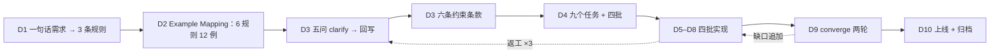
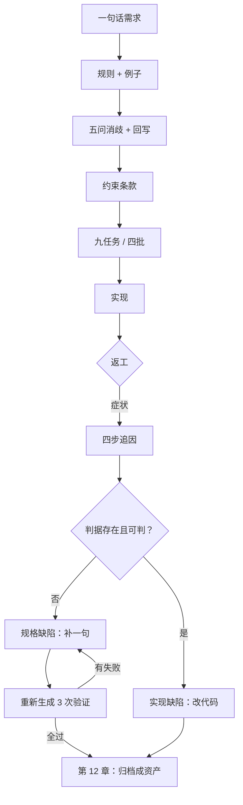

[English](./ch11-end-to-end.md) | **中文**

# 第 11 章：端到端实战——从模糊需求到上线

> **本章导读**：前面十章是分解动作。这一章把它们连成一趟完整的流程：一句话需求，十天，四批交付，三次返工，最后上线。重点不是"顺利"，而是**每次返工都能追到规格的哪一句**——这决定了同样的坑会不会再踩。
> **前置知识**：第 01–10 章。建议至少亲手做过一次 Example Mapping 与一次任务切片。
> **核心学习目标**：
> - 走通"需求 → 规则 → 例子 → 歧义 → 约束 → 任务 → 实现 → 收敛"的完整链路
> - 掌握返工追因的方法：从症状追到缺失的那一句判据
> - 用"重生成 3 次"验证补的那一句是否真的堵住了洞

---

## 1. 认知锚点：分解动作不等于会游泳

### 1.1 一个常见的落差

你看完了分解动作：怎么划手、怎么换气、怎么蹬腿。下水之后，你还是呛了。

不是因为动作错了，是因为**真实场景里这些动作是同时发生的**：你在划手的时候要换气，换气的时候要顾着方向，方向偏了要修正，修正时又忘了蹬腿。

规格驱动也一样。你会写判据、会做例子、会写约束，但真实项目里：需求在变、例子写不完、约束漏了一条、任务切完发现依赖有环。**本章就是把它们放在一起，让你呛一次。**

### 1.2 这一章的结构

不是"教你一个完美流程"，而是**给你一份带伤的过程记录**。三次返工、两次纠正、一次上线延期半天。每次返工都追到具体的一句话——这是全书方法的真正检验。

---

## 2. 第一性原理：一趟完整流程的骨架

### 2.1 十天时间线



**注意那条虚线**：三次返工里有两次回到了 D3（规格层），而不是回到代码层。这不是巧合——**返工的根因大多在规格，不在实现。**

### 2.2 三次返工与追因

| 次序 | 症状 | 追到规格哪一句 | 补了什么 | 重生成 3 次的结果 |
|---|---|---|---|---|
| 1 | 有人取消，候补没收到通知，名额空了一晚 | 「取消后释放名额」——缺"多快释放""释放给谁""怎么通知"三个子句 | AC-3.1：取消后 60 秒内置 reserved 并邀请候补第一位；AC-3.4：通知失败不影响取消 | 3 次重生成全部通过；第 2 次仍漏了"预留"状态，被 analyze 门禁抓到 |
| 2 | 同一位家长收到两条邀请短信 | 「发送确认邀请」——缺投递语义与去重 | C3：outbox + 至少一次投递 + `dedupe_key=(entry_id, offer_round)` | 3 次全部通过；其中 1 次把去重写成"内存 Set"，被约束条款"必须持久化"拦下 |
| 3 | 最后 1 个名额被两人同时抢到 | 「名额满了进候补」——缺并发约束 | C2：名额占用由唯一约束 `(event_id, seq_no)` 保证，禁止"先查后写" | 首次重生成仍写 TOCTOU；补上"必须唯一约束"后才通过——说明**约束要写到实现层可判** |

### 2.3 三次返工暴露的三件事

**第一件：返工的根因分布是不均匀的。**

第 1 次是"缺时序"，第 2 次是"缺投递语义"，第 3 次是"缺实现级约束"。三者对应第 3、6 章的三类判据。它们的共同点是：**都不在"功能有没有"的层面，而在"最坏情况下怎样"的层面。**

**第二件：补判据之后，AI 仍可能以"看起来对"的方式违反它。**

第 3 次最有代表性。补了"必须唯一约束"之后，AI 第一次生成仍然写了 `SELECT COUNT` 再 `INSERT`——因为它在语义上"满足"了"名额不超过 24"，只是没满足"用唯一约束保证"。**约束必须写到能判实现的程度，否则模型会用它的方式满足你的字面要求。**

**第三件：门禁抓到的，往往是人漏掉的。**

第 1 次重生成时，人看代码觉得没问题；`analyze` 发现 `plan` 里有 reserved 状态、`tasks` 里没有对应任务，报了"孤儿机制"。这不是人不够仔细，是**跨产物的一致性问题不适合靠人眼**。

### 2.4 上线检查清单

上线前逐条勾，勾不上就延期：

```text
[ ] 六条约束各自有取证记录（脚本输出 / 压测报告 / 故障注入日志）
[ ] 三条主路径在预发环境跑通（报名 / 满员进候补 / 取消并通知）
[ ] 越权测试：未登录 401、他人 403、列表脱敏、详情留痕
[ ] 并发测试：100 并发抢 1 个名额，成功 1
[ ] 故障注入：关闭通知服务，报名与取消仍返回 2xx
[ ] 数据回滚脚本已演练过一次（不是"写了但没跑过"）
[ ] 审计日志可查、不可删
[ ] 运营侧的操作手册已更新（含代取消、手工合并重复报名）
[ ] 告警已配：通知积压、offer 过期率异常、报名错误率
[ ] 规格与代码一致（跑一次 converge，确认 Converged）
```

**最后一条最容易被跳过**，也最贵：如果上线时的代码已经和规格不一致，那么这份规格从上线那天起就作废了——而没人会告诉你。

### 2.5 上线后 72 小时

| 时段 | 看什么 | 判断 |
|---|---|---|
| 0–2 小时 | 报名成功率、错误率、p95 | 有异常立即回滚，不要"再看看" |
| 2–24 小时 | 候补队列长度、offer 过期率 | 过期率 > 30% 说明通知送达有问题 |
| 24–72 小时 | 重复报名数、运营手工干预次数 | 手工干预 > 3 次说明规格漏了场景 |

**"运营手工干预次数"是最好的规格质量指标**：每一次手工干预，都是一次"系统没覆盖"的证据。

---

## 3. 手把手推演：返工追因的具体方法

### 3.1 四步追因法

| 步 | 动作 | 输出 |
|---|---|---|
| 1 | 写下症状，只写现象不写猜测 | "取消后 12 小时，候补 A 未收到通知，名额显示可用但无人占用" |
| 2 | 沿数据流回溯到"第一个不该发生的状态" | 状态停在 `reserved`，没有生成 offer 记录 |
| 3 | 问：这个状态本应由哪条判据禁止？ | 「取消后 60 秒内邀请候补第一位」 |
| 4 | 检查那条判据是否存在、是否可判 | 存在但不够：只写了"释放名额"，没写"生成 offer 并置 reserved" |

**第 4 步是分水岭**：如果判据存在且可判，那是实现缺陷（改代码）；如果不存在或不可判，那是规格缺陷（改规格）。**两者的修法完全不同，混在一起就会"改了代码但洞还在"。**

### 3.2 复发验证：重生成 3 次

补完判据后，不要只看"这次修好了"。做一次验证：

1. 把补的那一句加进规格；
2. 用同一模型、同一任务描述，**重新生成 3 次**（不是改现有代码，是重新生成）；
3. 每次都用该判据的验收方式去测；
4. 3 次全过 → 判据有效；有 1 次不过 → 判据还不够具体，回到第 3 步。

**为什么要 3 次**：一次通过可能是运气。3 次里只要有 1 次失败，说明判据在某种解读下仍可被绕过——而生产环境一定会遇到那种解读。

### 3.3 一个反例：验证做成了"再跑一遍"

有个团队补完判据后，让 AI "再实现一次"，通过了，就宣布问题解决。两周后同样的 bug 复发。

原因：他们让 AI **在原有代码上改**，而不是**从规格重新生成**。在原有代码上改，AI 看得到之前的实现，会顺着改；从规格重新生成，才是对判据的真正检验。

**这条差别很小，但决定了你测的是"判据"还是"记忆"。**

---

## 4. 常见误区与正反例对比

| 容易踩的坑 | 为什么会出错 | 正确做法 |
|---|---|---|
| **返工后直接改代码** | 最快恢复服务 | 先改规格，再改代码；同一次提交 |
| **追因追到"AI 理解错了"** | 这个结论无法改进任何东西 | 追到"哪一句判据缺失或不可判" |
| **用"改现有代码"验证判据** | 省事 | 从规格重新生成 3 次 |
| **上线清单只勾不验** | 清单长，逐条验太慢 | 每条配一个取证物（脚本输出/截图/日志） |
| **忽略运营手工干预** | 觉得是运营不熟 | 每次干预记一条，作为规格缺口 |
| **规格与代码不一致也上线** | 赶时间 | 上线前跑 converge；不 Converged 不上线 |

---

## 5. 本章小结与局部知识图谱

### 5.1 三句话带走

- **返工根因大多在规格层**：三次返工有两次回到了 D3，不是回代码。
- **追因的终点是一句话**：哪条判据缺失或不可判；追不到这句话，就等于没追。
- **验证要看"重新生成"，不是"改好了"**：3 次重生成才检验判据本身。

### 5.2 本章概念拓扑



---

## 6. 分级通关练习

### Tier 1：直觉核验

1. 为什么"返工后先改规格再改代码"比"先改代码再补规格"更省时间？请用一次具体返工说明。
2. 复发验证为什么必须"重新生成"，而不是"在现有代码上改"？

### Tier 2：动手应用

3. 用四步追因法，分析你最近遇到的一个 bug，写出一张完整的追因表（症状 / 第一个异常状态 / 应存在的判据 / 判据是否存在且可判）。

### Tier 3：边界与迁移

4. 第 3 次返工的教训是"约束要写到能判实现的程度"。请分析这句话的代价：把判据写到实现层，会不会让规格变成 plan？边界在哪里？

<details>
<summary><strong>点击展开：本章练习参考答案与深度解析</strong></summary>

#### 1. 为什么先改规格更省时间

- **结论**：因为改代码只修一次，改规格修的是"这一类"。
- **具体推演**：第 1 次返工如果只改代码（在 `cancel()` 里补一句"生成 offer"），那么下一个"取消"相关任务（比如运营代取消）仍然会漏——因为漏的是判据，不是那一行代码。
- **反直觉之处**：先改规格看起来"多了一步"，实际省掉的是"同一类问题的第 2、3 次修复"。第 10 章的复发记录就是这一步没做的代价。

#### 2. 为什么必须重新生成

- **结论**：因为在现有代码上改，模型看得到旧实现，会"顺着"补齐，而不是"从判据推导"。
- **机制**：这测的是"模型能否理解旧代码"，不是"判据是否充分"。后者才是你要验的。
- **操作细节**：重新生成时，任务描述、规格、上下文都要与首次一致；否则你测的是"新条件"，不是"判据"。

#### 3. 追因表模板

| 项 | 内容 |
|---|---|
| 症状 | 只写现象：谁、在什么操作后、看到什么、期望什么 |
| 第一个异常状态 | 数据流上最早偏离预期的那个状态（数据库记录 / 响应码 / 队列位置） |
| 应存在的判据 | 用 EARS 写一句"本该存在"的话 |
| 判据现状 | 不存在 / 存在但不可判 / 存在且可判 |
| 结论 | 规格缺陷（回 specify）或实现缺陷（改代码） |

- **常见错误**：把"第一个异常状态"写成"用户投诉"或"我发现了"。要往上游追，追到系统内部状态。

#### 4. 判据写到实现层的代价与边界

- **代价**：规格开始绑定技术选型，换实现就要改规格；规格的可移植性下降（第 2 章说的"换团队也能做出同样行为"不再成立）。
- **边界**：**能用"可观测行为"表达的，就不要用"实现手段"表达**。
  - 「并发下不得超卖」是行为，进 spec。
  - 「用唯一约束 `(event_id, seq_no)`」是手段，进 plan。
  - 但当"行为"无法被稳定观测时（例如你无法在不看实现的情况下证明"没有 TOCTOU"），就必须在 spec 里写一条**可验证的实现约束**：「名额占用必须由数据库层唯一约束保证，应用层查后写视为不合规」。
- **判断口诀**：**行为可测就写行为；行为不可测就写约束，并说明为什么它必须被约束。** 后者的代价是牺牲可移植性，换来可验证性——在第 3 次返工那种场景下，这笔交易是划算的。

</details>

---

## 7. 本章权威参考信源与延伸阅读 (Authoritative References)

1. **GitHub Spec Kit**：[GitHub Spec Kit](https://github.com/github/spec-kit) - 本章的定义与规范以此为锚（核验日期：`2026-10-23`）。
2. **Stripe Idempotent Requests**：[Stripe Idempotent Requests](https://stripe.com/docs/api/idempotent_requests) - 本章的定义与规范以此为锚（核验日期：`2026-10-23`）。
3. **DORA**：[DORA](https://dora.dev/) - 本章的定义与规范以此为锚（核验日期：`2026-10-23`）。

> 口径提示：以上信源用于锚定**定义与规范**，不用于外推风险概率。引用任何数字前，先核对来源年份与分母。
