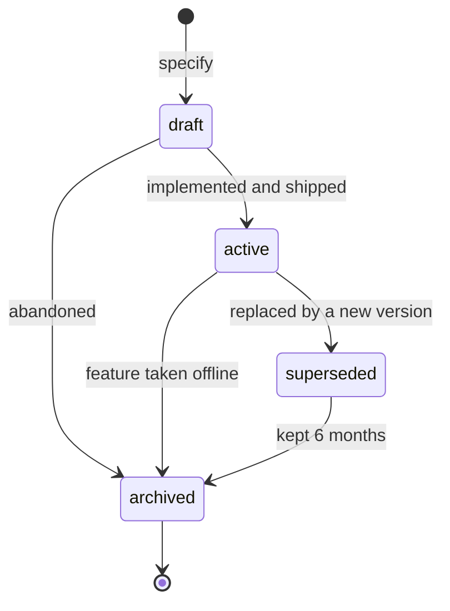
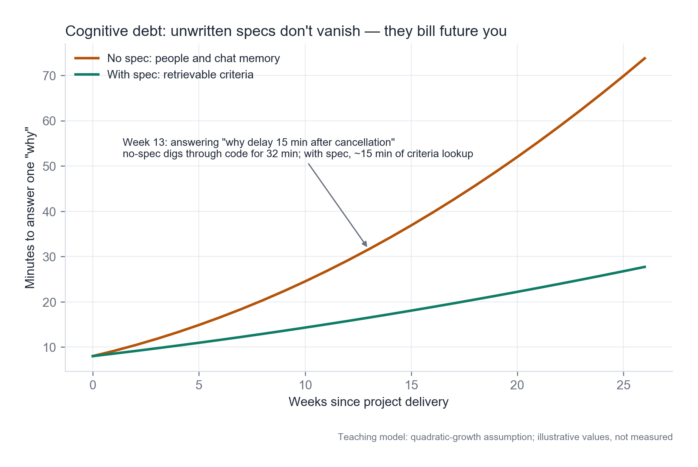
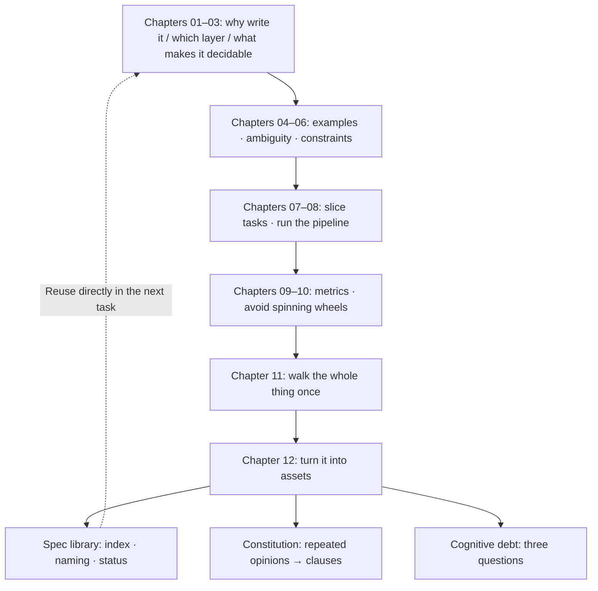

**English** | [中文](./ch12-spec-library.zh.md)

# Chapter 12: The Spec Library and Cognitive Debt

> **Chapter overview**: Launch is not the finish line. Three months later, someone (maybe you) will point at a piece of code and ask "why is this 15 minutes?". This chapter covers how to keep specs findable, trustworthy, and reusable on that day, and how to measure the cost of "nobody can explain it".
> **Prerequisites**: Chapter 08 (artifact directories), Chapter 09 (metrics), Chapter 11 (launch).
> **Core learning objectives**:
> - Build a searchable spec library, not a pile of date-named folders
> - Let `constitution` grow out of repeated review comments, not copy it from a template
> - Measure cognitive debt with three questions, and judge which specs to archive and which to delete

---

## 1. Cognitive Anchor: The Question Three Months Later

### 1.1 A Concrete Scene

In their second week, a newcomer reads a piece of code:

```python
OFFER_TTL_SECONDS = 15 * 60
```

They ask: "Why 15 minutes?"

- The team lead says: "We settled it with operations at the time."
- Operations says: "I do not remember; I think it was fear of people holding slots without showing up."
- The git log shows: `fix: offer timeout`, nothing more.

So the newcomer does the only thing they can: **leave it alone.** From then on that code is a black box nobody dares touch. It may have been due for a change to 30 minutes (because notifications are often delayed), or it may be perfectly reasonable - nobody knows.

### 1.2 Intuitive Analogy: A Library vs. a Box of Books

The difference between a box of books and a library is not the number of books; it is the **index**.

- A box of books: you know there is a dictionary in there, but you cannot find it; you also do not know which edition it is.
- A library: organized by classification, call number, and status (on shelf / checked out / withdrawn); anyone can find anything within twenty minutes.

What a spec library does is build an index for "why it was decided this way".

---

## 2. First Principles: The Three Elements of a Spec Library

### 2.1 Index, Naming, Status

| Element | How to do it | Counter-example |
|---|---|---|
| **Index** | One table in `specs/README.md`: capability / status / owner / last updated / related code paths | Relying on `find` and memory |
| **Naming** | `<domain>-<capability>`, e.g. `registration-waitlist`, `notification-delivery` | `spec-2026-09-22-final-v3.md` |
| **Status** | `draft` / `active` / `superseded` / `archived` | All flat; you cannot tell which is still valid |

**Naming is the easiest to dismiss and the most expensive to get wrong.** Naming by date organizes by "when you wrote it", while retrieval happens by "what is it called". A `spec-2026-09-22-final-v3.md` matches no feature in anyone's head three months later.

### 2.2 The State Machine



Four rules:

1. **Only one `active` per capability at a time.** More than one means someone skipped the supersede step.
2. **`superseded` is not deleted**; keep it for 6 months. It is the evidence of "why it was changed".
3. **The criterion for `archived` is "no code is running"**, not "nobody mentions it".
4. **Record one line per status change**: who, when, why.

### 2.3 constitution: Growing Out of Repeated Comments

`constitution` (the project constitution) is not a values document written from scratch. Its correct source is **the same class of review comment appearing over and over**.

The rule: **the third time the same class of comment appears, promote it into a constitution clause.**

Below is one project's evolution record from v0.1 to v1.0 (real shape, fictional details):

| Version | Clause | The repeated comment that triggered it | Count |
|---|---|---|---|
| v0.1 | All write endpoints must support idempotency | "Retries on this endpoint create duplicates" | 3 |
| v0.2 | Error responses must carry a machine-readable code | "The front end can only judge error types from copy" | 3 |
| v0.3 | List endpoints paginate by default, 20 per page | "This list returns 3000 items at once" | 4 |
| v0.4 | External calls must not appear inside database transactions | "An SMS timeout dragged the whole request down" | 3 |
| v1.0 | Every criterion must carry an executable verification method | "How do we verify this one?" | 5 |

**Note the last column**: clauses are not pulled out of thin air; every one carries "how many times it was raised". This gives the constitution one virtue - **it can be questioned**: if the comment behind a clause appeared only once, it probably should not be constitutional, just a preference.

### 2.4 Drift Detection: Keeping Spec and Code at the Same Version

Three mechanisms, cheapest first:

| Mechanism | Cost | What it catches |
|---|---|---|
| Add one line to the PR template: "Did this change the spec? if not, say why" | Extremely low | Obvious "code-only" changes |
| Run `converge` regularly (Chapter 8) | Low | Gaps between implementation and spec |
| A criterion -> test mapping table | Medium | Criteria covered by no test at all |

**The first one outperforms its cost by far.** One required text box makes "I forgot to change the spec" visible once at commit time. Seen once, people remember next time.

### 2.5 Measuring Cognitive Debt: Three Questions

No complex model needed. Find three people not on this project and ask three questions:

| Question | Record | Healthy value |
|---|---|---|
| "Why is this feature designed this way?" | Whether they can answer correctly within 5 minutes | Yes |
| "To change 15 minutes to 30 minutes, what needs to change?" | Whether they can list 3+ impact points | Yes |
| "If this code breaks, who knows it best?" | Whether it points to a specific person | It should not point to "only one person" |

**The third question stings most**: if the answer is "only Lao Wang knows", that is not "Lao Wang is great"; it is **the project has a single point of failure**.



*Figure 12-1：The vertical axis is "minutes needed to answer one 'why'". Orange is the path without specs - almost overlapping early on, sharply diverging after week 10; green is the path with specs, growing gently. The numbers in the figure are a model illustration, not measurements; what you should take away is the divergence trend of the two lines, and the order of magnitude "the divergence happens in weeks 8-12".*

### 2.6 Archive It, or Delete It

Judge on one thing only: **is any code still running?**

| Situation | Action |
|---|---|
| Feature live, spec matches code | `active`, keep |
| Feature live, spec outdated | Write it back immediately; do not mark active before that |
| Feature retired, code deleted | `archived`, keep |
| Feature retired, but historical data still in the database | `archived`, noting "data retained until year X" |
| The spec's code never shipped | Delete. It is waste paper, not an asset |

Be decisive about the last one. **The biggest enemy of a spec library is not absence but noise** - a forty-page spec that never shipped slows every retrieval and makes people doubt the credibility of the whole library.

---

## 3. Hands-on Walkthrough: A Usable Index

### 3.1 `specs/README.md`

```markdown
# Spec library index

| Capability | Status | Owner | Last updated | Related code |
|---|---|---|---|---|
| registration-waitlist | active | Chen | 2026-10-19 | `api/registrations/`, `services/waitlist/` |
| notification-delivery | active | Chen | 2026-10-12 | `jobs/outbox/`, `adapters/sms/` |
| seat-export | archived | — | 2026-08-30 | deleted (feature never shipped) |
| payment | draft | TBD | 2026-07-02 | none |

## Status meanings
- draft: still under discussion, not a basis for implementation
- active: currently in force; code must agree with it
- superseded: replaced; kept 6 months for traceability
- archived: feature offline or never shipped
```

**This table has 5 columns and every column earns its keep**: status decides "can it be trusted", owner decides "whom to ask", last updated decides "how fresh", related code decides "which one to look at when changing code".

### 3.2 One Complete Write-Back

The newcomer finds `OFFER_TTL_SECONDS = 15 * 60` has no provenance. The correct action is not "change the code" but:

1. Find AC-3.3 (the 15-minute window) in the criteria section of `registration-waitlist/spec.md`;
2. Discover it only says "15 minutes", with no rationale;
3. Add one line: `<!-- 2026-10-19 addendum: the 15 minutes comes from ops experience (waiting cost vs seat-holding cost); re-evaluate when notification delay > 5 minutes -->`;
4. Write the commit message as "adding criterion provenance, no behavior change".

**Note step 4**: stating "no behavior change" tells the reviewer this is a pure documentation commit needing no regression tests.

### 3.3 A Real Retrieval Three Months Later

Scenario: operations proposes "change the confirmation window from 15 minutes to 30 minutes".

With a spec library, the handling path is:

1. Query the index -> `registration-waitlist` -> `active`;
2. Read AC-3.3 and see "re-evaluate when notification delay > 5 minutes";
3. Query the metrics (Chapter 9) -> offer expiry rate 34%, of which 60% is caused by notification delays;
4. Judge: **the window is not too short; the notifications are too slow**. Fix notifications first; leave the window alone;
5. Write the conclusion back into the spec: `<!-- 2026-12-02 review: the main cause of the high expiry rate is notification delay; leave the window unchanged for now -->`.

**Without a spec library, step 4 could not happen** - you would only see "operations wants 30 minutes", change it, and the notification-delay problem would persist, just hidden longer.

---

## 4. Common Pitfalls: Wrong vs. Right

| Common pitfall | Why it goes wrong | The right approach |
|---|---|---|
| **Naming by date/version** | Most convenient while writing | Name by `<domain>-<capability>`; express versions as status |
| **Marking every spec active** | Nobody owns status changes | Record one line per status change; only one active per capability |
| **Copying constitution from a template** | Fast to copy, looks complete | Grow it from repeated comments; note the trigger count for each |
| **A spec library that only grows** | Deleting feels like a burden | Delete what never shipped; archive what is retired |
| **Treating "only Lao Wang knows" as Lao Wang being great** | Praise masks the risk | Treat it as a single point of failure: have Lao Wang write criteria, or run a handover |
| **Retrieval by memory** | Good enough while the project is small | Build the index table; in three months you will thank yourself |
| **Write-backs with conclusions but no reasons** | Conclusions are quicker | Reason + date + who confirmed; reasons are worth more than conclusions |

---

## 5. Chapter Summary and Local Knowledge Map

### 5.1 Three Takeaways

- **The value of a spec library is the index**: ten searchable specs beat fifty scattered ones.
- **constitution grows out of repeated comments**: the third time the same class appears, promote it into a clause.
- **Measuring cognitive debt takes only three questions**, and "only one person knows" is a single point of failure, not individual brilliance.

### 5.2 The Whole Book, Converged



---

## 6. Tiered Exercises

### Tier 1: Intuition Check

1. Why is "only one active per capability" a hard rule rather than a suggestion?
2. In a project, should the "only Lao Wang knows" parts be treated as an asset or a risk? Why?

### Tier 2: Hands-on Application

3. Write a `specs/README.md` index for your project (even just 2 rows), with the 5 columns, and give every spec a status.

### Tier 3: Boundaries & Transfer

4. Someone argues: "The spec library should live in the code repo, versioned together with the code." Analyze the pros and cons of this claim, and when it should live outside the code repo.

<details>
<summary><strong>Click to expand: reference answers and in-depth analysis for this chapter's exercises</strong></summary>

#### 1. Why only one active

- **Conclusion**: because "which one is valid" must be **uniquely decidable**, or the spec falls back to "relying on people's memory".
- **Example consequence**: two active specs define "full" differently (one 24, one 25); whichever the implementer follows, it is "justified", and the conflict cannot be adjudicated. Chapter 2's "source of truth = adjudication order" fails here.
- **Operation**: replacement must do two things at once - set the new one active and the old one superseded. Doing only the first half is a common error.

#### 2. Is "only Lao Wang knows" an asset or a risk

- **Conclusion**: a risk. Lao Wang's competence may be acknowledged along the way, but at the organizational level it must be handled as risk.
- **Mechanism**: the expected loss of a single-point dependency = the importance of that knowledge x the probability that Lao Wang leaves / takes vacation / changes roles. When the former is high and the latter is non-zero, the expected loss is not small.
- **Handling**: it is not as simple as "have Lao Wang write docs" (he may not be able to write criteria). The effective move is **run a handover drill**: have another person answer the three questions from the spec; whatever they cannot answer is a gap in the spec.

#### 3. Practical notes for the index

- **Do not write "the team" in the owner column.** Write a specific person, or nobody is responsible.
- **Related code paths: write directories, not single files.** Files get renamed; directories stay stable.
- **The hardest status to fill is "active but outdated"** - if you find yourself afraid to mark active, it is time to write back.

#### 4. Spec library inside vs. outside the repo

| | Inside the repo | Outside (Wiki / doc system) |
|---|---|---|
| Pros | Same version as code; editable in PRs; `git log` traceable; works offline | Non-engineers edit easily; retrieval and permissions more flexible; does not pollute the codebase |
| Cons | High barrier for non-engineers; large files hurt clone | Decoupled from code versions; easily becomes "that other place"; no code context in search |
| Fits | Engineering-led, specs as criteria, evolving in sync with code | Product-led, multi-party collaboration, specs more like "consensus documents" |

- **A compromise**: specs go into the repo (as the single source of truth for criteria); summaries for non-technical readers live outside, with **one-way sync only** (repo -> external) to avoid double-write conflicts.
- **Failure boundary**: if the team has no code review culture, specs in the repo become "files nobody reads"; putting them outside actually gets them used more. **Tool choice must match collaboration habits, not ideals.**

</details>

---

## 7. Authoritative References and Further Reading for This Chapter (Authoritative References)

1. **GitHub Spec Kit**: [GitHub Spec Kit](https://github.com/github/spec-kit) - The definitions and conventions of this chapter are anchored here (verified on: `2026-10-23`).
2. **Semantic Versioning 2.0.0**: [Semantic Versioning 2.0.0](https://semver.org/) - The definitions and conventions of this chapter are anchored here (verified on: `2026-10-23`).
3. **martinfowler.com**: [martinfowler.com](https://martinfowler.com/) - The definitions and conventions of this chapter are anchored here (verified on: `2026-10-23`).

> A note on scope: the sources above anchor **definitions and conventions**, not extrapolated risk probabilities. Before citing any number, check its source year and denominator first.
