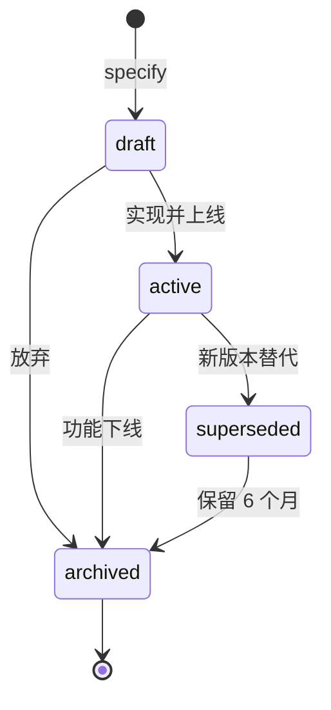
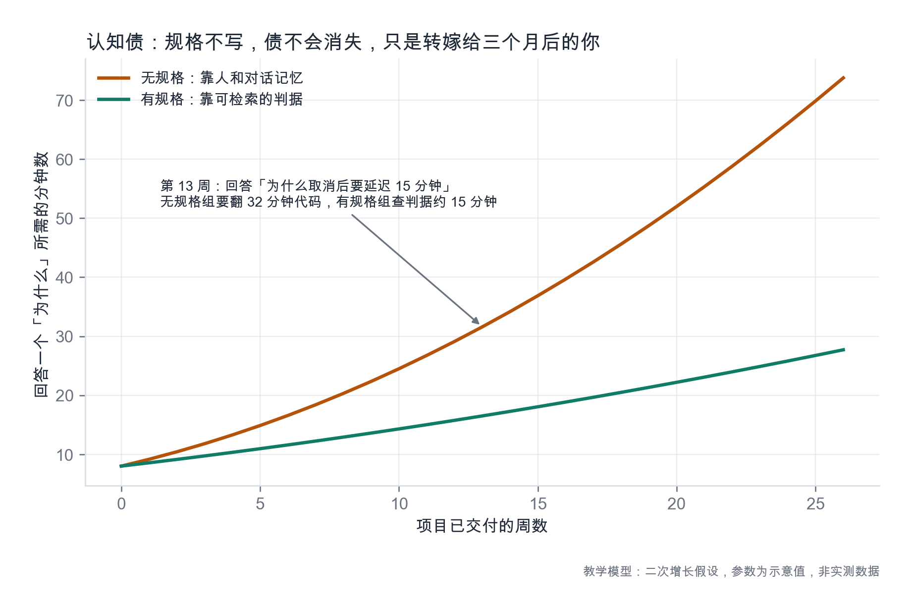
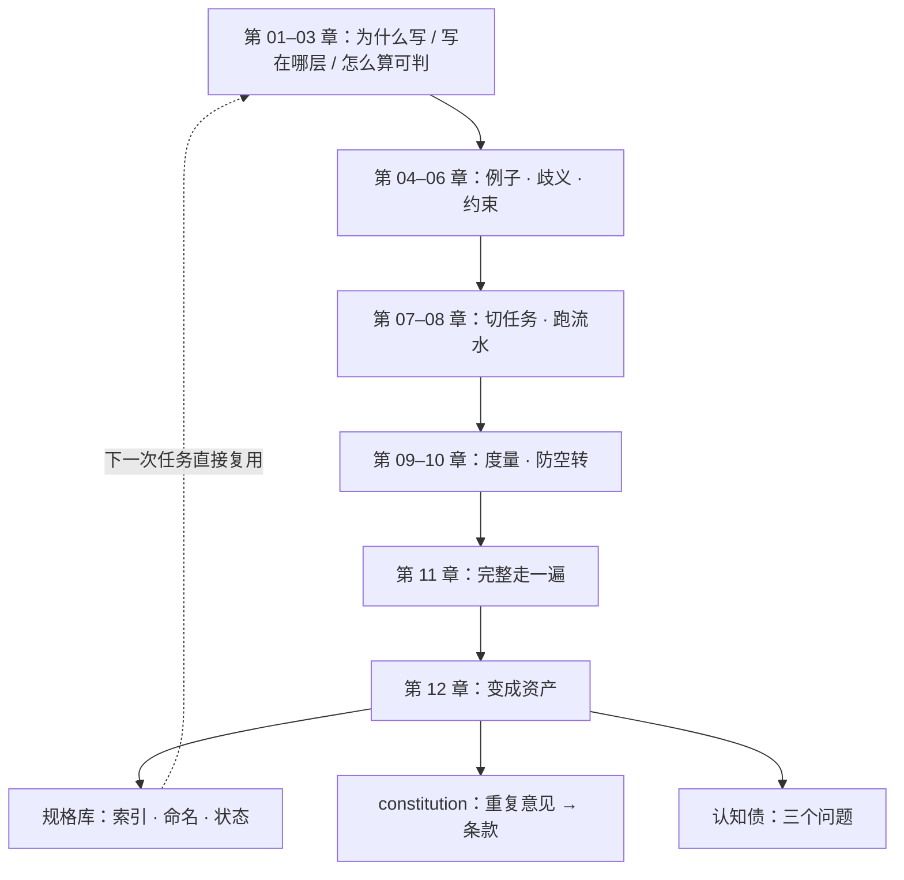

# 第 12 章：规格库与认知债

> **本章导读**：上线不是终点。三个月后，会有人（可能是你自己）指着一段代码问"这里为什么是 15 分钟"。本章讲怎么让规格在那一天仍然可查、可信、可复用，以及怎么度量"没人说得清"这件事的代价。
> **前置知识**：第 08 章（产物目录）、第 09 章（度量）、第 11 章（上线）。
> **核心学习目标**：
> - 建一个能被检索的规格库，而不是一堆按日期命名的文件夹
> - 让 `constitution` 从重复的评审意见里长出来，而不是从模板里抄
> - 用三个问题度量认知债，并判断哪些规格该归档、哪些该删

---

## 1. 认知锚点：三个月后的那个问题

### 1.1 一个具体的场景

新人入职第二周，翻到一段代码：

```python
OFFER_TTL_SECONDS = 15 * 60
```

他问："为什么是 15 分钟？"

- 组长说："当时跟运营定的。"
- 运营说："我不记得了，好像是怕有人占着名额不来。"
- Git 记录显示：`fix: offer 超时`，没有更多。

于是新人做了他唯一能做的事：**不动它。** 这段代码从此成了一个没人敢碰的黑盒。它可能早就该改成 30 分钟（因为通知经常延迟），也可能完全合理——没人知道。

### 1.2 直觉类比：图书馆与一箱书

一箱书和一个图书馆的差别，不是书的数量，是**索引**。

- 一箱书：你知道里面有《新华字典》，但你找不到它；你也不知道这本书是哪一版。
- 图书馆：按分类、编号、状态（在架/借出/下架）组织，任何人二十分钟内能找到。

规格库要做的，就是给"当初为什么这么定"建一个索引。

---

## 2. 第一性原理：规格库的三要素

### 2.1 索引、命名、状态

| 要素 | 做法 | 反例 |
|---|---|---|
| **索引** | `specs/README.md` 一张表：功能 / 状态 / 负责人 / 最后更新 / 关联代码路径 | 靠 `find` 和记忆 |
| **命名** | `<领域>-<能力>`，如 `registration-waitlist`、`notification-delivery` | `spec-2026-09-22-final-v3.md` |
| **状态** | `draft` / `active` / `superseded` / `archived` | 全部平铺，看不出哪份还有效 |

**命名这一条最容易被轻视，代价最大。** 按日期命名等于按"你什么时候写的"组织，而检索时人按"这叫什么"找。一个 `spec-2026-09-22-final-v3.md`，三个月后没人知道它对应哪个功能。

### 2.2 状态机



四条规则：

1. **同一能力同时只能有一份 `active`**。多于一份，说明有人没做替代动作。
2. **`superseded` 不删**，保留 6 个月。它是"当初为什么改"的证据。
3. **`archived` 的判据是"没有代码在跑"**，不是"没人提了"。
4. **每次状态变更记一行**：谁、什么时候、为什么。

### 2.3 constitution：从重复意见里长出来

`constitution`（项目宪法）不是一份从头写的价值观文档。它的正确来源是**评审里反复出现的同一类意见**。

规则：**同一类意见出现第 3 次，升格为一条 constitution 条款。**

下面是某项目从 v0.1 到 v1.0 的演进记录（真实形态，细节虚构）：

| 版本 | 条款 | 触发它的重复意见 | 次数 |
|---|---|---|---|
| v0.1 | 所有写接口必须支持幂等 | "这个接口重试会重复创建" | 3 |
| v0.2 | 错误响应必须含机器可读的 code | "前端只能靠文案判断错误类型" | 3 |
| v0.3 | 列表接口默认分页，默认 20 条 | "这个列表一次返回 3000 条" | 4 |
| v0.4 | 外部调用不得出现在数据库事务内 | "短信超时把整个请求拖挂了" | 3 |
| v1.0 | 每条判据必须配一个可执行的验证方式 | "这条怎么验？" | 5 |

**注意最后一列**：条款不是拍脑袋写的，每条都带着"它被重复提了几次"。这让 constitution 有了一个好处——**它可以被质疑**：如果某条条款背后的意见只出现过一次，那它可能不该是宪法，只是一次偏好。

### 2.4 漂移检测：让规格与代码保持同一版本

三种手段，成本从低到高：

| 手段 | 成本 | 能抓到什么 |
|---|---|---|
| PR 模板加一行"本次是否修改了规格？未修改请说明原因" | 极低 | 明显的"只改代码" |
| 定期跑 `converge`（第 8 章） | 低 | 实现与规格的缺口 |
| 判据 → 测试的映射表 | 中 | 判据没有被任何测试覆盖 |

**第一项的效果远超它的成本。** 一个必填的文本框，会让"我忘了改规格"这件事在提交时被看见一次。人被看见一次，下次就会记得。

### 2.5 认知债的度量：三个问题

不用复杂模型。找三个不在这个项目里的人，问三个问题：

| 问题 | 记录什么 | 健康值 |
|---|---|---|
| "这个功能为什么这样设计？" | 能否在 5 分钟内答对 | 能 |
| "如果要把 15 分钟改成 30 分钟，要动哪些地方？" | 能否列出 3 个以上影响点 | 能 |
| "这段代码出问题，谁最清楚？" | 是否指向一个具体的人 | 不应指向"只有某人" |

**第三个问题最刺人**：如果答案是"只有老王知道"，那这不是"老王厉害"，是**项目有单点故障**。



*图 12-2：纵轴是"回答一个『为什么』所需的分钟数"。橙色是无规格的路径——前期几乎重合，第 10 周后迅速拉开；绿色是有规格的路径，增长平缓。图中数字是模型示意，不是实测；你要带走的是两条线的分离趋势，以及"分离发生在第 8–12 周"这个量级。*

### 2.6 该归档，还是该删

判断只看一件事：**还有代码在跑吗？**

| 情况 | 动作 |
|---|---|
| 功能在线，规格与代码一致 | `active`，保持 |
| 功能在线，规格已过期 | 立刻回写；回写前不要标 active |
| 功能下线，代码已删 | `archived`，保留 |
| 功能下线，但还有历史数据在库 | `archived`，且注明"数据保留至某年" |
| 规格对应的代码从未上线 | 删。它是废纸，不是资产 |

最后一条要果断。**规格库最大的敌人不是缺失，是噪音**——一份从没上线过的四十页规格，会让所有检索都变慢，并让人怀疑整个库的可信度。

---

## 3. 手把手推演：一份可用的索引

### 3.1 `specs/README.md`

```markdown
# 规格库索引

| 能力 | 状态 | 负责人 | 最后更新 | 关联代码 |
|---|---|---|---|---|
| registration-waitlist | active | 小陈 | 2026-10-19 | `api/registrations/`、`services/waitlist/` |
| notification-delivery | active | 小陈 | 2026-10-12 | `jobs/outbox/`、`adapters/sms/` |
| seat-export | archived | — | 2026-08-30 | 已删除（功能未上线） |
| payment | draft | 待定 | 2026-07-02 | 无 |

## 状态说明
- draft：还在讨论，不可作为实现依据
- active：当前有效，代码必须与之一致
- superseded：已被替代，保留 6 个月供追溯
- archived：功能已下线或从未上线
```

**这张表有 5 列，每一列都有用途**：状态决定"能不能信"，负责人决定"找谁问"，最后更新决定"新不新"，关联代码决定"改代码时该看哪份"。

### 3.2 一次回写的完整动作

新人发现 `OFFER_TTL_SECONDS = 15 * 60` 没有出处。正确动作不是"改代码"，而是：

1. 在 `registration-waitlist/spec.md` 的判据段找到 AC-3.3（15 分钟窗口）；
2. 发现它只写了"15 分钟"，没写理由；
3. 补一行：`<!-- 2026-10-19 补记：15 分钟源于运营经验（等候成本 vs 占位成本），通知延迟 >5 分钟时应重新评估 -->`；
4. 提交信息写明"补记判据来源，不改行为"。

**注意第 4 步**：明确"不改行为"，评审者才知道这是一次纯文档提交，不需要回归测试。

### 3.3 三个月后的一次真实检索

场景：运营提出"把确认窗口从 15 分钟改成 30 分钟"。

有了规格库，处理路径是这样的：

1. 查索引 → `registration-waitlist` → `active`；
2. 读 AC-3.3，看到"通知延迟 >5 分钟时应重新评估"；
3. 查度量（第 9 章）→ offer 过期率 34%，其中 60% 是通知延迟导致；
4. 判断：**不是窗口太短，是通知太慢**。先修通知，窗口不动；
5. 结论写回规格：`<!-- 2026-12-02 评估：过期率高的主因是通知延迟，窗口暂不改 -->`。

**没有规格库的话，第 4 步不可能发生**——你只会看到"运营要改 30 分钟"，然后改掉，然后通知延迟的问题继续存在，只是被掩盖得更久。

---

## 4. 常见误区与正反例对比

| 容易踩的坑 | 为什么会出错 | 正确做法 |
|---|---|---|
| **按日期/版本号命名** | 写的时候最方便 | 按 `<领域>-<能力>` 命名；版本用状态表示 |
| **所有规格都标 active** | 没人负责改状态 | 状态变更记一行；同一能力只能一份 active |
| **constitution 从模板抄** | 抄起来快，看起来完整 | 从重复意见里长；每条注明触发次数 |
| **规格库只增不删** | 删东西有心理负担 | 从未上线的删掉；下线的 archived |
| **把"只有老王懂"当成老王厉害** | 夸奖掩盖了风险 | 当成单点故障处理：让老王写一份判据，或做一次交接 |
| **检索靠记忆** | 项目小的时候够用 | 索引表；三个月后会感谢自己 |
| **回写只写结论不写理由** | 结论省事 | 理由 + 日期 + 谁确认的；理由比结论更值钱 |

---

## 5. 本章小结与局部知识图谱

### 5.1 三句话带走

- **规格库的价值在索引**：能检索的十份，胜过散落的五十份。
- **constitution 从重复意见长出来**：同一类意见第 3 次，升格为条款。
- **认知债的度量只需三个问题**，其中"只有某人知道"是单点故障，不是个人能力。

### 5.2 全书概念收束



---

## 6. 分级通关练习

### Tier 1：直觉核验

1. 为什么"同一能力只能有一份 active"是硬规则，而不是建议？
2. 一个项目里"只有老王知道"的部分，应该被当成资产还是风险？为什么？

### Tier 2：动手应用

3. 为你手上的项目写一份 `specs/README.md` 索引（哪怕只有 2 行），包含 5 列，并给每份规格标状态。

### Tier 3：边界与迁移

4. 有人主张："规格库应该进代码仓库，和代码一起版本化。"请分析这个主张的优点、缺点，以及什么情况下应该放到代码库之外。

<details>
<summary><strong>点击展开：本章练习参考答案与深度解析</strong></summary>

#### 1. 为什么只能有一份 active

- **结论**：因为"哪份有效"必须是**唯一可判**的，否则规格就回到了"靠人记"的状态。
- **后果示例**：两份 active 对"满员"的定义不同（一份 24、一份 25），实现者按哪份都"有据可依"，冲突无法裁决。第 2 章的"唯一真源 = 裁决顺序"在这里失效。
- **操作**：替换时必须同时做两件事——新份置 active、旧份置 superseded。只做前一半是常见错误。

#### 2. "只有老王知道"是资产还是风险

- **结论**：是风险。可以顺带承认老王的能力，但组织层面必须按风险处理。
- **机制**：单点依赖的期望损失 = 该知识的重要性 × 老王离开/休假/调岗的概率。前者高、后者不为零，期望损失就不低。
- **处理**：不是"让老王写文档"这么简单（他可能写不出判据）。有效做法是**做一次交接演练**：让另一个人按规格回答三个问题，答不上来的地方就是规格的缺口。

#### 3. 索引实操要点

- **负责人一列别写"团队"**。写具体的人，否则等于没人负责。
- **关联代码路径写目录，不写单文件**。单文件会变，目录稳定。
- **状态列最难填的是"active 但已过期"**——如果发现自己不敢标 active，说明该回写了。

#### 4. 规格库放仓库内 vs 仓库外

| | 仓库内 | 仓库外（Wiki / 文档系统） |
|---|---|---|
| 优点 | 与代码同版本；PR 里能改；`git log` 可追溯；离线可用 | 非技术人员易编辑；检索与权限更灵活；不污染代码库 |
| 缺点 | 非技术人员参与门槛高；大文件影响 clone | 与代码版本脱钩；容易变成"另一个地方"；搜索不到代码上下文 |
| 适合 | 工程主导、规格即判据、需要与代码同步演进 | 产品主导、多方协作、规格更像"共识文档" |

- **折中方案**：规格进仓库（作为判据的唯一真源），面向非技术读者的摘要放仓库外，并**只做单向同步**（仓库 → 外部），避免双写冲突。
- **失效边界**：如果团队没有 code review 文化，规格进仓库会变成"没人看的文件"；此时放外部反而更容易被使用。**工具选择要匹配协作习惯，不是匹配理念。**

</details>

---

## 7. 本章权威参考信源与延伸阅读 (Authoritative References)

1. **GitHub Spec Kit**：[GitHub Spec Kit](https://github.com/github/spec-kit) - 本章的定义与规范以此为锚（核验日期：`2026-10-23`）。
2. **Semantic Versioning 2.0.0**：[Semantic Versioning 2.0.0](https://semver.org/) - 本章的定义与规范以此为锚（核验日期：`2026-10-23`）。
3. **martinfowler.com**：[martinfowler.com](https://martinfowler.com/) - 本章的定义与规范以此为锚（核验日期：`2026-10-23`）。

> 口径提示：以上信源用于锚定**定义与规范**，不用于外推风险概率。引用任何数字前，先核对来源年份与分母。
