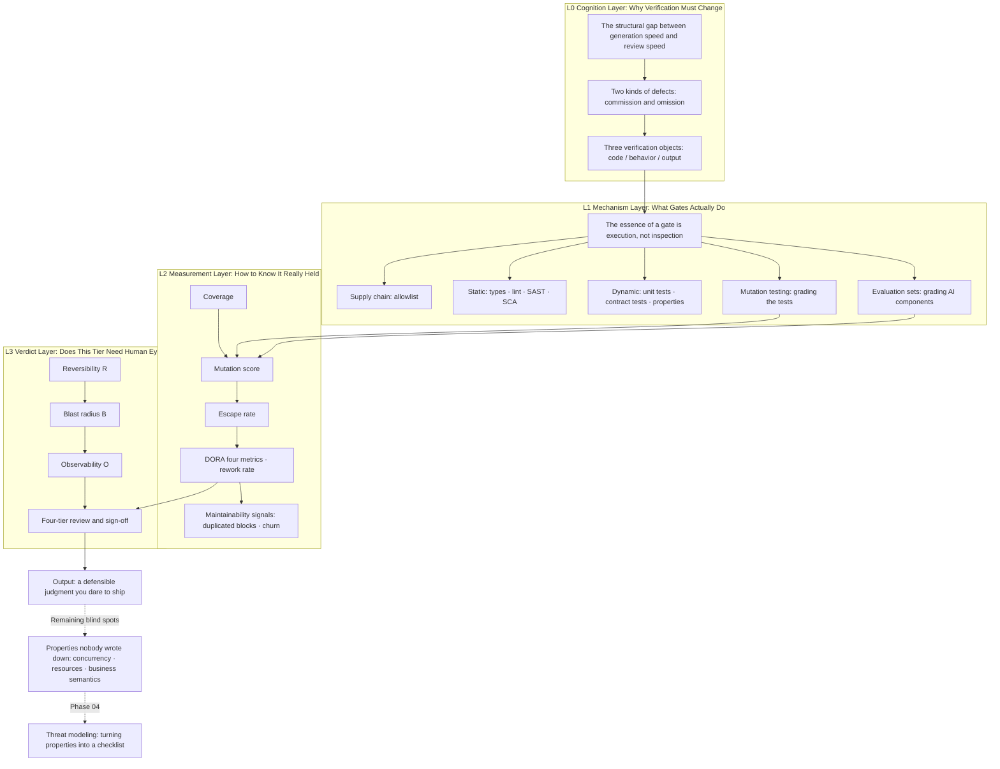

**English** | [中文](./README.zh.md)

# "Treating AI Code as Untrusted Input: From 'Looks Fine to Me' to 'I Dare Ship It'" Open-Source Textbook

> **Positioning**: for readers who "can already get AI to write runnable code, but cannot say why it is trustworthy". Readable with zero testing background and zero security background.
> **Design principles**: First Principles decomposition · intuition first · every criterion must produce a number or point out its boundary · every gate must state when it fails
> **Coordinates in the whole route**: this is **Phase 3** of the "Vibe Coding Learning Plan", standing as its own book. The previous phase solved "turning requirements into specs"; this phase solves "turning code into defensible evidence"; the next phase solves "who can break in".

---

## 0. The Hole This Book Fills, in One Sentence

Phases 1 and 2 make AI write faster and more accurately. Both of these increase the same thing: **the amount of code on your desk that "you have not read yet".**

And so appeared something nobody says out loud but everyone does — **passing off "I gave it a glance" as "I verified it"**.

The hole this book fills is one sentence:

> **You cannot read every line of code AI writes. So you must earn the right to "dare to ship" in another way.**

Replace what with what? Replace "I read it" with "what it has been through". What this book teaches is not reading faster; it is **replacing feelings with evidence**.

---

## 1. Domain Panorama and Learning Objectives

### 1.1 Why This Phase Deserves a Book of Its Own

Three scenarios; almost everyone who writes code with AI has run into one of them:

**Scenario A: all-green code, overselling in production.**
400 lines of implementation, CI all green, coverage 100%; you glance at the core function, it seems sound, and you merge. On Monday operations discovers the coupon limited to 100 copies was redeemed 143 times. You read it top to bottom and not a single line is wrong — what is wrong is that there is nothing between two lines.

**Scenario B: a pile of tests written, and not one bug stopped.**
The AI handed over 20 tests along the way, coverage 92%. The day after launch, an obvious boundary error blew up. You dig into the tests and find they assert "the function has a return value" and "execute was called once".

**Scenario C: the dependency got installed — and it was someone else's backdoor.**
The AI wrote a package name in the import; you cannot find it in the registry, but it looks so real you assume it is an internal package. After `pip install` everything is fine — because that package does work correctly; it just has one extra line you did not look at.

The three scenarios correspond to three different failures: **wrong verification position / insufficient verification strength / wrong verification object**. The three parts of this book break down in exactly this order.

### 1.2 What You Will Master After This Textbook

**Core cognition layer**
- Judge a defect as commission (doing it wrong) or omission (not doing what should be done), and explain which class "reading code" is powerless against
- Explain on which three conditions Veracode's 56% differs from a "release failure rate", and automatically carry the qualifiers when citing it
- Explain that "AI as the author" (the code it writes) and "AI as a component" (the judgments it gives) are two completely different verification objects, with different falsification methods

**System architecture layer**
- Draw the gate pipeline of your own project, marking each layer's **what it catches / what it misses / when it equals not running**
- Design three mutually non-overlapping verification devices: the dependency allowlist, mutation testing, and the evaluation set
- Explain which class of defects (concurrency, resources, business semantics) **no gate can catch**, and what the only way out is

**Practical application layer**
- Hook complete gates onto a real repository, and deliver the record of "having blocked at least one real problem"
- Use mutation testing to find at least two holes in your own test suite and patch them
- Assign a risk tier (R × B × O) to an AI-generated feature, and explain the criteria rather than the feeling

### 1.3 The Three Hard Rules of This Book

1. **Every criterion must produce a number, or be explicitly marked as an "empirical line".** Percentages whose source cannot be stated are never allowed into the text.
2. **Every gate layer must state its failure boundary.** One that only writes "what it catches" counts as unfinished — because what really causes incidents is the part it cannot catch.
3. **Do not decide review by author; decide by reversibility.** "This part is AI-written so look twice" is intuition, not a criterion. The criterion is "if it breaks, can I go back".

---

## 2. Domain Panorama Knowledge Map



**Layer explanations**

| Layer | The question it answers | The consequence of not learning it |
|---|---|---|
| L0 cognition layer | Why "reading it once" does not count as verification | You will pour all your energy into raising reading volume while the gap widens |
| L1 mechanism layer | What exactly each gate blocks | Ten tools installed, still unable to say which one works |
| L2 measurement layer | How to know the gates really block | Coverage 100% yet cannot stop one boundary error |
| L3 verdict layer | Which tier needs a human, and who signs | Either everything human-reviewed (unsustainable), or everything auto-merged (equals nothing) |

---

## 3. Knowledge Module Matrix

| Phase | Module | The core problem it solves | Prerequisites | Visual asset type | Difficulty |
|---|---|---|---|---|---|
| L0 | M1 The position of verification | Why "I read it" is not verification | None (readable with zero testing background) | Incident sequence diagram + detection matrix heatmap | ★★☆☆☆ |
| L0 | M2 Defect typology | Which defects reading code can never see | M1 | Dichotomy comparison table + four-failure matrix | ★★☆☆☆ |
| L0 | M3 Three verification objects | Which falsification method for code, behavior, output | M1 M2 | Coverage matrix + decision tree | ★★★☆☆ |
| L1 | M4 Supply-chain gate | Hallucinated dependencies and the squatting attack chain | M3 | Distribution bar chart + attack-chain sequence | ★★☆☆☆ |
| L1 | M5 Static gate | The boundary of shape checks and the economics of false positives | M3 | Detection boundary matrix + false-positive-vs-adoption curve | ★★★☆☆ |
| L1 | M6 Dynamic gate | From "it ran" to "it holds" | M3 | Four-pillar scorecard + pyramid/diamond comparison | ★★★★☆ |
| L1 | M7 Mutation testing | Grading the tests themselves | M6 | Flowchart + coverage-vs-mutation-score comparison | ★★★★☆ |
| L1 | M8 Blind spots | The class no gate can catch | M7 | Interleaving sequence diagram + three-check trade-off chart | ★★★★★ |
| L2 | M9 Metrics system | Which number will lie to you | M7 | Metric relationship map + three maintainability signal trends | ★★★★☆ |
| L2 | M10 Risk tiers | Which tier needs human eyes, and on what criteria | M9 | Three-axis scorecard + tier × gate-strength matrix | ★★★☆☆ |
| L1 | M11 Evaluation sets | The falsification method for AI as a component | M3 M9 | Evaluation pipeline diagram + judge bias shapes | ★★★★★ |
| L3 | M12 Pipeline implementation | Order, cost, bypass, and cognitive debt | M4—M10 | End-to-end topology + cost curve | ★★★★☆ |

---

## 4. Detailed Chapter Outline

### Part 1 · Cognitive Rebuild: Why Reading Code Is No Longer Enough

- **Chapter 01: All-Green Code and 143 Redemption Records** (`chapters/ch01-green-but-wrong.md`)
  - **Intuition Anchor**: merged at 16:40 on Friday, oversold at 09:20 on Monday. You read the code top to bottom and not one line is wrong
  - **Core Knowledge**: misplaced verification (tool and defect not on the same layer); the three layers of incident anatomy (behavior layer / structure layer / property layer); this book's two-halves structure (AI as author vs AI as component)
  - **Planned Figures**: incident timeline (Mermaid sequence); Figure 1-1 the five-gate × five-defect detection matrix (heatmap of real run results)
  - **Hands-on Exercise**: run the reproduction script in `code/ch01`, and personally oversell once with a piece of 100%-coverage code
  - **Difficulty**: ★★☆☆☆

- **Chapter 02: Two Kinds of Defects, and Reading Code Is Only Good at One** (`chapters/ch02-two-kinds-of-defects.md`)
  - **Intuition Anchor**: customs security — you do not clear a whole batch because "the sender looks pretty professional"
  - **Core Knowledge**: the visibility asymmetry between commission and omission; "the effectiveness of reading code = the completeness of the spec checklist in your head"; four classes of systematic failure (hallucinated dependencies / patterned copying / missing security properties / context collapse); the three qualifiers of Veracode's 56% and the magnitude gaps across languages/vulnerability classes
  - **Planned Figures**: Figure 2-1 syntax 100% vs security 56% (including the "no trustworthy data" unknown region); Figure 2-2 four failure classes × cheapest-gate matrix
  - **Hands-on Exercise**: tag the defects of your last 10 PRs (commission / omission), compute the ratio, and reconcile with this chapter's prediction
  - **Difficulty**: ★★☆☆☆

- **Chapter 03: Three Verification Objects — Code, Behavior, Output** (`chapters/ch03-three-objects.md`)
  - **Intuition Anchor**: a court does not look at whether you "look like a good person"; it looks at the chain of evidence
  - **Core Knowledge**: the falsification limits of the three object classes (code shape / runtime behavior / output quality); gate = execution rather than inspection as a First Principle; why "reading" can only verify the first class; the coverage matrix and overlap zones of the three means
  - **Planned Figures**: Figure 3-1 the three-objects × three-means coverage matrix; Figure 3-2 the decision tree "which verification for this piece" (Mermaid)
  - **Hands-on Exercise**: take one of your own functions, write three verifications — a type annotation, a behavior assertion, an output snapshot — and compare what each catches and misses
  - **Difficulty**: ★★★☆☆

### Part 2 · Gates: How to Verify AI as the Author

- **Chapter 04: Layer 0 — The Supply Chain, Run It First Because It's the Cheapest** (`chapters/ch04-supply-chain.md`)
  - **Intuition Anchor**: domain squatting, except what gets squatted is the package name
  - **Core Knowledge**: 19.7% of recommended package names do not exist (open source 21.7% / commercial 5.2%), 205,474 unique hallucinated names, 43% stably reproducible; the four-step slopsquatting attack chain; why the dependency allowlist must be human-maintained; lockfiles and SBOM; why this gate must run first (every later gate cannot see this hole)
  - **Planned Figures**: Figure 4-1 hallucinated package name distribution; Figure 4-2 the four-step attack chain sequence (Mermaid); Table 4-3 the three-layer dependency defense comparison
  - **Hands-on Exercise**: run `dependency_gate.py`; generate the initial allowlist for your project and write "why it is allowed" for each package
  - **Difficulty**: ★★☆☆☆

- **Chapter 05: Layer 1 — Static Analysis: Shape Is Not Intent** (`chapters/ch05-static.md`)
  - **Intuition Anchor**: an X-ray machine can see the shape of bones, not what this person intends to do
  - **Core Knowledge**: the capability boundaries of compiler / type checker / linter / SAST / SCA / secret scanning; the pattern-matching nature of SAST; the economics of false positives (high false-positive rate → turned off → equals not running); why "correct shape" carries almost no security information
  - **Planned Figures**: Figure 5-1 the six classes of static tools' detection boundary matrix; Figure 5-2 the false-positive-rate vs team-adoption curve (explicitly marked as illustrative)
  - **Hands-on Exercise**: run three static tools on code containing four defects; record what each caught, what it missed, and how many false alarms it raised
  - **Difficulty**: ★★★☆☆

- **Chapter 06: Layer 2 — Dynamic Analysis: From "It Ran" to "It Holds"** (`chapters/ch06-dynamic.md`)
  - **Intuition Anchor**: a health check is not measuring your height; it is putting a fake lesion inside you to see whether the immune system reacts
  - **Core Knowledge**: Khorikov's four pillars (regression protection / refactoring resistance / fast feedback / maintainability); "forever-green tests"; why AI-generated tests naturally test implementation details; which hole contract tests and property-based tests each patch; why the test pyramid should become a diamond in the AI era
  - **Planned Figures**: Figure 6-1 the four-pillar scorecard (scoring the two suites of this chapter's case item by item); Figure 6-2 pyramid vs diamond
  - **Hands-on Exercise**: rewrite a mock-style AI test into a behavior test; record how the "refactoring resistance" score changes before and after
  - **Difficulty**: ★★★★☆

- **Chapter 07: Layer 3 — Mutation Testing: Grading the Tests Themselves** (`chapters/ch07-mutation.md`)
  - **Intuition Anchor**: is the guard you hired actually patrolling? Send someone disguised as a thief on a round
  - **Core Knowledge**: mutation operators and "killed/survived"; mutation score; equivalent mutants (explained with the real example of the fixed version's M1); the cost model N × test runtime; how to control the time budget in CI
  - **Planned Figures**: Figure 7-1 the mutation testing flow (Mermaid); Figure 7-2 coverage 100% vs mutation score 25% (real run results); Table 7-3 common mutation operators and their defect types
  - **Hands-on Exercise**: run `mutation_demo.py`; add five mutants to your own test suite and find at least two holes
  - **Difficulty**: ★★★★☆

- **Chapter 08: Blind Spots — What No Gate Can Catch** (`chapters/ch08-blind-spots.md`)
  - **Intuition Anchor**: a gate is a searchlight, not the sun. What you cannot illuminate is not empty; you just did not turn there
  - **Core Knowledge**: why concurrency interleavings, resource leaks, unbounded result sets, and N+1 all slip past the first four layers; the three-way trade-off of deterministic interleaving reproduction vs stress testing vs constraint-level checks; "properties nobody wrote down" — sinking constraints into the database, transactions, rate limiters
  - **Planned Figures**: the two-request interleaving sequence (Mermaid sequence); Figure 8-1 the four-group stress test detection comparison (real run, including the "false green light" group)
  - **Hands-on Exercise**: run `race_repro.py`; write a "constraint-existence" check with `PRAGMA index_list` / `information_schema` and wire it into CI
  - **Difficulty**: ★★★★★

### Part 3 · Measurement and Verdicts: How to Know It Really Held

- **Chapter 09: Which Number on the Dashboard Will Lie to You** (`chapters/ch09-metrics.md`)
  - **Intuition Anchor**: the body-fat scale at the gym — it measures resistance, not fat. What you trust is the interpretation, not the number
  - **Core Knowledge**: how coverage, mutation score, and escape rate relate and deceive one another; the escape rate is the only metric that can falsify you; the four DORA metrics + rework rate + first-pass acceptance rate; why "AI-generated lines of code" is a misleading metric; GitClear's maintainability signals (refactoring down / duplicated blocks up / churn up)
  - **Planned Figures**: Figure 9-1 the three readings of one test suite (line 100% / branch 100% / mutation 25%, real run); metric leading-lagging relations (Mermaid)
  - **Hands-on Exercise**: compute three sets of numbers for your own project (duplicated block share, 30-day churn, cross-file call density) + one conclusion
  - **Difficulty**: ★★★★☆

- **Chapter 10: Risk Tiers — Does This Tier Need Human Eyes** (`chapters/ch10-risk-tiers.md`)
  - **Intuition Anchor**: the ER triage desk. The queue is not by severity of illness; it is by "what happens if we wait"
  - **Core Knowledge**: R × B × O three-axis scoring; the four-tier process (auto-merge / light / human / high-level); why reversibility rather than code volume; the tier-to-gate-strength table; who signs, and signs what
  - **Planned Figures**: Figure 10-1 the three-axis scorecard; Figure 10-2 the tier × gate-strength matrix
  - **Hands-on Exercise**: score five real features in your team and compare with the current process — wherever they disagree is a current risk hole
  - **Difficulty**: ★★★☆☆

### Part 4 · Implementation: Plugging Into the Pipeline, and Closing Honestly

- **Chapter 11: Evaluation Sets — When AI Is a Component, Not the Author** (`chapters/ch11-eval-sets.md`)
  - **Intuition Anchor**: the difference between an exam paper and an interviewer. The exam paper is the same every time; the interviewer is different every time
  - **Core Knowledge**: when an evaluation set is mandatory (any of model / prompt / retrieval will change); how to build one (real traffic sampling + boundary samples + regression set); why accuracy is not enough and errors must be weighted by cost; the three known biases of AI-as-a-judge (position, length, self-preference) and their applicable boundaries; the evaluation set's own drift and expiry
  - **Planned Figures**: Figure 11-1 the evaluation pipeline (Mermaid); Figure 11-2 the three empirical shapes of judge bias
  - **Hands-on Exercise**: build a 30-item minimal regression set for a function with an LLM call; run one round of judge-vs-human-label agreement and compute the disagreement rate
  - **Difficulty**: ★★★★★

- **Chapter 12: Plugging Into the Pipeline — Order, Cost, Bypass, and Cognitive Debt** (`chapters/ch12-pipeline.md`)
  - **Intuition Anchor**: a gate is not a wall; it is a floodgate. Design the floodgate badly and people climb the wall
  - **Core Knowledge**: ordering by "unit interception cost" (not by importance); parallelization and caching; three typical bypass paths (`--no-verify`, admin merge, skipping CI) and their cost accounting; the gates' own maintenance costs; the formation mechanism of cognitive debt; the three rewrite signals (mutation score / coupling density / churn)
  - **Planned Figures**: the complete pipeline topology (Mermaid); Figure 12-1 the real time costs of four gates (log axis, 28-fold difference)
  - **Hands-on Exercise**: end to end — hook a complete pipeline onto a repository and deliver the record of "having blocked at least one real problem" (corresponding to planning task 1)
  - **Difficulty**: ★★★★☆

---

## 5. Mapping to Phase 3 of the "Vibe Coding Learning Plan"

### 5.1 Seven Core Knowledge Points

| Planning knowledge point | Where it lands | How it is covered |
|---|---|---|
| 1. The measured picture and the basis boundary (Veracode 56% and all qualifiers) | ch02 | Break the three qualifying conditions down item by item; take only the magnitude, not the direction, of breakdown numbers |
| 2. The four testing pillars and "forever-green tests"; mutation testing | ch06 ch07 | Four pillars turned into a scorecard; mutation testing with a complete runnable implementation |
| 3. How to build layered gates and in what order | ch03 ch12 | Three object classes define the division of labor; ch12 defines order and cost |
| 4. Dependency verification and slopsquatting | ch04 | Its own chapter, with a reproducible attack chain and an allowlist |
| 5. Maintainability signals (refactoring / duplicated blocks / churn) | ch09 | Alongside DORA, explaining "leading vs lagging indicators" |
| 6. Delivery-system metrics (DORA + rework rate + first-pass acceptance rate; why generated line counts mislead) | ch09 | Its own section: "which number will lie to you" |
| 7. Evaluation (evaluation sets / AI-as-a-judge boundaries) | ch11 | Its own chapter, because it verifies a different object |

### 5.2 Three Practice Tasks

| Planning task | Deliverable | Landing spot |
|---|---|---|
| Task 1: hook up complete gates | A real CI pipeline + the record of "having blocked at least one real problem" | ch12 comprehensive exercise (all of Part 2 is its parts) |
| Task 2: self red team | Red-team report: what was caught, what was missed, why it was missed, how to fix it | ch02 groundwork + ch08 main battlefield (the missed part lives here) |
| Task 3: maintainability health check | Three sets of data + one conclusion | ch09 exercise |

### 5.3 Four Verification Standards

| Verification standard | Where it closes |
|---|---|
| Can explain on which three conditions 56% differs from the release failure rate | ch02 |
| Can produce a gate design of "I don't understand this code but I dare let it ship", and state the failure boundaries | ch08 (blind spots) + ch12 (integration) |
| Can independently reproduce: find at least two holes with mutation testing and patch them | ch07 |
| Can decide: which risk-review tier a feature should take, and on what criteria | ch10 |

**Coverage check**: 7 knowledge points, 3 tasks, 4 verification standards all have clear landing spots; no omissions, no duplicate attributions.

---

## 6. Prerequisite Bridging: What You At Least Need Before Reading This

This book assumes you have been through Phases 1–2. Six self-checks; if you cannot answer them, go back and fill the gaps first:

1. Can you state the difference between a "spec" and a "requirements document"? (Yes, and can give an example of "the requirement was written but the spec was not")
2. Can you rewrite a vague requirement into a decidable assertion? (Yes, and the assertion contains a number or a state)
3. Do you know which steps your project's CI currently runs? (Yes, and can state each step's duration)
4. Can you read the complexity increment of a piece of code? (Yes, and can point out which spot makes the next change expensive)
5. Can you state what "this code is AI-written" should and should not influence in decisions?
6. Have you ever had the experience of "all tests green but production incident"? Can you say which test should have caught it but did not?

It is fine if you cannot answer question 6 — Chapter 01 of this book walks you through reproducing one.

---

## 7. Repository Directory Structure

```text
phase3/
├── README.md                        # this file: panorama map, module matrix, per-chapter outline
├── chapters/                        # the 12 chapter texts (complete)
├── assets/                          # high-res figures in per-chapter directories (240 dpi)
│   ├── ch01/fig-01-detection-matrix.png
│   ├── ch02/fig-01-pass-rate-gap.png
│   ├── ch04/fig-01-hallucinated-packages.png
│   ├── ch06/fig-01-four-pillars.png
│   ├── ch07/fig-01-coverage-vs-mutation.png
│   ├── ch08/fig-01-stress-detection.png
│   ├── ch09/fig-01-three-readings.png
│   └── ch12/fig-01-gate-cost.png
└── code/                            # all runnable
│   ├── _figstyle.py                 # shared plotting style
│   ├── make_figures.py              # generates all eight figures in one run
│   ├── pipeline.sh                  # the full seven-gate pipeline
│   ├── case_coupon/                 # running example: coupon redemption (10 files)
│   ├── ch03/three_objects.py        # three verification objects experiment
│   ├── ch05/static_sweep.py         # four kinds of static checks
│   ├── ch06/refactor_probe.py       # one harmless refactor, see who turns red
│   ├── ch06/test_coupon_mock.py     # mock-style test sample
│   ├── ch08/stress_oversell.py      # four stress-test comparison groups
│   ├── ch08/constraint_check.py     # constraint existence check
│   └── ch11/eval_harness.py         # judge position-bias probe
```

**One command to run it all**: `cd code && bash pipeline.sh` (fixed version all green) / `bash pipeline.sh coupon_service.py` (original version red on three gates).

**About the existing material**: `chapters/ch03-untrusted-ai-code.md` is a **single-chapter compressed version** written early in this phase — twenty thousand words, squeezing the skeletons of twelve chapters into one chapter. It is not an official chapter of this book and has been deleted. The reusable parts in it (the coupon redemption case, the four test suites, the mutation comparison, the concurrency reproduction, the three figures) will be split by new chapter numbers into ch01, ch02, ch06, ch07, ch08.

---

## 8. The Running Example and Visual Style Guide

**The running example (final decision)**

The main line uses one example — **coupon redemption** — running through ch01, ch06, ch07, ch08, ch12.

The original plan used "the waiting-list signup system as the main line and coupons as the opening specimen"; during implementation it became one example. Reason: digging one example to the bottom has more teaching value than digging two halfway — readers can watch the same code being dismantled layer by layer by five gates, instead of re-adapting to a new scenario in every chapter. The waiting-list scenarios (idempotency, timing windows, privilege escalation) appear as "extension tasks" in Chapter 02's checklist exercise and Chapter 08's constraint check.

The cost: timing-type defects (the 15-minute confirmation window) have no running example. This gap is patched by Chapter 08's "the queue must not get stuck" exercise and Phase 4's threat modeling.

**Visual style guide**

- Color scheme: ink gray `#1F2937` / warning red `#B3261E` / pass green `#0F6B5C` / neutral `#94A3B8`, white background, no gradients, no shadows
- Every figure must have a one-sentence conclusion as its title, and the subtitle states "what this figure teaches"
- Data sources and basis are written below the figure, at body text size, never squeezed into small-print figure notes
- **"No data" must be drawn as an unknown region, never as 0** (ch02's Figure 2-1 is the model for this rule)
- All Chinese figures use matplotlib + `Hiragino Sans GB` as fallback, 240 dpi, and every figure is eyeball-verified for glyphs after rendering

---

## 9. Three Learning Routes

| Route | Who it suits | Chapters | Estimate |
|---|---|---|---|
| **Crash version** (good enough to go) | Need gates on a project within 5 weeks | 01 → 02 → 04 → 06 → 07 → 10 → 12 | 7 chapters · about 60 h |
| **Complete version** | Want complete judgment, including AI components | All 12 chapters | 12 chapters · about 110 h |
| **Blind-spot patch version** | Already have a test system, just unsure whether it works | 07 → 08 → 11 | 3 chapters · about 25 h |

What the crash version cuts is ch05 (static details; tool docs are more authoritative), ch08 (blind spots; if you don't touch concurrency you can owe it), ch09 (metrics; compute once you have volume), ch11 (evaluation sets; not needed without LLM components in the project). **But ch07 cannot be cut** — cut mutation testing and the green lights of all your earlier tests remain untrustworthy.

---

## 10. Quality Gates

Every chapter must pass three gates before delivery:

1. **Syntax and link gate**: `python3 verify_textbook_quality.py <chapter.md>` — all Mermaid node labels quoted, collapsible answer block open/close tags balanced, image paths exist, no placeholders.
2. **Figure gate**: every PNG eyeball-verified once — no tofu blocks in Chinese, no overlapping labels, no edge clipping, clear contrast on white. Data sources and basis must be on the figure.
3. **Teaching-completeness gate**: every new term's first appearance must give a plain-language explanation + English equivalent; every conclusion must be followed either by a runnable number or by an explicit "this is an empirical line"; the text may not contain "obviously" or "as everyone knows".

---

## 11. Current Progress

| Ch | Title | Words | Status |
|---|---|---|---|
| 01 | All-Green Code and 143 Redemption Records | 9.3k | Done |
| 02 | Two Kinds of Defects, and Reading Code Is Only Good at One | 10.8k | Done |
| 03 | Three Verification Objects | 8.9k | Done |
| 04 | Layer 0: Supply Chain | 9.2k | Done |
| 05 | Layer 1: Static | 7.2k | Done |
| 06 | Layer 2: Dynamic | 8.8k | Done |
| 07 | Layer 3: Mutation | 8.1k | Done |
| 08 | Blind Spots: Concurrency and Resources | 8.7k | Done |
| 09 | Metrics: Which Number Will Lie to You | 7.8k | Done |
| 10 | Risk Tiers | 5.9k | Done |
| 11 | Evaluation Sets: AI as a Component | 7.0k | Done |
| 12 | Plugging Into the Pipeline | 8.0k | Done |

**About 100,000 words in total, eight figures, twelve runnable experiments.** All chapters pass `verify_textbook_quality.py`.

**Verified key numbers** (all from real runs in this repository, not citations):

- The five-gate × five-defect detection matrix: no row all green (Figure 1-1)
- Coverage 100%, mutation score 25% (AI tests) / 50% (mock style) / 100% (spec behavior)
- On the fixed version the mock-style tests' mutation score overtakes the spec tests (100% vs 75%), because they weld down the implementation
- Four stress-test groups: 100% / 0% / 0% / 100%, where the second 0% is "insufficient load"
- Constraint check: original 0/3, fixed version 3/3
- Judge position bias: flip rate 70%, and after de-biasing only 30% of samples are decidable
- Seven-gate pipeline: finishes in 2.7 seconds, with "mutation score 4/4" on defective code

---

## 12. Implementation Record: Final Decisions on Three Originally-Planned Ruling Points

| Original ruling point | Final decision | Reason |
|---|---|---|
| 12 chapters or compress to 10 | **12 chapters** | Compressing would cut ch03 (three verification objects), and without it students would treat "code AI wrote" and "content AI outputs" as one thing |
| Dual case or single case | **Single case** (coupon redemption running through the book) | Digging one example to the bottom has more teaching value than two halves. The waiting-list idempotency/timing scenarios are downgraded to exercises |
| First batch ch01—ch03 | **Write all 12 chapters at once** | Cross-references between chapters are dense (ch07 cites ch06's experiment results; ch12 cites the numbers of the previous seven chapters); batch writing easily becomes inconsistent |

**Two design changes made during writing**:

1. **ch06 expanded from two suites ("AI tests vs spec tests") to three.** The original plan had only "null-assertion style" and "spec style"; halfway through, the mock style turned out to be the more common failure shape, so `test_coupon_mock.py` was added. This change made ch06's four-pillar scores and ch07's mutation scores both three columns, and incidentally produced a stronger conclusion: **on the fixed version the mock-style tests' mutation score overtakes the spec tests (100% vs 75%)** — because they weld down the implementation, so any change "gets caught".
2. **ch07's core argument changed from "the higher the mutation score the better" to "the mutation score measures only one of the four pillars".** This conclusion was pushed out by that surprise above, and is more honest than the original plan.

---

*This book follows the original definition of Phase 3 of the "Vibe Coding Learning Plan": 7 knowledge points, 3 practice tasks, 4 verification standards, all with landing spots.*
