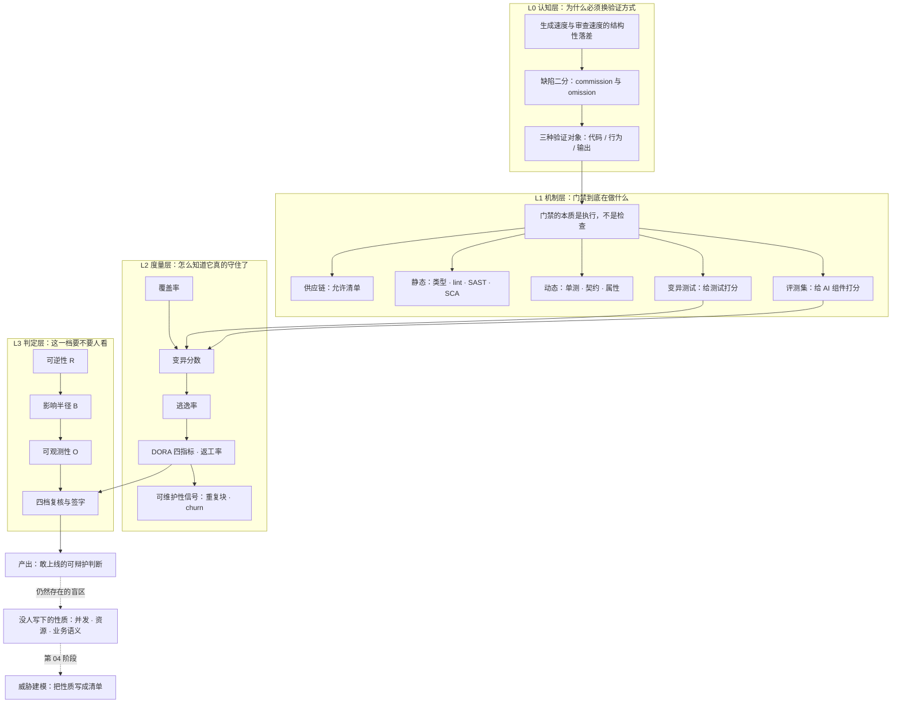

# 《把 AI 代码当不可信输入：从"我觉得没问题"到"我敢让它上线"》开源教材

> **定位**：面向"已经能让 AI 写出能跑的代码、但说不清它为什么可信"的读者。零测试基础、零安全基础可读。
> **设计原则**：第一性原理拆解 · 直觉先行 · 每个判据都能跑出数或指出边界 · 每道门禁必须写明它什么时候失效
> **在整条路线里的坐标**：这是《Vibe Coding 学习规划》的**阶段 3**，独立成书。前一阶段解决"把需求变成规格"，这一阶段解决"把代码变成可辩护的证据"，后一阶段解决"谁能打进来"。

---

## 0. 一句话说明这本书要补的那个洞

阶段 1 和阶段 2 让 AI 写得更快、写得更准。这两件事都在增加同一个东西：**你桌面上"你还没读过"的代码量。**

于是出现了一个没人明说、但每个人都在做的事——**用"我扫了一眼"冒充"我验证过了"**。

这本书要补的洞只有一句话：

> **你不可能读完 AI 写的每一行代码。所以你必须换一种方式获得"敢上线"的资格。**

换什么？把"我读过"换成"它经过了什么"。这本书教的不是读得更快，是**用证据替代感觉**。

---

## 1. 领域全景与学习目标

### 1.1 为什么这一阶段值得单独一本书

三个场景，几乎每个用 AI 写代码的人都撞过其中一个：

**场景 A：全绿的代码，线上超发。**
400 行实现，CI 全绿，覆盖率 100%，你扫了一眼核心函数觉得通顺，合了。周一运营发现限量 100 张的券核销了 143 次。你从头读到尾，没有一行是错的——错的是两行之间什么都没有。

**场景 B：测试写了一大堆，一个 bug 都没挡住。**
AI 顺手给了 20 个测试，覆盖率 92%。上线第二天一个显而易见的边界错误炸了。你去翻测试，发现它们断言的是"函数有返回值"、"execute 被调用了一次"。

**场景 C：依赖装上了，装的是别人的后门。**
AI 在 import 里写了一个包名，你在注册表上搜不到，但长得太像真的了，你以为是内部包，`pip install` 之后一切正常——因为那个包确实功能正确，只是多了一行你没看的东西。

三个场景对应三种不同的失效：**验证位置错了 / 验证强度不够 / 验证对象错了**。这本书的三部分就按这个顺序拆。

### 1.2 学完这本教材你将掌握什么

**核心认知层**
- 能把一个缺陷判定为 commission（做错了）还是 omission（该做的没做），并说清"读代码"对哪一类无能为力
- 能解释 Veracode 的 56% 与"上线失败率"差在哪三个条件上，并在引用时自动带上限定
- 能说清"AI 作为作者"（它写的代码）与"AI 作为组件"（它给出的判断）是两种完全不同的验证对象，证伪方法也不同

**系统架构层**
- 能画出自己项目的门禁流水线，标出每一层的**抓什么 / 漏什么 / 什么时候等于没跑**
- 能设计依赖允许清单、变异测试、评测集三套互相不重叠的验证装置
- 能说清哪一类缺陷（并发、资源、业务语义）是**所有门禁都抓不到**的，以及唯一的出路是什么

**实战应用层**
- 能给一个真实仓库接上完整门禁，并交出"至少拦住过一次真实问题"的记录
- 能用变异测试在自己测试套件里找出至少两个空洞并补上
- 能给一个 AI 生成的功能定出风险档位（R × B × O），并说清判据而不是感觉

### 1.3 本书的三条硬规矩

1. **每个判据必须能跑出数，或者明确标注为"经验线"。** 说不清来源的百分比，一律不许写进正文。
2. **每一层门禁必须写明失效边界。** 只写"它能抓什么"的，视为没写完——因为真正让你出事的是它抓不到的那部分。
3. **不按作者定审不审，按可逆性定。** "这段是 AI 写的所以要多看两眼"是直觉，不是判据。判据是"坏了我能不能退回去"。

---

## 2. 领域全景知识图谱



**分层说明**

| 层 | 回答的问题 | 学不会的后果 |
|---|---|---|
| L0 认知层 | 为什么"读一遍"不算验证 | 你会把全部精力花在提高阅读量上，而缺口在扩大 |
| L1 机制层 | 每道闸具体在拦什么 | 装了十件工具，仍然说不清哪件在起作用 |
| L2 度量层 | 怎么知道闸真的在拦 | 覆盖率 100% 却挡不住一个边界错误 |
| L3 判定层 | 哪一档需要人、谁签字 | 要么全部人审（不可持续），要么全部自动放行（等于没有） |

---

## 3. 知识模块矩阵

| 阶段 | 模块 | 核心解决的问题 | 前置依赖 | 视觉资产类型 | 难度 |
|---|---|---|---|---|---|
| L0 | M1 验证的位置 | 为什么"我读过"不是验证 | 无（零测试基础可读） | 事故时序图 + 检出矩阵热力图 | ★★☆☆☆ |
| L0 | M2 缺陷类型学 | 哪些缺陷读代码永远看不见 | M1 | 二分对照表 + 四类失效矩阵 | ★★☆☆☆ |
| L0 | M3 三种验证对象 | 代码、行为、输出该用哪种证伪法 | M1 M2 | 覆盖矩阵 + 决策树 | ★★★☆☆ |
| L1 | M4 供应链门禁 | 幻觉依赖与抢注攻击链 | M3 | 分布柱状图 + 攻击链时序 | ★★☆☆☆ |
| L1 | M5 静态门禁 | 形状检查的边界与误报经济学 | M3 | 检出边界矩阵 + 误报-采用率曲线 | ★★★☆☆ |
| L1 | M6 动态门禁 | 从"跑过"到"守住" | M3 | 四支柱打分卡 + 金字塔/菱形对比 | ★★★★☆ |
| L1 | M7 变异测试 | 给测试本身打分 | M6 | 流程图 + 覆盖率-变异分数对比 | ★★★★☆ |
| L1 | M8 盲区 | 所有门禁都抓不到的那一类 | M7 | 交错时序图 + 三类检查权衡图 | ★★★★★ |
| L2 | M9 度量体系 | 哪个数字会骗你 | M7 | 指标关系图 + 可维护性三信号趋势 | ★★★★☆ |
| L2 | M10 风险分档 | 哪一档要人看，判据是什么 | M9 | 三轴打分卡 + 档位×门禁强度矩阵 | ★★★☆☆ |
| L1 | M11 评测集 | AI 作为组件的证伪方法 | M3 M9 | 评测流水线图 + judge 偏差形态 | ★★★★★ |
| L3 | M12 流水线落地 | 顺序、成本、绕过与认知债 | M4—M10 | 端到端拓扑图 + 成本曲线 | ★★★★☆ |

---

## 4. 分章详细大纲

### 第一部分 · 认知重建：为什么读代码不再够用

- **第 01 章：全绿的代码与 143 条核销记录** (`chapters/ch01-green-but-wrong.md`)
  - **直觉锚点**：周五 16:40 合并，周一 09:20 超发。你把代码从头读到尾，没有一行是错的
  - **核心知识**：验证的位置错位（工具与缺陷不在同一层）；事故解剖的三层（行为层 / 结构层 / 性质层）；本书两半结构（AI 作为作者 vs AI 作为组件）
  - **规划图表**：事故时间线（Mermaid sequence）；图 1-1 五道闸 × 五个缺陷的检出矩阵（真实运行结果的热力图）
  - **实操**：跑通 `code/ch01` 的复现脚本，亲手让一份覆盖率 100% 的代码超发一次
  - **难度**：★★☆☆☆

- **第 02 章：缺陷有两种，读代码只擅长一种** (`chapters/ch02-two-kinds-of-defects.md`)
  - **直觉锚点**：海关安检——你不会因为"寄件人看起来挺专业"就整批放行
  - **核心知识**：commission 与 omission 的可见性不对称；"读代码的有效性 = 脑中规格清单的完整度"；四类系统性失效（幻觉依赖 / 模式化复制 / 缺失安全属性 / 上下文坍缩）；Veracode 56% 的三个限定条件与语言/漏洞类别的幅度差
  - **规划图表**：图 2-1 语法 100% vs 安全 56%（含"没有可信数据"的未知区间）；图 2-2 四类失效 × 最便宜门禁矩阵
  - **实操**：给自己最近 10 个 PR 的缺陷打标（commission / omission），算出比例，并与本章的预测对账
  - **难度**：★★☆☆☆

- **第 03 章：三种验证对象——代码、行为、输出** (`chapters/ch03-three-objects.md`)
  - **直觉锚点**：法庭不看你"像不像好人"，看证据链
  - **核心知识**：三类对象（代码形态 / 运行行为 / 输出质量）各自的证伪方法；门禁 = 执行而非检查的第一性原理；为什么"读"只能验证第一类；三种手段的覆盖矩阵与重叠区
  - **规划图表**：图 3-1 三种对象 × 三种手段的覆盖矩阵；图 3-2 决策树"这段东西该用哪种验证"（Mermaid）
  - **实操**：拿自己的一个函数，分别写出类型标注、行为断言、输出快照三条验证，对比它们各自能抓什么、抓不到什么
  - **难度**：★★★☆☆

### 第二部分 · 门禁：AI 作为作者怎么验

- **第 04 章：第 0 层——供应链，先跑因为它最便宜** (`chapters/ch04-supply-chain.md`)
  - **直觉锚点**：抢注域名，只不过抢的是包名
  - **核心知识**：19.7% 推荐包名不存在（开源 21.7% / 商用 5.2%）、205,474 个独有幻觉名、43% 可稳定复现；slopsquatting 四步攻击链；依赖允许清单为什么必须人工维护；锁文件与 SBOM；为什么这道闸必须排在最前（它之后所有门禁都看不见这个洞）
  - **规划图表**：图 4-1 幻觉包名分布；图 4-2 攻击链四步时序（Mermaid）；表 4-3 三层依赖防线对照
  - **实操**：跑 `dependency_gate.py`；给自己项目生成初始允许清单，逐个包写下"为什么允许"
  - **难度**：★★☆☆☆

- **第 05 章：第 1 层——静态检查，形状不等于意图** (`chapters/ch05-static.md`)
  - **直觉锚点**：X 光机能看见骨头的形状，看不见这个人想干什么
  - **核心知识**：编译器 / 类型检查 / linter / SAST / SCA / 密钥扫描各自的能力边界；SAST 的模式匹配本质；误报经济学（误报率高 → 被关掉 → 等于没跑）；"形状正确"为什么几乎不携带安全信息
  - **规划图表**：图 5-1 六类静态工具的检出边界矩阵；图 5-2 误报率与团队采用率的关系（明确标注为示意）
  - **实操**：在一份含四处缺陷的代码上跑三种静态工具，记录各自抓到什么、漏了什么、报了几条假警
  - **难度**：★★★☆☆

- **第 06 章：第 2 层——动态检查，从"跑过"到"守住"** (`chapters/ch06-dynamic.md`)
  - **直觉锚点**：体检不是量身高，是在你身体里放一个假病灶，看免疫系统会不会反应
  - **核心知识**：Khorikov 四支柱（防回归 / 抗重构 / 快速反馈 / 可维护）；"永远绿的测试"；AI 生成的测试为什么天然测实现细节；契约测试与属性测试各自补哪个洞；测试金字塔在 AI 时代为什么该变成菱形
  - **规划图表**：图 6-1 四支柱打分卡（对本章案例的两套测试逐条评分）；图 6-2 金字塔 vs 菱形
  - **实操**：把一份 mock 风格的 AI 测试改写成行为测试，记录改写前后"抗重构"评分的变化
  - **难度**：★★★★☆

- **第 07 章：第 3 层——变异测试，给测试本身打分** (`chapters/ch07-mutation.md`)
  - **直觉锚点**：你雇的保安到底有没有在巡逻？派个人扮成小偷走一趟
  - **核心知识**：变异算子与"杀死/存活"；变异分数；等价变异体（用修复版 M1 的真实例子讲）；成本模型 N × 测试耗时；在 CI 里怎么控制时间预算
  - **规划图表**：图 7-1 变异测试流程（Mermaid）；图 7-2 覆盖率 100% vs 变异分数 25%（真实运行结果）；表 7-3 常见变异算子与它对应的缺陷类型
  - **实操**：跑 `mutation_demo.py`；给自己的测试套件加五个变异体，找出至少两个空洞
  - **难度**：★★★★☆

- **第 08 章：盲区——所有门禁都抓不到的那一类** (`chapters/ch08-blind-spots.md`)
  - **直觉锚点**：门禁是探照灯，不是阳光。你照不到的地方不是没有东西，是你没转过去
  - **核心知识**：为什么并发交错、资源泄漏、无界结果集、N+1 全部逃过前四层；确定性交错复现 vs 压力测试 vs 约束级检查的三角权衡；"没人写下的性质"——把约束下沉到数据库、事务、限流器
  - **规划图表**：两个请求的交错时序（Mermaid sequence）；图 8-1 四组压测的检出率对比（真实运行，含"假绿灯"组）
  - **实操**：跑 `race_repro.py`；用 `PRAGMA index_list` / `information_schema` 写一个"约束存在性"检查，接进 CI
  - **难度**：★★★★★

### 第三部分 · 度量与判定：怎么知道它真的守住了

- **第 09 章：仪表盘上哪个数字会骗你** (`chapters/ch09-metrics.md`)
  - **直觉锚点**：健身房里的体脂秤——它测的是电阻，不是脂肪。你信的是解释，不是数字
  - **核心知识**：覆盖率、变异分数、逃逸率三者的关系与互相欺骗；逃逸率是唯一能证伪你的指标；DORA 四指标 + 返工率 + 首轮验收率；为什么"AI 生成代码行数"是误导性指标；GitClear 的可维护性信号（重构下降 / 重复块上升 / churn 上升）
  - **规划图表**：图 9-1 同一套测试的三个读数（行 100% / 分支 100% / 变异 25%，真实运行）；指标领先-滞后关系（Mermaid）
  - **实操**：给自己项目算三组数（重复块占比、30 天 churn、跨文件调用密度）+ 一份结论
  - **难度**：★★★★☆

- **第 10 章：风险分档——这一档要不要人看** (`chapters/ch10-risk-tiers.md`)
  - **直觉锚点**：急诊分诊台。不是按病情严重程度排队，是按"等下去会不会死"
  - **核心知识**：R × B × O 三轴打分；四档流程（自动放行 / 轻量 / 人工 / 高级别）；为什么按可逆性不按代码量；档位与门禁强度的对应表；谁签字、签什么
  - **规划图表**：图 10-1 三轴打分卡；图 10-2 档位 × 门禁强度矩阵
  - **实操**：给团队里五个真实功能打分，与现行流程对照——不一致的地方就是当前的风险漏洞
  - **难度**：★★★☆☆

### 第四部分 · 落地：装进流水线，并诚实地收口

- **第 11 章：评测集——当 AI 是组件，不是作者** (`chapters/ch11-eval-sets.md`)
  - **直觉锚点**：考卷和面试官的区别。考卷每次一样，面试官每次不同
  - **核心知识**：什么时候必须有评测集（模型 / 提示 / 检索任一项会变）；怎么建（真实流量采样 + 边界样本 + 回归集）；为什么准确率不够，要按错误代价加权；AI-as-a-judge 的三类已知偏差（位置、长度、自我偏好）与适用边界；评测集自身的漂移与失效
  - **规划图表**：图 11-1 评测流水线（Mermaid）；图 11-2 judge 偏差的三类实证形态
  - **实操**：给一个含 LLM 调用的函数建 30 条最小回归集，跑一次 judge 与人工标注的一致性，算出分歧率
  - **难度**：★★★★★

- **第 12 章：装进流水线——顺序、成本、绕过与认知债** (`chapters/ch12-pipeline.md`)
  - **直觉锚点**：门禁不是墙，是闸门。闸门设计得不好，人会去翻墙
  - **核心知识**：按"单位拦截成本"排序（不是按重要性）；并行化与缓存；三条典型绕过路径（`--no-verify`、管理员合并、跳过 CI）与它们的成本核算；门禁自身的维护成本；认知债的形成机制；重写判据三信号（变异分数 / 耦合密度 / churn）
  - **规划图表**：完整流水线拓扑（Mermaid）；图 12-1 四道闸的真实耗时对比（对数轴，差 28 倍）
  - **实操**：端到端——给一个仓库接完整流水线，交付"至少拦住过一次真实问题"的记录（对应规划任务 1）
  - **难度**：★★★★☆

---

## 5. 与《Vibe Coding 学习规划》阶段 3 的映射

### 5.1 七个核心知识点

| 规划知识点 | 落在哪章 | 覆盖方式 |
|---|---|---|
| 1. 实测图景与口径边界（Veracode 56% 及全部限定） | ch02 | 逐条拆三个限定条件；分项数字只取幅度不取方向 |
| 2. 测试四支柱与"永远绿的测试"；变异测试 | ch06 ch07 | 四支柱做成打分卡；变异测试给完整可跑实现 |
| 3. 分层门禁的搭法与顺序 | ch03 ch12 | 三层对象定分工，ch12 定顺序与成本 |
| 4. 依赖核验与 slopsquatting | ch04 | 单独成章，含可复现的攻击链与允许清单 |
| 5. 可维护性信号（重构/重复块/churn） | ch09 | 与 DORA 并列，讲清"领先指标 vs 滞后指标" |
| 6. 交付系统指标（DORA + 返工率 + 首轮验收率；生成行数为何误导） | ch09 | 单列"哪个数字会骗你" |
| 7. 评估（评测集 / AI-as-a-judge 边界） | ch11 | 单独成章，因为它验证的是另一种对象 |

### 5.2 三个实践任务

| 规划任务 | 交付物 | 落点 |
|---|---|---|
| 任务 1 装完整门禁 | 一条真实 CI 流水 + "至少拦住过一次真实问题"的记录 | ch12 综合实操（Part 2 全部是它的零件） |
| 任务 2 自我红队 | 红队报告：哪些抓到、哪些漏了、为什么漏、怎么修 | ch02 铺垫 + ch08 主战场（漏的那部分在这里） |
| 任务 3 可维护性体检 | 三组数据 + 一份结论 | ch09 实操 |

### 5.3 四条检验标准

| 检验标准 | 在哪一章收口 |
|---|---|
| 能解释 56% 与上线失败率差在哪三个条件 | ch02 |
| 能做出一份"我不懂这段代码但敢让它上线"的门禁设计，并说清失效边界 | ch08（盲区）+ ch12（整合） |
| 能独立复现：用变异测试找出至少两个空洞并补上 | ch07 |
| 能判定：一个功能该走哪一档风险复核，判据是什么 | ch10 |

**覆盖检查**：7 个知识点、3 个任务、4 条检验标准全部有明确落点，无遗漏，无重复归属。

---

## 6. 前置桥接：读这本之前你至少要有什么

这本书默认你已经走过阶段 1—2。六道自测，答不上来的先回去补：

1. 你能说出"规格"和"需求文档"的区别吗？（能，且能举一个"需求写了但规格没写"的例子）
2. 你能把一句模糊需求改写成一条可判定的断言吗？（能，且断言里有数值或状态）
3. 你知道自己项目的 CI 现在跑了哪几步吗？（能，且能说出每步耗时）
4. 你能读懂一段代码的复杂度增量吗？（能，且能指出哪一处让下次改动变贵）
5. 你能说出"这段代码是 AI 写的"这件事，在决策上应该影响什么、不应该影响什么吗？
6. 你有没有过"测试全绿但线上出事"的经历？能说出那次是哪个测试本该抓到却没抓到吗？

第 6 题答不上来也没关系——这本书第 01 章就是带你复现一次。

---

## 7. 仓库目录结构

```text
phase3/
├── README.md                        # 本文件：全景图谱、模块矩阵、分章大纲
├── chapters/                        # 12 章正文（已完成）
├── assets/                          # 按章分目录的高清图（240 dpi）
│   ├── ch01/fig-01-detection-matrix.png
│   ├── ch02/fig-01-pass-rate-gap.png
│   ├── ch04/fig-01-hallucinated-packages.png
│   ├── ch06/fig-01-four-pillars.png
│   ├── ch07/fig-01-coverage-vs-mutation.png
│   ├── ch08/fig-01-stress-detection.png
│   ├── ch09/fig-01-three-readings.png
│   └── ch12/fig-01-gate-cost.png
├── code/                            # 全部可运行
│   ├── _figstyle.py                 # 共享绘图样式
│   ├── make_figures.py              # 一次生成全部八张图
│   ├── pipeline.sh                  # 七道闸的完整流水线
│   ├── case_coupon/                 # 贯穿案例：优惠券核销（10 个文件）
│   ├── ch03/three_objects.py        # 三种验证对象实验
│   ├── ch05/static_sweep.py         # 四类静态检查
│   ├── ch06/refactor_probe.py       # 一次无害重构，看谁红
│   ├── ch06/test_coupon_mock.py     # mock 型测试样本
│   ├── ch08/stress_oversell.py      # 四组压测对照
│   ├── ch08/constraint_check.py     # 约束存在性检查
│   └── ch11/eval_harness.py         # judge 位置偏好探针
└── drafts/                          # 草稿区（非交付物）
    └── ch03-untrusted-ai-code-single-chapter.md
```

**一键跑通**：`cd code && bash pipeline.sh`（修复版全绿）／`bash pipeline.sh coupon_service.py`（原版红三道）。

**关于现有素材**：`chapters/ch03-untrusted-ai-code.md` 是本阶段早期写成的**单章压缩版**，两万字，把十二个章节的骨架压成了一章。它不是本书的正式章节，已移入 `drafts/`。其中可复用的部分（优惠券核销案例、四套测试、变异对比、并发复现、三张图）将按新章号拆分到 ch01、ch02、ch06、ch07、ch08。

---

## 8. 贯穿案例与视觉规范

**贯穿案例（最终决定）**

主线用**优惠券核销**一个案例，贯穿 ch01、ch06、ch07、ch08、ch12。

原计划用"候补报名系统做主线、优惠券做开场标本"，实施时改成了一个案例。理由：一个案例挖到底，比两个案例各挖一半有教学价值——读者能看到同一份代码被五道闸逐层拆开，而不是每章换一个场景重新适应。候补报名的那些场景（幂等、时序窗口、越权）在第 02 章的清单练习和第 08 章的约束检查里以"延伸任务"的形式出现。

代价：时序类缺陷（15 分钟确认窗口）没有贯穿案例。这个缺口由第 08 章的"队列不能卡住"练习和阶段 4 的威胁建模补。

**视觉规范**

- 配色：墨灰 `#1F2937` / 警示红 `#B3261E` / 通过绿 `#0F6B5C` / 中性 `#94A3B8`，白底，无渐变、无阴影
- 图必须有一句话结论当标题，副标题写"这张图在教什么"
- 数据来源与口径写在图下方，与正文同级字号，不许塞进图注小字
- **"没有数据"要画成未知区间，不许画成 0**（ch02 的图 2-1 是这个规矩的样板）
- 所有中文图用 matplotlib + `Hiragino Sans GB` 兜底，240 dpi，出图后逐张肉眼验字

---

## 9. 三条学习路线

| 路线 | 适合谁 | 章节 | 预计 |
|---|---|---|---|
| **赶工版**（够用就走） | 5 周内要给项目上门禁 | 01 → 02 → 04 → 06 → 07 → 10 → 12 | 7 章 · 约 60 h |
| **完整版** | 要建立完整判断力，含 AI 组件 | 全部 12 章 | 12 章 · 约 110 h |
| **补盲区版** | 已经有测试体系，只是不确定它有没有用 | 07 → 08 → 11 | 3 章 · 约 25 h |

赶工版砍掉的是 ch05（静态细节，工具文档更权威）、ch08（盲区，不碰并发可以先欠着）、ch09（度量，等有量再算）、ch11（评测集，项目里没有 LLM 组件就不需要）。**但 ch07 不能砍**——砍了变异测试，你前面所有测试的绿灯都还是不可信的。

---

## 10. 质量门禁

每章交付前必须过三道：

1. **语法与链接门禁**：`python3 verify_textbook_quality.py <chapter.md>` —— Mermaid 节点标签全部加引号、折叠答案块的开闭标签配平、图片路径存在、无占位符。
2. **配图门禁**：每张 PNG 用肉眼验一遍——中文无豆腐块、标签不重叠、不压边、白底对比清晰。数据来源与口径必须在图上。
3. **教学完整性门禁**：每个新术语首次出现必须给白话解释 + 英文对照；每个结论后面要么有可跑的数，要么明确写"这是经验线"；正文不许出现"显然""众所周知"。

---

## 11. 当前进度

| 章 | 标题 | 字数 | 状态 |
|---|---|---|---|
| 01 | 全绿的代码与 143 条核销记录 | 9.3k | 完成 |
| 02 | 缺陷有两种，读代码只擅长一种 | 10.8k | 完成 |
| 03 | 三种验证对象 | 8.9k | 完成 |
| 04 | 第 0 层 供应链 | 9.2k | 完成 |
| 05 | 第 1 层 静态 | 7.2k | 完成 |
| 06 | 第 2 层 动态 | 8.8k | 完成 |
| 07 | 第 3 层 变异 | 8.1k | 完成 |
| 08 | 盲区：并发与资源 | 8.7k | 完成 |
| 09 | 度量：哪个数字会骗你 | 7.8k | 完成 |
| 10 | 风险分档 | 5.9k | 完成 |
| 11 | 评测集：AI 作为组件 | 7.0k | 完成 |
| 12 | 装进流水线 | 8.0k | 完成 |

**合计约 10 万字，八张配图，十二个可运行实验。** 全部章节通过 `verify_textbook_quality.py`。

**已验证的关键数字**（全部来自本仓真实运行，不是引用）：

- 五道闸对五个缺陷的检出矩阵：无一行全绿（图 1-1）
- 覆盖率 100%，变异分数 25%（AI 测试）／50%（mock 型）／100%（规格行为）
- 修复版上 mock 型测试变异分数反超规格测试（100% vs 75%），因为它绑死实现
- 四组压测：100% / 0% / 0% / 100%，其中第二个 0% 是"负载不足"
- 约束检查：原版 0/3，修复版 3/3
- judge 位置偏好：翻转率 70%，去偏后只剩 30% 样本可判
- 七道闸流水线：2.7 秒跑完，有缺陷的代码上"变异分数 4/4"

---

## 12. 实施记录：三个原定裁决点的最终决定

| 原裁决点 | 最终决定 | 理由 |
|---|---|---|
| 12 章还是压成 10 章 | **12 章** | 压缩要砍掉 ch03（三种验证对象），砍了之后学生会把"AI 写的代码"和"AI 输出的内容"当成一回事 |
| 双案例还是单案例 | **单案例**（优惠券核销贯穿全书） | 一个案例挖到底，比两个各挖一半有教学价值。候补报名的幂等/时序场景降级为练习 |
| 首批 ch01—ch03 | **一次写完全部 12 章** | 章节之间互相引用很密（ch07 引 ch06 的实验结果，ch12 引前七章的数），分批写容易前后不一致 |

**写作过程中改变的两处设计**：

1. **ch06 从"AI 测试 vs 规格测试"两套，扩成三套。** 原计划只有"空断言型"和"规格型"，写到一半发现 mock 型是更常见的失败形态，于是补了 `test_coupon_mock.py`。这个改动让 ch06 的四支柱打分和 ch07 的变异分数都变成三列，也意外发现了一个更强的结论：**mock 型测试在修复版上变异分数反超规格测试（100% vs 75%）**——因为它焊死实现，任何改动都"抓得到"。
2. **ch07 的核心论点从"变异分数越高越好"改成"变异分数只测四支柱里的一根"。** 这个结论是被上面那个意外推出来的，比原计划更诚实。

---

*本书遵循《Vibe Coding 学习规划》阶段 3 的原始定义：7 个知识点、3 个实践任务、4 条检验标准，全部有落点。*
