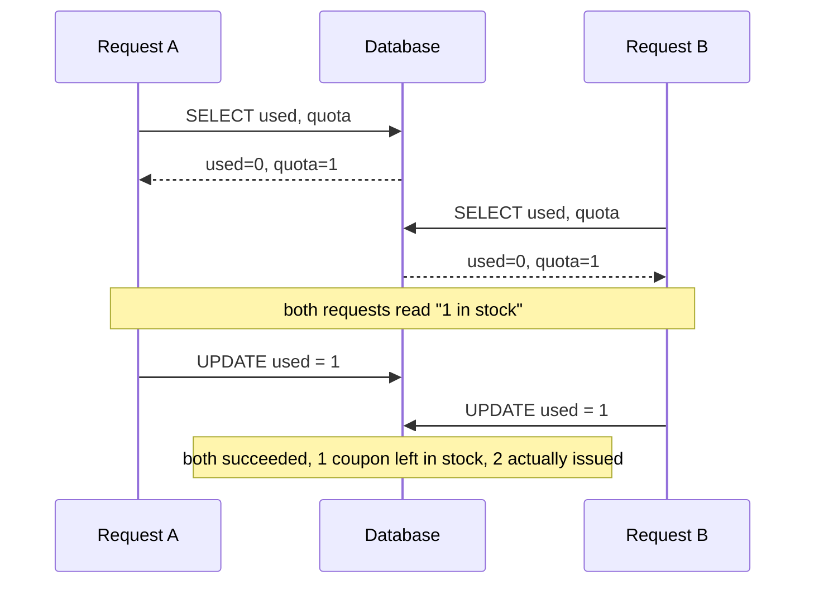
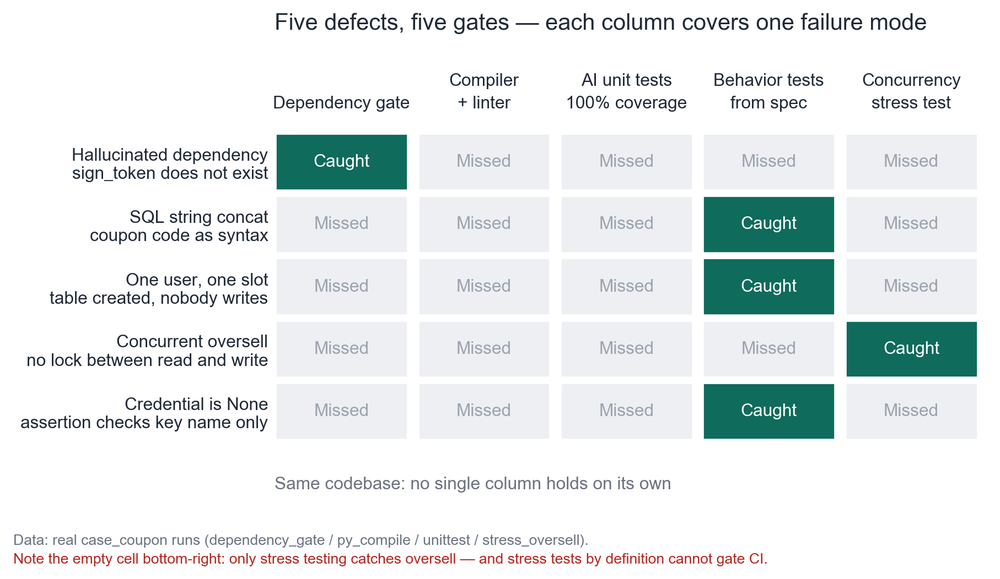
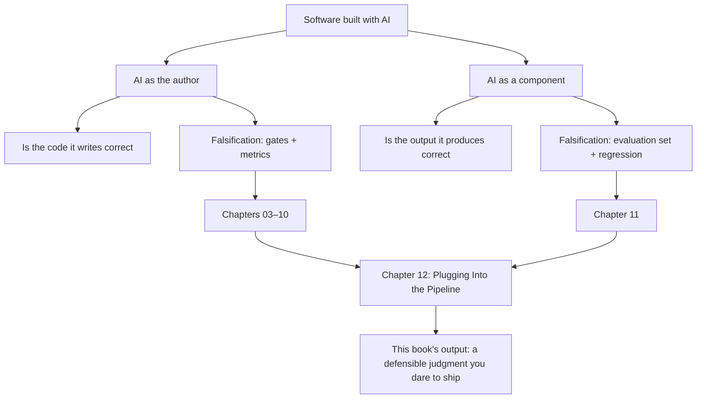

**English** | [中文](./ch01-green-but-wrong.zh.md)

# Chapter 01: All-Green Code and 143 Redemption Records

> **Chapter Guide**: This chapter will not comfort you, and it will not teach you a new tool. It does exactly one thing — let you see with your own eyes the gap between "I read it" and "it has been verified", and then lay the roadmap of the whole book across that gap.
> **Prerequisites**: None. Readable with zero testing background. But you need to be able to read 30 lines of Python.
> **Core Learning Objectives**:
> - Explain what "misplaced verification" means, and point out which layer was wrong in a real incident
> - Scan the same code with five checks, and get a matrix of "which gate caught which defect"
> - Know the two-halves structure of this book, and which half you should start from

## 1. Cognitive Anchor: Those 43 Oversells

### 1.1 A Friday Afternoon

At 16:40 you hand the "coupon redemption" requirements to a coding agent. Four thousand words of spec; it returns 400 lines of implementation plus two test files. CI is all green, coverage 100%.

You scan the core function: first query the stock, check whether it is enough, deduct if enough, return the voucher. The logic is sound. A colleague walks past; you let him take a look too, and he says it's fine. Merge.

At 09:20 on Monday, operations posts a screenshot in the group chat: the coupon was limited to 100 copies, and there are 143 redemption records.

You pull up the code and read it from top to bottom. **Not a single line is wrong.**

Really not. `if used >= quota` is written right, the `UPDATE` statement is written right, and the return structure is right too. You even drew the timing of two requests on paper once, and found that under any **single-threaded** execution order, this code cannot oversell.

So where did those 43 oversells come from?

From two requests reaching line 3 at the same time within 8 milliseconds, **both reading "1 in stock"**. The number in each of their hands was correct, and each of their judgments was correct too. What is wrong is between those two lines — where there is nothing at all.

You can now ask yourself a question: if you had stared at the screen for another 10 minutes back then, could you have seen these 43 oversells?

You could not. It is not an eyesight problem; it is an organ problem.

### 1.2 A More Precise Statement: Misplaced Verification

The sentence "I looked at it" implies an assumption: **defects live in the code text, so looking at the text will find defects.**

This assumption holds for half of the defects, and completely fails for the other half. And in production incidents, the other half is the majority.

Unpack the sentence, and you will see three entirely different "verification positions":

| Verification position | What you are verifying | Typical actions | What it cannot see |
|---|---|---|---|
| **Text layer** | Whether this code is written correctly | Reading code, review, type checking, lint | Runtime timing, data distribution, environment differences |
| **Behavior layer** | What it will do when it runs | Unit tests, integration tests, stress tests | The part of the behavior that was not designed as a use case |
| **Constraint layer** | Whether some things can happen at all | Database constraints, transaction isolation, rate limiter | The properties that were never expressed as constraints |

That Friday afternoon, you only verified at the **text layer**. And the oversell defect lives in the **behavior layer** and the **constraint layer**.

**This is "misplaced verification": you used a ruler that can only measure length, to measure a problem that only weighing can find.** The ruler is not broken; you picked up the wrong one.



The most critical thing in the figure is not any single message, but the gap between A and B where **nobody wrote any code**.


### 1.3 What This Book Does Not Plan to Teach You

Let us draw the boundary first, so you do not finish reading and find it is not what you wanted:

- **It will not teach you to read faster.** Human reading speed is a hard constraint; the amount of code one can genuinely read through in a day is a few hundred lines. Any method that claims to let you read five thousand lines a day is teaching you to pretend you have read it.
- **It will not give you a tool list.** Tools turn over every three months. This book talks about "what this gate blocks, and when it is equivalent to not running at all"; you take that judgment to pick tools, instead of taking a tool list to pad out a process.
- **It does not promise "zero incidents".** There is a class of defects that none of the gates in this book can catch. Chapter 08 is dedicated to it, and after it you will know what that class can only rely on.

## 2. First Principles: Three Paths of Verification, and Their Dead Corners

### 2.1 You Only Have Three Ways to Know Whether a Piece of Code Is Right

Put aside all the tool nouns; humans verify code with only three actions:

1. **Inspect** — read it, check its shape. Fast, cheap, narrow coverage.
2. **Execute** — give it input, see what it does. A bit slower, a bit more expensive, coverage depends on how many inputs you thought of.
3. **Constrain** — make some errors structurally impossible. The most expensive (it requires changing the design), but once it holds, it is permanent.

These three actions are not substitutes for each other; they are a **relay**. The problem is that the vast majority of teams only run the first leg, and then declare the race over.

| | Inspect | Execute | Constrain |
|---|---|---|---|
| Cost | Lowest (labor) | Medium (compute + test case design) | Highest (change the architecture) |
| Feedback speed | Seconds | Seconds to minutes | One-time investment, permanent effect |
| Coverage of commission (doing it wrong) | High | High | Medium |
| Coverage of omission (not doing what should be done) | **Low** | Medium (only when designed as use cases) | **High** |
| Can it prevent "nothing between two lines" | No | Yes | Yes (and only here is it thorough) |

Row 4 is the criterion this book will use repeatedly: **omission is "something is missing", and "something missing" has no shape in the text, so the inspect approach cannot catch it by nature.** Chapter 02 will explain this one through.

### 2.2 Five Gates Scan the Same Code

Empty talk is not convincing. The code below comes from `code/case_coupon/` in this repository, unchanged by a single character — it is an AI-generated coupon redemption implementation, syntactically correct, runnable, and passing on the happy path.

I scanned it with five checks and recorded the results in one table:

```bash
$ python dependency_gate.py coupon_service.as_generated.py
文件                                   行  模块                            判定
--------------------------------------------------------------------------------------
coupon_service.as_generated.py      10  sqlite3                       stdlib
coupon_service.as_generated.py      12  fastapi_jwt_auth_kit          未登记
--------------------------------------------------------------------------------------
GATE FAILED：存在未登记依赖。
```

```bash
$ python -m py_compile coupon_service.py && echo "编译通过"
编译通过

$ python -m unittest test_coupon_ai -q
Ran 2 tests in 0.004s
OK
```

```bash
$ python -m unittest test_coupon_behavior
Ran 5 tests in 0.057s
FAILED (failures=2, errors=1)
```

```bash
$ python stress_oversell.py
组1  原版 · 24 并发 · 配额 10   检出 30/30 轮（100%）  单轮最大超发 14 张
```

Drawing out the coverage of the five checks over the five defects:


*Figure 1-1: Green means "caught", gray means "missed". Note two things: first, no column is all green; second, the bottom row (concurrent oversell) is only caught by the last column, while the last column by definition cannot enter CI.*

This figure is the foundation of this book, and it is worth reading column by column:

- **Dependency gate**: only catches row 1. It cannot catch any business logic problem, because it only looks at imports.
- **Compiler + linter**: **all gray**. This is not a failure of the tools; it is a division of labor. These defects are all semantic problems, while the compiler only guarantees shape.
- **AI unit tests (coverage 100%)**: **all gray**. This is the most painful column — it ran 18 lines of code, all passed, and not one of them held anything.
- **Behavior tests**: catch three rows. They are not "smarter tests"; they are "tests written against the spec".
- **Concurrent stress test**: only catches row 4, and it is slow, needs threads, and its result depends on scheduling — **it cannot serve as a gate**, only as monitoring.

**So the real conclusion is not "use behavior tests", but "no single column can hold on its own".** A reservoir with only one gate is the same as having no gate.

### 2.3 From "Read It Once" to "What It Has Been Through"

Compress all of the above into one sentence, and you get the stance of this book:

> **You cannot read every line of code AI writes. So you must earn the right to "dare to ship" in another way: replace "I read it" with "what it has been through".**

The five words "what it has been through" must be made concrete into verifiable things: which gates it has been through, what the state of each gate was at that time, which gate has ever blocked a real problem. These things can be written into the PR description, shown to the boss, and re-checked three months later. While "I looked at it" leaves nothing behind.

## 3. Hands-on: Oversell an All-Green Codebase Once, With Your Own Hands

The purpose of this section is not to learn how to run a script; it is to let your **body remember** the distance between "green light" and "correct". Five minutes end to end.

### 3.1 First Confirm It Is Green

```bash
$ cd code/case_coupon
$ python -m coverage run --include=coupon_service.py -m unittest test_coupon_ai -q
Ran 2 tests in 0.004s
OK
$ python -m coverage report -m
Name                Stmts   Miss  Cover   Missing
-------------------------------------------------
coupon_service.py      18      0   100%
-------------------------------------------------
```

18 statements, 0 lines missed, 100%. This is the light you saw on that Friday afternoon.

### 3.2 Now Make It Oversell

```bash
$ python ../ch08/stress_oversell.py
组1  原版 · 24 并发 · 配额 10   检出 30/30 轮（100%）  单轮最大超发 14 张
```

Quota 10, 24 people grabbing, and 24 copies ended up sold. **The same code, the same interpreter, oversold in all 30 out of 30 rounds.**

Now step back in front of that 100% green light and ask yourself: what did it just prove?

The answer is only one sentence: **these 18 lines of code were all executed.** That is all. It did not say these lines did anything right, because it was never looking at "right or wrong" — it was looking at "ran or not".

### 3.3 Measure the Same Thing With Another Ruler

```bash
$ python -m unittest test_coupon_behavior
FAILED (failures=2, errors=1)
```

The same implementation, five assertions written against the spec, three of them red. Those three red ones exactly correspond to the three sentences of the spec that were violated.

Note what happened here: **the code did not change by one word; only the ruler was swapped, and the answer flipped from "pass" to "fail".**

This is the most important sentence of this chapter:

> **A green light is not a property of the code; it is a property of "what question you asked".**

The coverage suite asks "did it run"; behavior tests ask "were the rules held". The former will always answer "it ran"; only the latter can answer "it was not held".

## 4. Common Misconceptions, and Correct-vs-Wrong Comparisons

| Easy-to-fall-into misconception | Why it goes wrong | The right mental model and practice |
|---|---|---|
| **"All tests green means it can be merged"** | "Green" only means the question you asked got a yes. Ask a narrow question, and the green light is decoration | Ask "which sentences of the spec does this test suite cover", not "how many lines of code are covered" |
| **"Coverage 100%, quality assured"** | Coverage measures the number of lines executed. Piling up `assertIsNotNone` can push it to 100% | Use coverage as a floor, not a red line. Chapter 07 will give you a ruler that can score |
| **"I read it line by line, no problem"** | Reading can only see "what was written", not "what is missing". And omission is the main body of incidents | Use reading to catch commission; omission must rely on assertions, constraints, and red teams |
| **"Only AI-written code needs this much care, human-written code does not"** | Defects do not care about the author. Human-written concatenated SQL leaks databases just the same | Decide review by reversibility (Chapter 10), not by author |
| **"We did it like this last time and nothing happened"** | This is the formal definition of survivorship bias. Incidents are probabilistic events; an observation with sample size 1 carries no information | Replace "nothing happened last time" with "how many real problems has this gate blocked historically" |

## 5. Chapter Summary and Local Knowledge Map

### 5.1 Key Points

- **Verification has three layers: text, behavior, constraint.** Only doing the first layer means the second and third layers were never verified.
- **A green light is a property of the question, not a property of the code.** Swap the ruler, and the same "pass" turns into "fail".
- **No single column can hold on its own.** Five gates scanned out five defects; each gate covers one kind of failure on average.
- **One column cannot enter CI.** The concurrent stress test can catch oversells, but it is slow and scheduling-dependent, so it can only serve as monitoring — Chapter 08 handles this gap specifically.

### 5.2 The Two-Halves Structure of This Book

This book talks about "verification", but "verification" here has two different objects, and their falsification methods do not overlap at all:



**Why they must be separated**: the correctness of code can be exhausted (as long as there are enough use cases), while the correctness of output cannot be exhausted (the input space is infinite and answers have no unique solution). Using unit tests to measure whether an LLM's reply is good is like measuring height with a thermometer — it is not a precision problem, it is a dimension problem.

### 5.3 Interfaces to Later Chapters

- **Chapter 02** answers "why reading code can only catch half", and gives you a reusable defect classifier.
- **Chapter 03** turns the "three verification objects" into a decision tree; from then on, given any piece of code, you can judge within thirty seconds which way to verify it.
- **Chapters 04–08** are the layer-by-layer breakdown of the five gates; each chapter answers "what it catches, what it misses, and when it equals not running".
- **Chapters 09–10** turn gates into numbers, and numbers into verdicts.
- **Chapters 11–12** handle the other half (AI as a component), and integrate everything into a real pipeline.

## 6. Tiered Exercises

### Tier 1 · Intuition and Concept Checks

**1.** Classify the four defects below with "text layer / behavior layer / constraint layer", and state whether "reading code" can find them:
　(a) `if used > quota` (should be `>=`)　(b) the database has no unique constraint　(c) the request has no timeout　(d) the logs print the full ID number

**2.** Someone says: "Our coverage is 95%, stronger than your 80%." In which three situations does this sentence carry no information?

**3.** This chapter says "a green light is a property of the question". Construct an example: the same code, the same set of assertions, run in a different environment, the result flips from green to red.

### Tier 2 · Deduction and Hands-on Construction

**4.** Run `stress_oversell.py`, change "quota 10 / 24 concurrent" to "quota 10 / 6 concurrent", and record the detection rate. Explain the reason for the change, and answer: **if you want to prove "this code is concurrency-safe", how many rounds do you need to run to be enough?**

**5.** In the format of Figure 1-1, draw a matrix (defects × existing checks) for the most recent production incident in your own project. Which cell is empty?

### Tier 3 · Boundary Conditions and Cross-Chapter Transfer

**6.** Suppose you only have 30 minutes for pre-release verification and can only pick two gates. Which two would you pick? Give your criteria, and state under what conditions your choice would fail.

**7.** This chapter says "no single column can hold on its own". Turn the question around: **is it possible that one single gate blocks all defects?** If yes, which one? If no, use the three actions of Section 2.1 to argue why.

<details>
<summary><strong>Click to expand: reference answers and in-depth analysis for this chapter's exercises</strong></summary>

#### 1. Defect classification

- **(a) `>` should be `>=`**: text layer. This is a typical commission; the defect has a shape, and reading code can find it (provided you stop and compute a boundary once). Behavior tests can also find it, as long as use cases cover "stock just runs out".
- **(b) Missing unique constraint**: constraint layer. The text layer cannot see it at all — because **this piece does not exist in the code**; what you need to see is a "non-existent thing". This class can only rely on a "constraint-existence check" (Chapter 08 gives the code).
- **(c) No timeout set**: text layer + constraint layer. Whether reading code can find it depends on whether your head holds the checklist "all external calls must have timeouts". Experienced people can find it; beginners cannot — **"depending on the reader's experience" is itself a design defect**.
- **(d) Logs print the ID number**: text layer. It can be read out, but only if, when reading the log statement, you think through "what data is this". The trait of this kind of defect is that "the eye slides over it when reading", because the statement itself is fine.

#### 2. Three situations where a coverage comparison carries no information

First, **the other side's basis is unclear**: line coverage or branch coverage? Counting only business code or including test code? Second, **assertion strength is unclear**: 95% of lines were executed, but the assertions may all be `assertIsNotNone`. Third, **the test target is unclear**: if that 95% covers getters/setters while the core business logic happens to sit in that 5%, the number is completely reversed.

So "coverage comparison" only makes sense when the basis of all three is fully consistent, and that situation is rare.

#### 3. The same assertions, flipping from green to red in another environment

The classic construction: rely on the time zone. The test writes `assertEqual(expire_at, "2026-10-19T15:00:00")`; it passes locally under `TZ=Asia/Shanghai`; the CI machine has `TZ=UTC`, the same function returns `07:00:00`, and it goes red. The code did not change, the assertions did not change; **what changed is "what assumptions this code runs on"**.

The value of this example: it shows that a green light hides a batch of **unwritten premises** (time zone, locale, random seed, database version). Chapter 08 will classify these as "properties nobody wrote down".

#### 4. Concurrency level and detection rate


6 threads grabbing 10 quota copies — **no matter how it is scheduled, overselling is impossible**, because the maximum number of successes is 6. The detection rate is 0%, but this 0% means something completely different from the 0% you get after fixing it (groups 2 and 3 in Chapter 08, Figure 8-1 are exactly this trap).

As for "how many rounds are enough to run": **this question has no answer, and that is exactly the point.** A stress test cannot give a "proof"; it can only give "we did not hit it". Mathematically, if the probability of hitting it each round is p, the probability of not hitting it in n rounds is (1−p)ⁿ; you can only push the "miss probability" down, never to 0. So the conclusion "concurrency-safe" cannot come from a stress test; it can only come from **constraints** (unique index, conditional update, transaction isolation level).

#### 5. Draw a matrix for your own project

There is only one criterion: **every row must have a green cell, otherwise that row's defects can currently only be caught by luck**. The common shape is "the test column is very green, the constraint column all gray" — meaning your defense line is all at the application layer, and the database layer is naked.

#### 6. Pick two gates in 30 minutes

**The first: the dependency allowlist** (0.05 seconds). It blocks the class of defects that "all the later gates cannot see", and its cost is near zero; there is no reason not to pick it.

**The second: the three most expensive behavior tests** — not "run all tests", but "run the three that cover the core spec". The criterion is: **are the defects this gate blocks irreversible in consequence?** If reversible (can roll back), prefer the fast one; if irreversible (already charged, already issued coupons), you must pick it.

Failure conditions: if the core spec itself is written wrong, these two gates will consistently let a wrong thing pass. This is the problem that Chapter 03's "output object" and Chapter 02's "spec checklist" deal with.

#### 7. Can one gate block all defects

**No.** The three actions of Section 2.1 can prove it:

- "Inspect" acts on text, while omission has no shape in text — there must be a blind spot.
- "Execute" acts on the inputs you designed, while defects may live in the inputs you did not design — there must be a blind spot.
- "Constrain" acts on the properties you can express, while properties that were never thought of cannot be expressed — there must be a blind spot.

Stacking all three can compress this blind spot very small, but not to zero. **The honesty of this book is right here: it does not promise zero incidents; it promises to let you know where your blind spots are and how big they are.** Teams that know the location of their blind spots, versus teams that do not, differ by an order of magnitude in recovery speed after an incident.

</details>

---

**Next chapter**: why the "read the code" line of defense fails — not because you did not read enough, but because defects come in two kinds, and reading can only see one of them.

---

## 7. Authoritative References and Further Reading for This Chapter (Authoritative References)

1. **OWASP ASVS**: [OWASP ASVS](https://www.owasp.org/www-project-application-security-verification-standard/) - the definitions and norms of this chapter are anchored here (verification date: `2026-10-23`).
2. **CVE Program**: [CVE Program](https://www.cve.org/) - the definitions and norms of this chapter are anchored here (verification date: `2026-10-23`).
3. **DORA**: [DORA](https://dora.dev/) - the definitions and norms of this chapter are anchored here (verification date: `2026-10-23`).

> Basis note: the sources above are used to anchor **definitions and norms**, not to extrapolate risk probabilities. Before quoting any number, check the source's year and denominator first.
