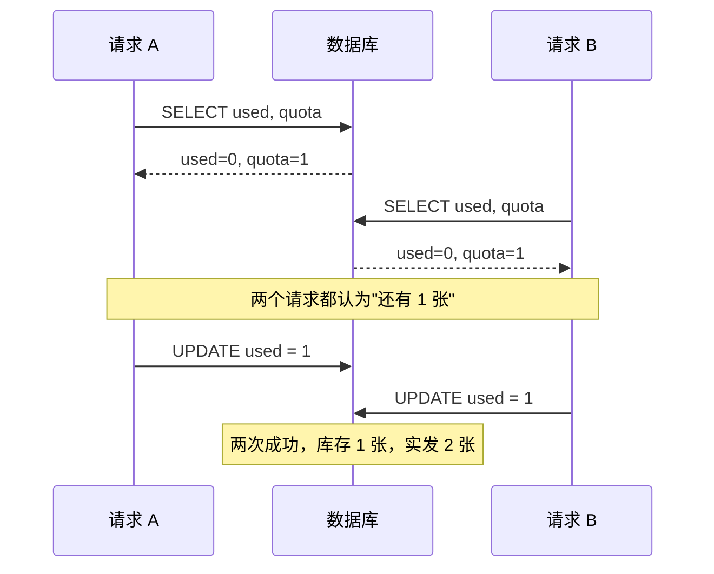
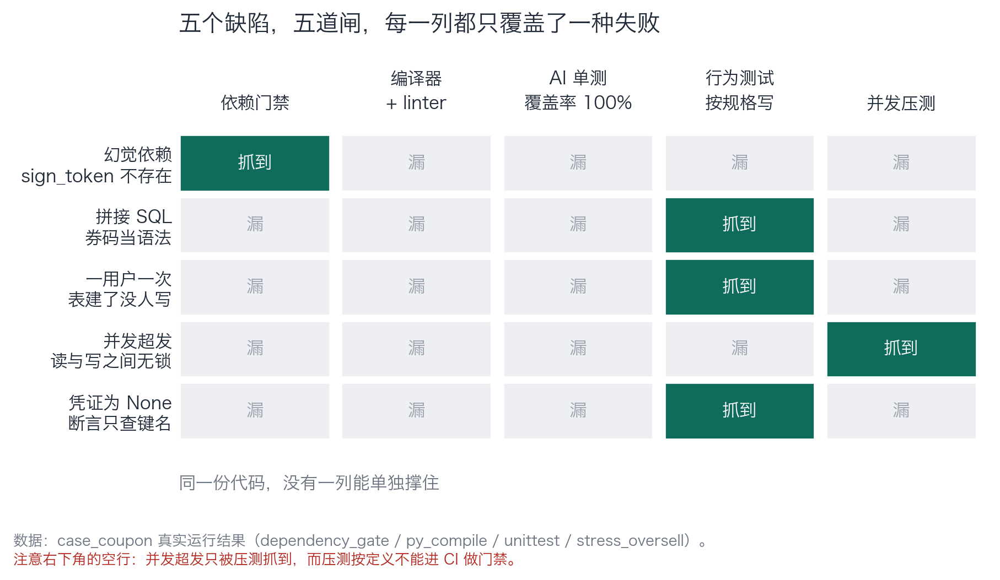
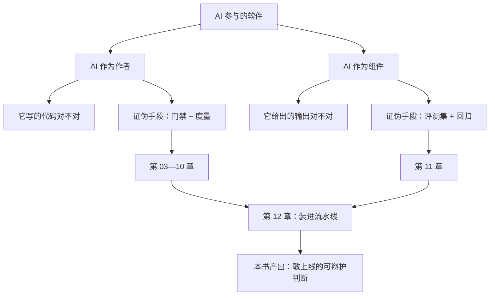

# 第 01 章：全绿的代码与 143 条核销记录

> **本章导读**：这一章不安慰你，也不教你新工具。它只做一件事——让你亲眼看到"我读过了"和"它验证过了"之间的那道缝，然后把整本书的路线图铺在这道缝上。
> **前置知识**：无。零测试基础可读。但你需要能读懂 30 行 Python。
> **核心学习目标**：
> - 说清"验证位置错位"是什么意思，并能在一个真实事故里指出错在哪一层
> - 用五道检查扫同一份代码，得到一张"哪道闸抓到哪个缺陷"的矩阵
> - 知道这本书的两半结构，以及你自己该从哪一半开始读

## 1. 认知锚点：那 43 次超发

### 1.1 一个周五下午

16:40，你把「优惠券核销」的需求交给编码智能体。四千字的规格，它回了 400 行实现和两个测试文件。CI 全绿，覆盖率 100%。

你扫了一眼核心函数：先查库存，判断够不够，够就扣减，返回凭证。逻辑通顺。同事路过，你让他也看了一眼，他说没问题。合并。

周一 09:20，运营在群里发截图：限量 100 张的券，核销记录 143 条。

你把代码调出来，从头读到尾。**没有一行是错的。**

真的没有。`if used >= quota` 写得对，`UPDATE` 语句写得对，返回结构也对。你甚至把两个请求的时序在纸上画了一遍，发现在任何**单线程**执行顺序下，这段代码都不会超发。

那 43 次是怎么来的？

来自两个请求在 8 毫秒内同时执行到第 3 行，**都读到了"库存还剩 1"**。它们各自手里的数字都是对的，各自的判断也都是对的。错的是这两行之间——那里什么都没有。

你现在可以问自己一个问题：如果当时你盯着屏幕再看 10 分钟，能看见这 43 次超发吗？

看不见。不是视力问题，是器官问题。

### 1.2 一个更精确的说法：验证位置错位

"我看过了"这句话，隐含一个假设：**缺陷存在于代码文本里，所以看文本就能发现缺陷。**

这个假设对一半缺陷成立，对另一半完全不成立。而生产事故里，另一半占多数。

把这句话拆开，你会看到三种完全不同的"验证位置"：

| 验证位置 | 你在验证什么 | 典型动作 | 它看不见什么 |
|---|---|---|---|
| **文本层** | 这段代码写得对不对 | 读代码、评审、类型检查、lint | 运行时的时序、数据分布、环境差异 |
| **行为层** | 它跑起来会做什么 | 单测、集成测试、压测 | 没被设计成用例的那部分行为 |
| **约束层** | 有些事能不能发生 | 数据库约束、事务隔离、限流器 | 约束没被表达出来的那些性质 |

那个周五下午，你只在**文本层**做了验证。而超发这个缺陷，住在**行为层**和**约束层**。

**这就是"验证位置错位"：你用一把只能量长度的尺子，去量一个只有称重才能发现的问题。** 尺子没坏，是你拿错了。



图里最关键的不是任何一条消息，是 A 和 B 之间那段**没有人写代码**的空隙。

### 1.3 这本书不打算教你什么

先把边界划清楚，省得你读完发现不是你要的：

- **不教你读得更快。** 人的阅读速度是硬约束，一天能认真读完的代码就是几百行。任何声称能让你一天读五千行的办法，都是在教你假装读过了。
- **不给你工具清单。** 工具三个月换一茬。这本书讲的是"这道闸在拦什么、什么时候它等于没跑"，你拿这个判断去挑工具，而不是拿工具清单去凑流程。
- **不承诺"零事故"。** 有一类缺陷，本书里所有门禁都抓不到。第 08 章会专门讲它，讲完你会知道那一类只能靠什么。

## 2. 第一性原理：验证的三条路，和它们各自的死角

### 2.1 你只有三种办法知道一段代码对不对

抛开所有工具名词，人类验证代码只有三种动作：

1. **看**（inspect）——读它、检查它的形状。快、便宜、覆盖窄。
2. **跑**（execute）——给它输入，看它做什么。慢一点、贵一点、覆盖取决于你想到多少输入。
3. **锁**（constrain）——让某些错误在结构上不可能发生。最贵（要改设计），但一旦成立就是永久的。

这三种动作不是替代关系，是**接力**关系。问题在于，绝大多数团队只跑第一棒，然后就宣布比赛结束。

| | 看 | 跑 | 锁 |
|---|---|---|---|
| 成本 | 最低（人力） | 中（算力 + 用例设计） | 最高（改架构） |
| 反馈速度 | 秒级 | 秒到分钟级 | 一次投入，永久生效 |
| 覆盖 commission（做错了） | 高 | 高 | 中 |
| 覆盖 omission（该做的没做） | **低** | 中（只在被设计成用例时） | **高** |
| 能防住"两行之间什么都没有" | 否 | 是 | 是（且只在这里才彻底） |

第 4 行是这本书反复要用的判据：**omission 是"少了东西"，而"少了东西"在文本里没有形状，所以看的方式天然抓不到它。** 第 02 章会把这条讲透。

### 2.2 五道闸扫同一份代码

空谈没有说服力。下面这份代码是本仓 `code/case_coupon/` 里的东西，一字未改——它是一份 AI 生成的优惠券核销实现，语法正确、能跑、happy path 通过。

我用五道检查扫它，把结果记在一张表里：

```bash
$ python dependency_gate.py coupon_service.as_generated.py
文件                                   行  模块                            判定
--------------------------------------------------------------------------------------
coupon_service.as_generated.py      10  sqlite3                       stdlib
coupon_service.as_generated.py      12  fastapi_jwt_auth_kit          未登记
--------------------------------------------------------------------------------------
GATE FAILED：存在未登记依赖。
```

```bash
$ python -m py_compile coupon_service.py && echo "编译通过"
编译通过

$ python -m unittest test_coupon_ai -q
Ran 2 tests in 0.004s
OK
```

```bash
$ python -m unittest test_coupon_behavior
Ran 5 tests in 0.057s
FAILED (failures=2, errors=1)
```

```bash
$ python stress_oversell.py
组1  原版 · 24 并发 · 配额 10   检出 30/30 轮（100%）  单轮最大超发 14 张
```

把五道检查对五个缺陷的覆盖画出来：


*图 1-1：绿色是"抓到了"，灰色是"漏了"。注意两件事：第一，没有一列全绿；第二，最下面一行（并发超发）只有最后一列抓到，而最后一列按定义进不了 CI。*

这张图是这本书的地基，值得逐列看：

- **依赖门禁**：只抓第 1 行。它抓不到业务逻辑的任何问题，因为它只看 import。
- **编译器 + linter**：**全灰**。这不是工具的失败，是分工。这些缺陷全都是语义问题，而编译器只保证形状。
- **AI 单测（覆盖率 100%）**：**全灰**。这是最扎心的一列——它跑了 18 行代码，全部跑过，一个都没守住。
- **行为测试**：抓三行。它不是"更聪明的测试"，它是"对着规格写的测试"。
- **并发压测**：只抓第 4 行，而它慢、要起线程、结果依赖调度——**它不能当门禁**，只能当监控。

**所以真正的结论不是"要用行为测试"，而是"没有一列能单独撑住"。** 一座只用一道闸的水库，等于没有闸。

### 2.3 从"读一遍"到"它经过了什么"

把上面这些压缩成一句话，就是这本书的立场：

> **你不可能读完 AI 写的每一行代码。所以你必须换一种方式获得"敢上线"的资格：把"我读过"换成"它经过了什么"。**

"经过了什么"这五个字要具体化成可核验的东西：它经过了哪几道闸、每道闸当时的状态是什么、哪道闸曾经拦住过真实问题。这些东西能写进 PR 描述、能贴给老板、能在三个月后复查。而"我看过了"什么都留不下。

## 3. 手把手：亲手让一份全绿的代码超发一次

这一节的目的不是学会跑脚本，是让你**身体记住**"绿灯"和"对"之间的距离。全程五分钟。

### 3.1 先确认它是绿的

```bash
$ cd code/case_coupon
$ python -m coverage run --include=coupon_service.py -m unittest test_coupon_ai -q
Ran 2 tests in 0.004s
OK
$ python -m coverage report -m
Name                Stmts   Miss  Cover   Missing
-------------------------------------------------
coupon_service.py      18      0   100%
-------------------------------------------------
```

18 行语句，0 行未覆盖，100%。这就是那个周五下午的你看到的那盏灯。

### 3.2 再让它超发

```bash
$ python ../ch08/stress_oversell.py
组1  原版 · 24 并发 · 配额 10   检出 30/30 轮（100%）  单轮最大超发 14 张
```

配额 10，24 个人抢，结果卖出去 24 张。**同一份代码，同一个解释器，30 轮里 30 轮都超发。**

现在回到那盏 100% 的绿灯面前，问自己：它刚才证明了什么？

答案只有一句：**这 18 行代码都执行过了。** 仅此而已。它没有说这些行做对了什么，因为它根本没在看"对不对"——它在看"跑没跑过"。

### 3.3 换一把尺子量同一个东西

```bash
$ python -m unittest test_coupon_behavior
FAILED (failures=2, errors=1)
```

同一份实现，五条按规格写的断言，红了三条。红的那三条恰好对应规格里被违反的三句话。

注意这里发生的事：**代码一个字没改，只是换了一把尺子，答案就从"通过"变成"不通过"。**

这就是本章最重要的一句话：

> **绿灯不是关于代码的属性，是关于"你问了什么问题"的属性。**

覆盖率那一套问的是"跑过没有"，行为测试问的是"规则守住没有"。前者永远回答"跑过了"，后者才可能回答"没守住"。

## 4. 常见误区与正反例对比

| 容易踩坑的误区 | 为什么会出错 | 正确的心智模型与做法 |
|---|---|---|
| **"测试全绿就可以合"** | "绿"只说明你问的那个问题得到了肯定回答。问题问窄了，绿灯就是装饰 | 问"这套测试覆盖了规格的哪几句"，而不是"覆盖了多少行代码" |
| **"覆盖率 100%，质量有保障"** | 覆盖率度量执行过的行数。补一堆 `assertIsNotNone` 就能刷到 100% | 覆盖率当下限，不当红线。第 07 章会给你一把能打分的尺子 |
| **"我逐行读过，没问题"** | 读只能看见"写了什么"，看不见"少了什么"。而 omission 是事故主体 | 读用来抓 commission；omission 必须靠断言、约束、红队 |
| **"AI 写的才需要这么小心，人写的不用"** | 缺陷不关心作者。人写的拼接 SQL 一样会泄库 | 按可逆性定审不审（第 10 章），不按作者定 |
| **"上次这么干也没出事"** | 这是幸存者偏差的正式定义。事故是概率事件，样本量为 1 的观察没有信息量 | 用"这道闸历史上拦住过几次真实问题"替代"上次没出事" |

## 5. 本章小结与局部知识图谱

### 5.1 核心要点

- **验证有三层：文本、行为、约束。** 只做第一层，等于没验证第二、第三层的东西。
- **绿灯是关于问题的属性，不是关于代码的属性。** 换一把尺子，同一个"通过"会变成"不通过"。
- **没有一列能单独撑住。** 五道闸扫出五个缺陷，每道闸平均只覆盖一种失败。
- **有一列进不了 CI。** 并发压测能抓到超发，但它慢、依赖调度，只能当监控——这个缺口第 08 章专门处理。

### 5.2 本书的两半结构

这本书讲"验证"，但"验证"在这里有两个不同的对象，证伪方法完全不重叠：



**为什么必须分开**：代码的正确性可以穷举（只要用例够），输出的正确性不能穷举（输入空间无限、答案没有唯一解）。用单测去测一个 LLM 的回复好不好，就像用体温计量身高——不是精度问题，是量纲问题。

### 5.3 与后续章节的接口

- **第 02 章**回答"为什么读代码只能抓一半"，给你一个能复用的缺陷分类器。
- **第 03 章**把"三种验证对象"落成决策树，你以后拿到任何一段代码，三十秒内能判断该用哪种方式验。
- **第 04—08 章**是五道闸的逐层拆解，每章都会回答"它抓什么、漏什么、什么时候等于没跑"。
- **第 09—10 章**把闸变成数，把数变成判定。
- **第 11—12 章**处理另一半（AI 作为组件），并整合成一条真实流水线。

## 6. 分级通关练习

### Tier 1 · 直觉与概念核验

**1.** 用"文本层 / 行为层 / 约束层"给下面四个缺陷归类，并说明"读代码"能不能发现：
　(a) `if used > quota`（应为 `>=`）　(b) 数据库没加唯一约束　(c) 请求没设超时　(d) 日志里打印了完整身份证号

**2.** 有人说："我们覆盖率 95%，比你们 80% 强。"这句话在哪三种情况下没有信息量？

**3.** 本章说"绿灯是关于问题的属性"。请构造一个例子：同一份代码，同一套断言，换个环境跑，结果从绿变红。

### Tier 2 · 推演与实操构建

**4.** 跑 `stress_oversell.py`，把"配额 10 / 24 并发"改成"配额 10 / 6 并发"，记录检出率。解释变化的原因，并回答：**如果要证明"这段代码并发安全"，需要跑多少轮才算够？**

**5.** 用图 1-1 的格式，给你自己项目里最近一次线上事故画一张矩阵（缺陷 × 现有检查手段）。哪个格子是空的？

### Tier 3 · 边界条件与跨章迁移

**6.** 假设你只有 30 分钟做上线前验证，只能选两道闸。你会选哪两道？请给出判据，并说明你的选择在什么情况下会失效。

**7.** 本章说"没有一列能单独撑住"。反过来问：**有没有可能某一道闸拦住全部缺陷？** 如果有，是什么？如果没有，请用第 2.1 节的三种动作论证为什么。

<details>
<summary><strong>点击展开：本章练习参考答案与深度解析</strong></summary>

#### 1. 缺陷归类

- **(a) `>` 应为 `>=`**：文本层。这是典型的 commission，缺陷有形状，读代码能发现（前提是你停下来算一次边界）。行为测试也能发现，只要用例覆盖"库存刚好用完"。
- **(b) 缺唯一约束**：约束层。文本层完全看不见——因为**代码里没有这一段**，你要看见的是一个"不存在的东西"。这类只能靠"约束存在性检查"（第 08 章给代码）。
- **(c) 没设超时**：文本层 + 约束层。读代码能不能发现，取决于你脑子里有没有"所有外部调用必须有超时"这条清单。有经验的人能发现，新手不能——**"依赖读者经验"本身就是设计缺陷**。
- **(d) 日志打印身份证号**：文本层。能读出来，但前提是你在读日志语句时把"这是什么数据"想了一遍。这类缺陷的特点是"读的时候眼睛会滑过去"，因为语句本身没毛病。

#### 2. 覆盖率对比没有信息量的三种情况

第一，**对方统计口径不明**：行覆盖还是分支覆盖？只统计业务代码还是含测试代码？第二，**断言强度不明**：95% 的行被执行，但断言可能全是 `assertIsNotNone`。第三，**测试目标不明**：如果那 95% 覆盖的是 getter/setter，而核心业务逻辑正好在那 5% 里，这个数字是完全反向的。

所以"覆盖率对比"只在三者口径完全一致时才有意义，而这种情况极少。

#### 3. 同一套断言，换环境从绿变红

最经典的构造：依赖时区。测试里写 `assertEqual(expire_at, "2026-10-19T15:00:00")`，本地 `TZ=Asia/Shanghai` 通过；CI 机器 `TZ=UTC`，同一个函数返回 `07:00:00`，红。代码没变、断言没变，**变了的是"这段代码运行在什么假设之上"**。

这个例子的价值：它说明绿灯里藏着一批**没被写下来的前提**（时区、locale、随机种子、数据库版本）。第 08 章会把这类东西归类为"没人写下的性质"。

#### 4. 并发度与检出率

6 个线程抢 10 张配额——**无论怎么调度都不可能超发**，因为成功次数上限就是 6。检出率 0%，但这个 0% 和你修复后得到的 0% 含义完全不同（第 08 章图 8-1 的组2 与组3 就是这个坑）。

关于"要跑多少轮才算够"：**这个问题没有答案，而且这正是重点。** 压测给不出"证明"，只能给"没撞上"。数学上，如果每一轮撞上的概率是 p，跑 n 轮都没撞上的概率是 (1−p)ⁿ，你永远只能把"漏检概率"压低，压不到 0。所以"并发安全"这个结论不能由压测得出，只能由**约束**得出（唯一索引、条件更新、事务隔离级别）。

#### 5. 给自己项目画矩阵

判据只有一条：**每一行都要有一个绿色的格子，否则那一行的缺陷现在只能靠运气**。常见形态是"测试列很绿，约束列全灰"——意思是你的防线全在应用层，数据库层是裸的。

#### 6. 30 分钟选两道闸

**第一道：依赖允许清单**（0.05 秒）。它拦的是"后面所有闸都看不见"的那类缺陷，且成本近乎为零，没有不选的理由。

**第二道：行为测试里最贵的那三条**——不是"跑全部测试"，是"跑覆盖核心规格的那三条"。判据是：**这道闸拦住的缺陷，后果不可逆吗？** 如果可逆（能回滚），宁可选快的；如果不可逆（已扣款、已发券），必须选它。

失效条件：如果核心规格本身写错了，这两道闸会一致地放行一个错误的东西。这是第 03 章"输出对象"和第 02 章"规格清单"要处理的问题。

#### 7. 有没有一道闸能拦住全部缺陷

**没有。** 用 2.1 节的三种动作可以证明：

- "看"作用于文本，而 omission 在文本里没有形状——必有盲区。
- "跑"作用于你设计的输入，而缺陷可能住在你没设计的输入里——必有盲区。
- "锁"作用于你能表达出来的性质，而没被想到的性质无法被表达——必有盲区。

三者叠加能把这个盲区压到很小，但压不到零。**这本书的诚实之处就在这儿：它不承诺零事故，它承诺让你知道自己的盲区在哪、有多大。** 知道盲区位置的团队，和不知道的团队，出事后恢复速度差一个量级。

</details>

---

**下一章**：为什么"读代码"这条防线会失效——不是因为读得不够多，是因为缺陷有两种，而读只能看见其中一种。

---

## 7. 本章权威参考信源与延伸阅读 (Authoritative References)

1. **OWASP ASVS**：[OWASP ASVS](https://www.owasp.org/www-project-application-security-verification-standard/) - 本章的定义与规范以此为锚（核验日期：`2026-10-23`）。
2. **CVE Program**：[CVE Program](https://www.cve.org/) - 本章的定义与规范以此为锚（核验日期：`2026-10-23`）。
3. **DORA**：[DORA](https://dora.dev/) - 本章的定义与规范以此为锚（核验日期：`2026-10-23`）。

> 口径提示：以上信源用于锚定**定义与规范**，不用于外推风险概率。引用任何数字前，先核对来源年份与分母。
