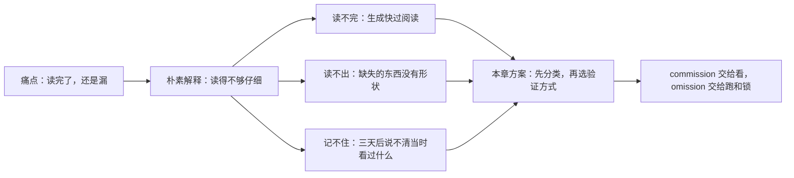
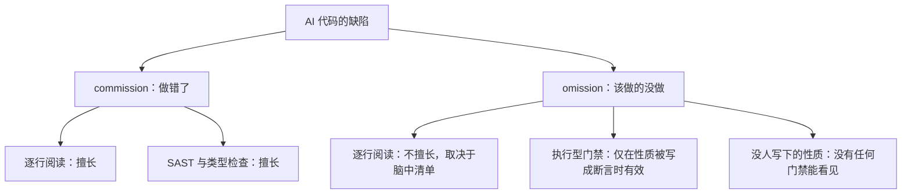
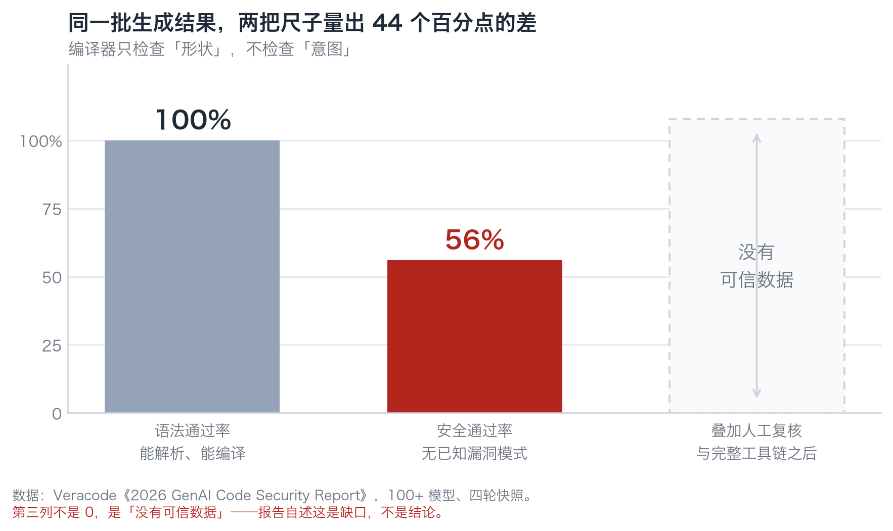
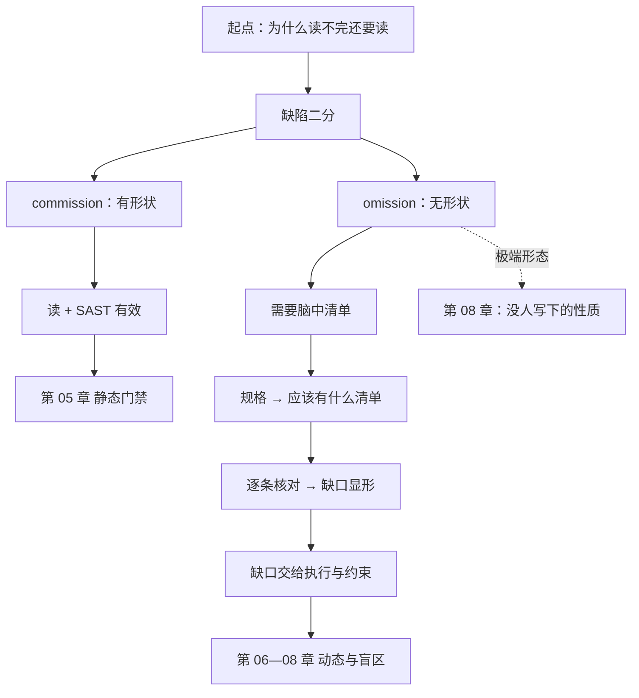

**English** | [中文](./ch02-two-kinds-of-defects.zh.md)

# Chapter 02: Two Kinds of Defects, and Reading Code Is Only Good at One

> **Chapter Guide**: The last chapter showed you "misplaced verification". This chapter gives you a classifier you can use over and over — split defects into commission and omission, and you will immediately understand why the sentence "I read it" is meaningless against certain defects.
> **Prerequisites**: Chapter 01. You need to be able to read code, but you do not need to know testing.
> **Core Learning Objectives**:
> - Judge a defect as commission or omission at a glance, and state the detection probability of "reading code" against it
> - Explain on which three conditions Veracode's 56% differs from a "release failure rate"
> - Derive a "what should exist" checklist from the spec, thereby turning omission into something detectable

## 1. Cognitive Anchor: Customs Doesn't Open Every Package

### 1.1 A Question That Doesn't Add Up

First, a small experiment.

Open `code/case_coupon/coupon_service.py`; this code has four defects. Give yourself three minutes and find them all.

Can't find them? Most people cannot find more than three. But among these four defects, one looks like this:

> The spec says "each user can redeem each coupon at most once". The code created a `redemptions` table, but **no line of code ever writes into it**.

Now that you know the answer, go back and look again — can you "see" it?

You cannot. Because **this piece does not exist in the code**. What you can see is an empty table name, and an "empty table name" looks completely normal. To find it, you must first know "there should be an INSERT here".

That is the entire content of this chapter: **some defects have no shape, so the eye cannot catch them.**

### 1.2 The Customs Analogy, and Its Boundary

You are at customs. A hundred thousand packages a day.

You will not let a whole batch through because "the sender looks pretty professional". Nor will you open every package for a piece-by-piece check — the cost does not allow it. What you do is: X-ray for shape, chemical testing for composition, the prohibited list for names, and spot checks for physical inspection.

The parts of code verification map one to one:

| Security check step | Its counterpart in code | What it guarantees | What it cannot guarantee |
|---|---|---|---|
| Sender's declaration | The model says "I implemented this requirement" | A natural-language description | Whether the description matches the implementation |
| X-ray machine | Compiler / type checker / linter | Correct shape | Whether the logic is right, whether it is safe |
| Chemical testing | SAST / dependency scanning / secret scanning | Signatures of known dangerous goods | New forms not yet in the rule base |
| Prohibited list | Dependency allowlist | Foreign objects are on the list | Whether the things on the list are themselves trustworthy |
| Spot check | Human review | The part that got sampled | The part that did not |
| Incident forensics | Mutation testing / structural analysis | Which rule nobody is actually keeping | Rules nobody wrote down |

**The boundary of the analogy (more important than the analogy itself)**: packages are static and pass once checked; code is alive, and the same code behaves differently under different inputs, concurrency, and data volumes. So this analogy can only borrow "layering", not "pass once".

### 1.3 Why "Read It a Few More Times" Is Useless

Put three numbers together and you will see this is a structural problem:

- **Generation side**: Anthropic announced in 2026-08 that as of May 2026, **over 80% of the code merged into its codebase was written by Claude**; in 2026 Q2, the per-engineer daily merged code volume was **8 times** that of 2024.
- **Review side**: human reading speed has not changed; the amount of code one can genuinely read through and understand in a day is still on the order of a few hundred lines.
- **Consequence side**: Thoughtworks' 34th Technology Radar made its annual theme **cognitive debt** — "AI-generated code is faster than the team's ability to understand it".

If the verification method remains "humans read line by line", verification capability will fall behind generation capability linearly. This is not a gap that diligence can close.

## 2. First Principles: Two Kinds of Defects, One Visible, One Invisible

### 2.1 Definitions and the Visibility Asymmetry

Look at just two words:

- **commission (doing it wrong)**: writing things that should not be written. Concatenated SQL, a boundary written as `>`, hardcoded secrets, using an API that throws.
- **omission (not doing what should be done)**: leaving out things that should be there. No locking, no parameterization, no authorization, no idempotency, no timeout, no rate limiting, no validation, no audit logging.

Their visibility is completely asymmetric:

| | commission | omission |
|---|---|---|
| Shape in the code | There is something, and that something looks suspicious | **Nothing at all** |
| Cognitive action when reading code | "Is this line right?" | "Is something missing here?" |
| Detection ability of reading code | High (experienced readers can see most of it) | **Low, and proportional to the completeness of the checklist in your head** |
| Detection ability of automated tools | SAST, type checking, mutation testing | Only effective "when the property is written as an assertion" |
| Share in production incidents | Rare | **Common** |

The second and fourth columns are the entire starting point of this book.

When hunting commission, your eye has a target. When hunting omission, the target is **the "what should exist" checklist in your head**.

Which yields an uncomfortable corollary:

> **The effectiveness of reading code = the completeness of the spec checklist in your head. If the checklist is incomplete, no matter how short the code is, you cannot read it out.**

This is why "I read it line by line" does not equal "I verified it" in production — what you verified is what you thought of.

The node at the bottom right (O3) is the theme of Chapter 08. Remember it for now.

### 2.2 Four Classes of Systematic Failure

Classifying the failure modes of AI-generated code is so that gates can aim. These four classes are not "the model's quirks"; they are **determined by mechanisms**:

| Failure type | Mechanism | Typical form | The cheapest gate |
|---|---|---|---|
| **Hallucinated dependency** | When completing "a library is probably needed here", generate a syntactically and semantically plausible package name | `from fastapi_jwt_auth_kit import sign_token` | Dependency allowlist (scan imports via AST) |
| **Patterned copying** | In the training corpus, "runnable concatenated SQL" far outnumbers "the correct way to write parameterized queries" | f-string SQL assembly, `eval`, hand-rolled crypto | SAST + behavior tests |
| **Missing security properties** | What nobody asked it to write, it will not write on its own initiative | No locking, no idempotency, no timeout, no rate limiting | Only "property written as assertion" is effective |
| **Context collapse** | In long sessions, the weight of early instructions decays | The later code starts violating rules set by the earlier code | Short sessions + spec slicing + restating constraints every round |

The second row deserves a second look: **the root cause of patterned copying is corpus density, not a dumb model.** On GitHub, "runnable concatenated SQL" outnumbers "the correct way to write parameterized queries" by orders of magnitude, and what the model learned is exactly this distribution. This explains a counterintuitive phenomenon — the model is eloquent when explaining "why you must not concatenate SQL", and then turns around and concatenates in code. **Knowledge and behavior are two sets of weights in a model.**

### 2.3 The Measured Picture, and Three Reasons It Does Not Hold

First put the most important number straight.

Veracode's "2026 GenAI Code Security Report" (2026-07-28, 100+ models, four rounds of snapshots): **the average security pass rate is 56%, essentially flat against the previous year's 55%; about 44% of generation tasks introduced OWASP Top 10 class vulnerabilities; over the same period the syntax pass rate was close to 100%.**

*Figure 2-1: The same batch of generation results: the compiler passes 100%, the security scan passes 56%. The third column is not 0 — it is "no trustworthy data": the report itself admits that the effect after layering on toolchains and human review currently has no trustworthy measurement. This blank matters more than any number.*

Now do something most quotes skip: **split apart the three qualifying conditions of the 56%**.

| Qualifying condition | What the report actually meant | What it means for your project |
|---|---|---|
| Raw model | Ask the model directly for code, no agent, no rules file | You use agent + project rules + spec-driven; the condition has already changed |
| No security hints | No instructions like "watch out for SQL injection" | Your harness has feedforward control; the condition changes again |
| No agent, no human review | The generation is the result; no tests, no review in between | Your feedback control will block some of it, **but how much is blocked has no data** |

So both sentences must be said:

- You **cannot** say "56% means I have a one-in-two chance of release failure" — that treats the generation failure rate as the release failure rate, with three uncounted process steps in between.
- Nor **can** you say "I use agents and gates, so I am safer" — this sentence has no data behind it. Veracode explicitly points out that this is a research gap.

So what is the 56% still good for? **Its role is to calibrate expectations, not to predict your project.** It tells you two certain things: a green syntax light carries almost no security information (100% vs 56%); a year on, this number barely moved (55% → 56%), so "wait for the models to get stronger" is not a strategy.

The same report also gives breakdown numbers: by language, Python 63% and Java 30%; by vulnerability class, SQL injection 83%, cryptographic misuse 87%, while XSS 15%, log injection 12%.

The **direction** of this set of numbers does not matter here (whether it is pass rate or detection rate, defer to the original report's charts); what matters is the **magnitude**: the same model, the same prompts, changing the language moves 33 percentage points, changing the vulnerability class moves 70 percentage points. It directly kills one common way of asking:

> "Is AI-written code safe?" — this question has no answer.
> The answerable way to ask it is: "With this model, this language, this vulnerability class, this pipeline, how big is my failure surface?"

## 3. Hands-on: Turning "What Should Exist" Into a Checklist

This section gives you an action you can use immediately. Its effect: **turn omission from "invisible" into "checkable item by item".**

### 3.1 Starting Point: Four Sentences of Spec

Following the spec-driven approach (the practice of Phase 02), compress the requirements into four decidable sentences:

| Number | Spec | What it constrains |
|---|---|---|
| S1 | Each user can redeem each coupon at most once | Business rule |
| S2 | Total redemptions must not exceed stock | Business rule |
| S3 | The coupon code is user input, not code | Trust boundary |
| S4 | On success, return a redemption voucher | Interface contract |

### 3.2 Step Two: Derive "What Should Exist" From Each Spec Sentence

This step is the core technique of this chapter. Do not read the code; read only the spec, and ask sentence by sentence: **for this to hold, what must exist in the code?**

| Spec | What must exist (the "what should exist" checklist) |
|---|---|
| S1 | ⓐ a table recording "who redeemed which coupon" **and** ⓑ one write **and** ⓒ a unique constraint or check-then-write **and** ⓓ an explicit failure returned on duplicates |
| S2 | ⓐ one read of the current used count **and** ⓑ one check of remaining quota **and** ⓒ one deduction **and** ⓓ read and write inside the same atomic operation |
| S3 | ⓐ the coupon code treated as data when entering SQL (parameterized) **and** ⓑ never concatenated into the statement structure |
| S4 | ⓐ a real voucher generation **and** ⓑ the library the voucher depends on actually exists **and** ⓒ the failure path returns no voucher |

### 3.3 Step Three: Check the Code Against the Checklist

Now go into `coupon_service.py` and tick item by item. You will get a table like this:

| Checklist item | Is it in the code? | Conclusion |
|---|---|---|
| S1-ⓐ redemption record table | Yes (the `redemptions` table) | Tick |
| S1-ⓑ write the redemption record | **No** | **omission** |
| S1-ⓒ unique constraint | **No** | **omission** |
| S1-ⓓ fail on duplicates | **No** | **omission** |
| S2-ⓐ read the used count | Yes | Tick |
| S2-ⓑ check remaining quota | Yes | Tick |
| S2-ⓒ deduct | Yes | Tick |
| S2-ⓓ atomic operation | **No** | **omission** |
| S3-ⓐ parameterization | **No** (f-string) | commission |
| S4-ⓑ dependency exists | **No** (hallucinated package) | omission (factual error) |

**Ten checklist items, five missing.** And of those five, four are ones where, when reading the code, you **would not stop at all** — because when reading code your gaze rests on "the things that are there", not on "the things that are not there".

This is the value of the method: the checklist switches you from "browsing" to "checking". Browsing cannot find gaps; checking can.

> A side note: for these five missing items, the AI was not "being lazy on purpose". When generating, it pushes forward token by token; "what should exist" was never written into its context — those four sentences of spec were diluted long ago within 400 lines of code. Phase 02 covers context collapse; this is its concrete form in code generation.

### 3.4 Step Four: Classify the Defects, Choose the Verification Method

Group the conclusions of the previous table by commission / omission, and the verification methods fall out automatically:

| Defect | Type | How to verify | Why not "read" |
|---|---|---|---|
| S3-ⓐ concatenated SQL | commission | Behavior tests + SAST | Reading can find it, but line 287 of 400 will be skipped by the eye |
| S1-ⓑⓒⓓ no redemption record | omission | Behavior tests (same user redeeming twice must fail) | Missing items have no shape |
| S2-ⓓ non-atomic | omission | Concurrency reproduction / constraint check | Missing items have no shape, and behavior is correct single-threaded |
| S4-ⓑ hallucinated package | omission | Dependency allowlist | The import looks completely normal |

**The rule**: commission can be "inspected"; omission must be "executed" or "constrained". The three actions of Chapter 01 now get a clear division-of-labor table here.

## 4. Common Misconceptions, and Correct-vs-Wrong Comparisons

| Misconception to fall into | Root cause | The right practice |
|---|---|---|
| **"AI-generated code has more vulnerabilities"** | Confusing "generation failure rate" with "release failure rate", and ignoring the huge differences across languages and vulnerability classes | Ask specifically: what model, what language, what vulnerability class, what pipeline. Do not trust conclusions without concrete conditions |
| **"I read it once, the logic is fine"** | Reading is only good at commission; omission needs a checklist | Write the "what should exist" checklist first, then check against it. A checklist is far cheaper than reading |
| **"This line looks a bit odd, but it should be fine"** | Intuition works on commission and completely fails on omission (missing things have no "odd" feeling) | Downgrade "feels odd" to a clue; upgrade "checklist checking" to a criterion |
| **"A stronger model means fewer gates"** | 56% has not moved in a year (55→56); model capability gains have not translated into security pass-rate gains | Design gates for your project's failure surface, not for the model version |
| **"The AI explains why it wrote it that way, so it is trustworthy"** | Explanation and behavior are two sets of weights. It can eloquently explain parameterized queries and then keep concatenating strings | Trust only executable evidence: results that ran, lists that were scanned, records of what got blocked |

## 5. Chapter Summary and Local Knowledge Map

### 5.1 Key Points

- **Defects fall into two classes.** commission has a shape and reading code is good at it; omission has no shape, and the ceiling of reading code is "whether you thought of it".
- **The effectiveness of reading code = the completeness of the spec checklist.** To make reading useful, make the checklist complete first.
- **All four classes of systematic failure are products of mechanisms**: hallucinated dependencies (completion mechanism), patterned copying (corpus density), missing security properties (nobody asked), context collapse (attention decay). Cursing the model is useless; prescribe the right gate.
- **The 56% has three qualifying conditions.** Its use is to calibrate expectations, not to predict your project.
- **The "what should exist" checklist is the most practical output of this chapter.** It turns invisible omission into a table you can check item by item.

### 5.2 Concept Topology of This Chapter

### 5.3 Interfaces to the Previous and Next Chapters

- **From Chapter 01**: it said "misplaced verification"; here is the root cause of the misplacement — defects come in two kinds, and you only used one verification action.
- **To Chapter 03**: the checklist tells you "what is missing"; Chapter 03 tells you "which object should be used to verify the missing thing".
- **To Chapter 04**: that S4-ⓑ item (dependency exists) becomes its own chapter, because its attack surface is much larger than "written wrong".

## 6. Tiered Exercises

### Tier 1 · Intuition and Concept Checks

**1.** Judge the six defects below as commission / omission, and write whether "reading code can find them" plus the reason:
　(a) `if used > quota`　(b) no authorization on `user_id`　(c) the logs print the full phone number
　(d) no idempotency key　(e) used an API that throws with no try　(f) the cache has no expiry

**2.** Answer in one sentence: why are "I read 400 lines" and "I checked a 10-item checklist" not the same thing?

**3.** Someone says "we use the newest, strongest model, so that 56% number has nothing to do with us". This sentence is half right; state the right half and the wrong half.

### Tier 2 · Deduction and Hands-on Construction

**4.** Write a "what should exist" checklist for the "waiting-list signup system". The specs are:
　S1 After an event is full, signups enter a waiting queue ordered by signup time
　S2 When someone cancels, the first in line automatically gets a 15-minute confirmation window
　S3 If the window expires without confirmation, it passes to the next in line, and the queue must not get stuck
　S4 Each user can have at most one active record per event
Requirement: from each spec sentence, derive at least three "things that must exist".

**5.** Take one of your own projects; from the last 20 commits pick 5 that contain AI-generated code, tag the defects in them (commission / omission), and compute the ratio. Reconcile the result with this chapter's prediction.

### Tier 3 · Boundary Conditions and Cross-Chapter Transfer

**6.** The "what should exist" checklist has one fatal weakness: **it can only derive the items you already know**. Design a method for discovering "items the checklist itself missed", and state the failure boundary of this method.

**7.** This chapter attributes omission to "products of mechanisms". Argue a counterexample: **what kind of omission is not a product of a mechanism, but a deliberate omission?** What does such an omission mean in production?

<strong>Click to expand: reference answers and in-depth analysis for this chapter's exercises</strong>

#### 1. Classifying the six defects

- **(a) `>` should be `>=`**: commission. It has a shape; reading code can find it (provided you stop to compute a boundary), and mutation testing can also find it (provided tests cover "just ran out").
- **(b) No authorization**: omission. The most dangerous class, because the symptom is "everything looks fine" — the feature works; it is just usable by anyone. Reading code can almost never find it (you do not know what "should" be here); only a dedicated privilege-escalation test can catch it.
- **(c) Logs print the phone number**: commission. But note what is special about it: the statement itself is not wrong; what is wrong is "what data this variable holds". The eye slides over this kind of defect when reading; it belongs to "readable but easy to miss".
- **(d) No idempotency key**: omission. Moreover, it behaves perfectly normally in single-threaded, single-request tests. Only double-clicks, retries, and message redelivery will expose it.
- **(e) Used an API that throws with no try**: a commission + omission hybrid. The call itself is commission (chose a throwing API); the missing try is omission. Forced to classify: **the main cause is omission**, because swapping to a non-throwing API only treats the symptom.
- **(f) Cache without expiry**: omission. The typical trait is "running just fine" — until memory climbs or the data goes stale.

**Statistics**: four of the six are omission. This ratio roughly matches real projects, and it is the empirical basis for this chapter's emphasis that "reading code is not enough".

#### 2. Reading 400 lines vs checking a 10-item checklist

Reading 400 lines is **traversing known content**; your attention is on "the things that are there". Checking a 10-item checklist is **retrieving specific targets**; your attention is on "the things that should be there but are not". The former relies on stamina; the latter relies on checklist quality. And checklists are reusable — for the same class of requirements, a checklist can be written once and used ten times; reading 400 lines can only be used once.

#### 3. The sentence "the newest model has nothing to do with 56%"

**The right half**: 56% is a number under the conditions "raw model, no security hints, no agent, no human review"; your pipeline is indeed not under those conditions, so it cannot be applied directly.

**The wrong half**: the report also states that a year on (55% → 56%) the security pass rate barely moved, and that **coding-specific models (51%) are not safer than general models (52%), and model scale has essentially no effect**. So the "switch to a stronger model" path has no empirical support on the security dimension. What you can change is the pipeline, not the model version.

#### 4. The waiting-list system checklist (excerpt)

| Spec | Things that must exist |
|---|---|
| S1 full → waiting list | ⓐ a capacity check ⓑ a waiting status ⓒ a stable sort key (not implicit things like "insertion order") ⓓ atomicity of capacity check and insert under concurrency |
| S2 cancel triggers a slot release | ⓐ actively look up the head of the waiting list on cancel ⓑ a "slot released, awaiting confirmation" status ⓒ an expiry timestamp ⓓ atomicity of the release operation itself (two simultaneous cancels must not release twice) |
| S3 expiry passes on | ⓐ a mechanism scanning for expiry (scheduled task or lazy check) ⓑ skip already-expired people when passing on ⓒ advanceability of the queue head (it must not get stuck forever because one person did not confirm) |
| S4 one record per person | ⓐ a unique constraint (`UNIQUE(event_id, user_id)`) ⓑ exception handling that allows re-signup after canceling ⓒ an idempotent response to double-clicks |

Note S3-ⓐ: **"a scheduled task" does not exist in any line of code**; it is a "what should exist", and the most easily missed item. Chapter 08 will use this example to talk about "timing-type omissions".

#### 5. The tagging experiment on your own project

There is only one criterion: **for this defect, if another person reads it, what extra knowledge do they need in order to find it?** If the answer is "they need to know some convention / some business rule", then it is omission, because reading the code itself does not provide that knowledge.

#### 6. Methods for finding "items the checklist itself missed"

Three complementary approaches:

**(1) Derive backward from incidents.** Every time an incident happens, ask "why wasn't this item on the checklist", and add it. This is the most expensive but most reliable method — trading real losses for checklist completeness.

**(2) Generate the checklist from multiple viewpoints.** For the same spec, have three people write checklists from the "data flow", "attacker", and "operations" viewpoints respectively, and take the union. Blind spots of different viewpoints do not overlap.

**(3) Drive with counterexamples.** Do not ask "what should exist"; instead ask "if it broke, how would it break". This is the red team (task 2 of Chapter 12). Threat modeling (Phase 04) is the systematized version of this path.

**Failure boundary**: all three methods can only cover "the ways you can think of it breaking". For genuinely novel failures (the kind that appears for the first time), the checklist is guaranteed to be missing something. This is also why this book does not promise zero incidents — it promises to let you know "which class this miss belonged to".

#### 7. Counterexample: deliberate omission

It exists. The typical scenario is **cutting for the sake of shipping**: knowing there is no idempotency, knowing there is no audit log, knowing rate limiting was skipped, but choosing to ship first before the deadline. This is completely different in nature from "blind spots caused by mechanisms":

- Omission caused by mechanisms: you **do not know**, so you cannot guard against it.
- Deliberately omitted omission: you **know**, but chose to bear the risk.

The meaning of the latter in production: it must be **written down** (a sentence in an ADR, a risk register, or the PR description), otherwise after three months it degenerates into the first kind — nobody remembers that it was known back then. The place where a team is most likely to go wrong is not "not knowing what it does not know", but "once knew it, but left no trace".

---

**Next chapter**: the checklist tells you what is missing, but which method should be used to verify "the missing things"? Three verification objects, three completely different falsification methods.

---

## 7. Authoritative References and Further Reading for This Chapter (Authoritative References)

1. **OWASP ASVS**: [OWASP ASVS](https://www.owasp.org/www-project-application-security-verification-standard/) - the definitions and norms of this chapter are anchored here (verification date: `2026-10-23`).
2. **NIST CSRC**: [NIST CSRC](https://csrc.nist.gov/) - the definitions and norms of this chapter are anchored here (verification date: `2026-10-23`).
3. **martinfowler.com**: [martinfowler.com](https://martinfowler.com/) - the definitions and norms of this chapter are anchored here (verification date: `2026-10-23`).

> Basis note: the sources above are used to anchor **definitions and norms**, not to extrapolate risk probabilities. Before quoting any number, check the source's year and denominator first.
