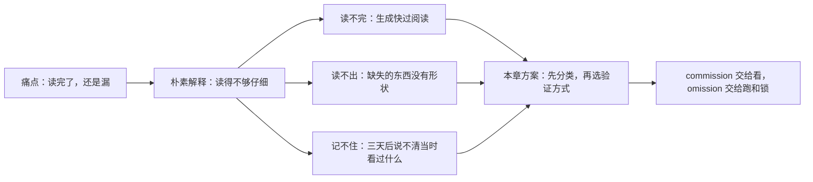
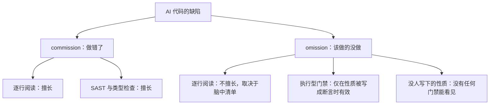
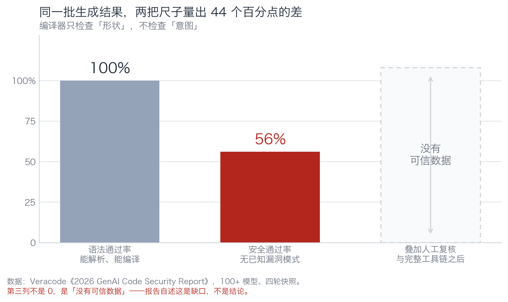
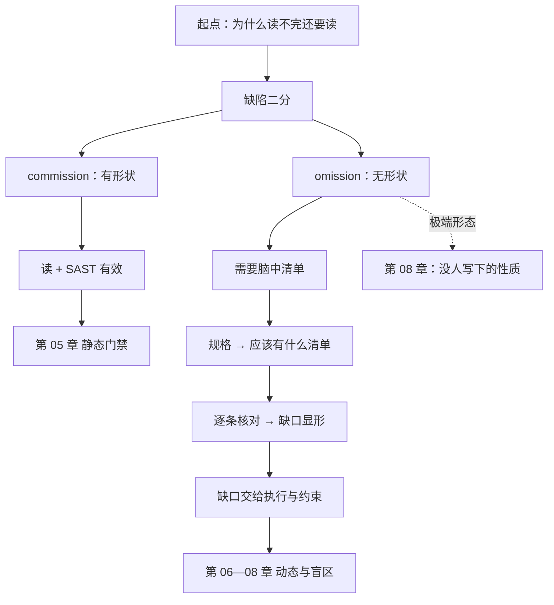

# 第 02 章：缺陷有两种，读代码只擅长一种

> **本章导读**：上一章让你看到了"验证位置错位"。这一章给你一个能反复使用的分类器——把缺陷分成 commission 和 omission，你会立刻明白为什么"我读过了"这句话在某些缺陷面前毫无意义。
> **前置知识**：第 01 章。能读懂代码，但不需要懂测试。
> **核心学习目标**：
> - 一眼把缺陷判成 commission 或 omission，并说出"读代码"对它的检出概率
> - 说清 Veracode 的 56% 与"上线失败率"差在哪三个条件上
> - 用规格推出一份"应该有什么"的清单，从而把 omission 变成可检出的东西

## 1. 认知锚点：海关不拆包裹

### 1.1 一个想不明白的问题

先做一个小实验。

打开 `code/case_coupon/coupon_service.py`，这份代码有四处缺陷。给你三分钟，把它们全部找出来。

找不到？大多数人找不到三处以上。但这四处缺陷里，有一处是这样的：

> 规格说"每个用户对同一张券只能核销一次"。代码建了一张 `redemptions` 表，但**从来没有任何一行代码往里写数据**。

现在你知道了答案，再回去看——你能"看见"它吗？

看不见。因为**代码里没有这一段**。你能看见的是一个空表名，而"空表名"看起来完全正常。你要发现它，必须先知道"这里应该有一句 INSERT"。

这就是本章的全部内容：**有些缺陷没有形状，所以眼睛抓不到。**

### 1.2 海关的类比，和它的边界

你在海关。每天十万个包裹。

你不会因为"寄件人看起来挺专业"就整批放行。你也不会拆开每一个包裹逐件检查——成本不允许。你干的是：X 光看形状、化学检测看成分、禁运清单看名单、开箱抽检看实物。

代码验证的零件可以一一对应：

| 安检环节 | 代码里的对应物 | 它保证什么 | 它保证不了什么 |
|---|---|---|---|
| 寄件人申报 | 模型说"我实现了这个需求" | 一段自然语言描述 | 描述与实现是否一致 |
| X 光机 | 编译器 / 类型检查 / linter | 形状正确 | 逻辑对不对、安不安全 |
| 化学检测 | SAST / 依赖扫描 / 密钥扫描 | 已知危险品的特征 | 没进规则库的新形态 |
| 禁运清单 | 依赖允许清单 | 外来物在名单内 | 名单内的东西本身可信吗 |
| 开箱抽检 | 人工评审 | 抽到的那部分 | 没抽到的部分 |
| 事故溯源 | 变异测试 / 结构分析 | 哪条规则其实没人守 | 没人写下来的规则 |

**类比的边界（比类比本身重要）**：包裹是静态的，检查一次就通关；代码是活的，同一份代码在不同输入、并发、数据量下行为不同。所以这个类比只能借"分层"，不能借"一次通关"。

### 1.3 为什么"多读几遍"没有用

三个数字放在一起，你会发现这是结构性问题：

- **生成侧**：Anthropic 2026-08 公布，截至 2026 年 5 月，其代码库合并的代码 **80% 以上由 Claude 撰写**；2026 Q2 工程师人均日合并代码量是 2024 年的 **8 倍**。
- **审查侧**：人的阅读速度没变，一天能认真读完并理解的代码仍是几百行量级。
- **后果侧**：Thoughtworks 第 34 期技术雷达把年度主题定为**认知债**——"AI 生成代码的速度超过了团队理解它的速度"。

如果验证方式仍然是"人逐行读"，验证能力会随生成能力线性落后。这不是勤奋能追上的差距。

## 2. 第一性原理：两种缺陷，一种可见，一种不可见

### 2.1 定义与可见性不对称

只看两个词：

- **commission（做错了）**：写了不该写的东西。拼接 SQL、边界写成 `>`、密钥硬编码、用了会抛异常的 API。
- **omission（该做的没做）**：少写了该有的东西。没加锁、没参数化、没鉴权、没幂等、没超时、没限流、没校验、没写审计。

两者的可见性完全不对称：

| | commission | omission |
|---|---|---|
| 在代码里的形态 | 有东西，且那东西看着可疑 | **什么都没有** |
| 读代码时的认知动作 | "这一行对不对？" | "这里是不是少了什么？" |
| 读代码的检出能力 | 高（有经验的读者能看出大半） | **低，且与脑中清单完整度成正比** |
| 自动化工具的检出能力 | SAST、类型检查、变异测试 | 只有"性质被写成断言"时才有效 |
| 生产事故里的占比 | 少见 | **常见** |

第二列和第四列是这本书的全部出发点。

找 commission 时，你的眼睛有个靶子。找 omission 时，靶子是**你脑子里的那份"应该有什么"清单**。

于是得到一个不太舒服的推论：

> **读代码的有效性 = 你脑中规格清单的完整度。清单不全，代码再短也读不出来。**

这就是为什么"我逐行读过了"在生产环境里不等于"我验证过了"——你验证的是你想得到的东西。

右下角那个节点（O3）是第 08 章的主题。先记住它。

### 2.2 四类系统性失效

把 AI 生成代码的失效模式分类，是为了让门禁有的放矢。这四类不是"模型的毛病"，是**机制决定的**：

| 失效类型 | 机制 | 典型形态 | 最便宜的门禁 |
|---|---|---|---|
| **幻觉依赖** | 补全"这里大概需要一个库"时，生成一个语法合理、语义合理的包名 | `from fastapi_jwt_auth_kit import sign_token` | 依赖允许清单（AST 扫 import） |
| **模式化复制** | 训练语料里"能跑的拼接 SQL"远多于"参数化查询的正确讲法" | f-string 拼 SQL、`eval`、手写加密 | SAST + 行为测试 |
| **缺失安全属性** | 没人要求它写的东西，它不会主动写 | 没锁、没幂等、没超时、没限流 | 只有"性质写成断言"才有效 |
| **上下文坍缩** | 长会话里早期指令权重衰减 | 后半段代码开始违反前半段定下的规则 | 短会话 + 规格分片 + 每轮重述约束 |

第二行值得多看一眼：**模式化复制的根因是语料密度，不是模型笨。** GitHub 上"能跑的拼接 SQL"比"参数化查询的正确讲法"多几个数量级，模型学到的就是这个分布。这解释了一个反直觉现象——模型在解释"为什么不能拼 SQL"时头头是道，转头写代码还是拼。**知识和行为在模型里是两套权重。**

### 2.3 实测图景，以及它不成立的三个理由

先把最重要的数字摆正。

Veracode《2026 GenAI Code Security Report》（2026-07-28，100+ 模型、四轮快照）：**平均安全通过率 56%，与上一年 55% 基本持平；约 44% 的生成任务引入了 OWASP Top 10 类漏洞；同期语法通过率接近 100%。**

*图 2-1：同一批生成结果，编译器通过 100%，安全扫描通过 56%。第三列不是 0，是"没有可信数据"——报告自己承认：叠加工具链与人工复核之后的效果，目前没有可信测量。这个空白比任何数字都重要。*

现在做一件大多数引述都会跳过的事：**把 56% 的三个限定条件拆开**。

| 限定条件 | 报告的原意 | 对你的项目意味着什么 |
|---|---|---|
| 原始模型 | 直接问模型要代码，不走 agent、不加规则文件 | 你用 agent + 项目规则 + 规格驱动，条件已经变了 |
| 无安全提示 | 没有要求它"注意 SQL 注入"这类指令 | 你的 harness 里有前馈控制，条件又变一次 |
| 无 agent、无人工复核 | 生成即结果，中间没有测试、没有评审 | 你的反馈控制会拦掉一部分，**但拦掉多少没有数据** |

所以两句话都要说：

- **不能**说"56% 意味着我有一半概率上线失败"——那是把生成失败率当成上线失败率，中间隔了三道你没算进去的工序。
- **也不能**说"我用了 agent 和门禁，所以我更安全"——这句没有数据支持。Veracode 明确指出这是研究缺口。

那 56% 还有什么用？**它的作用是校准预期，不是预测你的项目。** 它告诉你两件确定的事：语法绿灯几乎不携带安全信息（100% vs 56%）；一年过去这个数字几乎没动（55% → 56%），所以"等模型变强"不是策略。

同一份报告还给了分项数字：按语言，Python 63% 与 Java 30%；按漏洞类别，SQL 注入 83%、密码学误用 87%，而 XSS 15%、日志注入 12%。

这组数字的**方向**在这里不重要（究竟是通过率还是检出率，以原报告图表为准），重要的是**幅度**：同一个模型、同一批提示，换一门语言差 33 个百分点，换一类漏洞差 70 个百分点。它直接杀死一个常见问法：

> "AI 写的代码安全吗？"——这个问题没有答案。
> 有答案的问法是："用这个模型、这门语言、这类漏洞、这条流水线，我的失败面有多大？"

## 3. 手把手：把"应该有什么"变成一张清单

这一节给你一个可以立刻用的动作。它的作用是：**让 omission 从"看不见"变成"可以逐条核对"。**

### 3.1 起点：四句规格

沿用规格驱动的方式（第 02 阶段的做法），把需求压成四句可判定的话：

| 编号 | 规格 | 它约束什么 |
|---|---|---|
| S1 | 每个用户对同一张券只能核销一次 | 业务规则 |
| S2 | 总核销次数不超过库存 | 业务规则 |
| S3 | 券码是用户输入，不是代码 | 信任边界 |
| S4 | 成功时返回一枚核销凭证 | 接口契约 |

### 3.2 第二步：从每句规格推出"应该有什么"

这一步是本章的核心技术。不要读代码，只读规格，逐句问：**要让它成立，代码里必须存在什么？**

| 规格 | 必须存在的东西（"应该有什么"清单） |
|---|---|
| S1 | ⓐ 一张记录"谁核销过哪张券"的表 **且** ⓑ 一次写入 **且** ⓒ 一个唯一约束或先查后写 **且** ⓓ 重复时返回明确失败 |
| S2 | ⓐ 一处读取当前已用次数 **且** ⓑ 一处判断是否还有余量 **且** ⓒ 一次扣减 **且** ⓓ 读与写在同一原子操作内 |
| S3 | ⓐ 券码进入 SQL 时被当作数据（参数化）**且** ⓑ 不被拼接进语句结构 |
| S4 | ⓐ 一个真实的凭证生成 **且** ⓑ 该凭证依赖的库确实存在 **且** ⓒ 失败路径不返回凭证 |

### 3.3 第三步：拿清单对代码

现在去 `coupon_service.py` 里逐项打勾。你会得到这样一张表：

| 清单项 | 代码里有吗 | 结论 |
|---|---|---|
| S1-ⓐ 核销记录表 | 有（`redemptions` 表） | 打勾 |
| S1-ⓑ 写入核销记录 | **没有** | **omission** |
| S1-ⓒ 唯一约束 | **没有** | **omission** |
| S1-ⓓ 重复返回失败 | **没有** | **omission** |
| S2-ⓐ 读已用次数 | 有 | 打勾 |
| S2-ⓑ 判断余量 | 有 | 打勾 |
| S2-ⓒ 扣减 | 有 | 打勾 |
| S2-ⓓ 原子操作 | **没有** | **omission** |
| S3-ⓐ 参数化 | **没有**（f-string） | commission |
| S4-ⓑ 依赖库存在 | **没有**（幻觉包） | omission（事实错误） |

**十项清单，五项缺失。** 而这五项里有四项，你在读代码时**根本不会停下来**——因为读代码时你的视线停在"有的东西"上，不会停在"没有的东西"上。

这就是方法的价值：清单让你从"浏览"切换到"核对"。浏览找不出缺口，核对能。

> 顺带说一句：这五项缺失，AI 并不是"故意偷懒"。它在生成时逐 token 往前推，"应该有什么"这件事从来没被写进它的上下文——规格里那四句话在 400 行代码里早就被稀释掉了。第 02 阶段讲上下文坍缩，这就是它在代码生成上的具体形态。

### 3.4 第四步：给缺陷分类，选验证方式

把上一张表的结论按 commission / omission 分组，验证方式就自动出来了：

| 缺陷 | 类型 | 用什么验 | 为什么不用"读" |
|---|---|---|---|
| S3-ⓐ 拼接 SQL | commission | 行为测试 + SAST | 读能发现，但 400 行里第 287 行会被眼睛跳过 |
| S1-ⓑⓒⓓ 无核销记录 | omission | 行为测试（同一用户核销两次必须失败） | 缺失项无形状 |
| S2-ⓓ 非原子 | omission | 并发复现 / 约束检查 | 缺失项无形状，且单线程下行为正确 |
| S4-ⓑ 幻觉包 | omission | 依赖允许清单 | import 看起来完全正常 |

**规律**：commission 可以"看"，omission 必须"跑"或"锁"。第 01 章那三种动作，在这里有了明确的分工表。

## 4. 常见误区与正反例对比

| 踩坑的误区 | 根因 | 正确的做法 |
|---|---|---|
| **"AI 生成的代码漏洞更多"** | 把"生成失败率"和"上线失败率"混为一谈，且忽略语言与漏洞类别的巨大差异 | 问具体的：什么模型、什么语言、什么漏洞类别、什么流水线。不给具体条件的结论一律不采信 |
| **"我读过一遍了，逻辑没问题"** | 读只擅长 commission；omission 需要清单 | 先写"应该有什么"清单，再对照。清单比阅读便宜得多 |
| **"这行代码看着有点怪，应该没事"** | 直觉在 commission 上有效，在 omission 上完全失效（缺失没有"怪"的感觉） | 把"感觉怪"降级为线索，把"清单核对"升级为判据 |
| **"用更强的模型就能少写门禁"** | 56% 一年没动（55→56），模型能力提升没有转化为安全通过率提升 | 门禁按你项目的失败面设计，不按模型版本设计 |
| **"AI 会解释它为什么这么写，所以可信"** | 解释和行为是两套权重。它能头头是道地讲参数化查询，然后继续拼字符串 | 只信可执行的证据：跑出来的结果、扫出来的清单、拦下来的记录 |

## 5. 本章小结与局部知识图谱

### 5.1 核心要点

- **缺陷分两类。** commission 有形状，读代码擅长；omission 没形状，读代码的天花板是"你想到没有"。
- **读代码的有效性 = 规格清单的完整度。** 想让读有用，先让清单完整。
- **四类系统性失效都是机制产物**：幻觉依赖（补全机制）、模式化复制（语料密度）、缺失安全属性（没人要求）、上下文坍缩（注意力衰减）。骂模型没用，对症下门禁。
- **56% 有三个限定条件。** 它的用途是校准预期，不是预测你的项目。
- **"应该有什么"清单是本章最实用的产出。** 它把不可见的 omission 变成可逐条核对的表格。

### 5.2 本章概念拓扑

### 5.3 与前后章的接口

- **接第 01 章**：那里说"验证位置错位"，这里给出了错位的根因——缺陷有两种，而你只用了一种验证动作。
- **给第 03 章**：清单告诉你"缺什么"，第 03 章告诉你"缺的东西该用哪种对象去验"。
- **给第 04 章**：S4-ⓑ 那一项（依赖库存在）会单独成章，因为它的攻击面比"写错了"大得多。

## 6. 分级通关练习

### Tier 1 · 直觉与概念核验

**1.** 把下面六个缺陷判成 commission / omission，并写出"读代码能不能发现"以及理由：
　(a) `if used > quota`　(b) 没有对 `user_id` 做鉴权　(c) 日志里打印了完整手机号
　(d) 没有幂等键　(e) 用了会抛异常的 API 且没 try　(f) 缓存没有过期时间

**2.** 一句话回答：为什么"我读了 400 行"和"我核对了 10 项清单"不是同一件事？

**3.** 有人说"我们用的是最新最强的模型，56% 那个数字跟我们无关"。这句话对了一半，说出对的那一半和错的那一半。

### Tier 2 · 推演与实操构建

**4.** 给"候补报名系统"写一份"应该有什么"清单。规格是：
　S1 活动满员后报名进入候补队列，顺序按报名时间
　S2 有人取消时，候补第一位自动获得 15 分钟确认窗口
　S3 窗口过期未确认，顺延给下一位，队列不能卡住
　S4 同一用户对同一活动只能有一条有效记录
要求：每条规格至少推出三项"必须存在的东西"。

**5.** 用你自己的一个项目，从最近 20 个 commit 里挑 5 个含 AI 生成代码的，给其中的缺陷打标（commission / omission），算比例。把结果和本章的预测对账。

### Tier 3 · 边界条件与跨章迁移

**6.** "应该有什么"清单有一个致命弱点：**它只能推出你已经知道的项**。请设计一个方法，用来发现"清单本身漏掉的项"，并说明这个方法的失效边界。

**7.** 本章把 omission 归因为"机制产物"。请论证一个反例：**什么样的 omission 不是机制产物，而是故意省略？** 这种省略在生产里意味着什么？

<strong>点击展开：本章练习参考答案与深度解析</strong>

#### 1. 六个缺陷分类

- **(a) `>` 应为 `>=`**：commission。有形状，读代码能发现（前提是停下来算边界），变异测试也能发现（前提是测试覆盖"刚好用完"）。
- **(b) 没做鉴权**：omission。最危险的一类，因为症状是"一切正常"——功能跑得通，只是任何人都能用。读代码几乎不可能发现（你不知道这里"应该"有什么），只有专门的越权测试能抓。
- **(c) 日志打印手机号**：commission。但注意它的特殊之处：语句本身没错，错的是"这个变量里装的是什么数据"。这类缺陷读的时候眼睛会滑过去，属于"读得出来但很容易漏"。
- **(d) 没幂等键**：omission。而且它在单线程、单请求的测试里完全正常。只有连点、重试、消息重投才会暴露。
- **(e) 用了会抛异常的 API 且没 try**：commission + omission 的混合体。调用本身是 commission（选了会抛的 API），没 try 是 omission。硬要归类：**主因是 omission**，因为换成不抛的 API 也是治标。
- **(f) 缓存没过期时间**：omission。典型特征是"跑得好好的"——直到内存涨上去或者数据变陈旧。

**统计**：六个里四个是 omission。这个比例和真实项目大致吻合，也是本章强调"读代码不够用"的经验依据。

#### 2. 读 400 行 vs 核对 10 项清单

读 400 行是**遍历已知内容**，你的注意力在"有的东西"上；核对 10 项清单是**检索特定目标**，你的注意力在"该有但没有的东西"上。前者依赖耐力，后者依赖清单质量。而且清单可以复用——同一类需求，清单能一次写完用十次；读 400 行只能用一次。

#### 3. "最新模型跟 56% 无关"这句话

**对的那一半**：56% 是"原始模型、无安全提示、无 agent、无人工复核"条件下的数字，你的流水线确实不是那个条件，所以不能直接套。

**错的那一半**：报告同时说明，一年过去（55% → 56%）安全通过率几乎没动，且**编程专用模型（51%）并不比通用模型（52%）更安全、模型规模基本无影响**。所以"换更强的模型"这条路，在安全维度上没有任何实证支持。你能改的是流水线，不是模型版本。

#### 4. 候补报名系统的清单（节选）

| 规格 | 必须存在的东西 |
|---|---|
| S1 满员进候补 | ⓐ 一个容量判断 ⓑ 一个候补状态 ⓒ 一个稳定的排序键（不能是"插入顺序"这种隐式的东西）ⓓ 并发下容量判断与插入的原子性 |
| S2 取消触发放位 | ⓐ 取消时主动查找候补首位 ⓑ 一个"已放位待确认"状态 ⓒ 一个过期时间戳 ⓓ 放位操作本身的原子性（两个取消同时发生不能放两次） |
| S3 过期顺延 | ⓐ 一个扫描过期的机制（定时任务或惰性检查）ⓑ 顺延时跳过已过期的人 ⓒ 队列头部的可推进性（不能因为一个人没确认就永久卡住） |
| S4 一人一记录 | ⓐ 唯一约束（`UNIQUE(event_id, user_id)`）ⓑ 取消后允许重新报名的例外处理 ⓒ 连点的幂等响应 |

注意 S3-ⓐ：**"定时任务"这件事在任何一行代码里都不存在**，它是一个"应该有什么"，而且是最容易漏的一项。第 08 章会用这个例子讲"时序类的 omission"。

#### 5. 自己项目的打标实验

判据只有一条：**这个缺陷，如果换一个人来读，他需要额外知道什么才能发现？** 如果答案是"需要知道某个约定/某条业务规则"，那它就是 omission，因为读代码本身不提供这个知识。

#### 6. 发现"清单本身漏项"的方法

三个互补的办法：

**(1) 从事故反推。** 每发生一次事故，问"清单里为什么没有这一项"，然后补进去。这是最贵但最可靠的方法——用真实损失换清单的完整性。

**(2) 换视角生成清单。** 同一份规格，让三个人分别从"数据流""攻击者""运维"三个视角写清单，取并集。不同视角的盲区不重叠。

**(3) 用反例驱动。** 不问"应该有什么"，改问"如果它坏了，会怎么坏"。这就是红队（第 12 章的任务 2）。威胁建模（第 04 阶段）是这条路的系统化版本。

**失效边界**：这三种方法都只能覆盖"你能想到的坏法"。对于真正新颖的失效（第一次出现的那类），清单一定是漏的。这也是为什么本书不承诺零事故——它承诺让你知道"这次漏的是哪一类"。

#### 7. 反例：故意省略

存在。典型场景是**为了上线而砍**：知道没有幂等、知道没有审计、知道没做限流，但在截止日期前选择先上。这和"机制导致的盲区"性质完全不同：

- 机制导致的 omission：**不知道**，所以没法防。
- 故意省略的 omission：**知道**，但选择了承担风险。

后者在生产里的意义是：它必须被**写下来**（ADR、风险登记表、PR 描述里的一句话），否则三个月后就退化成第一种——没人记得当时是知道的。一个团队最容易出事的地方，不是"不知道自己不知道"，而是"知道过，但没留下痕迹"。

---

**下一章**：清单告诉你缺什么，但"缺的东西"该用哪种方式去验？三种验证对象，三套完全不同的证伪方法。

---

## 7. 本章权威参考信源与延伸阅读 (Authoritative References)

1. **OWASP ASVS**：[OWASP ASVS](https://www.owasp.org/www-project-application-security-verification-standard/) - 本章的定义与规范以此为锚（核验日期：`2026-10-23`）。
2. **NIST CSRC**：[NIST CSRC](https://csrc.nist.gov/) - 本章的定义与规范以此为锚（核验日期：`2026-10-23`）。
3. **martinfowler.com**：[martinfowler.com](https://martinfowler.com/) - 本章的定义与规范以此为锚（核验日期：`2026-10-23`）。

> 口径提示：以上信源用于锚定**定义与规范**，不用于外推风险概率。引用任何数字前，先核对来源年份与分母。
