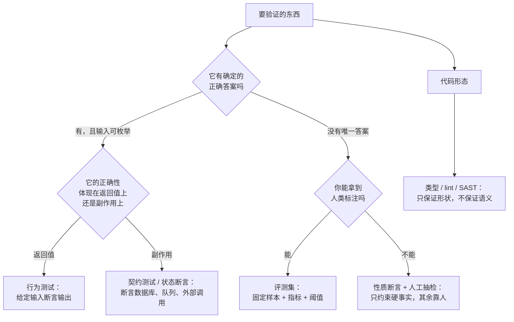
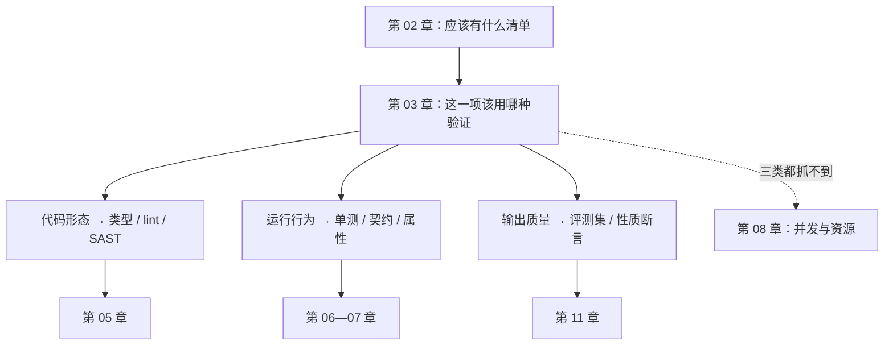

# 第 03 章：三种验证对象——代码、行为、输出

> **本章导读**：上一章给了你一份"应该有什么"的清单。这一章解决下一个问题：清单上的每一项，该用哪种方式去验？答案不是"都写测试"，而是先分清你在验的是**什么东西**。
> **前置知识**：第 01—02 章。
> **核心学习目标**：
> - 分清三种验证对象：代码形态、运行行为、输出质量，并说出各自的证伪极限
> - 理解为什么"AI 输出的内容"不能用单测验，只能用评测集验
> - 拿到一段陌生的东西，三十秒内判断该用哪种验证方式

## 1. 认知锚点：保安和法庭的区别

### 1.1 两个都在"判断真假"，但方法完全不同

小区保安判断一个人是不是业主，看的是**证件**：拿出来，对得上，放行。这个过程快、确定、可重复。

法庭判断一个人有没有罪，看的是**证据链**：多份互相印证的证据，加上排除合理怀疑的标准。这个过程慢、有争议、结论带概率。

如果有人拿保安的办法去办案——"我看他长得不像坏人"——你会觉得荒谬。

但软件行业天天在干这件事：**用一个只能验"证件"的方法，去验一个需要"证据链"的东西。**

具体一点。你说"这个功能是对的"，可能是三种完全不同的意思：

| 你说的"对" | 实际在断言什么 | 例子 |
|---|---|---|
| 代码写得对 | 形状、类型、结构符合约定 | 函数返回 `str`，不是 `None` |
| 行为做得对 | 给定输入，产生符合规格的输出与副作用 | 库存 2 张，第三个人必须被拒 |
| 输出内容对 | 生成的内容在质量、事实、语气上可接受 | 这句退款通知没写错金额，也没失礼 |

第一种是保安，第二种是质检，第三种是法庭。**用第一种的方法去验第三种，是这个时代最普遍的验证错误。**

### 1.2 为什么第三种突然变得重要

因为 AI 开始"产出内容"而不只是"产出逻辑"。

三年前，你的系统里几乎不存在"输出是一段自然语言"的函数。今天它到处都是：退款通知、商品描述、客服回复、代码注释、周报摘要、审核意见。

这类东西有三个特征，直接决定了它们不能被单测覆盖：

1. **输入空间不可穷举**：自然语言的输入是开放的。
2. **正确答案不唯一**：同一件事有十种都正确的说法。
3. **错误是连续的**：不是"对/错"，是"95% 对但把金额说错了一位"。

第 3 条最要命：**它没有"通过"这个状态，只有"这一批样本上的得分"。**

## 2. 第一性原理：三种对象，三套证伪逻辑

### 2.1 把"验证"拆成可判定的三件事

| | 代码形态 | 运行行为 | 输出质量 |
|---|---|---|---|
| 你问的问题 | 它长得对吗 | 它做对了吗 | 它说得对吗 |
| 输入空间 | 有限（源码本身） | 大但可枚举（状态 × 输入） | **不可枚举** |
| 正确答案 | 唯一 | 唯一（规格定义） | **不唯一** |
| 主要手段 | 类型检查、lint、SAST | 单测、契约测试、属性测试 | 评测集 + 人工抽检 |
| 失败信号 | 报错 / 告警 | 断言红 | **分数下降 / 分布漂移** |
| 能否给出"通过" | 能 | 能 | **不能，只能给"这批样本上通过"** |
| 典型工具 | mypy、ruff、Semgrep | pytest、Hypothesis | 评测集、judge、人工标注 |

看清第 6 行：**前两种能给出二值的"通过"，第三种不能。** 这不是工程没做好，是对象本身的性质。任何声称"我们的 AI 输出单测全绿"的说法，测的一定不是输出质量，而是输出格式。

### 2.2 三套证伪逻辑，互不替代



这张图值得抄下来贴在显示器边上。它解决的是"我该写哪种测试"这个每天都要问的问题。

### 2.3 为什么"评测集"不是"更全的测试"

最常见的误解：以为评测集 = 测试用例多了几百条。不是。

| | 单元测试 | 评测集 |
|---|---|---|
| 断言 | 精确值（`== "abc"`） | 指标或性质（"含金额且金额正确"） |
| 通过标准 | 全绿 | 阈值 + 对比基线 |
| 失败后怎么办 | 修代码 | **先判断是模型退化、数据漂移，还是基线本身该更新** |
| 谁维护 | 开发者 | 开发者 + 领域专家 |
| 更新频率 | 随代码 | 随模型版本、提示版本、真实流量分布 |

关键差别在第三行：**单测失败意味着代码错了；评测失败可能意味着"世界变了"。** 所以评测集必须带版本、带基线、带"这次比上次差在哪"的对比视图。没有这三样，它就只是一堆会随机变红的测试。

## 3. 手把手：同一件事，三段检查，两种结局

`code/ch03/three_objects.py` 里有一个函数：给用户生成一句"退款已受理"的通知。

它有两个实现：

- **A 规则版**：模板拼字符串，确定性输出。
- **B 模型版**：模型生成（这里用本地桩模拟"同一输入多次调用措辞不同"这个事实）。

现在拿三段检查依次上。

### 3.1 第一段：代码形态

```python
def check1_shape(fn) -> tuple[bool, str]:
    try:
        out = fn(ORDER)
    except Exception as e:
        return False, f"调用失败：{e!r}"
    return isinstance(out, str) and len(out) > 0, "返回非空字符串"
```

两个版本都通过。这一段几乎不携带信息——它只证明了"函数能调用、返回字符串"。

### 3.2 第二段：行为，精确匹配

```python
def check2_exact(fn) -> tuple[bool, str]:
    expected = "订单 A1024 的退款 128.00 元已受理，预计 3 个工作日原路退回。"
    got = fn(ORDER)
    return got == expected, "一字不差" if got == expected else f"实际：{got}"
```

跑出来：

```text
check2 行为·精确匹配    通过 · 一字不差               失败 · 实际：订单 A1024：退款 128.00
```

**A 通过，B 失败。**

注意 B 失败的原因：它的输出是"订单 A1024：退款 128.00 元已受理，3 个工作日左右回到您的账户。"——内容一字不差地正确，只是措辞不同。

**这不是 B 的 bug，这是 check2 的 bug。** 它测的是措辞，不是事实。而你想要的显然是事实。

如果你把这条断言留在 CI 里，会发生什么？模型升级一次、温度调一次、提示改一个字，它就红一次。团队会怎么做？**把它标记成 skip，或者把期望值改成新的措辞。** 两次之后，这条测试就死了——它还在跑，但已经不代表任何东西。

### 3.3 第三段：输出，性质断言

```python
def check3_eval(fn) -> tuple[bool, str]:
    cases = []
    for _ in range(20):
        text = fn(ORDER)
        cases.append((
            ORDER["order_id"] in text,                    # 含单号
            "128.00" in text,                             # 含金额，两位小数
            str(ORDER["eta_days"]) in text,               # 含时长
            bool(re.search(r"受理|处理|提交", text)),     # 表达了"已受理"
            len(text) <= 60,                              # 长度上限
        ))
    passed = sum(1 for c in cases if all(c))
    return passed == len(cases), f"{passed}/20 次调用全项通过"
```

跑出来：

```text
check3 输出·性质断言    通过 · 20/20 次调用全项通过   通过 · 20/20 次调用全项通过
```

**两个版本都通过。** 而且它连跑 20 次，因为 B 每次措辞都不同——这正是关键：性质断言对"措辞变化"免疫，只对"事实变化"敏感。

三段的完整结果：

```text
                        A 规则版                      B 模型版
--------------------------------------------------------------------------------------
check1 代码形态         通过 · 返回非空字符串         通过 · 返回非空字符串
check2 行为·精确匹配    通过 · 一字不差               失败 · 实际：订单 A1024：退款 128.00
check3 输出·性质断言    通过 · 20/20 次调用全项通过   通过 · 20/20 次调用全项通过
```

### 3.4 从这个实验里能拿走的三条

**第一，同一套断言，对 A 有效，对 B 无效。** 不是断言写错了，是它作用在了错误的对象上。A 是"确定性的逻辑"，B 是"生成的内容"——量纲不同。

**第二，check3 不是"更宽松的 check2"。** 它做了一个交换：放弃"措辞必须一致"，换来"措辞怎么变都能验"。这个交换只在一种情况下成立——**你能把"对"拆成若干条必须为真的事实**。拆不出来，就只能靠人工抽检。

**第三，20 次调用不是浪费。** 它验的是"稳定性"：如果 B 有时漏写金额，20 次里会露出来。单次调用验不了稳定性，这在确定性代码里不是问题（同一输入永远同一输出），在模型输出里是核心问题。

## 4. 常见误区与正反例对比

| 踩坑的误区 | 根因 | 正确做法 |
|---|---|---|
| **"给 AI 输出写单测就完事了"** | 单测假设"唯一正确答案"，而输出对象没有唯一答案 | 拆成性质断言 + 评测集；先问"我要保证的是哪几条事实" |
| **"用快照测试（snapshot）锁住输出"** | 快照锁的是"当前这一版长什么样"，模型一变全线红，最后被 skip | 快照只用于"结构稳定"的输出（如 JSON schema），内容用性质断言 |
| **"断言越严格越好"** | 严格度要和对象的确定性匹配。对随机输出用精确断言，等于给自己造一个随机红灯 | 断言只锁你真正在乎的维度；其余维度交给指标和抽检 |
| **"评测集就是多写点测试"** | 评测集的核心是基线、版本、分布；测试的核心是断言 | 评测集必须能回答"这次比上次差在哪"，没有对比视图就不是评测集 |
| **"代码形态检查没用，反正跑不过就报错"** | 报错发生在运行时，而类型/静态检查发生在提交前，成本差两个量级 | 形态检查当下限用，不要指望它保语义——它是 X 光，不是化验 |

## 5. 本章小结与局部知识图谱

### 5.1 核心要点

- **"对不对"有三种意思**：代码形态对、行为对、输出内容对。三者的证伪逻辑不通用。
- **输出对象没有"通过"这个状态**，只有"这批样本上的得分"。任何声称"输出单测全绿"的说法，测的都是格式。
- **评测集不是更全的测试**：它带基线、带版本、带分布，失败时先判断是模型退化还是世界变了。
- **断言严格度要匹配对象的确定性**。对随机输出用精确断言，等于给自己造一个随机红灯。
- **一段东西该用哪种验证，是一个三十秒能答完的问题**（2.2 节的决策树）。

### 5.2 本章概念拓扑



### 5.3 与前后章的接口

- **接第 02 章**：清单告诉你缺什么，本章告诉你缺的东西该用哪种尺子量。
- **给第 05—07 章**：这三章是"运行行为"这一支的展开，从静态到动态到变异。
- **给第 11 章**：输出质量这一支单独成章，因为它需要一整套不同的工具（评测集、judge、基线管理）。
- **给第 08 章**：三类对象的交集之外，还有一块谁都不管的区域——并发与时序。

## 6. 分级通关练习

### Tier 1 · 直觉与概念核验

**1.** 给下面五个东西分类（代码形态 / 运行行为 / 输出质量），并说出该用什么手段验：
　(a) 一个计算税费的函数　(b) 一段自动生成的商品描述　(c) 一个 API 的响应 schema
　(d) "用户不能取消别人的订单"这条规则　(e) 一份自动生成的周报摘要

**2.** 为什么"精确匹配"在某些场景下是**正确**的选择？举两个例子。

**3.** 一句评测集和单测的核心差别是什么？（提示：失败之后做的事不一样）

### Tier 2 · 推演与实操构建

**4.** 跑 `three_objects.py`，把 `check3_eval` 里的 `len(text) <= 60` 改成 `<= 20`。重跑，解释结果。这个实验说明"性质断言"的什么风险？

**5.** 给一条 AI 生成的"客服回复"，写出 5 条性质断言。要求：这 5 条必须能在不知道具体措辞的情况下判断真假。

### Tier 3 · 边界条件与跨章迁移

**6.** 有人主张："既然输出没有唯一答案，那就用另一个模型当裁判（AI-as-a-judge）。"请说出这个方案在什么条件下可信、什么条件下必然失效，并给出一个能检测"裁判自己偏了"的方法。

**7.** 本章的决策树第一个问题是"它有确定的正确答案吗"。请举一个例子，说明**同一个函数可以同时属于三类对象**，并说明这时该怎么验。

<details>
<summary><strong>点击展开：本章练习参考答案与深度解析</strong></summary>

#### 1. 五个东西的分类

- **(a) 税费计算**：运行行为。正确答案唯一（由税法定义），输入可枚举（金额 × 税率 × 舍入规则）。用行为测试，且必须覆盖边界（0 元、负数、半分进位）。
- **(b) 商品描述**：输出质量。没有唯一答案。用评测集：性质断言（含规格参数、不含违禁词、不夸大）+ 人工抽检。
- **(c) 响应 schema**：代码形态。它约束的是"结构"，不是"内容"。用 JSON Schema 校验 + 契约测试。
- **(d) 不能取消别人的订单**：运行行为，但正确性体现在**副作用与权限边界**上，不在返回值上。用状态断言 + 越权测试（用 A 的身份去取消 B 的订单，断言失败且 B 的订单状态未变）。
- **(e) 周报摘要**：输出质量。而且比 (b) 更难——因为"好摘要"的标准因人而异，需要先和读者对齐指标（是否覆盖关键事件、是否遗漏风险项）。

#### 2. 精确匹配什么时候是对的

两个场景：**第一，输出是协议的一部分**。比如 API 返回的错误码、机器可读的 JSON 字段值——这里措辞就是契约，差一个字符下游就解析不了。**第二，输出是安全关键**。比如生成的 SQL、生成的 shell 命令——这里你希望它**完全可预测**，任何"措辞变化"都可能是注入。

判据：**当"措辞本身携带语义"时，精确匹配是对的；当"措辞只是表达同一事实的一种方式"时，它是错的。**

#### 3. 评测集与单测的核心差别

失败之后做的事不同。单测红了 → 修代码。评测红了 → 先做三选一判断：模型退化？数据漂移？基线该更新？**如果搞不清这三者，团队就会开始"改基线让它变绿"，那一刻评测集就死了。**

#### 4. 把长度上限改成 20

结果：两版都会失败（一句话讲退款，20 个字符塞不下）。

这说明性质断言的一个真实风险：**它把"你认为重要的性质"固化成了硬阈值，而阈值本身可能是错的。** 上限 60 是我拍的，没有依据；拍错了，它就会稳定地误报，然后被关掉。

正确做法：阈值要能从数据里来（比如"线上 95% 的文案在 45—55 字之间"），并且要定期复核。**拍脑袋的阈值是评测集里最常见的死因。**

#### 5. 客服回复的五条性质断言

以"用户投诉物流慢"为例：

1. **不含推诿词**：不出现"这不是我们的问题""你自己没看清"这类句式（可用词表 + 正则）。
2. **给出具体动作**：必须包含至少一个可执行的下一步（"已为您催单""将在 24 小时内回复"）。
3. **不承诺无法兑现的事**：不出现具体赔偿金额（除非从订单数据里算出来的真实金额）。
4. **称呼正确**：包含用户的实际称呼，不是"亲爱的用户"。
5. **长度与结构**：不超过 N 字，且包含一段共情 + 一段行动。

这五条的共同点：**不需要看到具体措辞就能判真假**。这是"性质"的定义。

#### 6. AI-as-a-judge 的可信条件

**可信条件**（三条同时满足）：① 评判标准可以被写成明确的 rubric；② 有 30—50 条人工标注的对照集，judge 与人的一致率可测量；③ 评判任务是"比较/分类"而不是"打分"（人机一致率通常高得多）。

**必然失效**：要求 judge 判断"这段文案有没有创意""这个设计好不好看"——这类判断连人类专家之间的一致率都很低，judge 的一致性自然也无从校准。

**检测裁判自己偏了**：三个已知偏差各有探针。位置偏好——把同一对答案交换顺序再判一次，结论应该不变；长度偏好——构造一对"短而正确"vs"长而啰嗦"，看 judge 是否偏好后者；自我偏好——用两个不同模型的输出做对照，看 judge 是否系统性偏袒自己家的。第 11 章会给完整做法。

#### 7. 同一个函数同时属于三类

例子：`generate_invoice(order) -> str`（生成一张发票的 PDF 文本）。

- **代码形态**：函数签名、返回类型、异常契约。
- **运行行为**：金额合计等于明细之和、税率计算正确、编号唯一。
- **输出质量**：版式可读、字段齐全、措辞符合财务规范。

三层都要验，且**顺序不能反**：先形态（秒级，挡住低级错误），再行为（分钟级，挡住算错），最后质量（人工或评测集，挡住"算对了但没法用"）。

这个例子说明：三类对象不是互斥的标签，而是**同一个东西的三个切面**。真实项目里，一个功能往往三个切面都要覆盖——这也是为什么第 12 章要把它们排成流水线，而不是让你每次现场决定。

</details>

---

**下一章**：进入 Part 2。第一道闸不讲测试，先讲 import——因为那是唯一一道"后面的闸全都看不见"的防线。

---

## 7. 本章权威参考信源与延伸阅读 (Authoritative References)

1. **OWASP ASVS**：[OWASP ASVS](https://www.owasp.org/www-project-application-security-verification-standard/) - 本章的定义与规范以此为锚（核验日期：`2026-10-23`）。
2. **OpenTelemetry**：[OpenTelemetry](https://opentelemetry.io/) - 本章的定义与规范以此为锚（核验日期：`2026-10-23`）。
3. **RFC 9110（HTTP Semantics）**：[RFC 9110（HTTP Semantics）](https://www.rfc-editor.org/rfc/rfc9110.html) - 本章的定义与规范以此为锚（核验日期：`2026-10-23`）。

> 口径提示：以上信源用于锚定**定义与规范**，不用于外推风险概率。引用任何数字前，先核对来源年份与分母。
