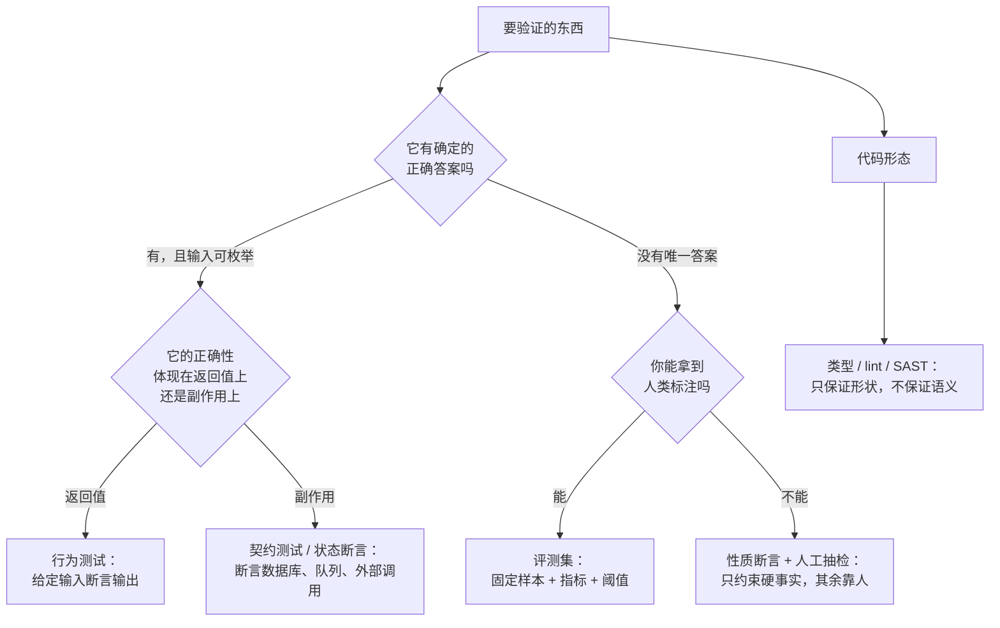
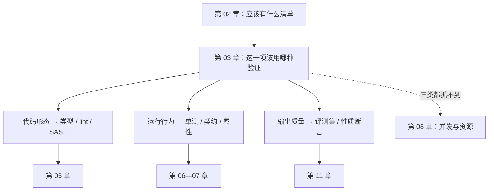

**English** | [中文](./ch03-three-objects.zh.md)

# Chapter 03: Three Verification Objects — Code, Behavior, Output

> **Chapter Guide**: The last chapter gave you a "what should exist" checklist. This chapter solves the next question: for each item on the checklist, which method should be used to verify it? The answer is not "write tests for everything"; it is to first distinguish **what kind of thing** you are verifying.
> **Prerequisites**: Chapters 01–02.
> **Core Learning Objectives**:
> - Distinguish the three verification objects: code shape, runtime behavior, output quality, and state the falsification limit of each
> - Understand why "AI output content" cannot be verified with unit tests, only with evaluation sets
> - Given something unfamiliar, judge within thirty seconds which verification method to use

## 1. Cognitive Anchor: The Difference Between a Security Guard and a Court

### 1.1 Both "Judge True or False", but the Methods Are Completely Different

A residential security guard decides whether a person is a resident by looking at **an ID**: take it out, it matches, let them through. This process is fast, certain, repeatable.

A court decides whether a person is guilty by looking at **a chain of evidence**: multiple pieces of mutually corroborating evidence, plus the standard of beyond reasonable doubt. This process is slow, contested, and its conclusion carries probability.

If someone used the guard's method to try a case — "he doesn't look like a bad guy to me" — you would find it absurd.

But the software industry does exactly this every day: **using a method that can only verify "an ID" to verify something that needs "a chain of evidence".**

More concretely. When you say "this feature is correct", it could mean three completely different things:

| Your "correct" | What you are actually asserting | Example |
|---|---|---|
| The code is written correctly | Shape, type, structure conform to convention | The function returns `str`, not `None` |
| The behavior is correct | Given input, it produces output and side effects conforming to the spec | 2 copies in stock; the third person must be rejected |
| The output content is correct | The generated content is acceptable in quality, facts, and tone | This refund notice got the amount right and was not rude |

The first kind is the guard, the second is quality inspection, the third is the court. **Using the first kind's method to verify the third kind is the most common verification error of our time.**

### 1.2 Why the Third Kind Suddenly Matters

Because AI has started to "produce content", not just "produce logic".

Three years ago, your system barely had any function whose "output is a piece of natural language". Today they are everywhere: refund notices, product descriptions, customer-service replies, code comments, weekly-report summaries, review opinions.

These things have three traits that directly decide they cannot be covered by unit tests:

1. **The input space is inexhaustible**: natural-language inputs are open-ended.
2. **The correct answer is not unique**: for the same thing there are ten correct ways to say it.
3. **Errors are continuous**: not "right/wrong", but "95% right but got one digit of the amount wrong".

Point 3 is the deadliest: **it has no "pass" state, only "the score on this batch of samples".**

## 2. First Principles: Three Objects, Three Falsification Logics

### 2.1 Split "Verification" Into Three Decidable Things

| | Code shape | Runtime behavior | Output quality |
|---|---|---|---|
| The question you ask | Does it look right? | Did it do the right thing? | Did it say the right thing? |
| Input space | Finite (the source itself) | Large but enumerable (state × input) | **Not enumerable** |
| Correct answer | Unique | Unique (defined by the spec) | **Not unique** |
| Main means | Type checking, lint, SAST | Unit tests, contract tests, property-based tests | Evaluation set + human spot checks |
| Failure signal | Compile error / warning | Red assertion | **Score drop / distribution drift** |
| Can it give a "pass"? | Yes | Yes | **No — only "passes on this batch of samples"** |
| Typical tools | mypy, ruff, Semgrep | pytest, Hypothesis | Evaluation sets, judge, human annotation |

Look closely at row 6: **the first two can give a binary "pass"; the third cannot.** This is not because the engineering was done badly; it is a property of the object itself. Any claim that "our AI output unit tests are all green" is definitely testing output format, not output quality.

### 2.2 Three Falsification Logics, None Replacing the Others



This figure is worth copying down and sticking next to your monitor. It solves the question asked every day: "which kind of test should I write?"

### 2.3 Why an "Evaluation Set" Is Not "More Complete Tests"

The most common misconception: thinking an evaluation set = just a few hundred more test cases. It is not.

| | Unit tests | Evaluation set |
|---|---|---|
| Assertion | Exact value (`== "abc"`) | Metric or property ("contains an amount and the amount is right") |
| Pass criterion | All green | Threshold + comparison baseline |
| What to do on failure | Fix the code | **First judge whether it is model regression, data drift, or whether the baseline itself should be updated** |
| Who maintains it | Developers | Developers + domain experts |
| Update frequency | With the code | With model version, prompt version, real traffic distribution |

The key difference is row 3: **a unit test failure means the code is wrong; an evaluation failure may mean "the world changed".** So an evaluation set must carry versions, a baseline, and a comparison view of "where is this worse than last time". Without these three, it is just a pile of tests that turn red randomly.

## 3. Hands-on: One Thing, Three Checks, Two Outcomes

`code/ch03/three_objects.py` contains a function: generate a "refund accepted" notification for the user.

It has two implementations:

- **A, the rule version**: template-assembled string, deterministic output.
- **B, the model version**: model generation (here a local stub simulates the fact that "the same input gets different wording on repeated calls").

Now run the three checks in sequence.

### 3.1 Check One: Code Shape

```python
def check1_shape(fn) -> tuple[bool, str]:
    try:
        out = fn(ORDER)
    except Exception as e:
        return False, f"调用失败：{e!r}"
    return isinstance(out, str) and len(out) > 0, "返回非空字符串"
```

Both versions pass. This check carries almost no information — it only proves "the function can be called and returns a string".

### 3.2 Check Two: Behavior, Exact Match

```python
def check2_exact(fn) -> tuple[bool, str]:
    expected = "订单 A1024 的退款 128.00 元已受理，预计 3 个工作日原路退回。"
    got = fn(ORDER)
    return got == expected, "一字不差" if got == expected else f"实际：{got}"
```

The run:

```text
check2 行为·精确匹配    通过 · 一字不差               失败 · 实际：订单 A1024：退款 128.00
```

**A passes, B fails.**

Note why B fails: its output is "Order A1024: the refund of 128.00 has been accepted; it will reach your account in about 3 business days." — the content is correct word for word, only the wording differs.

**This is not B's bug; this is check2's bug.** It tests wording, not facts. And what you want is obviously the facts.

If you leave this assertion in CI, what happens? One model upgrade, one temperature tweak, one character changed in the prompt, and it goes red once. What will the team do? **Mark it skip, or change the expected value to the new wording.** After twice, this test is dead — it still runs, but it no longer stands for anything.

### 3.3 Check Three: Output, Property Assertions

```python
def check3_eval(fn) -> tuple[bool, str]:
    cases = []
    for _ in range(20):
        text = fn(ORDER)
        cases.append((
            ORDER["order_id"] in text,                    # 含单号
            "128.00" in text,                             # 含金额，两位小数
            str(ORDER["eta_days"]) in text,               # 含时长
            bool(re.search(r"受理|处理|提交", text)),     # 表达了"已受理"
            len(text) <= 60,                              # 长度上限
        ))
    passed = sum(1 for c in cases if all(c))
    return passed == len(cases), f"{passed}/20 次调用全项通过"
```

The run:

```text
check3 输出·性质断言    通过 · 20/20 次调用全项通过   通过 · 20/20 次调用全项通过
```

**Both versions pass.** And it runs 20 times in a row, because B words it differently every time — this is exactly the point: property assertions are immune to "wording changes" and sensitive only to "fact changes".

The complete results of the three checks:

```text
                        A 规则版                      B 模型版
--------------------------------------------------------------------------------------
check1 代码形态         通过 · 返回非空字符串         通过 · 返回非空字符串
check2 行为·精确匹配    通过 · 一字不差               失败 · 实际：订单 A1024：退款 128.00
check3 输出·性质断言    通过 · 20/20 次调用全项通过   通过 · 20/20 次调用全项通过
```

### 3.4 Three Takeaways From This Experiment

**First, the same set of assertions works on A and fails on B.** It is not that the assertions are written wrong; it is that they act on the wrong object. A is "deterministic logic"; B is "generated content" — different dimensions.

**Second, check3 is not "a more relaxed check2".** It makes a trade: give up "the wording must match", gain "however the wording changes, it can be verified". This trade only holds in one situation — **you can split "correct" into several facts that must be true**. If you cannot split it out, human spot checks are the only way.

**Third, 20 calls are not a waste.** They verify "stability": if B sometimes omits the amount, it will show up within 20 runs. A single call cannot verify stability; this is not a problem in deterministic code (same input always gives the same output), but it is the core problem in model output.

## 4. Common Misconceptions, and Correct-vs-Wrong Comparisons

| Misconception to fall into | Root cause | The right practice |
|---|---|---|
| **"Just write unit tests for AI output and be done"** | Unit tests assume "a unique correct answer", while the output object has no unique answer | Split into property assertions + evaluation set; first ask "which facts do I need to guarantee" |
| **"Lock the output with snapshot tests"** | A snapshot locks "what this version currently looks like"; one model change turns everything red, and eventually it gets skipped | Snapshots only for "structurally stable" outputs (like JSON schema); use property assertions for content |
| **"The stricter the assertion the better"** | Strictness must match the object's determinism. Exact assertions on random output means building yourself a random red light | Lock only the dimensions you truly care about; leave the rest to metrics and spot checks |
| **"An evaluation set is just writing more tests"** | The core of an evaluation set is baseline, version, distribution; the core of tests is assertions | An evaluation set must answer "where is this worse than last time"; without a comparison view it is not an evaluation set |
| **"Code shape checks are useless; it errors out anyway when it fails"** | The error happens at runtime, while type/static checks happen before commit — a cost difference of two orders of magnitude | Use shape checks as a floor; do not expect them to guarantee semantics — they are the X-ray, not the lab test |

## 5. Chapter Summary and Local Knowledge Map

### 5.1 Key Points

- **"Right or wrong" has three meanings**: right code shape, right behavior, right output content. The falsification logics of the three are not interchangeable.
- **The output object has no "pass" state**, only "the score on this batch of samples". Any claim of "output unit tests all green" is testing format.
- **An evaluation set is not more complete tests**: it carries a baseline, versions, and distributions; on failure, first judge whether the model regressed or the world changed.
- **Assertion strictness must match the object's determinism**. Exact assertions on random output means building yourself a random red light.
- **Which verification to use for a piece of something is a question answerable in thirty seconds** (the decision tree of Section 2.2).

### 5.2 Concept Topology of This Chapter



### 5.3 Interfaces to the Previous and Next Chapters

- **From Chapter 02**: the checklist tells you what is missing; this chapter tells you which ruler to measure the missing things with.
- **To Chapters 05–07**: these three chapters expand the "runtime behavior" branch, from static to dynamic to mutation.
- **To Chapter 11**: the output quality branch becomes its own chapter, because it needs a completely different set of tools (evaluation sets, judge, baseline management).
- **To Chapter 08**: beyond the intersection of the three objects, there is an area nobody manages — concurrency and timing.

## 6. Tiered Exercises

### Tier 1 · Intuition and Concept Checks

**1.** Classify the five things below (code shape / runtime behavior / output quality), and state what means should verify them:
　(a) a function computing tax　(b) an auto-generated product description　(c) an API's response schema
　(d) the rule "users cannot cancel other people's orders"　(e) an auto-generated weekly-report summary

**2.** Why is "exact match" the **correct** choice in some scenarios? Give two examples.

**3.** In one sentence, what is the core difference between an evaluation set and unit tests? (Hint: what you do after failure is different.)

### Tier 2 · Deduction and Hands-on Construction

**4.** Run `three_objects.py` and change `len(text) <= 60` in `check3_eval` to `<= 20`. Re-run and explain the result. What risk of "property assertions" does this experiment show?

**5.** For an AI-generated "customer-service reply", write 5 property assertions. Requirement: these 5 must be judgeable true or false without knowing the exact wording.

### Tier 3 · Boundary Conditions and Cross-Chapter Transfer

**6.** Someone argues: "Since output has no unique answer, use another model as the judge (AI-as-a-judge)." State under what conditions this scheme is trustworthy, under what conditions it is guaranteed to fail, and give a method that can detect "the judge itself is biased".

**7.** The first question of this chapter's decision tree is "does it have a definite correct answer". Give an example showing that **the same function can belong to all three object classes at once**, and state how to verify it in that case.

<details>
<summary><strong>Click to expand: reference answers and in-depth analysis for this chapter's exercises</strong></summary>

#### 1. Classifying the five things

- **(a) Tax computation**: runtime behavior. The correct answer is unique (defined by tax law), and inputs are enumerable (amount × tax rate × rounding rule). Use behavior tests, and they must cover boundaries (zero, negative, half-cent rounding).
- **(b) Product description**: output quality. No unique answer. Use an evaluation set: property assertions (contains the spec parameters, no forbidden words, no exaggeration) + human spot checks.
- **(c) Response schema**: code shape. It constrains "structure", not "content". Use JSON Schema validation + contract tests.
- **(d) Cannot cancel other people's orders**: runtime behavior, but the correctness shows up in **side effects and permission boundaries**, not in the return value. Use state assertions + privilege-escalation tests (cancel B's order with A's identity, assert failure and that B's order status did not change).
- **(e) Weekly-report summary**: output quality. And harder than (b) — because the standard for a "good summary" varies by person; you first need to align metrics with the readers (does it cover key events, does it miss risk items).

#### 2. When exact match is right

Two scenarios: **first, the output is part of a protocol**. Like an API's error codes, machine-readable JSON field values — here wording is the contract; one character off and downstream cannot parse it. **Second, the output is safety-critical**. Like generated SQL, generated shell commands — here you want it **fully predictable**; any "wording change" could be an injection.

The criterion: **when "the wording itself carries semantics", exact match is right; when "the wording is just one way of expressing the same fact", it is wrong.**

#### 3. The core difference between an evaluation set and unit tests

What you do after failure is different. Unit test red → fix the code. Evaluation red → first make a three-way judgment: model regression? data drift? baseline should be updated? **If you cannot tell these three apart, the team will start "changing the baseline to make it green", and at that moment the evaluation set is dead.**

#### 4. Changing the length cap to 20

Result: both versions fail (talking about a refund in one sentence does not fit in 20 characters).

This shows a real risk of property assertions: **they hard-code "the properties you think matter" into hard thresholds, and the thresholds themselves may be wrong.** The cap of 60 was a number I picked, with no basis; pick it wrong and it will produce stable false alarms, and then get turned off.

The right practice: thresholds should come from the data (like "95% of production copy falls between 45 and 55 characters"), and should be re-checked regularly. **Thumb-sucked thresholds are the most common cause of death in evaluation sets.**

#### 5. Five property assertions for a customer-service reply

Take "the user complains that shipping is slow" as an example:

1. **No buck-passing words**: sentences like "this is not our problem" or "you didn't read it carefully" do not appear (a word list + regex works).
2. **Gives a concrete action**: must contain at least one executable next step ("we have rushed your order", "we will reply within 24 hours").
3. **Does not promise what cannot be delivered**: no concrete compensation amounts (unless a real amount computed from order data).
4. **Correct form of address**: contains the user's actual name, not "dear user".
5. **Length and structure**: no more than N characters, and contains one paragraph of empathy + one paragraph of action.

What these five share: **they can be judged true or false without seeing the exact wording**. That is the definition of "property".

#### 6. Trust conditions for AI-as-a-judge

**Trust conditions** (all three met): ① the grading criteria can be written as an explicit rubric; ② there is a comparison set of 30–50 human-annotated items, and the judge-human agreement rate is measurable; ③ the grading task is "comparison/classification" rather than "scoring" (human-machine agreement is usually much higher).

**Guaranteed to fail**: asking the judge to decide "is this copy creative" or "does this design look good" — for these judgments even human experts have low mutual agreement, so the judge's consistency has no way to be calibrated either.

**Detecting that the judge itself is biased**: each of the three known biases has a probe. Position bias — swap the order of the same pair of answers and judge again; the conclusion should not change. Length bias — construct a pair "short and correct" vs "long and rambling", and see whether the judge prefers the latter. Self-preference — use outputs from two different models as a comparison, and see whether the judge systematically favors its own family. Chapter 11 gives the complete method.

#### 7. The same function belonging to all three classes

Example: `generate_invoice(order) -> str` (generates the PDF text of an invoice).

- **Code shape**: function signature, return type, exception contract.
- **Runtime behavior**: the total equals the sum of line items, the tax is computed correctly, the number is unique.
- **Output quality**: the layout is readable, the fields are complete, the wording conforms to financial norms.

All three layers must be verified, and **the order must not be reversed**: first shape (seconds, blocks low-level mistakes), then behavior (minutes, blocks miscalculations), finally quality (human or evaluation set, blocks "computed right but unusable").

This example shows: the three object classes are not mutually exclusive labels but **three facets of the same thing**. In real projects, a feature often needs all three facets covered — which is also why Chapter 12 arranges them into a pipeline instead of letting you decide on the spot every time.

</details>

---

**Next chapter**: entering Part 2. The first gate does not talk about tests; it starts with imports — because that is the one line of defense that "all the later gates cannot see".

---

## 7. Authoritative References and Further Reading for This Chapter (Authoritative References)

1. **OWASP ASVS**: [OWASP ASVS](https://www.owasp.org/www-project-application-security-verification-standard/) - the definitions and norms of this chapter are anchored here (verification date: `2026-10-23`).
2. **OpenTelemetry**: [OpenTelemetry](https://opentelemetry.io/) - the definitions and norms of this chapter are anchored here (verification date: `2026-10-23`).
3. **RFC 9110 (HTTP Semantics)**: [RFC 9110 (HTTP Semantics)](https://www.rfc-editor.org/rfc/rfc9110.html) - the definitions and norms of this chapter are anchored here (verification date: `2026-10-23`).

> Basis note: the sources above are used to anchor **definitions and norms**, not to extrapolate risk probabilities. Before quoting any number, check the source's year and denominator first.
