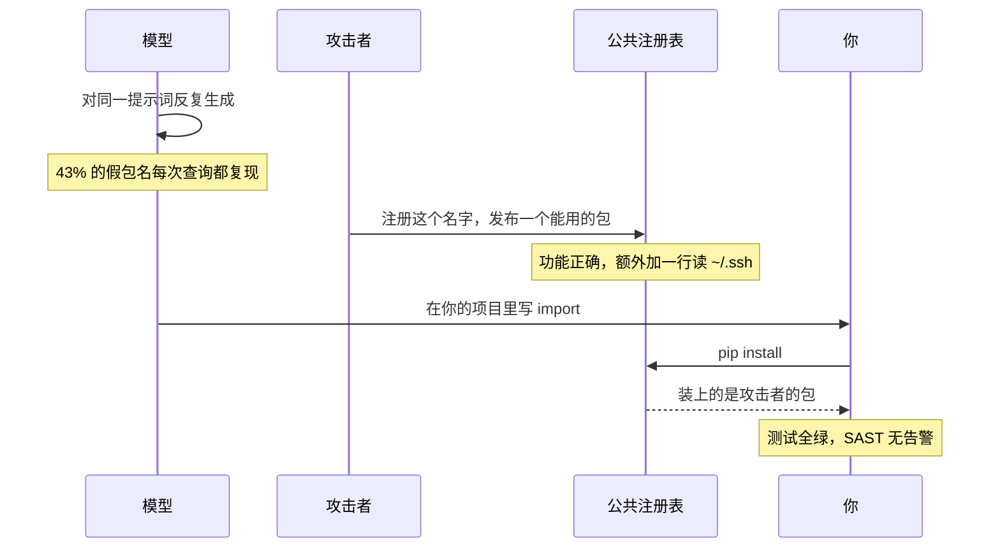
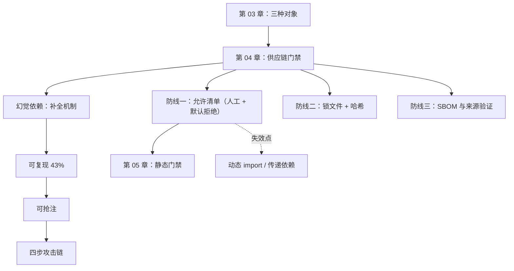

**English** | [中文](./ch04-supply-chain.zh.md)

# Chapter 04: Layer 0 — The Supply Chain, Run It First Because It's the Cheapest

> **Chapter Guide**: This chapter talks about imports. It sounds like the most boring topic, but it is the one line of defense that "all the later gates cannot see" — because once the wrong package is installed, your code runs something someone else wrote, and it is entirely normal for all tests to be green and SAST to raise no alerts.
> **Prerequisites**: Chapter 03 (knowing the "code shape" object class).
> **Core Learning Objectives**:
> - Explain the mechanism of hallucinated dependencies, and why it is reproducible
> - Draw the four-step attack chain of slopsquatting, and point out at which step it can be cut off
> - Build a maintainable dependency allowlist for a real project

## 1. Cognitive Anchor: What Gets Squatted Is Not a Domain, It's a Package Name

### 1.1 An Import That Looks Completely Normal

```python
from fastapi_jwt_auth_kit import sign_token
```

What goes through your head when you read this line?

Most likely: this is a library for signing JWTs; the name is long but follows Python ecosystem naming habits (`fastapi` + `jwt` + `auth` + `kit`). You skip it and look at the business logic below.

This line is line 12 of `code/case_coupon/coupon_service.as_generated.py` in this repository, and it is AI-generated. **This package does not exist on PyPI.**

It was generated while the model was completing "a library for signing tokens is probably needed here" — syntactically plausible, semantically plausible, naming-style plausible; the only problem is that it is fake.

A single fake package name is not scary; if it cannot be installed, it just errors. What is scary is the chain below.

### 1.2 Four Steps From "Fake Package Name" to "Backdoor"



Of the four steps, you cannot see the first three. The only thing you can see is the fourth step's `pip install`, and it looks like any other installation.

This attack has a name: **slopsquatting** (slop = low-quality AI-generated content, squatting = name squatting).

### 1.3 Why It Must Come First

The next few chapters will cover five gates: dependencies, static, dynamic, mutation, concurrency. Their order is not by importance; it is by **unit interception cost**:

| Gate | Typical time | What it blocks |
|---|---|---|
| Dependency allowlist | 0.05 seconds | Hallucinated packages, unapproved dependencies |
| Compiler + linter | 0.1 seconds | Shape errors |
| Unit tests | Seconds | The rules you wrote assertions for |
| Mutation testing | Minutes | Holes in the test suite |
| Stress tests | Minutes to hours | Concurrency and timing |

But there is an even harder reason for it to be first: **what this gate blocks, the later gates cannot see even in principle.**

After the fake package is installed: the code can import it, it runs, the happy path passes, SAST finds nothing (because the package itself has no known vulnerability signature), all tests are green (because its functionality is indeed correct). **Every gate says "no problem", because they verify the code you wrote, and this package is not in the code you wrote.**

## 2. First Principles: Why Models Invent Package Names

### 2.1 The Completion Mechanism Decides That It Will Invent

A model's job is "given the preceding text, predict the next token". When it writes `from fastapi_jwt_auth_`, it is doing something very natural: **in this context, what should a token sequence look like.**

It has no table of "all PyPI package names" to look up. What it has is the distribution of "what import statements look like" in the training corpus. So the package name it generates is **the syntactically optimal one**, not **the one that factually exists**.

This is not "the model is not smart enough"; it is decided by the task definition: **it is asked to generate "text that looks like an import", not "a dependency that can be installed".**


*Figure 4-1: About 19.7% of recommended package names do not exist in the registry; open-source models 21.7%, commercial models 5.2%. More critically, 43% of fake names reproduce stably — ask the same prompt ten times, and eight times it gives you the same non-existent package name.*

### 2.2 The Word "Reproducible" Is the Watershed

If the fake names generated each time were different, the harm of this hole would be limited — an attacker cannot predict what you will install.

But 43% of fake names reproduce stably. That means:

- An attacker can run a public prompt ten thousand times and compute the high-frequency fake names;
- Pick the ones that have not been registered yet, and squat them;
- Publish a package that "works completely fine but has one extra line";
- Wait for the next person using the same prompt to `pip install`.

**Reproducible = predictable = squattable.** This is the step that upgrades it from "a model quirk" to "a supply-chain attack surface".

### 2.3 Three Layers of Dependency Defense, and Their Failure Boundaries

| Defense line | Practice | What it blocks | When it fails |
|---|---|---|---|
| **Allowlist** | Third-party imports must be in a human-maintained whitelist | Hallucinated packages, unapproved dependencies | The list gets auto-appended; or bypassed via `pip install`'s indirect dependencies |
| **Lockfile** | Pinned versions + hashes | Version drift, tampered packages | Only direct dependencies are locked, transitive ones are not |
| **SBOM and provenance verification** | Record each package's source, signature, release time | Squatted packages, hijacked legitimate packages | Emerging ecosystems have no signing mechanism; internal registries are not covered |

Of the three, **the allowlist is the only one that can block "the first appearance"**. Lockfiles and SBOMs are post-hoc audits — they can tell you "what you installed", but cannot block "you should not have installed it".

So the allowlist must satisfy two conditions, and neither can be missing:

1. **Human-maintained**: the agent has no right to add to it. It may suggest; a human must look at it.
2. **Deny by default**: anything not on the list fails outright. Not a warning — a failure.

Condition 2 is easily compromised into a warning ("get it running first"), and once compromised this gate is dead — warnings get ignored; failures get handled.

## 3. Hands-on: The First Gate, Fifty Lines

### 3.1 Run It and See

```bash
$ cd code/case_coupon
$ python dependency_gate.py coupon_service.as_generated.py
文件                                   行  模块                            判定
--------------------------------------------------------------------------------------
coupon_service.as_generated.py      10  sqlite3                       stdlib
coupon_service.as_generated.py      12  fastapi_jwt_auth_kit          未登记
--------------------------------------------------------------------------------------
GATE FAILED：存在未登记依赖。先人工确认它在真实注册表里存在、且是你要的那个包，
再由人写进 allowed_deps.txt —— 不要让智能体自己往清单里加。
```

Exit code 1. In CI, this one line stops the pipeline right here — **not a single one of the next ten minutes of tests will run**, because you already know this commit has a problem.

Switch to the local-stub version (`coupon_service.py`):

```bash
$ python dependency_gate.py coupon_service.py
coupon_service.py                   10  sqlite3                       stdlib
--------------------------------------------------------------------------------------
GATE PASSED：所有 import 都在 stdlib 或允许清单内。
```

### 3.2 Its Working Principle Is One Sentence

Use an AST to extract all imports from the file, take the top-level module name, and fail anything that is neither in the standard library nor in `allowed_deps.txt`.

```python
def top_level_imports(path: Path) -> list[tuple[str, int]]:
    tree = ast.parse(path.read_text(encoding="utf-8"), filename=str(path))
    found = []
    for node in ast.walk(tree):
        if isinstance(node, ast.Import):
            for alias in node.names:
                found.append((alias.name.split(".")[0], node.lineno))
        elif isinstance(node, ast.ImportFrom) and node.level == 0 and node.module:
            found.append((node.module.split(".")[0], node.lineno))
    return sorted(set(found), key=lambda x: x[1])
```

**Note that it does not touch the network.** This is deliberate: querying PyPI over the network would make it slower and more brittle (network jitter → gate goes red), and would leak your dependency list. The allowlist is offline, so it finishes in 0.05 seconds and can run on every save.

### 3.3 What Should Be Written in the Allowlist

One package per line in `allowed_deps.txt`, but the real work is not writing that line; it is **answering three questions**:

1. **Does it exist in the real registry?** Is it a name the AI invented? Check PyPI / npm once: look at the release date, download count, repository address.
2. **Is it the one we want?** Same name, different source is real (squatted packages often work correctly too). Verify the author, repository, release history.
3. **Is there an alternative with fewer dependencies?** Every extra dependency is one more hole in the attack surface. If the standard library can do it, do not add a package.

The answers to these three questions should be written into the commit message or PR description, not just leaving a package name. **Three months from now you will thank your past self.**

```text
# allowed_deps.txt 的正确形态（示例，本章示例不需要任何第三方包）
# 每行一个包名，注释里写"为什么允许"与"什么时候复核"
fastapi==0.115.0        # 2026-10 加入；Web 框架，来源 pypi.org/project/fastapi；下次复核 2027-04
psycopg[binary]==3.2.3  # 2026-10 加入；Postgres 驱动；来源官方仓库；复核 2027-04
```

### 3.4 When This Gate Will Lie to You

Let us be honest about it, because from the next chapter on, every gate must account for its own failure boundaries:

| Scenario | Consequence | Countermeasure |
|---|---|---|
| The agent itself added a line to the list | The gate is a hollow shell | Put the list under CODEOWNERS; changes require human review |
| An indirect dependency brings in a malicious package | The list only checks direct imports; transitive dependencies are invisible | Lockfile + tools like `pip-audit`, as a separate gate |
| A package on the list later gets hijacked | Passed the first review, then went bad | Periodic re-review (the "re-check date" field above) |
| Dynamic import (`importlib.import_module("xxx")`) | The AST cannot catch the string | Additionally scan module names in string constants, or forbid dynamic imports |

The last row deserves attention: this chapter's `test_coupon_behavior.py` uses `importlib.import_module(os.environ.get("COUPON_IMPL", ...))` — **a static scanner cannot see it**. This is a real bypass path, not a theoretical problem.

## 4. Common Misconceptions, and Correct-vs-Wrong Comparisons

| Misconception to fall into | Root cause | The right practice |
|---|---|---|
| **"If it can't be installed it just errors; no need to worry"** | Only thought of "the fake package doesn't exist", not "the fake package got squatted" | Deny by default; human-maintained allowlist |
| **"I scanned `pip list`; they're all well-known packages"** | Only looking at name familiarity, not source and release date | Verify author, repository, release date; new packages are especially suspicious |
| **"Use AI to help maintain my allowlist"** | Letting the inspected party write the inspection rules means the gate is bound to fail | List changes require human review; the agent may suggest but not commit |
| **"A warning is fine; don't block the pipeline"** | Warnings get ignored; failures get handled | Deny by default. Either fix it, or explicitly add it to the list with the reason written down |
| **"A lockfile equals supply-chain security"** | A lockfile prevents drift; it does not prevent "installing the wrong thing the first time" | Lockfile + allowlist + periodic audit; three layers each covering a stretch |

## 5. Chapter Summary and Local Knowledge Map

### 5.1 Key Points

- **Hallucinated dependencies are an inevitable product of the completion mechanism**: it generates "text that looks like an import", not "a dependency that can be installed".
- **43% reproducible, therefore squattable.** This is the step that upgrades it from quirk to attack surface.
- **This gate must come first**, because after the fake package is installed, all the later gates verify "the code you wrote", and this package is not in it.
- **The allowlist needs human maintenance + deny by default**. Miss either condition and the gate is dead.
- **It has four known failure points**: auto-appending, transitive dependencies, hijacked packages, dynamic imports. Write them down; do not pretend they are not there.

### 5.2 Concept Topology of This Chapter



### 5.3 Interfaces to the Previous and Next Chapters

- **From Chapter 03**: dependencies belong to the "code shape" object class, but they have one peculiarity — once wrong, all other verification fails.
- **To Chapter 05**: the static gate scans further down, but it scans the code you wrote, not the dependencies.
- **To Chapter 12**: this gate's time cost (0.05 seconds) decides it must sit at the very front of the pipeline; the full ordering argument is given there.

## 6. Tiered Exercises

### Tier 1 · Intuition and Concept Checks

**1.** Why is "hallucinated dependency is the one defect that all later gates cannot see"? Explain the mechanism in one sentence.

**2.** The allowlist's two conditions (human-maintained, deny by default) — what happens if either one is removed? Describe each.

**3.** What do a lockfile and an allowlist each prevent? Give a scenario that only a lockfile can prevent and an allowlist cannot.

### Tier 2 · Deduction and Hands-on Construction

**4.** Generate an initial allowlist for a real project (any one of your own). Requirement: one line of reason + re-check date per package, and mark the packages whose **source you are unsure of**.

**5.** Modify `dependency_gate.py` so it can scan string literals inside `importlib.import_module("xxx")`. Write the change, and explain what blind spots this change itself still has.

### Tier 3 · Boundary Conditions and Cross-Chapter Transfer

**6.** Suppose you take over a project that already has 80 dependencies and now you want to introduce an allowlist. **Adding everything to the list wholesale equals having no gate**. Design a gradual plan, and state the criterion for each step.

**7.** Someone says "an internal private registry makes it safe; no allowlist needed". Give a rebuttal, and explain what a private registry changes and what it does not change.

<details>
<summary><strong>Click to expand: reference answers and in-depth analysis for this chapter's exercises</strong></summary>

#### 1. Why all later gates cannot see it

Because every later gate verifies **the code you wrote**. Once the fake package is installed, it becomes "part of the runtime environment" — your code imports it, calls it, tests it, all normal. SAST scans your source code, tests assert your behavior, mutation testing mutates your implementation. **Not a single gate asks "who wrote this dependency itself".**

#### 2. Removing either condition

**Remove "human-maintained"** (let the agent add to it): the gate degrades into a log line. The model writes a fake package and "conveniently" adds it to the list — this can be done in a single tool call, and you may not even see it.

**Remove "deny by default"** (change to warnings): the first run shows three warnings, the second run shows the same three, the third time you add `|| true`. **A warning is not a gate; it is decoration.**

#### 3. Lockfile vs allowlist

A lockfile prevents "version drift" and "content tampering" — for the same package name, whether the bytes installed today are the same as those installed last month.

Scenario: a legitimate package releases `1.2.4`, and your `requirements.txt` says `>=1.2.0`. One day `1.2.4` gets a backdoor slipped in by its author (or hijacker). The allowlist will let it through (the package name did not change); only a lockfile + hash can detect "the bytes changed".

Conversely, what only a lockfile cannot prevent is **installing the wrong thing the first time**: the first generated lockfile already contains that fake package, and the hash is completely correct.

#### 4. Building a list for a real project

There is only one criterion: **can you say in 30 seconds why this package is here.** If you cannot, mark it "pending confirmation"; do not write a "temporarily allowed" just to make it pass — that is the easiest debt to accumulate.

#### 5. Scanning dynamic imports

```python
elif isinstance(node, ast.Call) and isinstance(node.func, ast.Attribute):
    if node.func.attr in {"import_module", "__import__"} and node.args:
        arg = node.args[0]
        if isinstance(arg, ast.Constant) and isinstance(arg.value, str):
            found.append((arg.value.split(".")[0], node.lineno))
```

**Blind spot**: it only catches literals. If the module name comes from a variable (`importlib.import_module(os.environ["PLUGIN"])`), a static scanner cannot catch it in principle — this is already a design where "what to import is only known at runtime". For this situation, the only way is **a runtime hook** (install a recorder on `sys.meta_path`, log the module names actually imported, and check them afterward).

#### 6. A gradual plan for 80 dependencies

Three steps, each with a criterion:

**Step one (same day)**: add all dependencies to the list, but mark each with `status=grace`. The gate only applies to **newly added** dependencies (deny by default) and only warns on the existing ones. Criterion: do not block existing development.

**Step two (within two weeks)**: sort by "import frequency × whether it handles sensitive data", review 10 per week. After review, change from `grace` to `verified` or delete. Criterion: after each review, the proportion of `verified` in the list rises monotonically.

**Step three (after a month)**: clear out all `grace` — whatever has not been reviewed either gets reviewed or deleted. Criterion: no more `grace` in the list. **This step must not be delayed; delay makes it permanent.**

#### 7. "A private registry makes it safe"

**What it changes**: source credibility. You can confirm "this package was published by us", and attackers cannot slip things into it.

**What it does not change**: three things.


First, **hallucinated packages can still pollute the private registry**. The model invents a name, and you happen to have an internal package with the same name (or someone created an empty shell on the private registry "to make it run"); installing it is still the wrong dependency — only the way it is wrong changes from "malicious" to "chaotic".

Second, **a private registry cannot prevent insider poisoning**. A considerable share of supply-chain attacks come from compromised internal accounts or departing employees.

Third, **a private registry masks the question of "this dependency should not exist in the first place"**. The allowlist's third question ("is there an alternative with fewer dependencies") is even more easily skipped in a private-registry scenario, because "we have it internally anyway".

So a private registry downgrades "externally untrusted" to "semi-trusted internally"; it does not eliminate it. **What the allowlist must answer is "do we want this dependency at all", and a private registry does not help you answer that.**

</details>

---

**Next chapter**: the first gate blocks "the foreign stuff". The second gate starts inspecting "the stuff you wrote" — but it can only see shape, not intent.

---

## 7. Authoritative References and Further Reading for This Chapter (Authoritative References)

1. **CVE Program**: [CVE Program](https://www.cve.org/) - the definitions and norms of this chapter are anchored here (verification date: `2026-10-23`).
2. **OWASP ASVS**: [OWASP ASVS](https://www.owasp.org/www-project-application-security-verification-standard/) - the definitions and norms of this chapter are anchored here (verification date: `2026-10-23`).
3. **Semantic Versioning 2.0.0**: [Semantic Versioning 2.0.0](https://semver.org/) - the definitions and norms of this chapter are anchored here (verification date: `2026-10-23`).

> Basis note: the sources above are used to anchor **definitions and norms**, not to extrapolate risk probabilities. Before quoting any number, check the source's year and denominator first.
