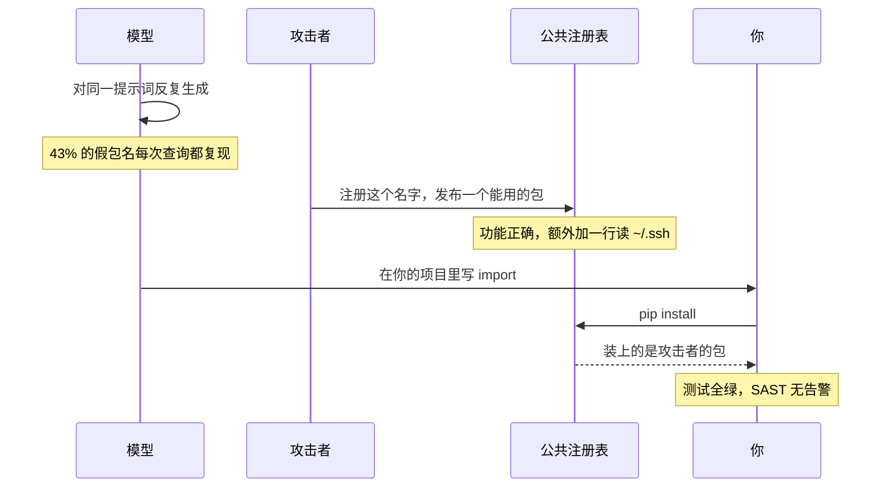
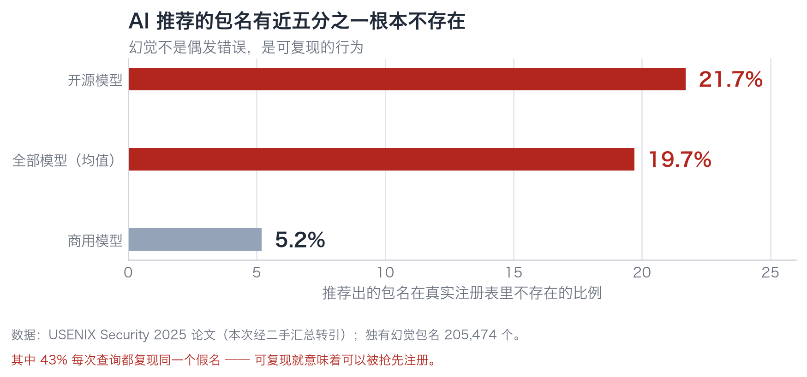
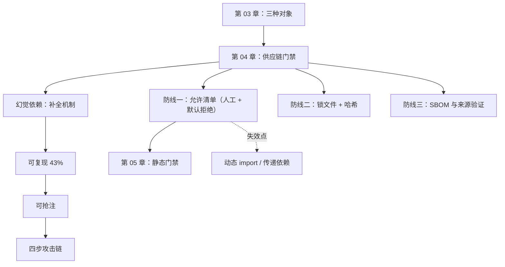

# 第 04 章：第 0 层——供应链，先跑因为它最便宜

> **本章导读**：这一章讲 import。听起来最无趣，但它是唯一一道"后面的闸全都看不见"的防线——因为一旦装错了包，你的代码跑的就是别人写的东西，测试全绿、SAST 无告警都是正常的。
> **前置知识**：第 03 章（知道"代码形态"这一类对象）。
> **核心学习目标**：
> - 说清幻觉依赖的机制，以及它为什么是可复现的
> - 画出 slopsquatting 的四步攻击链，指出在哪一步能断掉它
> - 给一个真实项目建起可维护的依赖允许清单

## 1. 认知锚点：抢注的不是域名，是包名

### 1.1 一个看起来很正常的 import

```python
from fastapi_jwt_auth_kit import sign_token
```

你读到这一行会怎么想？

大概率是：这是个签发 JWT 的库，名字很长但符合 Python 生态的命名习惯（`fastapi` + `jwt` + `auth` + `kit`）。你会跳过它，去看下面的业务逻辑。

这一行是本仓 `code/case_coupon/coupon_service.as_generated.py` 的第 12 行，是 AI 生成的。**这个包在 PyPI 上不存在。**

它是模型在补全"这里大概需要一个签发 token 的库"时生成的——语法合理、语义合理、命名风格合理，唯一的问题是它是假的。

单个假包名不可怕，装不上就报错了。可怕的是下面这个链条。

### 1.2 从"假包名"到"后门"的四步



四步里，前三步你都看不见。你能看见的只有第四步的 `pip install`，而它长得和任何一次安装一样。

这个攻击有名字：**slopsquatting**（slop = AI 生成的低质内容，squatting = 抢注）。

### 1.3 为什么它必须排在最前

后面几章会讲五道闸：依赖、静态、动态、变异、并发。它们的顺序不是按重要性排的，是按**单位拦截成本**排的：

| 闸 | 典型耗时 | 拦截的东西 |
|---|---|---|
| 依赖允许清单 | 0.05 秒 | 幻觉包、未批准的依赖 |
| 编译器 + linter | 0.1 秒 | 形状错误 |
| 单元测试 | 秒级 | 你写了断言的规则 |
| 变异测试 | 分钟级 | 测试套件的空洞 |
| 压测 | 分钟到小时 | 并发与时序 |

但排第一还有一个更硬的理由：**这道闸拦的东西，后面的闸在原理上就看不见。**

假包装上之后：代码能 import、能跑、happy path 通过、SAST 扫不出（因为包本身没有已知漏洞签名）、测试全绿（因为它功能确实正确）。**所有闸都在说"没问题"，因为它们验的是你写的代码，而这个包不在你写的代码里。**

## 2. 第一性原理：为什么模型会编包名

### 2.1 补全机制决定了它会编

模型的工作是"给定前文，预测下一个 token"。当它写下 `from fastapi_jwt_auth_` 的时候，它在做一件很自然的事：**这个上下文里，一个 token 序列应该长什么样。**

它没有一张"PyPI 全部包名"的表可以查。它有的是训练语料里"import 语句长什么样"的分布。所以它生成的包名是**语法上最优的**，不是**事实上存在的**。

这不是"模型不够聪明"，是任务定义决定的：**它被要求生成"像 import 的文本"，而不是"能装上的依赖"。**


*图 4-1：约 19.7% 的推荐包名在注册表里不存在；开源模型 21.7%，商用模型 5.2%。更关键的是 43% 的假名会稳定复现——同一个提示词问十次，八次给你同一个不存在的包名。*

### 2.2 "可复现"这三个字是分水岭

如果每次生成的假名都不一样，这个洞的危害有限——攻击者没法预测你会装什么。

但 43% 的假名稳定复现。这意味着：

- 攻击者可以用公开的提示词跑一万次，统计出高频假名；
- 挑那些还没被注册的，抢注；
- 发布一个"功能完全正常但多一行东西"的包；
- 等着下一个用同样提示词的人 `pip install`。

**可复现 = 可预测 = 可抢注。** 这是它从"模型的怪癖"升级为"供应链攻击面"的那一步。

### 2.3 三层依赖防线，和它们各自的失效边界

| 防线 | 做法 | 拦住什么 | 什么时候失效 |
|---|---|---|---|
| **允许清单** | 第三方 import 必须在人工维护的白名单里 | 幻觉包、未经批准的依赖 | 清单被自动追加；或用 `pip install` 的间接依赖绕过 |
| **锁文件** | 固定版本 + 哈希 | 版本漂移、包被篡改 | 只锁了直接依赖，没锁传递依赖 |
| **SBOM 与来源验证** | 记录每个包的来源、签名、发布时间 | 抢注包、被接管的合法包 | 新兴生态没有签名机制；内部源没有覆盖 |

三道里，**允许清单是唯一能挡住"第一次出现"的那道**。锁文件和 SBOM 都是事后审计——它们能告诉你"你装了什么"，但拦不住"你不该装它"。

所以允许清单必须满足两个条件，缺一不可：

1. **人工维护**：智能体无权往里加。它可以建议，人必须看一眼。
2. **默认拒绝**：不在清单里的，一律失败。不是警告，是失败。

第 2 条容易被妥协成警告（"先跑起来再说"），一妥协这道闸就废了——警告会被忽略，失败才会被处理。

## 3. 手把手：第一道闸，五十行

### 3.1 跑起来看

```bash
$ cd code/case_coupon
$ python dependency_gate.py coupon_service.as_generated.py
文件                                   行  模块                            判定
--------------------------------------------------------------------------------------
coupon_service.as_generated.py      10  sqlite3                       stdlib
coupon_service.as_generated.py      12  fastapi_jwt_auth_kit          未登记
--------------------------------------------------------------------------------------
GATE FAILED：存在未登记依赖。先人工确认它在真实注册表里存在、且是你要的那个包，
再由人写进 allowed_deps.txt —— 不要让智能体自己往清单里加。
```

退出码 1。在 CI 里，这一行会让流水线停在这里——**后面十分钟的测试一条都不会跑**，因为你已经知道这次提交有问题。

换成本地桩的版本（`coupon_service.py`）：

```bash
$ python dependency_gate.py coupon_service.py
coupon_service.py                   10  sqlite3                       stdlib
--------------------------------------------------------------------------------------
GATE PASSED：所有 import 都在 stdlib 或允许清单内。
```

### 3.2 它的工作原理只有一句话

用 AST 把文件里所有 import 抽出来，取顶层模块名，凡是不在标准库、也不在 `allowed_deps.txt` 里的，判失败。

```python
def top_level_imports(path: Path) -> list[tuple[str, int]]:
    tree = ast.parse(path.read_text(encoding="utf-8"), filename=str(path))
    found = []
    for node in ast.walk(tree):
        if isinstance(node, ast.Import):
            for alias in node.names:
                found.append((alias.name.split(".")[0], node.lineno))
        elif isinstance(node, ast.ImportFrom) and node.level == 0 and node.module:
            found.append((node.module.split(".")[0], node.lineno))
    return sorted(set(found), key=lambda x: x[1])
```

**注意它不联网。** 这是刻意的：联网查 PyPI 会让它变慢、变脆（网络抖动 → 门禁红）、还会泄露你的依赖清单。允许清单是离线的，所以它 0.05 秒跑完，可以在每次保存时都跑。

### 3.3 允许清单里该写什么

`allowed_deps.txt` 里每个包一行，但真正的工作不是写这一行，是**回答三个问题**：

1. **它在真实注册表里存在吗？** 是不是 AI 编的名字。查一遍 PyPI / npm，看发布日期、下载量、仓库地址。
2. **它是我们要的那个吗？** 同名不同源的情况真实存在（抢注包往往功能也正确）。核对作者、仓库、发布历史。
3. **有没有更少的依赖可以替代？** 每多一个依赖，攻击面多一个口子。能用标准库就别加包。

这三个问题的答案应该写进 commit message 或 PR 描述，而不是只留下一个包名。**三个月后你会感谢当时的自己。**

```text
# allowed_deps.txt 的正确形态（示例，本章示例不需要任何第三方包）
# 每行一个包名，注释里写"为什么允许"与"什么时候复核"
fastapi==0.115.0        # 2026-10 加入；Web 框架，来源 pypi.org/project/fastapi；下次复核 2027-04
psycopg[binary]==3.2.3  # 2026-10 加入；Postgres 驱动；来源官方仓库；复核 2027-04
```

### 3.4 什么时候这道闸会骗你

诚实地说清楚，因为下一章开始，每道闸都要交代自己的失效边界：

| 场景 | 后果 | 对策 |
|---|---|---|
| 智能体自己往清单里加了一行 | 闸形同虚设 | 清单纳入 CODEOWNERS，改动需要人工 review |
| 间接依赖带入恶意包 | 清单只查直接 import，看不见传递依赖 | 锁文件 + `pip-audit` 类工具，单独一道闸 |
| 清单里的包本身后来被接管 | 第一次审过，之后变质 | 定期复核（上面的"复核日期"字段） |
| 动态 import（`importlib.import_module("xxx")`） | AST 抓不到字符串 | 额外扫字符串常量里的模块名，或禁止动态 import |

最后一行值得注意：本章的 `test_coupon_behavior.py` 里就用了 `importlib.import_module(os.environ.get("COUPON_IMPL", ...))`——**一个静态扫描器看不见它**。这是真实的绕过路径，不是理论问题。

## 4. 常见误区与正反例对比

| 踩坑的误区 | 根因 | 正确做法 |
|---|---|---|
| **"装不上就报错了，不用管"** | 只想到"假包不存在"，没想到"假包被人抢注了" | 默认拒绝；允许清单人工维护 |
| **"我扫了 `pip list`，都是知名包"** | 只看包名熟悉度，不看来源与发布时间 | 核对作者、仓库、发布日期；新包尤其可疑 |
| **"用 AI 帮我维护允许清单"** | 让被检查者写检查规则，闸必然失效 | 清单改动需要人工 review；智能体可以建议，不能提交 |
| **"警告就行，别卡流水线"** | 警告会被忽略，失败才会被处理 | 默认拒绝。要么修，要么显式加进清单并写明理由 |
| **"锁文件等于供应链安全"** | 锁文件防漂移，不防"第一次就装错" | 锁文件 + 允许清单 + 定期审计，三层各管一段 |

## 5. 本章小结与局部知识图谱

### 5.1 核心要点

- **幻觉依赖是补全机制的必然产物**：它生成"像 import 的文本"，不是"能装上的依赖"。
- **43% 可复现，所以可抢注。** 这是它从怪癖升级为攻击面的那一步。
- **这道闸必须排第一**，因为假包装上之后，后面所有闸验的都是"你写的代码"，而这个包不在其中。
- **允许清单要人工维护 + 默认拒绝**。两个条件缺一个，闸就废了。
- **它有四个已知失效点**：自动追加、传递依赖、包被接管、动态 import。写下来，别假装没有。

### 5.2 本章概念拓扑



### 5.3 与前后章的接口

- **接第 03 章**：依赖属于"代码形态"这一类对象，但它有一种特殊性——错了之后，其他所有验证都失效。
- **给第 05 章**：静态门禁接着往下扫，但它扫的是你写的代码，不是依赖。
- **给第 12 章**：这道闸的耗时（0.05 秒）决定了它必须排在流水线最前面，那里会给出完整的排序论证。

## 6. 分级通关练习

### Tier 1 · 直觉与概念核验

**1.** 为什么说"幻觉依赖是唯一一道后面所有闸都看不见的缺陷"？用一句话说清机制。

**2.** 允许清单两个条件（人工维护、默认拒绝），去掉任何一个会发生什么？分别描述。

**3.** 锁文件和允许清单各自防什么？举一个只有锁文件能防、允许清单防不住的场景。

### Tier 2 · 推演与实操构建

**4.** 给一个真实项目（你自己的任意一个）生成初始允许清单。要求：每个包写一行理由 + 复核日期，并标出你**不确定来源**的包。

**5.** 修改 `dependency_gate.py`，让它能扫出 `importlib.import_module("xxx")` 里的字符串字面量。写出改动，并说明这个改动本身还有什么盲区。

### Tier 3 · 边界条件与跨章迁移

**6.** 假设你接手一个已经有 80 个依赖的项目，现在要引入允许清单。**直接全量加入清单等于没有闸**。请设计一个渐进方案，并说明每一步的判据。

**7.** 有人说"内部私有源就安全了，不用允许清单"。请给出反驳，并说明私有源改变了什么、没改变什么。

<details>
<summary><strong>点击展开：本章练习参考答案与深度解析</strong></summary>

#### 1. 为什么后面所有闸都看不见

因为后面每道闸验证的都是**你写的代码**。假包一旦装上，它就成了"运行环境的一部分"——你的代码 import 它、调用它、测试它，全部正常。SAST 扫的是你的源码，测试断言的是你的行为，变异测试变异的是你的实现。**没有一道闸在问"这个依赖本身是谁写的"。**

#### 2. 去掉任一条件

**去掉"人工维护"**（允许智能体自己加）：闸退化成一句日志。模型写了一个假包，同时"顺手"把它加进清单——这在一次工具调用里就能完成，你甚至不会看到。

**去掉"默认拒绝"**（改成警告）：第一次跑会看到三条警告，第二次跑会看到同样的三条，第三次你会加 `|| true`。**警告不是门禁，是装饰。**

#### 3. 锁文件 vs 允许清单

锁文件防的是"版本漂移"和"内容被篡改"——同一个包名，今天装的和你上个月装的是不是同一份字节。

场景：一个合法包发布了 `1.2.4`，你的 `requirements.txt` 写的是 `>=1.2.0`。某天 `1.2.4` 被作者（或接管者）塞了后门。允许清单会放行（包名没变），只有锁文件 + 哈希能发现"字节变了"。

反过来，只有锁文件防不住的是**第一次就装错**：第一次生成的锁文件里就写着那个假包，哈希也完全正确。

#### 4. 给真实项目建清单

判据只有一条：**你能不能在 30 秒内说出这个包为什么在这里。** 说不出来的，标成"待确认"，不要为了让它通过就写个"暂时允许"——那是最容易积累的债。

#### 5. 扫动态 import

```python
elif isinstance(node, ast.Call) and isinstance(node.func, ast.Attribute):
    if node.func.attr in {"import_module", "__import__"} and node.args:
        arg = node.args[0]
        if isinstance(arg, ast.Constant) and isinstance(arg.value, str):
            found.append((arg.value.split(".")[0], node.lineno))
```

**盲区**：只抓字面量。如果模块名来自变量（`importlib.import_module(os.environ["PLUGIN"])`），静态扫描在原理上抓不到——这已经是"运行时才知道导入什么"的设计。对这种情况，唯一的办法是**运行时钩子**（在 `sys.meta_path` 上装一个记录器，把实际 import 的模块名记下来，事后核对）。

#### 6. 80 个依赖的渐进方案

三步，每步都有判据：

**第一步（当天）**：把所有依赖加进清单，但每个都标记 `status=grace`。闸只对**新增**依赖生效（默认拒绝），对存量只警告。判据：不阻塞现有开发。

**第二步（两周内）**：按"被 import 的频次 × 是否处理敏感数据"排序，每周审 10 个。审完从 `grace` 改成 `verified` 或删除。判据：每次审完，清单里 `verified` 的比例单调上升。

**第三步（一个月后）**：把 `grace` 全部清空——没审完的，要么审，要么删。判据：清单里不再有 `grace`。**这一步不能拖，一拖就永久化了。**

#### 7. "私有源就安全了"

**改变了什么**：来源可信度。你能确认"这个包是我们自己发布的"，攻击者没法往里面塞东西。

**没改变什么**：三件事。

第一，**幻觉包仍然会污染私有源**。模型编了一个名字，你内部恰好也有个同名包（或者有人为了"让它跑起来"在私有源上建了一个空壳），装上去照样是错的依赖——只不过错的方式从"恶意"变成"混乱"。

第二，**私有源不能阻止内部投毒**。供应链攻击里相当一部分来自内部账号被盗或离职人员。

第三，**私有源掩盖了"这个依赖本来不该有"的问题**。允许清单的第三个问题（"有没有更少的依赖可以替代"）在私有源场景下更容易被跳过，因为"反正内部有"。

所以私有源是把"外部不可信"降级为"内部半可信"，不是消除。**允许清单要回答的是"要不要这个依赖"，这个问题私有源不帮你回答。**

</details>

---

**下一章**：第一道闸拦住了"外来的东西"。第二道闸开始检查"你写的东西"——但它只能看形状，看不到意图。

---

## 7. 本章权威参考信源与延伸阅读 (Authoritative References)

1. **CVE Program**：[CVE Program](https://www.cve.org/) - 本章的定义与规范以此为锚（核验日期：`2026-10-23`）。
2. **OWASP ASVS**：[OWASP ASVS](https://www.owasp.org/www-project-application-security-verification-standard/) - 本章的定义与规范以此为锚（核验日期：`2026-10-23`）。
3. **Semantic Versioning 2.0.0**：[Semantic Versioning 2.0.0](https://semver.org/) - 本章的定义与规范以此为锚（核验日期：`2026-10-23`）。

> 口径提示：以上信源用于锚定**定义与规范**，不用于外推风险概率。引用任何数字前，先核对来源年份与分母。
