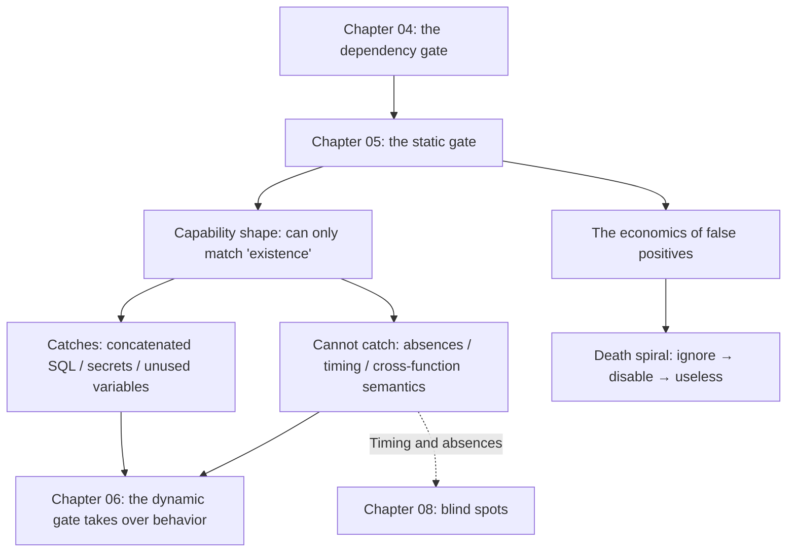

**English** | [中文](./ch05-static.zh.md)

# Chapter 05: Layer 1 — Static Analysis: Shape Is Not Intent

> **Chapter Guide**: Static analysis is the gate with the best cost-effectiveness, and also the most misunderstood one. Its capability has a definite shape: **it can see "what was written", not "what is missing"**. This chapter draws that shape clearly, and along the way explains why "too many false positives, so we turned it off" is an incident that is bound to happen.
> **Prerequisites**: Chapter 02 (commission / omission), Chapter 04 (gate ordering).
> **Core Learning Objectives**:
> - State the capability boundary of each of the six classes of static tools, and stop treating them as one "security check" button
> - Understand the pattern-matching nature of SAST, and how a false-positive rate kills a gate
> - Write four classes of static checks yourself, and verify with your own hands that they are completely ineffective against omission

## 1. Cognitive Anchor: What an X-Ray Machine Can See

### 1.1 A Common Misconception

"We enabled type checking, lint, and SAST in our CI, so the static side should be fine."

This sentence bundles three different things together. They are indeed all means of "finding problems without running the code", but their capability ranges are far apart:

| Tool | What it looks at | What it can find | What it cannot find |
|---|---|---|---|
| Compiler | Whether the syntax tree can stand | Syntax errors, some type errors | All logic and security problems |
| Type checker | Whether declared types are self-consistent | Type mismatches, possible None | Correct types but wrong logic |
| Linter | Code style and suspicious patterns | Unused variables, overly broad exceptions, complexity | Semantic errors |
| SAST | Syntactic matches of dangerous code patterns | Concatenated SQL, hardcoded secrets, known vulnerability patterns | Business logic flaws, concurrency, privilege escalation |
| SCA | The dependency's known-vulnerability database | Dependency versions with CVEs | Those without CVEs (including zero-days and hallucinated packages) |
| Secret scanning | High-entropy strings and known prefixes | Hardcoded tokens, private keys | Assembled keys, encrypted configuration |

The most critical of the six rows is SAST: **it is pattern matching.** It does not know your business; its definition of "dangerous" is "looks like dangerous stuff".

An X-ray machine can see the shape of bones; it cannot see what this person intends to do. Use it to check for fractures and it works great; use it to judge whether a person is a thief and it is useless.

### 1.2 Why "SAST Is On" Does Not Mean "the Static Side Is Fine"

Because SAST's coverage and what it reports are two independent things.

A real loop: the rule set has 200 rules enabled → each commit reports 40 → the team reviews 10 and finds 8 are false positives → a week later the rule set is narrowed to 30 rules → it reports 3, of which 2 are false positives → three months later someone adds `continue-on-error` in CI → a year later the job still runs, but nobody is looking.

**False positives are not "noisy"; they kill this gate.** This is the second theme of this chapter: the economics of false positives.

## 2. First Principles: The Capability Shape of Static Analysis

### 2.1 It Can Only See "What Exists in the Text"

This sentence is the source of all conclusions. The input of static analysis is the source text (or its syntax tree), and the output is "this text conforms to / violates some pattern".

So its capability boundary can be described precisely:

- **Can see**: some token sequence appears. For example in `f"...WHERE code = '{code}'"`, the SQL keyword and the string interpolation appear at the same time.
- **Cannot see**: some token sequence **does not** appear. For example "there should be an INSERT here", because no pattern can match "does not exist".
- **Cannot see**: the **timing relation** between two statements. For example "there should be a lock between SELECT and UPDATE" — this is an assertion about execution, not about text.
- **Cannot see**: **semantics** across functions. For example "this parameter comes from user input, so it must be validated" — unless you do taint analysis properly, which is the hardest and most false-positive-prone part of SAST.

Item 2 is exactly the projection of the commission / omission dividing line onto the tool layer: **static analysis can only catch commission by nature.**

### 2.2 The Economics of False Positives: a Gate's Life-or-Death Line

Suppose a gate's rule set has N rules, each with a false-positive rate p on real code, and the team commits M times a day. Then the daily noise ≈ N × p × M.

What decides this gate's survival is not p, but **the team's capacity to digest noise**. When the noise exceeds that capacity, three things happen, in order:

1. **Selective ignoring**: skip the familiar false positives on sight. The gate is still running, but it is already dead.
2. **Global shutdown**: on some overtime night, someone adds `|| true`.
3. **Reverse incentives**: newcomers see "the veterans all skip", and learn to skip.

**This is why "if the false-positive rate is high, narrow the rules" is a correct engineering decision, not laziness.** A rule set that never false-positives but only covers 30% is worth more than one that covers 90% but reports 40 items every time — because the former is actually being read.

The criterion can be written in one sentence: **a gate's value = the number of real problems it catches ÷ the total number of alerts it produces.** Below some threshold (empirically 1:5), it enters a death spiral.

## 3. Hands-on: Write Four Classes of Static Checks Yourself, and See What They Catch

`code/ch05/static_sweep.py` implements four classes of minimal static checks:

- **C1 Compile**: can it stand at all.
- **C2 Dangerous patterns**: f-string SQL assembly, `eval`/`exec`, bare `except`.
- **C3 Hardcoded secrets**: long random-string assignments.
- **C4 Unused variables/parameters**: assigned but never used.

Use it to scan two implementations — the AI original (with five known defects) and the fixed version.

### 3.1 Output

```text
已知缺陷：
  D1 幻觉依赖           需要先换成本地桩才可运行，静态检查看不见
  D2 拼接 SQL         f-string 把券码拼进语句
  D3 一人一次未实现        缺失，没有任何文本形态
  D4 读改写非原子         缺失，没有任何文本形态
  D5 凭证可能为 None     行为属性，不在语法里

=== AI 原版（coupon_service.py）===
  C1 编译：无
  C2 危险模式：2 处
      L28 f-string 拼 SQL：f"SELECT quota, used FROM coupons WHERE code = '{code}'"
      L34 f-string 拼 SQL：f"UPDATE coupons SET used = {used + 1} WHERE code = '{code}'
  C3 硬编码密钥：无
  C4 未使用变量：无
  合计命中 2 处 / 已知缺陷 5 个

=== 修复版 （coupon_service_fixed.py）===
  C1 编译：无
  C2 危险模式：无
  C3 硬编码密钥：无
  C4 未使用变量：无
  合计命中 0 处 / 已知缺陷 5 个
```

### 3.2 Reading This Result Line by Line

**C1 compiles both versions.** This is not a triviality — it proves a key fact: **not one of the five defects is at the syntax level.** If a piece of code does not compile, you do not need to discuss semantics at all; conversely, compiling successfully provides close to zero information.

**C2 caught 2 hits**, both in the original, both pointing at the same defect (concatenated SQL). Note how it caught them: not because it "understood" injection, but because the word `SELECT` appeared inside a `JoinedStr`. **This is the entire mechanism of pattern matching.**

Why is the fixed version 0? Not because it is "safer", but because after parameterization, the SQL became an ordinary string constant and the f-string disappeared. Pattern matching cannot find a target.

**C3 and C4 are 0 on both versions.** C4 deserves a word: the `user_id` parameter is used in the original (passed to `sign_token`), so it does not count as unused. But in the scenario where the "one per person" spec is violated, `user_id` is actually **semantically unused** — it does not participate in any deduplication decision. Static analysis cannot distinguish "used" from "used correctly".

### 3.3 The Most Valuable Line of This Experiment

```text
合计命中 2 处 / 已知缺陷 5 个
```

**Hit rate 40%.** And the three it missed (D3, D4, D5) happen to be the protagonists of the next three chapters of this book:

- D3 one per person → Chapter 06 (behavior tests)
- D4 non-atomic → Chapter 08 (blind spots)
- D5 voucher possibly None → Chapter 07 (mutation testing can catch it because the tests assert the value's type)

That is the meaning of layering: **every layer has a definite capability boundary; you do not need one layer to be omnipotent, you need to know where each layer breaks off.**

## 4. Common Misconceptions, and Correct-vs-Wrong Comparisons

| Misconception to fall into | Root cause | The right practice |
|---|---|---|
| **"SAST is on, so we're safe"** | Treating pattern matching as semantic understanding | Position SAST as "catching known shapes"; find other means for business logic and privilege escalation |
| **"Too many false positives; turned the rules off"** | Only counting "noise", not counting "what this gate could have blocked" | Narrow the rules but keep the high-value ones; record "what got missed after turning it off" |
| **"Type annotations are formalism"** | Not realizing type checking is the cheapest behavioral constraint | Add types to critical paths; it can block a batch of None crashes in 0.1 seconds |
| **"lint passes, so the code is fine"** | lint manages style, not semantics | Treat lint as hygiene, not as a quality criterion |
| **"Static analysis can replace tests"** | Confusing "exists in the text" with "happens at runtime" | Static holds the first line, tests hold the second; their objects differ (Chapter 03) |

## 5. Chapter Summary and Local Knowledge Map

### 5.1 Key Points

- **Static analysis can only see "what exists in the text".** This decides that it can only catch commission by nature.
- **SAST is pattern matching.** It does not know your business; "dangerous" equals "looks dangerous".
- **False positives kill a gate.** Criterion: real problems caught ÷ total alerts; below 1:5 it enters a death spiral.
- **Measured hit rate 40%.** Two of five defects caught; the three missed classes are taken over by the next three chapters.
- **"Used" does not equal "used correctly".** Static analysis can see a variable is referenced; it cannot see that it was used in the right decision.

### 5.2 Concept Topology of This Chapter



### 5.3 Interfaces to the Previous and Next Chapters

- **From Chapter 04**: the dependency gate blocks "the foreign stuff"; the static gate starts inspecting "the stuff you wrote", but only checks shape.
- **To Chapter 06**: D3/D5, which static missed, need behavior assertions to catch.
- **To Chapter 08**: static analysis cannot see timing in principle; this gap turns into incidents in concurrency scenarios.

## 6. Tiered Exercises

### Tier 1 · Intuition and Concept Checks

**1.** In one sentence, explain why "static analysis can only catch commission".

**2.** A SAST rule set has 50 rules, produces 20 alerts a day, of which 3 are real problems. By this chapter's criterion, what state is this gate in? What would you do?

**3.** Type checking can find `None` crashes, but cannot find "this value logically should not be None". Where is the difference between these two things?

### Tier 2 · Deduction and Hands-on Construction

**4.** Add a rule to `static_sweep.py`: detect "HTTP calls without a timeout set". Write the implementation, and explain where this rule's false positives will come from.

**5.** Run `static_sweep.py` on your own project (adjust the path), and classify the hits: real problems / false positives / uncertain. Compute your real hit rate.

### Tier 3 · Boundary Conditions and Cross-Chapter Transfer

**6.** Someone proposes: "Since static analysis can only look at patterns, why not have an LLM do code review — wouldn't that understand semantics?" Analyze the capability boundary of this scheme, and point out under what conditions it produces misses that are **more dangerous than SAST's**.

**7.** This chapter says "a false-positive rate kills a gate". Design a mechanism that makes a gate **raise a signal before it dies**, and explain how this mechanism itself prevents "false alarms of false alarms".

<details>
<summary><strong>Click to expand: reference answers and in-depth analysis for this chapter's exercises</strong></summary>

#### 1. Why it can only catch commission

Because the input of static analysis is the source text, and "missing" has no shape in the text. It can only answer "is some pattern here", not "is some pattern missing here".

#### 2. The state of this gate

20 alerts a day, 3 real problems a day; the ratio is about 1:6.7, already past the 1:5 threshold — **at the entrance of the death spiral**.

The handling is not to shut it all down, but **to split and attribute by rule**: count which rules contribute most of the false positives. The typical conclusion is "5 of the 50 rules contribute 80% of the noise". Downgrade those 5 into a weekly report (out of CI), keep the remaining 45. This way noise drops to 4 a day, the ratio returns to 1:1.3, and the gate becomes readable again.

#### 3. The difference between type checking and logic judgment

Type checking answers "can this value possibly be None" — it is a **possibility** judgment. Logic judgment answers "is this value allowed to be None in business terms" — it is a **semantic** judgment.

Example: `user.email` has type `str | None`. The type checker will remind you to handle None. But if the business rule says "every activated user's email must have a value", the type system cannot express this rule; only assertions or database constraints can.

#### 4. The rule detecting "no timeout set"

The difficulty: this is still "missing" — you cannot match "no timeout". The engineering approach is **reverse matching**:

```python
if isinstance(node, ast.Call) and node.func.attr in {"get", "post", "request"}:
    kwargs = {k.arg for k in node.keywords}
    if "timeout" not in kwargs:
        hits.append(f"L{node.lineno} 调用未显式设置 timeout")
```

**Sources of false positives**: ① the timeout is configured uniformly at the session layer (`session.request` carries a timeout by default), in which case not writing it in the code is correct; ② what is called is your own internal function, not HTTP; ③ the timeout value comes from a config constant rather than a kwarg.

So this rule's real false-positive rate will be high; the right practice is to allow `# noqa: timeout` comment exemptions, and require every exemption to state its reason.

#### 5. Computing your own hit rate

The key is **honestly putting "uncertain" in its own class**. Counting uncertain as real problems overestimates; counting it as false positives underestimates. Only with the three classes counted separately do you know whether to narrow or to expand.

#### 6. Having an LLM do code review

**Capability boundary**: an LLM can indeed do things SAST cannot — it can read context, can understand "the intent of this code", can find "this decision logic contradicts the comment". That part is real.

**But it has a failure mode more dangerous than SAST: it attaches reasons to its misses.**

When SAST misses, it is silent — no report means no report, and you know you have no evidence. When an LLM misses, it often adds "this code looks fine" — **that explanation makes you think it has already been reviewed**. The former's silence is detectable; the latter's silence is packaged as a conclusion.

Two more concrete risks: ① it cannot see things outside its context window, and it will not tell you "I did not finish reading"; ② it has strong confirmation bias toward code that "looks normal", especially code AI wrote itself (self-consistency preference).

**Conclusion**: LLM review suits a "second pair of eyes"; it does not suit a gate. It may prompt; it cannot sign.

#### 7. Making the gate signal before it dies

Three measurable metrics; any one triggering raises an alert:

1. **Alert handling rate**: of the alerts produced in the past 30 days, how many were actually handled (not skipped). Below 50% means ignoring has begun.
2. **Rule survival rate**: whether any rule is broadly exempted by `# noqa`. A rule exempted more than N times is unusable.
3. **MTTR drift**: the median time from alert produced to alert handled; if it is lengthening, priority is falling.

**How to prevent "false alarms"**: these three metrics are themselves "gates about gates", and they too can false-positive. The method is **to alert only when the trend persists for two weeks**, not on a single-point crossing — a single-point fluctuation carries no information; only continuous drift does.

</details>

---

**Next chapter**: what static missed must be caught by "running". But between "it ran" and "it holds" there is a ditch many people cannot cross.

---

## 7. Authoritative References and Further Reading for This Chapter (Authoritative References)

1. **OWASP ASVS**: [OWASP ASVS](https://www.owasp.org/www-project-application-security-verification-standard/) - the definitions and norms of this chapter are anchored here (verification date: `2026-10-23`).
2. **NIST CSRC**: [NIST CSRC](https://csrc.nist.gov/) - the definitions and norms of this chapter are anchored here (verification date: `2026-10-23`).
3. **martinfowler.com**: [martinfowler.com](https://martinfowler.com/) - the definitions and norms of this chapter are anchored here (verification date: `2026-10-23`).

> Basis note: the sources above are used to anchor **definitions and norms**, not to extrapolate risk probabilities. Before quoting any number, check the source's year and denominator first.
