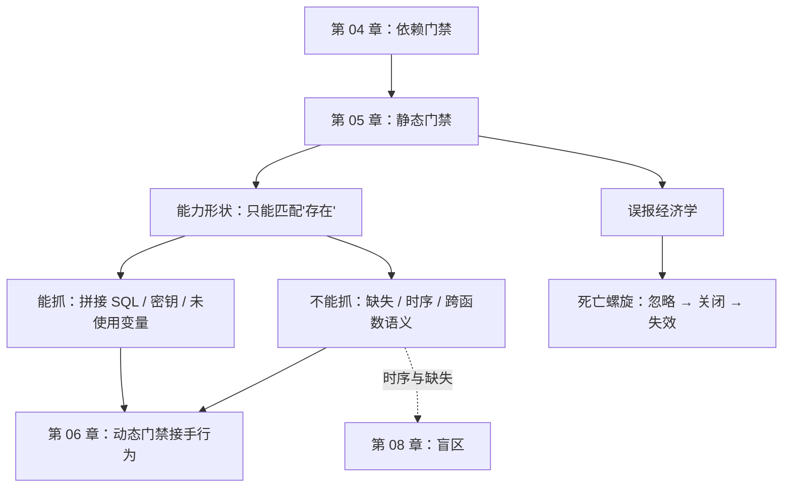

# 第 05 章：第 1 层——静态检查，形状不等于意图

> **本章导读**：静态检查是性价比最高的一道闸，也是最容易被误解的一道。它的能力有一个明确的形状：**能看见"写了什么"，看不见"少了什么"**。这一章把这个形状画清楚，顺便讲清为什么"误报太多于是关掉"是一个必然会发生的事故。
> **前置知识**：第 02 章（commission / omission）、第 04 章（门禁排序）。
> **核心学习目标**：
> - 说出六类静态工具各自的能力边界，不再把它们当成一个"安全检查"按钮
> - 理解 SAST 的模式匹配本质，以及误报率如何杀死一道闸
> - 自己写四类静态检查，并亲手验证它们对 omission 完全无效

## 1. 认知锚点：X 光机能看见什么

### 1.1 一个常见的误解

"我们 CI 里开了类型检查、lint 和 SAST，静态这块应该没问题了。"

这句话把三件不同的事捆在了一起。它们确实都是"不运行代码就能发现问题"的手段，但能力范围差得远：

| 工具 | 它在看什么 | 它能发现 | 它发现不了 |
|---|---|---|---|
| 编译器 | 语法树能否成立 | 语法错误、部分类型错误 | 一切逻辑与安全问题 |
| 类型检查器 | 声明的类型是否自洽 | 类型不匹配、可能为 None | 类型正确但逻辑错误 |
| Linter | 代码风格与可疑模式 | 未使用变量、过宽异常、复杂度 | 语义错误 |
| SAST | 危险代码模式的语法匹配 | 拼接 SQL、硬编码密钥、已知漏洞模式 | 业务逻辑漏洞、并发、越权 |
| SCA | 依赖的已知漏洞库 | 有 CVE 的依赖版本 | 没有 CVE 的（包括零日与幻觉包） |
| 密钥扫描 | 高熵字符串与已知前缀 | 硬编码的令牌、私钥 | 拼出来的密钥、加密后的配置 |

六行里最关键的是 SAST 那一行：**它是模式匹配。** 它不知道你的业务，"危险"的定义是"长得像危险的东西"。

X 光机能看见骨头的形状，看不见这个人想干什么。你拿它排查骨折，它很好用；你拿它判断一个人是不是小偷，它一无是处。

### 1.2 为什么"开了 SAST"不等于"静态这块没问题"

因为 SAST 的覆盖面和它报出来的东西，是两件独立的事。

一个真实的循环：规则集开了 200 条 → 每次提交报 40 条 → 团队审了 10 条，发现 8 条是误报 → 一周后把规则集收窄到 30 条 → 报 3 条，其中 2 条误报 → 三个月后有人在 CI 里加了 `continue-on-error` → 一年后这个 job 还在跑，但没人在看。

**误报不是"吵"，它会杀死这道闸。** 这是本章第二个主题：误报经济学。

## 2. 第一性原理：静态检查的能力形状

### 2.1 它只能看见"文本里存在的东西"

这句话是全部结论的来源。静态分析的输入是源码文本（或它的语法树），输出是"这段文本符合/违反了某条模式"。

于是它的能力边界可以精确描述：

- **能看见**：某个 token 序列出现了。比如 `f"...WHERE code = '{code}'"` 里，SQL 关键字和字符串插值同时出现。
- **看不见**：某个 token 序列**没有**出现。比如"这里应该有 INSERT"，因为没有一个模式能匹配"不存在"。
- **看不见**：两个语句之间的**时序关系**。比如"SELECT 和 UPDATE 之间应该有锁"——这是关于执行的断言，不是关于文本的。
- **看不见**：跨函数的**语义**。比如"这个参数来自用户输入，所以要校验"——除非你把污点分析（taint analysis）做到位，那是 SAST 里最难也最容易误报的部分。

第 2 条就是 commission / omission 的分界线在工具层面的投影：**静态检查天然只能抓 commission。**

### 2.2 误报经济学：一道闸的生死线

设一道闸的规则集有 N 条规则，每条在真实代码上的误报率为 p，团队每天提交 M 次。则每天产生的噪音 ≈ N × p × M。

决定这道闸存活的因素不是 p，而是**团队消化噪音的能力**。当噪音超过这个能力时，会发生三件事，按顺序：

1. **选择性忽略**：看到熟悉的误报就跳过。此时闸还在跑，但已经失效了。
2. **全局关闭**：某个加班夜，有人加了 `|| true`。
3. **反向激励**：新人看到"老同事都跳过"，学会了跳过。

**这就是为什么"误报率高就调低规则"是一条正确的工程决策，而不是偷懒。** 一条从不误报但只覆盖 30% 的规则集，比一条覆盖 90% 但每次报 40 条的规则集更有价值——因为前者真的在被看。

判据可以写成一句话：**一道闸的价值 = 它抓到的真问题数 ÷ 它产生的总告警数。** 低于某个阈值（经验上 1:5），它就会进入死亡螺旋。

## 3. 手把手：自己写四类静态检查，看它们能抓什么

`code/ch05/static_sweep.py` 实现了四类最小静态检查：

- **C1 编译**：能不能立起来。
- **C2 危险模式**：f-string 拼 SQL、`eval`/`exec`、裸 `except`。
- **C3 硬编码密钥**：长随机串赋值。
- **C4 未使用变量/参数**：赋值了没用。

拿它扫两份实现——AI 原版（有五个已知缺陷）和修复版。

### 3.1 输出

```text
已知缺陷：
  D1 幻觉依赖           需要先换成本地桩才可运行，静态检查看不见
  D2 拼接 SQL         f-string 把券码拼进语句
  D3 一人一次未实现        缺失，没有任何文本形态
  D4 读改写非原子         缺失，没有任何文本形态
  D5 凭证可能为 None     行为属性，不在语法里

=== AI 原版（coupon_service.py）===
  C1 编译：无
  C2 危险模式：2 处
      L28 f-string 拼 SQL：f"SELECT quota, used FROM coupons WHERE code = '{code}'"
      L34 f-string 拼 SQL：f"UPDATE coupons SET used = {used + 1} WHERE code = '{code}'
  C3 硬编码密钥：无
  C4 未使用变量：无
  合计命中 2 处 / 已知缺陷 5 个

=== 修复版 （coupon_service_fixed.py）===
  C1 编译：无
  C2 危险模式：无
  C3 硬编码密钥：无
  C4 未使用变量：无
  合计命中 0 处 / 已知缺陷 5 个
```

### 3.2 逐条读这个结果

**C1 编译两版都通过。** 这不是废话——它证明了一个关键事实：**五个缺陷里没有一个是语法层面的。** 如果一份代码编译不过，你根本不需要讨论语义；反过来说，编译通过提供的信息量接近于零。

**C2 抓到了 2 处**，都在原版，都指向同一个缺陷（拼接 SQL）。注意它是怎么抓到的：不是因为它"理解"了注入，而是因为 `JoinedStr` 里出现了 `SELECT` 这个单词。**这是模式匹配的全部机制。**

修复版为什么是 0？不是因为它"更安全"，而是因为参数化查询后，SQL 变成了一个普通字符串常量，f-string 消失了。模式匹配找不到目标。

**C3、C4 两版都是 0。** C4 值得说一句：`user_id` 参数在原版里被用到了（传给 `sign_token`），所以不算未使用。但在"一人一次"这个规格被违反的场景里，`user_id` 实际上是**语义上没被用**——它没有参与任何去重判断。静态检查区分不了"用了"和"用对了"。

### 3.3 这个实验最值钱的一行

```text
合计命中 2 处 / 已知缺陷 5 个
```

**命中率 40%。** 而漏掉的那三个（D3、D4、D5），恰好是这本书后面三章的主角：

- D3 一人一次 → 第 06 章（行为测试）
- D4 非原子 → 第 08 章（盲区）
- D5 凭证为 None → 第 07 章（变异测试能抓到，是因为测试断言了值的类型）

这就是分层的意义：**每一层都有明确的能力边界，你不需要一层全能，你需要知道每层在哪断掉。**

## 4. 常见误区与正反例对比

| 踩坑的误区 | 根因 | 正确做法 |
|---|---|---|
| **"开了 SAST 就安全了"** | 把模式匹配当成语义理解 | 把 SAST 定位成"抓已知形态"，业务逻辑与越权另找手段 |
| **"误报太多，把规则关了"** | 只算"噪音"，没算"这道闸原本能挡什么" | 收窄规则但保留高价值那几条；记录"关掉之后漏了什么" |
| **"类型标注是形式主义"** | 没意识到类型检查是最便宜的行为约束 | 给关键路径补类型；它能在 0.1 秒内挡住一批 None 崩溃 |
| **"lint 过了代码就没问题"** | lint 管风格，不管语义 | lint 当卫生习惯，不当质量判据 |
| **"静态检查能替代测试"** | 混淆"文本里存在"与"运行时发生" | 静态守第一道，测试守第二道，两者对象不同（第 03 章） |

## 5. 本章小结与局部知识图谱

### 5.1 核心要点

- **静态检查只能看见"文本里存在的东西"。** 这决定了它天然只能抓 commission。
- **SAST 是模式匹配。** 它不知道你的业务，"危险"等于"长得像危险"。
- **误报会杀死一道闸。** 判据：抓到真问题数 ÷ 总告警数，低于 1:5 就进入死亡螺旋。
- **实测命中率 40%。** 五个缺陷抓到两个，漏掉的三类正好由后三章接手。
- **"用了"不等于"用对了"。** 静态检查能看出变量被引用，看不出它被用在了正确的判断里。

### 5.2 本章概念拓扑



### 5.3 与前后章的接口

- **接第 04 章**：依赖闸挡住"外来的东西"，静态闸开始检查"你写的东西"，但它只查形状。
- **给第 06 章**：静态漏掉的 D3/D5，需要用行为断言去抓。
- **给第 08 章**：静态在原理上看不见时序，这个缺口在并发场景下变成事故。

## 6. 分级通关练习

### Tier 1 · 直觉与概念核验

**1.** 用一句话说清"静态检查只能抓 commission"的原因。

**2.** 一道 SAST 规则集有 50 条规则，每天产生 20 条告警，其中 3 条是真问题。按本章的判据，这道闸处于什么状态？你会怎么处理？

**3.** 类型检查能发现 `None` 崩溃，但不能发现"这个值逻辑上不该为 None"。这两件事的差别在哪？

### Tier 2 · 推演与实操构建

**4.** 给 `static_sweep.py` 加一条规则：检测"没有设置 timeout 的 HTTP 调用"。写出实现，并说明这条规则的误报会来自哪里。

**5.** 拿你自己的项目跑一遍 `static_sweep.py`（改一下路径），把命中结果分类：真问题 / 误报 / 不确定。算出你的真实命中率。

### Tier 3 · 边界条件与跨章迁移

**6.** 有人提出："既然静态检查只能看模式，那让 LLM 来做代码审查，不就能理解语义了吗？"请分析这个方案的能力边界，并指出它在什么情况下会给出**比 SAST 更危险**的漏报。

**7.** 本章说"误报率会杀死一道闸"。请设计一个机制，让一道闸在被杀死之前**先发出信号**，并说明这个机制本身怎么防"报假警"。

<details>
<summary><strong>点击展开：本章练习参考答案与深度解析</strong></summary>

#### 1. 为什么只能抓 commission

因为静态分析的输入是源码文本，而"缺失"在文本里没有形态。它只能回答"这里有没有某个模式"，不能回答"这里是不是少了某个模式"。

#### 2. 这道闸的状态

告警 20 条/天，真问题 3 条/天，比值约 1:6.7，已经过了 1:5 的阈值——**处于死亡螺旋的入口**。

处理方式不是全关，是**按规则拆分归因**：统计哪几条规则贡献了大部分误报。典型的结论是"50 条规则里 5 条贡献了 80% 的噪音"。把那 5 条降级成周报（不进 CI），保留剩下 45 条。这样噪音降到每天 4 条，比值回到 1:1.3，闸重新变得可读。

#### 3. 类型检查与逻辑判断的差别

类型检查回答"这个值可能是 None 吗"——它是**可能性**判断。逻辑判断回答"这个值在业务上允许是 None 吗"——它是**语义**判断。

例子：`user.email` 的类型是 `str | None`。类型检查器会提醒你处理 None。但如果业务规定"所有已激活用户的 email 必须有值"，这条规则类型系统表达不了，只能靠断言或数据库约束。

#### 4. 检测"没有设置 timeout"的规则

难点在于：这仍然是"缺失"——你没法匹配"没有 timeout"。工程上的做法是**反向匹配**：

```python
if isinstance(node, ast.Call) and node.func.attr in {"get", "post", "request"}:
    kwargs = {k.arg for k in node.keywords}
    if "timeout" not in kwargs:
        hits.append(f"L{node.lineno} 调用未显式设置 timeout")
```

**误报来源**：① 超时在 session 层统一配置了（`session.request` 默认带 timeout），这时代码里不写是对的；② 调用的是你自己的内部函数，不是 HTTP；③ 超时值来自配置常量而非 kwarg。

所以这条规则的真实误报率会很高，正确做法是允许 `# noqa: timeout` 注释豁免，并要求豁免必须写理由。

#### 5. 算你自己的命中率

关键是**诚实地把"不确定"单独一类**。把不确定归到真问题会高估，归到误报会低估。三类分开统计，才知道该收窄还是该扩展。

#### 6. 让 LLM 做代码审查

**能力边界**：LLM 确实能做 SAST 做不到的事——它能读上下文、能理解"这段代码的意图"、能发现"这个判断逻辑和注释矛盾"。这部分是真的。

**但它有一个比 SAST 更危险的失效模式：它会给漏报配上理由。**

SAST 漏报时是沉默的——没报就是没报，你知道自己没有证据。LLM 漏报时往往会附一句"这段代码看起来没有问题"——**这句解释会让你以为已经审过了**。前者的沉默是可察觉的，后者的沉默被包装成了结论。

另外两个具体风险：① 上下文窗口外的东西它看不见，而它不会告诉你"我没看完"；② 它对"看起来正常"的代码有强烈的确认偏差，尤其是 AI 自己写的代码（自我一致性偏好）。

**结论**：LLM 审查适合当"第二双眼睛"，不适合当门禁。它可以提示，不能签字。

#### 7. 让闸在死之前发信号

三个可测指标，任一触发就告警：

1. **告警处理率**：过去 30 天产生的告警里，有多少条被人真实处理（不是跳过）。低于 50% 说明开始被忽略。
2. **规则存活率**：有没有规则被 `# noqa` 全面豁免。一条规则被豁免超过 N 次，说明它不可用。
3. **MTTR 漂移**：从告警产生到被处理的时长中位数，如果在变长，说明优先级在下降。

**怎么防"报假警"**：这三个指标都是"关于闸的闸"，它们自己也会误报。办法是**只在趋势持续两周边界时告警**，而不是单点越线就报——单点波动没有信息量，连续漂移才有。

</details>

---

**下一章**：静态漏掉的东西，得靠"跑"来抓。但"跑过"和"守住"之间，还有一道很多人跨不过去的沟。

---

## 7. 本章权威参考信源与延伸阅读 (Authoritative References)

1. **OWASP ASVS**：[OWASP ASVS](https://www.owasp.org/www-project-application-security-verification-standard/) - 本章的定义与规范以此为锚（核验日期：`2026-10-23`）。
2. **NIST CSRC**：[NIST CSRC](https://csrc.nist.gov/) - 本章的定义与规范以此为锚（核验日期：`2026-10-23`）。
3. **martinfowler.com**：[martinfowler.com](https://martinfowler.com/) - 本章的定义与规范以此为锚（核验日期：`2026-10-23`）。

> 口径提示：以上信源用于锚定**定义与规范**，不用于外推风险概率。引用任何数字前，先核对来源年份与分母。
