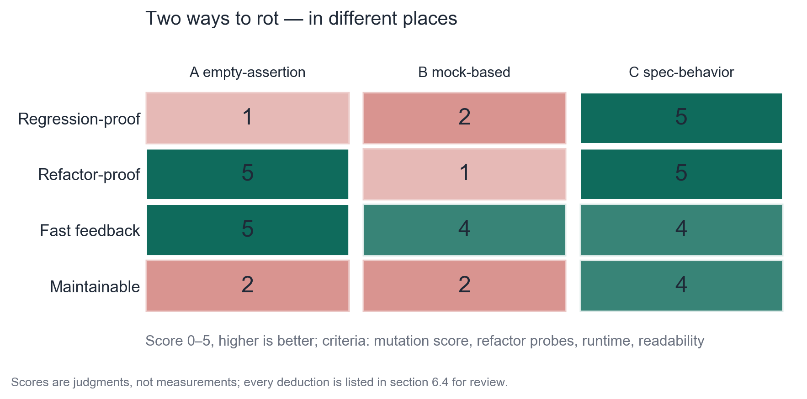
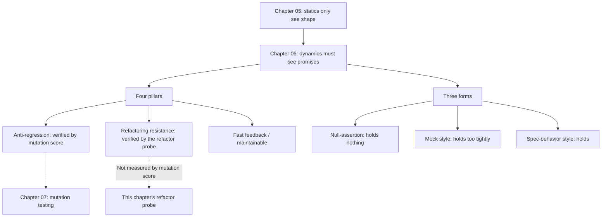

**English** | [中文](./ch06-dynamic.zh.md)

# Chapter 06: Layer 2 — Dynamic Analysis: From "It Ran" to "It Holds"

> **Chapter Guide**: The main battlefield of this chapter is "whether tests are written correctly". You will see two typical kinds of bad tests — one asserts nothing at all, one welds implementation details in place — as well as the real scores of three test suites on four pillars over the same code.
> **Prerequisites**: Chapter 03 (three verification objects), Chapter 05 (the capability boundary of static analysis).
> **Core Learning Objectives**:
> - Score any test suite with the four pillars, and state the reasons for every deduction
> - Distinguish the "null-assertion" and "mock-style" kinds of badness; they are bad in different places
> - Use a harmless refactor to test a test's refactoring resistance

## 1. Cognitive Anchor: The Difference Between a Vaccine and a Health Check

### 1.1 Both Are Called "Checking the Body", but the Logic Is Opposite

A **health check** is "scan your body for disease". It assumes the disease already exists and finds it.

A **vaccine** is "put a fake lesion into your body and see whether the immune system reacts". It assumes you are healthy, then **actively inflicts a small injury** and observes the system's reaction.

When most teams write tests, they use the health-check mindset: run it once and see if anything errors. This is why 100% coverage still cannot stop bugs — **a health check can only find "the disease that already exists"; it cannot find "the disease you don't have yet but will get"**.

The vaccine mindset is the essence of testing: **actively construct a scenario that "should fail", and see whether the system fails. If it does not fail, your defense has a hole.**

This difference decides this chapter's two themes: whether tests **can detect regressions** (regression protection), and whether tests **raise false alarms** (refactoring resistance). The former is the vaccine; the latter is the management of the vaccine's side effects.

### 1.2 A Concrete Confusion

The AI gave you 20 tests, 92% coverage, all green. You vaguely feel something is wrong, but cannot say what.

This chapter gives you two rulers to turn "vaguely felt" into "can point at which item".

## 2. First Principles: Four Pillars and Two Kinds of Badness

### 2.1 The Four Pillars

Vladimir Khorikov, in "Unit Testing", gives four criteria for deciding "does this test deserve to exist":

| Pillar | The question it asks | The failing performance |
|---|---|---|
| **Regression protection** | When the code is broken by a change, will it go red? | Green no matter what changes (null assertion) |
| **Refactoring resistance** | When the code is harmlessly refactored, will it go red? | Red after renaming a variable (bound to implementation) |
| **Fast feedback** | How long does one run take? | One test takes 30 seconds |
| **Maintainability** | Can a newcomer understand what it asserts? | Three layers of mock + one assertion line |

Among the four pillars, **the first two are a pair of opposing forces**: the more you want to "catch everything", the more easily you also weld down implementation details; the more you want to "never go red no matter the change", the more easily you catch nothing at all.

This tension is the core of this chapter. Whether a test is well written is essentially about finding a balance point on this tension — and the criterion for the balance point is: **does it assert the "promise", or the "way it is written"?**

### 2.2 Two Kinds of Badness

Push the tension above to its two extremes, and you get the two most common shapes of AI-generated tests:

**A, the null-assertion style**: only asserts "there is a return value" and "it does not throw".

```python
def test_all_paths_do_not_crash(self):
    conn = _fresh()
    self.assertIsNotNone(redeem(conn, "WELCOME", "u1"))
    self.assertIsNotNone(redeem(conn, "WELCOME", "u2"))
    self.assertIsNotNone(redeem(conn, "WELCOME", "u3"))
    self.assertIsNotNone(redeem(conn, "NOPE", "u1"))
```

It runs through every branch (so coverage is full), but each assertion only proves "the function has a return value". Regression protection ≈ 0.

**B, the mock style**: replaces real dependencies with mocks, asserting "what internal instructions were sent".

```python
def test_update_statement_is_exact(self):
    redeem(self.conn, "WELCOME", "u1")
    last_sql = self.cur.execute.call_args_list[-1][0][0]
    self.assertEqual(last_sql, "UPDATE coupons SET used = 3 WHERE code = 'WELCOME'")
```

It does check a real number (3 = 2+1), so it can catch some defects. But it asserts **the SQL string word for word** — this belongs to "the way it is written", not "the promise". Anyone who extracts this SQL into a constant, changes some whitespace, or switches to a parameterized form will make it red.

**The dividing line between the two kinds of badness**: A's problem is "assertions too weak"; B's problem is "assertions too close". The former cannot hold anything; the latter holds too tightly.

### 2.3 The Third Kind: Written Against the Spec

```python
def test_01_same_user_can_only_redeem_once(self):
    conn = _fresh()
    self.assertTrue(_impl.redeem(conn, "WELCOME", "u1")["ok"])
    second = _impl.redeem(conn, "WELCOME", "u1")
    self.assertFalse(second["ok"], "同一用户第二次核销必须被拒绝")
```

Note what it asserts: **"a second redemption by the same user must be rejected"** — this is a sentence from the spec, not an action from the code. It does not care how you implement it; it only cares whether this promise is kept.

The criterion can be written in one sentence: **read out the assertions in the test; if it sounds like a requirement, it is a good test; if it sounds like an implementation note, it is a bad test.**

## 3. Hands-on: Three Test Suites, One Refactor, One Scorecard

### 3.1 The Three Test Suites

| Suite | File | Shape |
|---|---|---|
| A, null-assertion style | `case_coupon/test_coupon_ai.py` | Only asserts non-null |
| B, mock style | `ch06/test_coupon_mock.py` | Mocks out the database, asserts the raw SQL |
| C, spec-behavior style | `case_coupon/test_coupon_behavior.py` | Asserts sentence by sentence against the spec |

### 3.2 Experiment One: A Harmless Refactor, and Who Goes Red

`code/ch06/refactor_probe.py` does one very small thing: rewrites the implementation into another equivalent version —
rename the variable `row` to `record`, extract two SQL statements into module-level constants, and extract "read stock" into a helper function.

**The behavior does not change by a single word.** Then each of the three suites runs against the implementations before and after the refactor, comparing whether the conclusions flip.

```text
测试套件          重构前       重构后
--------------------------------------------
A 空断言型        绿         绿  结论不变（抗重构通过）
B mock 型      绿         红  结论翻转（被重构影响）
C 规格行为型       红         红  结论不变（抗重构通过）
```

Three things to note when reading this table:

**First, B's red is meaningless.** Extracting SQL into constants and normalizing whitespace is tidying-up any team would do. One such tidying turns the test red; what will the team do next? Change the assertion. Keep changing until it is green again. **Every such edit weakens its binding force.** Three months later it becomes a suite of tests that "drift along with the implementation" — forever green, forever useless.

**Second, A's "pass" is not worth celebrating.** It asserts nothing, so of course it never goes red no matter the change. For a checker that checks nothing, refactoring resistance is of course a perfect score.

**Third, C is red both before and after the refactor**, because the original implementation already violated the spec (those five defects of Chapter 02). Its value is not in "green"; it is in **a stable conclusion** — the refactor did not make it green and did not make it red. This is what refactoring resistance means: **the conclusion does not change with the way it is written.**

### 3.3 Experiment Two: Mutation Score

Chapter 07 will give the complete method; here we borrow the results first. The same original implementation, four mutants:

```text
变异体 说明                                          A 空断言         B mock 型      C 规格
------------------------------------------------------------------------------------------
M1  边界翻转：used >= quota 变成 used > quota          存活（漏）         存活（漏）         杀死（抓到）
M2  算术错误：used + 1 变成 used + 0                   存活（漏）         杀死（抓到）        杀死（抓到）
M3  判定反转：没找到券码却走进 not_found                     杀死（抓到）        杀死（抓到）        杀死（抓到）
M4  返回值退化：token 变成 None                         存活（漏）         存活（漏）         杀死（抓到）
------------------------------------------------------------------------------------------
变异分数                                            1/4 = 25%     2/4 = 50%     4/4 = 100%
```


*Figure 6-1: The two kinds of badness fail in different directions — A is near zero on regression protection but perfect on refactoring resistance; B is near zero on refactoring resistance but holds half on regression protection. Only C stands firm on both.*

### 3.4 Four-Pillar Scoring, With a Reason for Every Cell

The numbers in the figure are not measured; they are **judgments derived from the two experiments above**. The reason for each cell is below, and you can score your own test suite the same way:

| Pillar | A null-assertion | B mock style | C spec-behavior | Criterion |
|---|---|---|---|---|
| **Regression protection** | 1 | 2 | 5 | Look directly at the mutation score: 1/4, 2/4, 4/4 |
| **Refactoring resistance** | 5 | 1 | 5 | Look directly at the refactor probe: did the conclusion flip? |
| **Fast feedback** | 5 | 4 | 4 | Single-run time: A with no mocks is fastest; B/C both need to build a database |
| **Maintainability** | 2 | 2 | 4 | Can a newcomer reading the assertion say "which rule is it protecting"? |

**A's regression protection gets 1, not 0**: M3 was caught by it, because it has at least one `assertTrue(result["ok"])`. This one point shows that "even the worst test may catch one" — but catching one does not mean holding the line.

**B's regression protection gets 2, not 3**: it catches M2 (the number in the SQL changed), but because the assertion welds down the whole SQL string, what it caught is accidental — switch to a parameterized form and it can no longer catch the same defect.

**C's refactoring resistance gets 5**: the conclusion is unchanged after the refactor, and nowhere in its assertions does it mention implementation details.

### 3.5 Three Operations to Learn From This Card

**Operation one: first ask "does this assertion sound like a requirement or like an implementation note".** One sentence filters out most bad tests, faster than running any tool.

**Operation two: do a harmless refactor regularly.** Once every three months, tidy up the implementation (extract functions, change constants, switch to equivalent forms) and see which tests go red. The red batch is the "welded to implementation" batch: either rewrite them, or delete them.

**Operation three: do not chase "one suite to rule them all".** Unit tests manage logic, contract tests manage interfaces, property tests manage boundaries, integration tests manage assembly. Mixing all four together necessarily unbalances some pillar.

## 4. Common Misconceptions, and Correct-vs-Wrong Comparisons

| Misconception to fall into | Root cause | The right practice |
|---|---|---|
| **"90% coverage means the tests are well written"** | Coverage measures "ran", not "held" | Use coverage as a floor; verify assertion strength with mutation score (Chapter 07) |
| **"You need mocks for isolation; that is what unit testing is"** | Treating "isolation" as the goal. Isolation is a means; the goal is verifying promises | Mock boundaries (external services, time, randomness); do not mock your own core logic |
| **"The finer the assertions the better"** | Fine down to the implementation layer becomes "copy the implementation as the expected value" | Stop assertions at the "promise" layer: return values, state changes, outward calls |
| **"When the test goes red, change the assertion"** | This has happened in every team. It turns tests into "drifting along with the implementation" | When red, first ask: is the implementation wrong, or the assertion? Decide first, then change, and record the reason |
| **"The test pyramid: many unit tests, few integration tests"** | The pyramid was born in the era when "unit tests are cheap". After AI-generated code, unit tests got cheaper, but **fake unit tests** also got cheaper | Caring about ratios matters less than caring about "whether each layer asserts promises". The pyramid should become a diamond: few but precise unit tests + thick integration/contract layer |

The last row deserves expansion: AI dropped the cost of writing tests by an order of magnitude, but **what dropped is the cost of "writing", not the cost of "thinking"**. The difference between 20 fake tests and 2 real tests is not the quantity; it is whether, when writing, one thought through "which assertion can actually hold this rule".

## 5. Chapter Summary and Local Knowledge Map

### 5.1 Key Points

- **Tests are vaccines, not health checks.** Actively construct a scenario that "should fail" and see whether the system fails.
- **Among the four pillars, the first two are opposing forces.** Too weak cannot hold; too close holds to death.
- **Two kinds of badness**: null-assertion (regression protection ≈ 0) and mock style (refactoring resistance ≈ 0). They are bad in different places and need different fixes.
- **A harmless refactor is the best refactoring-resistance detector.** Tests whose conclusions flip are testing the way it is written.
- **An assertion that sounds like a requirement is a good test; one that sounds like an implementation note is a bad test.** This criterion is faster than any tool.

### 5.2 Concept Topology of This Chapter



### 5.3 Interfaces to the Previous and Next Chapters

- **From Chapter 05**: D3/D5, which static analysis missed, are covered here with behavior assertions.
- **To Chapter 07**: mutation testing can quantify "regression protection", but it cannot quantify "refactoring resistance" — these two tools are complementary; neither can be missing.
- **To Chapter 08**: no matter how well the tests are written, concurrency and timing remain out of range.

## 6. Tiered Exercises

### Tier 1 · Intuition and Concept Checks

**1.** Using the "vaccine vs health check" analogy, explain why "ran once with no errors" does not constitute a test.

**2.** Among the four pillars, why are "regression protection" and "refactoring resistance" a pair of opposing forces? Give an example that achieves both at once.

**3.** Of the three assertions below, which sounds like a requirement and which like an implementation note?
　(a) `assertEqual(result["reason"], "exhausted")`
　(b) `assertEqual(len(conn.execute.call_args_list), 3)`
　(c) `assertFalse(redeem(conn, "WELCOME", "u1")["ok"])` (on the second redemption)

### Tier 2 · Deduction and Hands-on Construction

**4.** Run `refactor_probe.py`, then add one refactor yourself (say, change `if used >= quota` to `if quota <= used`) and see whether the conclusions of the three suites change. Explain the result.

**5.** Pick a test suite in your own project and run a "harmless refactor" experiment: find a purely tidying change (renaming, extracting a constant), run the tests. Record which went red and why.

### Tier 3 · Boundary Conditions and Cross-Chapter Transfer

**6.** Property-based testing can partially replace hand-written cases. Explain which pillar's weakness it patches, and under what conditions it is **completely ineffective**.

**7.** The criterion "an assertion that sounds like a requirement is a good test" has a hole: some requirements are themselves vague, and turning them into assertions is inevitably vague. Give a handling method, and explain why it cannot solve the problem completely.

<details>
<summary><strong>Click to expand: reference answers and in-depth analysis for this chapter's exercises</strong></summary>

#### 1. Vaccine vs health check

A health check is "scan once to see if there is disease" — running the code once without errors only shows "this time there is no disease". A vaccine is "plant a fake lesion and watch the reaction" — construct a scenario that must fail; if it does not fail, the defense has a hole.

"Ran once with no errors" is not a test, because it has no **expectation**. An execution without expectations can only find crashes, not wrong behavior. The essence of testing is "I expect it to behave like this", not "let me see if it blows up".

#### 2. Why they are opposing forces

Regression protection requires "any change that alters behavior must be caught by me"; refactoring resistance requires "any change that does not alter behavior must not be caught by me". And the line of "what counts as altering behavior" is exactly where the assertion sits. The closer the assertion is to the implementation, the easier it misjudges "a change in the way it is written" as "a change in behavior". So the two naturally pull against each other.

**An example achieving both**: assert "the second redemption returns ok=False" (the promise layer), without checking how many SQL statements it sent internally (the implementation layer). The former is sensitive to behavior changes and immune to writing-style changes.

#### 3. Classifying the three assertions

- **(a)** Sounds like a requirement. It says "when stock is exhausted it should report exhausted", which is spec language. (But note: the exact string of `reason` is part of the interface contract; changing it changes the API, so this assertion is reasonable.)
- **(b)** Sounds like an implementation note. It counts "internally called execute three times"; purely the way it is written.
- **(c)** Sounds like a requirement, but **incompletely stated** — it does not say under what premise "the second time" happens. The good way is to carry the context: `# u1 has already redeemed once`. This is also the boundary of the "sounds like a requirement" criterion: the sentence sounds like a requirement, but if the reader has to guess the context, it still fails.

#### 4. Adding an equivalent refactor

`if used >= quota:` → `if quota <= used:` is a purely equivalent transformation. Expected result: none of the three change. If B changes, it is asserting even the conditional expression (worse); if A changes, it means it cannot run at all.

The value of this experiment is to let you feel that **most refactors should have zero impact**. If your tests are often turned red by refactors, the problem is not in the refactor; it is in the tests.

#### 5. Doing the refactor experiment yourself

Common causes of "red" come in three kinds: ① asserting private methods / internal function names; ② asserting call counts or call order; ③ asserting the complete wording of log texts / exception messages.

The three fixes differ: ① change to asserting public behavior; ② change to asserting "did it happen", not "how many times it happened" (unless the count is itself the promise); ③ assert the key information in the message, not the whole sentence.

#### 6. Which pillar property testing patches

It patches **regression protection**, and patches it heavily. The framework auto-generates large numbers of inputs to find counterexamples. Hand-written cases can never cover boundaries completely; property testing can hit combinations you did not think of.

**When it is completely ineffective**: when "correctness" itself cannot be written as a decidable property. For example "does this copy read naturally" — there is no executable assertion, and property testing has no foothold. Also, if the property definition itself is wrong (say writing "amount ≥ 0" as "amount > 0"), property testing will produce stable false alarms, and because they are auto-generated, the false alarms will pile up faster than you can imagine.

#### 7. The hole in the "assertions like requirements" criterion

The hole: **requirements themselves may be vague**. For example "the system should respond quickly" — you turn it into "response time < 200ms"; that 200ms is a number you picked, not one the requirement gave. Now the assertion looks very "requirement-like", but it is a disguised implementation detail.

Handling method: **explicitly mark vague requirements as "threshold to be decided", and record who set this threshold in what scenario.** That way it is at least traceable, instead of a magic number hidden in the code.

Why it cannot solve things completely: because **the step from "a vague requirement" to "a precise assertion" is essentially a decision, not a translation.** A decision inevitably carries subjectivity; no method can remove it, only make it visible, traceable, and revisable.

</details>

---

**Next chapter**: how do you score "regression protection"? The answer is to deliberately break the code and see whether the tests go red.

---

## 7. Authoritative References and Further Reading for This Chapter (Authoritative References)

1. **OWASP ASVS**: [OWASP ASVS](https://www.owasp.org/www-project-application-security-verification-standard/) - the definitions and norms of this chapter are anchored here (verification date: `2026-10-23`).
2. **OpenTelemetry**: [OpenTelemetry](https://opentelemetry.io/) - the definitions and norms of this chapter are anchored here (verification date: `2026-10-23`).
3. **Python concurrent.futures**: [Python concurrent.futures](https://docs.python.org/3/library/concurrent.futures.html) - the definitions and norms of this chapter are anchored here (verification date: `2026-10-23`).

> Basis note: the sources above are used to anchor **definitions and norms**, not to extrapolate risk probabilities. Before quoting any number, check the source's year and denominator first.
