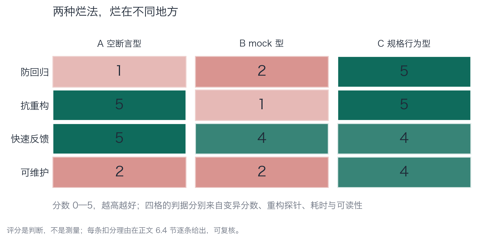
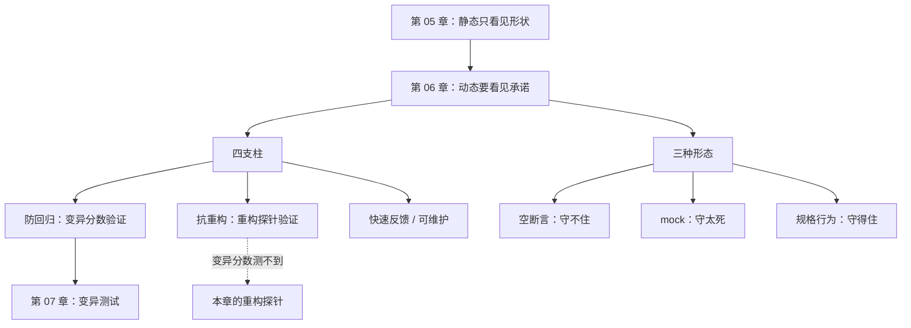

# 第 06 章：第 2 层——动态检查，从"跑过"到"守住"

> **本章导读**：这一章的主战场是"测试写得对不对"。你会看到两种典型的烂测试——一种什么都不断言，一种把实现细节焊死——以及同一份代码上，三种测试套件在四根支柱上的真实得分。
> **前置知识**：第 03 章（三种验证对象）、第 05 章（静态的能力边界）。
> **核心学习目标**：
> - 用四根支柱给任意一套测试打分，并说出扣分理由
> - 分清"空断言型"与"mock 型"两种烂法，它们烂在不同地方
> - 会用一次无害重构来检验测试的抗重构性

## 1. 认知锚点：疫苗与体检的区别

### 1.1 两个都叫"检查身体"，但逻辑相反

**体检**是"扫描你身上有没有病"。它假设病已经存在，找出来。

**疫苗**是"往你身体里放一个假病灶，看免疫系统会不会反应"。它假设你健康，然后**主动制造一次小伤害**，观察系统的反应。

绝大多数团队写测试时，用的是体检的思路：跑一遍，看看有没有报错。这就是为什么覆盖率 100% 却挡不住 bug——**体检只能发现"已经存在的病"，发现不了"你还没得但会得的病"**。

疫苗的思路才是测试的本质：**主动构造一个"应该失败"的场景，看系统会不会失败。如果它没失败，说明你的防线有个洞。**

这个区别决定了本章的两个主题：测试**能不能发现回归**（防回归），以及测试**会不会误报**（抗重构）。前者是疫苗，后者是疫苗的副作用管理。

### 1.2 一个具体的困惑

AI 给了你 20 个测试，覆盖率 92%，全绿。你隐约觉得不对，但说不清哪里不对。

这一章给你两把尺子，让你把"隐约觉得"变成"能指出第几条"。

## 2. 第一性原理：四根支柱与两种烂法

### 2.1 四根支柱

Vladimir Khorikov 在《Unit Testing》里给出四条判据，用来决定"这个测试值不值得存在"：

| 支柱 | 问的问题 | 不合格的表现 |
|---|---|---|
| **防回归** | 代码被改坏时，它会红吗 | 无论怎么改都绿（空断言） |
| **抗重构** | 代码被无害重构时，它会红吗 | 改个变量名就红（绑实现） |
| **快速反馈** | 跑一次要多久 | 一个测试跑 30 秒 |
| **可维护** | 新人能看懂它在断言什么吗 | 三层 mock + 一行断言 |

四根支柱里，**前两根是一对反向的力**：你越想"什么都能抓住"，就越容易把实现细节也抓住；你越想"怎么改都不红"，就越容易什么都抓不住。

这个张力是本章的核心。一个测试写得好不好，本质上是在这个张力上找平衡点——而平衡点的判据是：**它断言的是"承诺"，还是"写法"。**

### 2.2 两种烂法

把上面那个张力推到两个极端，就得到 AI 生成测试最常见的两种形态：

**A 空断言型**：只断言"有返回值""不抛异常"。

```python
def test_all_paths_do_not_crash(self):
    conn = _fresh()
    self.assertIsNotNone(redeem(conn, "WELCOME", "u1"))
    self.assertIsNotNone(redeem(conn, "WELCOME", "u2"))
    self.assertIsNotNone(redeem(conn, "WELCOME", "u3"))
    self.assertIsNotNone(redeem(conn, "NOPE", "u1"))
```

它跑遍了所有分支（所以覆盖率是满的），但每一条断言只证明"函数有返回值"。防回归能力≈0。

**B mock 型**：用 mock 替代真实依赖，断言"内部发了什么指令"。

```python
def test_update_statement_is_exact(self):
    redeem(self.conn, "WELCOME", "u1")
    last_sql = self.cur.execute.call_args_list[-1][0][0]
    self.assertEqual(last_sql, "UPDATE coupons SET used = 3 WHERE code = 'WELCOME'")
```

它确实检查了一个真实的数字（3 = 2+1），所以能抓到一部分缺陷。但它断言的是**SQL 字符串一字不差**——这属于"写法"，不是"承诺"。任何人把这条 SQL 提成常量、改一下空白、换个参数化写法，它都会红。

**两种烂法的分界线**：A 的问题在"断言太弱"，B 的问题在"断言太近"。前者守不住，后者守得太死。

### 2.3 第三种：按规格写

```python
def test_01_same_user_can_only_redeem_once(self):
    conn = _fresh()
    self.assertTrue(_impl.redeem(conn, "WELCOME", "u1")["ok"])
    second = _impl.redeem(conn, "WELCOME", "u1")
    self.assertFalse(second["ok"], "同一用户第二次核销必须被拒绝")
```

注意它断言的东西：**"同一用户第二次核销必须被拒绝"**——这是规格里的一句话，不是代码里的一个动作。它不关心你怎么实现，只关心这个承诺有没有被守住。

判据可以写成一句话：**把测试里的断言读出来，如果它听起来像一句需求，它是好测试；如果它听起来像一句实现说明，它是坏测试。**

## 3. 手把手：三套测试，一次重构，一张评分卡

### 3.1 三套测试

| 套件 | 文件 | 形态 |
|---|---|---|
| A 空断言型 | `case_coupon/test_coupon_ai.py` | 只断言非空 |
| B mock 型 | `ch06/test_coupon_mock.py` | mock 掉数据库，断言 SQL 原文 |
| C 规格行为型 | `case_coupon/test_coupon_behavior.py` | 按规格逐句断言 |

### 3.2 第一个实验：一次无害的重构，看谁红

`code/ch06/refactor_probe.py` 做了一件很小的事：把实现重写成另一个等价版本——
变量 `row` 改名成 `record`、两条 SQL 提成模块级常量、把"读库存"抽成一个辅助函数。

**行为一个字没变。** 然后三套测试各跑一遍重构前后的实现，比较结论有没有翻转。

```text
测试套件          重构前       重构后
--------------------------------------------
A 空断言型        绿         绿  结论不变（抗重构通过）
B mock 型      绿         红  结论翻转（被重构影响）
C 规格行为型       红         红  结论不变（抗重构通过）
```

读这张表要注意三件事：

**第一，B 红得毫无意义。** SQL 提成常量、空白规范化，这是任何团队都会做的整理。一次这样的整理就让测试红，团队接下来会做什么？改断言。改到它重新变绿为止。**每一次这样的修改，都在削弱它的约束力。** 三个月后，它就变成了一套"跟随实现漂移"的测试——永远绿，永远没用。

**第二，A 的"通过"也不值得庆祝。** 它什么都没断言，当然怎么改都不红。一个什么都不检查的检查器，抗重构性当然是满分。

**第三，C 在重构前后都是红的**，因为原实现本来就违反了规格（第 02 章那五个缺陷）。它的价值不在于"绿"，在于**结论稳定**——重构没让它变绿，也没让它变红。这就是抗重构的含义：**结论不随写法变化。**

### 3.3 第二个实验：变异分数

第 07 章会给完整方法，这里先借结果用一下。同一份原实现，四个变异体：

```text
变异体 说明                                          A 空断言         B mock 型      C 规格
------------------------------------------------------------------------------------------
M1  边界翻转：used >= quota 变成 used > quota          存活（漏）         存活（漏）         杀死（抓到）
M2  算术错误：used + 1 变成 used + 0                   存活（漏）         杀死（抓到）        杀死（抓到）
M3  判定反转：没找到券码却走进 not_found                     杀死（抓到）        杀死（抓到）        杀死（抓到）
M4  返回值退化：token 变成 None                         存活（漏）         存活（漏）         杀死（抓到）
------------------------------------------------------------------------------------------
变异分数                                            1/4 = 25%     2/4 = 50%     4/4 = 100%
```


*图 6-1：两种烂法烂在不同方向——A 在防回归上接近零但抗重构满分，B 在抗重构上接近零但防回归有一半。只有 C 两项都站得住。*

### 3.4 四支柱评分，逐格给理由

图里的数字不是测出来的，是**根据前面两个实验推出来的判断**。每一格的理由如下，你可以拿自己的测试套件照着打分：

| 支柱 | A 空断言 | B mock 型 | C 规格行为 | 判据 |
|---|---|---|---|---|
| **防回归** | 1 | 2 | 5 | 直接看变异分数：1/4、2/4、4/4 |
| **抗重构** | 5 | 1 | 5 | 直接看重构探针：结论是否翻转 |
| **快速反馈** | 5 | 4 | 4 | 单次耗时：A 无 mock 最快；B/C 都要建库 |
| **可维护** | 2 | 2 | 4 | 新人读断言能否说出"它在保护哪条规则" |

**A 的防回归给 1 而不是 0**：M3 被它抓到了，因为它至少有一条 `assertTrue(result["ok"])`。这一分说明"再烂的测试也可能抓到一个"——但抓到一个不等于守住了。

**B 的防回归给 2 而不是 3**：它抓到 M2（SQL 里的数字变了），但因为断言绑死了整条 SQL，它抓到的"对"是偶然的——换成参数化写法之后，同样的缺陷它就抓不到了。

**C 的抗重构给 5**：重构后结论不变，且它的断言里没有一处提到实现细节。

### 3.5 从这张卡能学到的三个操作

**操作一：先问"这条断言听起来像需求还是像实现"。** 一句话就能筛掉大半坏测试，比跑任何工具都快。

**操作二：定期做一次无害重构。** 三个月一次，把实现整理一遍（提取函数、改常量、换等价写法），看哪些测试红了。红的那批就是"绑死实现"的那批，要么改写，要么删掉。

**操作三：别追求"一套测试打天下"。** 单元测试管逻辑，契约测试管接口，属性测试管边界，集成测试管装配。四类混在一起写，必然在某一根支柱上失衡。

## 4. 常见误区与正反例对比

| 踩坑的误区 | 根因 | 正确做法 |
|---|---|---|
| **"覆盖率 90% 说明测试写得好"** | 覆盖率度量"跑过"，不度量"守住" | 覆盖率当下限；用变异分数核验断言强度（第 07 章） |
| **"用 mock 才能隔离，才是单元测试"** | 把"隔离"当目的。隔离是手段，目的是验证承诺 | mock 边界（外部服务、时间、随机），不要 mock 自己的核心逻辑 |
| **"断言越细越好"** | 细到实现层就变成"复制一份实现当期望值" | 断言停在"承诺"层：返回值、状态变化、对外发出的调用 |
| **"测试红了就改断言"** | 这句话在所有团队里都发生过。它让测试变成"跟随实现漂移" | 红的时候先问：是实现错了，还是断言错了？判断完再改，改完记录理由 |
| **"测试金字塔：单测要多，集成要少"** | 金字塔诞生于"单测便宜"的时代。AI 生成代码之后，单测更便宜了，但**假单测**也更便宜了 | 关注比例不如关注"每一层是否都在断言承诺"。金字塔应变成菱形：少而准的单测 + 厚的集成/契约 |

最后一行值得展开：AI 让写测试的成本降了一个量级，但**降的是"写"的成本，不是"想"的成本**。20 个假测试和 2 个真测试的差别，不在于数量，在于写的时候有没有想清楚"这条规则用什么断言才守得住"。

## 5. 本章小结与局部知识图谱

### 5.1 核心要点

- **测试是疫苗不是体检。** 主动构造"应该失败"的场景，看系统会不会失败。
- **四根支柱里，前两根是反向的力。** 太弱守不住，太近守得太死。
- **两种烂法**：空断言型（防回归≈0）和 mock 型（抗重构≈0）。它们烂在不同地方，需要不同的修法。
- **一次无害重构是最好的抗重构检测器。** 结论翻转的测试，测的是写法。
- **断言像需求就是好测试，像实现说明就是坏测试。** 这条判据比任何工具都快。

### 5.2 本章概念拓扑



### 5.3 与前后章的接口

- **接第 05 章**：静态漏掉的 D3/D5，这里用行为断言补上。
- **给第 07 章**：变异测试能把"防回归"量化，但它量化不了"抗重构"——这两个工具互补，缺一不可。
- **给第 08 章**：即使测试写得再好，并发与时序仍然在射程之外。

## 6. 分级通关练习

### Tier 1 · 直觉与概念核验

**1.** 用"疫苗 vs 体检"的类比，解释为什么"跑一遍没报错"不构成测试。

**2.** 四支柱里，为什么"防回归"和"抗重构"是一对反向的力？举一个把两者同时做到的例子。

**3.** 下面三条断言，哪条像需求、哪条像实现说明？
　(a) `assertEqual(result["reason"], "exhausted")`
　(b) `assertEqual(len(conn.execute.call_args_list), 3)`
　(c) `assertFalse(redeem(conn, "WELCOME", "u1")["ok"])`（第二次核销时）

### Tier 2 · 推演与实操构建

**4.** 跑 `refactor_probe.py`，然后自己再加一条重构（比如把 `if used >= quota` 改成 `if quota <= used`），看三套测试的结论有没有变化。解释结果。

**5.** 挑你自己项目里的一套测试，做一次"无害重构"实验：找一个纯整理性的改动（重命名、提取常量），跑一遍测试。记录哪些红了，红的原因是什么。

### Tier 3 · 边界条件与跨章迁移

**6.** 属性测试（property-based testing）能部分替代手写用例。请说明它补上了哪个支柱的短板，以及它在什么情况下**完全无效**。

**7.** "断言像需求就是好测试"这条判据有一个漏洞：有些需求本身写得含糊，转成断言必然含糊。请给出一个处理方法，并说明它为什么不能彻底解决问题。

<details>
<summary><strong>点击展开：本章练习参考答案与深度解析</strong></summary>

#### 1. 疫苗 vs 体检

体检是"扫一遍看有没有病"——跑一遍代码没报错，只能说明"这一次没病"。疫苗是"放一个假病灶看反应"——构造一个必然失败的场景，如果它没失败，说明防线有洞。

"跑一遍没报错"不是测试，因为它没有**预期**。没有预期的执行只能发现崩溃，发现不了错误行为。测试的本质是"我预期它会这样"，而不是"我看它会不会炸"。

#### 2. 为什么是反向力

防回归要求"任何改变行为的改动都要被我抓住"；抗重构要求"任何不改变行为的改动都不要被我抓住"。而"什么算改变行为"这条线，正是断言的位置。断言越靠近实现，越容易把"写法变化"误判为"行为变化"。所以两者天然拉扯。

**同时做到的例子**：断言"第二次核销返回 ok=False"（承诺层），而不检查它内部发了几条 SQL（实现层）。前者对行为变化敏感，对写法变化免疫。

#### 3. 三条断言的分类

- **(a)** 像需求。它说的是"库存耗尽时应该报 exhausted"，这是规格里的语言。（但要注意：`reason` 的具体字符串是接口契约的一部分，改它等于改 API，所以这条断言是合理的。）
- **(b)** 像实现说明。它数的是"内部调用了三次 execute"，纯粹的写法。
- **(c)** 像需求，但**表述不完整**——它没说清"第二次"是在什么前提下。好的写法是带上上下文：`# u1 已核销过一次`。这也是"像需求"这条判据的边界：句子像需求，但如果读者要猜上下文，它还是不合格。

#### 4. 加一条等价重构

`if used >= quota:` → `if quota <= used:` 是纯等价变换。预期结果：三套都不变。如果 B 变了，说明它连条件表达式都断言了（更糟）；如果 A 变了，说明它根本跑不起来。

这个实验的价值是让你体会"**大多数重构应该零影响**"。如果你的测试经常被重构打红，问题不在重构，在测试。

#### 5. 自己做重构实验

常见的"红"有三种原因：① 断言了私有方法/内部函数名；② 断言了调用次数或调用顺序；③ 断言了日志文本/异常消息的完整措辞。

三种的修法不同：① 改成断言公开行为；② 改成断言"有没有发生"，不断言"发生几次"（除非次数本身是承诺）；③ 断言消息里的关键信息，不断言整句。

#### 6. 属性测试补哪根支柱

补**防回归**，而且是大幅补强。它由框架自动生成大量输入，找反例。人手写用例永远覆盖不全边界，属性测试能撞上你没想到的组合。

**完全无效的情况**：当"正确性"本身无法被写成可判定的性质时。比如"这段文案读起来自然吗"——没有可执行的断言，属性测试无从下手。另外，如果属性的定义本身错了（比如把"金额 ≥ 0"写成"金额 > 0"），属性测试会稳定地误报，而且因为它是自动生成的，误报会以你想象不到的速度堆起来。

#### 7. "断言像需求"这条判据的漏洞

漏洞在于：**需求可能本身就是含糊的**。比如"系统应该快速响应"——你把它转成"响应时间 < 200ms"，这个 200ms 是你拍的，不是需求给的。这时断言看起来很"像需求"，但它是伪装的实现细节。

处理方法：**把含糊的需求显式标记为"待定阈值"，并记录这个阈值是谁在什么场景下定的。** 这样它至少是可追溯的，而不是一个藏在代码里的魔法数字。

为什么不能彻底解决：因为**从"含糊的需求"到"精确的断言"这一步，本质上是一次决策，不是一次翻译。** 决策必然带主观性，任何方法都消不掉它，只能让它可见、可追溯、可修改。

</details>

---

**下一章**：怎么给"防回归"这件事打分？答案是把代码故意改坏，看测试会不会红。

---

## 7. 本章权威参考信源与延伸阅读 (Authoritative References)

1. **OWASP ASVS**：[OWASP ASVS](https://www.owasp.org/www-project-application-security-verification-standard/) - 本章的定义与规范以此为锚（核验日期：`2026-10-23`）。
2. **OpenTelemetry**：[OpenTelemetry](https://opentelemetry.io/) - 本章的定义与规范以此为锚（核验日期：`2026-10-23`）。
3. **Python concurrent.futures**：[Python concurrent.futures](https://docs.python.org/3/library/concurrent.futures.html) - 本章的定义与规范以此为锚（核验日期：`2026-10-23`）。

> 口径提示：以上信源用于锚定**定义与规范**，不用于外推风险概率。引用任何数字前，先核对来源年份与分母。
